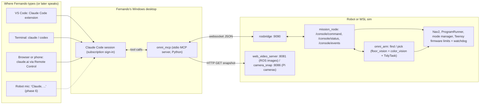

# AI control of the robot: Claude / Codex as the high-level commander

**Status (Nov 5, 2026):** phases 1–4 are implemented in the simulator only and were run end to end on both arm
cameras (stereo with the Python arm, nose D435 with the C++ arm), including open requests ("go to the kitchen and spin
3 times", a tour of every room) worked out by a model through `call.py` (results in the omni_mcp README). Phase 5
(hardware) and phase 6 (voice) haven't been started; physical motion stays behind the build gates (design.md 8). Where
this plan has been executed, its text is unchanged; the departures are:

- **`mcp` 2.x:** `MCPServer` (the renamed `FastMCP`).
- **Connection:** `OMNI_HOST` 127.0.0.1, because Windows resolves `localhost` to ::1 and that path to WSL2 hangs.
- **Shape classes:** retuned on rendered scenes (`color_vision.py`). They now use length over height and a flat top,
  and mark far shapes as guesses.
- **`.mcp.json`:** not checked in. The snippet is in the README.
- **Rooms are not places:** `robot_goto("kitchen")` is refused (`unknown_place`), but the refusal names the room and
  its centre so the model can check a point on the map and send x, y (Nov 5). No room-goto mission was added.

Usage and tests: `ros/tools/omni_mcp/README.md`. The design summary is in design.md 2.1.

**Prepared:** Nov 2, 2026; rewritten Nov 3, 2026 into an execution plan (the Nov 2 draft is in git, commit `ef5761a`).

**Baseline:** the arm robot in [design.md](design.md): ROS 2 Jazzy, SO-101 arm, Teensy base, v11 SIL simulator. The
robot computer is still open; nothing here selects one or runs a language model on the robot.

## 0. Review of the Nov 2 draft, and what changed

The Nov 2 draft got the important things right. The AI stays out of every control loop, it goes through the
console's existing `/console/command` verbs, a successful reply means the task was accepted, not that it finished,
AI-owned motion runs under an expiring lease, and the rollout is staged.

The draft was too abstract to execute. It named no tool set, transport, file list or acceptance tests, and it did not
cover the two requests this plan is built around. This rewrite keeps those rules and changes the following:

| Nov 2 draft | This plan | Why |
| --- | --- | --- |
| A new `omni` CLI over SSH with a forced command; MCP later | **One MCP server on the desktop first**: `omni_mcp`, talking to rosbridge, which the console already runs | Claude Code, its VS Code extension, a session opened from the browser and Codex all discover MCP tools directly. A persistent websocket avoids starting `ros2` or SSH for every call (seconds each). It needs no ROS on Windows. |
| A gateway on the robot | No new robot process: new verbs in `missions.py`, plus `omni_arm` requests | The rule that already exists: features are verbs, not new services |
| Object-specific picking deferred | `find` (colour + shape) and `pick` of one object ID are the core of phase 3 | This is the main request. `floor_vision` already gives geometry, tracked IDs and odom positions; it needs colour and a target. |
| Motion through saved places and Tidy only | Also bounded relative moves (spin, turn, drive) through the existing Program runner | "Spin 5 times" already runs as `program_run` with `[{"do": "spin", "turns": 5}]`. It needs a speed ceiling and an owner, not a new controller. |
| Access path not defined | Claude Code Remote Control for the browser and phone; voice later | No public endpoint is needed |

## 1. The requests this plan is built around

1. **"Claude, make the robot spin 5 times, as fast as you can."** Claude calls one tool. The robot spins 1800° at the
   highest turn rate the AI may use, stops and reports the turn it measured.
2. **"Go get the purple square object."** Claude looks at the scene and asks the robot to find candidates by colour
   (a purple HSV filter) and shape (square footprint). It checks the annotated image and picks the matching object
   by ID. The robot's pick task does the approach, wrist-camera refinement, grasp and drop into the bin. Claude
   reports what actually reached the bin.
3. **Status and correction.** "What is the robot doing? Why did it stop? Cancel that, go back to the dock." Claude reads
   status, faults and events, stops or cancels, and starts a different task.

The robot never depends on Claude for anything faster than a task. Claude's reasoning takes seconds, so it chooses
the next task, never the next wheel or servo command.

## 2. How Fernando reaches the robot



- **VS Code and terminal:** a project-scoped `.mcp.json` at the repo root registers `omni_mcp`. Any Claude Code session
  opened in this repo then has the `robot_*` tools. Codex gets the same server through `~/.codex/config.toml`.
- **Browser or phone:** use Claude Code's **Remote Control** to continue the desktop session from claude.ai or the
  Claude app. The MCP server keeps running on the desktop, so the browser needs no robot access and nothing is
  exposed publicly. VERIFY the current command and setup in the Claude Code documentation before writing the how-to.
- **Not in v1:** a claude.ai custom connector, meaning a remote MCP server reachable from Anthropic's cloud. That needs
  a public HTTPS endpoint with OAuth in front of robot motion. Revisit only if Remote Control is not enough.
- **Model access:** use the existing Claude Code or Codex subscription sign-in. Do not build a separate model client
  or reuse subscription tokens outside those tools. Usage limits and internet access still apply. When the model is
  unavailable, the robot behaves as it does when it loses the AI (section 7).

## 3. Components to build

### 3.1 `omni_mcp` (new, desktop): `ros/tools/omni_mcp/`

A stdio MCP server in Python using the official `mcp` SDK (`FastMCP`). Give it its own venv,
`C:\Users\ferna\.venvs\omni-mcp`: do not install into PlatformIO's Python, and keep the sim venv's dependencies
unchanged. It is ROS-free and talks the rosbridge v2 JSON protocol over one persistent websocket (`websockets` or
`websocket-client`).

```text
ros/tools/omni_mcp/
  README.md            setup, registration (.mcp.json, Codex), environment variables, safety rules
  server.py            the MCP tool definitions (thin: validate, call the client, shape the reply)
  rosbridge.py         one websocket; call_service(/console/command); subscribe /console/status and /console/events
                       (keep the latest status, a ring of the last 200 events); reconnect with backoff
  images.py            snapshot by HTTP from web_video_server (/snapshot?topic=...) or camera_snap (/snap?cam=...),
                       downscaled to <= 640 px, JPEG q70, returned as MCP image content
  lease.py             background thread: renews the AI lease every 1 s while the server runs (section 7)
  test/test_omni_mcp.py  against a fake rosbridge (a local websocket server that scripts replies)
```

Configuration comes from environment variables in `.mcp.json`:
`OMNI_HOST` (default `localhost`; WSL2 forwards localhost), `OMNI_ROSBRIDGE_PORT` (9090), `OMNI_VIDEO_PORT` (8081),
`OMNI_SNAP_PORT` (8086) and `OMNI_AI_SESSION` (generated at start-up when unset). When another session's stack is
running alongside Fernando's, point these at that session's ports (AGENTS.md: separate `ROS_DOMAIN_ID` and ports).

`.mcp.json` (repo root):

```json
{
  "mcpServers": {
    "omni": {
      "command": "C:\\Users\\ferna\\.venvs\\omni-mcp\\Scripts\\python.exe",
      "args": ["ros/tools/omni_mcp/server.py"],
      "env": { "OMNI_HOST": "localhost", "OMNI_ROSBRIDGE_PORT": "9090", "OMNI_VIDEO_PORT": "8081" }
    }
  }
}
```

### 3.2 Robot-side additions (existing packages)

| Where | Change |
| --- | --- |
| `omni_console/missions.py` | New verbs `ai_lease`, `move`, `find`, `pick`, `task`; owner tracking (`page`, `ai`, `voice`, `rc`); `ai.*` settings; a `task` record in the status |
| `omni_console/ai_tasks.py` (new, ROS-free) | Task records: `id`, `request_id`, `kind`, `args`, `owner`, `state` (section 6), `t_accepted`, `t_end`, `result`, `evidence`; dedupe by `request_id`; append to the session log |
| `omni_console/program.py` | `ProgramRunner` accepts a per-run speed and turn-rate override, bounded by the `ai.*` ceilings; it reports the turn it measured (unwrapped odom yaw) at the end of each block |
| `omni_console/mission_node.py` | Pass `/arm/state`'s `found` list and the pick result through to the status; nothing else new |
| `omni_arm/color_vision.py` (new, ROS-free) | Named colours as HSV ranges, mask, per-candidate colour statistics, shape class, an annotated image (section 5) |
| `omni_arm/arm_brain.py` (beside omni_cpp's `arm_driver`, `stack.py`; the Python `arm_node` was deleted Nov 7) | Requests `{"verb": "find", ...}` and `{"verb": "tidy", "only": <id>, "max_objects": 1}`; publishes `/arm/find_image` (sensor_msgs/Image, only after a `find`); adds `found` to `/arm/state` |
| `omni_arm/pick.py` | `TidyTask` target selection (`pick.py:377`, nearest candidate today) honours `only`: choose that tracked object or fail with `not_found` / `lost`. Report `attempted`, `grasped`, `released` and `in_bin` separately |
| `omni_sim/bridge_node.py` | Render the depth camera's RGB on request ("color" in `/arm/camera_request`). Publish it as `/stereo/left/image_color` or, with `arm_camera:=d435`, `/d435/color/image_raw`, with the depth camera's intrinsics and pose so pixels line up with depth |
| `omni_bringup/config/d435.yaml` | Hardware, phase 5: enable the colour stream at a low rate with depth aligned to colour |
| `simulation/v11 sil/arm_objects.py` | New catalogue entry `cube40_purple` and a new set `colours` (section 5). Leave the existing sets unchanged so old results still reproduce |

The `ai_*` and owner logic stays ROS-free in `missions.py`/`ai_tasks.py`, so `ros/src/omni_console/test` covers it
without ROS. `omni_mcp` never touches `/cmd_vel`, `/mcu/*` or `/arm/request` directly; everything goes through
`/console/command`.

## 4. Tool catalogue (MCP)

All tools return JSON text: `{"ok": bool, "message": str, "data": {...}}`, plus image content where noted. Units are
SI, angles are in degrees at the tool boundary (radians inside) and frames are named. Each mutating tool takes an
optional `request_id`; the server generates one when it is missing and returns it, and a retry with the same ID returns
the same task.

| Tool | Arguments | Robot side | Returns |
| --- | --- | --- | --- |
| `robot_status` | none | cached `/console/status` | mode, mission, owner, task, pose (frame, x, y, yaw, localization health), arm state, battery, faults, sim/hardware, status age |
| `robot_events` | `since` (event number, optional) | cached `/console/events` | events since `since` |
| `robot_capabilities` | none | `schema` verb + `ai.*` settings | verbs, limits (AI speed/turn ceilings, firmware profile caps), cameras, places, payload |
| `robot_look` | `camera`: `front` \| `wrist` \| `arducam` \| `d435_color`; `width` (≤ 640) | `/arm/camera_request` + web_video_server snapshot, or camera_snap | **image** + capture time, pose at capture, camera name |
| `robot_places` | none | status / `schema` | saved places on the current map |
| `robot_goto` | `place` or `{x, y, yaw_deg}` (map frame); `timeout_s` (≤ 300) | `goto` verb | task ID |
| `robot_move` | `steps`: Program blocks (`forward`/`back`/`left`/`right` m, `turn` deg, `spin` turns, `wait` s, `repeat`); `speed`: m/s or `"max"`; `turn_rate`: deg/s or `"max"` | new `move` verb → `ProgramRunner` | task ID, the limits actually used, estimated duration |
| `robot_find` | `color`: name or `{h: [lo, hi], s_min, v_min}`; `shape`: `square` \| `round` \| `long` \| `any`; `max_range_m` | new `find` verb → `omni_arm` | candidates `[{id, x, y (odom), size_mm [long, short, height], color: {name, h, s, v, fraction}, shape, score, last_seen_s}]` + **annotated image** |
| `robot_pick` | `object_id`; `timeout_s` (≤ 180) | new `pick` verb → TidyTask with `only` | task ID |
| `robot_task` | `task_id`; `wait_s` (≤ 30) | `task` verb (waits on the status, returns early on a state change) | state, progress, result, evidence |
| `robot_cancel` | `task_id` | `cancel` | final state after controllers acknowledge |
| `robot_stop` | none | `stop` verb | stopped state (always allowed, needs no lease) |
| `robot_say` | `text` (≤ 200 chars), `expression` | `say` verb | ok |
| `robot_arm_pose` | `name` (one of the `ARM_POSES`) | `arm` verb `do=pose` | task ID |

Do not expose these: raw `/cmd_vel`, joint jog, `relax` (torque off), `fire`, `thrower`, calibration, map deletion,
settings writes outside `ai.*`, firmware flashing or shell. Tool descriptions say so, so Claude does not go looking
for workarounds.

Tool descriptions matter: they are Claude's manual. Each one states what it does, its limits, that a reply means
"accepted", and the follow-up call (`robot_task`). In `server.py`, give the server `instructions` text that says to call
`robot_status` first, call `robot_task` until the task reaches a terminal state, never retry a physical action without
checking the task first, and call `robot_stop` when unsure.

## 5. Walkthroughs

### 5.1 "Spin 5 times as fast as possible"

```text
Claude: robot_status()                      -> idle, owner none, arm stowed, healthy
Claude: robot_move(steps=[{"do":"spin","turns":5}], turn_rate="max")
robot:  move verb: lease valid? owner free? arm stowed (/arm/out false)? not on a sloped edge?
        turn_rate "max" -> min(ai.max_turn, firmware profile max_yaw_rate)
        -> PROGRAM mission, owner ai, task t-0007 RUNNING, estimated 10.5 s
Claude: robot_task("t-0007", wait_s=15)     -> SUCCEEDED, measured 1797.6 deg in 10.9 s, max 181 deg/s
Claude: "Done: 5 turns (1798 deg measured) in 10.9 s at 180 deg/s, the AI turn limit."
```

(The numbers are illustrative.) Turn-rate limits that exist today: the Program tab caps `program.turn` at
120 deg/s. The firmware's adult profile caps `max_yaw_rate` at 4.0 rad/s (229 deg/s) and `max_yaw_accel` at
15 rad/s². The kid profile caps them at 2.0 rad/s and 7.5 rad/s² (`fw_params_arm.h`). Proposed: `ai.max_turn` defaults
to 180 deg/s with a range of 20–229, and `ai.max_speed` defaults to 0.5 m/s with a range of 0.1–1.0 in the first
version. The firmware still applies its own profile limits and ramps, and `move` reports the limit it actually
used. Measure the settling time of `ProgramRunner`'s P controller at 180 deg/s in the sim. If the end of the spin
overshoots, add a deceleration ramp sized from `max_yaw_accel`, not a higher gain.

Speed of response: the robot part is one websocket round trip (milliseconds). Most of the time goes to Claude's
reasoning, a few seconds for a request this simple. Do not add a local grammar to bypass Claude in v1. The local
`stop` paths (page, RC, voice) stay as fast as they are now.

Preconditions `move` checks and refuses with a clear message: the arm is out (spinning with the arm extended hits
things; the mode manager already reads `/arm/out`, `mode_manager_node.cpp`); another owner is driving; navigation is not running
while there is translation in an unmapped area (spins in place are allowed); the kid profile is active (it applies
its own ceiling, which `move` reports). Translation goes through Nav2's collision monitor when navigation runs, which
`ProgramRunner` already does.

### 5.2 "Go get the purple square object"

```text
Claude: robot_status()                      -> arm robot, idle, localized
Claude: robot_look("front")                 -> image: several toys on the floor ahead
Claude: robot_find(color="purple", shape="square")
robot:  find verb -> /arm/request {"verb":"find","color":"purple","shape":"square"}
        arm_node: request depth + colour; floor_vision.detect -> candidates (odom, tracked IDs)
                  color_vision.label: each candidate's footprint projected into the colour image ->
                  hue/sat/value statistics, fraction of pixels inside the purple range; shape from the footprint
                  (long/short, height) -> score; annotated image (mask overlay, boxes, IDs, scores)
        -> candidates: id 4 purple square 40x40x40 mm score 0.93; id 6 purple long 60x30 mm score 0.41 (not square);
           id 1 red square score 0.05
Claude: (reads the annotated image; agrees: id 4)
Claude: robot_pick(object_id=4)             -> task t-0008 RUNNING (approach -> hover -> wrist refine -> grasp -> bin)
Claude: robot_task("t-0008", wait_s=30) ... -> SUCCEEDED: grasped, released over the bin, in_bin=true (bin check)
Claude: "The purple cube (id 4) is in the bin. I skipped the purple block: it is 60 x 30 mm, not square."
```

When nothing matches: Claude turns the robot in 45° steps (`robot_move` with `turn`) and calls `robot_find` again,
or goes to a saved place first. When the colour filter is wrong for the lighting, Claude passes explicit HSV values
after looking at the image. The annotated image includes the mask so Claude can see what the filter caught.

**Why colour labels go on the depth detector's candidates.** `floor_vision` already finds small floor objects from
depth, with odom positions, tracked IDs and furniture/rug rejection. Taking the colour of each candidate's
footprint in a registered colour image adds the attribute the user asks for. It needs no second detector that would
have to be projected to 3D on its own. An image-only HSV blob without a depth candidate is reported as
`image_only` with no position, and it cannot be picked. Claude can then move closer and look again.

**Shape classes from the footprint** (`floor_vision`'s long/short sides and height): `square` means long/short
≤ 1.3 and a flat top (height spread small), `round` means a round footprint (PCA ratio ≤ 1.15) and a circular
silhouette in the image, `long` means long/short ≥ 2. Tune these on the sim's `colours` set, then on real objects.
Report the scores and let Claude decide; do not hide near misses.

**Named colours** (HSV, OpenCV scale H 0–179): start with `red` (0–8 ∪ 170–179), `orange` (9–20), `yellow` (21–34),
`green` (35–85), `blue` (86–125), `purple` (126–160), `pink` (161–169, high value), `white`/`black`/`grey` from value
and saturation. These are estimates; tune them on renders and real captures, and record the settings that worked in
the module.

**Sim test scene:** add `"cube40_purple": ("box", (0.04, 0.04, 0.04), (0.55, 0.2, 0.75, 1), 0.035)` to
`arm_objects.CATALOG`, and `SETS["colours"] = ("cube40_purple", "block", "cube30", "cube40", "ball40", "crayon")`.
`block` is already purple (0.55, 0.2, 0.7) and 60 × 30 mm: the same colour but the wrong shape. `cube30` is red:
the right shape but the wrong colour. Launch with the bridge's `objects:=colours`.

### 5.3 Correction

"Why did it stop?" → `robot_status` + `robot_events` (fault text, the controller's reason). "Cancel that and go
back to the dock" → `robot_cancel(task)`, confirm `CANCELLED`, then `robot_goto("dock")`. Claude must not clear faults
that need attended recovery; the gateway does not offer a tool for it.

## 6. Tasks and results

States: `ACCEPTED → RUNNING → SUCCEEDED | FAILED | CANCELLED | TIMED_OUT`, and `INTERRUPTED` after a node restart.
A rejected request never becomes a task: the reply is `ok: false` with an error code.

- One task at a time owns motion: a second motion request while one runs is rejected (`busy`), not queued.
- A task is derived from the console's existing mission (`PROGRAM`, `GOTO`, `TIDY`) and ends when that mission ends.
  `ai_tasks.py` records how it ended; it is not a second mission engine.
- Every task has a deadline (the tool's `timeout_s`, otherwise a per-kind default) and fails `TIMED_OUT` with a
  stop when it passes.
- Evidence: `goto` reports Nav2's result and a fresh pose with its distance to the goal; `move` reports the yaw and
  distance it measured; `pick` reports `attempted / grasped / released / in_bin`. `in_bin` comes from the arm's bin
  check (sim: `/sim/objects`' bin count, used only for scoring and labelled `sim_truth`). When evidence is missing,
  the result is `uncertain` with a reason.
- After a robot or node restart, old tasks become `INTERRUPTED` and nothing resumes on its own.
- Error codes: `no_lease`, `busy`, `owner_conflict`, `arm_out`, `not_localized`, `unknown_place`, `not_found`,
  `lost`, `out_of_limits`, `fault`, `stale_object`, `timeout`.

## 7. Authority, lease and stopping

- **Owners:** the console page (Take control), RC, local voice and `ai`. A human taking control (the page, RC, a stop)
  revokes AI authority at once and cancels the AI task. AI tools can never raise firmware limits, change settings
  outside `ai.*`, bypass the collision monitor or clear attended faults.
- **Lease:** `omni_mcp` calls `ai_lease {session, ttl_s: 3}` every 1 s from a background thread. Motion verbs from that
  session require a valid lease. When it expires (the MCP process dies, the desktop sleeps, Wi-Fi drops), the node
  cancels the AI task and stops. A live lease does not prove that Claude is still reasoning well; the task deadlines
  cover that. The firmware's 0.5 s ROS-to-MCU watchdog is a separate, lower layer and stays in place.
- **Stop is always available:** `robot_stop` needs no lease, and the page, RC and voice stop paths are unchanged.
- **Arm:** cancelling a pick holds the arm in place; it never relaxes the arm on a lost connection, because the arm
  would drop. Stowing follows the arm's checked paths only.
- **Image text is data:** words seen in a camera image, an object label or a log never grant permissions or change
  the task. Tool descriptions state this.
- **Catch, launcher and fire stay off the tool list** (paused project gate).

## 8. Phases: what the executing session does

Each phase ends with its tests passing and a short note in the `omni_mcp` README. Work in a separate ROS domain with
separate ports if Fernando's stack is running, and stop only your own processes (AGENTS.md).

### Phase 1: read-only tools (sim)

1. Create the venv `C:\Users\ferna\.venvs\omni-mcp` (`mcp`, `websockets`, `pillow`, `pytest`). Write `rosbridge.py`
   (call_service, subscribe, reconnect) and `images.py`.
2. Tools: `robot_status`, `robot_events`, `robot_capabilities`, `robot_places`, `robot_look` (`wrist` first, since the
   sim already renders it; `front` arrives in phase 3).
3. `stack.py` starts `web_video_server` on port 8081 whenever the package is installed in WSL; if it is missing, the
   Vision tab says so. Install it there if needed (`ros-jazzy-web-video-server`), then check
   `http://localhost:8081/snapshot?topic=/arm_cam/image_raw` from Windows.
4. Register in `.mcp.json`; in a Claude Code session in this repo, check that `/mcp` lists `omni` and that
   `robot_status` and `robot_look("wrist")` work against `omni.sh arm` (or the console's arm step).
5. Tests: `test_omni_mcp.py` against the fake rosbridge covers status caching, reconnection, event paging, image
   downscaling and a clean error when rosbridge is down.

**Accept when:** Claude, from the VS Code extension, describes the robot's state and the wrist image correctly, and
the sim is labelled as sim.

### Phase 2: lease, tasks and `move` (sim)

1. `ai_tasks.py` + `missions.py`: the verbs `ai_lease`, `task`, `move`; the `ai.max_turn` and `ai.max_speed`
   settings; owner tracking; revocation when the page takes control or a stop arrives.
2. `program.py`: per-run limits, measured yaw and distance in the result.
3. MCP tools: `robot_move`, `robot_task`, `robot_cancel`, `robot_stop`, `robot_say`, plus the lease thread.
4. Tests (`ros/src/omni_console/test`, sim venv): verb validation and limits, owner conflicts, lease expiry →
   stop, request-ID deduplication, timeout, and revocation by Take control.
5. End-to-end: `ros/tools/ai_smoke.py` (new) uses the MCP server's client classes directly, not the model. It spins
   5 turns at `"max"` and checks the unwrapped `/ground_truth/odom` yaw is 1800° ± 3° and the duration is within 15 %
   of the estimate. It kills the MCP process mid-spin and checks the robot stops within the lease TTL plus 0.5 s. It
   sends a duplicate `request_id` and checks there is no second spin. It sends `move` while the page owns the robot
   and checks it is refused.

**Accept when:** "Claude, make the robot spin 5 times as fast as possible" works from VS Code and from the browser
through Remote Control, and the smoke test passes.

### Phase 3: `find`, colour images and `pick` (sim)

1. Sim: the `colours` object set; colour rendering on request in `bridge_node` (both the stereo camera and
   `arm_camera:=d435`), registered to depth.
2. `color_vision.py` with tests that use synthetic images and saved sim renders: purple vs `block` vs red cube, a
   shadow, low saturation.
3. `arm_node`: the `find` request, `/arm/find_image`, `found` in `/arm/state`; `pick.py`: the `only` target and the
   separate success stages.
4. `missions.py`: the `find` and `pick` verbs (pick needs a lease, a stowed arm and a fresh candidate; it returns
   `stale_object` after a map or localization reset, or when the candidate was last seen more than 30 s ago).
5. MCP: `robot_find`, `robot_pick`, `robot_look("front")`.
6. Tests: `python -m pytest -q ros/src/omni_arm/test`; in `simulation/v11 sil`, `python -m pytest -q test_v11.py`
   (catalogue change); `ai_smoke.py --pick purple-square` checks that only `cube40_purple` is in the bin
   (`/sim/objects`).

**Accept when:** "go get the purple square object" works end to end in the sim from a plain-language request, and
when it is given "the purple round one" it reports that there is none rather than picking the block.

### Phase 4: navigation and longer requests (sim)

`robot_goto` with saved places, tasks that combine places, find and pick ("go to the kitchen and bring back the red
ball"), and a recovery drill: a blocked route, a lost lease during navigation, a restart of `mission_node`
(`INTERRUPTED`, no automatic resumption).

### Phase 5: hardware (behind design.md 8)

The D435 colour stream (`d435.yaml`) and camera_snap for the Pi cameras behind `robot_look`. Run the same smoke
tests on the rolling platform at low limits (`ai.max_turn` 60 deg/s, `ai.max_speed` 0.2 m/s), attended, with the
page open to take control. Raise the limits only after the stop and lease tests pass on hardware.

### Phase 6: voice (optional)

`omni_face` already has a local voice path (the `hear` verb). Add a wake phrase, "Claude, ...": the robot publishes
the transcript on a `/ai/request` topic. A desktop relay subscribes to it through rosbridge and runs
`claude -p "<transcript>" --mcp-config .mcp.json --allowedTools "mcp__omni__*"`. The relay reads the answer aloud
through `robot_say`. A local "stop" keeps working without the cloud.

## 9. Decisions left open

- Remote Control vs a claude.ai custom connector for browser access (recommendation: Remote Control; check that it
  covers MCP tools from the desktop session).
- `ai.max_turn` and `ai.max_speed` defaults on hardware; lease TTL (3 s proposed); per-task default deadlines.
- Whether `find` should also return image-only blobs to steer looking around, or only depth-backed candidates
  (recommendation: both, with only depth-backed candidates pickable).
- Colour camera on hardware: D435 colour (available now) vs the later global-shutter colour head.
- Bin verification on hardware (a wrist-camera look into the bin, or a gripper-width check at release).
- Robot computer: unchanged, still open (design.md 4.9).

## 10. Files touched, at a glance

```text
new   .mcp.json
new   ros/tools/omni_mcp/{README.md, server.py, rosbridge.py, images.py, lease.py, test/test_omni_mcp.py}
new   ros/tools/ai_smoke.py
new   ros/src/omni_console/omni_console/ai_tasks.py
new   ros/src/omni_arm/omni_arm/color_vision.py
edit  ros/src/omni_console/omni_console/{missions.py, program.py, mission_node.py}
edit  ros/src/omni_console/test/  (new tests for the ai verbs)
edit  ros/src/omni_arm/omni_arm/{arm_brain.py, pick.py};  ros/src/omni_arm/test/
edit  ros/src/omni_sim/omni_sim/bridge_node.py  (colour on request)
edit  simulation/v11 sil/arm_objects.py  (cube40_purple, SETS["colours"])
edit  ros/src/omni_interfaces/srv/ConsoleCommand.srv  (comment: the new verbs)
later ros/src/omni_bringup/config/d435.yaml, omni_face (voice), the console page (an "AI" owner badge in the status bar)
```

Keep the distinction between proposed, implemented, simulated and physically validated explicit in every README and
status line this work touches.
