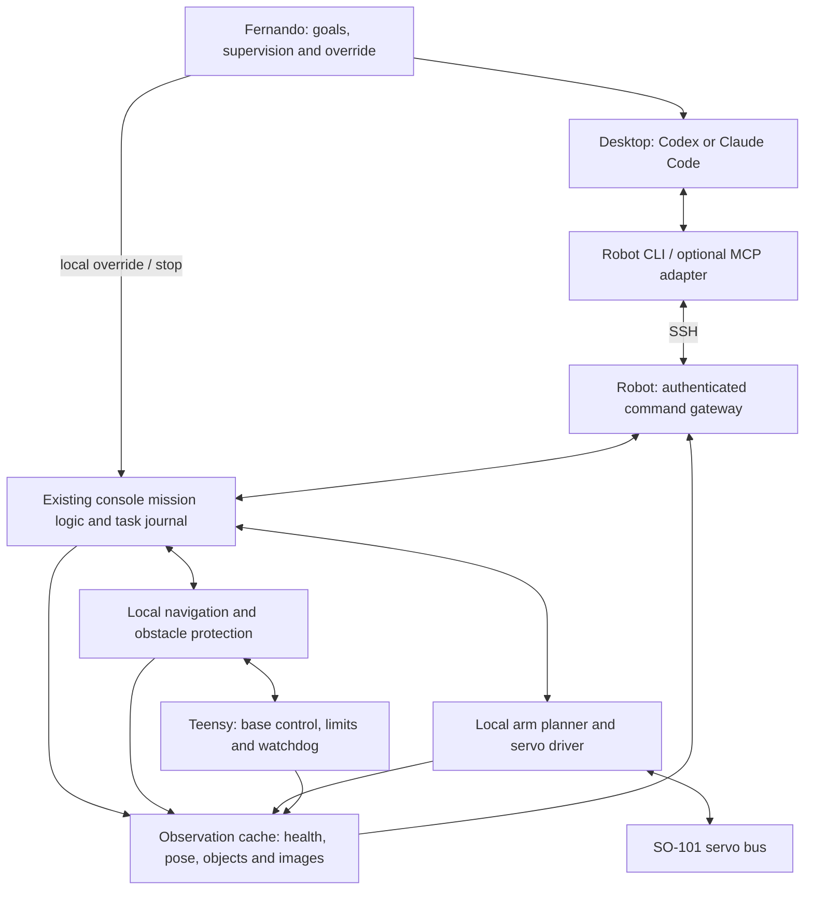

# Proposed AI-controlled robot architecture

**Status:** proposal only; no AI control interface has been implemented by this document.

**Prepared:** November 2, 2026.

**Baseline:** the active arm robot in [design.md](design.md), using ROS 2 Jazzy, the SO-101 arm, Teensy base control and the v11 SIL simulator. This document describes a possible extension; it does not replace the design baseline or select a robot computer.

## 1. Intended experience

Fernando should be able to ask Codex or Claude Code to inspect the robot, understand its current task and surroundings, and command useful actions through terminal tools. For example:

> Look at the floor near the robot. Go to the kitchen, collect up to three suitable toys, and report what actually reached the bin. Stop if localization or obstacle sensing becomes unreliable.

The AI turns that request into bounded robot tasks. The robot performs navigation, trajectory execution, grasp correction and fault handling locally. An AI response can take seconds or longer without disrupting the control loops.

Start with an attended operator session and simple navigation. General household tidying is a later capability that depends on validated perception, picking and object selection.

## 2. Model access without separate API billing

Run the existing Codex or Claude Code client on the desktop, signed in through an eligible subscription. The robot interface is an ordinary local tool the agent can call; building it does not require building a separate model client.

- Codex supports ChatGPT subscription sign-in and a terminal client. Its non-interactive mode, `codex exec`, can reuse saved CLI authentication. See [authentication](https://learn.chatgpt.com/docs/auth) and [non-interactive mode](https://learn.chatgpt.com/docs/non-interactive-mode).
- Claude Code supports subscription sign-in and terminal operation, including `claude -p` for non-interactive runs. See [authentication](https://code.claude.com/docs/en/authentication) and [programmatic execution](https://code.claude.com/docs/en/headless).

Use supported subscription authentication and verify the selected account/billing mode. Subscription allowances, usage limits and internet connectivity still apply. This is not a proposal for unlimited or offline inference, credential extraction, or a custom client that reuses subscription tokens outside the supported tools.

Begin interactively: an agent with terminal access to Fernando's desktop can invoke the robot tools directly. A separate runner for unattended jobs is optional later work. Do not launch a second AI merely to let an existing agent reach the robot.

## 3. Overall architecture



The diagram describes software responsibilities, not a completed physical safety circuit. In particular, the arm's USB servo bus is separate from Teensy base control. The final emergency-stop/power implementation remains an open hardware item in the baseline.

### Desktop responsibilities

- Interpret the user's goal, inspect observations and choose the next task.
- Read selected images when object identity or scene interpretation is needed.
- Submit tasks, monitor progress and explain results or uncertainty.
- Keep a compact record of the user's intent and robot task IDs across reasoning turns.

### Robot responsibilities

- Validate requests against current configuration, health and control ownership.
- Execute each task locally, with deadlines and explicit success/failure conditions.
- Maintain navigation, obstacle protection, arm control and low-level watchdogs.
- Provide fresh, timestamped observations and retain the authoritative task record.
- Apply the locally defined response when the AI, desktop or network disappears.

Do not place the AI in the wheel-speed, servo-position, collision-monitor or emergency-stop loops.

## 4. Reuse the existing mission interface

Use the existing [`/console/command` service](ros/src/omni_interfaces/srv/ConsoleCommand.srv): a verb, JSON arguments and a structured reply. Extend verbs/settings in [`missions.py`](ros/src/omni_console/omni_console/missions.py), following the [console instructions](ros/src/omni_console/AGENTS.md).

The command gateway should adapt this interface and expose observations. It should not become a second mission engine competing with the console. The browser, voice commands and AI should reach the same task ownership and cancellation logic.

Proposed additions include durable task IDs, request deduplication, control sessions, bounded task parameters and explicit completion evidence. Existing navigation actions and Tidy behavior remain the execution mechanisms after their relevant gaps are resolved.

Keep reusable validation and task-state logic ROS-free. Keep robot packages independent of `omni_sim`; simulation provides substitute sensors and actuators at the existing boundaries.

## 5. Proposed terminal and tool interface

**The following command names are illustrative; they are not implemented commands.**

| Command | Purpose |
| --- | --- |
| `omni capabilities --json` | Discover supported tasks, limits, sensors, robot configuration and interface version |
| `omni status --json` | Read mode, active task, pose, health, faults, battery and observation ages |
| `omni observe --camera front` | Obtain a timestamped image and relevant scene/pose metadata |
| `omni places --json` | List saved destinations and their map identity |
| `omni goto kitchen --timeout 90` | Start a bounded navigation task and return its ID |
| `omni tidy --max-objects 3 --timeout 120` | Start a bounded Tidy task in its authorized area |
| `omni task task-123 --json` | Inspect task state, progress and result evidence |
| `omni wait task-123 --timeout 20` | Wait a bounded interval for progress or completion |
| `omni cancel task-123` | Cancel a task through its local controller |
| `omni stop` | Invoke the unified controlled-stop policy for active base and arm motion |
| `omni say "I cannot reach that object"` | Speak through the existing face/voice path |

Every operation should have a versioned JSON form, stable error codes and documented units. Validate arguments as data; do not construct executable shell commands from free-form task descriptions.

The first motion interface should expose saved-place navigation and bounded Tidy. Object-specific grasp commands require stable object IDs and an execution path that the current Tidy interface does not yet provide. Do not advertise them until implemented and validated.

For tool discovery, a later MCP adapter can expose the same operations as named tools such as `robot_status`, `robot_observe`, `robot_goto`, `robot_task` and `robot_stop`. Both [Codex](https://developers.openai.com/codex/mcp) and [Claude Code](https://code.claude.com/docs/en/mcp) support MCP. CLI and MCP must share the same validation, ownership and task logic.

## 6. How the AI knows what the robot is doing

Maintain an observation cache on the robot. Subscribe once and reuse the console's existing status/event paths rather than starting new ROS subscriptions for every shell command. Use the established draining approach for busy inputs and the separate preview path for images.

| Observation | Required information |
| --- | --- |
| Identity | Robot ID, hardware versus simulation, configuration hash, software/interface versions and boot ID |
| Pose | Frame, map ID/revision, position, heading, uncertainty and localization health |
| Motion | Requested/actual motion, active controller, obstacle-protection status and applicable limits |
| Base health | MCU connection, faults, battery voltage, estimated charge and relevant temperatures |
| Arm health | Feedback age, servo errors, joints, gripper state, active motion and arm-out state |
| Objects | Stable ID, measured geometry/position, coordinate frame, uncertainty and last-seen time |
| Images | Capture time, camera/calibration ID, pose at capture, dimensions and availability |
| Task | Task/request IDs, owner, phase, progress, deadline, outcome and supporting evidence |

Expose source timestamps and age at the robot, plus the time the snapshot was assembled. A snapshot combines asynchronous sensors; do not imply that every field was measured simultaneously. Use monotonic time for local deadlines and freshness checks, and preserve the existing event-time/frame conventions for sensor data.

Use SI units and explicit frame names. After map changes, localization resets or reboot, invalidate observations whose coordinates or identity are no longer applicable. The gateway should reject stale scene references instead of executing an action against an old object position.

### Images and semantic understanding

The current floor detector provides geometric candidates, not general household object recognition. An AI may suggest that a candidate is a toy from an image, but that interpretation does not establish its mass, safe grasp or physical identity.

Provide a front RGB snapshot and map overlay on request. The current [D435 configuration](ros/src/omni_bringup/config/d435.yaml) disables colour, so this needs an explicit capture/preview path. A physical wrist camera remains TBD.

The desktop adapter should make returned images accessible to the agent's actual image-reading tool or MCP image result. Printing a filename or URL does not itself give a text-only process visual understanding.

Request selected snapshots at task boundaries or when uncertainty changes. Keep depth processing, tracking and final grasp correction local; do not send every camera frame through a subscription model.

## 7. Task lifecycle and durable results

```text
REQUESTED -> VALIDATING
VALIDATING -> REJECTED
VALIDATING -> ACCEPTED -> RUNNING
RUNNING -> SUCCEEDED
RUNNING -> FAILED
ACCEPTED or RUNNING -> CANCELLING -> CANCELLED
ACCEPTED or RUNNING -> INTERRUPTED after a crash or restart
```

Validation can reject a request before acceptance. An accepted task must eventually reach a terminal result or be explicitly marked interrupted after recovery. Admission policy should make it clear whether work is rejected or queued when another task owns the robot; initially, reject conflicting motion requests.

Key rules:

1. A successful command reply means accepted, not completed.
2. Each mutating request has a unique request ID. A retry with that ID returns the same task; reusing it with different arguments is an error.
3. Journal acceptance before dispatch and record controller/action identity. After an ambiguous crash, reconcile actual robot state; do not blindly repeat a physical action. Request deduplication alone cannot guarantee exactly-once physical execution.
4. Every task carries a deadline, owner, configuration/map identity, relevant observation references and allowed operating bounds.
5. Cancellation is not complete until local controllers acknowledge it or an enforced stop establishes the resulting state.
6. Restarting an AI client should recover task state from the robot. Restarting the robot should not automatically resume stale movement.
7. Store structured command/task events alongside the existing session-log workflow, with appropriate schema/version handling. Include failed and cancelled tasks.

Navigation success should include the controller result and a fresh final pose. Picking results should distinguish attempted, grasped, released and verified-in-bin. When verification is unavailable, return an uncertain result and explain the missing evidence.

## 8. Control authority, leases and stopping

Only one owner should command a given motion resource at a time. Navigation, Tidy, manual controls and external trajectories must not independently write competing goals. A later composite navigate-then-tidy mission can reserve the needed resources through the same ownership mechanism.

Human override and emergency stopping take priority. AI access never grants permission to increase firmware limits, bypass collision checks or clear faults that require attended recovery.

Use an expiring robot-side control lease for AI-owned motion. A desktop companion can maintain its transport/session heartbeat while the agent reasons, but it must stop renewing after the controlling session ends or fails. A running process or open connection alone is not proof that the AI is making progress; task deadlines and a bounded decision-wait policy are still required. The language model should not have to produce a heartbeat on every control tick.

The existing roughly 0.5 s ROS-to-MCU watchdog protects a different link. It will not detect the AI disappearing while ROS continues sending commands. Keep both protections, and define arm-bus health handling separately.

| Condition | Proposed local behavior |
| --- | --- |
| AI is reasoning; valid lease/task remain | Continue only the accepted task within its limits |
| Lease expires or desktop connection is lost | Cancel and perform a controlled stop; use the arm's validated hold/recovery policy |
| Explicitly authorized task may finish offline | Allow only that bounded task, with unchanged deadline and local health checks |
| Localization, obstacle sensing or arm feedback becomes invalid | Apply the relevant controller's stop/failure policy without waiting for AI |
| Task deadline expires | Cancel, establish the stopped state and record timeout |
| Human takes control | Revoke AI authority and cancel or safely transfer the active task |
| Robot/gateway restarts | Reconcile controllers, invalidate old leases and require new motion authority |
| Model quota, authentication or cloud service fails | Report unavailable; apply the same lease/deadline policy as other AI loss |

Define ordinary cancellation, controlled hold, stow and emergency power removal as distinct operations. Do not automatically relax the arm on network loss: it can drop. Do not automatically stow through an unchecked path. Any short recovery action allowed after cancellation must be validated and bounded locally.

## 9. Connection and deployment

Start with SSH between the desktop and robot. Use an account restricted to the command gateway, for example through a forced command, rather than giving the AI control account unrestricted robot shell/device access. Keep subscription credentials on the desktop. Do not expose ROS/DDS, rosbridge or the supervisor's control endpoints publicly to support this feature.

Use separate observation and control permissions. Initially expose no firmware flashing, arbitrary shell execution, raw velocity streams, free-form joint trajectories, launcher/fire commands or unattended torque-off. Catch remains paused under the existing project gate.

The same CLI may be used manually for debugging. A local stdio MCP adapter can invoke it through SSH later; a public hosted MCP service is unnecessary for the first version.

For efficiency, the robot gateway should cache compact state and wait on task events. Bound image sizes, request rates and journal retention. Measure its added CPU and data-age impact under the complete robot workload. This architecture does not require running a large language model on the robot or changing the unresolved computer selection.

Robot-control sessions should use a restricted tool set. Editing or deploying control software belongs in a separate maintenance workflow. Text found in camera images, logs or object labels is observation data and must not change control permissions.

## 10. Existing code and implementation prerequisites

| Existing component | Proposed use |
| --- | --- |
| `ros/src/omni_console/omni_console/missions.py` | Shared command validation, task ownership and mission state |
| `ros/src/omni_console/omni_console/mission_node.py` | ROS services, subscriptions, navigation integration and status |
| `ros/src/omni_console/omni_console/session_log.py` | Existing logging workflow to extend with task evidence |
| `ros/src/omni_arm/omni_arm/arm_node.py` | Local arm command execution and feedback |
| `ros/src/omni_arm/omni_arm/pick.py` | Bounded picking behavior after its required safeguards are established |
| `ros/src/omni_cpp/src/mode_manager_node.cpp` | Base command arbitration; preserve parity with the Python reference |
| `firmware/lib/omni_fw` | Local base control, limits, fault handling and watchdog |
| `ros/src/omni_face` | Speech output and existing local voice commands |
| `simulation/v11 sil` | Repeatable validation through the same robot software boundaries |

Before granting physical AI motion, revalidate and resolve the review's relevant findings: firmware low-battery/motor-fault response; unchecked arm-path fallbacks; arm feedback/error handling and unified stop behavior; obstacle protection for Tidy; missing-camera/state timeouts; robot variant identity; and honest battery/pick reporting. These are prerequisites, not work completed by this architecture proposal.

Voice can remain deterministic initially. Later, general spoken requests can enter the same task interface through an AI conversation. Keep a local stop path available without cloud recognition or model reasoning.

## 11. Rollout and acceptance

1. **Read-only observations:** expose identity, status, faults, tasks and selected images. Verify freshness, frames, image access and sim/hardware labeling.
2. **Attended simulated navigation:** navigate to one saved place, verify arrival and exercise cancellation, blocked routes and conflicting controllers.
3. **Connection/recovery tests:** disconnect the desktop, terminate the agent, expire a lease, exhaust a task deadline, retry a request and restart the gateway/robot. Verify no duplicated action or automatic stale resumption.
4. **Bounded simulated Tidy:** navigate, inspect, pick within explicit limits and report observed outcomes. Exercise missing wrist/depth data, stale objects, failed grasps and invalid arm feedback.
5. **Attended hardware rollout:** follow the existing bench/build gates, real-driver qualification, calibration and low-speed progression. Simulation success does not authorize physical deployment.

The first deliverable should be a short, logged simulation demonstration: the agent inspects the robot and an image, navigates to a named destination, verifies arrival, and correctly handles a deliberate failure or lost connection.

## 12. Decisions left open

- Initial agent/client and subscription entitlements on Fernando's account.
- Exact CLI/tool schema and whether the gateway extends the mission node or runs as a thin companion.
- Measured lease durations, task deadlines, freshness limits and stop behavior for each controller.
- RGB/wrist camera availability, object identity and bin-success verification.
- Real robot computer, driver bring-up and physical stop/power implementation.

Use the repository's normal scoped instructions and relevant tests when implementing. Keep the distinction between proposed, implemented, simulated and physically validated behavior explicit.
