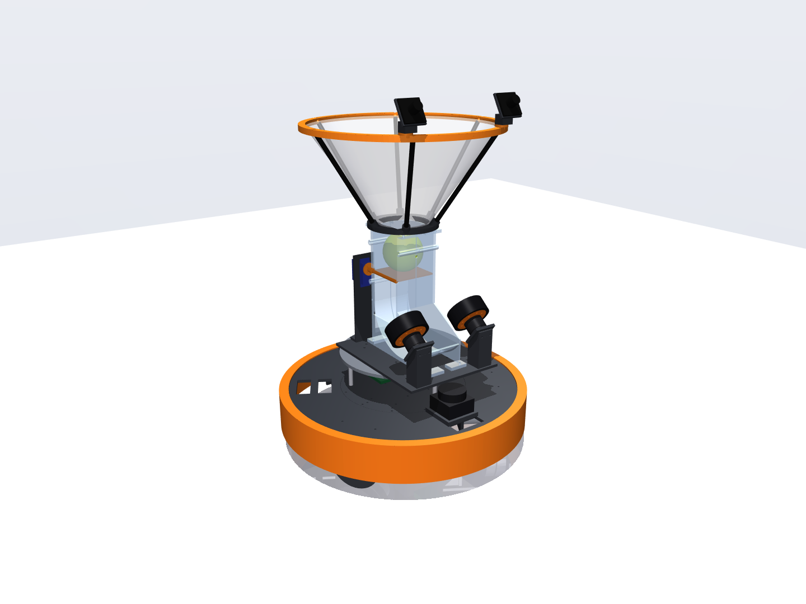
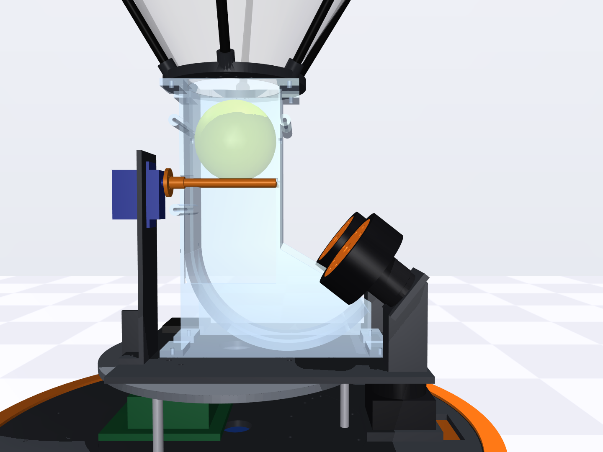
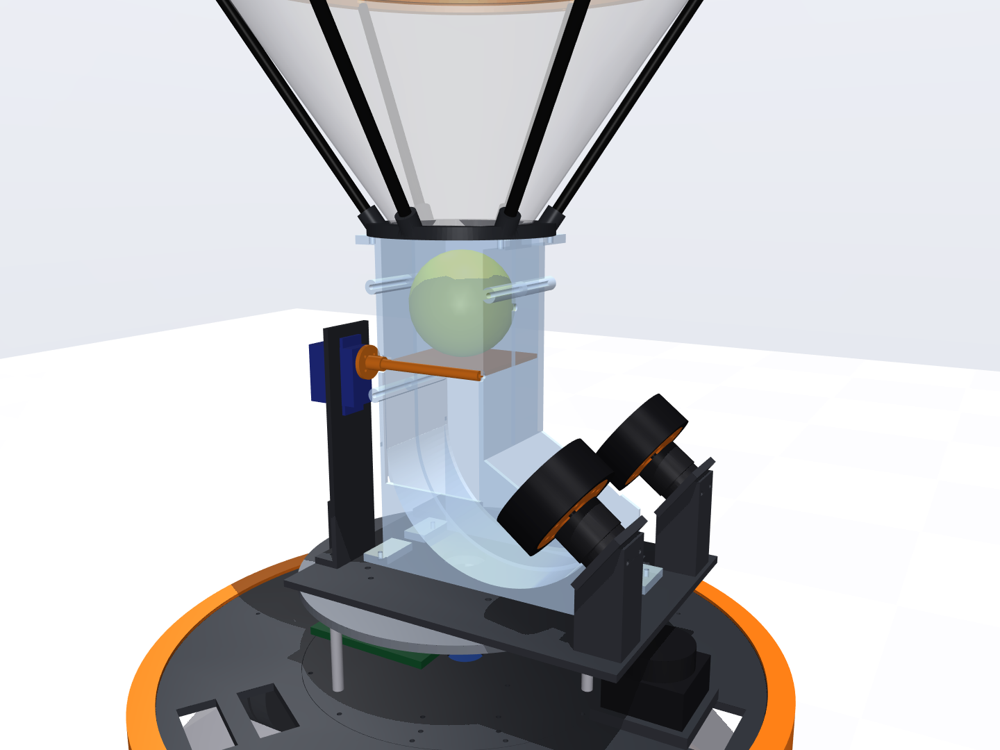

# CAD v1: printable play-catch robot (build123d → STEP / STL)

Parametric parts in Python (build123d). Every printed part exports as STEP for SolidWorks and STL for Bambu Studio. The robot layout comes straight from the v2 simulation (`dims.py` imports its `SimParams` and `geometry()`), so the CAD and the sim cannot drift apart.



|  |  |
| --- | --- |

## Build

```powershell
$py = "$env:USERPROFILE\.venvs\omni-robot-sim\Scripts\python.exe"
& $py build.py      # ~1 min: out/step, out/stl, out/assembly.step, PRINT_LIST.md, parts.json, funnel net pattern
& $py render.py     # out/renders/*.png (MuJoCo renders of the assembly)
```

`build.py` also runs a pairwise interference check on the placed assembly. The current result is 0 clashes; the flywheel hub/tire press fit is excluded on purpose.

## Files

| File | What it is |
| --- | --- |
| `dims.py` | All dimensions, plus the coordinate-frame contracts (ROBOT, PAYLOAD, POD, MOTOR) |
| `base.py` | Wheel pods, wheel adapters, center plate, 6 deck sectors, 6 TPU bumper arcs, battery tray, lidar riser, payload plate |
| `catch.py` | Channel halves (pocket, drop tube, J-bend), launcher base with tilted flywheel-motor plates, trapdoor gate flap, servo tower, flywheel hub and tire, funnel collar, 4 rim arcs, camera brackets, funnel net pattern |
| `vendor.py`, `vendor/` | Purchased parts: the official CubeMars AK40-10 V3.0 STEP and 2D drawing, plus simple envelopes for the rest |
| `out/step/` | One STEP per printed part, in its contract frame, for SolidWorks wrapper parts |
| `out/stl/` | Print-ready STLs (part sitting on the origin) |
| `out/assembly.step` | Everything placed in the ROBOT frame, purchased parts included |
| `out/PRINT_LIST.md` | Material, infill, orientation, size and estimated mass for each part; all fit a 256 mm bed |
| `out/funnel_net_pattern.svg` | 1:1 sewing pattern for the conical net (annular sector, R 308 / 63 mm, 210.5° + 4° seam overlap, 10 mm hems) |

## Design in one page

**Base.** The base is three identical wheel pods. Each pod is one PETG print: the motor bulkhead the AK40-10 bolts to through its rear 4× M2.5 on Ø47, a top flange, and an outer wheel guard. The pods bolt under a Ø240 center plate. Six 60° deck sectors half-lap under the plate's rabbet to make the 450 mm deck. Six TPU bumper arcs clip over the deck edge, offset 30° so each one bridges a sector joint, and hang a skirt to 45 mm above the floor.

Each wheel bolts to a printed adapter: 3× M2.5 into the motor output (Ø27 PCD), 3× M4 through the goBILDA wheel's 32 mm pattern into captive nuts, with a Ø14 spigot in the wheel bore. The battery hangs under the plate in a strapped tray; the MCU and power boards sit beside it. The Jetson and lidar live in the 65 mm layer under the payload plate.

**Payload interface** (the doc's first frame contract). It is a Ø240 plate on three 65 mm M4 standoffs, with:

- a 25 mm grid of M4 heat-set inserts,
- two asymmetric Ø4 dowels, so a module fits only one way,
- four grid inserts that take the module's captive M4 thumbscrews,
- a Ø28 connector hole at the center.

**Catch module.**

- The funnel is a fabric net laced to a printed collar at the throat and a 4-piece printed rim. Six Ø8 carbon struts hold it, and the two stereo cameras bolt to pads on the front rim arcs (baseline 190 mm, tilted 30° up).
- Below the throat, the ball lands in a vertical pocket on an EVA-padded trapdoor. The trapdoor is hinged on a Ø3 pin and driven directly by a 25 kg·cm servo on the hinge axis behind the pocket. An IR break-beam crosses the held ball.
- When the trapdoor opens (95°, flush into a window in the side wall), the ball drops through the J-bend and rolls up into the nip of two Ø70 left/right flywheels on tilted axes, launching at 52°.
- The channel is printed as two halves split on the centerline, each lying on its outer wall, so the ball-path surfaces print smooth without supports.
- The flywheel motors sit on 38°-overhang pedestals that are part of the launcher base.

## Fasteners and small parts (approximate counts)

| Item | Qty | Use |
| --- | --- | --- |
| M3 heat-set inserts (M3 × 4 × 5.7) | ~50 | pods, sectors, channel halves, rim joints, camera pads, tower |
| M4 heat-set inserts (M4 × 6 × 5.6) | ~40 | payload grid |
| M2.5 × 6 SHCS | 9 | wheel adapters → motor outputs |
| M2.5 × 10 SHCS | 12 | motors → pod bulkheads |
| M4 × 25 + nylock | 9 | wheels → adapters |
| M4 × 30 + nut | 16 | flywheel inertia rings (8 per wheel) |
| M5 nylock | 2 | flywheels on the motor shafts |
| M4 captive thumbscrews | 4 | catch module → payload plate |
| Ø4 × 12 dowel pins | 2 | payload locating pins |
| M4 F-F hex standoffs, 65 mm | 3 | deck → payload plate |
| Ø3 × 85 mm steel rod | 1 | trapdoor hinge pin |
| Ø8 × 6 mm carbon tube, 200 mm | 6 | funnel struts (cut to ~198 mm) |
| 3 mm EVA foam | 90 × 90 mm | trapdoor pad |
| Polyester mesh fabric | ~0.6 × 0.35 m | funnel net |
| IR break-beam pair, 5 mm (e.g. Adafruit 5 mm IR break beam) | 1 | catch confirmation |

## Before printing: VERIFY items

Search the code for `VERIFY`. The main ones are:

- goBILDA wheel width and 32 mm-pattern hole phase.
- Whether the AK40-10 output's Ø15 feature is a recess (assumed) or a boss.
- The drone motor's mount pattern (19 × 19 assumed) and bell-top recess.
- The servo's tab hole spacing and horn pattern.
- The Jetson carrier and RPLIDAR C1 hole patterns.
- The OV9782 board hole pattern.

Print one wheel pod with an adapter, and one flywheel hub with its tire, before batch-printing the rest.

## SolidWorks

`out/step/*.step` are modeled in their contract frames (`dims.py`), so they drop straight into the doc's wrapper-part workflow. `out/assembly.step` is a reference assembly, not a mated one.
