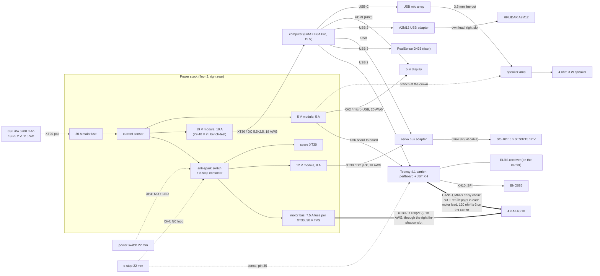

# cad/v13: the D435 on the arm riser (Nov 5 2026, PROPOSAL)

A copy of cad/v12 round 15's generating scripts with one change: the arm robot's RealSense D435
moves from the nose to the front of the arm riser. Everything else is round 15 (`../v12/README.md` has the robot and its history). STEP first;
**the SolidWorks viewing assembly of the whole robot was rebuilt here on Nov 9 (Fernando), see "The SolidWorks assembly"**, and **this folder
reads no file from any other version's folder** (see "Files this version reads"). Status:
**the camera position is baselined (Fernando, Nov 5)** in design.md 4.11 and the sim (`robot_export.ARM` / `ARM_D435`, `D435_RISER`; the
nose kept as `ARM_D435_NOSE`); the CAD itself is nominal, nothing printed.

## The brief and the answer

The sim study (`simulation/v11 sil/studies/results/height_map_2026-11-05.md` sections 4-5) proposed the D435 on its side (portrait) on the
riser front, body centre (200, 0, 200) mm, 25-30 deg down. Priorities: 1 clear of the arm (>= 5 mm, every pose and move), 2 no lidar blind
angle, 3 nothing in the field of view, 4 inside the bumper, 5 a notch that cuts no fin / boss / dovetail, 6 a real USB-C plug and lead.

**Portrait does not fit, anywhere** (`validation/d435/scan.json`: body centre x 170..235, z 180..235, 25 / 30 / 35 deg). The 90 mm body
standing 30 deg off vertical spans 90 mm in z; the lidar wants its bottom >= 166 and the SO-101 wants its top under its base (222) or ahead
of the arm's shoulder, where the 0.26 m floor grasps sweep down past the riser. The sim's pose: 3.4 mm *into* the arm (stow <-> high), its
lowest corner 8.2 mm below the scan plane, 8.5 mm past the bumper. Every portrait pose that clears the arm reaches at least 18 mm below
the scan plane.

**Landscape at the sim's higher height (z 0.215) does not fit either**: its top meets the SO-101's base (7.3 mm into it). Forward of
x ~ 199 the floor grasps hit it at any height.

**What fits: landscape, low, in a pocket in the riser's front under the adapter**, its lower edge down through a notch in the floor's front
edge. Arm clearance there is set by the SO-101's fixed base above the camera, not by any move.

### Candidates (landscape, body centre z 193, tilt 30 deg; 25 deg in brackets)

Robot frame: x forward from the centre, z up from the floor, mm. Arm: the camera box (90 x 25 x 25) against the swept arm cloud.
Nearest floor: the depth image's nearest floor point, ray-cast against the chassis, pods at bump and the notched floor.

| Lens | Body centre (x, y, z) | Arm (worst) | Lowest point (scan 163) | Bumper (r 225.15) | Notch | Nearest floor |
| --- | --- | --- | --- | --- | --- | --- |
| at the floor's edge (218) | (210.8, 0, 193) | **-4.3** (ready -> hover, 0.26 m grasp) | 175.9 | 7.1 mm out | 1,180 mm2, x 203.6.. | 0.33 m (0.36) |
| 1 cm back | (200.8, 0, 193) | **3.8** (same move) | 175.9 | inside | 2,100 mm2, x 193.6.. | 0.32 m (0.35) |
| **2 cm back (recommended)** | **(190.8, 0, 193)** | **11.9** (SO-101 base) | 175.9 | inside | 3,050 mm2, x 183.4.. | **0.31 m (0.34)** |
| 3 cm back | (180.8, 0, 193) | 11.9 (SO-101 base) | 175.9 | inside | 4,010 mm2, x 173.6.., to y +54.8 (under the riser's left wall) | 0.30 m (0.33) |

(Notch: the floor area cut, from that x to the edge over y +-46; the lowest point is the camera box's, 0.6 mm under the floor's underside
for every landscape candidate; Intel's model reaches 178.1.)
| sim portrait (reference) | (200, 0, 200), roll 90 | -3.4 (stow -> high) | 154.8 (below) | 8.5 mm out | | 0.27 m |
| sim landscape z 0.215 (reference) | (200, 0, 215) | -7.3 (SO-101 base) | 197.9 | inside | none | 0.33 m |

No candidate puts any robot part in the depth field (0 % of the image), and none adds lidar blind angle (all >= 12.9 mm above the scan
plane). With the notch the floor's edge costs nothing (the same nearest floor as with no floor at all); without it the edge would sit in
the bottom of the image. 2 cm back is the most forward pose with a real margin to the 0.26 m grasps; 3 cm sees 1 cm nearer but takes a
third more floor, and its RGB field needs the notch under the riser's left wall.

## The recommended mount (drawn)

`tools/d435_riser.py` (`POSE = CANDIDATES['back_2cm_t30']`), built into the robot by `upper.py`:

- **Camera:** Intel's model, body centre (190.8, 0, 193.0), 30 deg down, landscape. Depth lens (left imager) at (198.0, 17.5, 188.8).
- **Cradle `bracket_d435_riser`** (printed, 16.1 cm3, prints on its feet without supports): a 4 mm back plate (the camera's two rear
  M3 x 8 from behind, on the bench) and an ear behind each end of it, standing on the riser's foot plate. One M3 x 12 through each riser
  side wall from outside into a hex nut dropped into a slot in the ear. To take the camera out: unplug it, the two side screws out, slide the
  cradle forward out of the pocket (the notch is open at the front). The camera then belongs to the arm module (riser, adapter, SO-101, buck,
  bus board).
- **Riser** (`riser_arm`): the extension's front opened between the side walls (y +-46) from x 153 (front wall, centre wall's front, and the
  foot plate where the camera dips below it, x > 177); the side screws' holes; a slot for the plug in the right wall. The side walls stay
  full height to the front and carry the adapter's front corners over the camera (the adapter spans 92 mm between them there). Its two floor
  screws moved (188, +-30) -> (158, +-30), out of the notch.
- **Floor notch** (`floor2_FL`, `floor2_FR`): from x 183.4 to the edge, y -46..+46 under the riser's walls, widening to +49.6 at the edge
  for the RGB field; sized from both fields at 30 and 25 deg (2 mm clear) and the body (1 mm). Removes 3,050 mm2 of plate (21.5 cm3 with the
  rim lip). It cuts no fin, fin screw, boss or dovetail; the front seam's dovetail tab at x 190 moved to 120 and its two lip screws (172,
  205) became one at 167 (the lip runs only between the lidar's keep-out and the notch).
- **USB-C:** a straight plug (12.4 x 6.5 x 21, as the bench cable) out of the camera's -y end through the riser's right wall, the lead
  (Ø4.5, VERIFY) bending sharply back 4 mm past the plug, then back along the riser's right side under the SO-101 base's right edge to the
  riser's rear (x 62); on to the computer is not drawn. No L plug needed here.
- **Nose:** `chassis.NOSE_D435 = False`: no nose cradle, camera, plug or field envelopes, nor the cradle's two pilots in `node_front`. The
  node keeps its round-15 outline, so nothing else in the chassis moves.

### Checks (`validation/`; omni-robot-sim venv, from `tools/`)

| Check | Result |
| --- | --- |
| `upper.py check` | no part overlaps, also against the chassis; no screw short of 6 mm; hole audit: nothing new (the face crown's two screws and the mic board's vendor holes as round 13); battery slides out |
| arm (`d435_riser.check_mount`, the swept cloud: 8,141 configurations, every pose and move in the brief; 9 of 50 grasp targets have no IK at 0.33-0.36 m, one move has no planned path) | camera 13.3 mm, cradle 11.0, plug and lead 17.8, each from the SO-101's fixed base; every moving part is further |
| `arm_sweep.py` (official meshes, 33 planned moves) | >= 12.2 mm from everything (the gripper to the bumper at the 0.26 m grasp); none near the D435 |
| lidar | mount's lowest point z 178.1 (camera), 15.1 mm over the scan plane: blind angle unchanged, 20.9 deg (`chassis.py check`) |
| fields of view (500 mm frustums; depth 89 x 58, RGB 69 x 42; arm at stow, front pods at bump) | nothing of the robot in either |
| view (ray cast) | nearest floor 0.31 m ahead at 30 deg (0.34 at 25); nose today 0.34, sim portrait 0.27 |
| bumper | camera r <= 209.4, plug and lead <= 199.9: inside 225.15 |
| static gaps | camera to the riser 0.9 mm, to the floor's notch 1.2, to the adapter 3.2, to the front fins 6.5; plug to its wall slot 0.6 |
| `chassis.py check` | no overlaps, nothing thinner than 4 mm, every fastener lands, every part fits the bed, lidar blind 20.9 deg |

Renders: `validation/d435/side_stow.png`, `side_grasp_0.26.png` (from the right), `top_notch.png`, `iso_front.png`. STEPs:
`step_export/` (printed parts only, as v12) and `step_export/d435_mount_review.step` (the printed parts round the mount **plus the D435's
model and its plug + lead**, for review; drop it if only printed parts are wanted).

### In the sim (baselined Nov 5)

`robot_export.ARM` (and so `ARM_D435`) carries **body centre (0.1908, 0, 0.1930) m, 30 deg down, roll 0 (landscape)**, depth origin
(0.1980, 0.0175, 0.1888) m, and cuts the sim's riser block back 10 mm for it (`arm_riser_pocket`); the generated `robot_arm*.json` and
frames follow. Alternative 25 deg down: centre (0.1905, 0, 0.1930). Rerun there (Nov 6; design.md 4.11):

- `studies/d435_mount.py` (`riser_cad`): close look 25/40 at 30 deg, 35/40 at 35; floor valid 63/46 % at 1.5/2 m; no tags; no table
  or chair overhang at 25-35 deg (`--overhang`, `d435_mount_riser_cad_overhang.json`).
- `studies/d435_mount_pick.py` (`riser_cad`, `riser_cad35`; 6 toys, 4 seeds): 18/24 binned at 30 deg, 20/24 at 35 (nose 22/24),
  no failed grasps.
- `studies/arm_calib.py --out arm_calib_riser.json`: keyed block p95 0.27 mm, gripped 0.95 mm, as at the nose.

Expect against the portrait proposal: lower (z 0.193 instead of 0.200, lens 0.189 instead of 0.211), so less far floor; a 58 deg tall
field, so the 0.27 m blind zone becomes ~0.31 m; at 30 deg the field's top is 1 deg below the horizon, so no table or chair overhang (the
sim's landscape 30 deg saw neither table; portrait's top was 15 deg above); the arm's close look and the floor grasps will look different again. Tilt was not re-chosen: 30 deg was the brief's;
the notch is sized for 25 and 30 (35 would need 0.4 mm more on the left).

### Open / VERIFY

- The camera's two rear M3 (45 apart, thread depth) and the USB port's end: from the vendor model (`-y` end, VERIFY on the unit).
- The plug and lead envelopes (straight plug 21 mm, lead Ø4.5): VERIFY on the cable bought; the lead's tightest bend is modelled sharp.
- The adapter now spans the camera's pocket: 92 mm between the riser's side walls, with no centre wall or front wall under its front 52 mm
  (x 153..205; the SO-101's front M4s at x 195.5 thread into the adapter alone, as before). No strength check. The camera rides with the arm
  module.
- The camera's static gaps (0.9 mm to the riser, 1.2 to the notch) are nominal: print tolerance may want 0.5 mm more each side.
- Lens positions in the field envelopes are assumed (17.5 / 32.5 mm left of the centre), as round 15.
- The SolidWorks files follow the STEPs only when their stages are re-run (section below): after any geometry change regenerate the STEPs and rebuild
  the changed parts and every assembly above them. The Nov 9 build is of the geometry in this README **except one change made later that day (Fernando):**
  the outer fork half (`pod_fork_outer`, `_m`) has a **trough for the outer 627**: the bearing slides into its seat along its axis from the arm's inner face, and the
  bar's top (the z -10 flat under the keel) clipped its Ø22 circle. `pod_lean.build_fork` now cuts a Ø23 trough (`BRG_PATH_CLEAR` 0.5) from the arm's face to 10 mm
  past the bearing's exposed face (`BRG_PATH_LEN`, x -41.5..-31.6, short of the ramp at -26.5), open at the top so the bearing is set in from above and pushed home.
  A first try ran the whole bar (10.0 cm3 removed) and was too deep (Fernando); this one removes 113 mm3 (69.60 cm3 left), still one valid solid, nothing in the
  bearing's slide path, resting position or drop-in column, overhang as printed 78.6 -> 83.9 mm2 (the trough ends in a small step), `pod_lean.py check` clean in all
  three poses. The STEPs and `step_export/pod_lean` were regenerated, and **only the two SLDPRTs were re-imported** (`sw_robot.py import`:
  `V13_pod_fork_outer`, `_m`, one solid each, 69,594 / 69,603 mm3; Fernando's saved R1.5 fillet on the `_m` part was
  dropped at his request). The sub-assemblies (`unsprung`, `pod`, both hands) and `V13_robot` were **not** rebuilt or re-saved: they open with SolidWorks' load
  warning 33 (IdMismatch + NeedsRegen, expected for a replaced component), no mate errors, and show the new part; re-saving them clears the warning. No mate
  references the outer fork's faces. The upper robot's STEP assembly (`robot_step.py`) and the SolidWorks interference run are also not redone.

## Wheel hub: collar in the channel between the spoke rows (Nov 10, Fernando)

The hub prints cartridge end down (+x up). Row 2's spokes start at x +3, 6 mm above row 1's (x -3), and where the two rows overlap in plan, near
the drum (r 34..40), the slicer put short supports (3-7 mm tall, about 1,470 mm2) in that 6 mm channel between the rows. Spokes surround them
there, so pliers could not reach them. **`wheel_motor.build_hub` now revolves a 45 deg collar round the drum** (`dims.CHANNEL_CHAMFER` 11; 0 gives
the old hub): it rises from the drum at x -8 to r 44 at x +3, so row 2's web roots grow out of the drum at 45 deg and nothing needs support in the
channel. Nothing that mates or carries a roller moved: drum, flange, cartridge seat, spoke webs, blocks, pockets, pilots and roller cuts are as before.
- **Clearances:** the cone stays 1.0 mm off row 1's roller clearance envelope (2.0 mm off the TPU tread, measured). Where the full ring would pass under
  row 2's rollers, their existing clearance cut trims it. `wheel_motor.py check` against the same check with the collar off differs only in volume
  (233.9 -> 244.3 cm3, +4.4 %), the spoke root depth in x at r 34..42 (26 -> 40..28 mm), and the root fillets: the x ±3 roots are inside the collar,
  so only the x -29.25 root is filleted, at R3, not R2.5. Roller gaps (0.95 tread, 0.3 journal), drop-in paths, axle insertion tunnels and the XT30 4.68 mm are unchanged.
- **Supports still needed** (cartridge end down; mesh ray-cast, faces under 43 deg): 9,360 mm2, was 11,290. These are the flat x faces that hang over the open
  roller pockets (row 2's inboard faces at r 44..65, about 2,000 mm2, 42 mm tall from the bed through row 1's pockets; row 1's outboard faces, 10 mm),
  the flange disc inside the Ø36 access bore (40 mm) and the 3 mm cartridge counterbore roof. All of these sit in open pockets, not between spokes.
  Removing row 2's remaining ones too would take a 45 deg V cut into the web under its axle block (to x +11). That costs block depth under the
  axle and head counterbore, so it was not done.
- Pictures: `validation/wheel_motor/hub_channel_before_after.png` (as printed, and a section through a row-2 spoke with both rows' roller envelopes),
  `hub_overhang_map_before.png` / `_after.png` (downward faces coloured by support height). Not printed yet.
- Regenerated: `step_export/wheel_motor/` (print STEPs `parts/wheel_hub.step` and cartridge / roller, plus the wheel assembly, new in v13),
  `step_export/pod_lean/` (`pod_lean.py check`: no interference in any pose), `solidworks/step_parts/wheel_hub.step` and `wheel_hub_m.step` (`sw_robot_parts.py`:
  the only 2 of 182 STEPs that changed). Re-imported into SolidWorks and the assemblies rebuilt on Nov 11 with the fork changes below. `robot_step.py` (whole-robot STEP) was not re-run.

## Fork halves: through tie-bolt pilots, motor lip, M2.5 motor screws (Nov 10, Fernando)

- **Outer half, tie-bolt pilots:** each line's two M3 x 50 now share one Ø3.0 pilot straight through (`pod_lean.tie_holes`; `TIE_PILOT_D`, was Ø2.9, for easier driving). The blind pilots left a 2.4-2.9 mm plug of PLA between the two bolt tips.
  Bolt positions and threaded lengths are unchanged. Only the two head seats in the bed face still need support. Ø3.0 is the M3's own major diameter, so the grip relies on the printed hole coming out undersize: VERIFY on a print.
- **Joint between the halves:** the 45 deg gabled tenon is now a plain square one, 9 x 24.5, 7 deep, 0.1 clearance per face, with a 0.5 lead-in (`TENON_*`). The gable only gave the socket a self-supporting roof; the square socket's roof is a 9.2 mm bridge.
- **Corner fillets, both halves:** R10 (`FORK_CORNER_R`) where each arm's bottom edge meets the front of the bar's leg (`arm_outline`). That corner looks down and is in tension under wheel load, so it is the likely crack site; it was sharp.
- **Inner half, motor pocket:** the can sits in a 2.0 deep, Ø53.2 pocket (0.1 radial, a first try for a tight fit) with a 0.5 x 45 deg lead-in at its mouth (`dims.MOTOR_POCKET_*`; 0 = none). The motor did not move:
  the inner half's motor-side face, and with it the split plane and the tenon, moved 2 mm toward the wheel (x 42.7), and the pocket's floor is the old face. The can's rear edge has
  its own 0.5 chamfer in the maker's STEP, so 1.0 of straight wall grips. The part still prints motor face down; the only support is inside the pocket (a Ø53 roof 2 mm off the bed).
  A first try with a lip on the motor face instead was dropped: it stands proud of the bed face, so the part had to print motor face up with 4,400 mm2 of support.
- **Inner half, motor screws:** 4 x M2.5 x 14 pan heads (were M3 x 12) in Ø2.9 clearance holes and Ø5.6 counterbores 2.8 deep (were 4.8), head top 0.8 under the plate's outer face, 3.8 engaged. 14 is the longest that fits: 15 would leave the head proud or bottom in the 4.3 deep hole. The maker's STEP draws those holes Ø2.8 (read as M3 until now); they are taken as M2.5 on Fernando's word, with the motor in hand, and `build_motor` draws them Ø2.05.
- `pod_lean.py check`: no interference in any pose, both halves one valid solid. Not printed yet.
- `chassis.py check`: no part overlaps (the chassis is unchanged: the hub's and nodes' STEPs were rewritten, the same geometry).
- Regenerated (Nov 11): `step_export/pod_lean/`, `step_export/wheel_motor/`, `solidworks/step_parts/`, and in SolidWorks `sw_robot.py import` (14 parts: forks, stator, inner frame,
  chassis hub and nodes, the collar wheel hub, each hand; new `fst_M2p5x14_pan`), then `roller wheel motor unsprung static`, `pod`, `group_frame`, `robot`, `test`: no mate
  errors, motion test pass (686 components). The other groups were not rebuilt (none of their parts changed); `sw_robot.py interference` and `robot_step.py` were not re-run.

## Motor-to-hub assembly jig (Nov 10, Fernando)

Bench tooling, not part of the robot: `tools/motor_jig.py`, dimensions `dims.JIG_*`, print STEPs in `step_export/motor_jig/parts/`, pictures and `checks.json` in `validation/motor_jig/`. The joint has no spigot, so the jig supplies the centring.

| Part | Prints | What it does |
| --- | --- | --- |
| `jig_motor_cradle` | on its base, no support | Holds the can output side up in a sleeve; the sleeve's outside centres the hub's drum bore. An open slot takes the XT30 and leads and stops the stator turning |
| `jig_motor_guide` | on its plate, no support | Replaces the cartridge for the job: stem down the access bore, clocked by three pegs in the cartridge pilots. One Ø2.2 probe bore and two Ø5.6 screw bores, on the flange holes |

Procedure (cartridge off; rollers can be on):
1. Motor into the cradle, XT30 plugged in and in the slot.
2. Hub down over the sleeve until its flange rests on the rotor.
3. Guide cap in, pegs in the cartridge pilots.
4. A length of 1.75 mm filament, at least 80 mm, its end cut to a point, down the narrow bore. Turn the **wheel**, not the rotor, until the filament drops into a threaded hole (at most 120 deg). It now pins hub to rotor.
5. Drive M2.5 screws through the two wide bores (driver reach at least 44 mm from the cap's top).
6. Pull the filament, lift the cap, turn it 120 deg, seat it again and drive the third through a wide bore. The narrow bore is relieved at its end to clear a screw head.
7. Lift the wheel and motor out together.

Checked in CAD (`motor_jig.py check`): no overlap with the motor, plug, leads, hub or rollers, including the motor and hub drop paths and the cap's lift-out in all three cap positions. 0.15 radial clearance on each centring fit is a first try. Assumes the hub's weight on the rotor does not drag it round against its gearbox (VERIFY on the motor). Not printed yet.

## Single-pod bench stand (Nov 11, Fernando)

Bench tooling, not part of the robot: `tools/pod_jig.py [build|check|export|render|all]`, dimensions `dims.POD_JIG_*`, print STEPs `step_export/pod_jig/parts/jig_pod.step` (RL / FR hand) and `jig_pod_m.step` (the mirror image, FL / RR), the pod in it for review in `pod_jig_assembly.step`, pictures and `checks.json` in `validation/pod_jig/`. It holds one wheel + suspension pod by its two static parts, the way the chassis does, so a pod can be assembled, spun and run through its travel on the bench.

- **Seat = the chassis' own:** the inner frame's pad and pocket walls, the keel's pad and walls, and the brace between them behind the fork bar (`chassis.frame_outline`, `keel_outline`, `keel_foot`, `BRACE`, `frame_walls`, `keel_walls`), clipped 3 mm (`POD_JIG_CLR`) off everything that moves at droop, nominal and bump. The top is the members' top (pod z -8) and the heads seat at the chassis' height (z -26.1), so each screw tip lands where the robot's does (1.5 past each inner-frame nut, 16.9 into the keel's Ø2.9 pilots). **Long screws (Fernando, Nov 11; `POD_JIG_SCREW_L`):** 3 x **M3 x 70** into the foot nuts, 1 x **M3 x 100** into the column nut, 2 x **M3 x 80** into the keel, up from the underside, heads 6.4 / 11.4 / 6.4 mm up a Ø7.2 counterbore from the bench (the first draft kept the robot's 25 / 60 / 35 mm screws, heads 51 mm up a tunnel). Pan heads that long are rare; socket caps (Ø5.5 x 3) fit the same counterbores. Stand it on its side to drive them.
- **Legs and base:** the seat runs straight down to the bench (one vertical prism: prints upright on its base, no support; the only roofs are the six Ø7.2 → Ø3.4 head-seat steps). The base is **one 6 mm plate** 12 mm round the moving parts' plan with that plan cut out, so it is fused to the seat along every shared edge and the whole seat stands on it (Fernando, Nov 11: the first draft's ring left a 10 mm slit beside the keel's block; `checks.json` `base_slits_mm2` 0). It keeps the stand from tipping forward: the wheel and motor sit ahead of the seat (it starts at pod y 13); the axle is 67 mm inside the footprint.
- **The wheel hangs free:** 6.3 mm over the bench at droop (the unloaded pose; `POD_JIG_WHEEL_LIFT` 7 to its nominal envelope), so it spins, and lifted from below the fork runs to its own bump stop. `POD_JIG_WHEEL_LIFT = -DROOP` would stand it on its wheel at ride height instead.
- **Size:** 151.5 x 194.8 x 96 mm, 298 cm3 solid: print it with low infill (~15 %) and 3 walls.
- **Hollow legs, tried and left off (Nov 12, `POD_JIG_SHELL`):** closed pockets in the legs (4 mm walls, the base plate under, the slab over) take out 38 cm3
  with every check clean and roofs at most 9.2 mm wide; but at 15 % infill that space is only ~6 cm3 of plastic and each pocket adds its own perimeter walls
  (~25 cm3), so the hollow jig prints heavier and slower. Set `POD_JIG_SHELL = 4` only for a solid or high-infill print.

Checked in CAD (`pod_jig.py check`): one valid solid, fits the bed; no overlap with the static parts (both stand on it, gap 0); no overlap with any moving part in any pose, nearest 2.8 mm (the inner fork half's bar, beside the frame pad); the pod drops in from above (droop) with 0 overlap at every height; six screws: no half hole, no buried head, Ø6 driver path clear from below, tips where the robot's are. The inner dowel's end is 0.1 mm from the frame pocket's wall, as on the robot: press it flush. Not printed.

## Bearing roller wheel prototype (Nov 11, Fernando; PROPOSAL for a print test, not in the pod or robot assemblies)

`tools/wheel_quiet.py [build|check|export|render|all]` (it reuses `wheel_motor.py`'s hub and tread). Sim finding: the clicks are roller play on the axles, radial and axial ([report](../../simulation/v11%20sil/studies/results/wheel_noise_2026-11-11.md)). Round 2 follows Fernando's brief: bearings from his kit (693 623 624 685 687 627), a printed tube round the M3 that fits the bearing bore, the M3 x 50 axle kept, 0.4 mm nozzle.

- **Bearing: 687 (7 x 14 x 5), two per roller (24 per wheel).** The 7 mm bore leaves a 1.9 mm sleeve wall round a Ø3.2 hole. The core wall to the key slots is 4.15 mm.
- **Roller cartridge:** `roller_core_687`, two 687s, `roller_sleeve_687` and the unchanged `roller_tread`.
  - The sleeve's Ø7 ends pass through the bearings; its Ø8.6 middle sits on the inner races only.
  - Round 4 (Fernando, 687ZZ bought): the sleeve is 0.1 too long at each end, with a 0.3 x 45 deg lead-in on its end edges. So the cartridge presses into its slot over its last few millimetres, and the blocks pinch the sleeve (spokes sprung 0.2 apart) before the M3 x 50 clamps it; it cannot rattle between them. The screw only holds a stationary sleeve.
  - Round 5 (Fernando: seat the sleeve in the hub so the M3's play cannot rattle it; a pure U would let it out): each thrust face has a 0.5 deep click seat for the sleeve end, a Ø7.1 round about the axle (0.05 a side).
    - Toward the outside (the drop-in path), the round closes to a 6.9 neck just past the sleeve's centre, then opens at 45 deg into a 7.3 channel to the block's edge. The neck and channel are 0.4 deep, 0.1 shallower than the round.
    - The sleeve (0.1 long at each end, 0.2 lead-in) rides in pinched 0.2 a side axially and 0.05 a side at the neck, then clicks into the round, where it is held 0.1 a side.
    - The seat keeps 6.0 of M3 x 50 thread in the pilot and 1.9 under the head seat. `fit_coupon_687` has three seats with necks 6.8 / 6.9 / 7.0 to set the click before printing a hub. Picture: `validation/wheel_quiet/wheel_quiet_seat.png`.
  - Round 4: 1.0 radial clearance between the sleeve's middle and the core (core bore Ø10.6, was 0.5), and the M3 thread pilots in the hub are Ø2.8 (v13: 2.9), which leaves 4.6 mm of wall round them.
  - The sleeve cannot be part of the hub: a spigot from a block into a bearing would stop the roller dropping in.
- **No axial play:** pocket A (pilot side) is 0.2 deeper than the bearing, and bearing A sits on its floor. Pocket B is 0.5 deeper than bearing B's place, so B, pressed in last, stops on the sleeve's shoulder. The bearings then hold the roller between the shoulders from the inside, leaving only the 687s' own internal play.
- **Assembly:** press A in; push the sleeve through A to its shoulder; press B over the sleeve's other end until it stops; slide on the tread; drop the cartridge in; fit the M3.
- **Petals, round 3** (`wheel_hub_687`; Fernando: no cut-outs, shrink the feature that makes the petals, rounded, symmetric, printable): the spokes are built smaller instead of being cut.
  - The axle block radius drops from 8 to 6 (`BLOCK_R_Q`), so the tips come in from r 66.7 to 63.6 and the lobes stay round.
  - Seen along its axle, each block is now the R6 round about the axle with 45 deg tangent flanks down to both x faces, symmetric about the axle, with R2.5 into the faces. The corners that stood past the round are gone, and 45 deg prints without support. The separate R8 block cylinders are gone.
  - Walls: 2.5 mm round the Ø7 head counterbore (1.86 at its rim in the wheel plane), 4.55 round the pilot thread, 2.95 beyond its end. The pockets are v13's, and the spoke necks below r 54 are unchanged.
  - Volume 244.3 -> 209.2 cm3. The x -29.25 root fillet comes out R2 (v13: R3).
  - Support (cartridge end down, faces under 45 deg): 10,880 -> 9,000 mm2, on the spokes 7,450 -> 5,570. What remains are v13's flat faces: row 1's outboard faces, row 2's inboard faces over the roller pockets, the flange disc and the cartridge counterbore roof.
  - A small sharp ridge remains between the two head pockets of each head spoke, where their 45 deg flare cones meet (v13 has it too).
  - Step sim (`petal_step.py trim`): the smaller petals no longer reach a step, so the wheel climbs as one without petals. At 75 deg that crosses 40-75 % of phases against the v13 petals' 65-100 %; at 82 deg it does better at 12 mm and worse at 16 mm.
  - Round 2's cuts (r 62.5 tips and an outboard cone) are superseded.
- **`fit_coupon_687`:** pockets Ø14.0 / 14.1 / 14.2 and pins Ø6.9 / 7.0 / 7.1. Print it first; the drawn sizes are Ø14.1 and Ø7.0.
- **Checks** (`validation/wheel_quiet/checks.json`, `wheel_quiet_sections.png`, `wheel_quiet_end_view.png`, `wheel_quiet_tips.png` = shaded close-ups of a head and a pilot spoke against v13):
  - every part is one valid solid, with no hub or cartridge overlaps;
  - the cartridge's radial drop-in is clear at 0 / 10 / 20 / 30 mm;
  - gaps from the turning parts to the hub: bearing 1.15, core 1.05, tread 0.95; each sleeve overlaps its two block faces by 0.1 (4.9 mm3, the press fit).
- **STEP:** `step_export/wheel_quiet/parts/` and `wheel_quiet_assembly.step` (no bearings or fasteners).
- **VERIFY:** the 687 inner-race land (taken as ≥ Ø8.6), the printed pocket and sleeve fits (coupon), the sleeve hole on the M3 (Ø3.2: drill if it binds), the screw torque that clamps the sleeve without crushing the 2.4 mm wall under the head seat, and whether there are 24 687s per wheel in the kit.
- Round 1 (623s, hub bosses on the inner races, a TPU preload washer, a 45 deg petal chamfer) is superseded.

## Smoother-rolling wheel: tread tip relief (Nov 12, Fernando; the tread for the next roller print, not yet in the pod or robot assemblies)

**Decision (Fernando, Nov 12):** print `roller_tread_relief.step` the next time rollers are printed. The 0.14–0.2 mm relief is near TPU print precision, so it may print as a wash; it costs nothing and is kept. Not a print-now job, and not verified on hardware.

`tools/wheel_quiet_2.py [build|check|export|render|all|compare]` imports `wheel_quiet.py` unchanged (687 cartridges, round-3 hub). Only the TPU tread differs.

**Sim finding** ([report](../../simulation/v11%20sil/studies/results/wheel_wobble_2026-11-12.md), `studies/wheel_wobble.py`): the wheel rocks and thumps with its rollers locked.

- **Upright, the wheel is round.** Leaned by β it steps 34.5 sin β at every row handover, because the rows sit at ±17.25.
- **By hand, it rocks freely:** ±3.9° onto a tripod, with 1.3 mm of hub bob.
- **On the fork, the rocking is held.** What remains is the handover's TPU stiffness change (~0.08 mm bob) and any camber the fork holds.

**The change:**

- **`roller_tread_relief`:** the last 7 mm of each tread end (local z ±12.5 to ±19.5) leave the R70 circle on a tangent R44.55 arc, 0.2 mm under it by the end face. The unchanged R2 end fillet then starts 0.14 mm lower.
- **Relief at the upright handover (z 18.12):** 0.14 mm, less than the tread's own sink under a quarter of the robot (~0.22 mm). So the incoming roller takes up the load over a few millimetres of travel, not in a step (tip relief on a gear tooth).
- **Sim result:** −3 / −5 / −10 dB floor ripple at 0.3 / 0.6 / 1 m/s, −5 dB with a 0.5° lean. It holds for light and 18 kg robots and with 0.1 mm roller error.
- **It does not stop the hand test's rocking.** Roll the test wheel with its hub held level (a rod through the bore, or the pod on `pod_jig`).
- **Bore, keys and detent rib are v13's.** The tread fits the same core.

**Checks** (`validation/wheel_quiet_2/checks.json`, `wheel_quiet_2_profile.png`, `wheel_quiet_2_section.png`; before / after tread `wheel_quiet_2_before_after.png`):

- one valid solid, 16.3 cm3 (v13 16.4);
- the CAD sections equal the formula;
- no overlap with the core (as v13) or the hub;
- tread-to-hub gap 0.95 at all four checked rollers (unchanged: the nearest point is mid-roller).

**STEP:**

- `step_export/wheel_quiet_2/parts/roller_tread_relief.step`;
- `wheel_quiet_2_assembly.step` (no bearings or fasteners).

The other printed parts are `step_export/wheel_quiet/parts`.

**VERIFY:**

- whether a 0.4 mm nozzle holds a 0.14–0.2 mm relief: print the tread axis-vertical and measure the end radius against the middle;
- the roller-to-roller radius spread of a printed set (it adds steps like a lean);
- the wheel's camber on the pod.

## Print-fit calibration coupons (Nov 11, whole-CAD review)

Bench prints, not part of the robot: `tools/coupon.py`, dimensions `dims.COUPON_*`, print STEPs in `step_export/coupon/parts/`, `checks.json` in `validation/coupon/`. Nearly every printed fit in v13 is a first try set by arithmetic; each part below brackets one with a short series, numbered on the part (raised 0.6 mm; the two parts that mate face to face have theirs engraved). Print them in the filament and settings the robot's parts will use, test with the real bearings, screws and motor, then put the winning number into `dims.py` / `chassis.py`.

| Part (bed) | Series | Robot's value today | Test |
| --- | --- | --- | --- |
| `coupon_dt_tabs` + `coupon_dt_sockets` (136 x 90) | per face 0.10 / 0.15 / 0.20 / 0.30 (numbers 10 15 20 30), rows T tenon 9 x 24.5 x 7 with 0.5 lead-in, R ring tail, X cross tail | 0.1 (`DOVETAIL_CLR`, `TENON_CLR`) | turn the tab plate over like a page onto the block: each tab meets the socket of its number; tightest that goes in by hand and comes out |
| `coupon_seats` (188 x 84) | Ø21.8 / 21.9 / 22.0 / 22.1 for a 627; Ø31.9 / 32.0 / 32.1 / 32.2 for a 6804 (numbers in tenths) | 627 22.0, 6804 32.1 | press the real bearings: sits, spins or will not go |
| `coupon_pilots` (80 x 24 x 30) | M3 pilots Ø2.7 .. 3.1: blind from the top (along the print axis) and through the thickness (in the layer planes) | 2.8 / 2.9 / 3.0 | drive real screws; torque and hold-out |
| `coupon_slots` + `coupon_peg` (88 x 46) | slide-in slots for a loose 12 mm peg, 0.2 / 0.3 / 0.4 / 0.5 per face | pod pocket 0.2 (`POCKET_CLR`) | slide the peg in and out of each |
| `coupon_can` (143 x 149) | can pockets, 2 deep, 0.05 / 0.10 / 0.15 / 0.20 radial, 0.5 lead-in | 0.1 (`MOTOR_POCKET_CLR`) | the AK40-10 itself |
| `coupon_gaps` (76 x 14) | 5 open slits 0.3 / 0.4 / 0.5 / 0.6 / 0.8 | roller thrust gap 0.3 | which stay open (paper, feeler) |

`coupon.py check`: eight parts, each one valid solid, all fit the bed; every tab goes into its socket with 0 overlap and the closest approach equals the series (0.10 / 0.15 / 0.20 / 0.30); each peg clears its slot by exactly its number. Not covered, on purpose: the D435's 0.9 / 1.2 / 0.6 gaps (large enough for any printer), snap fits and TPU. Not printed.

## Whole-CAD review (Nov 11): checks re-run, bumper changes, what is still open

Re-run on the Nov 10 pods (outputs next to the older ones):
- **Pod removal** (`pod_service.py`, never saved in v13 before): `validation/upper/pod_service.json`. Every pod: 6 of 6 screws reachable from under the chassis, a 250 mm radial slide clear of everything with the second floor on. The XT30 plug is 96.4 mm in from the bumper, so a pod is out about 100 mm before its plug can be reached.
- **`chassis.py check` and `upper.py check`**: identical to the committed records (before the bumper change below). The upper record is from Nov 5, the chassis one from Nov 10 23:05.
- **`first_floor.pod_geometry()`** cached `validation/first_floor/pod_fp.pkl` with no staleness key; the Nov 5 file was 93 mm2 per pod smaller than a rebuild (the inner half's 2 mm shift). It now stores `(key, fp)` with the mtimes of the pod's sources, as `chassis.slide_path()` does; an old cache rebuilds once (about 40 s).
- **Not re-run since Nov 9-10:** `arm_sweep.py` (Nov 5; the upper geometry is unchanged), the SolidWorks interference run (Nov 9, before the 627 trough, hub collar and fork changes).

**Bumper (chassis.py):**
- `TAB_FILLET = 3.0`: R3 where each tab meets the wall (top, and both sides in plan); the node's recess takes the same shape (each arc loses about 3 x 3 mm there; 0 = round 13). A stress model of one quarter (3 mm PETG, E 2 GPa assumed, tab screws as fixed discs, 10 N inward on a 20 mm patch mid-span, P2 tets; converged, residual 1e-7): 0.023 mm/N there (the 3 mm to the wheels closes at about 130 N); peak von Mises **4.04 MPa per 10 N at the sharp tab root, 3.05 with R3** (the sharp number is mesh-dependent; the fillet's mesh is about its own size, so read the gain as at least 25 %). Printed upright, that corner is tension across the layers: a drop test of the real quarter (PETG) is still the test.
- `NOSE_DIP = False`: the +-22 deg across the nose was still cut down to z 52 for the nose camera (`first_floor.NOSE_DIP_DEG`); the camera moved to the riser, whose lowest ray is 59 deg down, the bumper's top corner 75 deg. Full height all round (the two front quarters 45.7 -> 55.7 cm3).
- `chassis.py check`: no overlap, nothing thinner than 4 mm, all fit the bed, 16/16 bumper screws land, every clearance to moving parts as before; the front fins' static gap to the bumper is now 2.82 mm (was 10.6, the dip had cut it away). `upper.py check` on the new bumper: identical to its record (no overlap, none of the robot in the D435's fields, nearest floor 311.5 mm).
- Regenerated: `validation/chassis/checks.json`, `step_export/chassis/` (four bumpers and four nodes change; each one valid solid, assembly 185 solids, bbox 450.3 x 450.3 x 234.2). The other seven parts were rewritten identical to the committed ones (volume and symmetric difference 0) and restored from git. **Not redone:** `solidworks/` (`sw_robot_parts.py`, then `sw_robot.py import` for `V13_bumper_q*` and `V13_node_*`, then `group_frame`, `group_bumper`, `robot`) and `robot_step.py`. Not printed.

**Wheel hub spokes (stress model, Nov 11):** the hub's thinnest section is the 1.9 mm waist of a row 2 spoke at r 42 (`wheel_motor.py check`, `spoke_neck_row2_az0_mm`), and the drive force is its worst load: the rollers' axes are tangent to the rim, so the traction runs along the roller axis into its thrust journal (Ø8, Ø3.4 bore, 41 mm2) against the spoke's flat face, bending the thin web sideways. Model: a sector of the real hub (`tools/hub_sector.py`, +-35 deg round the spoke, outside r 29), linear elastic P2 tets (`tools/fe_hub.py`; gmsh, scikit-fem and pyamg in a venv from `tools/requirements-fe.txt`, not the CAD interpreter), the far x plane and the two azimuth cuts fixed, E 2 GPa and nu 0.38 (PETG, assumed: the stress hardly depends on E), **58.6 N** on one roller = the AK40-10's 4.1 N m peak at the 70 mm wheel radius (the two rollers in contact normally share it). Converged (residual 1e-7); results in `validation/wheel_motor/hub_fe/`:

| Spoke (row, azimuth, side) | Peak von Mises, MPa | Peak across the layers (sigma_xx), MPa |
| --- | --- | --- |
| row 2, 0 deg, pilot side (the 1.9 mm waist) | 14.9 (15.7 on a mesh 2.6x finer; 17.0 with the pressure on the journal's outer half only) | 3.2 (3.5) |
| row 2, 60 deg, head side (Ø7 pocket) | 14.5 | 5.3 |
| row 1, 90 deg, pilot side | 14.2 | 2.9 |
| row 1, 30 deg, head side | 14.4 | 4.3 |

- **The waist is not the limit:** all four spoke types peak within about 5 % of each other, 0.24-0.27 MPa per newton, at the web's x-end edges (x = +-3, r 47.6, 5 mm either side of the spoke's centre), and the r 38-46 band round the neck reaches 12.7-14.3 MPa at the outboard x end (x = +-29), not at the 1.9 mm midpoint. No spoke type is the odd one out, so there is no weak spot to reinforce.
- **Against printed PETG** (35-45 MPa in the layer plane, at most half across the layers: typical values, VERIFY on prints): a factor of about 2.4 at stall torque on a single roller, 7-9 at the rated 1.3 N m (about 5 MPa), and 4 or more across the layers (5.3 MPa at the head spokes). The load repeats once per roller pass, so a fatigue limit near a third of static (12-15 MPa) is reached only by stall-torque cycling. Peak torque of 4.1 N m is also well above what a floor with mu about 1 can transmit under one wheel (a quarter of the 9.6 kg robot is 24 N, up to about 50 N in acceleration), so the real drive force is lower still.
- **Not covered:** the radial wheel load (by hand: web compression about 1 MPa, bearing on the Ø3.4 axle holes 3-5 MPa), impacts and a landing, the flange, the drum shell far from the spoke and the cartridge screws (the cuts are fixed, a little stiffer than the real hub), thread pull-out of the axle in its pilot, and the printed layers' real strength. A ground-contact test of a printed hub under stall torque is the check that counts.
- The bumper's stress model above is saved as `tools/fe_bumper.py` (`BUMPER_STEP` = another variant's STEP, e.g. the committed pre-change `bumper_q1.step` for the sharp-root number).

**Motor lead routes (Nov 11, `tools/cable_route.py`, `validation/upper/cable_route.json` and `.png`; ~90 s; superseded the same day by "Wiring harness" below: the grommets G0-G2 are gone, the leads use the fin-shadow slots):** the harness is drawn only to x = motor + 12 mm ("route on to the robot not drawn"), so this asks whether a lead can get out at all. Every solid (929, the four pods in droop, nominal and bump) is rasterised at 3 mm; the lead bundle's centreline needs 6 mm to any surface (an assumed Ø8 bundle: two 3 mm power leads and a CAN lead, plus 2 mm), the lidar's scan band (z 163 +- 7) is closed to it except inside a grommet (a cable lying in the plane, in the lidar's sight, is a blind angle, so a lead comes up from below and crosses the plane only in its hole), and Dijkstra runs from each pod's lead end to each grommet.

- **Every pod has a route to every grommet**, and it is not marginal: at Ø10 + 3 mm (8 mm needed) all 12 routes still exist, 7-12 mm longer. Best per pod to the power board at (9, -135) (the path under the floor + the straight run over it, a lower bound): **FR 157 + 91 = 248 mm** via G1 (100, -128); **FL 216 + 91 = 307** via G1 (it crosses the front bay at z 116, its centreline 15 mm under the lidar's base); **RR 181 + 115 = 296** via G0 (-105, -150); **RL 240 + 115 = 355** via G0 (it crosses the rear midline at x = -112, z about 100, between the spine's feet). Each lead then needs about 1.05 x that + 96 mm (the slide before the plug is reachable, `pod_service`) + 15 mm of strain relief: **about 370-480 mm**, assumed bundle.
- **G2 (-105, +150) is nobody's best hole:** RL through it would run 183 mm under the floor and 307 over it (490 mm) against 355 through G0. With the power board where it is, G2 serves no motor lead; what it was cut for is not recorded (VERIFY, or drop it).
- **The grommets sit in the lidar's view** (G0 at bearing -146 deg and 270 mm from it, G1 at -99 deg and 130 mm; the nearest fin shadows are at -137 and -36 deg). With two bundles through each they add **3.4 deg (G0) and 7.1 deg (G1)** to the 20.9 deg the fins already block: about 31 deg in all. A hole moved onto a fin's ray (the right side fin's, -136.7 deg) is hidden behind it; not done, it moves a floor hole and the fin's neighbours.
- **Not modelled:** the CAN lead (the AK40-10 has CAN and UART; the CAD draws the XT30 and its two power leads), the lidar's own USB lead through the same front bay, clips and strain relief, and the lead's flex with the fork beyond the three poses (the routes keep clear of every pod's droop, nominal and bump position; the first 14 mm round each lead end are opened). A clearance existence proof, not a drawn harness.

**Open after the review (not done):** (cables and harness: now routed and drawn, see "Wiring harness" below; still open there: the motor leads' service loops, real connectors); no hatch to the lidar (continuous floor over it, its top 3.8 mm under the floor, the riser above); no written assembly / teardown order (62 of 162 screws are covered by later parts, e.g. 8 of the 15 floor-to-fin screws sit under the deck, computer, battery tray or servo adapter); a service stand and lifting points; a material per part; (the "first try" clearances now have their coupons, above: print them); fork tenon root and floor-notch corners have no fillet; (the hub's 1.9 mm spoke waist was the thinnest load-bearing section: now modelled, 15-17 MPa at stall torque on one roller, not the limit; see above).

### Assembly and teardown order (derived Nov 11 from the scripts' procedures and `tools/screw_access.py`; nominal CAD, never built)

`screw_access.py` casts a straight Ø6 driver 100 mm out from every chassis and upper screw head in the finished robot (`validation/upper/screw_access.json`; 162 screws, 62 covered by a later part). A screw blocked only by something fitted afterwards is not a fault, it fixes the order:
1. **Wheels** (four): roller cores and treads, hub, M3 x 50 axles, cartridge and 6804, motor into the hub with the jig (Motor-to-hub jig, above), M2.5 flange screws.
2. **Pods:** outer fork half + 627, tie bolts, inner half on the motor (4 x M2.5 x 14), plungers and springs, static frame (hex nuts in its slots) and keel.
3. **Chassis frame:** hub + nodes on their dovetail laps. **The lap screws go in first**: four of them end up under the lidar pedestal or the spine fin and cannot be reached afterwards.
4. **Pedestal, then lidar.** The pedestal's four flange screws sit 60 mm under its own top plate (screw r 25.5, plate r 36.5): a ball-end hex key at 15-25 deg, not a straight driver.
5. **Pods in from outside** (the bumper quarter off), six screws each from under the chassis; then the **bumper quarters** (4 tabs each, from below). The motor leads (Nov 11) are part of the robot: before the second floor goes on they are laid along the right side fin, tied through its three tie slots, and their XT30(2+2) plugs left free by each pod; a pod goes home after its plug is mated (it is reachable until the pod has ~100 mm to go).
6. **Fins:** the side fins onto the column tops (dowels), the spine, the front fins (M3 x 30 up through the members).
7. **Second floor** (feed the four motor leads' board ends and the lidar's lead up through the right slot first: their XT30 / XH4 / lidar plugs are narrower than the 13 mm slot, the motor-end XT30(2+2) is not; the four quadrants bolted together on the bench; the two rear deck-post screws only from under it, over the rear wheels, so also bench-only): 13 M3 x 12 down into the fin flanges and the two M3 x 130 at the front. The riser's two floor screws before the adapter goes on.
8. **Arm module:** adapter on the riser; the SO-101's four base screws from inside its base before the pan servo goes in (two of them are under the arm's own links at the stow pose); the D435 on its cradle on the bench (two M3 x 8 from behind), the cradle in from the front, two M3 x 12 through the riser walls. The plug side's screw is under the USB lead: unplug first.
9. **Electronics on the floor:** battery tray and strap, computer clips (their screws are under the bin deck), power board and MCU stack, servo adapter, the lidar's USB adapter (zip-tied by the slot); plug and tie the leads (inventory in "Wiring harness"); then the bin deck on its four posts with the e-stop, switch and face leads fed down its pass-throughs, the bin, e-stop, switch, face frame.
- **To lift the second floor** (lidar, anything under it): unplug the four motor XT30s and their CAN XH4s at the power stack and the lidar's lead at its adapter and feed them down the slot; take off the bin, the bin deck, the computer, the servo adapter, the MCU stack and the D435 plug first (they cover 8 of the 15 floor-to-fin screws), and the arm module (the adapter's long screws go through the floor). The battery tray only covers the seam screws, needed to take the quadrants apart.
- **A pod comes out alone** (verified, `validation/upper/pod_service.json`): robot on a stand, the pod's bumper quarter off, its six screws from below, slide out 250 mm; the plug is reachable only after about 100 mm.

## Wiring harness (Nov 11, PROPOSAL: nominal CAD, nothing bought or wired)

`tools/harness.py` (inventory, power budget, the drawn leads and plugs, checks), `tools/harness_route.py` (routes for every lead on both floors;
it extends `cable_route.py`), outputs in `validation/harness/`. Every connector size, lead OD, bend radius and port position on our own boards is
ASSUMED (VERIFY on the parts bought); the CAD's own models are used where they exist (the AK40-10's XT30(2+2), the D435's USB-C, the computer's
and the Teensy's plugs as `upper.py` draws them).

**Fernando's calls (Nov 11):** the leads climb to the second floor **only through slots in the side fins' shadows** (no grommets: route and
zip-tie); **zip-tie holes all round** (the tie grabs the PLA directly); extra pass-throughs for unknowns and future additions; the **power board
moves to the right rear**; **18 AWG motor leads, CAN as a daisy chain**. **Converters (his picks): three potted Amazon modules**,
24 -> 19 V 10 A (B09KY6H4FZ, **bench-test its dropout first**), 15-90 -> 12 V 8 A (B0F3HQ6ND8), 8-40 -> 5 V 5 A (B0CM37DX4Q), **all in the power
stack** at the right rear with our fuse / anti-spark + contactor / current sensor / distribution board; the Teensy carrier is a perfboard with JST
XH connectors round its edge.

### Block diagram



### Power budget (`harness.py power`, `validation/harness/power.json`; estimates unless sourced)

| Rail | Load | Typical W | Peak W | Source |
| --- | --- | --- | --- | --- |
| motor bus (6S, after the contactor) | 4 x AK40-10 cruising | 70 | | sim, design.md 3 (68-76 W) |
| | accelerating at the traction limit at 2 m/s (mu 1, 9.63 kg: 1.65 N m, 2.9 A per wheel) | | 248 | est |
| | all four at 4.1 N m peak at 2 m/s (a ceiling a floor cannot load) | | 713 | motors.csv |
| 12 V (arm) | SO-101, 6 x STS3215 12 V | 12 | 80 | est: 2.7 A stall each; peak two joints stalled |
| 19 V | computer incl. its USB devices (D435, A2M12, mic, adapter, Teensy data) | 30 | 65 | est; peak = the maker's 19 V / 3.42 A adapter |
| 5 V | Teensy, 2 CAN transceivers, BNO085, ELRS, buzzer | 1.5 | 2.5 | est |
| | 5 in display | 3.5 | 5 | est (VERIFY) |
| | speaker amp (3 W into 4 ohm) | 0.3 | 3.6 | est |

- **Converters (Fernando's picks; listing values, VERIFY on the units):**
  - **19 V: B09KY6H4FZ, 24 -> 19 V 10 A (190 W) buck, IP67, 22-40 V in.** 3.4 A peak out, so ample. **Its 22 V input floor is the risk:** a 6S pack
    is under 22 V (3.67 V / cell) for its last stretch and sags below it in a drive burst well before the 21 V stop, so the computer's 19 V could
    sag and it could brown out. Bench test before trusting it: 3.4 A load, input 20, 21, 22 V, measure the output, and check what the BMAX accepts.
    If it drops out, raise the low-battery stop (~22.5 V, some runtime lost) or change to a 10-36 V buck-boost.
  - **12 V: B0F3HQ6ND8, 15-90 -> 12 V 8 A (96 W)**: 6.7 A peak out (the arm). Covers the whole pack.
  - **5 V: B0CM37DX4Q, LeMotech 8-40 -> 5 V 5 A (25 W), IP68**: 2.2 A peak out, room for a powered USB hub or a head camera later.
  - Sizes as drawn (`dims.CONV_*`): 74 x 74 x 32 (19 V, a comparable unit's), 64 x 60 x 22 (12 V) and 60 x 66 x 22 (5 V), the common potted
    classes: ASSUMED, none in the listings.
- **From the pack:** about **123 W typical (5.5 A at 22.2 V; ~45 min on 80 % of 115 Wh)**, **~420 W / 20 A at the 21 V stop** in a traction-limited
  burst with the arm and computer at peak. The 42 A "ceiling" needs all four motors at peak torque at speed, which the floor cannot take.
- **Fuses:** 30 A main at the board's input; motor bus 7.5 A per XT30 (a shorted lead stops one wheel) or 20 A for all four; 7.5 A each on the
  19 V input and the arm output; 3 A on the 5 V input. Wire: **14 AWG** silicone for the battery-side trunk (the pack's own XT90 pigtail is
  10-12 AWG), **18 AWG** to each motor, the computer and the arm, 20 AWG for 5 V, 22-26 AWG for signals.
- **Computer straight off the battery? No** for the BMAX: it takes 19 V (maker), the pack is 25.2 V full. It gets the 19 V buck-boost on the
  battery side of the e-stop, so an e-stop never reboots it. Only a PC rated for a wide input (e.g. 12-28 V) could take the pack directly.
- **E-stop** opens the contactor: the motor bus and the arm drop, the computer, MCU, lidar and face stay up (the e-stop's second NC contact tells
  the Teensy, pin 35). Back-EMF at the 44.9 rad/s wheel cap is ~25 V (KV 170, 10:1), so a 30 V TVS on the motor bus (VERIFY).

### Inventory (`harness.py inventory`, `validation/harness/inventory.json` has every port's position and direction)

| Run | From -> to | Signal | Connectors | Lead (AWG) | OD / bend R | Peak A | Must survive |
| --- | --- | --- | --- | --- | --- | --- | --- |
| BAT | battery -> power board | 6S, 18-25.2 V | XT90 pair (pack's plug, a 12 AWG pigtail's socket) | pack's pigtail (10) | Ø9 / R12 | 30 | battery removal: XT90 off first |
| BAL | battery | balance lead (charging only) | JST XH 7P | - | - | - | stays on the pack, tucked at its end |
| M_FR, M_FL, M_RR, M_RL | AK40-10 XT30(2+2) -> power board `pb_m1..4` (-x face) + carrier `mcu_can1..4` (-y edge) | motor bus + CAN in / out | XT30(2+2)-F (CubeMars cable plug) / XT30 / XH4 | 2 x 18 AWG + 2 twisted pairs 26 AWG, sleeved | Ø8 / R16 | 7.3 | pod removal: ~100 mm loop |
| CAN_x | the motor bundle's signal branch -> carrier XH4 | CAN1 chain | XH4 | 2 pairs 26 AWG | Ø3 / R6 | 0.1 | |
| PC19 | the stack's 19 V module `pb_19v` -> computer DC | 19 V | module lead / DC 5.5x2.5 (BMAX: VERIFY) | pair (18) | Ø5 / R10 | 4.5 | |
| ARM12 | the stack's 12 V module `pb_arm` -> servo adapter DC | 12 V (the e-stop cuts the module's input) | XT30 / DC 5.5x2.1 (Waveshare: VERIFY) | pair (18) | Ø5 / R10 | 6.7 | arm module removal: unplug at the adapter |
| SBUS | servo adapter -> SO-101 base servo | Feetech TTL bus + 12 V | 5264 3P (kit) | kit | | 6.6 | inside the arm (kit) |
| 5V | power board `pb_5v_face` -> display power (+ amp branch) | 5 V | XH2 / micro-USB | pair (20) | Ø3.8 / R8 | 2 | bin deck lift: unplug |
| PB-MCU | power board top -> carrier underside | 5 V, GND, V_BUS, I_BUS, ESTOP, BUS_EN | XH6 both ends | 24 AWG | | 0.5 | inside the stack |
| ESTOP | e-stop contact block -> power board XH4 | NC loop + NC sense | spades / XH4 | 4 x 22 AWG jacketed | Ø4.5 / R18 | 0.5 | bin deck lift: unplug |
| SWITCH | power switch -> power board XH4 | NO (anti-spark enable) + LED | spades / XH4 | 4 x 22 AWG jacketed | Ø4.5 / R18 | 0.5 | bin deck lift: unplug |
| D435 | D435 USB-C (riser rear) -> computer USB 3 (+y face) | USB 3 | USB-C / USB-A | USB 3 | Ø4.6 / R23 | 0.7 | arm module removal: unplug at the camera |
| TEENSY | Teensy micro-B -> computer USB 2 (-y face) | USB 2 | micro-B / USB-A | USB 2 | Ø3.8 / R19 | 0.1 | |
| SO101 | servo adapter USB-C -> computer USB 3 (+y face) | USB | USB-C / USB-A | USB-C | Ø5 / R25 | 0.1 | arm module removal: unplug at the adapter |
| LIDAR | A2M12 base -> its USB adapter (floor 2, by the slot) | UART + 5 V | its own connector | its own lead | Ø3.5 / R10 | 0.6 | floor 2 lift: unplug at the adapter |
| LIDARUSB | lidar adapter -> computer USB 2 (-y face) | USB 2 | micro-B / USB-A | USB 2 | Ø3.8 / R19 | 0.6 | |
| IMU | carrier XH10 (+y edge) -> BNO085 header | SPI + INT, RST, WAKE, BOOTN, 3V3 | XH10 / Dupont (VERIFY its header) | 10 x 26 AWG | Ø5 / R15 | 0.05 | |
| HDMI | computer HDMI (new, -y face) -> display (bottom edge) | video | HDMI-A on FPC adapters | flat FPC | Ø6 eq. / R6 | | bin deck lift: unplug at the computer |
| MIC | mic array (crown) -> computer USB-C (new, +y face) | USB audio in + playback (AEC reference) | micro-B / USB-C | USB 2 | Ø3.8 / R19 | 0.3 | bin deck lift: unplug at the computer |
| SPK | mic array line out -> amp -> speaker | audio | 3.5 mm / XH2 | 24 AWG | | 0.9 | on the crown; amp not drawn |
| ELRS | ELRS receiver on the carrier | CRSF, Serial2 | soldered | | | 0.15 | antenna past the carrier's edge |

CAN chain: carrier (120 ohm) -> down M1's lead -> a T at the motor's plug -> back up -> M2 ... -> M4 -> carrier (120 ohm): about 3 m of bus at
1 Mbit/s, stubs ~20 mm; a pod unplugged at its XT30(2+2) leaves the chain whole. The motors' own termination must be off (VERIFY). USB: the
computer's four A ports and its C port are all used (D435, SO-101 adapter, Teensy, lidar adapter, mic): the face's display needs no USB data
(power from 5 V); the next USB device (e.g. the IMX662 camera) needs a hub.

**Spares drawn (future proofing):** on the power board a spare switched-6S XT30 and a spare 5 V XH2; on the carrier XH4s for CAN3 (the firmware's
reserved payload connector), a UART, I2C, and an XH6 for GPIO / analog. The left fin-shadow slot. Two spare deck pass-throughs. The spare tie
pairs on the floor (the grid's) plus three tie slots in the left side fin. The riser's two buck bosses (a module on the arm).

### What changed in the CAD

- **`upper.py`:** G0 / G1 / G2 are gone; **two stadium slots**, one past each side fin's tail on its lidar ray (u 245..272, r 6.5:
  `dims.HARNESS_SLOT_*`, `upper.SLOTS`), each inside its fin's 3.7 deg shadow. **54 zip-tie pairs** through the floor (`upper.TIES_FLOOR`,
  `dims.TIE_*`: two 4.6 x 2.0 slots 13 apart, the tie under an 11 mm bridge; placed by `harness.py ties` where the plate is plain 5 mm with
  nothing under it (lip, rib, boss, fin flange) or on it, on a 30 mm grid, each turned along the nearest lead). **Six deck pass-throughs**
  (`DECK_HOLES`): under the e-stop and the switch, beside each face leg, two spares. **The power stack** (`upper.STACK`, `power_stack()`;
  replaces the power board + carrier pair at (9, -135)): a printed open box on the floor (x -38..108, y -184..-104, 36 tall) holds the 19 V and
  5 V modules; a printed shelf on it carries the distribution board (70 x 60 x 18 est, motor XT30s on its -x face toward the slot) and the 12 V
  module; the Teensy carrier on posts above (z 252.5). Per corner: box ear, post, shelf ear, post, carrier ear, one M3 x 80 into a floor boss
  (7 mm of thread each). The rear-left corner is at (-42, -171.5): at -170 it was beside the right side fin's flange, so the floor had no boss
  there (5 mm of thread); at -175 its boss blocked the motor leads' way up to the slot. The box stands over two of the floor's screws into the
  right side fin, at (7.2, -106.3) and (-29.2, -140.6): its floor is 3 mm with a Ø8 hole round each pan head (2.5 tall, so the modules clear them; the
  +y wall bridges the first), and they stay reachable with the box off. SolidWorks' interference run found them; `upper.py check`'s hole audit had
  flagged them too ("heads in parts") before this fix.
  The shelf keeps the modules down (the 19 V module's top is 1 mm under it); the modules' leads rise through a slot along the shelf's +y edge.
  **The riser's 12 V buck is gone** (`BUCK_ON_RISER = False`): the arm takes 12 V from the stack; the riser keeps its two buck bosses as a spare
  mount.
  The computer's two -y USB-A ports now take the Teensy and the lidar adapter, the +y USB 3 ports the D435 and the SO-101 adapter.
- **Accessory grid (Nov 11, Fernando: "not only zip tie holes but also some 2.8 mm for M3, in a square pattern to attach things later"):**
  **57 M3 pilots, Ø2.8, on a 30 mm square grid** (`upper.GRID_PILOTS`, `dims.GRID_*`), half a pitch off the tie grid (holes at 15 + 30k mm,
  tie pairs at 30k), so every hole sits in the middle of four tie points. Each has the floor's Ø8 x 4 boss under it (`upper.BOSS_*`), so the pilot is 9 mm
  deep (plate 5 + boss 4): **M3 x 10** through a 1-3 mm bracket (7-9 mm of thread), **M3 x 12** through 3-5 mm. `harness.py grid` (writes `validation/harness/grid.json`) keeps a grid point
  only where the boss fits under the plate with 2 mm to spare (no lip, rib, seam lip, fin flange, other boss, the lidar's keep-out or a routed lead),
  the plate is plain for 6 mm round it (no edge, seam, notch, slot, tie slot or hole) and nothing stands within 5 mm of it up to 8 mm above the floor.
  Of 148 grid points inside the rim, 51 are under a device (battery tray, computer, power stack, riser, deck posts), 26 have something under the boss,
  13 an edge or hole too close, 1 a lead. Re-run `harness.py grid` (from scratch) after moving anything on or under the floor, then paste.
  Checked (Nov 12): `upper.py check` no overlaps (also with the chassis), no screw short of 6 mm, battery slides out, hole audit as before; `harness.py
  check` no lead in any part, tightest clearances unchanged (M_RR 0.47 to its slot edge). `step_export/upper/` regenerated. SolidWorks (Nov 12): `sw_robot_parts.py`
  (4 changed: `floor2_*`), `sw_robot.py import` (the four `V13_floor2_*`), `group_upper` (38), `robot` (740 components, 0 mate errors); `paths` pass (263 files,
  all in v13); `interference` pass, the same 1,623 rows as Nov 11: 0 part-part, 0 fasteners beyond the thread allowance.
- **`chassis.py`:** three zip-tie slots through each side fin's 8 mm plate, 6 mm above its arch edge (u 150, 185, 215; `TIE_FIN_*`),
  below the scan band. The leads to the slot run along the right fin.
- **`harness.py` draws** (purchased, review only: `step_export/harness/harness_review.step`): every lead as a tube along its route with its
  corners at the allowed bend radius; a plug envelope on every port `upper.py` does not draw (power board, carrier, the computer's HDMI and USB-C,
  display, mic, buck, servo adapter DC, lidar); the A2M12's USB adapter board (zip-tied by the slot); the XT90 pair, the pack's pigtail and the
  board's 12 AWG pigtail in the 32 mm gap at the battery's end; the balance lead's XH7.
- **Not drawn (need a call or a part):** the motor leads' 100 mm service loops (where they are stowed under the floor), the CAN T and its
  strain relief at each motor, the speaker amp, the ELRS antenna, the adapter board's and the lidar plug's real shapes, ties themselves.

### Routes (`harness_route.py`, `validation/harness/routes.json`, `routes.png`; ~2 min)

The world is every part of the robot, with these keep-outs added:

- the four pods in droop, nominal and bump;
- the SO-101 swept through every 2nd of its 8,141 planned configurations (`arm_occ_p3.npz`);
- the D435's depth and RGB fields;
- the bin's inside;
- the battery's way out (+y);
- each pod's 250 mm slide-out path (a lead may cross only its own pod's).

The rules, all checked at cell centres on a 3 mm grid:

- **Static parts:** a lead keeps r + 2 mm, or r + 0 inside a slot, where it is tied against the edge.
- **Moving parts:** r + 4 mm from the pods and r + 7 mm from the arm's swept cells.
- **Slide paths:** r + 1 mm, the same rule the chassis members follow.
- **Scan band:** z 163 ± (3 + r) is closed except inside the slots.

The lead is then pulled taut (line of sight through open cells). Each slot lead runs straight up its fin's ray at its own u (`harness.SLOT_U_LEAD`): RR 243, FR 251.5, RL 260, FL 268.5, lidar 275, one behind another. Lengths below are the drawn route, plug to plug.

| Run | mm | Run | mm | Run | mm |
| --- | --- | --- | --- | --- | --- |
| M_FR | 395 | CAN_FR / FL / RR / RL | 138 / 157 / 132 / 148 | D435 | 286 |
| M_FL | 419 | PC19 | 176 | TEENSY | 109 |
| M_RR | 325 | ARM12 (12 V to the servo adapter) | 319 | SO101 | 175 |
| M_RL | 371 | | | LIDAR / LIDARUSB | 290 / 109 |
| 5V | 286 | ESTOP / SWITCH | 370 / 209 | IMU / HDMI / MIC | 92 / 191 / 399 |

Motor leads to cut: route x 1.05 + the 100 mm service loop + 15 mm strain relief, so **FR ~530, FL ~555, RR ~455, RL ~505 mm** (ASSUMED bundle). Every motor lead runs under the floor along the right side fin (its three tie slots) to the slot. The front two cross the hub's front at z ~150, under the scan band.

### Checks (`harness.py check`, `validation/harness/checks.json`; plus the version's own checks)

| Check | Result |
| --- | --- |
| Leads against every part: chassis, pods' static frames, upper, vendor models, fasteners, the new plugs and boards. Centreline samples every 0.5 mm to surface samples (~1 per mm²), minus r, ±0.3 mm | **No lead in or touching any part** (no centreline inside a solid). Tightest: M_RR 0.46 mm to the slot's own edge (where it is tied); then MIC 1.38 to the deck, the CAN branches 1.4-1.6 to the carrier's and board's own plugs; the rest 1.6 or more (they lie against parts) |
| New plugs, boards, XT90 pair against every part (exact overlap) | **0** |
| D435 depth and RGB fields | **nothing of the harness in either** |
| Pods' moving parts: droop / nominal / bump. A motor lead's first 20 mm flexes with its fork and is left out | **≥ 5.04 mm** (M_RR to the RR rollers at bump; M_RL 5.24, M_FR 5.77, lidar 6.42, M_FL 8.53; everything else ≥ 38) |
| SO-101 swept through its planned moves (grid lower bound) | **≥ 16.5 mm** |
| Lidar blind angle added | **0°.** All five crossings are inside the right fin's 3.7° shadow, with 0.36-1.48° of the shadow's half width to spare |
| Pod removal, `pod_service.py` (re-run with the new floor and fins) | every pod: 6/6 screws reachable from below, 250 mm slide clear, plug reachable after 96.4 mm. Other leads keep 1 mm off each pod's path (router) |
| `upper.py check` | no part overlaps (power stack included), also with the chassis; battery slides out (+y); no screw short of 6 mm (the four stack screws 7.0); hole audit as before. Every floor quadrant, the deck, the stack's box, shelf and posts one valid solid on the bed |
| `chassis.py check` | no overlaps, nothing under 4 mm, every fastener lands, all fit the bed, clearances to moving parts unchanged; lidar blind 20.9° (the fins' tie slots are below the band) |
| Bends | **Open.** Where routes turn in tight space the drawn corners are tighter than the allowed radius: USB leads round the computer down to R 0.7-2 (allowed 19-25); M_RR R 4.9 and M_FR R 8.8 near the slot (allowed 16); CAN, 19 V, 12 V and IMU also tight. 22 lead pairs share space (drawn as overlapping tubes: one bundle when built). The router plans centrelines, not bend radii |

Also fixed: the battery tray's -y end wall stood (round 12's cut began 0.1 mm inside it), blocking the pack's XT90 pigtail. It is now cut through (`upper.electronics`).

### Still open (harness)

- **VERIFY on the parts:**
  - the AK40-10's XT30(2+2) pinout (power + CAN) and its internal CAN termination;
  - every connector size and lead OD;
  - the BMAX's DC barrel;
  - the A2M12's lead exit and its adapter board;
  - the display's and the mic array's ports;
  - the Waveshare adapter's DC input;
  - the 12 V buck's leads and rating;
  - the pack's pigtail exit and length.
- **Bends:** re-route the USB leads round the computer with room to bend, or accept tighter real bends (USB 2 cables take ~4-5 x OD). A bend-aware router or hand-placed waypoints would fix the drawing.
- **The four motor leads' 100 mm service loops:** where they are stowed under the floor (an S-fold tied to the right fin, VERIFY) is not drawn; nor are the CAN T at each motor's plug or the speaker amp.
- **Tie pairs:** the floor's are placed on a 30 mm grid filtered for plain plate; their directions follow the first routes. Ties on the riser, the face frame's legs and the deck are not drawn.
- **SolidWorks:** rebuilt Nov 11 with the harness and the power stack in it ("The SolidWorks assembly" below); every check passes.
  Its views (`validation/robot/solidworks_robot_*.png`) were retaken Nov 12 (`views`, `views_close`), with the harness, power stack and floor grid.
- `robot_step.py` re-run Nov 12 (after the floor's M3 grid): `step_export/robot_assembly.step` (177 printed parts: chassis, bumpers, the Nov 10-11 pods,
  the harness-round upper with the grid) and `d435_mount_review.step` (14) are current; the SolidWorks interference run passed the same day.

## Filament colours (Nov 13, Fernando: baselined)

Three Bambu PLA Basic colours plus black TPU, chosen from low-fidelity MuJoCo renders of this version's parts (five rounds: whole schemes,
accents, orange placement, arm greys, lower-deck whites; the chosen card was "Grey arm, white in the lower deck / White chassis"). Part names
are the generating scripts' keys. **Since Nov 13 the CAD and the sim show it:** `tools/palette.py` holds the four colours and the part →
filament map (first matching prefix; the mirrored `_m` parts the same), and every robot colour function asks it first (`chassis`, `first_floor`,
`base`, `pod`, `pod_lean`, `wheel_motor`, `upper.colour` / `upper.COL`, the SO-101 parts in `sw_robot_parts.py`); bought parts keep realistic
colours, fasteners stay magenta, and bearings, springs, the motor, plugs, leads and the field envelopes keep their reading colours. The jigs,
coupons and `wheel_quiet*` studies keep their own (their STEPs were not re-exported). Checks (Nov 13): `robot_step.py` re-run, its 177 parts
and `d435_mount_review.step` read back face by face in their filament (the two mirrored hubs keep 108 of ~25k triangles uncoloured, as in the Nov 5
export); the SolidWorks assembly was rebuilt in it (checks: "The SolidWorks assembly" below); the sim's arm robot uses the same scheme
(`simulation/v11 sil`, `SimParams.colours`; the grey arm did not hurt perception: tidy 105 → 108/120 on the same tree,
`studies/results/filament_colours_2026-11-13.md`).

| Filament (hex sampled from Bambu's swatch) | Parts |
| --- | --- |
| **Jade White** (`#ffffff`) | second floor (`floor2_*`), arm riser and adapter (`riser_*`), D435 cradle (`bracket_d435_riser`), bin deck (`deck_bin`), face frame, crown and speaker cover (`housing_face*`, `housing_speaker_cover`), **chassis: hub, nodes, pedestal, supports**, the bin if printed |
| **Dark Gray** (`#545454`) | **the whole SO-101's printed parts** (base to jaws), pods (`pod_fork_*`, `pod_frame_inner`, `pod_keel_outer`, `pod_sleeve`), roller cores, the brackets and posts on the floor (computer clips, battery tray, power box and shelf, MCU/power posts, the bin deck's posts `post_deck_*` (Nov 13 reading: posts on the floor), servo-adapter bracket and spacers, IMU bracket), e-stop and switch housings |
| **Orange** (`#ff6a13`) | bumper (`bumper_q0..q3`), wheel hubs (`wheel_hub`), wheel cartridges |
| black TPU | roller treads |

Why: white top and lower deck read clean and light up the inside of the robot; the grey pods frame the wheels and hide the floor-level dirt
that white pods would show; orange stays the footprint edge at ankle height and flashes in the wheels. **The arm is neutral on purpose:**
`omni_arm/color_vision.py` finds objects by saturated hue and masks only pixels within 0.25 m of the base (`ROBOT_R`), and the gripper
reaches past that; keep the SO-101 white, grey or black. Bought parts (servos, motors, D435, display, electronics, red e-stop) keep their own
colours. Open: the actual swatch shades on a printed part, and whether the white chassis shows dirt through the bumper gap (VERIFY on the first
print).

## The SolidWorks assembly (Nov 9, Fernando: "all parts in there")

Open **`solidworks/V13_robot.SLDASM`** (the one file to open; its sub-assemblies are in `solidworks/assemblies/`, the parts in `solidworks/parts/`, 263 files in all).
Imported STEP bodies in sub-assemblies, not native features (`../solidworks.md` section 17), and a viewing assembly of a **proposal**: it carries
the status of the CAD above, nothing printed. 740 components at every depth (Nov 11, with the harness; 686 on Nov 9), none suppressed or hidden (SolidWorks loads them lightweight; its API
reports lightweight as "suppressed", which is why `sw_robot.py paths` counts both):

| Sub-assembly | Components |
| --- | --- |
| `V13_frame` / `mounts` / `bumper` | hub + 4 nodes / lidar pedestal + 5 fins / 4 bumper quarters |
| `V13_reference` | the vendor RPLIDAR and the D435's depth and RGB fields as see-through envelopes (blue / green, 500 mm) |
| `V13_upper` (38) | 4 floor quadrants, arm riser + adapter, the D435 cradle, electronics holders, the power stack's box, shelf and posts, bin deck + posts, face frame, housings |
| `V13_electronics` (39) | computer, battery, distribution board, Teensy carrier, the 19 V / 12 V / 5 V modules, servo adapter (envelopes, plugs, labels), bin, 5 in display, mic array, speaker, e-stop, switch, **the D435 with its USB plug + lead** |
| `V13_arm` (17) | the SO-101's official parts at the stow pose |
| `V13_fasteners` (168) | every screw, nut and dowel outside the pods, magenta (`fst_*`) |
| `V13_harness` (55) | Nov 11: the 24 leads as drawn by `harness.py` (round tubes, ASSUMED ODs), the plugs `upper.py` does not draw, the XT90 pair, the lidar's adapter |
| `V13_pod` (RL, FR) / `V13_pod_m` (FL, RR) (98 each) | static frame (keel, sleeve, dowel, springs), unsprung fork + 627s + wheel (hub, cartridge, 6804, 12 rollers = core + tread, axles) + AK40-10 (stator, rotor, XT30, leads), 4 spring plungers; the four pods are flexible |

Only the suspension has mates (hinge on the inner dowel, each plunger in its guide with its dome tangent to the fork pad, `Suspension_travel` limit); everything
else is fixed where build123d put it. Orientation: robot z = SolidWorks Y, front toward the Front view. Printed parts carry a `PRINT_BED (... up)` plane.
Not modelled: the harness's service loops, ties and the CAN Ts (see "Still open" above), strength, printing. The FL / RR pods are mirror images, not a real opposite-hand motor plug (as v12).

Checks (`validation/solidworks/`, logs `solidworks/sw_*.log`), Nov 9:

| Check | Result |
| --- | --- |
| mates | 0 errors in every file; `Suspension_travel` and hinge mates in both pod hands |
| `sw_robot.py test` (pod motion, both hands) | axle droop -3.0 / nominal 0 / bump +15.0 mm (lateral 0.06 / 0 / 1.41), plunger lifts within 0.05 mm of build123d's, dragged 6 deg past each end it stops at the limit; the top assembly opens with 4 flexible pods, axles 0.000 mm off their pod origins |
| `sw_robot.py paths` (the one-folder rule) | all 686 components = 203 files, **every one inside `cad/v13`** (Nov 11: 740 = 263 files, all inside) |
| **Nov 11 re-run** (harness + power stack) | `test`: the same numbers as below, both hands, and 4 flexible pods. `interference` (1,623 rows): **`pass: true`, 0 part-part, 0 fasteners beyond the thread allowance** (341 threads). Also listed apart, not counted: 1,092 rows where leads that share a path overlap (one bundle drawn as separate tubes, or a motor bundle starting inside the motor's own lead stubs), and 154 where a lead runs into the back of one of its own end plugs (`manifest.harness_own`). The first run found two floor-to-fin screw heads under the power stack's box (64 mm3 each), now in Ø8 holes |
| `sw_robot.py interference` (whole robot, nominal; 393 rows) | **`pass: true`: no overlap between printed or purchased parts and anything else, 0 fasteners beyond the thread allowance** (357 thread-formed screws). Listed apart in `vendor_internal` (36 rows, identical to v12's, not counted): 20 inside the SO-101's own official parts at their joints (up to 1,994 mm3) and 16 where the motor model's pins meet their leads (<= 2.9 mm3). The field envelopes touch only each other and the camera (they start at its lens) |
| **Nov 13 colour rebuild** (the filament scheme, "Filament colours" above) | `sw_robot_parts.py`: 83 part STEPs changed (exactly the palette's printed parts; no fastener, bearing, harness or bought part), re-imported, then `roller wheel unsprung static pod`, the frame / mounts / bumper / upper / electronics / arm groups and `robot` rebuilt (motor, reference, fasteners, harness untouched). Two of the 83 also carried geometry edited after the Nov 12 build (not colour): `bracket_d435_riser` +160 mm3 (its underside 0.5 mm higher) and `pod_fork_outer` +7.7 mm3; the other 81 matched the old parts' volumes to ~3e-5. `test`: identical numbers to Nov 11 in both hands, 4 flexible pods, 0 mate errors; `paths`: 740 components, all inside; `interference`: `pass: true`, 0 part-part; views retaken. SolidWorks ran out of memory on the first import try (a 24-worker sim batch held ~87 GB committed on the same PC): import in batches of ~22 with a restart between, and do not run SolidWorks beside a full `arm_pick.py` |
| self-containment | the generator re-run in a sandbox holding only `tools/`, `reference/` and the caches (no other cad folder) gave the identical manifest and the same 182 STEPs |

Views: `validation/robot/solidworks_robot_iso.png`, `solidworks_robot_trimetric.png` (zoom to fit includes the 500 mm field frustums, so the robot is small),
and `solidworks_robot_{iso,front,right,top}_close.png` from `sw_robot.py views_close` (the two field envelopes hidden for the picture only, nothing saved; an explicit
zoom box, so they are previews: the wide window cuts the top of the arm and display in the front and right views; open the assembly for the real look).
Not run here: the d435 / arm clearances are the build123d checks above; SolidWorks was not used to sweep the arm.

## Files this version reads (Nov 9, Fernando: always pull from the current version's folder; `../solidworks.md`, top)

Everything v13's scripts and SolidWorks files use is inside `cad/v13`. What other folders used to supply was copied into `reference/` (names kept):

| Copied into `reference/` | From | Used by |
| --- | --- | --- |
| `parts/SO-101_*.step` (13 official parts), `12_V_buck_arm`, `label_12V_BUCK_ARM`, `bin`, `5_in_display_800x480`, `USB_mic_array`, `micro_speaker_4_ohm_3_W` (`.step`) | cad/v10 `step_parts/` | `upper.py` (arm, buck, bin, face) |
| `parts/REC_arm_riser.step`, `REC_arm_adapter.step` | cad/v10 `step_export/sim_reconciliation/parts/` | `upper.arm_kit` |
| `parts/d435_source.step` (Intel's D435) | cad/v10 `reference/` | `chassis.d435_real`, `d435_riser.build_mount` |
| `parts/AK40-10 with connector.STEP` | `components/ak40-10/` | `wheel_motor.py` |
| `parts/RPLIDAR.SLDPRT` (vendor lidar, Ø76 x 41) | the Roomba robot project, `CAD/v2/` | `sw_robot.py` (VENDOR) |
| `so101_links.json`, `robot_sim_instances.json` | cad/v10 `reference/` | `screen_study.py` (arm part poses), `upper.py` (buck, bin and screw positions) |
| `fov_meshes/SO-101_*.npz` (13) | cad/v10 `validation/fov_meshes/` | studies only (`arm_sweep.py`, `d435_riser.py`) |

`tools/subasm.py` and `tools/sw_native.py` are trimmed copies of cad/v10's SolidWorks helpers, `tools/mate_api.py` an unchanged copy. Already here
from before: `reference/bearing_6804.step`, `bolt_M3_12_FLAT.step`, `bolt_M3_50_PAN.step`, `imu_bno085.step`. **One import that is not CAD:** the arm's
poses come from the robot's own kinematics, `ros/src/omni_arm` (`screen_study.py` puts it on the path), so the stow pose follows the robot code;
`imx662_fit.py` (a study) reads the sim's `simulation/v11 sil` the same way. Neither feeds the SolidWorks files except the stow pose.
Check after any change: `grep -rnE "v1[0-9] human|v1[0-2]/|components|Roomba|C:/" tools/*.py` shows only comments, and the SolidWorks check `sw_robot.py paths`
(below) fails if any component file is outside this folder.

## Regenerate

```
python -B tools/d435_riser.py motion | cloud | scan | candidates | render   (the study; caches in validation/d435/)
python -B tools/chassis.py all      python -B tools/upper.py all     python -B tools/arm_sweep.py     python -B tools/robot_step.py
python -B tools/pod_jig.py all      (bench stand for one pod; motor_jig.py, coupon.py, wheel_quiet.py, wheel_quiet_2.py likewise)
python -B tools/harness_route.py (~2 min)   python -B tools/harness.py all   (harness.py ties re-places the floor's tie pairs: paste into upper.TIES_FLOOR;
                                             harness.py grid the M3 accessory grid: paste into upper.GRID_PILOTS)
```

The SolidWorks assembly (`C:/Users/ferna/cadenv/Scripts/python.exe` for `sw_robot.py`; one stage group per process, SolidWorks leaks memory; never with
other people's documents open: it closes only files under `solidworks/`). Each part window left open costs SolidWorks ~0.4 GB: the harness group's 55
distinct files ran it out at ~21 GB (hang, then error 4194304 / RPC failure), so `fixed_asm` closes each part's window once it is a component
(3.9 GB for the harness group) and logs the memory per part:

```
python -B tools/sw_robot_parts.py                      (omni-robot-sim venv: part STEPs + solidworks/manifest.json; minutes)
sw_robot.py import                                     (STEP -> V13_*.SLDPRT, only the parts that changed; tens of minutes the first time)
sw_robot.py roller wheel motor unsprung static         (the pod's sub-assemblies, both hands)
sw_robot.py pod
sw_robot.py group_frame | group_mounts | group_bumper | group_reference | group_upper | group_electronics | group_arm | group_fasteners | group_harness
sw_robot.py robot                                      (the top assembly)
sw_robot.py test | paths | interference | views | views_close   (checks and pictures; -> validation/solidworks/, validation/robot/)
```

`solidworks/run_stages.sh <stage> <stage> ...` runs them one process each and stops at the first failure (log `solidworks/sw_stage2.log`).
