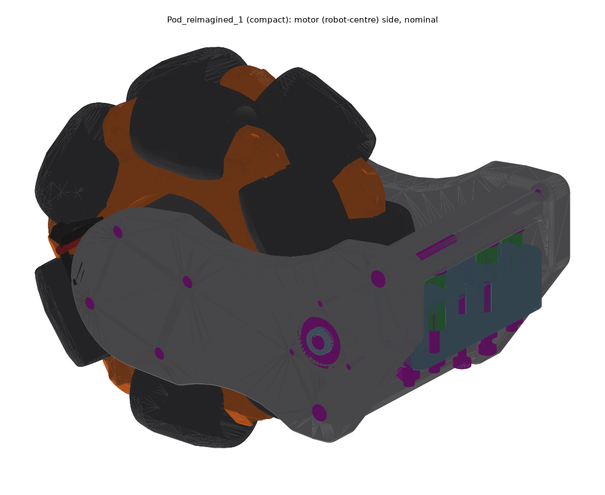
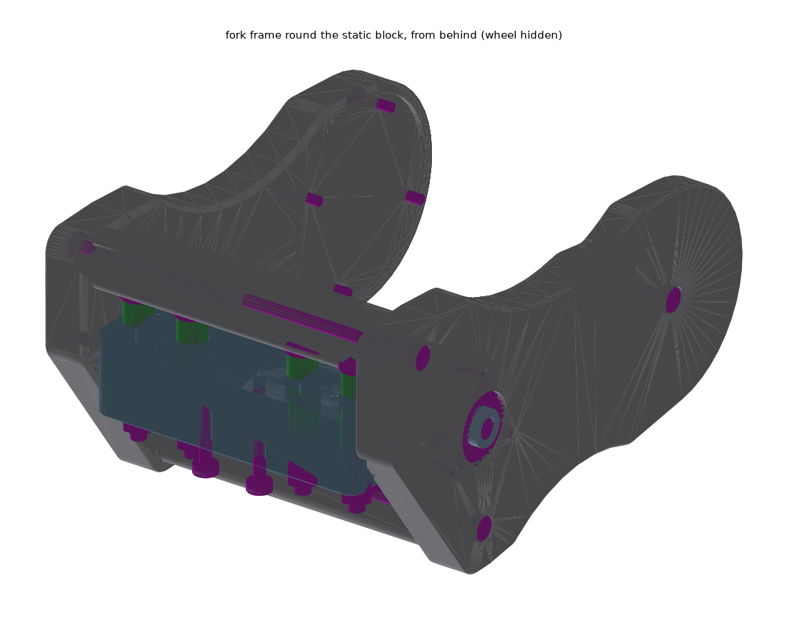
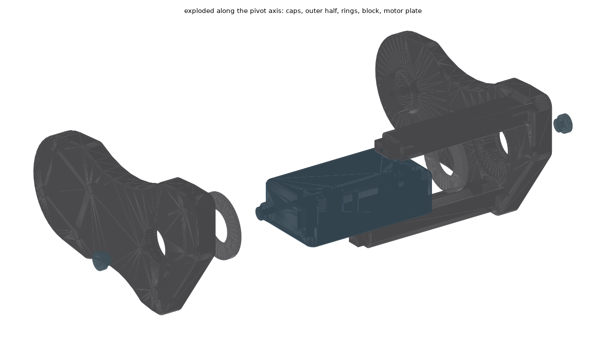

# Pod_reimagined_1 — COMPACT: closed fork frame round one static block

Blue-sky proposal (Nov 13-14 2026, Fernando's brief: "how the suspension mounts onto the fixed structure while staying compact"; the bearing,
spring, symmetry, fillet and clearance complaints about cad/v14's `fork_outer`, `fork_inner`, `frame_inner`, `keel_outer`). **STEP review only:**
build123d bodies, nominal CAD, nothing printed or load-tested, the chassis floor and the pod jig not adapted (Fernando: they follow the pod).
What the three proposals share (arms, pivot housing, checks) and the side-by-side comparison are in `cad/v14/README.md` → "Pod_reimagined".

## The idea

- **Fork = a closed rectangular frame.** Two identical arm plates (the motor plate and the outer arm: the same outline, 12 thick) joined by a
  **lower bar** under the pivot and a **top-back bridge** behind it. A closed frame is far stiffer in torsion than an open U, and torsion is what
  this fork sees most (below).
- **Static = one block** between the arms, behind the wheel. Both pivots are on its end faces (coaxial in one print, 1 mm from each arm), and
  the four springs, the bump pads, the droop slots and the four chassis screws are all in it. The block sits *inside* the fork frame: bar below,
  bridge above, arms either side.
- **Springs behind the pivot, pushing up.** The same four 8 × 25 bed springs on M4 plungers, 26 mm behind the pivot (today's lever, so
  today's wheel rate, 2.54 N/mm). They stand in the block, two per side, symmetric about the plane between the arms, and their domes push up
  on the bridge.
- **Stops at the springs' lever:** bump = the bridge landing on two pads on the block; droop = an M3 pan head on each arm's wheel face, in an
  arc slot in the block's end face (lever 28).
- **Nothing outboard of the arms.** The pod is 106 mm wide (pod_lean 131), its top at z 38.9 (pod_lean 57 + the nuts, 63), and 16 mm longer
  behind the pivot (static y 117, swept 125 at bump; pod_lean 103), where paired pods have 106 mm between them. The outer arm's outer face is
  3.1 mm further in than today's.

 

## Where the forces go (hand statics, `checks.json` → `hand_loads`)

Design cases: 10 kg robot, 24.5 N per wheel static, 61 N bump (2.5 g on one wheel), a 30 N side hit at a threshold (z -60), 59 N peak traction
(AK40-10 4.1 N·m, VERIFY). With the springs *behind* the pivot the pivot carries the wheel load **plus** the springs' reaction:

| Member | Static | Bump (61 N) | Note |
| --- | --- | --- | --- |
| 4 springs | 19 N each | 47.5 N each (7.7 mm, 31 % of free length) | under the long-life 10 mm |
| 2 pivots (627, M3 + Ø7.2 spigots) | 50 N each | **126 N each** | the highest loads in the pod: 4.1 × the wheel load (front springs: 2.1 ×) |
| Arm at the pivot lobe (motor side, takes up to 1.2 × the wheel load) | 2.4 N·m | 6.0 N·m | about 2 MPa across the lobe's 19 mm of material round the 627: in the layer plane |
| Bridge root (each spring pair 15 mm inboard of its arm) | 0.6 N·m | 1.4 N·m | 3.7 MPa across the bridge's layers at bump: **the tie line's preload must exceed it** (tighten it firmly) |
| Side hit | | 1.8 N·m roll, 2.4 N·m yaw | a 33 N couple on the two 627s (93 mm apart), 30 N axial: the closed frame carries it as shear, not as arm bending |

**Where strength is needed most:** (1) the pivot bosses, spigots and M3s, and the block round them (126 N each at bump; the block is a solid
43 × 24 mm section there); (2) the **frame's four corners**, where bar and bridge meet the arms. The hub's load split moves between the 6804
and the motor bearing as the roller rows hand over (the motor side takes 0.4-1.2 of the wheel load, the 6804 -0.2-0.6), so the fork is
twisted every half roller pitch. The closed frame takes that twist; an open U bends its arms; (3) the bridge's layers (in tension at its roots
at bump, held closed by the tie line).

## Parts

| Part | Filament | cm³ | Prints | Overhang mm² |
| --- | --- | --- | --- | --- |
| `pod_fork_outer`: outer arm + bar + bridge + tenons + 6804 stub | Dark Gray | 113.7 | outer face down (99 tall) | 91 (counterbore roofs) |
| `pod_fork_inner`: the motor plate | Dark Gray | 86.4 | outer face down (12 tall) | 178 |
| `rx_block`: both pivots, springs, pads, droop slots | Dark Gray | 74.3 | bottom (chassis face) down | 324 (round hole roofs) |
| `rx_ring_outer` / `_inner`: the 627's outer-race rings | Dark Gray | 2.1 each | flat | 0 |
| `rx_cap_outer` / `_inner`: the inner-race caps | Dark Gray | 0.3 each | flange down | 5-10 |
| `rx_shim_outer` / `_inner`: Ø10 / Ø7.4 washers between each boss and its inner race (0.6 nominal; print 0.4 / 0.6 / 0.8) | Dark Gray | 0.02 each | flat | 0 |
| `pod_retainer`: the 6804 retainer (cad/v14's, unchanged) | Dark Gray | 1.9 | spigot down | 106 |

Eight printed parts plus two shims (pod_lean: nine), 281 cm³ (pod_lean ~220: mass was not a constraint). Every part is one valid solid and fits the bed.
Print STEPs: `parts/`; the assembly with the wheel, motor, bearings, fasteners (magenta), springs and plungers: `pod_reimagined_1_assembly.step`.

**Hardware:** 2 × 627 · 2 × M3 × 25 flat (pivots) · 6 × M3 × 10 flat (rings) · 4 × M3 × 45/50 pan (one tie line per cross member, a bolt from
each end, the gaps staggered) · 2 × M3 × 8 pan (droop) · 4 × M2.5 × 10 pan (motor) · 1 × M3 × 25 pan (6804 retainer) · 4 × M3 × 25 pan (chassis,
from below) · 4 × M4 × 40 button head + washer + nyloc (plungers) · 4 bed springs.

## Assembly

1. Press each 627 into its arm's seat from the wheel face, onto the seat floor; fit the ring (3 × M3 × 10 flat heads, flush).
2. Drive the two droop screws into the arms' wheel faces. Put the springs and plungers in the block (domes up, nylocs under it).
3. Set the block between the halves: the outer half (arm + bar + bridge) from one side, the motor plate from the other. The tenons enter their
   sockets and the block's bosses enter the rings' bores. Drive the two tie lines.
4. From outside each arm: cap into the inner race, M3 × 25 flat head through it into the block. This clamps each inner race between the cap and
   the block's boss, with a shim on the boss's spigot between them. Start with the 0.6 shims; tighten both pivot screws and turn the fork by hand.
   If it binds, swap a 0.4 on one side; if it has end play, a 0.8.
5. Bolt the motor to the motor plate (4 × M2.5 × 10) and fit the wheel as today; the 6804 retainer as in cad/v14.
6. Pod to chassis: 4 × M3 × 25 up from under the chassis into the block.

## Checks (`build.py check`, `checks.json`)

| Check | Result |
| --- | --- |
| Interference, droop / nominal / bump (every static part and screw against every moving one) | **none** (the 627s' designed press fits listed apart) |
| Block to fork | 1.0 mm in every pose, except the designed bump contact (bridge on the pads, 0.0 at bump, 2.2 at nominal) |
| Static parts to the wheel's swept envelope | ≥ 2.23 (bump) |
| Arms to the wheel's swept envelope | outer arm **1.99** (its wheel face 2.1 off the treads, the dish floor 2.0 off the cartridge); motor plate 7.4. The 6804 stub inside r 16 is 1.47 from the cartridge bore: cad/v14's, unchanged |
| Fork to the XT30 + leads | 2.72 (they move together; as cad/v14) · block to them ≥ 86 |
| Springs | 21.9 mm nominal, 17.3 at bump (7.7 compressed, 31 %), 22.9 at droop; plunger nyloc gap 1.5 nominal, 0.5 at droop |
| Droop stop | the screw heads meet the slots' ends at droop (0.0), 0.15 at nominal (the slot's sides) |
| Hole audit | no partial holes, no blind holes, no buried heads, no screw without a hole; the pivot M3s' Ø2.9 pilots lie across the block's layers (allowed, round 14) |
| Threads | pivots 15.2 mm (Ø2.9), chassis screws 15.6 (Ø2.9), ring screws 7.5, droop screws 8.0, tie bolts 22-26, retainer 6.0 |

The plunger domes read 0.14-0.18 mm off the bridge at nominal: the M4 button head's hex socket takes the dome's apex, so its rim carries the
load. That is a modelling detail, not a gap.

## Open / VERIFY

- **Each pivot is located axially from both sides (Fernando's ask: both bearings held both ways, on both parts).** The fork's ring-to-ring
  span and the block's boss-to-boss span both come from prints. Without a shim, their difference (±0.2 per side) would preload the 627s axially
  by flexing the arms. Since Nov 14 each boss stops 0.6 short of its race and a printed shim fills the gap (`pod_rx.SHIM_T`; the same on both
  sides). The shim is picked at assembly (step 4), so the fit no longer relies on print accuracy. VERIFY that a printed PLA shim of three
  layers stays flat under the screw's clamp. A steel shim with a 7 mm bore, no larger than the Ø10 boss so it bears on the inner race only, would also do.
- 627 outer-race land taken as from Ø18.6 (the seat floor and the ring touch only r 9.4-11 and 9.5-11): VERIFY on the bearings. The fits are
  coupon_627's (seat Ø21.95, spigots Ø7.20).
- The bridge's layers: the tie line must pre-compress them (3.7 MPa of bending at bump, estimate).
- Droop stop near the arm's edge: 1.5 mm of steel head in a 2 mm slot; the slot's sides are 0.15-0.25 clear.
- The plunger nylocs and shank ends hang 1.5-11 mm under the block (z -9.5 .. -22.6 at bump): the chassis needs Ø12 holes there, and an
  opening for the bar (as today). The chassis and the pod jig are not drawn for this pod.
- Hand statics only (no FE); PLA strengths are assumptions. Nothing printed.

## Files

`build.py` (this proposal) · `../tools/pod_rx.py` (shared) · `checks.json` · `parts/*.step` · `pod_reimagined_1_assembly.step` · renders
`iso_*.png`, sections `section_pivot_plane.png`, `section_spring_outer.png`, `section_spring_droop.png`, `section_spring_bump.png`.
Regenerate: `C:/Users/ferna/.venvs/omni-robot-sim/Scripts/python.exe -B build.py all` (from this folder; ~6 min; the wheel is cached in
`%TEMP%/pod_rx_cache`).
