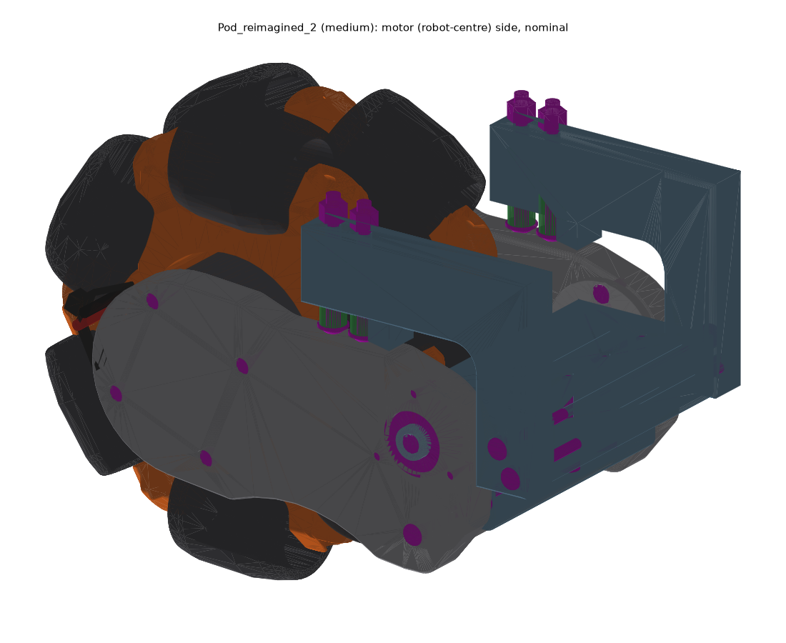
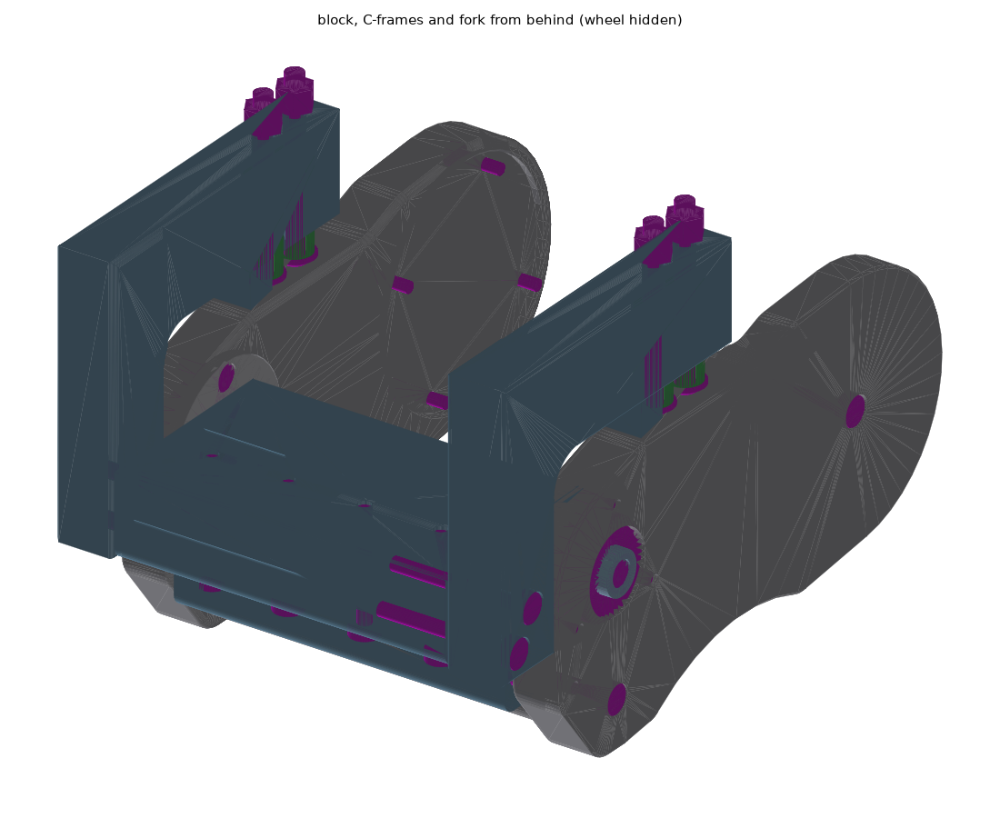
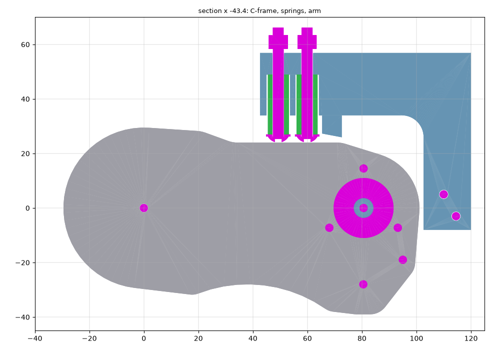

# Pod_reimagined_2 — MEDIUM: one block for both pivots, C-frames carry today's front springs

Blue-sky proposal (Nov 13-14 2026, the same brief as proposal 1). **STEP review only:** build123d bodies, nominal CAD, nothing printed or
load-tested, the chassis floor and the pod jig not adapted. Shared parts and the comparison: `cad/v14/README.md` → "Pod_reimagined".

## The idea

- **Fork = an open U:** the same two arm plates as proposal 1 (same outline family, 12 thick, the same pivot housing), joined by the lower bar
  only. Each arm's top ramps down onto a **flat pad** under its spring pair, 26 mm ahead of the pivot: exactly where pod_lean's pads are.
- **Static = a block between the arms** (both pivots coaxial on its end faces, four chassis screws, the droop slots on a chin behind the bar)
  **plus two C-frames**, one per arm. Each C-frame's column stands behind the arm's pivot lobe, bolted to the block's end face (2 × M3 × 30), and
  its neck reaches forward over the arm to the spring tower. Nothing stands outboard of the arms: each C-frame is its arm's width plus 0.8 mm,
  and its inner face stops at the arm's wheel face (2.1 mm off the treads).
- **Springs: pod.py's, unchanged.** Four bed springs on M4 plungers, two over each arm, dome down on the pad, bump rails under each tower.
  The lever, wheel rate (2.54 N/mm) and plunger are today's.
- **Droop:** an M3 pan head on each arm's wheel face, below and behind the pivot, in an arc slot in the block's chin (lever 23.6).
- **Footprint:** the width of proposal 1 (106 mm), today's height (towers to z 56.9, plunger bolts to 72.6), 17 mm further behind the pivot
  (y 120). It keeps today's spring layout and halves the pivot load compared with proposal 1, but its spring force takes the longest path of the three.

 

## Where the forces go

| Member | Static | Bump (61 N) | Note |
| --- | --- | --- | --- |
| 4 springs | 19 N each | 47.5 N each (9.6 mm, 38 % of free) | as pod_lean (under the 10 mm long-life) |
| 2 pivots | 26 N each | 64 N each | springs ahead of the pivot: 2.1 × the wheel load |
| **C-frame neck + column** (each takes its pair, 95 N at bump, 48 mm ahead of the column) | 1.8 N·m | **4.6 N·m** | neck 13.4 × 22.9: 4 MPa; column 13.4 × 17.4: 7 MPa, in the layer plane (printed on its side). The column's bend tilts the tower: about 0.2 mm at the springs under the static load, 0.45 at bump (estimate) |
| Arm under its pad | 1.2 N·m | 3.0 N·m | the arm is 50 mm deep there: < 1 MPa |
| Side hit | | 1.8 N·m roll, 2.4 N·m yaw | a 33 N couple on the 627s, 30 N axial; an open U carries it by bending its arms and the bar's joints |

**Where strength is needed most:** the C-frames' columns and their two bolts into the block (the spring force's whole path: tower → neck →
column → block → chassis). Then the bar's two joints to the arms, which take the fork's twist from the hub's load split (an open U, so the
joints bend). The pivots are lightly loaded.

## Parts

| Part | Filament | cm³ | Prints | Overhang mm² |
| --- | --- | --- | --- | --- |
| `pod_fork_outer`: outer arm + bar + tenon + 6804 stub | Dark Gray | 81.5 | outer face down | 62 |
| `pod_fork_inner`: the motor plate | Dark Gray | 70.7 | outer face down | 151 |
| `rx_block`: pivots, chin, chassis screws | Dark Gray | 86.1 | top face down (the chin up) | 704 (mostly the roofs of its long horizontal Ø2.9 pilots) |
| `rx_tower_outer` / `_inner`: the C-frames | Dark Gray | 31.5 each | on the outer face | 360-380 (the spring bores' and guides' round roofs, as pod_lean's frame) |
| rings, caps, shims, 6804 retainer | Dark Gray | 2.1 / 0.3 / 0.02 / 1.9 | as proposal 1 | |

Ten printed parts plus two shims, about 308 cm³. **Hardware:** as proposal 1, except one tie line (bar only), 4 × M3 × 30 pan (C-frames to block) and pod.py's
plungers (M4 × 40, dome down, nyloc on the tower top).

## Assembly

1. Bearings and rings into the arms (as proposal 1); droop screws into the arms' wheel faces.
2. Set the block between the halves, close the tenon, drive the tie line; caps and pivot screws from outside (as proposal 1).
3. Bolt each C-frame to the block's end (2 × M3 × 30 from the C-frame's outer face); springs and plungers into the towers.
4. Motor, wheel and retainer as today. Pod to chassis: 4 × M3 × 25 up into the block.

## Checks (`checks.json`)

| Check | Result |
| --- | --- |
| Interference, droop / nominal / bump | **none** |
| Static parts to the fork | 1.0 mm in every pose, except the designed bump contact (rails on the pads) |
| Static parts to the wheel's swept envelope | ≥ 2.14 |
| Arms to the wheel | outer arm 1.99, motor plate 7.4 (the 6804 stub: 1.47, cad/v14's) |
| Springs | 9.6 mm compressed at bump (38 %), nyloc gap 0.35 at droop |
| Droop stop | contact at droop, 0.1 at nominal |
| Hole audit | no partial, blind, buried or missing holes |

## Open / VERIFY

- As proposal 1: the pivots are axially located from both sides, so a 0.6 shim on each boss is chosen at assembly (0.4 / 0.6 / 0.8, until
  the fork turns free with the screws tight); the 627 land; coupon fits.
- The C-frame column's stiffness (estimated 0.2 mm of tower tilt at the static load). A thicker column, or a second bolt row, is the fix if a print
  shows it.
- The block prints top-down with long horizontal pilots (their round roofs are most of its overhang).
- The chin hangs to z -27 behind the bar: the chassis opening must take it. Hand statics only. Nothing printed.

## Files

`build.py` · `../tools/pod_rx.py` · `checks.json` · `parts/*.step` · `pod_reimagined_2_assembly.step` · `iso_*.png` · `section_*.png`.
Regenerate: `C:/Users/ferna/.venvs/omni-robot-sim/Scripts/python.exe -B build.py all`.
