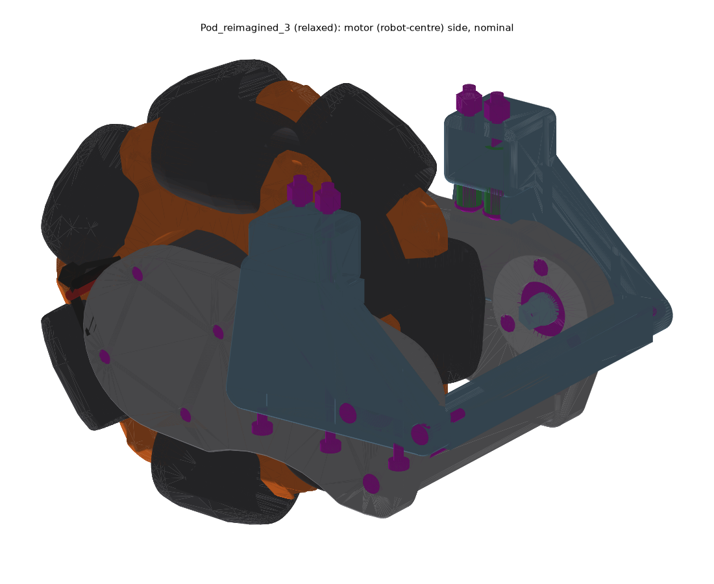
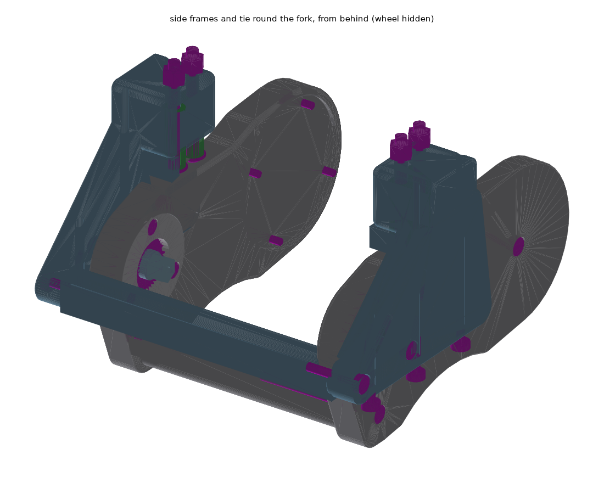
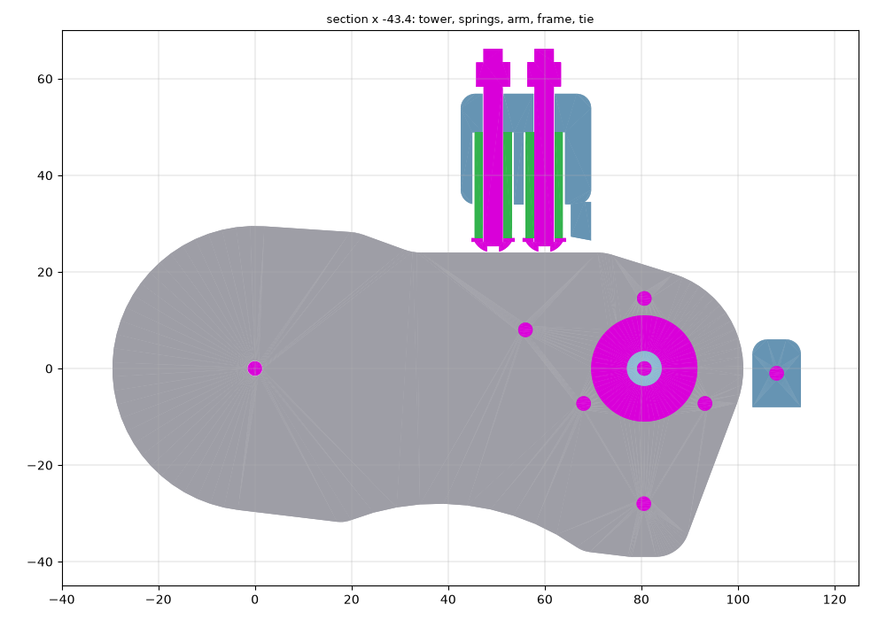

# Pod_reimagined_3 — RELAXED: outboard side frames tied behind the fork (the classic, done cleanly)

Blue-sky proposal (Nov 13-14 2026, the same brief as proposal 1). **STEP review only:** build123d bodies, nominal CAD, nothing printed or
load-tested, the chassis floor and the pod jig not adapted. Shared parts and the comparison: `cad/v14/README.md` → "Pod_reimagined".

## The idea

- **Fork = an open U** of the same two arm plates (12 thick, the same pivot housing), joined by the lower bar, each arm's top ramping down onto
  a flat pad under its springs. It is proposal 2's fork.
- **Static = two mirror-image side frames**, one outboard of each arm, joined by a printed **tie** behind the fork into one closed static U. Each
  frame is a single convex plate (foot, pivot, tower) with a rounded tower block straight over its arm. The spring force goes straight down the
  plate to its own foot, and the pivot pin is in the same plate, 26 mm behind the springs. The tie keeps the two pivots coaxial without the
  chassis' help (its ends sit 2 mm deep in pockets in the frames, plus one M3 per side).
- **Springs: pod.py's, unchanged**, two over each arm (today's lever, rate, plungers and bump rails).
- **Pivots:** the same housing as proposals 1-2, but the static pin comes from **outside**. The frame's boss goes through the arm's lip hole;
  the M3 runs from the frame's outer face, through the boss and the race, into a **threaded printed cap** on the wheel side (8 AF hex: hold it
  while tightening).
- **Droop:** an M3 pan head on each arm's outer face in an arc slot in its frame (lever 26).
- **Footprint:** 130 mm wide. That is 10 mm more outboard at the perimeter (x -62.4; pod_lean -52.5), and 11 mm less toward the robot centre
  (67.7; pod_lean 78.6). Today's height, 11 mm further behind the pivot (the tie, y 114). The most direct load paths and the simplest prints
  of the three; the only one wider than today at the perimeter.

 

## Where the forces go

| Member | Static | Bump (61 N) | Note |
| --- | --- | --- | --- |
| 4 springs | 19 N each | 47.5 N each (9.6 mm, 38 %) | as pod_lean |
| 2 pivots | 26 N each | 64 N each | 2.1 × the wheel load |
| Tower over the arm (cantilevers 12 mm in from the plate) | 0.2 N·m | 0.6 N·m | the shortest spring path of the three: tower → plate → its foot |
| Frame plate between tower and pivot | 0.5 N·m | 1.2 N·m | a 12 × 50+ mm section, in its layer plane |
| Side hit | | 1.8 N·m roll, 2.4 N·m yaw | a 33 N couple on the 627s, 30 N axial; the open U bends; the frames and tie stay square |

**Where strength is needed most:** the bar's joints to the arms (the open fork's twist, as proposal 2), and the threaded caps' 9 mm of M3
thread (they hold each frame's pin in its bearing). The static side is the strongest of the three.

## Parts

| Part | Filament | cm³ | Prints | Overhang mm² |
| --- | --- | --- | --- | --- |
| `pod_fork_outer` / `pod_fork_inner` | Dark Gray | 80.5 / 69.7 | outer faces down | 62 / 151 |
| `rx_frame_outer` / `_inner` (mirror images) | Dark Gray | 44.6 each | on the outer face | ~660-680: round roofs of the spring bores and the vertical chassis pilots (horizontal as printed) |
| `rx_tie` | Dark Gray | 14.3 | on its bottom | 239 (its pilots' roofs) |
| `rx_cap_outer` / `_inner` (threaded, hex) | Dark Gray | 0.6 each | hex down | 23 |
| `rx_shim_outer` / `_inner` (between the frame's boss and the inner race, 0.6 nominal) | Dark Gray | 0.02 each | flat | 0 |
| rings, 6804 retainer | Dark Gray | 2.1 / 1.9 | | |

Ten printed parts plus two shims, about 261 cm³. **Hardware:** as proposal 2, except the pivots are M3 × 25 pan heads from the frames, 2 × M3 × 20 tie
screws, 6 × M3 × 20 chassis screws (three per frame), and no C-frame bolts.

## Assembly

1. Bearings and rings into the arms (rings on the wheel faces); droop screws into the arms' outer faces. Join the fork halves (tenon, tie line).
2. Offer each frame to its arm: its boss into the lip hole; from the wheel side, the threaded cap into the race; M3 × 25 from the frame's outer
   face into the cap (hold the hex).
3. The tie between the frames (its ends in their pockets), one M3 × 20 each side. Springs and plungers into the towers.
4. Motor, wheel and retainer as today. Pod to chassis: 3 × M3 × 20 up into each frame.

## Checks (`checks.json`)

| Check | Result |
| --- | --- |
| Interference, droop / nominal / bump | **none** |
| Static parts to the fork | 1.0 in every pose except the designed bump contact; tie to fork 1.9 |
| Static parts to the wheel | ≥ 2.14; the caps ≥ 10 |
| Arms to the wheel | outer arm 1.99, motor plate 7.4 (the 6804 stub 1.47, cad/v14's) |
| Springs | 9.6 mm at bump (38 %), nyloc gap 0.35 at droop |
| Hole audit | no partial, blind, buried or missing holes (the vertical chassis pilots lie in the frames' layer plane: Ø2.9, allowed) |

## Open / VERIFY

- As proposals 1-2: the pivot shims (0.6 nominal, between each frame's boss and its inner race, picked at assembly), the 627 land, coupon fits.
- The threaded caps (9 mm of M3 thread in a small printed part, held by a spanner while the screw is tightened).
- The frames' long vertical chassis pilots run up through the plate (holes through, per the rule); their roofs are bridges.
- 10 mm more width at the perimeter: the robot (Ø450) or the bumper gap must give it. Hand statics only. Nothing printed.

## Files

`build.py` · `../tools/pod_rx.py` · `checks.json` · `parts/*.step` · `pod_reimagined_3_assembly.step` · `iso_*.png` · `section_*.png`.
Regenerate: `C:/Users/ferna/.venvs/omni-robot-sim/Scripts/python.exe -B build.py all`.
