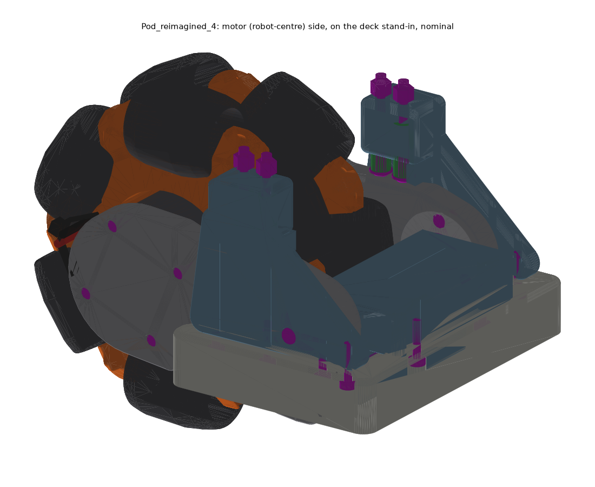
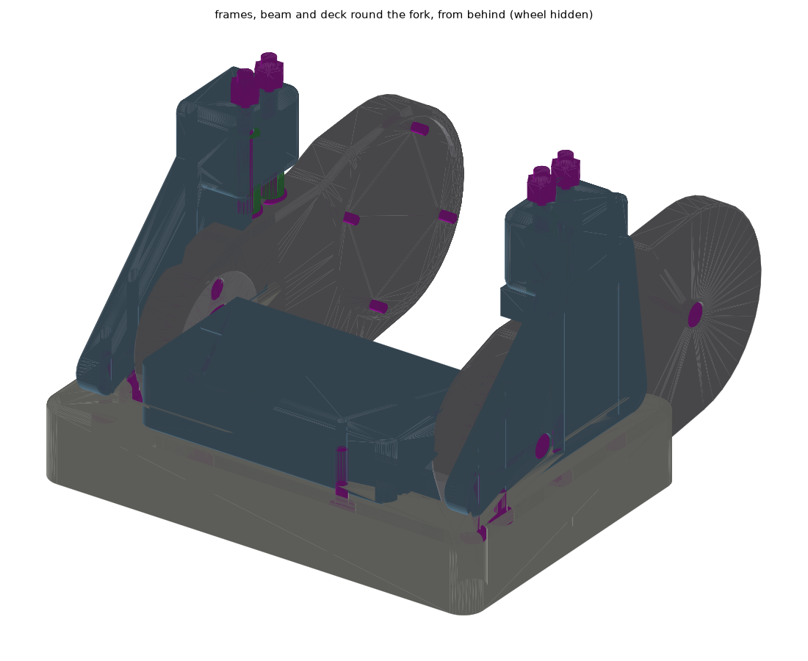
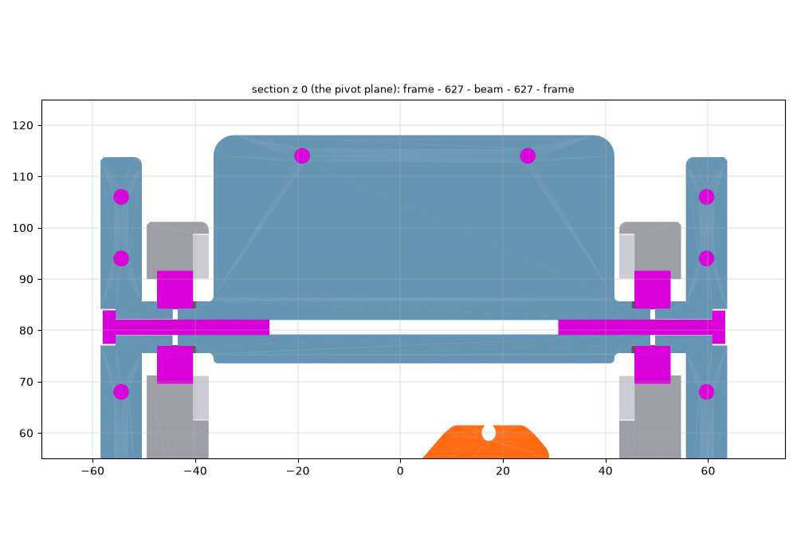

# Pod_reimagined_4: proposal 3's side frames + an inboard beam, on a floor deck (both sides of every pivot held)

Blue-sky proposal, Nov 14 2026. Fernando's brief: start from proposal 3, add inboard support for the pivot bearings, thin the side frames to
8-10 mm, add a part that stands for the floor deck, and drop `rx_tie`. **STEP review only:** build123d bodies, nominal CAD, nothing printed
or load-tested. Shared parts and the other proposals: `cad/v14/README.md` → "Pod_reimagined".

## The idea

- **Fork:** proposal 3's open U. Two 12 mm arm plates with the shared pivot housing are joined by the lower bar, and each arm's top ramps
  down onto a flat pad under its springs. The arms stay at 12 mm because the housing needs it (2 mm lip, 7 mm bearing, 3 mm ring).
- **Each 627 is supported on both sides:**
  - The **side frame's** boss bears on the inner race's outer face.
  - The **beam's** boss bears on its wheel-side face, with the 0.6 shim.
  - One **M3 × 30 pan head** from the frame's outer face runs through the frame, its boss and the race. It threads 14.7 mm into the beam and
    clamps frame, race, shim and beam together.
  - This removes proposal 3's threaded printed caps.
- **Side frames are 8 mm thick (proposal 3: 12).** Each carries its spring tower straight over its arm, using pod.py's springs and plungers
  at today's 26 mm lever (2.54 N/mm wheel rate).
- **Beam (`rx_beam`):** sits between the arms, behind the wheel. It carries both inboard bosses and the droop stop's lug. Its back stands on
  the deck's cross member.
- **Droop stop:** the bar's back face, 28 mm below the pivot, lands on the face of a lug hanging from the beam. The contact is on the centre
  plane, and the lug's face is the bar's back face as it stands at droop. From nominal to droop the bar moves back about 1 mm.
  - This replaces the M3 droop screws and the arc slots they rode in (the "cavities" of proposals 1-3).
  - A first try, a heel on the bar under the beam, ran into the pivot housing's ring pocket and ring screws.
- **Deck (`rx_deck`):** a stand-in for the robot's first floor under this pod. It is 22 mm deep, z -30..-8, like today's chassis members.
  - It is a U of two rails under the frames plus a cross member behind the fork.
  - Each frame is held by 4 × M3 × 16 from below: two ahead of the pivot (y 44, 68) and two behind it (y 94, 106).
  - 2 × M3 × 16 hold the beam.
  - Frames, beam and deck close a box round the fork, so `rx_tie` is gone.
- **Footprint:** 122 mm wide (x -58.4 .. 63.7; proposal 3: 130, pod_lean: 131). The deck reaches x -64.4 .. 69.7 and y 122. Today's height:
  the towers reach z 56.9, the plunger bolts 72.6.

 

## Where the forces go

| Member | Static | Bump (61 N) | Note |
| --- | --- | --- | --- |
| 4 springs | 19 N each | 47.5 N each (9.6 mm, 38 %) | as pod_lean |
| 2 pivots | 26 N each | 64 N each | shared between the frame's boss and the beam's boss (each race held both sides) |
| Tower over its arm | 0.2 N·m | 0.6 N·m | the spring force goes tower → frame plate → its rail |
| Droop stop (robot lifted: springs at droop + wheel weight) | | ~70 N on the lug | a 78 × 9 mm section hanging 26 mm: < 1 MPa |
| Side hit | | 1.8 N·m roll, 2.4 N·m yaw | a 32 N couple on the 627s, 30 N axial; frames + beam + deck are a closed box |

**Where strength is needed most:**
- The bar's joints to the arms, because the fork is an open U.
- The deck itself: everything now goes into it through 10 screws spread over 134 × 94 mm. A flimsy floor would let the whole pod flex
  (Fernando, Nov 14).

## Parts

| Part | Filament | cm³ | Prints | Overhang mm² |
| --- | --- | --- | --- | --- |
| `pod_fork_outer` / `pod_fork_inner` | Dark Gray | 80.6 / 69.8 | outer faces down | 62 / 151 |
| `rx_frame_outer` / `_inner` (mirror images, 8 thick) | Dark Gray | 31.7 each | on the outer face | 695-715 (round roofs of the spring bores and the vertical pilots) |
| `rx_beam` | Dark Gray | 78.9 | top face down (the lug standing up) | 298 |
| `rx_ring_outer` / `_inner`, `rx_shim_outer` / `_inner`, `pod_retainer` | Dark Gray | 2.1 / 0.02 / 1.9 | | |
| `rx_deck` (**stand-in for the chassis**, not a pod part) | Jade White | 87.0 | bottom down | 316 |

Pod: 9 printed parts plus 2 shims, about 299 cm³ without the deck. **Hardware:**
- 2 × 627 and 2 × M3 × 30 pan (pivots).
- 6 × M3 × 10 flat (rings).
- 2 × M3 × 45/50 pan (the bar's tie line).
- 4 × M2.5 × 10 pan (motor) and 1 × M3 × 25 pan (6804 retainer).
- 10 × M3 × 16 pan (deck).
- pod.py's 4 plungers (M4 × 40) and 4 bed springs.
- No droop screws.

## Assembly

1. Press the bearings into the arms and fit the rings. Join the fork halves (tenon, tie line).
2. Put the beam between the arms (its bosses into the rings' bores, a 0.6 shim on each spigot). Offer up each frame, its boss into the lip
   hole. Drive the M3 × 30 from each frame's outer face into the beam.
3. Turn the fork by hand: if it binds, swap a 0.4 shim on one side; if it has end play, a 0.8.
4. Set the pod on the deck. Drive the 10 screws from below: the frames' Ø3.4 deck holes float ±0.2, so tighten the pivots first.
5. Fit the springs and plungers, then the motor, wheel and retainer as today.

## Checks (`checks.json`)

| Check | Result |
| --- | --- |
| Interference, droop / nominal / bump | **none** |
| Droop stop | bar on the lug at droop (0.0), 0.89 at nominal, 1.0 at bump |
| Static parts to the fork | 1.0 in every pose, except the designed contacts (rails on the pads at bump, the bar on the lug at droop) |
| Static parts to the wheel's swept envelope | ≥ 2.14 (outer frame at bump), beam ≥ 2.4 |
| Arms to the wheel | outer arm 1.99, motor plate 7.4 (the 6804 stub 1.47, cad/v14's) |
| Springs | 9.6 mm at bump (38 %), nyloc gap 0.35 at droop |
| Hole audit | no partial, blind, buried or missing holes; pivot thread 14.7, deck screws 8.2-10 |

## Open / VERIFY

- As proposals 1-3: the 627 land and the coupon fits. Whether the shims' 0.4 / 0.6 / 0.8 range covers the print.
- Every screw into the deck is tightened after the pivots: check that the frames' ±0.2 float in the deck holes takes the print tolerance.
- The deck is a stand-in: the real first floor must give the same support (two rails under the frames and a cross member behind the fork,
  about 22 mm deep). That is v15's job (`cad/v15`).
- Hand statics only. Nothing printed.

## Files

`build.py` · `../tools/pod_rx.py` · `checks.json` · `parts/*.step` · `pod_reimagined_4_assembly.step` · `iso_*.png` · `section_*.png`.
Regenerate: `C:/Users/ferna/.venvs/omni-robot-sim/Scripts/python.exe -B build.py all`.
