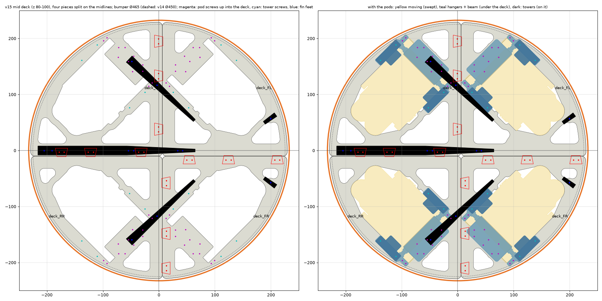
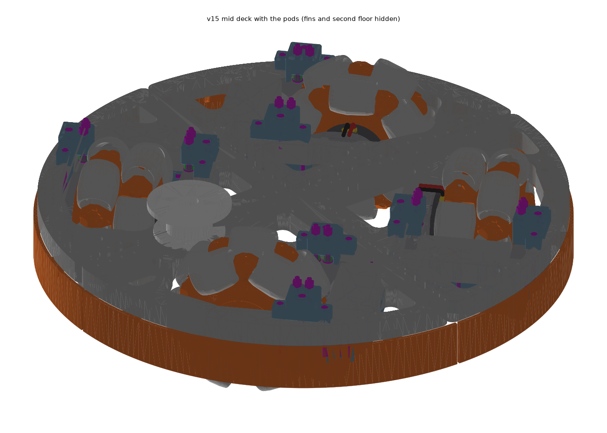
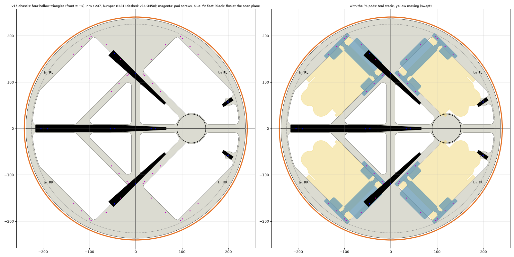
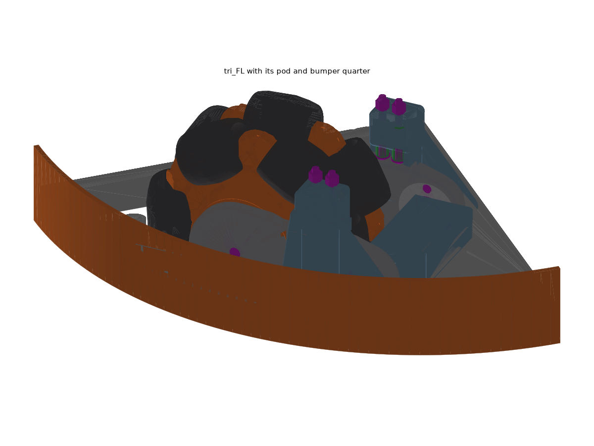
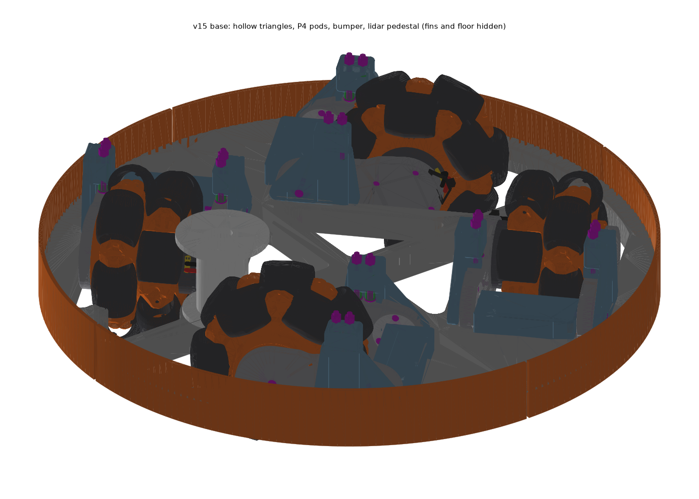

# cad/v15: the mid-deck robot (Nov 14 2026, PROPOSAL; cad/v14 stays the current robot)

v15 is a complete folder: its own scripts (`tools/`), reference parts (`reference/`), checks (`validation/`) and STEP files (`step_export/`). It
reads nothing from another CAD version (the one outside import is the robot's own `ros/src/omni_arm` kinematics, as v14). Regenerate every
STEP with `regen_all.sh` (sequential: wheel and motor, coupons, pod, deck, second floor, whole robot).

## The mid deck (Fernando, Nov 14)

The triangle study further down changed too much: Ø481, moved wheels, new fins, no way to remove a pod with the second floor on. Fernando's
alternative is the line being pursued.
- **The floor deck sits above the pivots and below the spring towers,** at robot z 80–100 (v14's chassis: z 40–62).
- **The pods hang under the deck,** bolted up from below, so the pivots' loads go straight into the floor.
- **A pod drops out downward;** the towers and springs stay on the deck.
- **The second floor and everything on it are v14's, unchanged in place** (z 176.5). The fins stand on the deck, shorter.

 

| | |
| --- | --- |
| Pod (`tools/pod_mid.py`) | P4's fork, pivots and beam (no shims since the review round). **Hangers** replace the side frames, at robot z 60–80, with the pivot boss and an M3 × 35 pivot screw. Each hanger is 14 mm under its tower (the tower's base width, Fernando), tapering to 8 mm behind the pivot (at 14 mm all along, its back corner set the robot at Ø475). They print upright. **Towers stand on the deck, right over the hangers** |
| Beam and droop lug | The lug is a 24 × 12 mm tab on the centre plane (was the beam's width; Fernando: excessive). **An M3 × 50 runs up the lug's length** (counterbored in its underside), through the beam into the deck: it keeps the lug's layers in compression (Fernando). 7 × M3 × 30 up into the deck (3 behind, 2 beside the lug, 2 at the front corners since review round c) |
| Fasteners | **2 × M3 × 50 per side** (Fernando's longest M3 is 50) go up from the hanger's underside (counterbored), through clearance in the hanger, deck and a foot tab at deck level in front of and behind the tower (20 + 20 + 12), to an **M3 hex nut in a 5.5 AF × 2.5 recess in the tab's top**: a clamped stack that can be torqued (Fernando), the two bolts 39 mm apart. Behind the pivot, 2 × M3 × 30 per hanger up into the deck, 8 mm apart (Nov 14: at 5 mm their counterbores collided). **Each tower also has one M3 × 30** down from its top into the deck (11 mm of thread), so it stays when the pod is out. Plungers M4 × 35 |
| Springs | **Fernando's: 7.7 OD × 18.5 free, 9.23 solid** (9.27 of travel); the rate is not measured (a firm pinch bottoms one: about 6–9 N/mm). The towers' ceilings are set so the far spring stops 1.0 mm off solid at bump (8.26 mm) whatever the rate (the bump rails stop the fork), with 1.1 mm of preload at droop. The nominal ride height assumes 10.4 N/mm. A softer spring sits lower: at 7.5 N/mm about 2 mm, leaving ~13 of the 15 mm bump travel. **To do:** the kitchen-scale test (press 4 mm, rate = grams × 0.0098 / 4), then retune: the lever (springs nearer the pivot) or the preload |
| Motor leads' tie point | (review round c) no tunnel in the rim (its support could not be taken out, Fernando): a Ø4.6 hole straight through the motor plate at pod (y 26, z 18), ahead of the spring pads and the inner hanger, 8 mm under the arm's top edge (`pod_rx.HARNESS_HOLE`). The leads are tied there, then run with a service loop onto the deck |
| Wheel | v14's bearing roller wheel, except the rollers' axle pilots in the hub: **Ø2.7** (Fernando: the blocks print sideways and the holes come out large; was 2.8). 6.9 mm of thread |
| Comes out | fork, wheel, motor, hangers, beam: unplug the motor, take out the 4 long bolts (their nuts on the tab tops), the 4 hanger screws, the 7 beam screws and the lug bolt from below (the beam's 2 front ones with an L-key over the fork's bar), and the pod drops |
| Deck (`tools/chassis_mid.py`) | a 20 mm disc in four pieces split on the midlines, one pod per piece (229 × 229: fits the bed). Each piece has its pod's opening (everything of the pod above the deck's underside, every pose, the wheel's full revolved envelope, + 1 mm), lightening pockets, and no strips under 14 mm held at one end only (Fernando). About 1730 cm³ in all (v14's frame: 1141) |
| Wheels | v14's positions (slide −20): the kinematics and front gap are unchanged; 16.8 mm between the paired pods |
| Bumper | **Ø465** (v14: Ø450), z 40–80, held by 12 tabs under the deck's rim (review round) |
| Heights | pod and tower tops z 131; a wheel at bump reaches 155; lidar plane 163; second floor 176.5; nothing of the chassis below z 80 except the bumper |

**Review round (Nov 14, Fernando's STEP review; `regen_nov14b.sh` regenerates the affected STEPs):**

| Change | What was done | Check |
| --- | --- | --- |
| Deck: the tongue between the arms | Of no use (held at the beam end only, no screw or seat): the deck between the two arms' slots, ahead of the beam, is open (`pod_mid.between_arms`, clipped to the opening's convex hull so the outline does not grow). The motor leads come up through it | seats 100 % on the deck; pod screws ≥ 6.5 mm from edges |
| TPU colour | light gray, `palette.TPU_LIGHT_GRAY` #c4c4c4 (approximate; was black) | |
| Motor connector up | `MOTOR_ROT` 143 → 74: the XT30 faces up (az ~90; was ~159). The rear holes, hub flange holes and motor plate screws follow it (the leads' tie tunnel: replaced in round c, below). The deck's opening keeps 4 mm round the plug and leads (`CLR_HARNESS_DECK`) | plug to the hub 4.68 mm (≥ 4); plug + leads to the deck 4.02 (droop) / 4.55 (nominal); fork to leads 2.72 (unchanged) |
| Deck accessory holes | every deck piece: zip-tie pairs (two 4.6 × 2.0 slots 13 apart, the second floor's anchor) and spare Ø2.8 M3 pilots on a 15 mm lattice, through the 20 mm deck, ≥ 2.6 mm wall, clear of seats, screws, laps, fin feet and the pedestal (`chassis_mid.accessory_holes`; a 30 mm grid as the second floor's found almost no room in the deck's 14–20 mm bands) | 71 tie pairs, 52 pilots (FL 16 / 7, RL 16 / 17, RR 24 / 20, FR 15 / 8; none under the bumper tabs); every piece one valid solid |
| Bumper attachment | **3 tabs per quarter** (12) from the quarter's top inward under the deck's rim (r 216 .. 229.5, 14 wide, 6 thick, a 45° gusset under each). An M3 × 16 pan goes up through each tab (Ø3.4, counterbored in its underside) into a Ø2.8 pilot through the deck: 12.9 mm of thread. The bumper's top is now z 80 (was 90, beside the rim): z 40–80. Tabs placed near each quarter's 1/6, 1/2, 5/6 where they clear the pods' swept parts by 3 mm and their static parts by 1.5 (`chassis_mid.bumper_tabs`). The quarters print upside down, the tabs on the bed | 12 of 12 placed; no clash in any pose: 10.7 mm to the moving parts, 2.3 to the pods' static parts; SolidWorks interference clean |
| Tower bump-rail stub | the bump rails (the hard stop) are joined before the edge rounds and run flush to the base's face (a 1 mm ledge under the overhang refused every round): the tower's edges now take **R2 on 11 edges** (before: refused, only the tabs were round) | no interference, rails to pads 0 at bump (the stop) |
| Outer fork at the wheel | round the axle **r 21** (was 29.5; `pod_rx.AXLE_R_OUTER`), so the 3 cartridge flat heads (r 26) can be driven past it: fork + retainer + 6804 + cartridge go onto the hub as one unit, turning the wheel to bring each screw clear | heads clear from wheel azimuth 80° to 270° (0° = toward the pivot); fork to wheel envelope 1.47 |
| Shim washer | **removed**: the beam's bosses are printed to the exact length and bear on the 627s' inner races (`R.SHIM_T` 0 in pod_mid; no rx_shim parts). A pivot that binds gets its boss face sanded; one with play gets a shim added at assembly | no interference |
| Side fins straight | `SIDE['leg_shift']` 0 (v14 shifted the legs 4 mm sideways off pod_lean's fork); their feet and the deck's holes follow | no clash; 6.3 mm to the rear pods |
| Fin zip-tie slots | slots through every fin: side ×3 (as before), spine ×6, front ×2 (by its inner edge; the corbel's edge is under the lidar band) | each fin one valid solid |
| **Round c:** beam's front screws | **2 more M3 × 30 up from the beam's underside** (head counterbored in the beam, thread in a Ø2.8 pilot through the deck: 14.9 mm, as the beam's other screws) at its front (x ±18 from the middle, y 86, clear of the pivot screws' through pilot at y 80.6; `pod_mid.BEAM_SCREWS`), which had none. The fork's bar is under them: drop them into the beam before the fork goes in and drive them with a hex L-key | head to the fork: 12.4 mm nominal, 12.3 droop, 13.0 bump (`beam_front_screw_heads_to_fork`); hole audit clean |
| **Round c:** motor harness hole | the tie tunnel is gone; a Ø4.6 hole through the motor plate (x, its print axis: no support) near the spring pads (row above) | plate one valid solid |
| **Round c:** tower foot tabs | 12 tall (was 8): stronger, and the M3 × 50's end stands 0.9 over the tab top (was 4.9), the nut right under it (`TOWER_TAB`) | towers R2 on 11 edges |

**Checks:**
- Pod (`validation/pod_mid/checks.json`): no interference in droop / nominal / bump; hole audit clean (its one flag is the nut recesses, by design).
  - The droop stop works: 0.89 mm at nominal.
  - Thread into the deck: 12–15 mm.
  - The hangers' and beam's tops sit 100 % on the deck. The deck clears the wheel's revolved envelope and the arms by 1.0 mm.
- Robot deck (`validation/chassis_mid/checks.json`): every pod's screws land on its own piece, ≥ 7 mm from any edge. The openings keep 1.0 mm.
  The top edges are rounded R1.

**STEP files (`step_export/`):**

| Folder | What |
| --- | --- |
| `robot_assembly.step` | the whole robot, printed parts only (deck, bumper, pedestal, fins, four pods with their wheels, the second floor and everything printed on it) |
| `pod_mid/` | one pod on a stand-in piece of deck, with every bearing and fastener (magenta); `parts/`: each printed part of the pod |
| `chassis_mid/` | the deck pieces, bumper quarters, pedestal, fins; `v15_mid_base_assembly.step`: the base with all four pods and their hardware |
| `wheel_motor/` | the wheel and motor (Ø2.7 axle pilots) |
| `upper/` | the second floor and everything on it (unchanged from v14) |
| `coupon_627/`, `coupon_687/` | the bearing fit coupons |
| `chassis_tri/` | the superseded triangle study |

**SolidWorks assembly (Nov 14, rebuilt after the review round: `sw_nov14b.sh`):** open `solidworks/V15_robot.SLDASM`. It is a viewing
assembly of imported STEP bodies, not native features (`cad/solidworks.md` section 17). 913 components from 215 files, all inside v15:
- every fastener and bearing in magenta;
- the computer and all the electronics, the vendor RPLIDAR on its pedestal, the D435 and its see-through view cones;
- the SO-101 at stow;
- the four pods, flexible, so a wheel can be dragged.

Built by `tools/sw_robot_parts.py` (part STEPs + `manifest.json`), then `tools/sw_robot.py` stages, in the order of its docstring.

| Check (`validation/solidworks/`) | Result |
| --- | --- |
| Motion (`motion_test.json`), both hands | the hinge on the spigots, the plungers in the towers' guides and on the arms' pads: axle and every plunger lift match build123d at droop / nominal / bump to 0.01 mm; dragged past either end, the travel limit holds; no mate errors |
| Paths (`paths.json`) | 215 files, none outside v15 (round c: 917 components) |
| Interference (`interference.json`), the whole robot | no part / part or fastener findings. Listed as by design: 104 bearing press fits (687 on its sleeve, 627 in its fork seat), 16 627 bores on their static spigots (no shims: both spigots now reach the race), 417 screw threads in their pilots (round c: + the beams' front screws), 2 touching faces |

The first interference pass found two problems, both fixed:
- Fin-foot bolts had no hole in the deck where a foot sat on a seam.
- The front fins' long bolts had no pilot in the deck, and ran 28 mm out under it. They are M3 × 90 now, longer than the M3s on hand: to change when the fins are redrawn.

To keep every fin foot whole in one piece, the deck's seams now cross at (x 6, y −10) instead of the centre: the spine fin stands on the old seam line.

**Harness (Nov 14, ported to the mid deck):** `tools/harness_route.py` (routes) and `tools/harness.py all` (the leads drawn, checks,
`step_export/harness/harness_review.step`); in the SolidWorks assembly as `V15_harness` (55 parts). Ports, leads and the upper floor's routes are
v14's (cad/v13 Nov 11); what changed:
- **The router's world** is the mid deck, bumper, pedestal and fins, the mid-deck pods (static parts fixed; fork, wheel, motor and plungers in
  droop / nominal / bump) and v14's upper robot in place. **A pod drops out downward:** its removal path is everything under it, hangers and
  beam included (was 250 mm radially out). The arm's sweep grid and the fins' lidar shadows are v14's (unchanged), copied to `reference/harness/`.
- **Motor bundles (Ø8, R16):** from the motor's lead stubs along the motor plate's top edge (1 mm over it) to the **zip tie at the plate's
  Ø4.6 hole**, then an 18 mm **service loop** straight up through the deck's opening (it rides with the fork), then routed over the deck to the
  second floor's right cable slot, up it in the side fin's shadow, to the power stack. 248–443 mm. The deck steps back 4 mm beside each hole
  (`pod_mid.tie_relief`) so the tie's strap has room in every pose. Pod removal: unplug the XT30 through the opening, cut the plate's tie.

| Check | Result |
| --- | --- |
| Leads to the pods' moving parts, every pose (`validation/harness/checks.json`) | ≥ 5.0 mm (rule 4); the motor bundles' fixed leg and loop ride with their own fork and are left out, plus 20 mm |
| Leads in a part / in the D435's fields / plug overlaps | none |
| Lidar scan band | 0° added: every crossing in a fin's shadow |
| Arm sweep | ≥ 16.5 mm |
| Leads to static parts under 2 mm | 9, the same leads at the same values as v14 (second-floor plugs, posts, the cable slot: the slot's leads are tied against its edge) |
| Drawn bends under the allowed radius | as v14 for the other leads; **the motor bundles' are tighter than v14's** (2.4–5.1 mm against R16): the 18 mm loop is too short a run for R16 corners. Built, the loop is slack; open item |
| SolidWorks, each lead alone against the whole robot (`interference_harness.json`) | 24 leads, 0 findings |
| SolidWorks, the robot without the harness (`interference_base.json`) | no part / part or fastener findings (as before the harness) |

The whole-robot interference run with the harness in (`interference.json`) is truncated: SolidWorks lists at most ~2000 interferences and the
leads sharing paths add ~1350; hence the two runs above (`sw_robot.py interference_base`, `interference_harness`).

**Joints (drawn):** dovetail half-laps across each midline seam, as v14's frame.
- The lower piece's bottom half (z 80–90) runs 14 mm across the seam as a dovetail tab (16 mm at the seam, 22 at the end). It sits in a
  socket in the neighbour's bottom half, whose top half covers it. 2 × M3 × 16 go down through the top half into the tab.
- FL and RR are the lower pieces on all their seams; RL and FR drop onto them.
- Three laps per seam (r ≈ 33–53, 128–143, 180–205), placed on solid deck clear of the pod, fin and pedestal screws.
- No lightening pocket within 22 mm of a seam. That, the pads and the pedestal raise the deck to 1706 cm³ (v14's frame: 1141).

**Fins and second floor (first look, `UPPER = True`):** v14's five fins stand on the deck at z 100 (were on z 62). The second floor stays
at 176.5.

| | Result |
| --- | --- |
| Fin feet | all 12 land on the deck |
| Spine, front fins | no clash; front fins 8.8 mm from the front wheels. Shorter, so lighter: spine 207 cm³ (v14: 261), front 12 (17) |
| Side fins | no clash, 18 mm from the wheels. **But the column that carries the arm riser's corner has lost its seat.** In v14 it sat on pod_lean's spring column. P4's inner tower stands at the same height (z 126.9) but only 11 mm² of the column lands on it: the fin's plane, a ray from the lidar, grazes the tower's corner. **Under the column there is deck (73 % of its strip; arch and foot 100 %), so the column can come down to the deck** (or the tower can grow a seat). 84 cm³ each (v14: 97) |
| Lidar pedestal | 31.7 mm (v14: 69.7); 2.5 mm from the front wheels at bump (v14: 2.0) |
| Lidar band | the fins' webs in the band are unchanged, so the blind angle is the same; pods and towers top out at z 136, under the scan plane (163) |

**Next (not done):**
- The side fins' column down to the deck.
- The second floor itself is unchanged, but its supports now all land on the deck.
- Sim, Nav2 (Ø465). Harness: the motor loops' drawn bends (above).

The triangle study below is kept for reference. Its hollow was cut from the rollers at one angle, not the wheel's full revolved envelope, so its clearances near the wheels are not reliable.

---

## Earlier: P4 pods on hollow-triangle chassis nodes (superseded)

Started Nov 14 2026 (Fernando). **Not adopted: cad/v14 stays the current robot.** The question: how cad/v14's Pod_reimagined_4 (side frames
plus an inboard beam, every pivot bearing held on both sides) would work in the robot. Fernando's guidance:
- Keep the changes to the pods and the chassis frame around them.
- The robot's diameter may grow.
- Each pod should bolt onto **one printed part, a hollow triangle**, so it is held on both sides. The triangle's curved side carries the bumper.

v15 is a clean copy of v14's scripts and reference files plus two new scripts:
- `tools/pod_p4.py`: the pod, P4 with a shorter back.
- `tools/chassis_tri.py`: the triangles, and the checks of how the pods, the v14 fins, the lidar pedestal and the bumper fit together.

The rest of v14's pipeline (upper floor, harness, SolidWorks assembly, screw access, robot STEP) is copied but **not yet ported**: it still
builds v14's robot.

## What v15 changes

| | v14 | v15 |
| --- | --- | --- |
| Pod | pod_lean (inner frame + outer keel, springs on the motor side) | **P4** (`pod_p4.py`): two 8 mm side frames, inboard beam, springs over both arms, droop stop on the beam's lug |
| Pod back (behind the axle, pod y) | 103 | **112** (P4 had 118: frames shortened to 104, the beam to 112, the rear deck screws at y 92 / 97) |
| Wheel positions | rolling lines tangent to r 154, slid 20 mm away from the pivot | the same rolling lines, **slid 25 mm** (FL at x 126.6, y 91.2) |
| Chassis frame | hub (ring + cross), four nodes, pocket walls; 1141 cm³ | **four hollow triangles**, one per pod; 415 / 391 cm³ each, **1612 cm³** total |
| Robot diameter (bumper) | Ø450 | **Ø481** (+31) |
| Pod to chassis | 3 screws into the inner frame's foot + 2 into the keel, pocket walls | **10 × M3 × 16 from below**: 4 into each side frame (two ahead of the pivot, two behind), 2 into the beam |

The wheels' rolling lines do not move, so the X4 kinematics, the firmware and the ROS drive are unchanged. Sliding the wheels changes only
the support rectangle, which the sim does not model yet.

## Why these numbers (layout study, P4 placed at layout F)

The paired pods meet pivot end to pivot end at the side midlines, in a V whose tightest point is at the inner end (r ~122).
- P4's static parts reach 15 mm further behind the pivot than pod_lean's.
- At v14's slide (-20) the paired pods overlap by about 18 mm.
- The robot's radius is set by the outer frames' back corners, not by the wheels: r_static 226 vs r_moving 217.

| Pod back (frames / deck) | Slide | Side gap | Front gap | Farthest pod or deck part |
| --- | --- | --- | --- | --- |
| 114 / 122 (P4 as drawn in v14) | -20 | -17.7 (overlap) | 57.3 | r 239.1 |
| 114 / 122 | -30 | -5.9 | 43.2 | r 235.2 |
| 104 / 112 (v15) | -20 | -7.7 | 57.3 | r 237.0 |
| **104 / 112 (v15)** | **-25** | 16.8 with the triangles sharing the midline (-2.7 if each pod kept its own deck) | 50.3 | r 235.1 |
| 104 / 112 | -30 | 3.2 | 43.2 | r 233.3 |

Slide -25 keeps the front gap wide for the lidar pedestal; -30 would narrow it to 43. The deck under the paired pods' backs is shared
by their two triangles where they meet on the side midline.

## The triangle

 

Each triangle is its quadrant's sector out to the rim radius (r 237), 22 mm deep like v14's frame members (z 40..62, the pods' feet at 62).
It is made of members:
- **The rim:** the curved side, 14 mm wide, carrying that quadrant's bumper. The bumper quarters split on the midlines, so each quarter sits
  on exactly one triangle.
- **A leg on each midline,** 9 mm. Two triangles' legs side by side make an 18 mm member, and the joints are dovetail half-laps like v14's
  frame (not drawn yet).
- **A rail under each of the pod's side frames,** run on to the legs and the rim.
- **The cross member under the pod's beam** (behind the fork), and the wedge behind it to the side midline.
- **A pad under the lidar pedestal** (front pair) and **pads under the fins' feet.**

The pod's hollow is cut out of all this: everything of the pod below the deck top, in every pose, plus 1.0 mm. The pod is lowered into the
hollow from above. Its frames stand on the rails and its beam on the cross member, with 10 screws from below.

| Check (`validation/chassis_tri/checks.json`) | Result |
| --- | --- |
| Triangles | one valid solid each; 237 × 237 mm: fit the 256 bed square |
| Frames' feet on the rails | 100 % supported; the beam stands on the cross member (its back 9 mm, by design) |
| Pod screws | all 40 land on their triangle, ≥ 15.7 mm from any edge |
| Triangle to the pod's hollow (plan, every pose) | 1.0 mm |
| Paired pods (plan, static + swept) | 16.8 mm at each side midline, 50.3 between the front pair and between the rear pair |
| Bumper to the swept wheels | 20.5 mm (v14: 3) |
| Pod tops | z 136.2: under the lidar's scan plane (163) and the second floor (176.5): no new lidar shadow |

## Impact on the rest of the robot

| Area | Impact | Status |
| --- | --- | --- |
| **Second-floor side fins** (v14's, unchanged in place) | **Conflict.** Each side fin's tail leg cuts into the rear pod's static parts (1874 mm³: the frame and tower). Its column no longer lands on anything: pod_lean's spring column top is gone, and P4's inner tower is 3 mm away at the same height (z 126.9). The two locating studs (M3 × 8 on the column top) have no pod to go into. | to redesign: move the fin's column onto P4's inner tower top and re-run the tail leg in the V gap between the paired pods |
| **Lidar pedestal** | 0.87 mm from the front wheels in a pose (v14: 2.0): the wheels moved 5 mm toward the front midline | trim the top plate (r 36.5) or move the pedestal |
| **Front fins** | 1.07 mm from the front wheels (rule: 3) | move them out along their rays |
| **Fins' feet, pedestal screws** | all land on the triangles | ok |
| **Spine fin** | on the rear pair's joined legs, as v14's | ok |
| **Pod service** | v14 slides a pod out radially with the second floor on (bumper quarter off). **A closed triangle stops that:** the wheel hangs below the outer rail. | **decision** (below) |
| **Bumper** | Ø481; one quarter per triangle on its rim. The tabs and their screws are not drawn yet (v14's tab-in-recess detail applies) | to draw |
| **Arm (SO-101) floor reach** | The front bumper moves 15 mm further out. v14's floor grasp at 0.26 m cleared the bumper by 7.5 mm, so it **probably hits it now** | re-run `arm_sweep.py` once the upper floor is ported; the sim's grasp distance may have to grow |
| **D435 (on the arm riser)** | P4's outer towers stand nearer the robot's edge than pod_lean's keel; not checked against the camera's fields of view | re-run `d435_riser.py` checks |
| **Harness** | The motor leads leave the pods in new places (P4 has no inner-frame column); the triangles' openings differ from v14's frame | re-run `harness_route.py` |
| **Mass** | Chassis +471 cm³ (about +0.6 kg in PLA at 100 %; less with v14's few-walls, low-infill print). Pods +77 cm³ each (P4 299 vs pod_lean ~222), about +0.4 kg for four | update the sim's masses |
| **Sim** (`simulation/v11 sil`) | The arm robot's deck radius 0.217 and bumper outline 0.225 become about 0.2375 / 0.2405. `test_v11.py` pins them. Masses as above. The wheels' rolling lines are unchanged. | if adopted: params + robot_export + tests |
| **Nav2** (`ros/src/omni_bringup/config/nav2.yaml`) | `robot_radius` 0.24, and the new bumper is r 0.2405 | if adopted: 0.25 |
| **Kinematics, firmware, ROS drive** | unchanged (the rolling lines are the same) | none |
| **SolidWorks assembly, screw access, robot STEP, pod service study** | still v14's (they import `pod_lean` and `chassis`) | to port |

## Decisions for Fernando

1. **How a pod comes out.** With a closed triangle the wheel cannot slide out radially. Options:
   - **(a)** The pod lifts out upward. The second floor comes off first: it is about 80 mm too low to lift the wheel over the rail.
   - **(b)** The rim and outer rail are a bolt-on piece that carries the bumper quarter. The pod then slides out radially as in v14, but
     the pod no longer sits on one piece.
   - **(c)** The triangle and its pod come out together as one module. The triangle bolts to its neighbours, the pedestal and the fins'
     feet, so those joints have to be reachable.

   My recommendation: (c) if the fins can stand on the legs only; otherwise (a).
2. **The side fins.** Move their columns onto P4's inner towers (same height, new place) and re-route their tail legs between the paired
   pods.
3. **Weight.** The triangles are 41 % more plastic than v14's frame. The rim's wedges and the region behind each pod's back can take
   lightening pockets.
4. **Slide -25 vs -30.** -30 gives the paired pods more room but narrows the front gap (lidar pedestal, front fins).

## Files

- `tools/pod_p4.py`: the pod. Outputs go to `validation/pod_p4/`: `checks.json`, renders, `parts/*.step` and `pod_p4_assembly.step`.
  All checks pass: no interference in any pose, a clean hole audit, the droop stop on the lug, a 0.89 gap at nominal.
- `tools/chassis_tri.py [study|build|check|render|export|all]`: the triangles and the robot-level checks. Outputs go to
  `validation/chassis_tri/` (`checks.json`, `plan.png`, `iso_*.png`, the cached pod footprints) and `step_export/chassis_tri/`
  (`tri_*.step` and `v15_base_assembly.step`: the triangles, pods, bumper, pedestal and fins, hardware magenta).
- Regenerate: `C:/Users/ferna/.venvs/omni-robot-sim/Scripts/python.exe -B pod_p4.py all` then `chassis_tri.py all` (from `tools/`).
- Shared with v14 (copied): `pod_rx.py` (arms, pivot housing, checks), `base.py` (placement), `chassis.py` (fins, pedestal),
  `first_floor.py`.

Nominal CAD, hand statics, nothing printed or load-tested.
