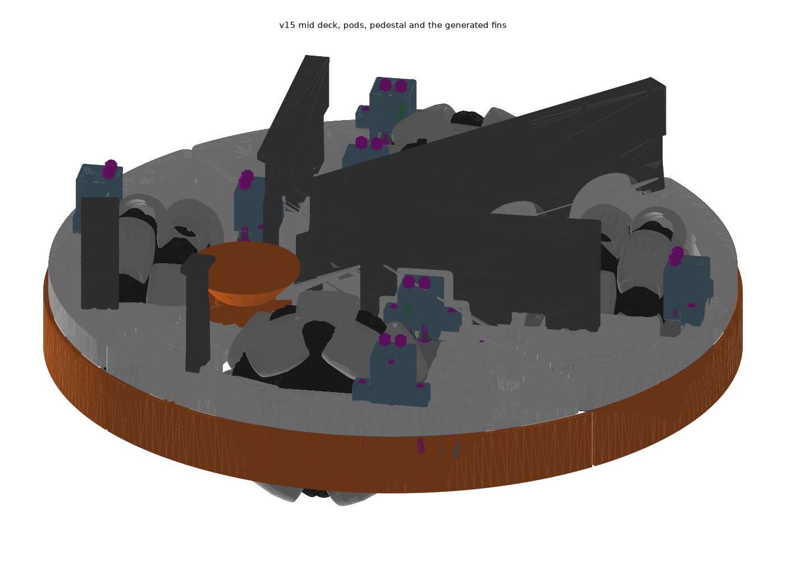
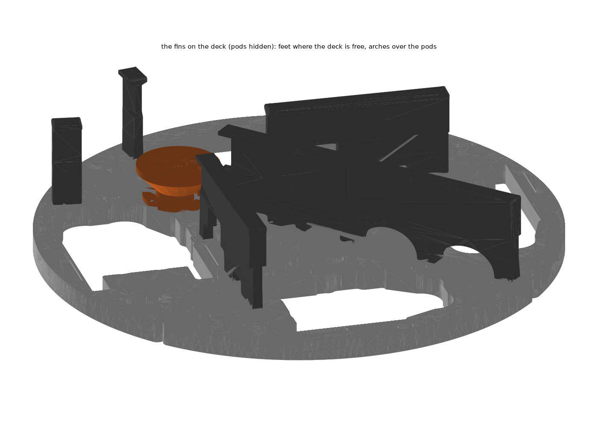
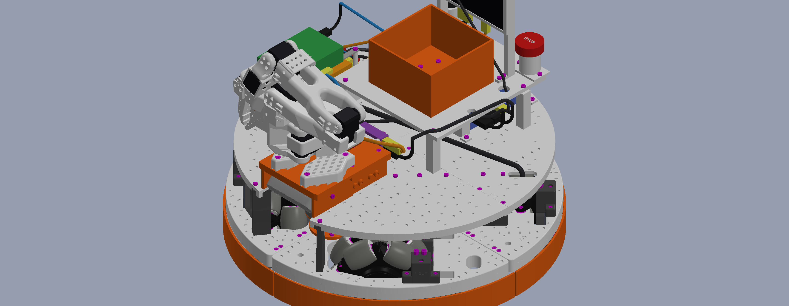
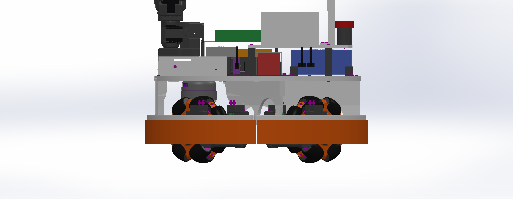

# cad/v15: the mid-deck robot (Nov 14 2026, PROPOSAL; cad/v14 stays the current robot)

**Nov 19: superseded by [cad/v16](../v16/README.md)**, a clean copy of this folder's baseline design (Fernando). Develop there; this folder
keeps the review rounds below, the triangle study, the plunger study (M4 cap try-out) and the proposals, for history and reproduction.

v15 is a complete folder: its scripts (`tools/`, map in [tools/README.md](tools/README.md)), reference parts (`reference/`), checks
(`validation/`), STEPs (`step_export/`), the SolidWorks viewing assembly (`solidworks/`) and run logs (`logs/`). It reads nothing from another
CAD version; the one outside import is the robot's own `ros/src/omni_arm` kinematics. **`./regen_all.sh` regenerates everything** in order
(`./regen_all.sh sw` adds the SolidWorks rebuild). Nominal CAD and hand statics: nothing here is printed or load-tested.

**Nov 18 (Fernando: power down): the electrics are rearranged on both floors and the harness is re-routed** ([Electrics and
harness](#electrics-and-harness-nov-18-fernando-power-down)): the 12 V and 5 V converters and the battery's path on the first floor, the
computer under the bin, the carrier (pcb/v1) beside the arm riser; the power stack, the power board and the switch pod are gone. The deck, the
pods and the fins are unchanged. Review STEP: `step_export/electrical/electrical_review.step`. Not rerun yet (they wait for the STEP review):
`harness.py check`, the arm sweeps, service, the SolidWorks assembly.
**Nov 18, evening (Fernando):** the deck has **217 accessory M3 pilots** (was 53; [the deck](#the-deck-toolschassis_midpy)), and **the ELRS
receiver is on the carrier** (plugged into J5 on headers, in the carrier's KiCad STEP; its floor-2 block, cradle and lead are gone). Rerun:
`chassis_mid.py all`, `upper.py all` (no overlap, no bed-fit failure), harness route / render / inventory / table, the electrical review STEP.
**Open, found doing it:** the D435's drawn lead (`d435_riser.py`, along the riser's side at y -60.75, z ~197.6, x 62-138) lies 3-8 mm over
the carrier's top edge: through the top-row XH housings (J15, J20) and now the receiver's header (the carrier is only box-checked, so the
check doesn't name it). Raise that lead over the carrier, or move the carrier ~15 mm toward -y. The receiver's antenna (upright, top z ~244 at
(96.5, -62)) is 5.6 mm from the riser adapter and 21.6 mm from the arm's base at stow; the arm sweep has not been rerun with it.

**Status (Nov 15 evening): the pod review and the evening round below are drawn; the pod, wheel and deck (+ fins) checks are rerun on them,
and the SolidWorks assembly is rebuilt on them (one pod assembly per pod, the marked parts per pod): motion test pass on all four pods, paths
pass (984 components, 300 files), interference without the harness: no part / part finding; each harness lead alone: no finding.
Not rerun since the evening round (Fernando: straight to SolidWorks): upper / D435, arm sweeps, harness routing (SolidWorks shows the pod
review's routes), service, robot STEP; they ran clean on the pod review.**
**Nov 16: the pack is the HRB 6S 3300** (136 x 46 x 43, 558 g; [below](#the-battery-under-the-deck)). `chassis_mid.py all` was rerun on it:
no overlap with the pods in any pose, every screw's thread at least 7 mm, and the battery group is further from the pods (clips 15.5 mm, pack
26.8 mm, plan 10.2 mm). Its STEPs are rewritten. **Not rerun on the new pack:** harness routing and checks (the drawn pigtail and XT90 pair), service (the pack's
drop-out). **Rerun the evening of Nov 16:** the robot STEP and the whole SolidWorks assembly, with the new [filament colours](#filament-colours-baselined-nov-16-fernando). The power budget is rerun (`harness.py power`): about 29 min typical (was 45).
**Nov 16, late: every printed part fits the 256 bed, checked.** The bed check measured the deck's plan outline, not its solids, and passed
deck_FL, whose dovetail tabs made it 243 x 258.6 (FL and RR are the lower pieces on both their seams, so their tabs reach past two edges).
The tabs are now **13 deep (were 20)**, so 4 laps fit on every seam, and all four pieces fit as exported ([the deck](#the-deck-toolschassis_midpy)).
One shared check, `print_beds.bed_fit` (the real solid in its print orientation, best rotation, 2 mm margin: 252 mm), now runs in the pod,
deck and upper checks; each lists `bed_fit_failures`. A survey of every exported print STEP found no other part over 225 mm. The dovetail
coupon follows the new depth. Rerun: `chassis_mid.py all`, the coupon, the robot STEP, the print files and the whole SolidWorks assembly
(motion test pass on all four pods, paths pass with 988 components and 300 files, interference without the harness: no part / part finding,
each of the 24 leads alone: no finding).
`pod_mid check` and `upper check` (Nov 17, geometry unchanged) pass the new bed check: no failures; the tightest are the floor2 pieces
(225 mm, 27 spare) and the pod build's local deck stand-in (217 mm, 35 spare). **Harness and service rerun Nov 17** (on the 13 mm tabs and
the HRB pack, so these also close Nov 16's "not rerun on the new pack"): [harness](#harness) as its table, no new finding (static clearances
within 0.5 mm of Nov 14's except the drawn BAT_PB); [service](#service-stand): all five drop-outs clear, 109 of 224 screws meet the driver
(was 103), every one an order of work listed there.
**Nov 17, evening: dovetail clearance 0.05 per face (the coupon) and R0.5 on the dovetails' outside corners** ([seams](#the-deck-toolschassis_midpy)).
Rerun: `chassis_mid.py all` (4 laps per seam, each piece one valid solid, bed fit unchanged), the coupon, the robot STEP and the print files.
Then the whole SolidWorks assembly (motion test pass on all four pods, no mate errors; paths pass with 988 components; interference without
the harness: no finding; each of the 24 leads alone: no finding). Not rerun: harness and service (plan changes under 0.5 mm at the seams).
**Earlier (Nov 14-15 review round, items 3, 5, 7-11):** the deck's openings are 2 mm (from 1); the fins are redrawn (generated); the battery
hangs under the deck; four service-stand pads; bumper strategies proposed; the arm, D435 and harness re-checked on v15; every script now
builds v15 (cleaned: no module changes another's constants, one world in `tools/world.py`, layout F in `base.py`; the superseded triangle
study is in `studies/triangle/`). Open: the arm's nearest floor grasp is 0.5 mm off the bigger bumper (below), the spring rate, the
computer's move (not done), the bumper's redesign (not drawn).

## Nov 15 evening round (Fernando)

| Item | What changed |
| --- | --- |
| A: fewer mass-saving pockets | The lightening pockets are gone (at 15 % infill a closed deck costs little and is far stiffer); a few access windows instead, the largest that fits where the pockets were: 25 x 50 slots (RL, RR), 20-24 mm holes / short slots (FL, FR, two each). Deck 1899 cm³ (was 1765) |
| Seams touch | The pieces meet along the seams (`JOINT_GAP` 0, was 0.2), so their walls bear on each other; only the dovetail sockets (and the centre key) keep a clearance: **0.05 per face** since Nov 17 (was 0.10), the best fit on the printed dovetail coupon (Fernando). Since Nov 17 the dovetails' outside corners carry **R0.5** fillets (the tab's far corners, the socket's two lips at the seam; vertical edges) so they slide in; the key already had R1 |
| Dovetail coupon | `tools/coupon_dovetail.py`: one male tab of the deck's shape on a short bar and a socket bar with two sockets, 0.05 and 0 per face, both 10 mm thick and printed flat as the deck; `step_export/coupon_dovetail/coupon_dovetail_bed.step` |
| B: centre key | A flush four-arm key (`deck_key`, 40 x 40, 6 thick, prints flat) in a recess over the seams' crossing; its arms run along the diagonals into the four pieces and flare like dovetails. The two south arms are screwed (M3 x 16 into FR / RR); the two north arms lie under the spine's first foot, which holds them down, and the spine's foot screws pass up through the key |
| D: laps | Tabs 20 deep (was 14; **13 since Nov 16**: at 20, deck_FL measured 243 x 258.6 and did not fit the bed), up to 4 per seam (at 20: 90°, 180°: 4; 0°, 270°: 3, where the beams, the strap slots and the key leave room; at 13: 4 on every seam); 2 x M3 x 16 each as before, the Ø2.8 pilot kept, plus a flush 5.5 AF x 2.5 hex recess under the tab for an optional nut (with a longer screw); the key's screws the same |
| Towers 5 mm lower | `dims.STACK_PRELOAD`: the spring seat 5 mm lower, so the two springs are always compressed (stack at nominal 8.7 mm, at bump 15.1 of 18.5); tower top robot z 133.3, plunger M4 x 45. The ride height now depends on the real spring rate (VERIFY) |
| Tower nuts | The hex wells are gone: 12 mm stub tabs again, the nut in a recess in each stub's top. Printed top down, the stubs hang: **support under the two stubs** (~320 mm² per tower) |
| Beam screws | 5: per side one at the front corner (x ±30 from the centre plane, y 94, behind the bar) and one at the back (±16, y 107.5), and the middle one at the back. Driver to the bar ≥ 2.56 mm |
| Beam cut-out through | The relief under the neighbouring deck piece's tab is cut through the beam (was its top 1 mm), on every beam (one part per hand), so that deck piece comes off with pod 2 and its deck in place |
| Front fins | Two screws each (feet ≥ 22 mm long get one near each end: the side fins now 3, the spine 6) |
| Spine's first section | The spine starts at u 44 (was 50, the lidar's body at u 38) and the front strap moved, so its nose is a real foot (u 44.6-57.9) with a screw |
| Battery strap | The front strap moved back 6.75 mm (x 44) and the laps now keep off the strap slots, so the seam-0 dovetail moved away from it (r 48 → 65) |

## Nov 15 pod review (Fernando's list)

(The evening round above replaces the towers' hex wells, the 7 beam screws, the 1 mm beam relief and the springs' tower height given here.)

| Item | What changed | Checked |
| --- | --- | --- |
| The 6804 could slide in and out | The cartridge is two parts: the **cup** (`wheel_cartridge`: a flange in the hub's counterbore, the Ø32.1 seat, a lip r 14.5-17.6 on the outer race's motor-side face) and the **cap** (`wheel_cartridge_cap`, the old flush plate, on its outboard face). The 3 flat heads clamp cap + flange to the hub, so the outer race is held both ways; the inner race already was (stub shoulder + retainer). The hub's counterbore is 2 mm deeper (end wall 10 → 8, the cartridge screws 7.5 mm in the hub). The wheel's and the pod's widths are unchanged | `validation/wheel_motor/checks.json` `bearing_6804_retention`: 0.0 gap cap / lip to the race, no overlaps. **The wheel is now located axially at both ends** (the 6804 and the motor's bearing): VERIFY on the first build that nothing binds |
| Beam, tower, hanger: holes perpendicular to the bed | Hangers print on their outer faces (pivot boss, spigot, snug hole vertical); the beam stands on its outer end (pivot line vertical): its outer boss is a separate **pin** (`rx_pin`, Ø10 + Ø7.2 spigot, snug on the pivot screw) and the droop lug a separate **lug** (`rx_lug`, a boss in a pocket under the beam, the lug bolt through both; it now bends in its layer planes); the towers print **top down** (spring bores, guides, every screw vertical), their end tabs full height, the long bolts' nuts dropped down a 5.7 AF hex well onto its floor | `print_beds.py`; overhang (mm²): towers 72, beam 544, lug 84, pin 0, **hangers 690: the rear 8 mm part's outer face stands 6 mm over the bed and needs a small support block** (widening it would put its corner into the bumper). The hangers' bed edges stay sharp (OCC refused the chamfer) |
| Numbers and IN / OUT | **1 front left, 2 front right, 3 back left, 4 back right** (top view, front up). Engraved 0.6: hangers (underside), towers (outer face), beam (underside; **Nov 18, Fernando: also "← OUT", "↑ UP", "IN →" on its back face and "OUT" / "IN" with arrows beside the number underneath**, the arrows pointing to the outer end (the pin) and the inner end (the boss) in every pod's hand: `labels.engrave`'s `arrow_to`), fork halves (outer faces), each deck piece's number in its top (reading with the front up). One file per pod for those parts (`step_export/pod_mid/parts/<part>_<n>_<pod>.step`, already in that pod's hand; `tools/labels.py`) | every mark placed (`pod_mid` checks `marks`, `chassis_mid` `deck_marks`) |
| Up arrow on the forks, XT30 mark | An up arrow next to the number on both fork halves; a 2 mm V-notch in the motor plate's rim at the plug's azimuth (89.8°) and an engraved "↑ XT30" pointing at it | |
| Alignment, deck ↔ tower / hanger / beam | 1.5 mm bosses (0.15 a side, pockets 1.7 deep): under each tower's base into the deck's top, on each hanger's and the beam's top into the deck's underside; the separate lug the same into the beam | every pocket in one piece, walls ≥ 2.8 to an opening, 4.7 to the nearest dovetail tab |
| Two hanger screws very close | The one at y 88.5 is gone; the one at 96.5 stays | hole audit clean |
| Beam's far screws blocked by the fork's bar | Moved from y 86 to y 94, beside the lug | a Ø6.5 driver straight down passes the bar by 2.56 (droop) / 3.75 (nominal) / 8.26 (bump), the lug by 3.75; service: no longer blocked |
| FR beam under the deck's dovetail | The beam's top is relieved 1 mm where x + y ≥ 143 (pod frame; every beam, one part per hand); `chassis_mid` now keeps every tab off every pod's seat | `seats_on_another_piece`: none |
| Two springs in series | Each bore takes two 7.7 × 18.5 springs stacked (stack 37 free, 18.5 solid): the towers are 15 mm taller (top robot z 138.3, plunger M4 × 50), the fix screw an M3 × 40, wheel rate 2.16 N/mm (half; rate still ASSUMED). A printed spring block replaces one spring if wanted (not drawn) | far bore at bump: 10.1 of 18.5 mm travel; D435 fields, arm sweep, lidar (20.9°) unchanged |

Other effects: the fins regenerated over the taller towers (side fins' lower edge to z 140); fin screws now keep off the pods' alignment bosses. The
front bumper's first tab moved 14° → 15°, and the arm's nearest floor grasp is **0.2 mm** off bumper_FL (was 0.5: the open bumper item). Harness:
0.0° in the scan band, motor leads ≥ 4.66 from moving parts; M_RR's drawn bend round the taller tower is 0.8 mm (open, as the other drawn bends).
The SolidWorks assembly was rebuilt after the evening round (status above).

## The idea (Fernando, Nov 14)

- **The floor deck sits above the pods' pivots and below their spring towers** (robot z 80–100; v14's frame was z 40–62).
- **The pods hang under the deck,** bolted up from below. **A pod drops out downward;** its towers and springs stay on the deck.
- **The second floor and everything on it are v14's, in place** (z 176.5); the fins stand on the deck.
- The wheels keep v14's positions (layout F: rolling lines tangent to r 154, slid −20), so the kinematics, firmware and ROS drive are unchanged.

 

## The pod (`tools/pod_mid.py`)

P4's fork, pivots and beam (cad/v14 Pod_reimagined_4) with **hangers** in place of its side frames. The pod hangs under the deck; its two
spring towers stand on it.

| | |
| --- | --- |
| Hangers | 14 mm under the tower, tapering to 8 behind the pivot, z 60-80, printed on the outer face (Nov 15); the pivot boss on the 627's inner race, an M3 x 35 pivot screw from the hanger's outer face through the 627 and the beam's pin into the beam (no shim: exact-length bosses, sand or shim at assembly) |
| Load path | the springs push the towers up and the pivot pulls the hangers and beam down (about 2x the wheel load). **2 x M3 x 50 per side** go up from the hanger's underside through hanger, deck and the tower's end into a hex nut 12 mm over the deck (since Nov 15 at the floor of a hex well from the tower's top): a clamped stack that closes the spring loop, so the deck carries only the net wheel load. 1 x M3 x 30 per hanger behind the pivot (Nov 15; was 2), 7 x M3 x 30 and the lug's M3 x 50 up through the separate lug and the beam into the deck. One M3 x 40 down through each tower keeps it when the pod is out |
| Springs | Fernando's 7.7 OD x 18.5 free, 9.23 solid, **two in series per bore** (Nov 15); rate unknown (10.4 N/mm assumed per spring for 10 kg). Bump stops at the towers' rails; the far stack uses 10.1 of its 18.5 mm at bump. **To do:** the kitchen-scale rate test, then retune (preload by compressing the stack, or a spring block for one spring) |
| Motor leads | the XT30 faces up; the bundle is tied at a Ø4.6 hole through the motor plate (`pod_rx.HARNESS_HOLE`), then an 18 mm service loop up through the deck's opening |
| Comes out | downward: unplug the motor through the deck's opening, cut the plate's tie, take out the 4 long bolts, 4 hanger screws, 7 beam screws and the lug bolt from below |

Checks (`validation/pod_mid/checks.json`): no interference in droop / nominal / bump; hole audit clean (the long bolts graze the tower's
nut recesses by 0.15, by design); droop stop 0.89 mm at nominal; thread into the deck 12-15 mm. **Deck opening 2.0 mm round everything that
moves** (Nov 14 review; was 1.0: `pod_mid.CLR`, the wheel rule): 2.0 / 2.02 to the fork and the wheel's revolved envelope at nominal, 1.96 /
1.99 at bump. The hangers' and beam's tops now sit 96.7 % on the deck (100 % with the 1 mm opening).

## The deck (`tools/chassis_mid.py`)

| | |
| --- | --- |
| Deck | a 20 mm disc (z 80-100) in four pieces, one pod each, joined by dovetail half-laps (4 per seam, tabs 13 deep, 2 x M3 x 16 down into the tab). The seams cross at (6, -10): the spine fin runs along y 0 and no screw may straddle a seam. 1896 cm³ in all (v14's frame 1141). **Bed fit (Nov 16), the solids as exported, tabs included:** FL 236.0 x 251.6, RR 247.4 x 232.0, RL 235.0 x 239.0, FR 222.4 x 218.6, all inside the 252 mm limit (256 bed, 2 mm margin) without turning; FL has the least spare (3.7 mm at its best rotation) |
| Openings | everything of the pod above the deck's underside in every pose + 2.0 mm; robot Ø465 (v14 Ø450), bumper 10.7 mm outside the wheels' swept envelope |
| Accessory holes | zip-tie pairs and spare Ø2.8 M3 pilots, through, where the deck has room: **since Nov 18 (Fernando: more, for whatever gets mounted later) 217 pilots** (FL 50, RL 58, RR 66, FR 43; was 53) on the 15 mm lattice, its centre points (a 10.6 mm diagonal pitch) and then the pockets left, at least 10.6 mm apart within a piece (10.31 across a seam); 72 tie pairs (unchanged); plan `validation/chassis_mid/accessory_holes.png`. **None over the battery, its straps or the stand pads** (a screw from the top would reach the pack), the pods' seats, laps, marks or within 6.5 of a screw |
| Bumper | four 3 mm PLA quarters, z 40-80, 3 tabs each under the deck's rim (M3 x 16 up into the deck). Other strategies below |
| Lidar pedestal | 31.7 mm on the deck (v14 69.7), the lidar at v14's height (scan plane z 163) |
| Heights | pod and tower tops z 131; a wheel at bump 155; scan plane 163; second floor 176.5; nothing of the base below z 80 but the bumper (40), the battery's straps (35.5 with the HRB pack) and the pods themselves (31) |

Checks (`validation/chassis_mid/checks.json`): every piece one valid solid; every pod screw on its own piece >= 6.5 mm from an edge; the
fins, pedestal, bumper, battery and its clips against the four pods in every pose: no overlap, nearest 2.3 mm (the bumper's tabs to the pods'
static parts).

## The fins (`tools/fins.py`), redesigned Nov 14

v14's fins were patched onto the deck: shortened, front fins on M3 x 90 bolts longer than any M3 on hand, the side fins' columns standing
on a pod column that v15 does not have. They are redrawn as one rule in `tools/fins.py`:

- **Kept, so the second floor does not change:** the five rays from the lidar's axis (spine 180°, sides ±136.7°, fronts ±36°), each fin's
  top extent and flange under the floor, the floor's screw points, and in the scan band only a web that is a wedge as wide as its own shadow.
- **Generated:** each fin's lower edge comes from a height map of everything that stands on the deck. That map covers the pods in five poses
  (droop to bump, with the wheel's revolved envelope), plungers and springs, towers and their bolts, the pedestal, the lidar and the battery
  straps over the deck. The edge keeps 3 mm off moving parts and 2 mm off static ones, rounded R3. Where the deck is solid and free, the fin
  stands on it (a foot); long feet get lightening arches.
- **Fixed from below:** every foot gets M3 x 25 pan heads up through the deck (counterbored) into Ø2.8 pilots along the fin's print axis,
  placed off the seams, other screws, strap slots and stand pads. Over the battery is allowed: the heads sit recessed. No long bolts, no studs.

| Fin | Feet (u, mm from the lidar) | Screws | Lower edge | Volume |
| --- | --- | --- | --- | --- |
| spine | 87-130, 165-182, 242-259, 319-335 (2 arches) | 4 | 100-104 (the straps) | 222 cm³ |
| side L / R | 153-178, 203-237 | 2 each | up to 124: its nose (u 78-153, under the arm riser's corner) arches over the front pod and cantilevers from the first foot as a ~50 mm-deep plate | 102 cm³ each |
| front L / R | 85-108 | 1 each, + one floor screw at v14's long bolt's place | 100 | 16 cm³ each |

Lidar: **20.9° blind in all, as v14** (spine 5.3°, sides 3.7°, fronts 4.1°: `validation/chassis_mid/lidar_shadows.json`, which the harness
now reads). The spine's web starts at u 54.3 (v14's nose cove). Change the pods, the deck or what stands on it and the fins follow on the next
build.

## The battery, under the deck

Fernando (Nov 14): "move it down there". **Since Nov 16 the pack is the HRB 6S 3300 mAh** (136 x 46 x 43, 558 g; Fernando's baseline,
[components/battery](../../components/battery/README.md)); it was the OVONIC 6S 5200 (157 x 47 x 46, 706 g). It hangs under the deck's
centre, along x, x -56.5..79.5 (the OVONIC's centre, so the straps keep their slots), its 43 mm side vertical, its top against the deck's
underside (z 37-80). Under the deck the pods leave a corridor 55 mm wide from x -135 to +135, 3 mm off every pod
part in every pose. In the CAD the pack's zone keeps 9.7 mm in plan from the pods.

- **Held:** four printed corner clips (L walls 30 tall, an M3 x 10 up through each tab into the deck) locate it; two straps at its quarter
  points go round it and over the deck's top through slots right beside it.
- **Leads:** the XT90 end faces the rear (the HRB's connector is VERIFY; XT90 ASSUMED): the mated pair lies under the deck behind the pack
  (x -118..-72, unchanged, so the pigtail is drawn 15 mm longer). The board's 12 AWG lead goes up
  through a Ø12 hole (-128, -17), beside the spine, 8 mm from the nearest opening; from there it is routed to the power board (harness `BAT_PB`).
  The balance lead's XH7 stays tucked against the pack's front end.
- **Out:** robot on its stand, unplug the XT90 under the deck, open the straps, the pack drops out (the pods' way).
- **Centre of gravity:** the pack's centre comes down 146.5 mm (v14: on the second floor), about 10 mm off the robot's CG at 10 kg (est).
- The second floor's battery tray is gone; its place under the bin deck is free.

**Can the computer move down too?** It fits: the BMAX B8A Pro (126 x 112 x 52 plus 12 mm of plugs) clears every pod and tower by 3 mm on
the deck's top at the centre, its top at z 155, under the scan plane (`computer_on_the_deck` in the checks). **Not moved yet**, because it
costs:
- the spine fin runs through exactly that spot (it would have to bridge over the computer: only its web and flange, z 158-176.5);
- the computer's five leads would have to rise to the second floor through a fin's shadow (a new slot beside the spine, or the side slots);
- the bin deck, which exists to hold the computer down, could then come down to the floor, which moves the bin and the face (the e-stop left the deck on Nov 18).

Worth it for the CG (430 g down ~110 mm) and a lower bin, if you want that round.

## Service stand

Four pads on the deck's underside, one per side (x, y): (197, 17), (-21, 197), (-197, 17), (-21, -197). Each is a solid Ø24 area with a
**Ø8.4 hole through the deck** for an Ø8 peg (through: cad/solidworks.md 18, every hole through its part). They are placed where nothing hangs or drops: 5 mm off every pod's drop-out column and off the battery's
zone, the bumper's tabs and the seams. No pocket, accessory hole or fin screw goes near them.

**Stand height:** a pod's dropping part is 140 mm tall at droop. To lower it onto the bench and slide it out radially under the bumper (z 40)
between two pegs, the stand holds the pads **185 mm over the bench** (the robot's floor 105 mm up). The battery comes out the same way.
`validation/chassis_mid/checks.json` "stand".

**Service checks (`tools/service.py`, `validation/service/service.json`)** (they replace v14's `screw_access.py` and `pod_service.py`):
- **Drop out:** each pod's dropping part (at droop) and the battery pack lowered straight down: all five clear. The checked items that stay
  are the towers, plungers and springs; the screws that come out first are left out.
- **Driver access:** a straight Ø6 driver 100 mm out from each of the 224 screw heads: 109 meet something on the way (Nov 17, on the 13 mm
  tabs and the HRB pack; was 103; v14: 66 of 164). Most
  are the second floor's order of work (parts fitted later), as in v14. The base's and pods' cases are orders of work too:

| Screws | Blocked by | Means |
| --- | --- | --- |
| each pod's up-screws, long tower bolts, lug bolt (60) | nothing | a pod comes out from below with everything else in place |
| the beams' two front screws (8) | the fork's bar, 15 mm | known (round c): drop them in before the fork, drive with an L-key |
| the outer pivot screws (4) | the bumper, 5 mm | they stay in the dropped pod; serviced on the bench |
| the towers' hold-down screws (8) | the second floor, 60 mm | a stubby driver (the towers stay when a pod drops) |
| four side-fin feet (two per rear pod) | the rear pods' beam and lug | drop that pod first to take a side fin off |
| four spine feet | the battery | take the battery out first |
| deck laps and keys under the second floor (33 of 34) | the floor, the spine, the computer, a deck post (lap 9 under `post_deck_1`), the D435 | the deck goes together before the posts, fins and floor |

## Bumper strategies (proposal, not drawn)

What is drawn today: four 3 mm PLA quarters (z 40–80, Ø465), each hung from its top edge by 3 tabs under the deck's rim, one M3 up through
each tab into the deck. The skirt is a 40 mm cantilever from those tabs: a knock at its lower edge levers on the tabs and their screws, and
the skirt is only about 10.7 mm from the wheels' swept envelope. A wall at deck height (z 80–100) meets the deck's rim first (r 229, 10 mm
outside the wheels). The skirt is there for low things (shoes, toys, chair feet under 80 mm) that would otherwise reach the wheels.

| | Strategy | For | Against |
| --- | --- | --- | --- |
| A | **As drawn**: rigid 3 mm PLA skirt, 12 tabs | simplest; prints flat on its top edge | cracks at the tabs; no give; 10 mm from the wheels if it bends in |
| B | **TPU skirt in a PLA clamp ring** (recommended): a 3–4 mm light-gray TPU band, its top edge clamped all the way round between the deck's rim and a printed PLA ring (M3 up into the deck every ~30°) | absorbs knocks, cannot crack, quiet against furniture; the clamp spreads the load (no tab stress points); a quarter swaps without touching the pods | TPU prints slower; it must not flex inward more than ~8 mm (3–4 mm wall, or a bead at the bottom edge); grips walls a little when the robot slides along them |
| C | **Ribbed PLA skirt**: vertical ribs inside every ~25 mm and a bead at the bottom edge | stiff, cheap; keeps today's tabs | still rigid and brittle under a hard knock; ribs eat into the 10.7 mm to the wheels |
| D | **Floating bumper with switches**: a ring on 4–8 elastomer or flexure mounts with 2–4 mm of travel, microswitches to the Teensy's spare GPIO (`mcu_spare_io` already exists) | real contact sensing (the Nov 9 study: a switch catches the light hits the motor current misses: shoes, balls, a 1.5 kg box) | reopens the Nov 9 decision (no switches for now); more parts, and its travel must stay clear of the wheels |
| E | **No skirt: a TPU edge on the deck's rim** (a D-profile pressed into a groove round the rim, z 80–100) | lightest, nothing hangs below the deck; the battery and pods stay as open from below as they are | low things reach the wheels and forks under the deck: needs low guards on each pod instead |

Recommendation: **B now, laid out so D can follow.** Make the clamp ring with a 3 mm gap behind the band, which leaves room for a few
millimetres of travel and switch pads later without redrawing the deck.

## Arm, camera and lidar re-checks

Re-run on the v15 robot (Nov 14 review, item 5): `arm_sweep.py`, `d435_riser.py`, `upper.py` check, all against `world.py`.

| Check | v14 | v15 |
| --- | --- | --- |
| SO-101 swept through every planned move (official meshes), nearest | 7.5 mm (the floor grasp 0.26 m ahead, to the bumper) | **0.5 mm**: the same grasp's gripper passes the front bumper (bumper_FR) |
| ... every other move | 18.6 mm (riser adapter) | 18.6 mm |
| Floor grasps that cannot be planned | 4 (out of reach at 0.36 m, y ±0.12) | the same 4, with either keep-out ring |
| D435 (on the riser): arm, lidar, bumper, fields, floor view | 11-18 mm from the arm; floor seen from 0.31 m | the same: 11.0 / 13.3 / 17.8 mm from the arm, 15.1 mm over the scan plane, r 209 inside the bumper (r 232.5), nothing in its depth or RGB fields, floor from 311.5 mm |
| Upper robot against the base (deck, fins, pedestal, bumper, battery, towers) | - | no overlap |
| Lidar blind angle | 20.9° | 20.9° |

**The floor grasp.** v15's bumper is 7.35 mm further out than v14's (r 232.5 vs 225.15), and the gripper's way down to the nearest floor
target (0.26 m ahead, on the centreline) passes just outside it. That costs 7 of v14's 7.5 mm of margin. Two ways back (your call):
1. pull the bumper back to v14's radius across the front ±30° (the deck's rim to about r 222 there: the front wheels are far inside that
   sector, the front fins' feet near it), or
2. move the nearest floor grasp out to about 0.27 m (an arm config change: `omni_arm`, the sim's pick).

**The robot's keep-out ring.** `ros/src/omni_arm/omni_arm/config/robot_arm.json` keeps the arm out of a ring r 0.19-0.235 only up to
z 0.085 (v14's bumper top 90, frame top 62); v15's deck rim stands at r 0.229 up to z 0.100. Here the sweep was planned both ways
(`arm_sweep.json` with v15's ring, `arm_sweep_robot_ring.json` with the robot's): the same moves, the same clearances. No planned move uses
that gap. If v15 is adopted, raise the ring's z1 to 0.100 anyway.

## Electrics and harness (Nov 18, Fernando: power down)

`tools/electrical.py` (every block, its cradle and its ports, both floors), `tools/harness.py` (ports, connections, the leads drawn),
`tools/harness_route.py` (routes), `tools/harness_table.py` (the table below), `tools/electrical_step.py` (the review STEP). Proposal: nothing
bought or wired; block sizes ASSUMED unless noted, port layouts per block class (VERIFY on the parts).

**Rules kept:** the deck, the pods and the fins are not modified (Fernando): every first-floor cradle screws into the deck's own accessory
M3 pilots (`chassis_mid.accessory_holes`, now also returning their positions). Nothing on the first floor over z 148 (the lidar's band; the
drive leads hop over the towers at up to z 150.5, their top 154.5, under the band rule z 163 +- (3 + r)). Every lead that changes floor
climbs a slot in a side fin's shadow.

**Where the deck has room:** a 1 mm map of the deck's top (the pods in every pose, towers, straps, fins + 2, openings: the fins' own height
map) holds exactly two converter-sized blocks, one in each side lens outside the side fins (around (22, +-182)), and small blocks in the
wedges by the spine. The 19 V module (74 x 74, with ears 92) fits nowhere on the deck, so it stays on the second floor.

| Block | Where | Size (mm), source | Held by |
| --- | --- | --- | --- |
| 12 V 8 A converter (the arm) | floor 1, left lens (22, 184) | 64 x 57 x 22 + ears (comparable 96 W units, VERIFY) | cradle: deck accessory pilots under it; its ears into the cradle |
| 5 V 5 A converter (face, hub) | floor 1, right lens (22, -184) | 66 x 60 x 22 + ears (comparable 25 W units, VERIFY) | as above |
| anti-spark switch (the main button's) | floor 1, right wedge (-68, -40) | 50 x 25 x 15 (ASSUMED) | cradle, deck pilots |
| distribution block + INA226 | floor 1, right wedge (0, -62) | 70 x 30 x 16: 7 XT30 out on top, CAN junction and pack sense on its side, the INA226 (2 mOhm shunt, 41 A) standing on it | cradle, deck pilots |
| 19 V 10 A converter (the computer) | floor 2, right (0, -165) | 74 x 74 x 32 + ears (ASSUMED) | cradle on outside tabs, new floor pilots |
| INA3221 (12 V, 19 V, 5 V) | floor 2 (-105, -100) | 32 x 25 x 8 | cradle, floor pilots |
| computer (BMAX B8A Pro) | floor 2, under the bin (-70, 0), front panel to the arm | 112 x 126 x 52 | its four clips |
| carrier (pcb/v1, KiCad STEP + the Teensy 4.1 and CAN models from `electronics/`) | floor 2, beside the arm riser: board x 26..128, y -122..-60 (Nov 18: 4 mm back, so the top-left corner screw clears the side fin's flange) | 102 x 62 (Nov 18: M3 holes at the corners, 3.5 in), 6 mm standoffs, plugs up | one M3 x 18 per corner through the board, its standoff and the tray into a floor pilot |
| USB hub | floor 2, left (-40, 120) | 90 x 28 x 14 (ASSUMED) | cradle, floor pilots |
| ELRS receiver (HPXGRC 2.4 GHz, `components/radio receiver`) | **on the carrier** (Nov 18, Fernando): plugged into J5 (1x4 female socket) on a male header, flat along the board's top edge 11 mm up; the 40 mm T antenna drawn upright from its U.FL (top at z ~246, robot (96.5, -62)) | 20 x 11 (vendor) | J5; in the carrier's KiCad STEP (`pcb/v1/tools/elrs_model.py`); no cradle, no lead |
| main button (= e-stop, latching) | floor 2's rear rim, face at x -204, y -45, facing back (-x); the bin deck's e-stop pod is gone | Fernando's `Switch.SLDPRT` (`reference/electronics/switch.step`): round snap-in rocker, Ø20.2 hole, Ø23 bezel, 4.8 mm tabs | `housing_switch`, 4 M3 x 10 into new pilots |

**Cradles (Nov 18, after the second floor's check):** each block sits in a printed tray with 7 mm walls. The converters' trays have a
7.5 mm floor: their ear screws (M3 x 10 through the 3 mm ear) get 7 mm of thread and end 0.5 mm over the deck or floor (a 2.5 mm floor
gave 3 mm). The other first-floor trays have a 5 mm floor. First-floor trays screw into the deck's accessory pilots under them (M3 x 12),
with the heads in 7 x 3 counterbores under the device (the converters 3 each, the distribution block 2, on the denser Nov 18 pilots). The
anti-spark switch's tray, beside the battery's keep-out, still finds only one pilot. A tray with fewer than two screws gets a 5 mm pad out to the nearest deck tie pair outside
its walls (`electrical._tie_pad`; the anti-spark's: the pair at (-105, -25), next to the battery lead's +L end). The pad has the same two
slots, and a zip tie goes down one slot through pad and deck, under the deck's bridge, up the other and over the pad. One screw + one tie
stop it turning. The tie isn't modelled. Second-floor trays screw down through
3 mm tabs outside their walls into new floor pilots (M3 x 10). These screws stay off the floor's seams, the fins' flanges, the slots, the
lidar, the grid pilots and the computer. The carrier's tray clears the two side-fin floor screws under it. Raising the converters
(+5.0 mm) and the other first-floor blocks (+2.5 mm) moved their ports, so the leads are re-routed.

**Battery path (floor 1 only):** the deck's lead hole (-128, -17) -> anti-spark switch -> 30 A fuse (inline) -> INA226 -> distribution
block -> the four drives (their own leads, no fuses), the 12 V and 5 V converters, and the 19 V converter's feed up slot R. No battery or
drive lead leaves the first floor.

**USB:** front USB-A 3: the D435 and the Teensy; front USB-C: the hub (the servo bus adapter and spares); rear USB-A 2: the mic and the
lidar's adapter; rear HDMI: the face; rear DC: 19 V from the INA3221.

**Lidar-plane crossings: 6, all inside the side fins' shadows** (was 6 thick ones: the battery's and four drive bundles): slot R the 19 V
feed, the 5 V output, one 8-wire signal lead (CAN, pack sense, the INA226's I2C) and the lidar's own lead; slot L the 12 V output and the
main button's two wires. The leads' table (from where, to where, through where, length) is `validation/harness/harness_table.md`.

**Main button (Nov 18, Fernando):** his `Switch.SLDPRT`, a round snap-in rocker (latching), is the main button and so the e-stop. It
sits on the second floor's rear rim, facing straight back at z 200: the panel's face at x -204, centred at y -45 (right of the rear seam's
lip and screws, behind the computer; Fernando moved it here from the left rim for less intrusive access). The bin deck's rear edge
(x -200) is 23 mm over the rocker's top, the rocker's centre about 3 mm inside the floor's Ø436 edge. The rocker tilts up and down.
`housing_switch` is a 4 mm panel (2.5 mm at the Ø20.2 hole, with a notch for the body's key) on a 3 mm base with two webs, drawn in its
own frame and turned into place (`upper.SWITCH`: `at`, `out`). It is open at the back for the leads and held by four M3 x 10 into new
floor pilots at (-191, -35), (-191, -55), (-164, -35) and (-164, -55). Put the outer two screws in before snapping the switch in,
because they sit under its body. It prints on the panel's face, so
the hole is round. The BUTTON lead starts at two 4.8 mm insulated receptacles (ASSUMED size). Which two tabs the rocker closes is VERIFY.
The modelled snap fingers are undeflected, so they overlap the panel by design; the check reports this under `intended_fits_mm3`.

The earlier harness notes below (v15 Nov 14: the power stack, the motor bundles up the right slot, `BAT_PB` up the left) are superseded by
the above; kept for the record.

## Harness (Nov 14, superseded Nov 18)

`tools/harness_route.py` (routes) and `tools/harness.py all` (the leads drawn and checked, `step_export/harness/harness_review.step`), on
`world.py`'s robot. Ports, leads and the upper floor's routes are v14's (cad/v13 Nov 11). What v15 changed:
- **Motor bundles (Ø8, R16):** from the motor's lead stubs along the motor plate's top edge to the zip tie at the plate's Ø4.6 hole, an 18 mm
  service loop up through the deck's opening, then over the deck to the second floor's right slot, up it in the side fin's shadow. Pod
  removal: unplug the XT30 through the opening, cut the plate's tie.
- **Battery (Nov 14):** the pack's pigtail and the mated XT90 pair are drawn under the deck. The board's 12 AWG lead (connection `BAT_PB`)
  starts at the deck's lead hole. The right slot is full (four motor bundles and the lidar's lead, one behind another in the fin's shadow),
  so `BAT_PB` goes up the **spare left slot** in the left side fin's shadow. It passes under the spine through its arch on the deck, then
  crosses the second floor to the power stack: 583 mm.
- **Slot runs** straight up from z 138 to 192 (was 146 to 188). A bundle's R16 bends at the ends of a shorter run reached into the scan band
  off the fin's ray.
- **The fins' shadows** are read from the generated fins (`validation/chassis_mid/lidar_shadows.json`), no longer v14's copy.

| Check (`validation/harness/checks.json`) | Result |
| --- | --- |
| Lidar scan band | **0.0° added**: every crossing inside a fin's shadow (tightest margin 0.29°, M_FL) |
| Leads to the pods' moving parts, every pose | none under 4 mm (a motor bundle's own loop rides with its fork and is left out, plus 20 mm) |
| Leads inside a part / in the D435's fields / plug overlaps | none |
| Arm sweep | >= 16.5 mm |
| Leads to static parts under 2 mm | as v14 for the second-floor leads (plugs, posts, slot edges where leads are tied); BAT_PB 1.45 mm to the power board it plugs into |
| Drawn bends under the allowed radius | as v14; the motor bundles' 18 mm loops are drawn tighter than R16 (slack when built; open item) |

## Filament colours (baselined Nov 16, Fernando)

Five filaments, one source: `tools/palette.py` (every colour function asks it first; bought parts keep realistic colours, fasteners and
bearings stay magenta). It replaces the Nov 13 three-colour scheme (cad/v14); chosen from renders of the robot in many combinations.

| Filament | Hex | Where |
| --- | --- | --- |
| **Jade White** | `#ffffff` | the deck (four pieces and its key), second floor, bin deck, the SO-101's printed links, face frame / crown / speaker cover, brackets, posts, spacers, the main switch's housing, battery clips, roller cores and sleeves |
| **Dark Gray** (PLA) | `#545454` | the suspension (fork halves, hangers, beam with pin and lug, towers, rings, 6804 retainer) and the five fins |
| **Orange** | `#ff6a13` | bumper quarters, bin, lidar pedestal, arm riser with the D435 cradle |
| **Black** | `#151515` (swatch `#000000`: shows no shading) | wheel hubs, wheel cartridges (cup and cap) |
| **TPU gray** | `#8e9089` | roller treads (a little darker than Silver `#a6a9aa`, which was the first pick) |

The arm stays white so the colour vision (`omni_arm/color_vision.py`, saturated hues) sees nothing of it; the orange riser is inside its 0.25 m mask.

**The first floor** (the deck and what bolts to it; 19 printed parts):

| Part | Qty | cm³ each | Filament | Seen assembled |
| --- | --- | --- | --- | --- |
| `deck_FL` / `FR` / `RL` / `RR` | 4 | 386-520 | Jade White | yes, the largest surface |
| `deck_key` | 1 | 4.7 | Jade White | small, on the deck's top |
| `bumper_FL` / `FR` / `RL` / `RR` | 4 | 47 | Orange | yes |
| `pedestal` | 1 | 54 | Orange | yes, under the lidar |
| the fins: `support_spine`, `support_side_L` / `R`, `support_front_L` / `R` | 5 | 225, 98 (x2), 16 (x2) | Dark Gray | yes |
| `bracket_battery_clip_0..3` | 4 | 2.8 | any colour | no: from below only |

**One pod** (x4 for the robot; the pod's parts are the same in both hands):

| Part | Qty | cm³ each | Filament | Seen assembled |
| --- | --- | --- | --- | --- |
| `pod_fork_outer`, `pod_fork_inner` | 1 + 1 | 72.5, 69.8 | Dark Gray | partly |
| `rx_tower_outer`, `rx_tower_inner` | 1 + 1 | 24.1 | Dark Gray | yes, they stand up through the deck |
| `rx_beam` | 1 | 52.3 | Dark Gray | glimpsed; from below |
| `rx_hanger_outer` | 1 | 17.5 | Dark Gray | glimpsed; from below |
| `rx_lug` | 1 | 6.3 | Dark Gray | glimpsed; from below |
| `wheel_hub` | 1 | 209 | Black | yes |
| `wheel_cartridge_cap` | 1 | 6.5 | Black | yes |
| `roller_core` | 12 | 15.1 | Jade White | yes, the ends between the treads |
| `roller_tread` | 12 | 15.5 | TPU gray | yes |
| `rx_hanger_inner`, `rx_ring_inner`, `rx_ring_outer`, `rx_pin`, `pod_retainer`, `wheel_cartridge` (the cup), `roller_sleeve` | 1, 1, 1, 1, 1, 1, 12 | 17.5, 2.0, 2.0, 0.4, 1.9, 5.1, 1.8 | **any colour** (spare filament) | no |

Solid volume for the base and four pods: Jade White 2,626 cm³ (decks 1,898, cores 723, key 5), Dark Gray 1,492 (fins 452, forks 569, towers 192,
beams 209, outer hangers 70; the lugs add 25), Orange 244, Black 862, TPU gray 742; about 215 cm³ of parts (clips, inner hangers, rings, pins, retainers,
cartridge cups, roller sleeves) can be any filament. Infill and walls make the real amounts smaller.

How "seen assembled" was measured: segmentation renders of the robot (SO-101 stowed, pods nominal), counting each part's visible pixels at 1200 x 900,
from 12 azimuths x 4 elevations around it and 24 close-ups of each pod, floor on; then with the floor removed to see what only shows from below.
Not seen = under 300 px in any outside view (clips 212, cups 20, sleeves 234, inner hanger 48, rings 28 / 246, pin 144, retainer 0; from below only the
clips, inner hangers and rings show to any extent). Glimpsed = 700-1,600 px (lug 767, outer hanger 1,234, beam 1,565). Open: the swatch shades on a real print.

**Print files:** `print_files/First floor/` (made by `tools/print_files.py`) holds the first floor's and the four pods' print STEPs sorted into
`White/`, `Gray/`, `Orange/`, `Black/`, `TPU gray/` and `Agnostic/` (the parts nobody sees), one folder per part type with every pod's file in it,
and `Print tracker.xlsx` for what is printed and what is left (per pod; by colour). The wheel hub and the droop lug are the only parts that come
in two hands (pods 1 FL and 4 RR are mirrored); the bumper is left out for now (`--bumper`).

## SolidWorks assembly

Open `solidworks/V15_robot.SLDASM`: a viewing assembly of imported STEP bodies, not native features (cad/solidworks.md 17). It has 984
components from 300 files (272 parts, 28 assemblies), all inside v15:
- every fastener and bearing in magenta;
- the electronics, the vendor RPLIDAR, the D435 and its see-through fields of view, the SO-101 at stow;
- the battery group (pack, clips, straps) under the deck;
- the four pods, flexible.

Built by `tools/sw_robot_parts.py` (part STEPs + `manifest.json`), then `tools/sw_robot.py`'s stages (`./regen_all.sh sw`).

**Rebuilt Nov 15** after this round: all 249 part STEPs written (37 changed: the deck pieces, fins, pedestal, battery clips and the
battery, the second floor's parts that lost the battery tray and the long bolts, the harness), re-imported. Then every stage: the pod
sub-assemblies and the pod, the groups frame / mounts / bumper / **battery** (new) / reference / upper / electronics / fasteners / harness,
the top assembly. Not rebuilt: the arm group (unchanged).

**Rebuilt Nov 16 (evening)** for the colour baseline and the HRB pack: the wheel, pod, base and upper print STEPs rewritten in their new
filaments (read back face by face) and `robot_assembly.step`; all 271 part STEPs written (72 changed: roller cores, sleeves and treads,
wheel hub and cartridge, deck pieces, pedestal, fins, brackets, posts, spacers, housings, the arm's links, the bin, and the pack's battery,
clips, straps and battery leads), re-imported; then every stage of `regen_all.sh sw` (pods, groups, top assembly, test, paths, both
interference runs, views) without a failure. The build123d geometry checks were not rerun for the colours.

 

| Check (`validation/solidworks/`) | Result |
| --- | --- |
| Motion (`motion_test.json`), both hands | axle and every plunger lift match build123d at droop / nominal / bump to 0.01 mm; dragged past either end, the travel limit holds; no mate errors |
| Paths (`paths.json`) | 984 components, 300 files, none outside v15 |
| Interference without the harness (`interference_base.json`) | **no part / part finding, no fastener past its thread.** By design: 104 bearing press fits, 16 spigots in 627 bores, 411 screws thread-formed into their pilots, 152 rows inside vendor models, 7 rows of the D435's fields of view on the camera |
| Each harness lead alone against the whole robot (`interference_harness.json`) | 24 leads, 0 findings |

STEPs (`step_export/`): `robot_assembly.step` (every printed part plus every fastener and bearing in magenta; re-imported: 752 solids,
±232.5 mm, `validation/robot/robot_step.json`), `chassis_mid/` (each printed base part, and `v15_mid_base_assembly.step` with the pods
and all hardware: 652 solids), `pod_mid/`, `wheel_motor/`, `upper/`, `harness/`, `coupon_627/`, `coupon_687/`.

## Open items

- **Nov 18: the plungers tilt in their guides and the M4 heads grind the fork's pads** (Fernando, by hand). Try-out: a domed PETG cap under
  each M4 head (`step_export/plunger/plunger_cap_m4_print.step`: Ø9.4 x 3.5, its pocket the domed head's sphere with a Ø7.8 relief round
  its upper half; +1.2 mm of preload). **Nov 18, round 2 (Fernando: they work but don't stay put):** both caps' walls rise past the head
  round the washer (a Ø washer-OD pocket: the washer presses in snug and, clamped on the head by the spring, stops the cap rocking off its
  ball-joint seat; the wall ends 0.1 under the washer's top, the floor round the head 0.2 under its top, so steel bears on steel). M4 cap
  Ø10.2 x 4.4 for a 9.0 x 0.8 washer (VERIFY his), 0.4 off the rails; M3 cap Ø8.35 x 3.5 for his 6.85 x 0.6, 0.22 inside the Ø8.8 bore at bump.
  Wrapping the spring's first turn would not fit: a cap round an 8.2 spring is Ø10+ (rails at 5.5, the bore Ø8.8). Proposal (`tools/plunger_study.py m3`, not in the pod
  build; Fernando: steel takes the loads): from the pad up an M3 x 45 button head (his: 5.5 x 1.8, dome R 3.0, dome down; its contact stays within 0.56 mm of the apex, inside the 2 mm
  hex socket's rim, so the pad rides on the socket's edge, as the M4's did) **sitting dome down in a PETG cap** (Ø8, its pocket the head's
  own sphere, an R8 dome 1.2 under the head: `plunger_cap_m3_print.step`, prints pocket down; the cap touches the pad, contact within 1.5 mm of
  its apex), his M3 washers (6.85 x 3.4 x 0.6: one on the head as the spring seat, it rises 0.1 into the bore at bump), a DIN 9021 washer (9 x 0.8, the spring seat), a printed Ø4.9
  sleeve (Ø2.9 x 12 thread at its top, Ø3.2 snug below; compression only), two M3 washers and the nyloc. The sleeve slides in a Ø5.16 guide
  (printed Ø5.0, 13/64" drill: 0.26 clearance, 1.9° at most); bores Ø8.8 for Fernando's 8.2 / 7.6 OD x 20 springs, two in series, drawn as
  coils at droop / nominal / bump; towers not moved, but (Fernando) **their overhang's underside comes down to the bump stop's surface** (the
  pad's top at bump, where the two rails were: now one stop face), so the bores reach z 30.4 / 28.4 (pod; was 34) and only 2.8 / 0.75 mm of
  spring stands below them at nominal (was 6.4); the fork clears it by 2.5 at nominal, 2.9 at droop, touches it at bump (the stop); each cap
  rises into its bore at bump with 0.4 all round. Drawn in `pod_mid.build_tower(side, info, stop=True)` (the overhang built with the stop
  surface as its underside, its full length, before the rounds; both bores walled all round at their mouths); the pod build still draws
  today's tower (`stop=False`) until it is adopted. Springs from Fernando's picture: flat wire 1.0 thick, 1.5 gaps (pitch 2.5), a closed turn
  each end: 6.8 active turns, solid 8.8; radial width 1.5 ASSUMED (ID 5.2 on the 8.2 spring: 0.15 round the sleeve; the 7.6 spring's ID 4.6
  does not take the Ø4.9 sleeve, so the bores hold the 8.2s). Each spring 14.4 at nominal, 11.2 at bump (2.4 off solid, 0.19 between coils).
  At bump the seat washer is 0.97 mm under the tower and the screw tip at robot z 147.2. VERIFY the radial width (which drill shank passes).
- **Nov 18: the D435's drawn lead crosses the carrier's top edge** 3-8 mm over the board (its XH row and the ELRS receiver): raise the lead
  over it or move the carrier toward -y. The ELRS antenna next to the arm's base: rerun the arm sweep after the STEP review. The receiver's
  pad pitch (2.54 assumed, the pictures read 2.3-2.45) is VERIFY before the carrier is ordered (pcb/v1 README).
- **The arm's nearest floor grasp passes 0.5 mm from the front bumper** (v14 7.5): pull the front bumper back to r 225, or grasp from 0.27 m (above).
- **Deck openings: 2.0 mm, as asked**, against the general 3 mm rule for the chassis to moving parts (cad/solidworks.md 18); 1.96 mm at bump.
- **The spring rate** (kitchen-scale test), then the ride height and preload (two springs in series per bore since Nov 15).
- **Nov 15:** the wheel is now located axially at both ends (VERIFY no binding); the hangers need a 6 mm support block under their rear part
  as printed; the SolidWorks assembly was rebuilt for it on Nov 16; the deck's stiffness (proposals: blind pockets, a centre cross plate, a
  continuous bumper clamp ring, more / deeper laps) is not analysed.
- **The computer onto the deck** (it fits; the spine, bin deck and leads follow: above). Not done.
- **The bumper** (strategy B recommended, not drawn).
- **The arm's keep-out ring** in `ros/src/omni_arm/omni_arm/config/robot_arm.json` to z1 0.100 if v15 is adopted.
- **Sim and Nav2** if adopted: robot radius 0.2325 (Ø465), the battery's new place (mass and CG).
- **Harness:** the motor bundles' 18 mm service loops are drawn tighter than their R16 (slack when built); BAT_PB is 583 mm through the left slot.
- **Printing, as checked** (`validation/chassis_mid/checks.json` "printed"): the upper deck pieces' lap sockets roof over as bridges (RL, FR:
  about 1.6k mm² each, as v14's frame); the spine (286 x 16) fits the bed only across its diagonal; the pedestal's top plate has a 45° cone
  under it since this round.
- **Inherited from v14's upper floor:** the power stack's four corner screws are M3 x 80, longer than the longest M3 on hand (50).
- Nominal CAD: nothing printed, load-tested or wired.
