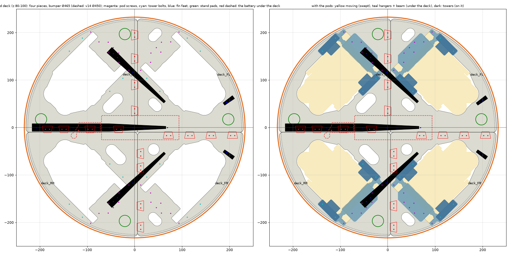
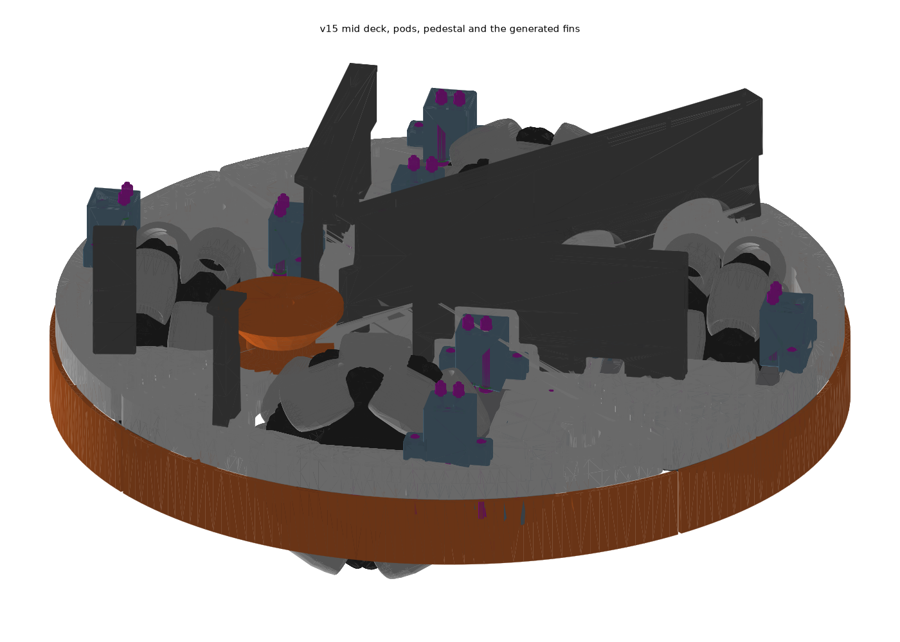
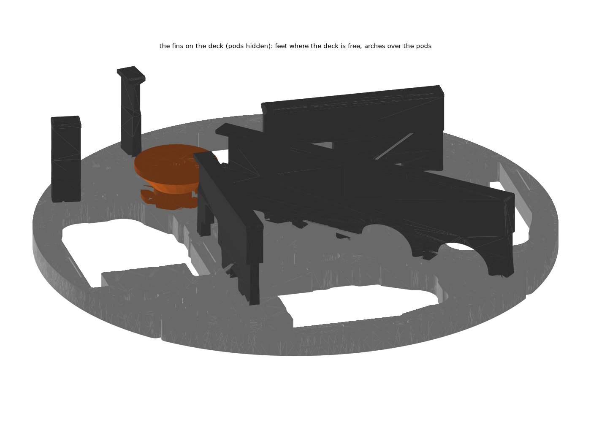

# cad/v16: the robot's baseline CAD (Nov 19 2026)

**v16 is a clean copy of cad/v15's baseline** (Fernando, Nov 19: "create a v16 folder and only move the baseline design of the CAD, leave
behind any intermediate proposals or unused files"): the mid-deck robot with every choice made on v15 up to Nov 19, including **the M3 spring
plunger as the baseline** (`tools/plunger.py`) and the plunger as separate parts in SolidWorks. Left in cad/v15 (history, reproduction): its
dated review rounds and status notes (its README), the superseded triangle study (`studies/`), the plunger study with the M4 cap try-out
(`tools/plunger_study.py`), the Nov 14 harness notes, the bumper strategies (not drawn), the unused 12 V riser buck, XT30 and duplicate IMU
models, and every generated output. Nothing in v16 reads cad/v15.

v16 is a complete folder: its scripts (`tools/`, map in [tools/README.md](tools/README.md)), reference parts (`reference/`, the electronics'
SolidWorks sources in `electronics/`), checks (`validation/`), STEPs (`step_export/`), print files (`print_files/`), the SolidWorks viewing
assembly (`solidworks/V16_robot.SLDASM`) and run logs (`logs/`). It reads nothing from another CAD version; the one outside import is the
robot's own `ros/src/omni_arm` kinematics. **`./regen_all.sh` regenerates everything** in order, checks included (`./regen_all.sh sw` adds the
SolidWorks rebuild and its checks; ~2 h with SolidWorks). **For an everyday change use `./quick.sh`** (no checks): `./quick.sh pod sw` after a
pod change (towers, forks, plungers ...) rewrites the pod STEPs, print files, `robot_assembly.step` (base and upper from
`robot_step.py`'s cache) and the pod's SolidWorks parts, re-imports only the changed parts and re-mates the four pods (~7 min). Nominal CAD
and hand statics: nothing here is printed or load-tested.

The sections below describe the design as drawn; numbers quoted from checks are v15's last runs unless the section says v16 (the v16 run is in
`logs/` and `validation/`).

## The idea (Fernando, Nov 14)

- **The floor deck sits above the pods' pivots and below their spring towers** (robot z 80–100; v14's frame was z 40–62).
- **The pods hang under the deck,** bolted up from below. **A pod drops out downward;** its towers and springs stay on the deck.
- **The second floor and everything on it are v14's, in place** (z 176.5); the fins stand on the deck.
- The wheels keep v14's positions (layout F: rolling lines tangent to r 154, slid −20), so the kinematics, firmware and ROS drive are unchanged.

 

## The pod (`tools/pod_mid.py`)

P4's fork, pivots and beam (cad/v14 Pod_reimagined_4) with **hangers** in place of its side frames. The pod hangs under the deck; its two
spring towers stand on it.

| | |
| --- | --- |
| Hangers | 14 mm under the tower, tapering to 8 behind the pivot, z 60-80, printed on the outer face (Nov 15); the pivot boss on the 627's inner race, an M3 x 35 pivot screw from the hanger's outer face through the 627 and the beam's pin into the beam (no shim: exact-length bosses, sand or shim at assembly) |
| Load path | the springs push the towers up and the pivot pulls the hangers and beam down (about 2x the wheel load). **2 x M3 x 50 per side** go up from the hanger's underside through hanger, deck and the tower's end into a hex nut in a recess in the top of each 12 mm stub tab (printed top down, the stubs need support): a clamped stack that closes the spring loop, so the deck carries only the net wheel load. 1 x M3 x 30 per hanger behind the pivot (Nov 15; was 2), 7 x M3 x 30 and the lug's M3 x 50 up through the separate lug and the beam into the deck. One M3 x 40 down through each tower keeps it when the pod is out |
| Plungers (`tools/plunger.py`, `KIND`) | **Nov 20 (Fernando: "regenerate them for a M4 screw, no sleeve"): the M4 set.** From the pad up: an **M4 x 45 button head** (ISO 7380, 7.6 x 2.2; the shortest that reaches, his longest is 50) dome down **straight on the pad** (no cap: a cup round the 7.6 head would be over Ø8.3 and could not enter the bores at bump), a **DIN 433 small M4 washer** (Ø8.0 x 0.5: the spring seat; it enters the Ø8.3 bore at bump, 0.15 round it, where a DIN 125 Ø9 would not), the **bare M4** up through the springs (0.125 round it in their 4.25 ID) and the tower's **guide Ø4.3 x 16 long** (Nov 20, Fernando; cleaned with a 4.3 drill if it prints under: 0.3 clearance, 1.1° over its 16 mm), two DIN 125 M4 washers and the M4 nyloc 1.5 over the tower's top (the tip 1.45 past it). No printed plunger parts. The M3 set (Nov 18-20: a PETG cap, an M3 button head, a printed Ø4.0 sleeve) stays in `plunger.py` (`KIND = 'M3'`); it replaced the M4 because the M4 tilted in its Ø4.4 guide and its head ground the pad (by hand, Nov 18) |
| Springs | **Nov 20 (Fernando): 7.85 OD x 4.25 ID x 20.2 free, solid at 12.0 (measured); one spring per bore, two bores per tower** ("double bore per tower but assume we will only use one spring per bore, so shorter towers"); **Ø8.3 bores** (0.45 round the spring; were Ø8.8); coil count and rate ASSUMED. **The towers are set by the spring** (`pod.Z_CEIL`, from `dims.STACK_PRELOAD_AT_DROOP`): the far bore's spring just touches at full droop (0.1 compressed, the near one 0.5), 18.95 long at nominal, and keeps 0.52 off solid at bump (the near one 2.53): its 8.2 mm stroke against the far plunger's 7.58 of travel, so a spring longer than 20.2 or a seat printed high binds it at bump (measure a few). Spring ceiling z 45.65, **guide 16 long** (Fernando: "increase the length of the bushing for smoother M4 motion"; was 8), tower top 61.65 (pod), z 131.7 on the robot: 1.7 lower than Nov 19. The robot's weight settles each pod into its travel, where depends on the rate (VERIFY). Earlier on Nov 20: two springs per bore, 1.0 compressed at droop (an M4 x 60, the tip at the lidar's plane) or 1.0 off solid at bump (7.8 of preload: the fork likely sat on its droop stop); Nov 15's 5 mm stack preload bound the far pair at about +9. **Bump stop: the towers' overhang's underside** is the stop surface (the pad's top at bump) over the arm only (Nov 20: not under the base, which sits flat on the deck round its alignment boss), so the bores run down to it. Nov 19 (Fernando: so the spring doesn't catch the sharp edge): each bore's mouth in that underside is chamfered 45 deg (`pod_mid.BORE_MOUTH_CHAMFER` 1.0). The seat washer rises into its bore at bump (0.15 round it; 0.87 under the tower). **To do:** the kitchen-scale rate test, then the ride height |
| Motor leads | the XT30 faces up; the bundle is tied at a Ø4.6 hole through the motor plate (`pod_rx.HARNESS_HOLE`), then an 18 mm service loop up through the deck's opening |
| Comes out | downward: unplug the motor through the deck's opening, cut the plate's tie, take out the 4 long bolts, 4 hanger screws, 7 beam screws and the lug bolt from below |

Checks (`validation/pod_mid/checks.json`): no interference in droop / nominal / bump; hole audit clean (the long bolts graze the tower's
nut recesses by 0.15, by design); droop stop 0.89 mm at nominal; thread into the deck 12-15 mm. **Deck opening 2.0 mm round everything that
moves** (Nov 14 review; was 1.0: `pod_mid.CLR`, the wheel rule): 2.0 / 2.02 to the fork and the wheel's revolved envelope at nominal, 1.96 /
1.99 at bump. The hangers' and beam's tops now sit 96.7 % on the deck (100 % with the 1 mm opening).

## The deck (`tools/chassis_mid.py`)

| | |
| --- | --- |
| Deck | a 20 mm disc (z 80-100) in four pieces, one pod each, joined by dovetail half-laps (4 per seam, tabs 13 deep, 2 x M3 x 16 down into the tab). The seams cross at (6, -10): the spine fin runs along y 0 and no screw may straddle a seam. 1896 cm³ in all (v14's frame 1141). **Bed fit (Nov 16), the solids as exported, tabs included:** FL 236.0 x 251.6, RR 247.4 x 232.0, RL 235.0 x 239.0, FR 222.4 x 218.6, all inside the 252 mm limit (256 bed, 2 mm margin) without turning; FL has the least spare (3.7 mm at its best rotation) |
| Openings | everything of the pod above the deck's underside in every pose + 2.0 mm; robot Ø465 (v14 Ø450), bumper 10.7 mm outside the wheels' swept envelope |
| Accessory holes | zip-tie pairs and spare Ø2.8 M3 pilots, through, where the deck has room: **since Nov 18 (Fernando: more, for whatever gets mounted later) 217 pilots** (FL 50, RL 58, RR 66, FR 43; was 53) on the 15 mm lattice, its centre points (a 10.6 mm diagonal pitch) and then the pockets left, at least 10.6 mm apart within a piece (10.31 across a seam); 72 tie pairs (unchanged); plan `validation/chassis_mid/accessory_holes.png`. **None over the battery, its straps or the stand pads** (a screw from the top would reach the pack), the pods' seats, laps, marks or within 6.5 of a screw |
| Bumper | four 3 mm PLA quarters, z 40-80, 3 tabs each under the deck's rim (M3 x 16 up into the deck). Other strategies (not drawn): cad/v15 README "Bumper strategies" |
| Lidar pedestal | 31.7 mm on the deck (v14 69.7), the lidar at v14's height (scan plane z 163) |
| Heights | tower tops z 131.7 (Nov 20: one spring per bore, a 16 mm guide); a wheel at bump 155; scan plane 163; second floor 176.5; nothing of the base below z 80 but the bumper (40), the battery's straps (35.5 with the HRB pack) and the pods themselves (31) |

Checks (`validation/chassis_mid/checks.json`): every piece one valid solid; every pod screw on its own piece >= 6.5 mm from an edge; the
fins, pedestal, bumper, battery and its clips against the four pods in every pose: no overlap, nearest 2.3 mm (the bumper's tabs to the pods'
static parts).

## The fins (`tools/fins.py`), redesigned Nov 14

v14's fins were patched onto the deck: shortened, front fins on M3 x 90 bolts longer than any M3 on hand, the side fins' columns standing
on a pod column that v15 does not have. They are redrawn as one rule in `tools/fins.py`:

- **Kept, so the second floor does not change:** the five rays from the lidar's axis (spine 180°, sides ±136.7°, fronts ±36°), each fin's
  top extent and flange under the floor, the floor's screw points, and in the scan band only a web that is a wedge as wide as its own shadow.
- **Generated:** each fin's lower edge comes from a height map of everything that stands on the deck. That map covers the pods in five poses
  (droop to bump, with the wheel's revolved envelope), plungers and springs, towers and their bolts, the pedestal, the lidar and the battery
  straps over the deck. The edge keeps 3 mm off moving parts and 2 mm off static ones, rounded R3. Where the deck is solid and free, the fin
  stands on it (a foot); long feet get lightening arches.
- **Fixed from below:** every foot gets M3 x 25 pan heads up through the deck (counterbored) into Ø2.8 pilots along the fin's print axis,
  placed off the seams, other screws, strap slots and stand pads. Over the battery is allowed: the heads sit recessed. No long bolts, no studs.

| Fin | Feet (u, mm from the lidar) | Screws | Lower edge | Volume |
| --- | --- | --- | --- | --- |
| spine | 87-130, 165-182, 242-259, 319-335 (2 arches) | 4 | 100-104 (the straps) | 222 cm³ |
| side L / R | 153-178, 203-237 | 2 each | up to 124: its nose (u 78-153, under the arm riser's corner) arches over the front pod and cantilevers from the first foot as a ~50 mm-deep plate | 102 cm³ each |
| front L / R | 85-108 | 1 each, + one floor screw at v14's long bolt's place | 100 | 16 cm³ each |

Lidar: **20.9° blind in all, as v14** (spine 5.3°, sides 3.7°, fronts 4.1°: `validation/chassis_mid/lidar_shadows.json`, which the harness
now reads). The spine's web starts at u 54.3 (v14's nose cove). Change the pods, the deck or what stands on it and the fins follow on the next
build.

## The battery, under the deck

Fernando (Nov 14): "move it down there". **Since Nov 16 the pack is the HRB 6S 3300 mAh** (136 x 46 x 43, 558 g; Fernando's baseline,
[components/battery](../../components/battery/README.md)); it was the OVONIC 6S 5200 (157 x 47 x 46, 706 g). It hangs under the deck's
centre, along x, x -56.5..79.5 (the OVONIC's centre, so the straps keep their slots), its 43 mm side vertical, its top against the deck's
underside (z 37-80). Under the deck the pods leave a corridor 55 mm wide from x -135 to +135, 3 mm off every pod
part in every pose. In the CAD the pack's zone keeps 9.7 mm in plan from the pods.

- **Held:** four printed corner clips (L walls 30 tall, an M3 x 10 up through each tab into the deck) locate it; two straps at its quarter
  points go round it and over the deck's top through slots right beside it.
- **Leads:** the XT90 end faces the rear (the HRB's connector is VERIFY; XT90 ASSUMED): the mated pair lies under the deck behind the pack
  (x -118..-72, unchanged, so the pigtail is drawn 15 mm longer). The board's 12 AWG lead goes up
  through a Ø12 hole (-128, -17), beside the spine, 8 mm from the nearest opening; from there it is routed to the power board (harness `BAT_PB`).
  The balance lead's XH7 stays tucked against the pack's front end.
- **Out:** robot on its stand, unplug the XT90 under the deck, open the straps, the pack drops out (the pods' way).
- **Centre of gravity:** the pack's centre comes down 146.5 mm (v14: on the second floor), about 10 mm off the robot's CG at 10 kg (est).
- The second floor's battery tray is gone; its place under the bin deck is free.

**Can the computer move down too?** It fits: the BMAX B8A Pro (126 x 112 x 52 plus 12 mm of plugs) clears every pod and tower by 3 mm on
the deck's top at the centre, its top at z 155, under the scan plane (`computer_on_the_deck` in the checks). **Not moved yet**, because it
costs:
- the spine fin runs through exactly that spot (it would have to bridge over the computer: only its web and flange, z 158-176.5);
- the computer's five leads would have to rise to the second floor through a fin's shadow (a new slot beside the spine, or the side slots);
- the bin deck, which exists to hold the computer down, could then come down to the floor, which moves the bin and the face (the e-stop left the deck on Nov 18).

Worth it for the CG (430 g down ~110 mm) and a lower bin, if you want that round.

## Service stand

Four pads on the deck's underside, one per side (x, y): (197, 17), (-21, 197), (-197, 17), (-21, -197). Each is a solid Ø24 area with a
**Ø8.4 hole through the deck** for an Ø8 peg (through: cad/solidworks.md 18, every hole through its part). They are placed where nothing hangs or drops: 5 mm off every pod's drop-out column and off the battery's
zone, the bumper's tabs and the seams. No pocket, accessory hole or fin screw goes near them.

**Stand height:** a pod's dropping part is 140 mm tall at droop. To lower it onto the bench and slide it out radially under the bumper (z 40)
between two pegs, the stand holds the pads **185 mm over the bench** (the robot's floor 105 mm up). The battery comes out the same way.
`validation/chassis_mid/checks.json` "stand".

**Service checks (`tools/service.py`, `validation/service/service.json`)** (they replace v14's `screw_access.py` and `pod_service.py`). **Not rerun in v16** (Nov 19: Fernando checks screw access visually; `regen_all.sh` skips it); the results below are v15's:
- **Drop out:** each pod's dropping part (at droop) and the battery pack lowered straight down: all five clear. The checked items that stay
  are the towers, plungers and springs; the screws that come out first are left out.
- **Driver access:** a straight Ø6 driver 100 mm out from each of the 224 screw heads: 109 meet something on the way (Nov 17, on the 13 mm
  tabs and the HRB pack; was 103; v14: 66 of 164). Most
  are the second floor's order of work (parts fitted later), as in v14. The base's and pods' cases are orders of work too:

| Screws | Blocked by | Means |
| --- | --- | --- |
| each pod's up-screws, long tower bolts, lug bolt (60) | nothing | a pod comes out from below with everything else in place |
| the beams' two front screws (8) | the fork's bar, 15 mm | known (round c): drop them in before the fork, drive with an L-key |
| the outer pivot screws (4) | the bumper, 5 mm | they stay in the dropped pod; serviced on the bench |
| the towers' hold-down screws (8) | the second floor, 60 mm | a stubby driver (the towers stay when a pod drops) |
| four side-fin feet (two per rear pod) | the rear pods' beam and lug | drop that pod first to take a side fin off |
| four spine feet | the battery | take the battery out first |
| deck laps and keys under the second floor (33 of 34) | the floor, the spine, the computer, a deck post (lap 9 under `post_deck_1`), the D435 | the deck goes together before the posts, fins and floor |

## Arm, camera and lidar re-checks

Re-run on the v15 robot (Nov 14 review, item 5): `arm_sweep.py`, `d435_riser.py`, `upper.py` check, all against `world.py`.

| Check | v14 | v15 |
| --- | --- | --- |
| SO-101 swept through every planned move (official meshes), nearest | 7.5 mm (the floor grasp 0.26 m ahead, to the bumper) | **0.5 mm**: the same grasp's gripper passes the front bumper (bumper_FR) |
| ... every other move | 18.6 mm (riser adapter) | 18.6 mm |
| Floor grasps that cannot be planned | 4 (out of reach at 0.36 m, y ±0.12) | the same 4, with either keep-out ring |
| D435 (on the riser): arm, lidar, bumper, fields, floor view | 11-18 mm from the arm; floor seen from 0.31 m | the same: 11.0 / 13.3 / 17.8 mm from the arm, 15.1 mm over the scan plane, r 209 inside the bumper (r 232.5), nothing in its depth or RGB fields, floor from 311.5 mm |
| Upper robot against the base (deck, fins, pedestal, bumper, battery, towers) | - | no overlap |
| Lidar blind angle | 20.9° | 20.9° |

**The floor grasp.** v15's bumper is 7.35 mm further out than v14's (r 232.5 vs 225.15), and the gripper's way down to the nearest floor
target (0.26 m ahead, on the centreline) passes just outside it. That costs 7 of v14's 7.5 mm of margin. Two ways back (your call):
1. pull the bumper back to v14's radius across the front ±30° (the deck's rim to about r 222 there: the front wheels are far inside that
   sector, the front fins' feet near it), or
2. move the nearest floor grasp out to about 0.27 m (an arm config change: `omni_arm`, the sim's pick).

**The robot's keep-out ring.** `ros/src/omni_arm/omni_arm/config/robot_arm.json` keeps the arm out of a ring r 0.19-0.235 only up to
z 0.085 (v14's bumper top 90, frame top 62); v15's deck rim stands at r 0.229 up to z 0.100. Here the sweep was planned both ways
(`arm_sweep.json` with v15's ring, `arm_sweep_robot_ring.json` with the robot's): the same moves, the same clearances. No planned move uses
that gap. Raise the robot ring's z1 to 0.100 anyway (the mid deck's rim; open item).

## Electrics and harness (Nov 18, Fernando: power down)

`tools/electrical.py` (every block, its cradle and its ports, both floors), `tools/harness.py` (ports, connections, the leads drawn),
`tools/harness_route.py` (routes), `tools/harness_table.py` (the table below), `tools/electrical_step.py` (the review STEP). Proposal: nothing
bought or wired; block sizes ASSUMED unless noted, port layouts per block class (VERIFY on the parts).

**Rules kept:** the deck, the pods and the fins are not modified (Fernando): every first-floor cradle screws into the deck's own accessory
M3 pilots (`chassis_mid.accessory_holes`, now also returning their positions). Nothing on the first floor over z 148 (the lidar's band; the
drive leads hop over the towers at up to z 150.5, their top 154.5, under the band rule z 163 +- (3 + r)). Every lead that changes floor
climbs a slot in a side fin's shadow.

**Where the deck has room:** a 1 mm map of the deck's top (the pods in every pose, towers, straps, fins + 2, openings: the fins' own height
map) holds exactly two converter-sized blocks, one in each side lens outside the side fins (around (22, +-182)), and small blocks in the
wedges by the spine. The 19 V module (74 x 74, with ears 92) fits nowhere on the deck, so it stays on the second floor.

| Block | Where | Size (mm), source | Held by |
| --- | --- | --- | --- |
| 12 V 8 A converter (the arm) | floor 1, left lens (22, 184) | 64 x 57 x 22 + ears (comparable 96 W units, VERIFY) | cradle: deck accessory pilots under it; its ears into the cradle |
| 5 V 5 A converter (face, hub) | floor 1, right lens (22, -184) | 66 x 60 x 22 + ears (comparable 25 W units, VERIFY) | as above |
| anti-spark switch (the main button's) | floor 1, right wedge (-68, -40) | 50 x 25 x 15 (ASSUMED) | cradle, deck pilots |
| distribution block + INA226 | floor 1, right wedge (0, -62) | 70 x 30 x 16: 7 XT30 out on top, CAN junction and pack sense on its side, the INA226 (2 mOhm shunt, 41 A) standing on it | cradle, deck pilots |
| 19 V 10 A converter (the computer) | floor 2, right (0, -165) | 74 x 74 x 32 + ears (ASSUMED) | cradle on outside tabs, new floor pilots |
| INA3221 (12 V, 19 V, 5 V) | floor 2 (-105, -100) | 32 x 25 x 8 | cradle, floor pilots |
| computer (BMAX B8A Pro) | floor 2, under the bin (-70, 0), front panel to the arm | 112 x 126 x 52 | its four clips |
| carrier (pcb/v1, KiCad STEP + the Teensy 4.1 and CAN models from `electronics/`) | floor 2, beside the arm riser: board x 26..128, y -122..-60 (Nov 18: 4 mm back, so the top-left corner screw clears the side fin's flange) | 102 x 62 (Nov 18: M3 holes at the corners, 3.5 in), 6 mm standoffs, plugs up | one M3 x 18 per corner through the board, its standoff and the tray into a floor pilot |
| USB hub | floor 2, left (-40, 120) | 90 x 28 x 14 (ASSUMED) | cradle, floor pilots |
| ELRS receiver (HPXGRC 2.4 GHz, `components/radio receiver`) | **on the carrier** (Nov 18, Fernando): plugged into J5 (1x4 female socket) on a male header, flat along the board's top edge 11 mm up; the 40 mm T antenna drawn upright from its U.FL (top at z ~246, robot (96.5, -62)) | 20 x 11 (vendor) | J5; in the carrier's KiCad STEP (`pcb/v1/tools/elrs_model.py`); no cradle, no lead |
| main button (= e-stop, latching) | floor 2's rear rim, face at x -204, y -45, facing back (-x); the bin deck's e-stop pod is gone | Fernando's `Switch.SLDPRT` (`reference/electronics/switch.step`): round snap-in rocker, Ø20.2 hole, Ø23 bezel, 4.8 mm tabs | `housing_switch`, 4 M3 x 10 into new pilots |

**Cradles (Nov 18, after the second floor's check):** each block sits in a printed tray with 7 mm walls. The converters' trays have a
7.5 mm floor: their ear screws (M3 x 10 through the 3 mm ear) get 7 mm of thread and end 0.5 mm over the deck or floor (a 2.5 mm floor
gave 3 mm). The other first-floor trays have a 5 mm floor. First-floor trays screw into the deck's accessory pilots under them (M3 x 12),
with the heads in 7 x 3 counterbores under the device (the converters 3 each, the distribution block 2, on the denser Nov 18 pilots). The
anti-spark switch's tray, beside the battery's keep-out, still finds only one pilot. A tray with fewer than two screws gets a 5 mm pad out to the nearest deck tie pair outside
its walls (`electrical._tie_pad`; the anti-spark's: the pair at (-105, -25), next to the battery lead's +L end). The pad has the same two
slots, and a zip tie goes down one slot through pad and deck, under the deck's bridge, up the other and over the pad. One screw + one tie
stop it turning. The tie isn't modelled. Second-floor trays screw down through
3 mm tabs outside their walls into new floor pilots (M3 x 10). These screws stay off the floor's seams, the fins' flanges, the slots, the
lidar, the grid pilots and the computer. The carrier's tray clears the two side-fin floor screws under it. Raising the converters
(+5.0 mm) and the other first-floor blocks (+2.5 mm) moved their ports, so the leads are re-routed.

**Battery path (floor 1 only):** the deck's lead hole (-128, -17) -> anti-spark switch -> 30 A fuse (inline) -> INA226 -> distribution
block -> the four drives (their own leads, no fuses), the 12 V and 5 V converters, and the 19 V converter's feed up slot R. No battery or
drive lead leaves the first floor.

**USB:** front USB-A 3: the D435 and the Teensy; front USB-C: the hub (the servo bus adapter and spares); rear USB-A 2: the mic and the
lidar's adapter; rear HDMI: the face; rear DC: 19 V from the INA3221.

**Lidar-plane crossings: 6, all inside the side fins' shadows** (was 6 thick ones: the battery's and four drive bundles): slot R the 19 V
feed, the 5 V output, one 8-wire signal lead (CAN, pack sense, the INA226's I2C) and the lidar's own lead; slot L the 12 V output and the
main button's two wires. The leads' table (from where, to where, through where, length) is `validation/harness/harness_table.md`.

**Main button (Nov 18, Fernando):** his `Switch.SLDPRT`, a round snap-in rocker (latching), is the main button and so the e-stop. It
sits on the second floor's rear rim, facing straight back at z 200: the panel's face at x -204, centred at y -45 (right of the rear seam's
lip and screws, behind the computer; Fernando moved it here from the left rim for less intrusive access). The bin deck's rear edge
(x -200) is 23 mm over the rocker's top, the rocker's centre about 3 mm inside the floor's Ø436 edge. The rocker tilts up and down.
`housing_switch` is a 4 mm panel (2.5 mm at the Ø20.2 hole, with a notch for the body's key) on a 3 mm base with two webs, drawn in its
own frame and turned into place (`upper.SWITCH`: `at`, `out`). It is open at the back for the leads and held by four M3 x 10 into new
floor pilots at (-191, -35), (-191, -55), (-164, -35) and (-164, -55). Put the outer two screws in before snapping the switch in,
because they sit under its body. It prints on the panel's face, so
the hole is round. The BUTTON lead starts at two 4.8 mm insulated receptacles (ASSUMED size). Which two tabs the rocker closes is VERIFY.
The modelled snap fingers are undeflected, so they overlap the panel by design; the check reports this under `intended_fits_mm3`.

## Filament colours (baselined Nov 16, Fernando)

Five filaments, one source: `tools/palette.py` (every colour function asks it first; bought parts keep realistic colours, fasteners and
bearings stay magenta). It replaces the Nov 13 three-colour scheme (cad/v14); chosen from renders of the robot in many combinations.

| Filament | Hex | Where |
| --- | --- | --- |
| **Jade White** | `#ffffff` | the deck (four pieces and its key), second floor, bin deck, the SO-101's printed links, face frame / crown / speaker cover, brackets, posts, spacers, the main switch's housing, battery clips, roller cores and sleeves |
| **Dark Gray** (PLA) | `#545454` | the suspension (fork halves, hangers, beam with pin and lug, towers, rings, 6804 retainer) and the five fins |
| **Orange** | `#ff6a13` | bumper quarters, bin, lidar pedestal, arm riser with the D435 cradle |
| **Black** | `#151515` (swatch `#000000`: shows no shading) | wheel hubs, wheel cartridges (cup and cap) |
| **TPU gray** | `#8e9089` | roller treads (a little darker than Silver `#a6a9aa`, which was the first pick) |

The arm stays white so the colour vision (`omni_arm/color_vision.py`, saturated hues) sees nothing of it; the orange riser is inside its 0.25 m mask.

**The first floor** (the deck and what bolts to it; 19 printed parts):

| Part | Qty | cm³ each | Filament | Seen assembled |
| --- | --- | --- | --- | --- |
| `deck_FL` / `FR` / `RL` / `RR` | 4 | 386-520 | Jade White | yes, the largest surface |
| `deck_key` | 1 | 4.7 | Jade White | small, on the deck's top |
| `bumper_FL` / `FR` / `RL` / `RR` | 4 | 47 | Orange | yes |
| `pedestal` | 1 | 54 | Orange | yes, under the lidar |
| the fins: `support_spine`, `support_side_L` / `R`, `support_front_L` / `R` | 5 | 225, 98 (x2), 16 (x2) | Dark Gray | yes |
| `bracket_battery_clip_0..3` | 4 | 2.8 | any colour | no: from below only |

**One pod** (x4 for the robot; the pod's parts are the same in both hands):

| Part | Qty | cm³ each | Filament | Seen assembled |
| --- | --- | --- | --- | --- |
| `pod_fork_outer`, `pod_fork_inner` | 1 + 1 | 72.5, 69.8 | Dark Gray | partly |
| `rx_tower_outer`, `rx_tower_inner` | 1 + 1 | 24.1 | Dark Gray | yes, they stand up through the deck |
| `rx_beam` | 1 | 52.3 | Dark Gray | glimpsed; from below |
| `rx_hanger_outer` | 1 | 17.5 | Dark Gray | glimpsed; from below |
| `rx_lug` | 1 | 6.3 | Dark Gray | glimpsed; from below |
| `wheel_hub` | 1 | 209 | Black | yes |
| `wheel_cartridge_cap` | 1 | 6.5 | Black | yes |
| `roller_core` | 12 | 15.1 | Jade White | yes, the ends between the treads |
| `roller_tread` | 12 | 15.5 | TPU gray | yes |
| `rx_hanger_inner`, `rx_ring_inner`, `rx_ring_outer`, `rx_pin`, `pod_retainer`, `wheel_cartridge` (the cup), `roller_sleeve` | 1, 1, 1, 1, 1, 1, 12 | 17.5, 2.0, 2.0, 0.4, 1.9, 5.1, 1.8 | **any colour** (spare filament) | no |

Solid volume for the base and four pods: Jade White 2,626 cm³ (decks 1,898, cores 723, key 5), Dark Gray 1,492 (fins 452, forks 569, towers 192,
beams 209, outer hangers 70; the lugs add 25), Orange 244, Black 862, TPU gray 742; about 215 cm³ of parts (clips, inner hangers, rings, pins, retainers,
cartridge cups, roller sleeves) can be any filament. Infill and walls make the real amounts smaller.

How "seen assembled" was measured: segmentation renders of the robot (SO-101 stowed, pods nominal), counting each part's visible pixels at 1200 x 900,
from 12 azimuths x 4 elevations around it and 24 close-ups of each pod, floor on; then with the floor removed to see what only shows from below.
Not seen = under 300 px in any outside view (clips 212, cups 20, sleeves 234, inner hanger 48, rings 28 / 246, pin 144, retainer 0; from below only the
clips, inner hangers and rings show to any extent). Glimpsed = 700-1,600 px (lug 767, outer hanger 1,234, beam 1,565). Open: the swatch shades on a real print.

**Print files:** `print_files/First floor/` (made by `tools/print_files.py`) holds the first floor's and the four pods' print STEPs sorted into
`White/`, `Gray/`, `Orange/`, `Black/`, `TPU gray/` and `Agnostic/` (the parts nobody sees), one folder per part type with every pod's file in it,
and `Print tracker.xlsx` for what is printed and what is left (per pod; by colour). The wheel hub and the droop lug are the only parts that come
in two hands (pods 1 FL and 4 RR are mirrored); the bumper is left out for now (`--bumper`).

## SolidWorks assembly

Open `solidworks/V16_robot.SLDASM`: a viewing assembly of imported STEP bodies, not native features (cad/solidworks.md 17), all inside v16:
- every fastener and bearing in magenta;
- the electronics, the vendor RPLIDAR, the D435 and its see-through fields of view, the SO-101 at stow;
- the battery group (pack, clips, straps) under the deck;
- the four pods, flexible. **Each spring plunger is its own rigid sub-assembly `V16_spring_plunger_<k>` of its seven parts** (Nov 19,
  Fernando: "split it into its actual parts so I can inspect each one"; since Nov 20 the M4 set, re-imported Nov 20 (motion test not rerun): the M4 x 45 screw, the
  seat washer, two top washers and the nyloc, magenta; the M3 set added the PETG cap, yellow, and the sleeve, cyan). The shaft is concentric in
  its tower's guide and the dome (the M4 head's R4.38; the M3 cap's R8)
  tangent to its arm's pad; the coil springs (green) stand in the static sub-assembly at nominal.

Built by `tools/sw_robot_parts.py` (part STEPs + `manifest.json`), then `tools/sw_robot.py`'s stages (`./regen_all.sh sw`).

 

| Check (`validation/solidworks/`) | What it checks |
| --- | --- |
| Motion (`motion_test.json`), both hands | the axle and every plunger lift against build123d at droop / nominal / bump; dragged past either end, the travel limit holds; no mate errors |
| Paths (`paths.json`) | every component file inside v16 |
| Interference without the harness (`interference_base.json`) | part / part findings and fasteners past their thread (press fits, spigots, thread-formed screws, vendor models' insides and the D435's fields of view listed by design) |
| Each harness lead alone against the whole robot (`interference_harness.json`) | findings per lead |

STEPs (`step_export/`): `robot_assembly.step` (every printed part plus every fastener and bearing in magenta, each plunger's parts and the
coil springs; re-imported in `validation/robot/robot_step.json`), `chassis_mid/` (each printed base part, and `v16_mid_base_assembly.step`
with the pods and all hardware), `pod_mid/` (with the M3 set, the plunger's cap and sleeve in print orientation), `plunger/` (the plungers and towers at
droop / nominal / bump), `wheel_motor/`, `upper/`, `harness/`, `electrical/`, `coupon_627/`, `coupon_687/`, `coupon_dovetail/`.

## Open items

- **Nov 20: the towers now give the full travel** (above; they were binding at about +9 mm). The SolidWorks assembly has them (Nov 20; `./quick.sh pod sw`, now with the plunger stage; its motion test not rerun). At bump the plungers' nuts reach robot z 146.2 and the M4's tip 147.6.
- **The M4 plunger (Nov 20), to verify on prints:** the M4 sliding in the Ø4.3 guide (the Nov 18 M4 tilted in a
  Ø4.4 guide and its head ground the pad: the reason for the M3 cap and sleeve, now dropped; smoothing ideas: dry PTFE lube, PTFE tape over
  the guided length, polished crests, a 4 mm ID oilite bushing in the tower), the DIN 433 Ø8 seat washer in the Ø8.3 bore at bump.
- **Nov 18: the D435's drawn lead crosses the carrier's top edge** 3-8 mm over the board (its XH row and the ELRS receiver): raise the lead
  over it or move the carrier toward -y. The ELRS antenna next to the arm's base: rerun the arm sweep after the STEP review. The receiver's
  pad pitch (2.54 assumed, the pictures read 2.3-2.45) is VERIFY before the carrier is ordered (pcb/v1 README).
- **The arm's nearest floor grasp passes 0.5 mm from the front bumper** (v14 7.5): pull the front bumper back to r 225, or grasp from 0.27 m (above).
- **Deck openings: 2.0 mm, as asked**, against the general 3 mm rule for the chassis to moving parts (cad/solidworks.md 18); 1.96 mm at bump.
- **The spring rate** (kitchen-scale test), then the ride height (two springs in series per bore since Nov 15; preload set by the towers since Nov 20).
- **Nov 15:** the wheel is now located axially at both ends (VERIFY no binding); the hangers need a 6 mm support block under their rear part
  as printed; the SolidWorks assembly was rebuilt for it on Nov 16; the deck's stiffness (proposals: blind pockets, a centre cross plate, a
  continuous bumper clamp ring, more / deeper laps) is not analysed.
- **The computer onto the deck** (it fits; the spine, bin deck and leads follow: above). Not done.
- **The bumper** (strategy B recommended, not drawn).
- **The arm's keep-out ring** in `ros/src/omni_arm/omni_arm/config/robot_arm.json` to z1 0.100 (the mid deck's rim).
- **Sim and Nav2** follow the mid deck: robot radius 0.2325 (Ø465), the battery's new place (mass and CG).
- **Harness:** the motor bundles' 18 mm service loops are drawn tighter than their R16 (slack when built); BAT_PB is 583 mm through the left slot.
- **Printing, as checked** (`validation/chassis_mid/checks.json` "printed"): the upper deck pieces' lap sockets roof over as bridges (RL, FR:
  about 1.6k mm² each, as v14's frame); the spine (286 x 16) fits the bed only across its diagonal; the pedestal's top plate has a 45° cone
  under it since this round.
- **Inherited from v14's upper floor:** the power stack's four corner screws are M3 x 80, longer than the longest M3 on hand (50).
- Nominal CAD: nothing printed, load-tested or wired.
