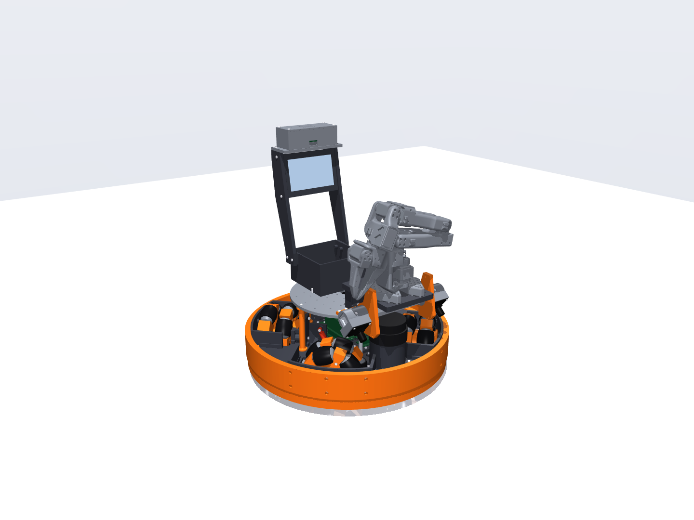

# CAD v7: the home-floor robot, down to the fasteners (build123d → STEP / STL)

The robot design.md describes today (the baseline, Fernando, Oct 25): the **v7 base** (X4, printed 127 mm omni wheels
with 2 × 5 rollers of 36 mm, sprung pods; section 25, adopted) with the **head** (one camera bar, the 5 in face) carrying
the **v6 round-3 catch / launch module** (chute pocket, two Pololu 25D feed wheels, J-bend, two F90 flywheels, STS3250
tilt; sections 22-24), on section 24's **Damiao DM-2325** drive and a 7S1P pack; and the **arm kit** that replaces the
module for the SO-101 (`arm_kit.py`, design.md 12.3). Every dimension the sim knows comes from it: `dims.py` builds `SimParams` + `geometry()` from
`simulation/v7 home floor`, so the CAD and the sim can't drift. The v2 CAD in `cad/` is untouched.




## Build and view

```powershell
$py = "$env:USERPROFILE\.venvs\omni-robot-sim\Scripts\python.exe"
& $py build.py            # ~9 min: STEP + STL of every printed part, assembly.step, viewer meshes, all checks, BOM,
                          # print list, and the arm robot's (ARM_KIT.md, checks.json "arm_robot", "arm")
& $py build.py --quick    # parts, BOM, mass, thread engagement, static clash check only (~1.5 min)
& $py view.py             # interactive 3D viewer (MuJoCo); --meshes rebuilds its meshes first
& $py step_export.py      # out/assembly.step again; --bodies, --groups, --no-fasteners, --tilt, --bump (see below)
& $py render.py           # out/renders/*.png (MuJoCo), --turntable for a video
```

`Launcher.cmd` (repo root) has buttons for all of them: Tools > Build CAD, View CAD 3D, Open CAD STEP, STEP as one part.

**Viewer** (`view.py`): left-drag rotates, right-drag pans, scroll zooms, double-click centres on a part. Keys 0-5
toggle groups: 0 base, 1 pods, 2 module, 3 yokes and cameras, 4 fasteners, 5 foam pads, net and ball. The right
panel's Control slider `tilt` turns the module about its pivot (−0.52 … 0.70 rad = −30 … +40°).

`build.py` checks every pair of placed solids (printed parts, purchased parts, every screw, nut, pin and bearing)
for interference at the static pose, at module tilts −30 … +40° and with all four wheels at their bump stop and full
droop (tyres pressed on hubs, rollers' treads on their cores are intended fits). It checks that **every screw engages
≥ 6 mm of printed thread** (or a nut / a metal thread ≥ 2.4 mm), from a probe tube around each shank. Since Oct 22 it
also checks that the robot can be put together and that the prints are sound:

- **Access** (`access()`): every screw's head bears on something, the screw clamps at least one other part, and a
  straight screwdriver path out of its head isn't blocked by the screw's own parts within 40 mm (that screw could never
  be driven). Blockers further out, or by other parts, are assembly-order constraints, listed per screw in
  `checks.json` (`access.all[].driver_blocked_by`).
- **Insertion paths**: the DM-2325 slides into its cup from the inner end; the STS3250 slides out of yoke R's window.
- **Ball path**: the ball, swept down the chute, round the J and up the launch run, touches no printed part but the
  wheels that grip it.
- **Single solids**: every printed part is one valid solid (a feature joined to nothing prints loose: the yokes' board
  bosses were, before Oct 22).
- **Wall thickness** (`walls.py`, full build only): ray casting on the exact geometry from points all over each
  part; clusters under 1.2 mm (three perimeters) are listed for the PETG / PLA parts.

It also measures the lidar's self-occlusion and the mass and CG against the sim (`out/checks.json`), the head's
exact clearances to the module and the launch line ("head"), turns the camera bar from its catch index to its arm index
against everything that stays ("index"), and builds **the arm robot** (`assembly.build(kit="arm")`): its static
clashes, the kit's screws (thread, access), single solids, walls and mass ("arm_robot"), and the SO-101's own meshes
against it at its fixed poses and grasps ("arm": `simulation/v11 sil/studies/layout_trade.py arm-check`, which builds
a 1.5 mm distance field of the CAD's meshes, `mesh_sdf.py`).

## Rules this CAD follows (Fernando, Oct 21)

- Printed in PETG / PLA / TPU 95A, every part ≤ 250 mm (a 256 mm bed).
- **No heat-set inserts.** M3 screws form their own threads in **2.8 mm** printed holes with ≥ 6 mm of engagement
  (checked for every screw); through holes are 3.4 mm. Nuts only on pivots and bolted joints (pivot bolts, shock
  top, the pivot shaft's clamp).
- **Pan head and flat head screws only** (Fernando's stock; no socket heads): pan heads (ISO 7045 / 14583) in 6.4 ×
  2.2 mm counterbores or on faces, flat heads (ISO 7046 / 14584) where a face must stay flush (payload plate top,
  motor cup face).
- M3 everywhere it can be. The exceptions are the vendors' own threads: M2 (camera boards), M2.5 (the A2M12's base),
  M5 (the F90's prop nut).
- Printing details are free, so the parts carry them (Oct 22): 0.5 mm entry countersinks on tapped holes with thread
  to spare (`hw.tap(entry=...)`; the countersink isn't counted as thread), 0.5 mm lead-ins on every bearing seat and
  press fit, first-layer chamfers where a bed face mates (deck joints, standoff and cup ends, the wheel hubs' pin
  channels), 2–5 mm fillets on load paths (`hw.cove_at`, `hw.cove_ring`), rounds where the ball or the net's cord
  touches a printed edge. Set the slicer's elephant-foot compensation (~0.15 mm) for the rest.

## Files

| File | What it is |
| --- | --- |
| `dims.py` | Every dimension, the frame contracts (ROBOT, POD, MODULE, PAYLOAD), the hole conventions |
| `hw.py` | Pan / flat head screws (ISO 7045 / 7046), nuts (ISO 4032 / 10511), bearings, pins, hole cutters, engagement probes, BOM bookkeeping |
| `vendor.py`, `vendor/` | Damiao DM-2325 (Damiao's STEP + drawing), Pololu 25D 9.7:1 + encoder, #1999 and #1997 hubs (Pololu STEPs + drawings); envelopes for the rest (VERIFY) |
| `wheel.py` | The omni wheel: barrel rollers (PETG core, TPU tread, 3 mm pin), three-piece hub around the in-wheel motor |
| `pod.py` | Motor cup, trailing arm, pod mount (clevis + shock tower), open-top wheel guard (front panel, side walls) |
| `base.py` | Deck (centre + 4 lobes, T-slots, printed posts and bosses), splices, four printed standoffs and the two Ø8 front rods, payload plate, battery tray, lidar riser, e-stop riser, bumpers, electronics layout |
| `module.py` | Chute halves (pocket, chute, J, launch run, keel), collar with pivot arms, rim arcs, struts, feed carriages, flywheel mounts, wheels, foam pads |
| `mounts.py` | Yokes (608 bearing / STS3250 window), servo cap, boards on the yokes |
| `head.py` | The head (design.md 12.1): the indexed camera bar (20 × 20 tube), the two camera holders, the cheeks that carry it and the face |
| `display.py` | The 5 in face unit (housing, back cover, window) and the audio box (USB mic array, speaker), each at its seat: on the head's cheeks and the plate's rear (catch), over the bin (arm) |
| `arm_kit.py` | The arm kit: the SO-101's riser and adapter, the bin, the face's uprights, the audio shelf, the arm's 12 V buck |
| `walls.py` | Wall-thickness scan of the printed parts (`python walls.py [part prefix]`) |
| `assembly.py` | Places everything at a tilt and a bump; the single source for the print list and the BOM |
| `build.py`, `render.py` | Exports, checks, lists; renders |
| `step_export.py`, `colors.py` | Named, coloured STEP with shared parts (assembly or one multi-body part); the colour table |
| `view.py` | Interactive viewer with a tilt slider |
| `out/head_stl/` | The head's parts (and, for the arm, the kit) as meshes in the ROBOT frame at each index, for `simulation/v11 sil/studies/layout_trade.py` (`build.py --head-only` rewrites them) |
| `out/ARM_KIT.md` | Generated: the kit's prints, and the purchased parts and fasteners a swap puts on and takes off |
| `out/step/`, `out/stl/` | One STEP per printed part in its contract frame (SolidWorks wrapper parts); print-ready STLs; foam-pad templates |
| `out/assembly.step` | The whole robot, every screw included: a nested, coloured assembly with shared parts |
| `out/PRINT_LIST.md`, `out/BOM.md` | Generated: material / infill / orientation / mass per print; every purchased part and fastener with counts |
| `out/funnel_net_pattern.svg` | 1:1 sewing pattern for the 55° net |

## Design in one page

**Wheel and drive.** The DM-2325 sits *inside* the wheel. Its body (Ø28 × 60.6) is held by its face (4 × M3 pan
heads on Ø22, on the cup's outer face under the hub's flange) in a printed cup; its 17 mm D-shaft ends at the wheel's outer face, where a Pololu #1999 hub drives the wheel's
outer plate. The wheel's inner end runs on a 61808 bearing on the arm's boss, so the motor's shaft carries only about
half the wheel load. The cup's bore has a 12 mm channel from the inner end to the mid-body connector: the motor slides in with its
9 mm connector housing (and the plugged cable) in it. The arm's four screws into the cup sit on r 17 inside the 61808's
bore (1.4 mm of boss over their holes; on r 18.15 it was 0.15 mm).
The wheel is three PETG hub prints split on the two row planes; each roller's 3 mm pin lies in a split plane, clamped
between half-channels. Rollers have the exact barrel profile (the wheel's envelope is a true Ø127 circle) and coned
ends. 10 × M3 × 20 join the hub. Hub A's end plate is 4 mm under the #1999 hub's six M3 × 8 (they carry the
drive torque).

**Pods.** A 48 mm trailing arm (pivot axis along the axle, two 623s on an M3 × 40) carries the cup, motor and wheel. A
1/16-scale RC shock runs from the arm to the pod mount's tower: motion ratio 0.50, static length 48.3 mm, 16.8 mm of
bump and 3.4 mm of droop in its stroke (the sim: 15 mm, ~2.6 mm sag). The pod mount (an 8 mm outer ear, bridge, web) stands
on the deck on seven M3 × 14 from below, 8 mm into it each; its **tie** (a foot extension) puts two of them into the
centre deck piece, which is what joins the side lobes to the centre (nothing did before Oct 22). The left pods (and the right) are mirror images, so both mounts on each side share that side's lobe, and
the front and rear lobes stay free. The mirrored pods use mirrored prints of the arm, cup, mount and guard (`_M`); the
wheel is the same print, turned half a roller pitch (its mirror image), and every purchased part is the same part.

**Deck and base.** The deck is in the axle plane: a 140 mm centre and four lobes (≤ 250 mm prints) with T-shaped
wheel slots, 141 mm wide at the wheel and 72 mm inboard of it. An open-top wheel guard closes each slot's outer end
with a curved front panel (to robot z 100) and two side walls on the lobes; the wheel's top is uncovered. TPU bumpers
wrap the deck and the guards at r 205-217 with a 1.5 mm skirt down to 20 mm. The battery (flat 7S1P) hangs under the
centre in a tray. The Jetson stands on 16 mm posts printed with the centre deck, over the power board and BMS on
printed bosses (the battery is right under the centre deck, so nothing screws up from below there); the battery
sits in a closed 3 mm tray. The e-stop is in a riser with a 4 mm panel and an open underside (ring nut and contact
block go on at the bench; the contact block passes a 30 mm deck hole); the MCU board hangs under the rear lobe. The
lidar's riser stands on four lugs at r 43 (a driver reaches them past the lidar) and its M2.5 screws are driven up
through 7 mm holes in the deck.

**Lidar layer.** The payload plate rides on **six standoffs** 96 mm over the deck, so the A2M12's scan plane (z 150,
on a riser at x 140) passes over the wheels at their bump stop (142) and under the plate (162.5): **only the six
standoffs cross it**, and nothing of the head comes below z 157. The side pair stands under the yokes; the front pair
sits on the lidar's rays through the side pair, so their shadows overlap; the rear pair is far away (thin shadows).
The front pair, 55 mm from the lidar, threw the widest wedges (12.5° at Ø12), so since Oct 24 they are **Ø8 6061
rods** (M3 tapped at both ends, located in 1 mm recesses in the deck and the plate): 8.2° each, **22° blocked in all**
(was 31°). The four printed ones (Ø12, Ø20 flanges) carry the sway. Route the head's cables down the side standoffs,
on the side away from the lidar: they stay inside the rods' wedges. Everything else on the deck stays under z 128. The
module and its pivot rose with the plate (`dims.PLATE_GAP`, the sim's `plate_gap`).

**Module.** The ball path is two PETG halves split on the centreline (outer wall down, smooth path), lined with 6 mm
low-resilience foam. The chute floor slopes at 40° into the feed wheels' nip; the slick J (40 mm) turns the ball up the
30° run into the Ø70 flywheels. Each Pololu 25D sits on a hinged carriage: a torsion spring holds it on an M3 stop
screw, set so the wheels just touch a seated ball. Each F90 sits on a solid wedge (y 48-87, the motor's full width)
that fills the space behind and under its plate, back to the side wall and keel (4 × M3 × 16) and down to the line the
payload plate leaves at +40° (the plate's front edge is the module's lowest point there, so it can't get thicker
downward). The tilt pivot is 13 mm above the throat, inside the cone. So the
collar's two arms run under the net to bosses outside it: an 8 mm shaft in a 608 on yoke L, and the STS3250's horn on
yoke R. The ESC, the RoboClaw and both bucks are on the yokes' outer faces, outside the swept volume; the yokes are solid
10 mm plates. The net is laced through holes in the collar joined by a groove underneath (the chute's flange is right
under the collar).

**Head** (`head.py`, Oct 24: design.md 12.1 drawn). One stiff camera bar for both payloads: a 6061 square tube
20 × 20 × 1.5, 228 long, its axis at x 155, z 195, behind the display. A printed holder on each end (a sleeve on the
tube, held by one M3 × 30 through the sleeve and both tube walls) carries an OV9782 board on its front face; the
cameras' optical centres sit at **(192, ±95, 211) at the catch index, 30° up**, 190 mm apart (the lenses inside the
bumper's 217 mm radius). The holders' inner ends are 34 mm journals in the two **cheeks'** bores: the cheeks stand on
the plate's front edge (3 × M3 each), rise under the module's swept volume (the closest the module comes: a flywheel
mount, 6 mm from a cheek: `checks.json` "head") and carry the face on horns
beside it. **Index:** one M3 × 10 through the left cheek's ring into the left journal (thread 6.5 mm, in one of two
tapped holes): 30° up for catching, 40° down for the arm. The right journal slides in its bore, so plate flex can't
bend the bar. At the arm index the lenses come to (183, ±95, 166): the bar's axis can't pass through them, because
the display stands in front of it, so turning 70° moves them 46 mm, mostly down; the holders stay 9 mm over the scan
plane (outboard of the lidar), and the horns stay out of the cameras' view there. The axis is as low as that allows:
the arm robot's SO-101 behind the bar reaches the floor over it only while the bar's top stays under ~210 mm. Turning the bar from one stop to
the other with the module and face off clashes with nothing (`checks.json` "index").

**Face and voice.** A **5 in 800 × 480 HDMI panel at the front**, between the cameras (`display.py`), facing forward and
leaning back 10°: its front-bottom edge at (198, 160), 3 mm over the lidar's top and ahead of it, its front face behind
the lenses' planes, so neither camera sees it. A printed housing (2 mm lip round the window, rails above and below the
panel take every screw), a 2 mm polycarbonate window (a low ball hits it), the panel, a 2 mm back cover; 2 × M3 × 16
from each cheek. The launch line clears it from 24° of elevation up (13.5 mm to spare at the game's flattest, 30°):
the Thrower bench mode's lowest elevation becomes 25°. The USB mic array and the 3 W speaker stay in the audio box on
the plate's rear (mics through the lid, speaker under a grille); the rear 7 in display and its shelf are gone.

**Payload interface.** Still a Ø240 plate with a 25 mm grid, two asymmetric Ø4 dowels and a Ø28 pass-through. Now
M3 on 2.8 mm holes (no inserts), a full disc on six standoffs, flat heads flush with its top. The base's own boards
moved off the catch kit's yokes on Oct 25, so the swap leaves them: the Jetson's **19 V buck** on two posts on the
front deck splice (under the plate, out of the scan plane) and the **RC receiver** on the right cheek's outer face.

**Arm kit** (`arm_kit.py`, design.md 12.3). The SO-101's base and shoulder bracket reach 65 / 86 mm ahead of its base
origin, 0-100 mm up: on the plate at the study's x 100 (A5) they stand where the camera bar is. So the arm stands on
a **riser**: a hollow printed block on the plate's front edge (4 × M3 into the plate, keyed by the front dowel) and a
10 mm **adapter** plate on it (4 × M3 × 20, heads counterbored) that runs forward over the bar, 3 mm above its highest
corner at any index; the base's origin at (140, 0, 224.5). Its base clears everything but its adapter by 9.8 mm and
every link clears the robot by ≥ 14 mm at the fixed poses and grasps (`checks.json` "arm"). The **bin** (120 × 120 ×
70) takes the audio box's 4 holes on the plate's rear. Two **uprights** (as the cheeks: |y| 64-72, a 4 mm foot against
the bin, 2 × M3 × 20 into the bin's wall bosses) carry the same **face unit** 0.40 m up over the bin's back, facing
forward, with the same 4 screws; the **audio shelf** on their tops takes the audio box with its own 4 screws. The arm's
**12 V buck** is on the riser's left wall; its bus board rides on the arm's base. The e-stop stays reachable from behind
(the face's back edge is over its front 2 cm, 25 cm higher).

## Assembly order

`build.py`'s access check gives, for every screw, the parts that block a straight driver (`checks.json`). The order
that satisfies all of them:

1. **Pods (bench, x4).** Press the 623s into the arm and the 61808 into hub C. Arm into the pod mount: shims, M3 × 40
   pivot bolt from the outer ear (before the wheel: it covers the head), nyloc. Shock: top bolt and nyloc, bottom bolt
   with its washer. Motor into the cup (connector in the channel), 4 × M3 × 8 on the face. Pololu #1999 hub on the
   shaft with a 2 mm shim between its boss and the cup's face; tighten both set screws (hub A encloses them). Hub C
   onto the arm's boss, the cup through it, 4 × M3 × 22 from the arm's inner face. Inner row of rollers in hub C,
   hub B, 5 × M3 × 20 from hub C's side (turn the wheel to reach each past the arm). Outer row, hub A, 5 × M3 × 20,
   6 × M3 × 8 into the #1999 hub.
2. **Module (bench).** 25D on its carriage, #1997 hub, feed wheel (before the carriage goes into its window). Chute
   halves together: 4 × M3 × 16 across the split, the keel one through the R half's bore (before the flywheel mounts).
   Carriages: knuckle, spring, M3 × 30 hinge, nyloc, stop screw; then glue the IR halves. F90s on their mounts,
   flywheels, prop nuts; mounts onto the keel. Pads, collar, struts, rim, lace the net. Servo horn onto the collar.
3. **Base (deck up, then on its back).** Deck pieces and splices. Power board and BMS, then the Jetson over them; MCU
   under the rear lobe. E-stop riser (e-stop built into it first), lidar riser then the lidar (its four M2.5 from under
   the deck). Standoffs and the two front rods. Robot on its back: the pods (7 screws each from below), guards,
   bumpers, battery and tray.
4. **Top.** Payload plate (its side screws are under the yokes, the front ones under the module). 608 into yoke L,
   yokes (3 screws each), boards on them. Module between the yokes: the 8 mm shaft from outside through the 608 into
   the collar, clamp; the servo through yoke R's window onto the horn, cap. Audio box (4 screws from inside), mic
   board, lid with the speaker.
5. **Head (bench, then onto the plate).** Cameras onto the holders (4 × M2 × 6 each). Holders onto the tube (one
   M3 × 30 each through the tube's cross holes). Slide the bar's journals into the cheeks (L with the index holes into
   cheek L), set the index screw, then the cheeks onto the plate (3 × M3 × 12 each; tilt the module back to reach
   them). Face on the bench: window, panel, back cover (4 × M3 × 12); then into the cheeks (2 × M3 × 16 each side).
   Calibrate the stereo pair on the bar once (omni_calib).

**Swap to the arm** (design.md 12.3; `out/ARM_KIT.md` lists the parts):
1. The face off the cheeks (4 screws), the audio box off the plate (4 from inside).
2. The module out of the yokes; the yokes (3 screws each) with their boards; unplug the ESC, the RoboClaw, the 12 V
   buck and the servo.
3. The index screw out, turn the bar to −40° (the other tapped hole), the screw back in.
4. The riser (4 screws from inside), the adapter (4), the SO-101 on it (4, VERIFY its holes), its 12 V buck and bus.
5. The bin (4 from inside), the uprights (2 each into the bin), the face between them (4), the shelf (4), the audio box
   on it (4).
6. Check the cameras against the floor plane (`omni_calib`'s sensors-on-base step).

Service: the payload plate comes off only with the module and yokes; the Jetson covers the BMS; the battery needs the
robot on its back; the inner row of rollers needs the pod off the robot (its screws face the robot's centre).

## Bearings

| Bearing | Qty | Where | In a small kit? |
| --- | --- | --- | --- |
| 623-2RS (3 × 10 × 4) | 8 | Pod pivots, two per pod | Yes |
| 608-2RS (8 × 22 × 7) | 1 | Tilt pivot, yoke L | Yes |
| 61808-2RS = 6808-2RS (40 × 52 × 7) | 4 | Each wheel's inner end, on the arm's boss (the motor leads and the cup's screws pass through its bore) | No: buy 5 |

## What the CAD found (for the next simulation round)

See design.md section 29 for the full list, with what each one changes in the sim.

## Before printing: VERIFY

Search the code for `VERIFY`. The ones that set geometry: the A2M12's hole circle and scan height, the Jetson
carrier's holes, the F90's 19 × 19 pattern, the STS3250's case and horn, the RoboClaw's holes, the shock's length,
stroke and spring, the OV9782 board holes and its lens's optical centre (16 mm ahead of the board's back assumed),
the 5 in panel (outline, depth, its HDMI and USB connectors), the USB mic board
(size, holes, mic positions), the micro speaker, the e-stop's ring nut and contact block (the deck hole is 30 mm), and
the DM-2325's cable plug in the cup's 12 mm channel. Print one wheel (3 hubs, 10 rollers) and one pod first.

`walls.py` still lists two kinds of thin spot, both accepted: 0.5 mm webs in the motor cup between the pilot pocket
and the face screws' holes (the DM-2325's own PCD 22 holes sit 2.5 mm outside its Ø17 pilot; the heads clamp the
solid outer 1 mm), and knife edges along the wheel spokes' roller cut-outs (no load there; the slicer drops them).

## SolidWorks / eDrawings

Open `out/assembly.step` (File > Open, STEP; import as an assembly). It is a nested assembly: robot > base, pod FL /
FR / RL / RR chassis and wheel, module (tilting), mounts > each group's fasteners in their own sub-assembly. Parts are
coloured and shared: every M3 × 10 pan head is one part with many instances, so SolidWorks makes ~135 part files
rather than 640 and its BOM counts them. Hide all of a group's screws, or a whole pod, with one click. eDrawings opens
the same file directly, for a quick look.

`step_export.py` writes other cuts of the same model:

```powershell
& $py step_export.py --bodies                       # out/assembly_bodies.step: one part, every solid a coloured body
& $py step_export.py --groups module,mounts --tilt 40 --out out/module_40.step
& $py step_export.py --no-fasteners --bump 15       # wheels at the bump stop, no screws
```

These are references at one tilt and bump, not mated assemblies: the model is the Python, and SolidWorks edits
don't flow back. `out/step/*.step` are the printed parts in their contract frames (POD parts in the pod frame,
module parts in the MODULE frame, base parts in the ROBOT frame), ready for wrapper parts; `_M` files are the mirrored
pod parts (front-left, rear-right).
