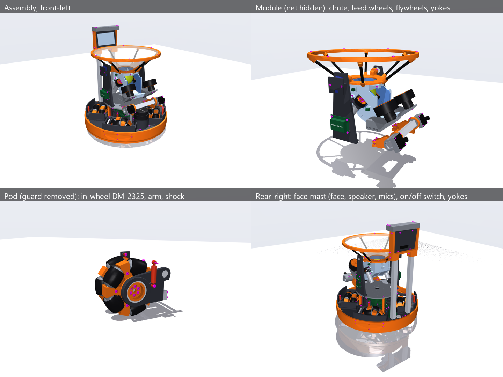
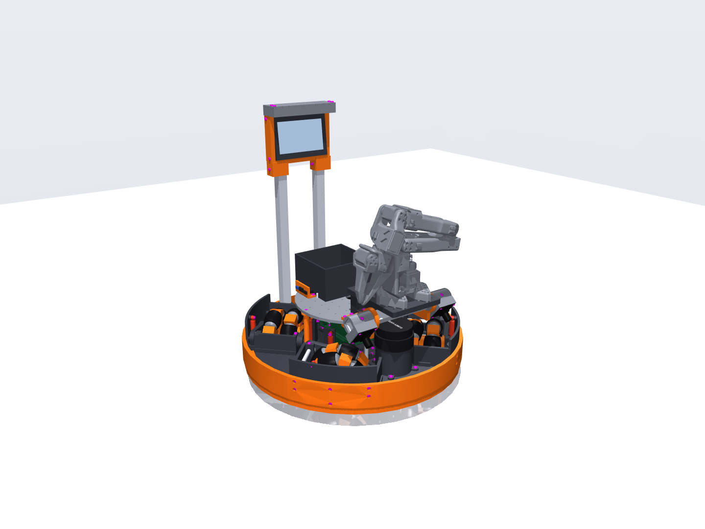

# CAD v8: the home-floor robot, down to the fasteners (build123d → STEP / STL)

**v8 round 2 (Oct 27, proposed; design.md section 14.1)**: Fernando's review of the arm robot, applied to both robots.

- **Wheels held on both sides, with bearings and shocks on both sides** (`pod.py`). The fork (inner plate 12 mm, outer
  plate 9 mm with a 10.5 mm bearing housing, a 10 × 20 6061 bar under the deck, the wheel between the plates on a
  61808 at each end) pivots on one **8 mm steel shaft** beside the wheel, in a **608 in each plate**. The shaft is held
  by an **ear on each side of the wheel**, both in the wheel guard (the inner ear pins it with an M3 through a cross
  hole). **Two shocks**, one per side: the inner one to the pod mount's tower, the outer one to a boss on the guard's
  front panel (motion ratios 0.56 / 0.47, one 5.6 N/mm spring for both; 14.8 mm of bump, 3 mm of droop).
- **The face, speaker and mics in one place for both robots: the face mast** (`mast.py`, `display.py`). Two 20 × 20
  tubes (the camera bar's stock) rise from the deck's rear edge behind the funnel's sweep to a printed crown; the face
  stands between the crown's ears over the funnel's rim (front-bottom edge at x −187, z 430, leaning back 6°), the
  audio cap (mic array on top, speaker beside it) on the ears' tops. The robot is 0.54 m tall. The front can't hold it
  (the SO-101 comes down there to the floor), nor can the plate's rear (the funnel tilts back over it). The cheeks lost
  their horns, the arm kit its uprights and shelf. The cameras stay on the indexed bar.
- **One electronics bay** along the deck's centreline (`base.py`): the Jetson on 22 mm posts with the MCU carrier
  (55 × 90, Teensy + BNO085) under it, the 19 V and 5 V bucks on the rear splice, the power board (anti-spark switch,
  fuse, current sensor) on the rear lobe, the BMS under it beside the battery's leads, the ELRS receiver on the mast's
  foot. The kits keep their own boards and plug into **one connector panel on the plate** (`payload_ports`: XT30,
  Micro-Fit 2 × 6, USB-C).
- **No e-stop**: a **round 22 mm latching on/off switch** (LED ring) on a riser at the rear edge; it switches the power
  board's anti-spark switch. Stops come from the radio.
- **Bumper higher off the floor**: rigid parts from 48 mm (was 42), the TPU skirt from 34 mm (was 20; still under a
  74 mm ball's centre, so it pushes a missed ball).
- **Diameter**: the both-sides pivot needs the outer plate's pivot boss beside the slot's corner (r 215), so the guard's
  panel moved out to r 218–223 and the bumper is 8 mm (was 12): **Ø462** (v8 Ø458). Smaller needs a one-sided pivot
  (design.md 14.1 has the numbers).

**v8 (Oct 26, proposed; design.md section 14)** is v7 with Fernando's review applied to both robots (catch and arm):

- **The wheel is supported on both sides** (a wheel hung off one printed arm will break it). A fork: the arm grows a leg
  under the deck, a 6061 bar (6 × 20 on edge) runs from it beside the wheel to an **outer plate** that holds a second
  61808 on a boss on hub A, outboard of the wheel. The robot grows 24 mm across (bumper Ø458, was Ø434) to make room.
- **Hex-drive shallow pan heads**, M3 head 6.5 × 2.5 with a 2 mm hex (counterbores 7.2 × 2.9); flat heads get a 2 mm hex;
  chamfered nuts, the nyloc's collar, chamfered shank tips.
- **Every fastener is magenta** (screws, nuts, washers, shims, set screws) in the STEP, the renders and the viewer.
- **Labels**: raised white text on the boards and other non-obvious parts (Jetson, power board, BMS, MCU + IMU, bucks,
  ESC, RoboClaw, ELRS receiver, mic array, speaker, battery, lidar).
- **Stronger cheeks**: a jaw under the plate's edge (the cheek clamps the edge like a C; the pad's screws pass through the
  plate into the jaw), the web filled down to it past the edge, and 14 mm thick (was 8) below the bar's ring.
- **Both robots as STEP**: `out/assembly.step` (catch) and `out/assembly_arm.step` (arm: the kit, the bar at −40°, the
  SO-101 stowed: TheRobotStudio's own STEP of every part, in `vendor/so101/`, placed at the sim's stow pose).

v7 below is unchanged except where v8 says so. The robot design.md describes (the baseline, Fernando, Oct 25): the **v7 base** (X4, printed 127 mm omni wheels
with 2 × 5 rollers of 36 mm, sprung pods; section 25, adopted) with the **head** (one camera bar, the 5 in face) carrying
the **v6 round-3 catch / launch module** (chute pocket, two Pololu 25D feed wheels, J-bend, two F90 flywheels, STS3250
tilt; sections 22-24), on section 24's **Damiao DM-2325** drive and a 7S1P pack; and the **arm kit** that replaces the
module for the SO-101 (`arm_kit.py`, design.md 12.3). Every dimension the sim knows comes from it: `dims.py` builds `SimParams` + `geometry()` from
`simulation/v7 home floor`, so the CAD and the sim can't drift. The v2 CAD in `cad/` is untouched.





## Build and view

```powershell
$py = "$env:USERPROFILE\.venvs\omni-robot-sim\Scripts\python.exe"
& $py build.py            # ~15 min: STEP + STL of every printed part, assembly.step and assembly_arm.step, viewer
                          # meshes, all checks, BOM, print list, and the arm robot's (ARM_KIT.md, checks.json
                          # "arm_robot", "arm")
& $py build.py --quick    # parts, BOM, mass, thread engagement, access, static clash check only (~8 min)
& $py view.py             # interactive 3D viewer (MuJoCo); --meshes rebuilds its meshes first; --arm: the arm robot
& $py step_export.py      # out/assembly.step again; --kit arm, --bodies, --groups, --no-fasteners, --tilt, --bump
& $py render.py           # out/renders/*.png (MuJoCo), --turntable for a video
```

`Launcher.cmd` (repo root) has buttons for all of them: More > CAD (v8) > Build, View in 3D (catch / arm robot), Open
the STEP assembly (catch / arm robot), Write STEP as one part.

**Viewer** (`view.py`): left-drag rotates, right-drag pans, scroll zooms, double-click centres on a part. Keys 0-5
toggle groups: 0 base, 1 pods, 2 module, 3 yokes and cameras, 4 fasteners, 5 foam pads, net and ball. The right
panel's Control slider `tilt` turns the module about its pivot (−0.52 … 0.70 rad = −30 … +40°).

`build.py` checks every pair of placed solids (printed parts, purchased parts, every screw, nut, pin and bearing)
for interference at the static pose, at module tilts −30 … +40° and with all four wheels at their bump stop and full
droop (tyres pressed on hubs, rollers' treads on their cores are intended fits). It checks that **every screw engages
≥ 6 mm of printed thread** (or a nut / a metal thread ≥ 2.4 mm), from a probe tube around each shank. Since Oct 22 it
also checks that the robot can be put together and that the prints are sound:

- **Access** (`access()`): every screw's head bears on something, the screw clamps at least one other part, and a
  straight screwdriver path out of its head isn't blocked by the screw's own parts within 40 mm (that screw could never
  be driven). Blockers further out, or by other parts, are assembly-order constraints, listed per screw in
  `checks.json` (`access.all[].driver_blocked_by`).
- **Insertion paths**: the DM-2325 slides into its cup from the inner end; the STS3250 slides out of yoke R's window.
- **Ball path**: the ball, swept down the chute, round the J and up the launch run, touches no printed part but the
  wheels that grip it.
- **Single solids**: every printed part is one valid solid (a feature joined to nothing prints loose: the yokes' board
  bosses were, before Oct 22).
- **Wall thickness** (`walls.py`, full build only): ray casting on the exact geometry from points all over each
  part; clusters under 1.2 mm (three perimeters) are listed for the PETG / PLA parts.

It also measures the lidar's self-occlusion and the mass and CG against the sim (`out/checks.json`), the head's
exact clearances to the module and the launch line ("head"), turns the camera bar from its catch index to its arm index
against everything that stays ("index"), and builds **the arm robot** (`assembly.build(kit="arm")`): its static
clashes, the kit's screws (thread, access), single solids, walls and mass ("arm_robot"), and the SO-101's own meshes
against it at its fixed poses and grasps ("arm": `simulation/v11 sil/studies/layout_trade.py arm-check`, which builds
a 1.5 mm distance field of the CAD's meshes, `mesh_sdf.py`).

## Rules this CAD follows (Fernando, Oct 21)

- Printed in PETG / PLA / TPU 95A, every part ≤ 250 mm (a 256 mm bed).
- **No heat-set inserts.** M3 screws form their own threads in **2.8 mm** printed holes with ≥ 6 mm of engagement
  (checked for every screw); through holes are 3.4 mm. Nuts only on pivots and bolted joints (pivot bolts, shock
  top, the pivot shaft's clamp).
- **Pan head and flat head screws only** (no socket-cap heads). v8 (Fernando, Oct 26): **hex-drive shallow pan heads,
  M3 head 6.5 × 2.5, 2 mm hex**, in 7.2 × 2.9 mm counterbores or on faces; flat heads (ISO 7046 head, 2 mm hex) where a
  face must stay flush (payload plate top). All fasteners are magenta in the model.
- M3 everywhere it can be. The exceptions are the vendors' own threads: M2 (camera boards), M2.5 (the A2M12's base),
  M5 (the F90's prop nut).
- Printing details are free, so the parts carry them (Oct 22): 0.5 mm entry countersinks on tapped holes with thread
  to spare (`hw.tap(entry=...)`; the countersink isn't counted as thread), 0.5 mm lead-ins on every bearing seat and
  press fit, first-layer chamfers where a bed face mates (deck joints, standoff and cup ends, the wheel hubs' pin
  channels), 2–5 mm fillets on load paths (`hw.cove_at`, `hw.cove_ring`), rounds where the ball or the net's cord
  touches a printed edge. Set the slicer's elephant-foot compensation (~0.15 mm) for the rest.

## Files

| File | What it is |
| --- | --- |
| `dims.py` | Every dimension, the frame contracts (ROBOT, POD, MODULE, PAYLOAD), the hole conventions |
| `hw.py` | Hex-drive pan / flat head screws, nuts (ISO 4032 / 10511), bearings, pins, hole cutters, engagement probes, labels (raised text), BOM bookkeeping |
| `vendor.py`, `vendor/` | Damiao DM-2325 (Damiao's STEP + drawing), Pololu 25D 9.7:1 + encoder, #1999 and #1997 hubs (Pololu STEPs + drawings); envelopes for the rest (VERIFY) |
| `wheel.py` | The omni wheel: barrel rollers (PETG core, TPU tread, 3 mm pin), three-piece hub around the in-wheel motor |
| `pod.py` | Motor cup, the fork (inner plate, outer plate, 10 × 20 bar, 8 mm pivot shaft, a 608 in each plate), two shocks, pod mount (the inner shock's tower), open-top wheel guard (front panel with the outer shock's boss, side walls, both pivot ears) |
| `base.py` | Deck (centre + 4 lobes, T-slots, printed posts and bosses), splices, four printed standoffs and the two Ø8 front rods, payload plate, battery tray, lidar riser, on/off switch riser, payload connector panel, bumpers, the electronics bay |
| `module.py` | Chute halves (pocket, chute, J, launch run, keel), collar with pivot arms, rim arcs, struts, feed carriages, flywheel mounts, wheels, foam pads |
| `mounts.py` | Yokes (608 bearing / STS3250 window), servo cap, boards on the yokes |
| `head.py` | The head (design.md 12.1): the indexed camera bar (20 × 20 tube), the two camera holders, the cheeks that carry it |
| `mast.py` | Round 2: the face mast at the rear (two 20 × 20 posts, their feet, the crown with the face's ears), the ELRS receiver |
| `display.py` | The 5 in face unit (housing, back cover, window) between the crown's ears and the audio cap (USB mic array, speaker) on them: the same place on both robots |
| `arm_kit.py` | The arm kit: the SO-101's riser and adapter, the bin, the arm's 12 V buck |
| `walls.py` | Wall-thickness scan of the printed parts (`python walls.py [part prefix]`) |
| `assembly.py` | Places everything at a tilt and a bump; the single source for the print list and the BOM |
| `build.py`, `render.py` | Exports, checks, lists; renders |
| `step_export.py`, `colors.py` | Named, coloured STEP with shared parts (assembly or one multi-body part); the colour table |
| `view.py` | Interactive viewer with a tilt slider |
| `out/head_stl/` | The head's parts (and, for the arm, the kit) as meshes in the ROBOT frame at each index, for `simulation/v11 sil/studies/layout_trade.py` (`build.py --head-only` rewrites them) |
| `out/ARM_KIT.md` | Generated: the kit's prints, and the purchased parts and fasteners a swap puts on and takes off |
| `out/step/`, `out/stl/` | One STEP per printed part in its contract frame (SolidWorks wrapper parts); print-ready STLs; foam-pad templates |
| `out/assembly.step` | The whole catch robot, every screw included: a nested, coloured assembly with shared parts |
| `out/assembly_arm.step` | The arm robot the same way (the arm kit, the bar at its arm index, the SO-101 stowed: its own STEP parts) |
| `vendor/so101/` | TheRobotStudio's SO-101 STEP files (every printed part of the follower arm, the STS3215), unmodified, Apache-2.0; `SOURCES.md` has the commit, links and hashes |
| `out/PRINT_LIST.md`, `out/BOM.md` | Generated: material / infill / orientation / mass per print; every purchased part and fastener with counts |
| `out/funnel_net_pattern.svg` | 1:1 sewing pattern for the 55° net |

## Design in one page

**Wheel and drive.** The DM-2325 sits *inside* the wheel. Its body (Ø28 × 60.6) is held by its face (4 × M3 pan
heads on Ø22, on the cup's outer face under the hub's flange) in a printed cup; its 17 mm D-shaft ends at the wheel's outer face, where a Pololu #1999 hub drives the wheel's
outer plate. The wheel's inner end runs on a 61808 bearing on the arm's boss, so the motor's shaft carries only about
half the wheel load. The cup's bore has a 12 mm channel from the inner end to the mid-body connector: the motor slides in with its
9 mm connector housing (and the plugged cable) in it. The arm's four screws into the cup sit on r 17 inside the 61808's
bore (1.4 mm of boss over their holes; on r 18.15 it was 0.15 mm).
The wheel is three PETG hub prints split on the two row planes; each roller's 3 mm pin lies in a split plane, clamped
between half-channels. Rollers have the exact barrel profile (the wheel's envelope is a true Ø127 circle) and coned
ends. 10 × M3 × 20 join the hub. Hub A's end plate is 4 mm under the #1999 hub's six M3 × 8 (they carry the
drive torque).

**The fork (v8).** v7 hung the wheel, the cup and the motor off the arm on one side: every load went through one
printed plate and four screws into a printed cup. v8 closes a loop round the wheel. Hub A has a boss outboard of its
end plate (Ø40, bore Ø31, so the #1999's screws are driven through it) carrying a **second 61808**; its outer race sits
in the **outer plate** (PETG, a Ø62 housing with a 3 mm lip, a web over the wheel's outer face clear of the rollers by
1.9 mm, and a lug). The arm grows a **leg** under the deck (5 mm under its underside), and a **6061 bar 6 × 20 × 104**
on edge runs from the leg, beside the wheel and under the deck, to the outer plate's lug: two M3 × 14 through the bar
into each (8 mm of thread). The bar is on the pivot's side (+y): there bump moves it down 6 mm and inward, while a point
on the far side would rise ~36 mm into the deck. Vertical loads stay in the plates' planes (the outer plate in its own
plane, the bar on edge), so the loop is stiff where the wheel loads it. The outer plate sat where the guard's front panel
was, so **the deck, the guards and the bumpers grew 12 mm in radius** (DECK_R 205 → 217; bumper Ø434 → Ø458), and the
corner bumpers' side screws moved over the deck (z 72 and 88), off the outer plate's lug. The three bearings (two
61808s and the motor's own) are statically indeterminate: printed parts take up the misalignment, but VERIFY on the
bench that the #1999 hub doesn't load the motor's shaft (if it does, open the outer plate's housing to a slip fit).

**Pods (round 2, Oct 27).** The fork (inner plate, outer plate, the bar, the wheel between them) swings on one 8 mm
steel shaft 74.5 mm from the axle, beside the wheel on the pivot side (POD y 68.2, z 30), in a 608 in each plate. The
shaft is held at both ends of the wheel by the wheel guard's two ears: the inner one beside hub C (an M3 × 25 through
the ear and a 3.4 mm cross hole in the shaft pins it), the outer one beside the rollers (cut back to r 65.5 from the
axle). 0.5 mm shims set the 608s' inner races against the ears, so the fork is located between them. Two 1/16-scale RC
shocks, one each side of the wheel: the inner one from the inner plate to the pod mount's tower (motion ratio 0.56,
static 48.3 mm), the outer one from the outer plate to a boss on the guard's front panel (0.47, static 48.0); one
~5.6 N/mm spring for both gives the sim's 3 N/mm at the wheel, with 14.8 mm of bump and 3 mm of droop in the inner
shock's stroke (`checks.json` "suspension"). Since the shaft sits above the axle (30 mm), the wheel moves 6 mm along its
rolling direction over the full bump. The pod mount is now only the inner shock's tower: it stands on the deck on five
M3 × 14 from below, 10 mm into it each; its **tie** puts two of them into the centre deck piece, which is what joins
the side lobes to the centre (nothing did before Oct 22). The fork's parts: the inner plate 12 mm, the outer plate a
9 mm web with a 10.5 mm bearing housing, the bar 10 × 20 (v8: 8, 6.5 and 6 mm). The left pods (and the right) are mirror images, so both mounts on each side share that side's lobe, and
the front and rear lobes stay free. The mirrored pods use mirrored prints of the arm, cup, mount and guard (`_M`); the
wheel is the same print, turned half a roller pitch (its mirror image), and every purchased part is the same part.

**Deck and base.** The deck is in the axle plane: a 140 mm centre and four lobes (≤ 250 mm prints) with T-shaped
wheel slots, 141 mm wide at the wheel and 72 mm inboard of it. An open-top wheel guard closes each slot's outer end
with a curved front panel (to robot z 127.5: it carries the outer shock's top) and two side walls on the lobes, the
pivot side's with the two ears; the wheel's top is uncovered. TPU bumpers (8 mm) wrap the deck and the guards at
r 223-231 (round 2; v8 217-229, v7 205-217) from 48 mm up, with a 1.5 mm skirt down to 34 mm (v8: 42 and 20); the rear
lobe's steps round the face mast's feet. The battery (flat 7S1P) hangs under the centre in a closed 3 mm tray.
**Electronics bay (round 2)**: along the centreline under the plate. The Jetson on 22 mm posts printed with the centre
deck, the MCU carrier (55 × 90: Teensy 4.1, BNO085) under it on the deck's bosses (the battery is right under the centre
deck, so nothing screws up from below there); the 19 V and 5 V bucks on posts on the rear splice; the power board
(anti-spark switch, fuse, current sensor) on the rear lobe; the BMS under the rear lobe next to the battery's leads; the
ELRS receiver on the left mast foot. The **on/off switch** (22 mm, round, latching, LED ring) is in a riser at the rear
edge with a 4 mm panel and an open underside (the ring nut goes on at the bench; its body passes a 24 mm deck hole); it
switches the power board's anti-spark switch. The kits plug into the **payload connector panel** on the plate's
rear-right (XT30, Micro-Fit 2 × 6, USB-C; the base's cables come up through a slot under it). The
lidar's riser stands on four lugs at r 43 (a driver reaches them past the lidar) and its M2.5 screws are driven up
through 7 mm holes in the deck.

**Lidar layer.** The payload plate rides on **six standoffs** 96 mm over the deck, so the A2M12's scan plane (z 150,
on a riser at x 140) passes over the wheels at their bump stop (142) and under the plate (162.5): **only the six
standoffs cross it**, and nothing of the head comes below z 154.5 (v8: the cheeks' jaws; v7 157). The side pair stands under the yokes; the front pair
sits on the lidar's rays through the side pair, so their shadows overlap; the rear pair is far away (thin shadows).
The front pair, 55 mm from the lidar, threw the widest wedges (12.5° at Ø12), so since Oct 24 they are **Ø8 6061
rods** (M3 tapped at both ends, located in 1 mm recesses in the deck and the plate): 8.2° each, **22° blocked in all**
(was 31°). The four printed ones (Ø12, Ø20 flanges) carry the sway. Route the head's cables down the side standoffs,
on the side away from the lidar: they stay inside the rods' wedges. Everything else on the deck stays under z 128. The
module and its pivot rose with the plate (`dims.PLATE_GAP`, the sim's `plate_gap`).

**Module.** The ball path is two PETG halves split on the centreline (outer wall down, smooth path), lined with 6 mm
low-resilience foam. The chute floor slopes at 40° into the feed wheels' nip; the slick J (40 mm) turns the ball up the
30° run into the Ø70 flywheels. Each Pololu 25D sits on a hinged carriage: a torsion spring holds it on an M3 stop
screw, set so the wheels just touch a seated ball. Each F90 sits on a solid wedge (y 48-87, the motor's full width)
that fills the space behind and under its plate, back to the side wall and keel (4 × M3 × 16) and down to the line the
payload plate leaves at +40° (the plate's front edge is the module's lowest point there, so it can't get thicker
downward). The tilt pivot is 13 mm above the throat, inside the cone. So the
collar's two arms run under the net to bosses outside it: an 8 mm shaft in a 608 on yoke L, and the STS3250's horn on
yoke R. The ESC, the RoboClaw and both bucks are on the yokes' outer faces, outside the swept volume; the yokes are solid
10 mm plates. The net is laced through holes in the collar joined by a groove underneath (the chute's flange is right
under the collar).

**Head** (`head.py`, Oct 24: design.md 12.1 drawn). One stiff camera bar for both payloads: a 6061 square tube
20 × 20 × 1.5, 228 long, its axis at x 155, z 195, behind the display. A printed holder on each end (a sleeve on the
tube, held by one M3 × 30 through the sleeve and both tube walls) carries an OV9782 board on its front face; the
cameras' optical centres sit at **(192, ±95, 211) at the catch index, 30° up**, 190 mm apart (the lenses inside the
bumper's radius: 217 mm in v7, 229 in v8). The holders' inner ends are 34 mm journals in the two **cheeks'** bores: the cheeks stand on
the plate's front edge (3 × M3 each), rise under the module's swept volume (the closest the module comes: a flywheel
mount, 6 mm from a cheek: `checks.json` "head"). (Until round 2 they also carried the face on horns.) **v8 cheeks:** over the pad the module's sweep keeps the web low (v7's section there was 8 mm thick and
6–14 mm tall), so the cheek grows down and out instead: an 8 mm **jaw** under the plate's edge (z 154.5, 4.5 mm over the
scan plane and ≥ 64 mm from the lidar's axis), so pad and jaw clamp the plate's edge like a C, the pad's three M3 × 20
passing through the plate (now clearance holes) into the jaw; the web filled down to the jaw past the edge; and 14 mm
thick (|y| 64–78, was 64–72) from x 89 to the ring, clear of the pad's outer screw and the holder's sleeve. The cheek
slides onto the plate's edge from the front (0.3 mm round it). The module's closest approach is unchanged (6.2 mm), and
so is the launch line. **Index:** one M3 × 10 through the left cheek's ring into the left journal (thread 6.5 mm, in one of two
tapped holes): 30° up for catching, 40° down for the arm. The right journal slides in its bore, so plate flex can't
bend the bar. At the arm index the lenses come to (183, ±95, 166): the bar's axis can't pass through them, because
it was drawn round the face that stood in front of it until round 2, so turning 70° moves them 46 mm, mostly down;
the holders stay 9 mm over the scan plane (outboard of the lidar). The axis is as low as that allows:
the arm robot's SO-101 behind the bar reaches the floor over it only while the bar's top stays under ~210 mm. Turning the bar from one stop to
the other with the module off clashes with nothing (`checks.json` "index").

**Face and voice: the face mast (round 2, `mast.py`, `display.py`).** The same place on both robots (Fernando, Oct 27:
he won't move the screen and speaker for each payload). The front can't take it on the arm robot (the SO-101 comes down
over the camera bar exactly there, design.md 12), nor the plate's rear on the catch robot (the funnel tilts back over
it: its rim reaches x −193 at −25°). So two 6061 tubes 20 × 20 × 1.5 (the camera bar's stock), 357 mm, stand at
(−202.4, ±48) in printed feet on the deck's rear edge, 3 mm behind the rim's sweep; each foot reaches forward for its
two M3 × 14 from under the deck, and an M3 × 30 with a nyloc crosses socket and tube. A printed **crown** takes both
tubes' tops (an M3 × 45 and nyloc across each), bridges them under the face and rises in two ears (|y| 63.5–73). The
**5 in 800 × 480 panel** stands between the ears on 2 × M3 × 18 each side, its front-bottom edge at (−187, 430),
leaning back 6°: over the funnel rim's strut sockets (420 at tilt 0; they pass 7.5 mm under it at −2°), so a thrower
in front sees all of it with the module level. The rim comes within 3.0 mm of a post at −24° (`checks.json` "head"). A printed housing (2 mm lip round the window, rails above and below the
panel take every screw), a 2 mm polycarbonate window (a ball hits it), the panel, a 2 mm back cover. The **audio cap**
(18 mm box and 3 mm lid, 4 × M3 × 14 into the ears' tops) sits over the face with the USB mic array (mics through the
lid) and the 3 W speaker (under a grille) side by side; its front overhangs the funnel (nothing reaches 0.5 m there).
The robot's top is 0.54 m. The cables (HDMI, USB) run down inside the left tube to the electronics bay. The tubes cross
the lidar's scan plane 340 mm behind it (two thin shadows next to the rear standoffs'). With the face gone from the
front, the launch line clears the head from 8° up (was 24°: the Thrower bench mode's 25° floor could drop; not changed).

**Payload interface.** Still a Ø240 plate with a 25 mm grid, two asymmetric Ø4 dowels and a Ø28 pass-through. Now
M3 on 2.8 mm holes (no inserts), a full disc on six standoffs, flat heads flush with its top. The base's boards stay
in the electronics bay when the kits are swapped; each kit's own boards (the catch kit's ESC, RoboClaw, 12 V buck and
servo on its yokes; the arm kit's 12 V buck and servo bus) plug into the **payload connector panel** on the plate's
rear-right (round 2, `base.payload_ports`): an XT30 (the switched motor bus), a Micro-Fit 3.0 2 × 6 (CAN3, 2 × DShot,
Serial3, Serial4, beams, IR, 5 V; VERIFY the pinout against PINS.md) and a USB-C, facing the robot's right side.

**Arm kit** (`arm_kit.py`, design.md 12.3). The SO-101's base and shoulder bracket reach 65 / 86 mm ahead of its base
origin, 0-100 mm up: on the plate at the study's x 100 (A5) they stand where the camera bar is. So the arm stands on
a **riser**: a hollow printed block on the plate's front edge (4 × M3 into the plate, keyed by the front dowel) and a
10 mm **adapter** plate on it (4 × M3 × 18, heads counterbored; v7 M3 × 20) that runs forward over the bar, 3 mm above its highest
corner at any index; the base's origin at (140, 0, 224.5). Its base clears everything but its adapter by 9.8 mm and
every link clears the robot by ≥ 14 mm at the fixed poses and grasps (`checks.json` "arm"). The **bin** (120 × 120 ×
70) takes the plate's 4 holes at its rear. The arm's **12 V buck** is on the riser's left wall; its bus board rides on
the arm's base; their harness plugs into the payload connector panel. (Until round 2 the kit also carried the face and
the audio box on uprights and a shelf over the bin.)

## Assembly order

`build.py`'s access check gives, for every screw, the parts that block a straight driver (`checks.json`). The order
that satisfies all of them:

1. **Pods (bench, x4).** Press the 61808 into hub C, a 608 into each fork plate (the inner plate's from its outer
   face, the outer plate's from its inner face). Motor into the cup (connector in the channel), 4 × M3 × 8 on the face.
   Pololu #1999 hub on the shaft with a 2 mm shim between its boss and the cup's face; tighten both set screws (hub A
   encloses them). Hub C onto the inner plate's boss, the cup through it, 4 × M3 × 25 from the plate's inner face. Inner
   row of rollers in hub C, hub B, 5 × M3 × 20 from hub C's side (turn the wheel to reach each past the plate). Outer
   row, hub A, 5 × M3 × 20, 6 × M3 × 8 into the #1999 hub (through the bore of hub A's boss). The outer 61808 onto hub
   A's boss, the outer plate's housing onto it, then the fork bar: 2 × M3 × 18 through it into the inner plate's leg,
   2 into the outer plate's lug (heads on the bar's outer face; on the bench, the other pod's bar faces it on the
   robot). The shocks' lower bolts: the inner one with its washer into the inner plate, the outer one into the outer
   plate. Guard (bench): the outer shock's top bolt into the panel's boss, its head inside (before the guard meets the
   fork).
2. **Module (bench).** 25D on its carriage, #1997 hub, feed wheel (before the carriage goes into its window). Chute
   halves together: 4 × M3 × 16 across the split, the keel one through the R half's bore (before the flywheel mounts).
   Carriages: knuckle, spring, M3 × 30 hinge, nyloc, stop screw; then glue the IR halves. F90s on their mounts,
   flywheels, prop nuts; mounts onto the keel. Pads, collar, struts, rim, lace the net. Servo horn onto the collar.
3. **Base (deck up, then on its back).** Deck pieces and splices; the bucks on the rear splice. The MCU carrier, then
   the Jetson over it; the power board on the rear lobe; the BMS under it. Switch riser (switch built into it first),
   lidar riser then the lidar (its four M2.5 from under the deck), the mast's feet. Standoffs and the two front rods.
   Pod mounts (5 screws each from below). Each pod: the fork into its guard (the shaft's line between the ears), the
   shaft in from the outer end through the outer plate's 608, the outer ear, the inner ear and the inner plate's 608,
   with a shim at each ear; the pin (M3 × 25) down through the inner ear and the shaft. The inner shock's top bolt
   through the tower, nyloc; the outer shock's lower bolt through the access hole in the panel. Robot on its back: the
   guards (feet screws from below), bumpers, battery and tray.
4. **Top.** Payload plate (its side screws are under the yokes, the front ones under the module). 608 into yoke L,
   yokes (3 screws each), boards on them. Module between the yokes: the 8 mm shaft from outside through the 608 into
   the collar, clamp; the servo through yoke R's window onto the horn, cap. The payload connector panel (2 screws), the
   kit's pigtails into it.
5. **Head (bench, then onto the plate).** Cameras onto the holders (4 × M2 × 6 each). Holders onto the tube (one
   M3 × 30 each through the tube's cross holes). Slide the bar's journals into the cheeks (L with the index holes into
   cheek L), set the index screw, then slide the cheeks onto the plate's edge from the front (their jaws under it) and
   3 × M3 × 20 each through pad and plate into the jaw (tilt the module back to reach them).
   Calibrate the stereo pair on the bar once (omni_calib).
6. **Face mast.** The tubes into the feet (cross bolts, nylocs), the cables down the left one. The crown on the tubes'
   tops (cross bolts). Face on the bench: window, panel, back cover (4 × M3 × 12); then between the crown's ears
   (2 × M3 × 18 each side). Audio cap: 4 × M3 × 14 down into the ears, mic board, lid with the speaker.

**Swap to the arm** (design.md 12.3; `out/ARM_KIT.md` lists the parts):
1. Unplug the kit's pigtails from the payload connector panel (the face, the speaker and the mics stay on their mast).
2. The module out of the yokes; the yokes (3 screws each) with their boards; unplug the ESC, the RoboClaw, the 12 V
   buck and the servo.
3. The index screw out, turn the bar to −40° (the other tapped hole), the screw back in.
4. The riser (4 screws from inside), the adapter (4), the SO-101 on it (4, VERIFY its holes), its 12 V buck and bus.
5. The bin (4 from inside); the arm's pigtails into the connector panel.
6. Check the cameras against the floor plane (`omni_calib`'s sensors-on-base step).

Service: the payload plate comes off only with the module and yokes; the Jetson covers the MCU carrier; the battery needs the
robot on its back; the inner row of rollers needs the pod off the robot (its screws face the robot's centre).

## Bearings

| Bearing | Qty | Where | In a small kit? |
| --- | --- | --- | --- |
| 608-2RS (8 × 22 × 7) | 9 | The forks' pivots, one in each plate (round 2; v8 had two 623s per pod); the tilt pivot, yoke L | Yes |
| 61808-2RS = 6808-2RS (40 × 52 × 7) | 8 | Each wheel's inner end, on the arm's boss (the motor leads and the cup's screws pass through its bore); v8: each wheel's outer end too, on hub A's boss in the fork's outer plate | No: buy 9 |

## What the CAD found (for the next simulation round)

See design.md section 29 for the full list, with what each one changes in the sim.

## Before printing: VERIFY

Search the code for `VERIFY`. The ones that set geometry: the A2M12's hole circle and scan height, the Jetson
carrier's holes, the F90's 19 × 19 pattern, the STS3250's case and horn, the RoboClaw's holes, the shock's length,
stroke and spring, the OV9782 board holes and its lens's optical centre (16 mm ahead of the board's back assumed),
the 5 in panel (outline, depth, its HDMI and USB connectors), the USB mic board
(size, holes, mic positions), the micro speaker, the on/off switch's body (the deck hole is 24 mm), the payload connectors' cut-outs, and
the DM-2325's cable plug in the cup's 12 mm channel. Print one wheel (3 hubs, 10 rollers) and one pod first.

`walls.py` still lists two kinds of thin spot, both accepted: 0.5 mm webs in the motor cup between the pilot pocket
and the face screws' holes (the DM-2325's own PCD 22 holes sit 2.5 mm outside its Ø17 pilot; the heads clamp the
solid outer 1 mm), and knife edges along the wheel spokes' roller cut-outs (no load there; the slicer drops them).

## SolidWorks / eDrawings

Open `out/assembly.step` (the catch robot) or `out/assembly_arm.step` (the arm robot) (File > Open, STEP; import as an
assembly). Each is a nested assembly: robot > base, pod FL / FR / RL / RR chassis and wheel, module (tilting) or the
SO-101, mounts, head > each group's fasteners in their own sub-assembly. Parts are coloured (fasteners magenta, labels
white) and shared: every M3 × 10 pan head is one part with many instances, so SolidWorks makes one part file per
distinct part and its BOM counts them. Hide all of a group's screws, or a whole pod, with one click. eDrawings opens the
same files directly, for a quick look. The labels are separate white bodies named `label <text>`; the SO-101's parts
are TheRobotStudio's own STEP files (`vendor/so101/`, the commit the sim's meshes come from), each placed where the sim
puts its mesh at the stow pose (`layout_trade.py arm-poses`; every part's frame matches its mesh's, checked to 0.01 mm
in place). Edit a part in `vendor/so101/` and rebuild (`step_export.py --kit arm`); a changed part the sim should
see goes to `simulation/v11 sil/assets/so101/` as an STL in metres too. The wrist servo is the STS3215 with its horn
(no STEP without it).

`step_export.py` writes other cuts of the same model:

```powershell
& $py step_export.py --bodies                       # out/assembly_bodies.step: one part, every solid a coloured body
& $py step_export.py --kit arm                      # out/assembly_arm.step: the arm robot, the SO-101 stowed
& $py step_export.py --groups module,mounts --tilt 40 --out out/module_40.step
& $py step_export.py --no-fasteners --bump 15       # wheels at the bump stop, no screws
```

These are references at one tilt and bump, not mated assemblies: the model is the Python, and SolidWorks edits
don't flow back. `out/step/*.step` are the printed parts in their contract frames (POD parts in the pod frame,
module parts in the MODULE frame, base parts in the ROBOT frame), ready for wrapper parts; `_M` files are the mirrored
pod parts (front-left, rear-right).
