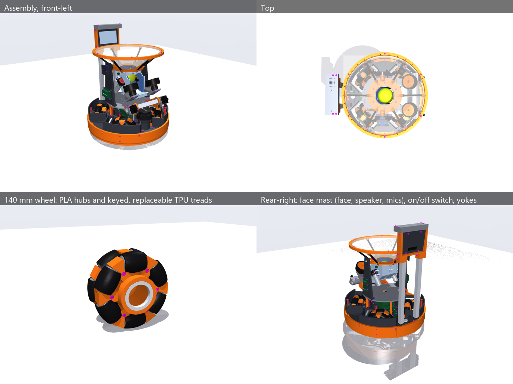

# CAD v9 — wheel-only bench prototype

Current work is restricted to the wheel. Test it before changing the base, fork,
cameras or arm. Existing whole-robot exports and their checks below are older
pre-integration snapshots: they do not validate this wheel revision. In particular,
their bearing supports do not fit the new 20 mm inner-race interfaces.

Use **out/wheel_test_6804.zip** for the oriented print STLs and assembly instructions,
and **out/wheel_assembly_6804.step** for the wheel assembly. Start with one PLA
roller_core and one medium-TPU roller_tread; then print the remaining wheel.
PLA and TPU remain separate, keyed parts so treads can be replaced.

- Two owned 6804 bearings: 20 × 32 × 7 mm. Hub A uses a removable cartridge;
  tighten motor-flange screws before installing it (three M3 × 12 screws).
- Twelve stock M3 × 50 axle screws and plain M3 nuts, captured in 5.8 mm AF hex pockets.
- Core body 39 mm, 42 mm overall including Ø8 × 1.5 mm thrust journals.
  End blocks allow 0.6 mm total axial float; TPU is recessed 2.5 mm behind
  the journal ends. Both core body and TPU require at least **0.5 mm clearance**
  from the fixed PLA throughout travel. Only the small journal thrust faces
  may rub; check wear and free spin. Clearances are nominal CAD, not measured.
- Actual 2 mm fillets join the perpendicular spoke/drum roots. Roller envelopes
  are recut after filleting, with deeper end pockets to keep the cones clear.
  Unused pointed spoke tips are clipped, the cheeks taper beyond the joint
  pads, and nose edges are bevelled 1 mm. Axle blocks and broad spoke roots
  are retained.
- Both sides of each narrow triangular cheek root now have **2 mm reinforcing
  fillets**, adding PLA at the neck. All 48 finished blend faces are checked
  (A: 12, B: 24, C: 12), together with added material at both roots of every
  cheek half and the existing roller-clearance checks. These are geometric
  checks; loaded strength remains unmeasured.
- The end-relief slot underneath each triangular support is **filled with
  continuous PLA**. The pocket narrows toward the core tip instead of remaining
  barrel-wide past the roller body. Regression checks sample three depths on
  both ends of every support. `out/renders/wheel_web_join.png` shows the join
  with the rollers hidden; the assembly and STL geometry include the fill.

Wheel-only regeneration: run `build.py --wheel-only`,
`python -m pytest -q test_wheel.py`, `render.py --wheel-only`, and
`print_plates.py` using the project simulation venv. The build exports the kit
and STEP, then checks clashes, M3 engagement, screw access/clamping, single
valid solids, walls, and the complete rotating core/tread envelopes at the
centre and both axial stops of all twelve rollers.
Use `out/x2d_plates/wheel_6804_PLA_X2D.3mf` and
`wheel_6804_TPU_X2D.3mf` for the matching Bambu X2D print plates.
The solid-underside revision passes 28 wheel tests and the 7 v2 baseline sim tests.
The finished wheel check passes: minimum core-body clearance **1.50 mm**, TPU
clearance **1.19 mm**, zero clashes, short threads or screw-access/clamping
problems, and one valid solid per print. These are nominal CAD distances;
thin-edge wall-scan warnings remain listed below.
Reprint the twelve PLA cores and hubs A/B/C together; existing TPU sleeves,
bearing cartridge and stock hardware keep their original interfaces.
For the reinforcing-fillet and solid-underside follow-ups to that clearance kit, **only hubs A/B/C
change**; its 42 mm overall cores, treads, cartridge and hardware are unchanged.
Checks are in `out/wheel_checks_6804.json`; its wall scan retains thin-edge
warnings and needs slicer inspection. The kit README explains supports and fit
coupons. These are unprinted prototypes; bearing fits, loaded strength, runout,
TPU retention, grip and bore/thrust wear require bench confirmation.

Six rollers **per row** (12 total) retains 36 mm terrain rollers on a 140 mm wheel.
This is a packaging choice, not a proven optimal count. More smaller rollers can
smooth transitions but add parts and reduce the effective obstacle radius when
rolling sideways. Historical studies compared several configurations with other
changes too, so do not establish a count-only winner. Keep this size/count for
the first physical test.

## Earlier integrated v9 snapshot — retained for context

# CAD v9 — compact AK40-10 base and first wheel print

Fernando, Oct 31: **CubeMars AK40-10 V3.0 KV170**, retain suspension, larger
wheels, PLA and medium-soft TPU for the wheel test. This is a new CAD variant;
`cad/v7` and the simulation / firmware baseline are preserved. The v8 catch and
arm payloads, face mast, electronics bay and payload connector carry over.



## What changed

| | v8 round 2 | v9 |
| --- | --- | --- |
| Motor | DM-2325, Ø28 × 60.6 mm, shaft adapter | AK40-10 V3.0, Ø53 × 40.2 mm, direct flange |
| Wheel | 127 mm, 2 × 5 rollers | **140 mm, 2 × 6 rollers**, 36 mm diameter rollers |
| Roller-row centre spacing | 40 mm | **36 mm**, checked for clearance |
| Wheel centre radius | 150 mm | **146 mm** |
| Main deck / guard radius | 223 mm | **217 mm**, local rear mast supports |
| Base bumper footprint | Ø462 mm | **450 mm wide × 453 mm long**; rear arc steps out 3 mm |
| Axle / belly height | 63.5 / about 34.5 mm | **70 / about 41 mm** |
| Lidar scan / payload top | 150 / 168.5 mm | **163 / 181.5 mm** |
| Wheel supports | double-sided sprung forks | retained; shorter fork and 98 mm pivot shaft |

The short motor remains inside the wheel. The output bolts directly to hub A
with **3 × M2.5 × 6 on PCD 27**, engaging 2.5 mm in the maker's 3 mm blind holes.
The stationary rear bolts to a new open-front cradle with **4 × M2.5 × 8 on
PCD 47**, engaging 4 mm in 5 mm blind holes. All four forks use the same unmirrored cradle so the actual motor connectors
stay aligned with its channel. No shaft adapter or assumed Ø15 locating boss. Two 61808 / 6808 bearings carry the wheel on the fork. Verify
that assembly does not preload the motor's own bearing.

Dimensions: CubeMars' [official V3.0 drawing and downloads](https://www.cubemars.com/product/ak40-10-v3-0-kv170-robotic-actuator.html).
The original PDF, image and STEP are in `vendor/`. The STEP has open shells;
`vendor.ak40_10()` supplies a solid check envelope with the specified mounting
holes. The actual plug, cable bend, cooling and connector orientation remain
**VERIFY**; a diagonal channel between the rear bolts reserves harness space.

## Compactness and suspension

140 mm balances the larger motor opening, existing 36 mm terrain rollers,
footprint and height. Wider roller rows waste axle width; moving them too close
makes adjacent rollers collide. The compact fork and smaller wheel-centre
circle recover footprint while keeping double-sided support. This is a packaged
design, not proof of a global minimum footprint.

152 mm offers more radius and theoretical speed but requires a larger wheel
sweep, higher pivots / clearance and higher lidar / payload. The 140 mm wheel
adds **6.5 mm axle / belly clearance and 10.2% travel per motor revolution**.
At the maker's 435 rpm no-load figure at 24 V, rim speed is 3.19 m/s; this is
**not a loaded robot speed claim**. The firmware cap remains 2.0 m/s. Rated /
peak tangential force per wheel is 18.6 / 58.6 N from 1.3 / 4.1 N·m.

Four forks retain two shocks each, ~3 N/mm effective wheel rate and 15 mm bump /
3 mm droop. The higher pivot clears the larger wheel. Exact rotation makes the
axle move the requested height; the old arcsine shortcut ignored pivot height.
Both nominal 40–50 mm shock stroke limits are checked throughout travel.
Spring ~5.6 N/mm at each shock is **est**; rate, preload, damping and purchased
shock dimensions must be measured.

The lidar, head and payload lift preserves clearance above a fully bumped
wheel. The arm's STEP / mesh checks use the same 13 mm lift through
`arm_geometry.py`; shared simulation studies and robot exports stay intact.
Real grip, wear, stopping, threshold performance, floor-picking reach and
full-robot dynamics still need validation. Earlier catch / crossing scores do
not describe this CAD variant.

## First print

Use **[out/wheel_test.zip](out/wheel_test.zip)** or **[out/wheel_test/](out/wheel_test/)**.
Its [README](out/wheel_test/README.md) has quantities, orientation, hardware,
assembly and measurements. Start with **one PLA roller core and one medium TPU
tread**, then print the other eleven once the fit works. Three internal keys
resist tread rotation; the barrel retains it axially. No glue or PLA–TPU bond.
The test kit STLs are on the bed in print orientation; general assembly exports
retain their contract-frame orientation.

A combined print could combine each roller's core and tread on a suitable
printer. All twelve rollers must still turn freely on their M3 screw axles.
Separate sleeves permit changing hardness and replacing worn treads. The TPU's
Shore hardness, printer, shrinkage and grip are unknown; density / mass
estimates do not specify hardness. Structural base / cradle parts retain PETG;
the first wheel uses the requested PLA. The hubs need removable supports; the individual roller cores and sleeves are support-free. Inspect the slicer preview before printing.

## Build, check and view

Use `C:\Users\ferna\.venvs\omni-robot-sim\Scripts\python.exe` from this folder:

```text
python -m pytest -q test_v9.py
python build.py                  # both robots, STEP / STL, BOM, checks, walls
python drive_checks.py           # focused wheel / fork checks
python wheel_test.py             # oriented wheel kit and wheel STEP
python render.py                 # overview, wheel and robot pictures
python view.py                   # interactive catch robot; --arm for arm
python step_export.py --bodies   # optional single multibody STEP
```

The Launcher's CAD controls point to v9. Important files:

- `dims.py`, `wheel.py`, `pod.py`: motor, wheel and suspension interfaces.
- `base.py`, `mast.py`: smaller chassis, rear foot fastening and receiver pad,
  stepped rear bumper, rearranged power board and switch.
- `build.py`, `drive_checks.py`, `test_v9.py`: thread depth, access, insertion,
  valid single-solid prints, clashes through tilt / bump, roller clearance,
  handed motor-pattern symmetry and lidar clearance.
- `out/assembly.step`, `out/assembly_arm.step`: named coloured assemblies.
- `out/BOM.md`, `out/PRINT_LIST.md`, `out/checks.json`: generated evidence.
- `out/wheel_assembly.step`, `out/wheel_test.zip`: first wheel and print files.

Fasteners remain magenta. No inserts; M3 thread-forming holes are 2.8 mm with
at least 6 mm engagement, M3 clearance 3.4 mm. Vendor M2.5 threads are respected.
Strength, estimated masses and tolerances remain unverified until printed and
loaded. A clean geometric check is not a structural strength test.

## Wall-scan review for the prototype

The full ray scan records sub-1.2 mm edge clusters on eight print names:
wheel hubs A/B/C at roller clearances / pin channels; the roller core at
keyway-to-barrel edges; the cradle at the cable-channel / centre-bore merge;
the two handed inner fork plates at a trimmed fillet; and the rear deck at
neighbouring board-post / mounting-bore edges. These are not a zero-warning
wall report. Coordinates and sampled thicknesses are in out/checks.json.
Inspect those areas in the slicer and remove loose edge feathers after printing.
Do not assume a small CAD edge will resolve as a continuous printed wall.
The inner wheel-bearing retaining shoulder is explicitly 2.5 mm thick and
checked separately. Loaded strength, key wear and bearing fits still need the
first bench wheel. The geometry gates (clashes, thread, access, insertion,
connected solids) are separate from these wall-scan warnings.

Validated Oct 31: full build PASS for both payloads, 0 clashes / short threads / access problems, all prints valid single solids; 25 CAD tests and 7 v2 simulation tests passed. Estimated catch robot mass 10.18 kg, CG z 138.6 mm (CAD estimate, not weighed). Wall-scan edge warnings are listed above.

Wheel revision (Oct 31): M3x50 axles / nuts, shorter 39 mm cores, enlarged joint pads, moved-in hub fasteners and root coves. Earlier pin-based print files are superseded by the regenerated M3-axle kit.

For the revised wheel, use 12 M3 × 50 pan-head screws and 12 plain M3 nuts. Roller cores are 39 mm long with 3.6 mm running bores. Joint screws are at radius 38 mm on Ø14 pads with 2 mm root coves; spoke roots widen from 16 to 28 mm. Assemble axle nuts while the hub halves are open, and leave rollers free. A fully threaded screw is usable for the prototype but the replaceable PLA bore must be checked for thread wear.

The revised wheel has a nominal minimum TPU-to-unsprung-fastener CAD distance of **2.39 mm**, at a hub joining screw. The exact value and source hashes are in out/wheel_revision.json; real TPU deformation and print tolerances still need the bench wheel.

Latest printable revision: **out/wheel_test_M3x50.zip**; review assembly **out/wheel_assembly_M3x50.step**. Full build PASS for both robots; 25 CAD tests and 7 baseline sim tests pass. Thin cutout-edge warnings remain recorded in checks.json; loaded strength and PLA-on-thread wear await the test wheel.
