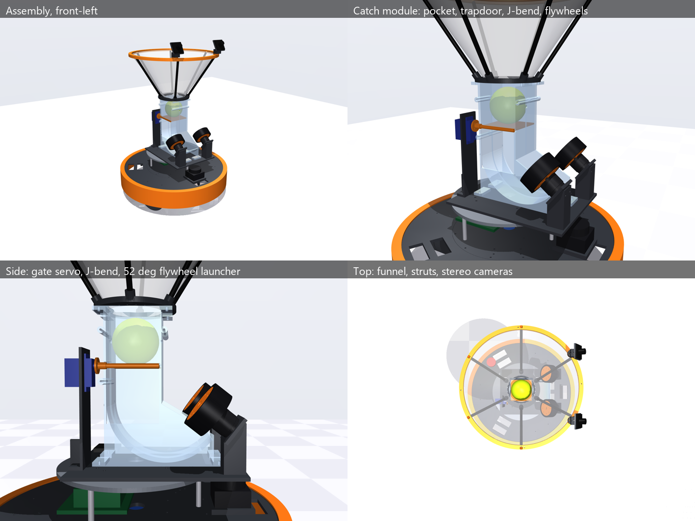
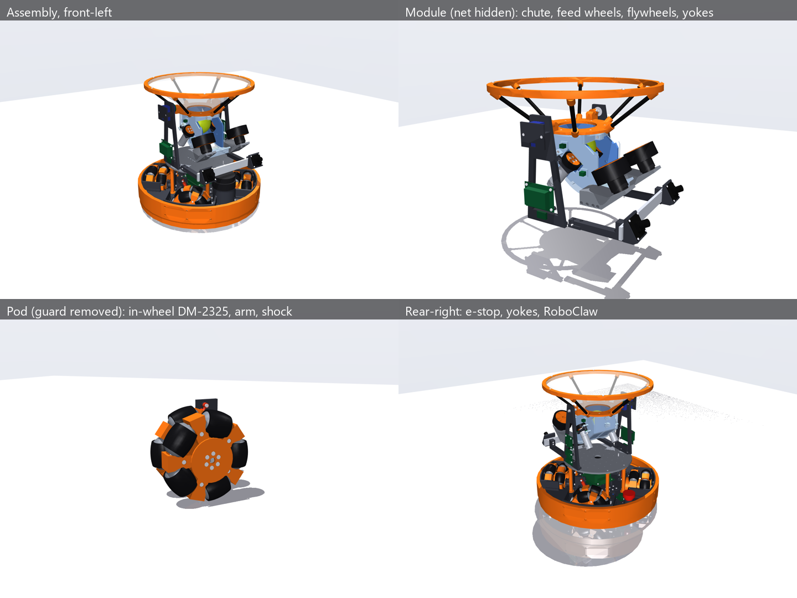

# Play-Catch Robot — Design Baseline

Oct 17, 2026 · Fernando (with Claude) · supersedes the Oct 16 design doc and the Oct 17 component study (both in [archive/](archive/))

## Start here (for a new session)

This is the single source of truth for the design. Each section states the **current baseline**, its **expected performance** (from the v2 MuJoCo simulation unless noted) and **why** it was chosen. Conventions used throughout:

- **(est)**: an engineering estimate waiting for bench data.
- **VERIFY**: a dimension or spec to confirm on the real part (searchable in `cad/` and the sim catalog).
- **Proposed**: not yet agreed with Fernando.

**Where things stand:** Phase 1 (simulation and design) is well under way.

- Three MuJoCo sims run: v1 is the hello world, v2 is the detailed physics model (the baseline), v3 is a **proposed compact redesign**, summarized in section 20. Its defaults are round 2 (v3b): a 4-wheel X base with the deck in the axle plane, and a tilting catch/launch module with a plunger feed. CG 95 mm, rim 387 mm.
- **v5 unlimited** (section 21) is the v3b robot with every firmware limit removed, a per-pixel vision model and a multi-ball hopper mode. It is an exploration of the envelope, not a proposal to drop safety limits. Headline: 81% → 89% caught (92% with a fast camera pipeline); the funnel only works as a hopper with a single-file magazine tube. Section 21.4 estimates the real cameras: 86–92% expected, 72% pessimistic. A thrower farther than ~4 m catches less, not more. Swerve is the base upgrade path, worth +2–4 points.
- **v6 shallow throw** (section 22) targets throwers 6-7 m away with the expected cameras and the X4 base. Firmware adult mode catches 96% of shallow throws (v5: 57%). Three changes:
  - a **roller feed**: two worm-geared feed wheels hold the ball and pass it to the flywheels, one per trigger, with zero misfires;
  - a padded pocket and catch tilt up to 35°;
  - an honest stereo track start (perception software).
- v6 catches 99–100% at 1.5–6 m with human-like scatter, and returns land a median 3 cm from the thrower at 6.5 m (sim upper bound). Multi-ball: the magazine tube works. A tennis-style indexer wheel feeds but catches only 20%, so a catch path that bypasses it is the open design question.
- Indoors under an 8 ft ceiling, a ceiling-aware return (~35–40°, ~4,500 rpm) still reaches a thrower 7 m away, with 0 ceiling hits and a median miss of 7 cm (section 22.5). The round-1 feed pocket only fed balls within about ±0.5 mm of 74 mm. Round 2's **chute pocket** (floor sloping into the feed-wheel nip, J-bend into the flywheels) feeds every 72–76 mm ball at every tilt, with the same catch rate and zero misfires (section 22.4).
- **v6 round 3** (section 23) replaces guesses with models and ranges:
  - feed wheels on direct-drive gimbal motors that hold the ball with current (no worm): the integrated **LK-TECH MF4005** or a GM3506;
  - viscoelastic contacts;
  - randomized worlds: **86% caught across 192 worlds** (per-world median 89%, 10–90% 72–97%), with stereo calibration the dominant unknown;
  - floors: an omni wheel can't climb a square rug edge sideways, and a missed ball under a wheel or a threshold hop can flip the robot (fixed by a skirt and slow zones);
  - a motor study: keep four wheels, but the AK40-10 isn't needed; the DJI M2006 catches the same for less.
- **Actuator choice, cost first** (section 24), on a new shared **actuator database** (`database/`: CSV + `actuator_db.py`; 981 motors, 106 servos, 60 controllers, 424 third-party dynamometer tests, each value with its source and provenance):
  - a brand sweep found the **Damiao DM-2325** ($86, integrated FOC + loops on CAN, 172 g), which catches the same as the AK40-10 in the sim;
  - cheapest compliant motor + controller set **~$682 on 7S**: DM-2325 drive, brushed Pololu 25D feed on DRV8874s, STS3250 tilt, F90 flywheels on an 8S AM32 4-in-1. With a RoboClaw for the feed: ~$738. With the AK40-10 drive: ~$937;
  - the DM-2325's data is reseller-only: bench two (and a DM-J3507 as runner-up) before ordering a set;
  - brushed gearmotors are out for the drive: they overheat in continuous play.
- **v7 home floor** (section 25): a base for real home floors, quantified with the explicit-roller wheel model over ~11,000 crossings at every body direction. A square rug edge stops an omni wheel moving along its axle unless the roller radius is well above the edge height. Fernando adopted the larger wheels (Oct 20):
  - printed **127 mm omni wheels with two rows of five 36 mm rollers**;
  - **sprung, damped wheel pods** (15 mm travel, ~3 N/mm, ζ 0.6).

  It crosses 8 and 12 mm square rugs, 6-18 mm thresholds and the other house transitions at all 24 body directions, with no airborne phase and no ball lost. Catching: home floor 89% vs flat 92%; a 45°-turned rug 88% (v6: 68%). Costs: +1 kg, CG +0.8 cm, ~2.7 points on a flat floor (25.5). It fixes the drive's speed margin on a low battery (+22% with the AK40-10, +57% with the DM-2325). Cross-axis swing pods, a rear rocker and mecanum were tested and rejected. `house.py` drives it through a house with the keyboard, a gamepad or a flight stick.
- **v8 swerve** (section 26, exploration): a three-module swerve base on the same drive.
  - **Terrain:** better. It crosses every house transition plus 16 and 20 mm rugs at every direction, its odometry is 5× better, and it needs no rocker or edge map. But its belly sits 21 mm up.
  - **Catching:** slightly fewer: 90% flat and 87.5% at home, against v7's 91 / 90%. The triangle rocks at the catch, and it needs a 47 cm footprint to stay upright.
  - **Cost:** the same (~$420 vs ~$444), 0.7 kg lighter.
  - Proposed: keep v7 for the catch robot; revisit the swerve for plush rugs or an arm.
- **v9 sensors** (section 27, step 1 of the move to ROS-like simulation): models of the IMU (ICM-42688-P), the RPLIDAR C1 and a downward optical-flow sensor, plus a `robot_localization`-style EKF and lidar matching to a known map.
  - **Localization:** with lidar every base knows where it is to **~1.2 cm median, < 3 cm 95%, 0.5°** through the whole house at up to 2 m/s, transitions and a wall push included. Without lidar they drift 0.5-1% of distance.
  - **Arms:** on its fused estimate the omni base holds 1 mm and makes 5-20 mm moves to ~1 mm. The arm limit is tipping (11-16 N at 35-50 cm), not positioning.
  - **Flow sensor:** the PMW3901 in section 7 is the wrong part; even a near-field PAA5100JE is blind above ~1.1 m/s and over rugs.
  - **Next:** step 2, a ROS 2 bridge (WSL2, Jazzy) so `slam_toolbox` and Nav2 run against the sim (done: v10).
- **v10 ROS bridge** (section 28, step 2): the v9 sim is a ROS 2 Jazzy robot in WSL2. It publishes `/clock`, `/scan` (now the RPLIDAR A2M12 model), `/imu` (BNO085), `/odom` and TF, and takes `/cmd_vel` through the firmware's limits. robot_localization, slam_toolbox and Nav2 run against it unchanged; RViz shows through WSLg, Foxglove connects from Windows, and the flight stick drives through a relay. One command per step: `ros/omni.sh map | save-map | localize | nav`.
  - **Map:** 2.1 cm median wall error, every wall found. It needed two small scan fixes the real robot needs too: drop floor returns (a 1.2° tilted A2M12 13 cm up sees the floor at 6.4 m, so 17% of returns are phantom walls), and de-skew scans (slam_toolbox doesn't).
  - **Localization:** slam_toolbox + EKF 9.0 cm median / 13 cm 95% while moving, against 1.3 / 2.4 cm for v9's matcher on the same readings. So v9's matcher stays the catch-time localizer.
  - **Nav2:** 24 of 24 goals through every door and onto every rug, ending a median 9 cm from the goal.
  - **Driving it:** double-click `Launcher.cmd` (repo root). Three clicks give MuJoCo's own 3D view of the running sim (drawn on Windows), Foxglove, and the flight stick, at ≈ 0.95-1.0× real time (`fast`: the sim's firmware at 1 kHz).
  - **Monorepo:** the robot's ROS packages live in the top-level `ros/`. `omni_bringup` and `omni_perception` go to the Jetson; `omni_sim` stays on the PC.
- **v7 CAD** (section 29, `cad/v7`): the whole current robot, down to every screw. It covers the v7 base, the v6 round-3 module and section 24's actuators.
  - 57 printed parts; pan / flat head M3 into 2.8 mm holes (no inserts), every screw checked for ≥ 6 mm of thread.
  - 0 interferences at every tilt and suspension state.
  - View it with `view.py` (Launcher: View CAD 3D; a slider tilts the module) or open `out/assembly.step` in SolidWorks / eDrawings (a coloured assembly with shared parts).
  - Round 2 (29.4, Fernando's review): the payload plate on six standoffs, 31 mm higher, so the A2M12 sees past everything but them (30° blocked, was 176°); open-top wheel guards; stiffer flywheel mounts; 48 short screws fixed.
  - Findings that need a new sim round:
    - the printed wheel weighs 515 g, not 285 (robot 7.7 vs 6.4 kg, CG 121 mm);
    - the front rocker is dropped;
    - the robot is Ø434 mm, not 37 cm;
    - `plate_gap` 0.096 (the module 31 mm higher) and the A2M12 at 150 mm with a standoff mask;
    - the cameras move 55 mm forward and 12.5 mm up (from the plate);
    - two IR beams move.
  - Open: battery swaps need the robot on its side (a rear drawer is proposed).
  - The DM-2325 now sits inside the wheel.
- **v11: the robot's own code in the loop** (section 30, `simulation/v11 sil`, `firmware/`, `ros/src/omni_catch`, `omni_mcu`). Fernando (Oct 21): start the real robot code, and run the MCU firmware with the ROS sim; assume a Teensy 4.1.
  - **Firmware:** a board-free C++ core (modes, watchdog, ramped stops, kid / adult limits, base controller, odometry, flywheel loop, feed, DM-2325 CAN, the Jetson link). It builds for the Teensy 4.1 (44 KB flash) with a pin map checked at compile time: 29 of 42 pins used, 13 spare. The same source runs in the sim every 1 ms (software in the loop) behind raw CAN frames and sensor values.
  - **Jetson code:** the MCU link with time sync, a colour-blob detector on camera pixels, the tracking filter on the MCU's odometry, the catch behaviour and the modes, as ROS nodes. Their cores have no ROS in them, and the sim also runs them in one process.
  - **Catching:** on the same 216 throws, 90.3% ± 2.0 through the real code against 93.1% ± 1.7 for the sim's own game. Through the full ROS stack, 41 of 48 (85% ± 5) at ≈ 1.0× real time, return throws landing a median 25 cm from the thrower. Zero link errors; the clock syncs to ~0.2 ms.
  - The same detector works on MuJoCo-rendered images (0.1 px). The house steps (map, localize, Nav2) now also drive through the firmware.
- The v2 CAD (`cad/`) stays as it was: printable, 0 clashes.
- A component trade study confirmed most choices and changed a few.
- No hardware has been bought or built. Perception is ground truth in v2; v3 onward model it (v5-v6: per-pixel vision).
- **Safety finding that applies to v2 today:** a zero-speed command on every wheel at 1.4 m/s (a naive fault stop) rocks the v2 kiwi 23° on a μ 0.95 floor and tips it over at μ 1.2. Stops must be ramped (sections 3 and 14).

**Repo map**

```
omni-robot/
├── design.md                       ← this file
├── archive/                        ← superseded docs (Oct 16 design doc, Oct 17 component study)
├── simulation/
│   ├── README.md                   ← Python venv setup, version index
│   ├── requirements.txt
│   ├── v1 hello world/             ← simple kiwi + catch loop (velocity-servo motors, launcher modeled by its output)
│   ├── v2 detailed physics/        ← CURRENT SIM
│   │   ├── catalog.py              ← datasheet values for every candidate part ((est) marks estimates)
│   │   ├── params.py               ← fitted parts + geometry + masses + limits (single source for sim AND cad)
│   │   ├── models.py               ← drive actuator, flywheel motor + ESC, gate servo, battery
│   │   ├── robot_model.py          ← MJCF builder (scene, base, omni wheels, funnel, gate, J-bend, flywheels)
│   │   ├── robot.py                ← firmware-facing robot: sensors in, commands out, electrical bookkeeping
│   │   ├── catch_game.py           ← toss → catch → aim → launch loop
│   │   ├── run.py                  ← viewer / headless / video
│   │   ├── launcher_bench.py, launcher_cal.json   ← flywheel rpm → exit speed calibration
│   │   ├── test_v2.py              ← 7 checks (~5 s)
│   │   ├── studies/                ← trade studies; results/ holds JSON, plots, logs
│   │   └── catch_demo.mp4, drive_demo.mp4
│   └── v3 compact/                 ← PROPOSED compact robot (section 20): same files as v2, plus
│       ├── traction.py             ← quasi-static N-wheel traction / tip model (also used for load-aware allocation)
│       ├── omni_control.py         ← N-wheel kinematics, jerk-limited base controller
│       ├── render.py, renders/     ← module poses
│       ├── test_v3.py              ← 13 checks (~10 s)
│       └── studies/                ← wheel_count.py, funnel_tilt.py, camera_view.py
│   └── v5 unlimited/               ← v3b with no firmware limits, vision.py, hopper (section 21; there is no v4)
│       ├── vision.py               ← per-pixel blob detector, stereo + known-size ranging, image-space EKF
│       ├── shoot_game.py           ← hopper mode: shoot at targets standing or on the move
│       ├── test_v5.py              ← 25 checks (~20 s)
│       └── studies/                ← envelope, vision_sweep, catch_sweep, hopper_rig, launcher_max, shoot_sweep,
│                                     camera_estimate, thrower_distance, base_types
│   └── v6 shallow throw/           ← 6-7 m shallow throws, chute feed, padded pocket, indexer (section 22) + round 3 (section 23)
│       ├── contact_model.py        ← round 3: Hunt-Crossley ball contacts, viscoelastic tire slides
│       ├── floor.py                ← round 3: rolling resistance, friction field/patches, thresholds, carpet
│       ├── randomize.py            ← round 3: the 17 guessed parameters, their ranges, randomized worlds
│       ├── test_v6.py              ← 43 checks (~45 s)
│       └── studies/                ← shallow_sweep, catch_rig, return_throws, hopper_rig, shoot_sweep, thrower_distance,
│                                     feed_tolerance, indoor; round 3: feed_motor, randomized, floor_wheels, motor_study;
│                                     actuator_choice (section 24: reads database/, ranks by cost, writes results/actuator_choice.md)
│   └── v7 home floor/              ← PROPOSED home-floor base (section 25): v6 + big-roller wheels, sprung pods, terrain-aware firmware
│       ├── house.py                ← drive the robot through a house: keyboard, gamepad, flight stick (pygame)
│       ├── floor.py                ← + edge map, turned / all-side-beveled rugs, walls, house transitions
│       ├── test_v7.py              ← v6's 43 checks + 11 v7 checks
│       └── studies/home_floor.py   ← crossings (A), catch games (B), costs (C), robustness / flat floor (R), pod tune
│   └── v8 swerve/                  ← EXPLORATION (section 26): v7 + three- / four-module swerve bases
│       ├── house.py                ← the house drive, default base = the swerve (--base v7 / v6)
│       ├── omni_control.py         ← + SwerveKinematics (flip-and-reverse, steering hold, odometry)
│       ├── test_v8.py              ← v7's checks + 6 swerve checks
│       └── studies/home_floor.py   ← + swerve configs, part S (moves, reversals, panic stops, steering torque), tune_swerve
│   └── v9 sensors/                 ← v8 + sensor models and localization (section 27)
│       ├── sensors.py              ← ICM-42688-P IMU, wheel encoders, PAA5100JE flow, RPLIDAR C1 (ray-cast, skewed scans)
│       ├── estimator.py            ← EKF (robot_localization style), likelihood-field scan matcher, shadow-mode Localizer
│       ├── house.py                ← + --sensors: the fused estimate live, the scan drawn where the robot thinks it is
│       ├── test_v9.py              ← v8's checks + 5 sensor / estimator checks
│       └── studies/localization.py ← house tour, catch-time motion error, positioning for an arm, tip-over forces
│   └── v10 ros bridge/             ← v9 + the sim side of the ROS 2 bridge (section 28); A2M12 + BNO085 models in sensors.py
│       ├── bridge_core.py          ← the sim side of the bridge, no ROS: physics, sensors, wheel odometry, cmd watchdog, tour
│       ├── map_quality.py          ← a SLAM map against the true house (wall error, coverage, per-wall offsets)
│       ├── test_v10.py             ← v9's checks + A2M12, BNO085, bridge core, map scorer
│       └── studies/ros_report.py   ← maps, localization tour, Nav2 goals from studies/results/ros_*.json
│   └── v11 sil/                    ← v10 + the robot's own code in the loop (section 30); omni.sh's default
│       ├── sil_robot.py            ← SilRobot: the C++ firmware ticked every 1 ms; DM-2325 CAN port, DShot eRPM models
│       ├── catch_world.py          ← the world: thrower, the cameras' frames per pixel, truth scoring (no robot code)
│       ├── sil_game.py, sil_link.py ← world + firmware + the Jetson's code in one process (--view: MuJoCo's window)
│       ├── robot_export.py         ← writes firmware/lib/omni_fw/fw_params.h and omni_catch's robot_v11.json from SimParams
│       ├── house_scene.py          ← section 31: a furnished house around the field (decoration only); fetch / overview
│       ├── rendered_camera.py      ← section 31: the stereo cameras as rendered images (motion blur, sensor model)
│       ├── assets/house/           ← the house's CC0 Poly Haven textures (fetched, not in git)
│       ├── test_v11.py             ← v10's checks + 22 firmware / catch-code / house checks
│       └── studies/                ← sil_catch.py (SIL vs the sim's own game), rendered_frames.py (detector on renders),
│                                     rendered_catch.py (section 31: the game on rendered vs sparse frames)
├── firmware/                       ← the MCU (section 30; README, PINS.md): Teensy 4.1, PlatformIO
│   ├── lib/omni_fw/                ← board-free core: firmware, base, module, dm_motor, protocol, hw_io, board_teensy41
│   ├── src/main.cpp                ← the Teensy's drivers and 1 kHz loop
│   └── sil/                        ← the core as a library for the sim (build_sil.py, omni_fw_sil.py)
├── ros/                            ← the robot's ROS 2 software (section 28; README there): runs on the Jetson later
│   ├── omni.sh                     ← one command per step, run in WSL (mirror to ~/omni_ws, build there, launch)
│   ├── setup/install_wsl.sh        ← one-time ROS 2 Jazzy + MuJoCo setup in WSL
│   ├── src/omni_bringup/           ← launch + config (EKF, slam_toolbox, Nav2, teleop, RViz), save_map      → robot
│   ├── src/omni_perception/        ← scan_prep: floor returns + de-skew                                    → robot
│   ├── src/omni_interfaces/        ← messages (McuState, McuCommand, BallTrack, SparseImage, ...), SetMode  → robot
│   ├── src/omni_mcu/               ← mcu_link + protocol.py: the MCU link, odometry, IMU, time sync         → robot
│   ├── src/omni_catch/             ← catch_perception, catch_behavior, mode_manager (+ ROS-free cores)     → robot
│   ├── src/omni_sim/               ← the MuJoCo bridges (house, catch), the firmware's USB port, viewer, scoring → PC only
│   ├── maps/                       ← saved maps (house = the main one, with its pose graph)
│   ├── foxglove/omni_layout.json   ← Foxglove layout: 3D, status, Teleop
│   ├── tools/mujoco_view.py        ← MuJoCo's 3D view of the ROS sim, drawn on Windows (the bridge starts it)
│   └── tools/joystick_sender.py    ← Windows side of the joystick relay
├── Launcher.cmd, launcher.ps1      ← double-click: buttons for the ROS steps, Foxglove, the joystick, the Windows sims (logs/)
├── database/                       ← shared actuator database (section 24; moves up to Robotics/database/ later)
│   ├── motors.csv, servos.csv, controllers.csv, motor_tests.csv, sources.csv   ← the data (edit in Excel); gaps.csv is generated
│   ├── actuator_db.py              ← schema, validator, DC model, requirement checks, costs, sim export, gaps
│   └── README.md, test_actuator_db.py
└── cad/
    ├── v7/                         ← CAD of the current robot (section 29): dims.py (from the v7 sim), hw.py (fasteners),
    │                                 wheel.py, pod.py, base.py, module.py, mounts.py, assembly.py, build.py, render.py;
    │                                 vendor/ (Damiao + Pololu STEPs); out/ (step, stl, assembly.step, BOM.md, PRINT_LIST.md)
    ├── README.md                   ← (v2 CAD below) print list, fasteners, assembly notes
    ├── dims.py                     ← CAD dimensions + coordinate-frame contracts (imports the sim's params)
    ├── base.py, catch.py           ← printed parts (drive base / catch module)
    ├── vendor.py, vendor/          ← purchased parts (official CubeMars AK40-10 STEP + drawing, envelopes)
    ├── build.py, render.py         ← export STEP/STL/assembly + clash check; MuJoCo renders + turntable
    └── out/                        ← step/, stl/, assembly.step, PRINT_LIST.md, renders/, funnel_net_pattern.svg
```

Outside the repo:

- **Python venv:** `C:\Users\ferna\.venvs\omni-robot-sim`. It holds MuJoCo 3.16 and build123d 0.13. The only base Python on this PC is PlatformIO's, so never install packages into PlatformIO's penv.
- **Sister project:** `C:\Dropbox\Personal Projects\Robotics\wheeled-leg-robot\simulation\mujoco\v4_twin_279mm_baseline`, a mature sim with motor, battery and thermal models, optimizers and a digital-twin link. Reuse its conventions.

**Common commands** (run from the folder shown; `$py = "$env:USERPROFILE\.venvs\omni-robot-sim\Scripts\python.exe"`):

| Folder | Command | What it does |
| --- | --- | --- |
| repo root | double-click `Launcher.cmd` | Buttons for everything below and the ROS steps: e.g. *Localize on map* → *Open Foxglove* → *Joystick → ROS* (section 28) |
| WSL (`wsl -d Ubuntu-24.04`), `ros` | `bash omni.sh map` (then `save-map`), `localize`, `nav`; `sim` to just drive; `auto-map`, `tour`, `goals` to score; `stop` | The ROS 2 stack against the sim (section 28; `ros/README.md`) |
| `ros/tools` | `& $py joystick_sender.py` | Stream the Extreme 3D into ROS (start after a WSL step; the 3Dconnexion is ignored) |
| WSL, `ros` | `bash omni.sh catch` (`dist:=6.5`); `catch-score tosses:=24` | The catch game on the robot's own code and firmware (section 30) |
| `simulation/v11 sil` | `& $py sil_game.py --view --returns` | The same in one process on Windows, with MuJoCo's window (section 30) |
| `simulation/v11 sil/studies` | `& $py sil_catch.py both` / `report`; `& $py rendered_frames.py --png` | SIL vs the sim's own game on 216 throws; the detector on rendered frames (section 30) |
| `simulation/v11 sil` | `& $py house_scene.py fetch` (once); `& $py sil_game.py --view --frames rendered --scene house` | The catch on rendered camera images in a furnished house, MuJoCo's window with the robot's left camera (section 31); Launcher group 4 picks any variation |
| `simulation/v11 sil/studies` | `& $py rendered_catch.py run --frames rendered --seeds 3 --workers 12` / `--frames sparse`; `report`; `pictures` | The 216-throw grid on rendered vs sparse frames (~35 min rendered on 12 GPU processes) (section 31) |
| `firmware` | `pio run` (PlatformIO); `& $py sil\build_sil.py --pins` | Build for the Teensy 4.1 (checks the pin map); the SIL library and PINS.md (section 30) |
| `simulation/v10 ros bridge/studies` | `& $py ros_report.py` | Maps, localization tour and Nav2 goal results (section 28) |
| `simulation/v9 sensors` | `& $py house.py --base v7 --sensors --camera top` | Drive with the IMU, flow and lidar fused live; the scan is drawn where the robot thinks it is (section 27) |
| `simulation/v9 sensors/studies` | `& $py localization.py` (`T`, `C`, `P`, `report`) | Localization: house tour, catch-time motion, arm positioning (section 27) |
| `simulation/v8 swerve` | `& $py house.py` (`--base v7`, `--base v6`) | Drive the three-module swerve (or the X4s) through the house (section 26) |
| `simulation/v8 swerve/studies` | `& $py home_floor.py S` / `A "swerve3 v2, r 170"` / `B "swerve3 v2 r 170, home"` | Swerve steering tests, crossings, catch games (section 26) |
| `simulation/v7 home floor` | `& $py house.py` (`--base v6`, `--no-assist`; needs pygame) | Drive the proposed v7 base through a house with the keyboard, a gamepad or a flight stick (section 25.8) |
| `simulation/v7 home floor/studies` | `& $py home_floor.py A` / `B` / `C` / `report` / `probe "v6" "rug edge 12 mm" 45 1.0` | Crossings, catch games, costs (section 25) |
| `simulation/v6 shallow throw` | `& $py watch_floor.py` (`--list`; `cross --obstacle "rug edge 8 mm" --dir 45`; `game`; `flip`) | Watch the robot on thresholds, rug edges and the home floor (section 23.4) |
| `simulation/v2 detailed physics` | `& $py run.py` | Catch demo in the MuJoCo viewer (`--drive` for the omni demo, `--wheel-model rollers` for explicit rollers) |
| same | `& $py run.py --headless -n 30` | Catch statistics without graphics |
| same | `& $py -m pytest -q` | Regression checks |
| same | `& $py launcher_bench.py` | Recalibrate the launcher table |
| same/studies | `& $py wheel_slip.py` (and the others) | Re-run a trade study |
| `cad/v7` | `& $py build.py` (`--quick`), then `& $py build.py --render-only; & $py render.py` | v7 CAD: STEP / STL, BOM, print list, clash checks over tilt and suspension, lidar occlusion, mass vs sim (section 29) |
| `cad` | `& $py build.py; & $py render.py --turntable` | Rebuild the v2 CAD outputs and renders |

**Suggested next steps (in order):**

0. Decide on the v3 compact proposals (section 20). Whichever base is kept, make firmware stops ramped, never a step to zero speed.
1. Perception: a first stereo noise/latency/dropout model and tracking filter now exist in the v3 sim (section 20, round 3), and they show perception timing is the biggest lever on catch rate. Next: run the spec sweep over latency, noise and frame rate (section 12), then calibrate the model on the bench (Phase 2).
2. Make the base acceleration limit direction-aware and jerk-limited (section 3). Done in the v3 sim (section 20, item 8): port it to v2 if v3 isn't adopted.
3. Bench work: order parts and print a test wheel pod with adapter and a flywheel hub with tire. Measure roller μ on the real floor, the foam ball's properties, and the launcher calibration. Resolve the VERIFY items.
4. Bring the CAD into SolidWorks as wrapper parts; add wiring, bumper switches, speaker, the ELRS receiver and the MCU board once chosen.
5. From v5 (section 21): set the camera spec by what the sweep says matters (latency, frame rate, calibration, global shutter, hardware sync), film throws to measure ball spin. (v5's open item, a retaining gate at the pocket exit, is answered by v6's roller feed.)
6. From v6 (section 22):
   - decide on the roller feed, the padded pocket and the 35° catch tilt;
   - port the honest track start into the perception code;
   - bench-test a feed-wheel pair on GM3506 gimbal motors (round 3, section 23.1): speed, current-limited holding, a rigid preloaded stop;
   - measure the net's rolling resistance and the ball's mass and drag;
   - choose a multi-ball path: the tube insert now, or an indexer whose catch path bypasses the wheel;
   - decide on the chute pocket (section 22.4) and bench-test a printed chute + J with two feed gearmotors and the exit beam;
   - for indoor play, use the ceiling-aware return planner and spin-test the flywheels to ≥ 5,000 rpm (section 22.5).
7. From v6 round 3 (section 23):
   - bench the stereo pair's calibration stability first: it is the biggest unknown in the randomized study;
   - drop-test the foam ball on the floor and the pad at three heights; film throws for spin;
   - rework the battery into two rows;
   - design the bumper skirt (down to ~20 mm) and the wheel-top guards; map thresholds as ≤ 1 m/s zones; avoid square rug edges;
   - in the tracking filter, model calibration error as a slowly varying bias.
8. From the actuator choice (section 24):
   - buy two Damiao DM-2325s and one DM-J3507 and bench them: torque constant and peak, undervoltage cutoff on a low 7S pack, winding temperature at ~0.4 N m RMS, backlash, comm-loss behaviour. Record the results in the database's `meas_*` columns;
   - then decide the drive: DM-2325 (~$682 set), DM-J3507, AK40-10 (~$937) or M2006 on 6S (~$714);
   - look at a counterbalance spring on the tilt pivot, and bench the $30 Hiwonder HTD-45H (either could replace the $74 STS3250);
   - add torque sharing to the X4's four speed loops (it cuts drive heating for any motor);
   - fill the database gaps (`database/gaps.csv`), prices first.
9. From v7 (section 25):
   - decide on the v7 base (big-roller printed wheels + sprung pods); drive it in `house.py` first;
   - print one 127 mm wheel (2 × 5 rollers of 36 mm, coned roller ends) and one pod on a 1/10 RC coil-over; measure roller grip and rolling resistance on wood, tile and carpet, the pod's rate and damping, and climb an 8 / 12 mm square rug edge sideways by hand-pushing a loaded wheel;
   - CAD: the 80 mm-wide wheel moves the motor 21 mm inward; check the deck slot against the battery;
   - decide where the floor-edge map comes from (the 2D lidar can't see a rug edge): app markup, IMU-bump learning, or stereo depth;
   - recover the ~2.7 flat-floor points (25.5).
10. From v8 (section 26): only if plush or 16-20 mm rugs are in the play area, or odometry matters more (an arm, mapping), bench one swerve module first: an ST3215-HS on a printed turntable, a DM-2325 on a belt to a 100 mm TPU-tread wheel. Measure steering speed under load, scrub torque and the cable loop; solve the 21 mm belly clearance.
11. From v9 (section 27):
   - set up WSL2 + Ubuntu 24.04 + ROS 2 Jazzy and a MuJoCo-to-ROS 2 bridge (`/scan`, `/imu`, `/odom`, `/tf`, `/clock`, `/cmd_vel`), then run `slam_toolbox` (mapping the house), `robot_localization` and Nav2 against it;
   - feed the lidar fixes into the catch-time estimator;
   - drop the PMW3901; choose between a PAA5100JE (+ ToF) and no flow sensor;
   - for an arm, budget tip-over first (ballast, stance, motion planning that keeps the CG inside the wheels);
   - if the swerve comes back, give it a fine-positioning mode.
12. From v10 (section 28):
   - map the house yourself with the stick (`omni.sh map`, then `save-map`), then try `nav` with goals from RViz or Foxglove;
   - when the A2M12 arrives: measure its scan-plane tilt on a flat floor and its range noise at 1, 3, 6 and 10 m; level the mount; check `rplidar_ros`'s scan direction and stamp against the bridge's;
   - port v9's matcher to the ROS side as the catch-time localizer on slam_toolbox's map; measure AMCL alongside;
   - before the Jetson: profile slam_toolbox + Nav2 at real time on its CPU.
13. From the v7 CAD (section 29):
   - re-run the v7 sim with the CAD's masses (wheel 515 g, sprung pod parts, yokes and bar), without the rocker, with the bumper ring at r 205-217 and the CAD's camera positions;
   - re-run the v10 stack with the lidar's self-occlusion mask (~176° blocked); decide where the lidar goes before printing the front wheel houses;
   - recalibrate `feed_clear_travel` for the moved feed-exit beam;
   - print and bench one wheel and one pod with a DM-2325; choose the shock spring (~12 N/mm at the shock).
14. From v11 (section 30):
   - write the three stub drivers in `firmware/src/main.cpp`: the BNO085 (SH-2 over SPI), bidirectional DShot, CRSF;
   - on the bench, with a Teensy 4.1 and one DM-2325: check its CAN ids, feedback ranges, reply to every frame, and comm-loss timeout and error D against `dm_motor.h`; measure the USB link's latency and the 1 kHz loop's CPU time. That is hardware in the loop: the same core and `mcu_link`, a real board;
   - schedule the coast, brake and dump on a crossing time refined after the freeze (SIL bounced 5 balls to the sim's 1);
   - feed rendered images into ROS in real time from a Windows render server (2-5 ms a frame); `catch_perception source:=image` is ready;
   - port the terrain assist (the edge map) into the firmware, or keep it on the Jetson as speed caps;
   - re-run v11 with section 29's CAD findings (masses, cameras, plate height, lidar mask).



## 1. Overview and goals

A kiwi omni-wheel robot tracks a tossed ball, drives under it, catches it in a funnel and throws it back with a flywheel launcher. Most tuning and training happens in a realistic MuJoCo simulation; the real robot is used for attended calibration and validation sessions.

**Goals**

- Fun to play catch with, including with kids (a dedicated kid mode).
- Technically impressive: stop-and-catch first, moving catches later.
- Improvable by Claude between sessions, mainly through overnight simulation runs.
- A general mobile platform: lidar SLAM, RC driving, a speaker, and swappable top modules (catch module now, robot arm later).
- Built mostly from 3D-printed parts (PLA, PETG, TPU on a ~256 mm Bambu bed) plus purchased actuators and electronics.

## 2. Requirements and expected performance

v1 targets stop-and-catch of gentle underhand throws. Requirements are still provisional; the right-hand columns show what the current design achieves in simulation.

| Parameter | Requirement | Expected (sim v2) | Notes |
| --- | --- | --- | --- |
| Throw distance (to robot) | 2–4 m underhand | Thrower at 3.0 m | |
| Apex above release | 1–2 m | 1.0–2.0 m tested | Gives 0.7–1.0 s after the 0.25 s perception delay |
| Detect + fit trajectory | by ~0.25 s after release | 0.25 s delay, 20 Hz updates (ground truth) | **Perception noise not modeled yet** |
| End-to-end latency | < 100 ms | not modeled | |
| Base acceleration | ~~4–5 m/s²~~ → **2.5 m/s² limit (proposed)** | Slip-free: ~2.4 m/s² worst direction, up to 4–7 toward a wheel (μ 0.95) | Traction-limited; see section 3 |
| Peak speed | ~1.4 m/s | 2.6 m/s full battery, 2.0 m/s at 10% charge | Firmware cap 1.4 m/s |
| Landing prediction error | ±5 cm | n/a (ground truth) | |
| Catch zone | ~1 m diameter | 100% within 0.65 m radius (30/30), with perfect perception | The funnel tolerates ~±12 cm of positioning error |
| Positioning at ball arrival | — | median 0.4 cm, max 1.9 cm funnel offset (20 tosses) | |
| Return throw | to the thrower | median 14 cm from the thrower's hands (20 throws) | 52° lob to chest height |
| Cycle time | — | ~4.5 s per toss in sim (toss → catch → aim → launch → reset) | |
| Ball | ~~70–75 mm hollow plastic~~ → **74 mm foam pickleball, ~22 g (proposed)** | Drag ≈ 25% of weight at 6 m/s | Drag must be in every predictor |
| Run time | one session per battery | ~3.9 h at 28 W average | |

Key insights:

1. **Stop-and-catch is easy in sim.** Requiring a full stop under the ball halves reach versus a moving catch, but in simulation it caught everything inside a 0.65 m radius. Even acceleration limits from 2.0 to 3.5 m/s² all scored 30/30; only 1.5 m/s² lost catches (26/30). Perception accuracy, not drive performance, will drive the real catch rate.
2. **The real error budget is about ±11 cm** (funnel radius minus ball radius).

## 3. Drive base

A three-wheel kiwi base on CubeMars AK40-10 actuators and 96 mm goBILDA omni wheels, running from a 7S Li-ion pack.

| Item | Baseline | Why |
| --- | --- | --- |
| Layout | Kiwi: 3 wheels at 60° / 180° / 300° (0° = forward = launcher side), 180 mm from center | Equal agility in every direction, always 3 wheels on the ground |
| Wheels | **goBILDA 96 mm omni, 14 mm bore, 50A rollers, part 3624-0014-0096** ($21.99, 119 g) | Lightest and grippiest of the candidates; lowers deck and CG. 125–127 mm wheels add ~1 kg and raise the CG for no catch benefit |
| Motors | 3 × **CubeMars AK40-10 V3.0 KV170** with driver ($135.90, 190 g): Kt 0.056 N·m/A, 10:1, 978 mΩ, 7.3 A peak (4.1 N·m), 435 rpm no-load at 24 V, CAN | Lightest actuator that meets speed; torque is never the limit |
| Wheel mount | Wheel overhung on the motor output via a printed adapter (3 × M2.5 to the output on PCD 27, 3 × M4 through the wheel's 32 mm pattern); motor bolts to a printed pod through its rear 4 × M2.5 on PCD 47 | Simple; VERIFY the AK40-10 output bearing's radial and moment rating |
| Battery | 7S1P Molicel P50B 21700 (5 Ah, ~126 Wh), BMS ≥ 40 A | See section 10 |
| Mass | **5.56 kg** total (sim with CAD masses), CG 151 mm high and ~21 mm forward (launcher, lidar) | Lighter than the old 6–9 kg planning range |

**Expected performance**

| Metric | Value | Source |
| --- | --- | --- |
| Top speed | 2.63 m/s (29 V), 2.0 m/s (22 V, 10% charge) | motor + battery model |
| Slip-free acceleration (μ 0.95) | ~2.4 m/s² worst in sim, rear diagonals 120° / 240° (quasi-static model 2.8); ~3.4 forward, 3.1–3.4 sideways, 4.7–7.4 toward a wheel | `studies/wheel_slip.py` |
| Same vs roller friction | worst direction 1.6 / 2.0 / 2.4 / 3.1 m/s² at μ 0.6 / 0.75 / 0.95 / 1.1 | same |
| Tip-over | ~5.9 m/s² toward a wheel-triangle edge (quasi-static) | model |
| 0.37 m stop-and-catch move | ~0.97 s to settle within 1 cm; 0.6 m in ~1.2 s | `studies/drive_components.py`, `drive_reach.py` |
| Motor heating | winding ≈ +2–3 °C over ambient in continuous catch duty (thermal constants est) | thermal model |
| Ground clearance | 22 mm (motor bottom) | geometry |

**Traction, not torque, limits acceleration.**

- Accelerating between two wheels is pushed by those two wheels alone, each needing 0.58·m·a, while load transfer unloads them.
- Quasi-static limit per wheel: a_max = μ·N₀·g / ((2/3)|t·u| + μ(2/3)(h/L)(u·r)); take the minimum over the three wheels. N₀ is the static load share (it includes the CG offset), t the wheel's rolling direction, r its radial direction, and u the acceleration direction.
- The sim matches this model in shape, and runs ~0.5 m/s² below it in the worst directions. The instant acceleration step rocks the robot, so jerk limiting should recover most of that.
- The explicit-roller wheel model agrees with the fast sphere model within ±25%. It also adds the real double-row 2–3% speed ripple and about ±2° of heading wander.
- **Proposed firmware behavior:**
  - cap at 2.5 m/s²,
  - make the limit direction-aware with the formula above (30–50% more acceleration in good directions),
  - add jerk limiting.

**Tipping.** The support polygon is the wheel triangle, so the tipping lever is its inradius: half the wheel-circle radius (90 mm here), not half the base width. The Oct 16 doc's "45 cm wide, CG at 40 cm, tips near 5.5 m/s²" example actually tips at about 2.2–2.5 m/s². Keep the battery and motors low (they are).

- Accelerating toward a wheel, or braking while driving forward (launcher first), the kiwi is right at its tip limit: the two loaded wheels do the pushing and gain grip as the third one unloads, so traction doesn't cap the acceleration before tipping does.
- **Dynamic check (v3 sim, `studies/wheel_count.py`, kiwi at v2's 180 mm):** cruising at 1.4 m/s, then every wheel commanded to zero speed at once, the base rocks 23° on a μ 0.95 floor and **tips over at μ 1.2**. At the 2.5 m/s² ramped limit nothing tips.
- So: stops are always ramped within the acceleration limit, including watchdog and fault stops; the e-stop cuts power so the wheels coast; the AK40-10's own comm-loss behavior must coast or ramp, not lock (VERIFY in its manual).

**Rejected drive options** (sim + datasheets, `studies/drive_components.py`):

| Option | Why rejected |
| --- | --- |
| AK45-10, DM-J4310-2EC | Too slow at 24 V: top speed 1.1–1.6 m/s with low-battery speed under 1.2 m/s |
| AK60-6 V3 | 2.6× the cost for torque the floor can't use; needs ≥127 mm wheels for clearance |
| SteadyWin GIM6010-8 | Budget option at ~$105, but 200 g heavier per motor and needs ≥100 mm wheels |
| RobStride 01/02, Damiao DM-J6006 | Need 36–48 V, or too slow at 24 V (from the Oct 16 doc) |
| Nexus 100 / 127 mm aluminum omnis | 3–4× heavier, lower μ (est) |

## 4. Compute and real-time control

A Jetson Orin runs perception, planning, SLAM and logging; a separate microcontroller runs motor control and is the safety authority. (Unchanged from Oct 16.)

**Main computer: Jetson Orin.** Start with the Orin Nano Super dev kit ($399) or an Orin NX 16GB module (~$999 plus a ~$150–250 carrier). Both share the same module footprint, so a carrier board can take the Nano now and the NX later. Prices reflect NVIDIA's July 2026 increase ([CNX Software](https://www.cnx-software.com/2026/07/22/nvidia-increases-the-price-of-jetson-modules-and-devkits-by-up-to-101/?amp=1)).

- Why Jetson over a Raspberry Pi 5: more MIPI camera lanes, CUDA for neural-net detection and visual SLAM (Isaac ROS), and headroom for an arm and more cameras later.
- Why not AGX Orin or AGX Thor: overkill, and now $3,499 / $5,499 dev kits. The cheaper Thor T3000/T2000 modules expected Q1 2027 ([ServeTheHome](https://www.servethehome.com/nvidia-announces-expanded-jetson-thor-lineup-with-mid-range-t3000-and-t2000-modules/)) are a possible future upgrade.
- Considered: x86 mini PC (cameras only over USB, no CUDA), RK3588 boards (weak robotics software support), VOXL 2 (drone-oriented, expensive).
- Runs full Ubuntu (JetPack) with a desktop; switch to headless boot when deployed to free ~1 GB of RAM.
- Placement: in the 65 mm layer between the deck and the payload plate, rear half (VERIFY the carrier hole pattern).

**Real-time microcontroller: STM32G4/H7 class with native CAN-FD** (Teensy 4.1 acceptable). **Fernando, Oct 21: assume a Teensy 4.1 for now.** Its firmware is written and runs in the sim (section 30): `firmware/`, pin map in `firmware/PINS.md`.

- Runs the 500 Hz–1 kHz base control loop and talks to the three AK40-10s over CAN.
- Enforces velocity, acceleration, current and flywheel-RPM limits; reads bumpers, e-stop and the RC receiver directly; stops the motors if the Jetson heartbeat stops.
- Closes the flywheel rpm loop from bidirectional-DShot eRPM telemetry and drives the gate servo.
- The Jetson only requests desired velocities, so a bad high-level change cannot exceed firmware limits.
- Placement: under the center plate beside the battery, with the power board (relay, DC-DC converters) opposite.

## 5. Software architecture and development workflow

ROS 2 for the overall system, with one low-latency catch path, a simple custom link to the microcontroller, and development done remotely on the Jetson from a Windows PC. (Unchanged from Oct 16.)

**Architecture**

- ROS 2 provides the RPLidar driver, slam_toolbox, Nav2, MoveIt (future arm), rosbag logging and Foxglove visualization, so none of that is rebuilt.
- **Fast catch path:** camera capture, ball detection, stereo triangulation, trajectory fitting with drag, and landing prediction run in one process (composable nodes or one C++ node), passing data in memory. It publishes only the target "go to (x, y) by time t" plus diagnostics.
- Camera frames carry hardware timestamps, and Jetson and microcontroller clocks are synchronized, so fits use real capture times.
- **Microcontroller link:** a small custom protocol over CAN or UART (velocity commands, heartbeat, status), not micro-ROS, to keep the safety MCU simple.
- Robot software runs in Docker so the PC simulation and the Jetson run identical code and ROS 2 versions.
- The sim already separates "firmware-facing" robot code (`robot.py`: sensors in, wheel/flywheel/gate commands out) from the world. Keep that boundary when the code moves to ROS.

**Development workflow**

- Windows PC is the front end: VS Code Remote-SSH into the Jetson for editing, building (colcon, natively on ARM) and running.
- Claude Code runs on the Jetson, so it can edit, build, read logs, run tests and restart nodes directly on the hardware.
- The MCU programmer (ST-Link or USB DFU) plugs into the Jetson, so flashing, serial console and GDB all work remotely. Flashing is allowed only in attended sessions and is blocked in unattended configurations; hard safety limits live in a separate firmware module changed only deliberately, together.
- One git repo on the Jetson, pushed to GitHub. Tunable parameters are kept separate from algorithm code. Today they live in `simulation/v2 detailed physics/params.py` and `catalog.py`, to become YAML.
- **Visualization:** Foxglove on Windows connects to foxglove_bridge over WebSocket, so no ROS networking or Linux is needed on the PC.
- **Simulation on the PC:** MuJoCo runs natively on Windows in the venv above. Since v10 (section 28), WSL2 + Ubuntu 24.04 + ROS 2 Jazzy run the real ROS stack against the MuJoCo sim through a bridge (its workspace in WSL's filesystem, Foxglove on Windows over localhost); Gazebo is not needed.
- Remote desktop (Ubuntu screen sharing or NoMachine) is available for occasional GUI use; it needs an HDMI dummy plug when headless.

**Improvement loop (sim-first):** every change, parameter or code, must pass the simulation regression suite before it reaches the robot (today: `test_v2.py` plus headless catch statistics). Real sessions score catch rate, positioning error and return accuracy; changes are kept only if they beat the current best, with automatic rollback. Firmware, safety limits and test-area geometry are outside what Claude changes unattended.

## 6. Cameras and perception

Two hardware-synchronized OV9782 color global-shutter cameras, on the funnel rim, looking forward and tilted 30° up.

| Item | Baseline | Why |
| --- | --- | --- |
| Placement | Printed pads on the front rim arcs at ±33.7°, 600 mm up | Works anywhere (mobile platform goal) |
| Configuration | Stereo, **190 mm baseline**, parallel optical axes | Stereo gives ~1–2 cm depth vs ~8 cm for mono size-based depth |
| Sensor | [OV9782](https://www.ovt.com/sensors/OV9782): 1280×800 color at 120 fps, global shutter, frame sync | Rolling shutter smears a fast ball |
| Exposure | < 1 ms | Ball moves ~5 cm per frame at 6 m/s and 120 fps |

**Pipeline:**

1. Color-blob detection of the brightly colored foam ball (CPU).
2. Stereo triangulation.
3. A ballistic filter **with quadratic drag**, whose output is a landing point and its uncertainty, computed where the ball crosses the funnel rim height (0.60 m), not the floor.

The 22 g foam ball has drag ≈ 25% of its weight at 6 m/s, so a vacuum-ballistic fit misses by tens of centimeters. The sim's predictor (`ball_flight.py`, MuJoCo's drag law, Cd 0.5 (est)) matches the simulated ball within 1 cm. The robot commits once uncertainty is small; each frame is corrected for robot motion using odometry and IMU. A small neural-net detector comes later if lighting or backgrounds get messy.

**Alternatives considered:** Arducam OV9281 stereo kit (about $174, but mono, 90 fps on Jetson, and only guaranteed on official dev kits); Stereolabs ZED X (about $599 plus a GMSL2 capture card; 60 fps is low for catching, but excellent for visual SLAM later).

**Caution:** Jetson camera support depends on drivers for the exact JetPack version and carrier board. Confirm OV9782 driver support for the chosen carrier before buying; the official dev kit is the safest choice.

## 7. Localization

Short-term motion tracking for the catch, lidar SLAM for long-term position, and three ways to find the thrower. (Unchanged from Oct 16.)

- **During a catch (about 1 s):** the ball is measured in the robot's camera frame, so only the robot's own motion over the flight matters. Wheel odometry and an IMU are fused on the microcontroller.
- **Slip handling:** omni wheels slip hardest during the acceleration bursts that matter most. A downward-facing PMW3901-class optical-flow sensor measures ground motion directly and is unaffected by wheel slip. The sim shows slip starts around 2.4 m/s² in the worst direction.
- **Long-term position:** RPLidar C1 with slam_toolbox builds a map, keeps the robot in the play area, avoids obstacles and returns it to a home spot. The lidar sits at the front of the deck under the payload plate (scan plane ~150 mm). Its only fixed obstructions are the three thin payload standoffs at 0° / 120° / 240°, which software masks out.
- **Finding the thrower:** (1) back-extrapolate the ball trajectory to its release point; (2) a person or pose detector on the Jetson at a modest rate, aiming return throws at chest height; (3) in a test setup, an AprilTag on a fixed target gives a precise, unambiguous aim point and a drift check.
- **Hardware added:** IMU on the microcontroller board, optical-flow sensor (optional, see below), lidar. **Fernando, Oct 20: the lidar is a Slamtec RPLIDAR A2M12 and the IMU a CEVA/Hillcrest BNO085.**
  - RPLIDAR A2M12: 16 kHz, 10 Hz typical (5-15 Hz), 0.225° at 10 Hz, 0.2-12 m, accuracy 1% of range to 3 m, 2% at 3-5 m, 2.5% beyond, ±1.5° scan flatness, UART 256 kbaud (Slamtec datasheet).
  - BNO085: 9-axis with on-chip fusion; game rotation vector up to 400 Hz, raw gyro up to 1 kHz; ~0.5°/min heading drift (reseller figure; VERIFY in CEVA's datasheet).
  - v9 (section 27) modelled the C1 and an ICM-42688-P; v10 (section 28) models these parts. The A2M12 must be mounted level, with its scan plane's tilt calibrated and floor returns filtered: a 1.2° unit 13 cm up sees the floor at 6.4 m (proposed, section 28).
- **v9 update (section 27, proposed):**
  - the flow sensor must be a near-field part (PAA5100JE, 15-35 mm), not the PMW3901 (≥ 80 mm). Even then it's blind above ~1.1 m/s and over rugs, so it is optional;
  - the catch-time estimator should take the lidar fixes. With lidar the robot's motion over a 1 s catch is known to 13-20 mm (95%), against 42-65 mm with wheels + IMU;
  - the lidar's scan plane is ~100 mm up on the v3b-and-later deck (not 150).

## 8. Catching

A 33 cm fabric-net funnel feeds a padded catch pocket closed by a servo trapdoor; an IR break-beam confirms the catch.

| Element | Baseline | Why / evidence |
| --- | --- | --- |
| Funnel | Ø330 rim at 600 mm, walls 35° from vertical, Ø84 throat at 424 mm. Fabric net laced to a printed collar and a 4-piece printed rim, held by 6 × Ø8 carbon struts | Steep walls redirect a ball arriving at 5–6.5 m/s, 20–30° off vertical |
| Net material | Grippy, soft mesh (sim: μ 1.0, high rolling resistance (est)) | A slippery cone lets off-center balls swirl and climb out. With a grippy, lossy net, 6/6 test arrivals were held (6.5 m/s, 20° tilt, up to 0.11 m off-center) |
| Catch pocket | Vertical-walled square tube (78 mm inside, 2 mm clearance) one ball diameter (85 mm) below the throat | With the gate at the throat, balls skated across and climbed back out of the cone |
| Gate | **Trapdoor** hinged on a Ø3 pin at the side wall, driven directly by a 25 kg·cm servo on the hinge axis; opens 95° into a wall window so it lies flush | A sliding shutter needs ~250 mm of side travel and drags the ball sideways. The padded impact (~0.6 N·m) is within servo holding torque |
| Gate pad | 3 mm EVA foam (restitution 0.15 (est)) | A hard gate bounces the ball back out of the pocket |
| Catch confirmation | IR break-beam (5 mm pair) across the held ball | Exact catch/miss score for logging and tuning; doubles as "ball loaded" |
| Misses | A person picks up the ball; a pickup mechanism is a possible future upgrade | |
| Camera occlusion | The funnel may block the ball in the final moments; acceptable because the landing prediction is committed by then | |

## 9. Throwing

A gravity-fed, gated, left/right dual-flywheel launcher at a fixed 52°, aimed by rotating the base.

**Ball path:**

1. The trapdoor opens.
2. The ball drops through a J-bend (50 mm centerline radius) that turns it up the 52° launch line.
3. It rolls into the nip between two Ø70 flywheels.
4. The flywheels throw it.

The flywheels sit left and right with axes perpendicular to the launch line (38° from vertical). Equal speeds launch without spin.

| Item | Baseline | Why / evidence |
| --- | --- | --- |
| Feed | Gravity through the J-bend; needs ≥15 cm of drop, so the lidar/Jetson layer is 65 mm (was 105) | A 52° launch can't be gravity-fed into over-under wheels; the J reaches the nip with margin in every sim shot |
| Flywheels | Printed PETG hub + TPU 95A tire, **Ø70 × 28 mm**, 8 × M4 steel bolt ring: 8.0e-5 kg·m², 120 g each; 10 mm squeeze on the ball (~15 N (est)) | Smallest shot dip and tightest scatter of 50–80 mm in the bench study |
| Motors | 2 × **T-Motor F90 2806.5 1300KV** (iFlight XING 2806.5 1300KV equivalent), M5 shaft | Huge margin: 14% throttle at max speed on a 22 V battery |
| ESC | **TBS Lucid 8S 60A 4-in-1, AM32, bidirectional DShot** (2 of 4 channels) | Must be 8S-rated (a full 7S pack is 29.4 V); eRPM telemetry for the MCU rpm loop |
| Aiming | Yaw from the base spinning in place; pitch fixed at 52°; distance set by flywheel rpm through `launcher_cal.json` | High, slow arcs are easy for kids to catch |
| Gating | The gate opens only when aimed, both wheels at speed (±2%) and safety checks pass | Every shot is a deliberate event |
| Spin | None (left/right wheels at equal speed) | Backspin would need over-under wheels; not needed for gentle lobs |

**Expected performance** (bench in sim, `launcher_bench.py`):

| Flywheel rpm | 1000 | 2000 | 3000 | 4000 | 5000 |
| --- | --- | --- | --- | --- | --- |
| Exit speed (m/s) | 2.4 | 5.1 | 7.7 | 10.2 | 12.6 |
| Elevation (°) | 43 | 50 | 51.4 | 51.8 | 51.9 |

- **Transfer:** about 0.70 of rim speed. Repeat shots agree within ±0.1–0.2 m/s; azimuth scatter is within ±2.6°.
- **Recovery:** each shot dips the flywheels ~20%, and they recover in 30–40 ms; the calibration table absorbs the dip.
- **Spin-up:** to 3 m-throw speed in 0.13 s, with a 4 A peak bus current.
- **Requirement:** 5.5 m/s for a 1.5 m return throw, 6.8 m/s at 3 m and 8.8 m/s at 5 m, all to chest height. Design max is 10.1 m/s (+15%), which needs ~3950 rpm.
- **Return accuracy in the full game:** median 14 cm from the thrower's hands.
- **Consistency** comes from feeding the ball the same way every time (the J and gate) and from the calibration table refined with logged throws.

## 10. Power

| Item | Baseline | Expected |
| --- | --- | --- |
| Pack | 7S1P Molicel P50B 21700 (5 Ah, 25.2 V nominal, 29.3 V full), BMS ≥ 40 A, main fuse, low-voltage cutoff | 612 g, R0 ≈ 137 mΩ incl. BMS and wiring (est) |
| Worst burst | Hardest base move + both flywheels spinning up | 12.6 A, 29.3 → 27.5 V |
| Average play | 28 W (Jetson + sensors ~22 W dominate) | ~3.9 h per charge |
| Low charge | 10% SoC, 15 °C | 22.4 V loaded; top speed still 1.97 m/s |

7S1P is enough. A 7S2P pack doubles the mass for runtime nobody needs in attended sessions. Sessions are sized to one battery; a charging dock is not needed.

## 11. Mechanical design and CAD

Python (build123d) generates every printed part as STEP (for SolidWorks) and STL (for Bambu Studio). Dimensions are imported from the simulation (`cad/dims.py` imports `params.py` and `geometry()`), so the CAD and the sim can't drift. SolidWorks remains the master assembly for mechanisms and fine work, using wrapper parts with named reference geometry. That workflow is unchanged from Oct 16: wrapper parts reference their own origin, STEP files are imported with 3D Interconnect, and each part follows the coordinate-frame contracts below.

**Coordinate-frame contracts** (`cad/dims.py`)

| Frame | Definition |
| --- | --- |
| ROBOT | Origin on the floor under the base center; x forward (launcher side), y left, z up |
| PAYLOAD | Origin at the payload-plate top center (z = 185 mm); axes parallel to ROBOT. The first contract, shared by every module |
| POD | Origin at the wheel center on the axle; +x along the axle toward the robot center |
| MOTOR | As in the CubeMars STEP: axis +Y, output face y = −14.0, rear face y = +26.2 |

**Current printable design** (38 printed pieces from 32 unique parts, ~2.3 kg of PETG/PLA/TPU, all ≤ 248 mm, 0 clashes; see `cad/out/PRINT_LIST.md`)

- **Base:**
  - 3 wheel pods, each one PETG print: motor bulkhead, top flange and outer wheel guard.
  - 3 wheel adapters.
  - A Ø240 center plate with 6 half-lapped 60° deck sectors, making a Ø450 deck at 108–114 mm.
  - 6 TPU clip-on bumper arcs, each bridging a sector joint, with a skirt to 45 mm above the floor.
  - A strapped battery tray under the plate and a lidar riser.
- **Payload interface:**
  - Ø240 PETG plate on 3 × 65 mm M4 standoffs (at 0° / 120° / 240°, r 100).
  - A 25 mm grid of M4 heat-set inserts.
  - Two asymmetric Ø4 dowels at (87.5, 37.5) and (−37.5, −62.5), so a module fits only one way.
  - Four captive M4 thumbscrews into grid inserts at (±50, ±50).
  - A Ø28 center hole for the power/CAN/USB connector.
- **Catch module:**
  - Launcher base plate carrying both tilted flywheel-motor pedestals.
  - Two channel halves (pocket, drop tube and J), split on the centerline and printed on their outer walls so the ball path comes out smooth.
  - Trapdoor flap, servo tower, flywheel hubs and tires.
  - Funnel collar, 4 rim arcs, 2 camera brackets.
  - A 1:1 sewing pattern for the net (`out/funnel_net_pattern.svg`).
- **Purchased:** the CubeMars AK40-10 STEP and drawing are in `cad/vendor/`; other parts are envelopes marked VERIFY.

Payload budget: size the base for about 3–4 kg of payload; firmware lowers acceleration limits automatically based on the attached module.

## 12. Simulation

MuJoCo is the primary simulator and the main training environment; Gazebo is added later for full-system navigation testing.

| Version | Content | Speed |
| --- | --- | --- |
| v1 hello world | Kiwi base (sphere omni wheels), velocity-servo motors, funnel, launcher modeled by its output, catch loop, 10 tests | ~9× real time |
| **v2 detailed physics** (current) | See the model list below; 7 tests; 5 trade studies | ~4× real time at a 0.5 ms step |
| v3 compact (proposed) | v2's models on a compact robot: N compliant wheels (+ rocker), jerk-limited direction-aware control, tilting catch/launch module with a plunger feed, base-mounted cameras, a stereo perception model, moving catches; 20 tests; 7 studies (section 20) | ~3× real time; ~1× with the perception model |
| v5 unlimited (exploration) | v3b with a "physics" limits profile (live back-EMF speed ceiling, full traction table, no jerk cap), a per-pixel vision model, extra balls, magazine tube / sweeper hopper, shooting game; 25 tests; 6 new studies (section 21) | ~2.5× real time; ~2× with the vision model |
| v6 shallow throw (proposed) | v5 plus a roller feed (driven feed wheels, one ball per trigger), padded pocket, 35° catch tilt, honest stereo track start, landing prior option, stirrer and tennis-style indexer hoppers, misfire scoring (section 22). Round 3 (section 23): datasheet feed-motor and driver models, viscoelastic contacts, randomized worlds, rolling resistance, floor friction fields, thresholds and carpet; 43 tests | ~1.5× real time (~2× with viscoelastic contacts) |

v2 models:

- **AK40-10:** FOC speed loop with current and back-EMF limits at the live bus voltage, gearbox, two-node thermal model.
- **Battery:** OCV, R0 and an RC branch, with BMS trip.
- **Omni wheels:** a fast sphere model, plus an explicit double-row roller model for validation.
- **Launcher:** physical flywheels on sprung slides, drone motor + AM32 ESC models, closed-loop rpm.
- **Gate:** the trapdoor servo.
- **Ball and funnel:** foam pickleball with drag, a lossy net.
- **Scene:** a nicer scene with video and HUD.

**Modeling choices:**

- The base uses three wheels with direction-dependent traction (the sphere model) plus the motor model, rather than every roller.
- The launcher is now physical, calibrated into `launcher_cal.json` the same way the real one will be.
- Perception is still ground truth plus delay. Next: synthetic detections with realistic noise, latency and dropped frames. The detector itself is trained and tested on real recorded images.

**MuJoCo lessons learned** (read before changing the models):

1. Frame sensors with `objtype="body"` report the inertial (CoM) frame; use `xbody`.
2. Soft-contact stiffness scales with the constraint's effective mass, so a ball pinched between two wheels gets huge forces (250 N). Model the squeeze compliance as sprung slides and keep the contact stiff.
3. Default soft friction acts like a weak damper. Friction-critical contacts (wheels on floor, ball on flywheels, ball on funnel, ball on gate) are explicit `<pair>`s with `solreffriction 0.002`.
4. Flywheel shots above ~4000 rpm are erratic at a 1 ms step; v2 uses 0.5 ms.
5. Thin collision panels let a 6.5 m/s ball tunnel through. Funnel panels are 10 mm thick with stiff contact.
6. The sphere-wheel contact body needs real mass (≥ 0.06 kg). A 20 g sphere drifts in yaw at a 2 ms step.
7. The roller model's bearing drag must be scaled by (r_roller/R)².
8. Keep Python out of the inner loop: the drag predictor uses plain floats, and the throw solver runs once per state change.
9. ESC model details: complementary-PWM braking; current limiting acts through the duty cycle.
10. build123d quirks: extrusion follows the face normal (winding order), and touching faces don't fuse (overlap by 0.5 mm).

**First job, the spec sweep (not yet run):** sweep acceleration, funnel size, perception latency, camera noise, throw distance and apex, and map catch rate across them to settle the provisional requirements. This needs the perception model first.

**Sim-to-real calibration:** once hardware exists, measure and feed back:

- motor step responses (refit `catalog.py`; a characterized motor is a new catalog entry),
- end-to-end latency and jitter,
- ball drag (film throws), mass and restitution,
- funnel bounce (drop tests),
- roller-floor μ,
- the launcher calibration (50–100 logged shots, rewrite `launcher_cal.json`).

Randomize each parameter within its measured range during training. **Key trust metric:** the gap between simulated and real catch rate for the same settings.

## 13. Real-world test area

Real sessions are short, attended calibration and validation runs, so the test area stays simple; unattended overnight training on hardware is not planned. (Unchanged from Oct 16; the sim models this same area.)

- **Area:** about 4×5 m with soft netting walls and foam bumpers along the bottom edge. Measure the floor's roller friction first: it sets the acceleration limit.
- **Throwing source:** a person throwing, or optionally a simple launcher (a copy of the robot's flywheel launcher on a pan-tilt base) for repeatable, logged pitches.
- **Referee camera:** a fixed overhead camera records every trial as ground truth for catches and onboard accuracy.
- **Logging per trial:** throw parameters (if launched), full ball track and landing prediction over time, robot path, break-beam result, return-throw settings and outcome, plus video. Stored as rosbag per session plus a summary table.
- **Metrics:** catch rate by distance from start, positioning error at ball arrival, prediction convergence time, return accuracy, cycle time, faults. The same metrics are computed in simulation (`catch_game.py` already reports catch rate, positioning error, return accuracy, battery and motor temperature).
- **Session outputs:** calibration data for the simulation, and validation of simulation-tuned settings before they are adopted.

## 14. Safety

Safety is layered so that no high-level code change can make the robot exceed hard limits; kids are the design case. (Unchanged from Oct 16, apart from the notes on the new mechanisms.)

**Hazards:** a ~5.6 kg robot at 1.4 m/s carries about 5.5 J (enough to hurt a small foot or knock over a toddler), pinch points at omni wheels, flywheels and the trapdoor, the launched ball, tipping, and the battery.

**Layers, most independent of software first:**

1. **Physical e-stop:** a 22 mm mushroom button on the rear-left deck sector (135°), cutting motor and payload power through a relay, independent of any code.
2. **Wireless e-stop:** ELRS receiver paired with the RadioMaster TX15, wired to the same power cutoff, failsafe set to stop on link loss.
3. **Firmware limits (microcontroller):**
   - caps on speed, acceleration (direction-aware, see section 3), motor current and flywheel RPM;
   - every stop is ramped, never a step to zero wheel speed: a stepped stop at 1.4 m/s can tip the kiwi (section 3);
   - a Jetson heartbeat watchdog;
   - the Jetson can request less but never more, and only Fernando flashes this firmware;
   - AK40-10 current limits set as a backstop; their comm-loss timeout is to be confirmed in the manual.
4. **Bumpers and guards:** TPU bumper skirt around the base (contact switches to add), printed guards over the wheels' outer faces and tops, enclosed flywheels (guard over the intake to add).
5. **Lidar people-awareness (Jetson software):** slow down when anyone is within about 1.5 m and keep target positions away from people. Useful but not trusted alone.

**Modes:**

- **Kid mode:** hard-capped speed (around 0.8 m/s) and acceleration, gentle lob throws only, launcher aimed at chest height or below.
- **Adult mode:** full performance envelope.
- **Rule:** settings trained in simulation must pass a supervised adult-only session before they are allowed in kid mode.

**Audible cues:** the speaker chirps before the robot starts moving and gives a distinct warning tone before the launcher fires.

**Battery:** Li-ion pack with BMS, main fuse, low-voltage cutoff; charge only while supervised, ideally in a fire-resistant bag or box.

## 15. Future features and modular payload interface

The base is a general mobile platform with the standard payload interface on top (section 11), so the catch module can be swapped for a robot arm or removed entirely. (Unchanged from Oct 16.)

- **Electrical:** one connector with e-stop-switched 24 V power, CAN, and USB or Ethernet to the Jetson.
- **Identity:** each module announces itself over CAN; software loads the matching behavior, safety limits and mass model (catch mode, arm mode, or bare base).
- **What lives where:**
  - The base carries everything every personality needs: lidar, IMU, optical flow, speaker, RC receiver, Jetson, battery, microcontroller.
  - Mission-specific parts ride on the module: stereo cameras and launcher on the catch module; the arm module brings its own wrist or gripper camera.
- **Planned features:**
  - **Speaker:** USB or I2S amp and speaker on the Jetson for personality (sounds, voice, celebrating catches) and safety cues.
  - **RC driving:** the ELRS receiver used for the wireless e-stop also carries stick inputs to the microcontroller over a serial link. A TX15 switch selects manual or autonomous. In manual mode the microcontroller drives the base directly under the same firmware limits, even with the Jetson off; link loss means stop.
  - **Robot arm module:** a second personality on the same payload interface, with its power cut by the e-stop chain.

## 16. Bill of materials

Core robot plus catch module: roughly $1,600–2,800, with the Jetson tier driving most of the spread. The AK40-10, goBILDA wheel and Jetson prices are verified; the rest are typical street prices.

| Item | Part | Est. cost (USD) |
| --- | --- | --- |
| Jetson | Orin Nano Super dev kit ($399), or Orin NX 16GB (~$999 + $150–250 carrier) | 400–1,200 |
| Drive actuators | 3 × CubeMars AK40-10 V3.0 KV170 with driver ($135.90) | 408 |
| Omni wheels | 3 × goBILDA 3624-0014-0096 ($21.99) | 66 |
| MCU, IMU, optical flow | STM32G4/H7 board with CAN-FD, ICM-42688/BNO085, PMW3901 | 70–120 |
| Lidar | RPLIDAR C1 | 70–100 |
| Cameras | 2 × OV9782 global-shutter color modules + cables | 150–250 |
| Battery | 7 × Molicel INR21700-P50B, 7S BMS ≥ 40 A, charger | 150–200 |
| Power | Fuses, e-stop relay, DC-DC converters, wiring, 22 mm e-stop | 80–120 |
| RC / audio | ELRS receiver (TX15 already owned), speaker + amp | 50 |
| Launcher | 2 × T-Motor F90 2806.5 1300KV, TBS Lucid 8S 60A 4-in-1 ESC, 25 kg·cm servo (e.g. DS3225MG) + 25T horn | 170–200 |
| (v6 round 3, proposed) Feed + tilt | 2 × LK-TECH MF4005-V2 integrated FOC motors ($100; DIY alternative: GM3506 + AS5048A + SimpleFOC Mini, $69), 12 V buck converter (~$10), Feetech STS3250 tilt servo ($74) in place of a PWM servo. Full motor + controller BOM: section 23.5 | ~284 |
| (section 24, proposed) Cheaper drive | 4 × Damiao DM-2325 ($86, integrated) instead of 4 × AK40-10 ($136): −$200. Cheapest compliant motor + controller set ~$682 vs ~$937 with AK40-10s (section 24) | −200 |
| Catch hardware | IR break-beam (5 mm), 6 × Ø8 carbon tubes, Ø3 hinge pin, EVA foam, mesh fabric | 30–50 |
| Printed parts | ~2.3 kg filament (PETG, PLA, TPU 95A) | 50–80 |
| Fasteners | M3/M4 heat-set inserts, M2.5/M4/M5 screws and nuts, 3 × 65 mm M4 standoffs, Ø4 dowels, 4 × M4 thumbscrews (full list in `cad/README.md`) | 40–60 |
| **Total** | | **~1,750–2,900** |

Sources: [CubeMars AK40-10 V3.0](https://www.cubemars.com/product/ak40-10-v3-0-kv170-robotic-actuator.html), [goBILDA 96 mm omni](https://gobilda.com/96mm-omni-wheel-14mm-bore-50a-durometer), [Jetson pricing, July 2026](https://www.cnx-software.com/2026/07/22/nvidia-increases-the-price-of-jetson-modules-and-devkits-by-up-to-101/?amp=1), [T-Motor F90](https://pyrodrone.com/collections/motors/products/t-motor-f90-2806-5-long-range-motor), [TBS Lucid 8S](https://www.rotorama.com/product/tbs-lucid-8s-4v1), [Molicel P45B datasheet](https://www.kronium.cz/uploads/p45b-datasheet.pdf).

## 17. Phased roadmap

1. **Simulation and design (buy only the Jetson)**. *In progress.*
   - Done: v1/v2 sims, component study, printable CAD.
   - Remaining: perception model and spec sweep, dev environment (Jetson + WSL2 + Foxglove + Claude Code), SolidWorks wrapper parts.
   - Exit: provisional requirements confirmed or revised from sweep results.
2. **Perception bench.** Cameras and lidar on the Jetson, no robot. Track hand-tossed foam balls and measure landing-prediction accuracy and how early it converges.
   - Exit: prediction within about ±5 cm early enough to leave ~0.7 s of motion time.
3. **Base and safety.** Print pods, deck and adapters; motors, microcontroller firmware with limits and watchdog, physical and wireless e-stop, bumpers, RC driving. Measure base dynamics and roller μ, and feed them back into the sim.
   - Exit: all safety layers tested; RC driving works with the Jetson off.
4. **Catch module.** Funnel, pocket, trapdoor and cameras on the robot; stop-and-catch with adult tosses; funnel drop tests to calibrate contact.
   - Exit: real catch rate tracked against simulation.
5. **Launcher and return throws.** Bench-calibrate the flywheels (rewrite `launcher_cal.json`), measure scatter, validate kid mode.
   - Exit: consistent, catchable return throws; kid mode signed off in an adult-only session.
6. **Improvement loop.** Simulation-driven tuning with real validation sessions; lidar SLAM/Nav2; speaker personality.
   - Exit: small, stable sim-vs-real gap.
7. **Arm module.** Second personality on the same payload interface.

## 18. Open questions and items to verify

**Decisions**

- [ ] Jetson tier: Orin Nano Super dev kit vs Orin NX 16GB, and which carrier board.
- [ ] Adopt the proposed changes: 2.5 m/s² direction-aware acceleration limit, 74 mm / 22 g foam ball, 96 mm wheels.
- [ ] MCU board choice (STM32G4/H7 with CAN-FD). Fernando (Oct 21): assume a Teensy 4.1 for now (section 30: the pin map fits with 13 pins spare; CAN3 is CAN-FD, kept for the payload connector).
- [ ] ROS 2 and Ubuntu version alignment between the Jetson and the PC Docker image. **VERIFY (section 28):** the Orin's JetPack 6 is Ubuntu 22.04, and the stack is ROS 2 Jazzy (Ubuntu 24.04): run it in Docker on the Orin, or confirm a JetPack 7 release for the Orin with 24.04 before planning a native install.
- [ ] v3 compact proposals (section 20): 4-wheel X base; rocker vs rigid chassis; tilting catch/launch module with a 55° funnel; cameras on the payload-plate front; tilt servo choice.
- [ ] v3b proposals: deck in the axle plane (moves the payload standoffs to 0/90/180/270°, a payload-interface change); plunger feed; flywheel brake-on-stop; direction-aware acceleration cap up to ~4 m/s².
- [ ] v6 proposals: roller feed in place of the plunger; padded pocket walls; catch tilt cap 35° (tilt range −30…+40°); honest track start; throw line out to 6–7 m; multi-ball by the tube insert or an indexer with a separate catch path.
- [ ] v6 round 3 proposals (section 23): GM3506 feed motors on a 12 V rail; M2006 + C610 drive instead of AK40-10 (after the voltage check); a serial-bus tilt servo with an encoder; bumper skirt to ~20 mm + wheel-top guards; threshold slow zones; a two-row battery pack (the one-row pack overlaps the motors in v3b's layout).

**Hardware to verify**

- [ ] OV9782 driver support for the chosen JetPack version and carrier.
- [ ] Flashing path for the chosen Jetson (SD card image vs SDK Manager on an x86 Ubuntu host).
- [ ] AK40-10: is the output's Ø15 feature a recess (assumed) or a boss? Does the driver accept a full 7S pack (29.4 V)? Radial and moment load on the output bearing with the overhung wheel. Comm-loss timeout and current-limit settings. Thermal constants (sim says the duty is light).
- [ ] goBILDA 96 mm omni: width (38 mm assumed) and 32 mm-pattern hole phase; behavior on the real floor's thresholds and carpet edges.
- [ ] Roller-floor μ on the play floor (0.95 assumed): sets the acceleration limit.
- [ ] Foam ball: diameter, mass, Cd (film throws), restitution on the floor and on the EVA pad.
- [ ] Launcher transfer on the bench (~0.70 assumed), squeeze force, TPU-on-foam grip; 2806.5 mount pattern (19 × 19 assumed) and M5 shaft fit.
- [ ] Gate servo horn pattern and tab spacing; Jetson, RPLIDAR C1 and OV9782 hole patterns (all marked VERIFY in `cad/`).
- [ ] Funnel net fabric choice (grippy, soft) and drop tests at varied speeds and angles.
- [ ] Confirm SolidWorks 3D Interconnect STEP updates keep wrapper references and mates on a first test part.
- [ ] AK40-10 behavior on CAN loss: coast, ramp or hold zero speed (holding can tip a kiwi, section 3).
- [ ] (v3) Roller vertical stiffness (30 N/mm assumed) and chassis/floor flatness: they decide rocker vs rigid.
- [ ] (v3) Ball rebound off the gate pad at 6 m/s (drop test): the tilted funnel needs an effective restitution ≈ 0.05 (sim) or a lower tilt gain.
- [ ] (v3) OV9782 module + 30–40 cm 22-pin FFC at 1280×800 / 120 fps on the chosen carrier.
- [ ] (v3b) RPLIDAR C1 scan-plane height vs the ~15 mm window between the wheel tops and the payload plate; plunger servo speed and horn/link geometry (0.4 m/s over 50 mm assumed); AM32 brake-on-stop on the Lucid ESC.
- [ ] (v5) Ball spin of real tosses (film them): 10 rad/s doubles the landing error. Stereo calibration quality reached in practice (0.02° assumed; 0.5° drops catches to 58%). End-to-end camera latency (50 ms assumed; 22–26 ms raw V4L2 / 40–50 ms Argus estimated, section 21.4): measure with an LED and a photodiode. Does the OV9782 driver for the chosen carrier offer 1280×800 at 120 fps (some listings give 60), and does the module expose the frame-sync pin? Printed-flywheel spin test behind a guard before any shot above 5,000 rpm.

- [ ] (v6 chute) Feed gearmotor at ~760 rpm on Ø40 wheels (or Ø60 at ~510) that still self-locks; J-bend and launch-run friction (μ 0.25 assumed); second IR beam at the feed-wheel exit; exit-speed calibration per ball batch (±3.5% across 72-76 mm).
- [ ] (v6) Ball diameter spread of a real batch (the chute takes 72-76 mm; the round-1 tangent fit needed ±0.5 mm); the room's ceiling height; printed-flywheel spin test to ≥ 5,000 rpm (indoor 7 m returns run at ~4,500).
- [ ] (v6) ~~Feed wheels: N20 worm gearmotor speed (~380 rpm assumed) and torque (0.3 N·m), self-locking under a ball push~~ (round 3: GM3506 gimbal motors, see below); feed-wheel preload (6 N) on a rigid stop; TPU-on-foam grip. Net rolling resistance (12 mm assumed; 4 mm lets the indexer feed). Pocket pad restitution on the side walls. Foam "practice dodgeball" mass, size, Cd if it replaces the pickleball foam ball.
- [ ] (v6 round 3) GM3506 + AS5048A + SimpleFOC Mini on a 12 V rail: bench a feed-wheel pair for 764 rpm, the hold stiffness against a dropped ball (sim: ≤ 3 mm back-drive at the tire), heating while holding a 6-ball magazine; the kt from ke assumption (est).
- [ ] (v6 round 3) Drop-test the foam ball at 3 heights (e.g. 5 cm, 1.25 m, 2.5 m: ~1, 5, 7 m/s) on the floor and on the catch pad: restitution 0.55 / 0.38 and 0.10 / 0.04 assumed. Squeeze-force vs rate on a flywheel (static 15 N, 2× at high rate assumed).
- [ ] (v6 round 3) Stereo calibration stability on the robot, measured over a session and after ball impacts: the randomized study's dominant factor (0.04° → 97%, 0.3° → 78%).
- [ ] (v6 round 3) Roller rolling resistance on the play floor and on carpet (Crr 0.02 / 0.06 assumed); real thresholds and rug edges in the play area.
- [ ] (v6 round 3) ~~DJI C610 input voltage range against a full 7S pack (29.4 V)~~ (section 24: run the M2006 on a 6S pack instead); M2006 P36 backlash and noise; motor and ESC supply (both out of stock at DJI on Oct 20).
- [ ] (Section 24) M2006 winding temperature on the bench at ~0.4 N m RMS (sim est 70 °C; 127 °C with the reseller's torque constant). AK40-10 maximum supply voltage (needed for the 7S integrated set). Feetech STS3250 continuous torque rating. LK-TECH MF4005 supply range (a listing says 7.4-32 V). Pilotix / Sequre 8S ESCs: bidirectional DShot with AM32. Is a tilt counterbalance spring practical?
- [ ] (Section 24) Damiao DM-2325 (reseller data only): torque labels (1.35 / 5 N m assumed), undervoltage cutoff vs a low 7S pack, backlash, supply. DM-J3507: maximum supply voltage for 7S. Hiwonder HTD-45H as the tilt servo (5.8 rad/s, potentiometer). Damiao DM-H3510: does it have a built-in driver (a $42 feed motor lead)?
- [ ] (Section 24) Decision: the drive (DM-2325 on 7S, DM-J3507, AK40-10 on 7S, or M2006 on 6S), after the bench test.
- [ ] (Section 25) Printed 127 mm big-roller omni wheel: TPU roller grip on wood / tile / carpet (0.9 assumed), rolling resistance, roller-end clearance, mass (~285 g est). A pod's coil-over rate and damping (~3 N/mm, ζ ~0.6 at the wheel). Roller sizes of the AndyMark DuraOmni and Rotacaster wheels (not published; est). Real rug, threshold and transition heights in the house.
- [x] (Section 25) The v7 base: Fernando (Oct 20) takes the larger big-roller wheels. Still open: the source of the floor-edge map.
- [ ] (Section 27) BNO085 gyro noise, bias stability and heading drift from CEVA's datasheet; the A2M12's scan-plane height on the deck (its 0.2 m minimum range hides anything closer, including the robot's own standoffs) and its triangulation accuracy on the home's real surfaces.
- [ ] (Section 27) ICM-42688-P residual bias after calibration and its drift with temperature on the board; RPLIDAR C1 range noise on the home's real surfaces (black, glossy); the PAA5100JE on wood, tile and rugs at the robot's height (and whether to fit it at all).
- [ ] (Section 28) The A2M12's scan-plane tilt on a flat floor (±1.5° spec; 1.2° sees the floor at 6.4 m from 13 cm up) and its range noise at 1 / 3 / 6 / 10 m (accuracy taken as 2.5σ, est); `rplidar_ros`'s scan direction, angle origin and stamp against the bridge's.
- [ ] (Section 30) DM-2325 on CAN: velocity-mode ids, feedback ranges (PMAX / VMAX / TMAX), a reply to every frame (also when disabled), the comm-loss timeout and its error D, mounting directions. F90 pole pairs (7 assumed). RoboClaw packet-serial baud and counts per revolution; STS3250 zero and direction on the pivot. The USB link's latency and jitter to the Jetson; the 1 kHz loop's CPU time on the Teensy with all drivers.
- [ ] (Section 26) If the swerve is revisited: steering-servo heating at 1.2-1.7 N m peaks (ST3215-HS stall 1.96), TPU tread grip, module CAD (turntable, belt, cable loop) and belly clearance.

## 19. Decision log

| Date | Decision | Reason |
| --- | --- | --- |
| Oct 16 | Kiwi base, AK40-10, 7S Li-ion, Jetson + STM32, ROS 2, stereo OV9782, MuJoCo-first | Original design doc |
| Oct 17 | Wheels 125 mm → **96 mm goBILDA** | Lighter, grippier, lower CG; catch performance unchanged |
| Oct 17 | Base acceleration target 4–5 → **2.5 m/s², direction-aware** (proposed) | Traction-limited kiwi; catches insensitive above 2 m/s² |
| Oct 17 | Ball → **74 mm foam pickleball ~22 g** (proposed) | Fernando's request; safe and soft; strong drag modeled |
| Oct 17 | **Catch pocket + EVA-padded trapdoor + J-bend gravity feed** | Sim failures: bounce-out, slide-out, no gravity path to over-under wheels at 52° |
| Oct 17 | Launcher: **left/right Ø70 flywheels, F90 2806.5 1300KV, 8S AM32 ESC** | Bench study; 7S needs an 8S-rated ESC |
| Oct 17 | Lidar/Jetson layer 105 → 65 mm | Drop height for the J-bend |
| Oct 17 | Printed-first mechanical design (PLA, PETG, TPU) | Fernando's preference; 2.3 kg printed, all parts fit a 256 mm bed |
| Oct 17 | Firmware stops always ramped; e-stop coasts (proposed) | A stepped zero-speed stop at 1.4 m/s tips the kiwi on grippy floors (v3 sim) |
| Oct 17 | v3 compact robot: X4 base, tilting catch/launch module, 55° funnel, base-mounted cameras (**proposed**, section 20) | Fernando's questions; v3 sim studies |
| Oct 17 | v3b: deck in the axle plane, plunger feed instead of the J, braked idle flywheels, return-throw bias learning (**proposed**, section 20) | CG 142 → 95 mm, rim 494 → 387 mm; J's 0.4 s feed → 0.1 s |
| Oct 17 | Adult mode: 2 m/s cap; moving catches only with a 20 cm clear path (stop included); arena stays 5 × 4 m | Fernando |
| Oct 17 | Moving catch = braking curve to the slowest on-time end speed, replanned at 20 Hz; brake at 3 m/s² with the ball aboard (**proposed**) | 83 → 86% caught with modeled perception; the safety gate costs ~0 |
| Oct 17 | v5 sim: no-limits envelope, per-pixel vision model, hopper mode (exploration; v3b's firmware limits stay the design) | Fernando's questions; section 21 |
| Oct 17 | Hopper mode needs a single-file magazine tube (proposed); the bare funnel stops after 2 balls | Two balls arch over the Ø84 throat (v5 hopper_rig) |
| Oct 17 | Camera spec (proposed): stereo pair triggered from the MCU, stiff stereo bar, raw V4L2 path if Argus > ~50 ms, driver must offer 1280×800 at 120 fps | Expected pipeline 86–92%; drifting calibration (0.3°: 85%) and a slow stacked pipeline (72%) are the risks (section 21.4) |
| Oct 17 | Throw line at ~2.5 m; long throws as high lobs (proposed) | Flight time comes from the apex, not distance; scatter and flat arrivals drop catches beyond 4 m (section 21.4) |
| Oct 17 | Keep the X4 omni for catching; 4-module swerve is the upgrade path for a general platform (proposed) | Traction-limited omni; swerve +2–4 points; mecanum and diff drive are worse here (section 21.4) |
| Oct 18 | v6: roller feed (worm-geared feed wheels as gate and active pass, one ball per trigger), padded pocket walls, catch tilt to 35°, honest stereo track start (**proposed**, section 22) | 6–7 m shallow throws 57% → 96% (firmware adult); 0 misfires in hopper shooting; returns 3 cm at 6.5 m (sim) |
| Oct 18 | Multi-ball: keep the magazine tube; a tennis-style indexer only with a catch path that bypasses it (proposed) | Bare funnel domes after 2 balls (stirrer, vibrator: unreliable); indexer feeds but catches 20% |
| Oct 19 | Feed wheels stay tangent to the nominal ball; ball spec ±0.5 mm until the pocket is made size-tolerant (proposed) | Pinching the resting ball for size tolerance perches caught balls on the tires (returns 3 → 45 cm) (section 22.4) |
| Oct 19 | **Chute pocket** replaces the roller pocket (proposed): floor sloping into the stopped feed wheels' nip, slick J-bend, 1.6 m/s feed, feed-exit beam | Fernando's choice; feeds every 72-76 mm ball at every tilt; catching, misfires unchanged; bursts 6/6 with no double feeds (section 22.4) |
| Oct 19 | Indoors: ceiling-aware return elevation (apex 0.25 m under the ceiling); 7 m returns in an 8 ft room at ~35-40° and ~4,500 rpm (proposed) | 0 ceiling hits, returns 7 cm median; the 50° lob hits the ceiling 96 times in 97 (section 22.5) |
| Oct 19 | Feed wheels on direct-drive gimbal motors holding with current instead of a worm: **LK-TECH MF4005-V2 (integrated FOC + encoder, CAN; Fernando prefers integrated devices)**, or the GM3506 + SimpleFOC Mini as the DIY fallback, on a 12 V rail (proposed) | Feeds 72-76 mm at every tilt; a fast catch back-drives them ≤ 3 mm; tightest bursts. The micro gearmotor and N20 worm can't do 764 rpm with torque; the 25D doesn't package (section 23.1) |
| Oct 19 | Sim: viscoelastic contacts (Hunt-Crossley ball, standard-linear-solid tires), rolling resistance, collidable bumper + skirt + wheel guards are the v6 defaults | More honest physics; catching and returns unchanged or better (sections 23.2, 23.4) |
| Oct 19 | Measure first: stereo calibration stability, then throw spin and camera latency; ball properties can wait (proposed) | Randomized worlds: calibration 0.04 → 0.3° costs 19 points; ball size/mass/drag/bounce within ±2 (section 23.3) |
| Oct 19 | Bumper skirt down to ~20 mm and guards over the wheel tops; slow to ≤ 1 m/s over mapped thresholds; no square rug edges in the play area (proposed) | A missed ball in a wheel slot, or a hop over a threshold onto it, flipped the robot; an omni wheel can't climb a square 8 mm edge sideways (section 23.4) |
| Oct 19 | Keep 4 wheels; the AK40-10 is not needed: DJI M2006 + C610 proposed, pending its voltage rating; tilt actuator → a serial-bus servo with an encoder (proposed) | The kiwi loses 11 points; every 4-motor set catches the same; the AK40-10 uses a third of its torque and runs out of speed on a low battery (section 23.5) |
| Oct 20 | Shared actuator database in `database/` (CSV + `actuator_db.py`; moves to `Robotics/database/` later) | Fernando's request: one sourced, provenance-marked part list for every project, with checks, costs and sim export (section 24) |
| Oct 20 | Cost-first actuator set, first pass (proposed): 6S pack, M2006 + C610 drive, brushed Pololu 25D + DRV8874 feed, Feetech STS3250 tilt, F90 + 8S AM32 4-in-1 flywheels, ~$714; integrated fallback on 7S (AK40-10, 25D + RoboClaw) ~$937 | Catches the same at 10% charge on 6S as on 7S; the C610 stays inside its 24 V rating; brushed drive motors overheat in continuous play (est 157 °C); the 25D is the cheapest feed motor that holds (0.7 mm) (section 24) |
| Oct 20 | After a brand sweep of every class (proposed, supersedes the line above): **7S pack, Damiao DM-2325 drive** (integrated, $86), same feed / tilt / flywheels, ~$682 (~$738 with a RoboClaw feed); bench two DM-2325s and a DM-J3507 first; fallbacks DM-J3507, AK40-10, M2006 on 6S | The DM-2325 catches 92-96% at 10% charge (AK40-10 94%, M2006 93%), runs cool, is integrated and the cheapest drive that passes; its data is reseller-only (section 24) |
| Oct 20 | v7 home-floor base (**proposed**, section 25): printed 127 mm omni wheels with 2 × 5 rollers of 36 mm, each wheel + motor on a sprung, damped pod (15 mm, ~3 N/mm, ζ 0.6); front rocker kept | Crosses 8 / 12 mm square rugs at every body direction (v6: stuck at 45°), no airborne phase (v6: 6 ms), 0 balls lost; home 89% vs flat 92%, 45° rug 88% (v6: 68%); speed margin on a low pack +22% (AK40-10) / +57% (DM-2325). Costs +1 kg, CG +0.8 cm, ~2.7 flat-floor points |
| Oct 20 | Rejected for home floors: cross-axis swing pods, a rear rocker with a differential, mecanum, 32 mm rollers + map alignment | The blocked wheel stays loaded, so a swing pod lowers the chassis rather than lifting the wheel; the rear rocker changed nothing; mecanum sticks and pitches 44° over 18 mm; the 32 mm wheel needs the map and loses 13 points on a 45° rug (section 25) |
| Oct 20 | **v7 base adopted by Fernando: the larger wheels** (printed 127 mm big-roller omnis on sprung pods) | Fernando: "assume the larger wheels for v7" (section 25) |
| Oct 20 | **Sensors chosen by Fernando: RPLIDAR A2M12 lidar, BNO085 IMU** | Replaces the C1 and the ICM-42688-P class part in sections 7 and 27; the v9 models follow |
| Oct 20 | v9: model the IMU, flow and lidar in MuJoCo and fuse them; next, a ROS 2 bridge in WSL2 rather than moving the physics to Gazebo (Fernando: yes) | The catch and terrain physics depend on what MuJoCo does well; ROS 2 tools need only the sensor topics (section 27) |
| Oct 20 | Lidar fixes go into the catch-time estimator; the PMW3901 flow sensor is dropped (a near-field PAA5100JE optional) (proposed) | Robot motion over a 1 s catch: 13-20 mm (95%) with lidar vs 42-65 mm without; the PMW3901 can't focus under 80 mm and a PAA5100JE is blind above ~1.1 m/s and over rugs (section 27) |
| Oct 20 | Three-module swerve explored (v8); **keep the v7 X4 for the catch robot** (proposed) | Swerve: better terrain (16 / 20 mm rugs at every direction, 2 cm odometry), same drive-set cost (~$420 vs $444), 0.7 kg lighter; but 87.5% vs 90% at home (the triangle rocks at the catch), a 47 cm footprint, 21 mm belly clearance, 3 more actuators (section 26) |
| Oct 20 | Terrain-aware firmware (edge map: speed caps + 0/90° alignment) only for edges the wheels can't climb, and never during a catch (proposed) | Turning away from the ball near an edge cost up to 30 points; the speed caps cost reach (v6 + assist on a 45° rug: 56% vs 68%) (section 25.4) |
| Oct 20 | v10: ROS 2 Jazzy in WSL2 Ubuntu 24.04; the ROS workspace builds in WSL's ext4 (`~/omni_ws`), synced from the repo by `ros/omni.sh`, not on `/mnt/c` | Small-file I/O ~110× slower in the Dropbox folder, and Dropbox locks fresh files; build output stays out of Dropbox (section 28.1) |
| Oct 20 | Joystick into ROS through a TCP relay from Windows (pygame → `joy_relay` → teleop_twist_joy), not usbipd-win | No admin rights needed; the 3Dconnexion device is filtered by name; usbipd stays an option (section 28.1) |
| Oct 20 | The ROS bridge runs on sim time (`/clock`); the house sim runs at ~0.7-0.9× real time on this PC | `mj_step` alone uses 0.3 of each 0.5 ms; results don't depend on the PC (section 28.2) |
| Oct 20 | A2M12 mounted level, its plane tilt bench-calibrated, floor returns filtered with the IMU's attitude; scans de-skewed before slam_toolbox (proposed) | A 1.18° unit 13 cm up on a pitching base: 17% floor returns, map 33 cm off; without de-skew yaw jumps 10-15° in spins. With both: map 2.1 cm median, localization 9 cm (section 28.3-4) |
| Oct 20 | **Monorepo (Fernando):** the robot's ROS 2 software in the top-level `ros/` (omni_bringup + omni_perception for the robot, omni_sim for the PC only); the repo stays in Dropbox, WSL builds from a mirror | One repo for design, sims and robot code; build output out of Dropbox; the Jetson builds from a clone (section 28.6) |
| Oct 20 | View the running sim in MuJoCo's own window, drawn on Windows from a state stream, + Foxglove, not Gazebo; `Launcher.cmd` for the common steps; `fast` mode (1 kHz firmware) for driving | Gazebo can't display MuJoCo's world; in WSL the view drew ~1 frame/s (D3D12 translation) or took the sim's CPU (llvmpipe); now ≥ 20 frames/s and ≈ 0.95-1.0× real time with the whole stack (0.60× before); scored runs keep every-step settings (section 28.6) |
| Oct 20 | slam_toolbox for the map and Nav2; v9's de-skewing matcher on that map stays the catch-time localizer (proposed) | Same readings: slam_toolbox localization 9.0 / 13.2 cm (median / 95%) while moving, v9's matcher 1.3 / 2.4 cm; Nav2 reached 24 of 24 goals (section 28.4-5) |
| Oct 21 | **v7 CAD rules (Fernando):** printed PETG / PLA / TPU; no heat-set inserts, M3 thread-forming into 2.8 mm holes; mostly M3 | Fernando's request; his stock of M3 hardware |
| Oct 21 | v7 CAD (proposed, section 29): DM-2325 inside the wheel; 48 mm trailing-arm pods, front-left / rear-right mirrored; T-slots; fixed wheel houses closing the slots; no front rocker; payload plate on the pod mounts; stereo bar on the front houses; ESC / RoboClaw / bucks on the yokes | The motor behind the 80 mm wheel reached r ~40 through the deck and battery; a 78 mm arm collided with its mirror pod's pivot; the sim's camera spot is swept by the flywheel motors; 0 interferences in 11 states |
| Oct 21 | v7 CAD round 2 (Fernando's review, section 29.4): **pan / flat head screws only**; every screw checked for ≥ 6 mm of thread; payload plate on six standoffs with `plate_gap` 0.096 so the A2M12 (scan plane 150 mm) sees past everything but the standoffs; open-top wheel guards; camera arms on the plate; solid flywheel-mount wedges; nested coloured STEP + an interactive viewer | Fernando's points. The lidar's self-occlusion falls from 176° to 30°; 48 screws were short of thread (2 into nothing); the module rises 31 mm (CG 110 → 121 mm, re-simulate) |
| Oct 21 | **Start the robot's real code (Fernando):** the Jetson's catch code, modes and camera pipeline as ROS 2 packages (`omni_catch`, `omni_mcu`, `omni_interfaces`); the MCU firmware in C++ on a **Teensy 4.1 (assumed for now)**, run in the sim as software in the loop | Fernando's request. The sim's firmware logic was Python on the true pose; the robot's will be C++ on its own odometry (section 30) |
| Oct 21 | Firmware structure (proposed): a board-free core (`firmware/lib/omni_fw`) behind one hardware boundary (`hw_io.h`), drivers only in `src/main.cpp`; constants generated from the sim (`robot_export.py`); the pin map checked by `static_assert` | One source for the Teensy, the sim and the tests; the pin check fails the build on a clash or a missing signal (29 used, 13 spare) |
| Oct 21 | Jetson ↔ MCU link (proposed): COBS + CRC-16 frames over USB; CMD at 100 Hz is the heartbeat (0.5 s → ramped stop, then disarm); STATE 200 Hz; IMU forwarded at 400 Hz; NTP-style time sync from the CMD / STATE echo | Section 5's "small custom protocol"; SIL: 0 errors, the MCU clock to ~0.2 ms |
| Oct 21 | The catch's after-arrival sequence runs on the MCU (proposed): the Jetson sends the predicted arrival time; the firmware coasts, brakes with the ball and holds, and the tilt dumps on that schedule | Millisecond timing without the link in the loop; the sim's game used the true crossing, so SIL bounced 5 balls to its 1 (refine the time after the freeze) |
| Oct 21 | The camera pipeline takes frames through one interface (proposed): sparse synthetic frames from the sim, rendered or real images (`sensor_msgs/Image`) | The same detector on MuJoCo renders: 0.1 px; the sim's frames cost ~100× fewer bytes than 1280 × 800 images |

## 20. v3 compact robot study (proposed)

**Everything in this section is Proposed.** The sim is `simulation/v3 compact` ([README](simulation/v3%20compact/README.md)). Perception is still ground truth.

Two rounds of questions from Fernando:

- **Round 1 (v3a):** do four omni wheels raise the acceleration limit? Can one pitch joint on the whole funnel + launcher shorten it, and also set the launch angle? How far can the cameras be from the Jetson? At the traction limit, can the robot tip over?
- **Round 2 (v3b, the sim's defaults):** lower the deck into the wheel-axle plane; replace the J-bend gravity feed with an active one; does the robot ever yaw to shoot back; how sensitive is catching to throws far from the baseline?
- **Round 3:** a perception model, and catching while moving (2 m/s, only with a 20 cm clear path, 5 × 4 m arena).


**The robots**

| | v2 baseline | v3a (round 1) | v3b (round 2) |
| --- | --- | --- | --- |
| Base | Kiwi, 3 × AK40-10 at r 180 mm, deck Ø450 above the wheels | X drive, 4 × AK40-10 at r 150 mm, deck Ø370 above the wheels, front pair on a ±3° rocker | Same wheels and rocker; **deck in the axle plane**, notched for wheels and motors; battery as a flat 7×21700 row under it |
| Catch module | Fixed, 35° cone 176 mm deep | Pitches −20°…+35° on one joint; 55° cone 86 mm deep | Same funnel; pitches −30°…+25° |
| Feed | Trapdoor + 145 mm gravity drop through a J | Trapdoor + 118 mm drop through a J | **Plunger**: the old gate servo pushes the ball 50 mm up an inclined pocket floor into the flywheels |
| Launch elevation | Fixed 52° | 35–60° (40° in the module minus tilt) | 30–60° (30° in the module minus tilt) |
| Rim height / plate-to-rim | 600 / 415 mm | 494 / 298 mm | **387 / 265 mm** |
| Mass, CG height | 5.56 kg, 151 mm | 5.85 kg, 142 mm | **5.34 kg, 95 mm** |
| Cameras | Funnel rim, ~1 m of cable | Payload-plate front, ~40 cm | Payload-plate front, ~34 cm |
| Catch game (perfect perception) | 30/30, returns median 14 cm | 60/60, returns median 13–14 cm | 60/60 (funnel offset ≤ 3.1 cm), returns median 13–14 cm |

### Round 3: modeled perception and the moving catch

Fernando's decisions for this round: adult mode may drive at 2 m/s; moving catches only when the path is clear by 20 cm; the arena stays 5 × 4 m.

**Perception model** (`perception.py`; all figures are estimates until the OV9782 pair is on the bench):

- Stereo detections at 120 fps, only when the ball is in both fields of view and not hidden by the robot, the funnel net or the thrower (ray cast).
- 5% dropped frames; 0.5 px centroid and 0.3 px disparity noise (depth error grows with distance squared); 3 mm camera-pose error; 50 ± 15 ms latency.
- A drag-aware Kalman filter (0.5 m/s² process noise for spin and drag error) reports the landing point and its uncertainty.
- It replaces "exact ball state after 0.25 s". A usable estimate arrives after 8 detections plus latency, about 0.12 s after release.

**What the catch module tolerates in motion** (`studies/moving_rig.py`; 6.4 m/s ball, 24° from vertical, 17 landing offsets up to 7 cm):

| Base moving at | 0.5 m/s | 1.0 m/s | 1.5 m/s | 2.0 m/s |
| --- | --- | --- | --- | --- |
| With the ball's travel | 17/17 | 17/17 | 17/17 | 17/17 |
| Sideways | 17/17 | 17/17 | 17/17 | 16/17 |
| Against it | 17/17 | 17/17 | 13/17 | 12/17 |

- Moving with the ball makes it arrive more vertically relative to the funnel (6° at 2 m/s).
- **Braking with the ball aboard** (from 1.5 m/s, in every direction, funnel at 0° or 15°, dump starting with the braking): held at 1, 2, 3 and 4 m/s². The game brakes at 3 m/s² after a catch, with a 0.05 s coast after a moving catch.

**The moving catch** (`intercept.py`):

- When the stop controller can't get there in time, the robot passes through the meeting point *on time* at the slowest possible speed: accelerate fully, brake fully, and end at v_f instead of rest.
- This is the same braking-curve controller with an end speed, replanned at 20 Hz: getting early lowers v_f to 0 (a plain stop-and-catch), getting late raises it.
- It commits only once the landing prediction's 1σ is under 10 cm.
- **The clear-path gate:** the path, the coast and the braking with the ball aboard must keep the robot's outline 20 cm from the netting and from the thrower. If that fails, v_f is capped at the fastest speed that passes.
- **Two earlier versions lost to the plain stop controller:**
  - chasing a virtual target that slides at the meeting velocity: the robot waited for a target that started behind it, then couldn't catch it;
  - constant-acceleration guidance: it arrives at twice the average speed, past the cap and with too little room to stop.

**Results** (`studies/catch_sweep.py`, 5 × 4 m arena, waiting spot 1.5 m from the back netting):

- **Grid:** thrower 1.5–3 m away; apex 0.5 m (line drive) to 3 m; landing 0.3, 0.6 or 1 m from the waiting spot.
- **Size:** 6 tosses per cell, the same throws for every robot (216 each).

| Robot | Caught | Robot not in place / bounced out | Funnel offset of catches (median) |
| --- | --- | --- | --- |
| Stop, 1.4 m/s, perception model | 82% | 38 / 1 | 5.7 cm |
| Stop, 2 m/s, perception model | 83% | 35 / 2 | 5.6 cm |
| **Moving, 2 m/s, perception model** | **86%** | 29 / 2 | 4.7 cm |
| Moving without the clear-path gate (reference only) | 86% | 27 / 3 | 4.6 cm |
| Stop, exact state after 0.25 s | 70% | 54 / 10 | 2.7 cm |
| Moving, exact state after 0.25 s | 83% | 36 / 0 | 0.7 cm |

- **Perception timing matters more than catching on the move.**
  - With the modeled pipeline (estimate at ~0.12 s), plain stop-and-catch already gets 83%.
  - Under the old 0.25 s assumption, the same robot gets 70%, and the moving catch is worth +13 points there.
  - With modeled perception it adds +3 points: 1 m-apex throws landing 1 m away go from 0–17% to 0–83%, and catches are more precise. Of 55 moving catches, 38 held.
- **The 20 cm safety rule costs almost nothing here** (86% with or without it). It caps 20 throws, mostly toward the back netting, but those would mostly not have been caught anyway.
- **What's left is physics.** Flights of 1 s or less landing 1 m away leave the robot ~0.65–0.85 s to cover 1 m at 2 m/s. Only a faster pipeline, a longer reach (cap above 2 m/s) or a bigger funnel would help.
- **Perception model accuracy:** catches land a median 5–6 cm from the funnel center, vs 0.7–2.7 cm with exact data. The filter's own landing 1σ at commit is ~17 cm on high lobs, which leave the cameras' view near their top and descend unseen above the robot. It is conservative: actual errors are smaller.
- **Proposed:** adult mode uses moving catches with the gate; kid mode stays stop-and-catch at a low speed cap.

### Round 2 (v3b)

**5. Deck in the axle plane: CG height 142 → 95 mm, rim 494 → 387 mm, no loss of ground clearance.**

- **Layout:**
  - The deck is a center piece plus four lobes between 110 mm-wide slots for the wheels and motors, starting 75 mm out.
  - The motors (bottom at 21 mm) still set the ground clearance. The battery becomes a flat row of 7 × 21700 (~150 × 72 × 23 mm) under the deck, level with them.
  - Everything above the deck drops 63 mm. Mass falls to 5.34 kg (lighter notched deck, shorter module).
- **Packaging changes (VERIFY in CAD):**
  - The Jetson moves to the center; its v2 spot collides with a rear motor.
  - The payload-plate standoffs move to 0/90/180/270° because the diagonals hold the motors. **This changes the payload interface contract** (section 11).
  - The lidar sits on a ~23 mm riser so its scan plane (~100 mm) clears the wheel tops (96 mm) and passes under the plate (116 mm). Check that window against the RPLIDAR C1's real scan height.
  - The e-stop moves to the rear lobe.
- **Effect on the base** (`studies/wheel_count.py`, μ 0.95):

| Base | CG height | Slip-free accel, worst / mean | Tip-over (model, worst) | Panic stop from 1.4 m/s, μ 0.95 / 1.2 |
| --- | --- | --- | --- | --- |
| Kiwi r150, high deck | 150 mm | 2.7 / 4.1 m/s² | 4.1 m/s² | falls / falls |
| Kiwi r150, axle deck | 100 mm | 3.3 / 5.4 m/s² | 6.4 m/s² | 12° / 17° |
| X4 + rocker, high deck (v3a) | 142 mm | 3.1 / 4.9 m/s² | 6.5 m/s² | 11° / 13° |
| **X4 + rocker, axle deck (v3b)** | **95 mm** | **3.5 / 5.3 m/s²** | **9.9 m/s²** | **4° / 6°** |
| X4 rigid, axle deck | 95 mm | 4.2 / 6.2 m/s² | 10.0 m/s² | 0.2° / 0.4° |

- On the lowered deck even a kiwi survives a panic stop.
- The rigid X4 still loses half its diagonal traction with one wheel 1 mm proud (1.8 m/s²); the rocker holds ≥ 3.5 m/s² with 0–2 mm. So the rocker stays.

**6. Active feed: a plunger replaces the J. The module is 33 mm shorter, and the ball leaves 0.10 s after the command (J: 0.4 s).**

- **Design:**
  - The pocket floor is inclined at the module's launch angle (30°, rising toward the flywheels), so a caught ball rolls back into the corner against a plunger face standing perpendicular to the floor.
  - The old gate servo drives the plunger 50 mm up the floor through a horn and link, into the flywheel nip 50 mm ahead.
  - The trapdoor is gone.
- **Four things failed in the sim first, and shaped the design:**
  - *Wedge jam.* A paddle hinged at the pocket corner wedge-jams the ball against the padded floor, because the wedge half-angle falls below the friction angle as it swings. A plunger keeps a 90° corner and can't.
  - *Launch path under the funnel.* The launch line must be shallower than the funnel wall (30° vs 35° from horizontal) and pass under the funnel's collar and 10 mm wall. The throat is raised until it does.
  - *Push distance.* The plunger must still be pressing when the wheels take the ball. With the nip 70 mm away, a 0.4 m/s plunger let go first and exit speed scattered 3.6%; at 50 mm the scatter is 0.0%. The 0.4 m/s is set so a hobby servo can do it (est).
  - *Live flywheels.* The pocket is open toward the nip, so idle flywheels must brake to a stop (AM32 brake-on-stop) rather than coast. Coasting wheels fired out balls that bounced forward during catches, which cut catches to 73%.
- **Catch tilt limit:** the floor must still slope back during a catch, so the catch tilt stays below the 30° launch angle (cap 25°, enough at 60% gain for arrivals up to ~42°).
- **Results:**
  - Calibration: 72/72 shots fed at tilts −30°…0°, 7.7 m/s at 3000 rpm (same ~0.70 transfer as v2), elevation within ~1.5° of geometric.
  - Funnel rig: 75/75 with the v3 funnel setting; upright cones get 84–88% with this pocket.
  - Catch game: 60/60.
- **Return throws: median 13–14 cm** (same as v3a), after three fixes:
  - **Spin bias.** The ball leaves with ~2 rad/s of spin (J: ~10). MuJoCo's air model includes Magnus lift and the planner doesn't, so each feed has its own range bias (+0.17 to +0.25 m here).
  - **Bias learning.** The game learns that bias from logged landings, as the real robot will (section 9). A learning gain of 0.25 works; at 0.5 it chased throw-to-throw scatter and the median rose to 19–20 cm.
  - **Fire only when settled.** The firmware waits for the flywheels to hold speed for 0.1 s and the base to be still (< 3 cm/s) before firing. Without this, returns were 35 cm.

**7. Does it yaw to shoot back? Not needed: 0.0° in all 60 tosses.**

- The robot catches facing the incoming ball. In still air that ball's horizontal path runs straight from the thrower's hand, so at the catch the robot already faces the thrower.
- Aiming is just tilting to the launch elevation and spinning up the flywheels: median 0.34 s.
- Yaw would be needed with wind or spin curving the ball, or a thrower who moves after throwing. The base can yaw at 4 rad/s anyway.

**8. Throw sensitivity: reach is the limit, and the tilt matters for long, fast throws** (`studies/toss_sweep.py`).

- **Grid:**
  - thrower distance 1.5–4.5 m;
  - apex 0.5 m (a flat line drive) to 3 m (a high lob) above a 1.0 m release;
  - landing 0.3, 0.6 or 1.0 m from where the robot waits.

  Each cell gets 6 tosses, for 3 robots: 864 tosses with perfect perception.
- **The throws at the rim:**
  - line drives (apex 0.5 m) arrive 22–49° from vertical at 4.8–6.6 m/s, 0.78 s after release;
  - apex 1 m arrives 14–37°, 1.0 s;
  - apex 2 m arrives 9–25°, 6.5–6.9 m/s, 1.3 s;
  - lobs (apex 3 m) arrive 6–18° at 7.2–7.5 m/s, 1.5 s.

| Landing offset | v3b catches |
| --- | --- |
| 0.3 m | 100%, except line drives from 3.5–4.5 m (67%: they arrive at 42–49°, beyond what the 25° tilt cap can meet) |
| 0.6 m | Line drives 0% (0.78 s is too short to move 0.6 m); apex ≥ 1 m: 83–100% |
| 1.0 m | Apex ≤ 1 m: 0%; apex 2 m: 67–83%; apex 3 m: 83–100% |

- **Overall** (final run, jerk-aware base planner, same throws for every robot):

| Robot | Caught | Misses: robot not in place / bounced out |
| --- | --- | --- |
| v3b as first reported (catch tilt up to 25°, brakes as soon as the ball is in) | 71% | 79 / 5 |
| Same, funnel held upright | 62% | 80 / 29 |
| + catch fixes (catch tilt ≤ 15°, coast 0.2 s after the ball enters) | 71% | 79 / 5 |
| **+ direction-aware acceleration limit (the v3b defaults)** | **73%** | 71 / 7 |

  An earlier run with a 4 m/s² flat cap got 74%, but 4 m/s² exceeds the worst-direction slip limit (3.5), so it isn't safe.

- **What it says:**
  - With perfect perception the robot covers about 0.3 m in 0.8 s, 0.6 m in 1.0 s and 1 m in 1.3 s. Faster, flatter throws have to land closer.
  - The upright funnel's extra misses are long, fast lobs. At 4.5 m with a 2 m apex it held 1/6 of the balls landing 0.3 m away; the tilted funnel held 6/6.
  - The one place the upright funnel does better is long line drives landing close (3.5–4.5 m, 0.5 m apex: 12/12 vs 8/12). Those arrive 42–49° from vertical, and with the tilt capped at 25° the inclined pocket floor bounced some out. Worth revisiting the tilt gain for flat arrivals.
  - **Reach is physics, not tuning.** With the 0.25 s perception delay, a line drive leaves 0.53 s to move and stop: about 0.3 m even at 4.5 m/s². A ball landing 0.6 m away needs ~1 s of flight to reach and *stop*. Beyond that the robot would have to catch on the move (roadmap), and every 0.1 s of perception latency shrinks the reach.
  - **Direction-aware acceleration limit** (`params.ACCEL_TABLE_V3B`): 85% of the slip-free acceleration measured in each direction, mirrored left/right and capped at 4.5 m/s². That is 3.0–4.5 m/s² instead of a flat 2.5, with no slip in 0.6 m test moves in 12 directions.
    - It cut reach misses from 79 to 71: 2 m-apex throws landing 1 m away went from 67–83% to 100%.
    - It first made positioning *worse* (worst funnel offset 4.4 → 11.8 cm). The cause: the stop was planned with the current direction's limit while the base yawed into a weaker one, and the jerk limit's 0.17 s acceleration reversal wasn't in the stopping-distance plan.
    - The fix plans the stop with the table's worst value and subtracts the distance covered while the acceleration reverses. The worst offset is now 2.2–3.1 cm, better than the flat limit's 4.4.
    - This is the "direction-aware, jerk-limited" firmware limit proposed in section 3, now tested in sim.
  - **Catch fixes** for line drives caught while the base is still moving: at a 25° catch tilt, the kicker's pocket floor slopes back only 5°, and braking right after the catch rolled the ball out. Capping the catch tilt at 15° and coasting 0.2 s after the ball enters helped on the hard cells (169 → 177/180) with the earlier planner, but shows no net gain over the full grid with the jerk-aware planner, which arrives calmer.
  - Kid throws are short and loopy, which is the easy corner of this map. Adult line drives are the hard one.

### Round 1 (v3a)

**1. Four wheels: yes, but mostly through load transfer and tip margin, and only with a rocker or suspension.**

- *Theory* (`traction.py`):
  - Without load transfer, any symmetric omni base has the same worst-direction limit, μg/2 (4.7 m/s² at μ 0.95). That is reached when the motion lines up with one wheel's rolling direction (kiwi) or with a diagonal (X4).
  - What 4 wheels change:
    - On a diagonal move, the two wheels that push gain and lose no load; only the two idle wheels trade load.
    - The tip lever is 0.71 L instead of 0.5 L.
    - The extra wheel leaves freedom to shift torque to the loaded wheels.
- *Sim, slip-free acceleration* (`studies/wheel_count.py`, μ 0.95, jerk-limited ramps):

| Base | Worst direction | Mean over directions | Tip-over (model, worst) |
| --- | --- | --- | --- |
| Kiwi at r 150 (compact) | 2.7 m/s² | 3.7 m/s² | 4.0 m/s² |
| Kiwi at r 180 (v2 size) | 3.0 m/s² | 4.8 m/s² | 4.9 m/s² |
| X4 at r 150, rigid | 4.2 m/s² | 5.9 m/s² | 6.3 m/s² |
| X4 at r 150, rigid, load-aware torque allocation | 4.3 m/s² | 6.2 m/s² | 6.3 m/s² |
| **X4 at r 150, front rocker (v3)** | **3.0 m/s²** | **4.8 m/s²** | 6.3 m/s² |

- *Four wheels are statically indeterminate.*
  - With stiff rubber rollers (30 N/mm (est)), one wheel 1 mm proud of the others (floor dip or build error) takes about half the load off the two wheels beside it (13 → 6 N). The rigid X4's diagonal limit drops from 4.2 to 2.0 m/s², and at 2 mm a wheel lifts off (1.0 m/s²).
  - A rocker keeps 3.0–3.5 m/s² whatever the unevenness. 8 N/mm sprung pods give 3.6 flat and 2.5 m/s² at 2 mm.
  - So the rocker is proposed; rigid only if the real floor and chassis are flat to well under 0.5 mm.
- *Load-aware allocation is optional.* With plain speed loops, the unloaded wheel micro-slips and the other three keep tracking, so the base redistributes force by itself. Explicit allocation adds only ~5%.
- Costs: one more AK40-10 ($136) and pod, +0.3 kg, the rocker. A bonus: four-wheel odometry is over-determined, so a slipping wheel can be detected.
- Every option clears the 2.5 m/s² firmware cap, the compact kiwi only barely (2.7 m/s² worst).

**2. Tilting funnel + launcher: yes. The funnel is half as deep, provided the tilt is partial and it "dumps".**

- Required tosses (2–4 m, apex 1–2 m) arrive 12–36° from vertical at 5–6.7 m/s.
- *Funnel rig* (`studies/funnel_tilt.py`): 6.4 m/s arrivals at 12°, 24° and 36°, landing 0–10 cm off-center, 75 trials per configuration.

| Funnel | Caught |
| --- | --- |
| v2 35° cone, upright | 93% (84% at 36°, 79% at 10 cm off-center) |
| 50° upright | 92% (76% at 36°) |
| 50° fully aligned | 55%. Centered balls hit the gate at full speed and bounce out; others stall on the far wall, which is nearly flat when the funnel is tilted |
| 50° fully aligned + dump | 100% |
| **55° (86 mm deep), tilted to 60% of the arrival angle + dump** | **100%** |
| 60° (71 mm), 65° (57 mm) + dump | 96%, 95% |

- How it works:
  - The robot faces the incoming ball and tilts to ~60% of its arrival angle, so the ball still glances off one wall and loses energy there.
  - 30 ms after the ball enters, the funnel swings upright, so a ball resting on the shallow far wall rolls into the throat.
  - The pocket floor must absorb a straight-in 6 m/s impact. The sim needed the gate pad's restitution at 0.05 (est, e.g. 10 mm slow-recovery foam) or a tilt gain of 0.3.
  - Spring-loaded one-way flaps at the throat were tried and rejected: they jam the ball and can't close before the rebound.
- *Launcher on the same joint.* Calibrated at 4 tilts × 9 rpm: 72/72 shots fed, exit speed as v2 (7.8 m/s at 3000 rpm), elevation within ~1° of geometric above 2000 rpm. The return lob at 50° lands a median 13–14 cm from the thrower's hands.
- *In the full game with perfect perception* (positioning errors ≤ 4.5 cm), an upright 55° funnel also catches 30/30. The tilt's margin shows at the larger errors and steeper arrivals that real perception will produce.
- *Tilt actuator.* It holds the module at ~0.4 N·m and saturates a 3 N·m servo during fast swings: a 35 kg·cm-class servo or a geared motor (est).
- Height: plate-to-rim drops 28% (415 → 298 mm). The tilt itself costs ~2 cm of clearance under the module.

**3. Cameras: keep them within ~30–40 cm of the Jetson, fixed to the base.**

- MIPI CSI-2 over ribbon (FFC/FPC) is commonly specified to ~30 cm, and well-made cables reach ~50 cm ([The Imaging Source](https://www.theimagingsource.com/en-us/support/knowledge-base/mipi-csi-2-cameras-fpc-cable-length/)). 22-pin 0.5 mm Jetson cables are sold up to 40 cm ([Kurokesu](https://www.kurokesu.com/main/tag/ffc/)).
- Longer runs need a serializer: GMSL2, FPD-Link/V3Link, or Arducam's LAN extension (10 m). None of these lists the OV9782 ([Arducam LAN kit](https://www.arducam.com/blog/?p=95847), [Arducam GMSL](https://docs.arducam.com/GMSL-Camera-Solution/GMSL-Camera-for-NVIDIA/Introduction/)).
- The OV9782 at 1280×800 / 120 fps RAW10 is ~1.2 Gbit/s over 2 lanes, so cable quality matters.
- v2's rim cameras are ~1 m from the Jetson, and on a tilting module the cable would also flex through the pivot and the extrinsics would change with the tilt.
- *Visibility* (`studies/camera_view.py`; 15 tosses per mount, ray-cast at 120 fps against the robot, funnel net and thrower):

| Mount | Cable to Jetson | Stereo, first 0.5 s (the fit) | Stereo, whole flight | Last stereo frame before the rim |
| --- | --- | --- | --- | --- |
| **Payload-plate front, fixed** | ~40 cm | 100% | 56% | ~0.5 s |
| Side posts at rim height, fixed (0.40 m baseline) | ~70 cm | 100% | 74% | ~0.3 s |
| Funnel rim (v2), tilts | ~1 m | 92% (worst 70%) | 36% | ~0.75 s |

- Proposed: plate front, with the Jetson's CSI connectors facing forward to stay at ~30 cm. Side posts track longer but need a serializer or USB3 cameras.

**4. Tip-over: yes for a kiwi, no for the X4.**

- At the ramped 2.5 m/s² limit, nothing tips.
- *Panic stop:* at 1.4 m/s, every wheel commanded to zero speed at once (a naive fault stop: traction-limited braking):

| Base | μ 0.95 | μ 1.2 |
| --- | --- | --- |
| Compact kiwi | falls over | falls over |
| v2-size kiwi | rocks 23° | falls over |
| X4 rigid | ≤ 6° | ≤ 10° |
| X4 + rocker | ≤ 11° | ≤ 13° |

- The kiwi is worst braking while driving forward. That is acceleration toward its rear wheel, where the loaded front pair keeps gripping while the rear wheel unloads.
- The X4's quasi-static tip limit (6.3 m/s²) is above its slip limit in every direction.
- This applies to v2 now (sections 3 and 14): ramped stops in firmware, a coasting e-stop, and the AK40-10's comm-loss behavior checked.

**What v3 does not cover yet:** CAD for the X4 base, notched deck, rocker and tilting module with the plunger; perception noise (the spec sweep, section 12); the tilt servo, plunger linkage and pocket pad as real parts; the explicit-roller wheel model on four wheels.

## 21. v5: no limits, a detailed vision model, and a hopper (exploration)

The sim is `simulation/v5 unlimited` ([README](simulation/v5%20unlimited/README.md)). It is the v3b robot (section 20). Fernando asked three questions: what can it do with every speed and safety limit removed; can a more detailed camera model (color blob + known size, besides stereo) show how sensitive catching is to the cameras; and can the compact module work as a multi-ball hopper that shoots while driving. **Removing the limits is an envelope study, not a proposal:** v3b's firmware limits stay the design, and `limits="firmware"` reproduces them.


### 1. The physical envelope (`studies/envelope.py`, μ 0.95)

Only physics is left: motor back-EMF at the live battery voltage, the driver's peak current, roller traction, tip-over and the 40 A BMS.

| | v3b firmware | Physics only |
| --- | --- | --- |
| Top speed | 1.4 m/s (2.0 adult) | **3.44 m/s** along the X's sides, 2.45 m/s on a diagonal (full charge); 2.9 / 2.1 at 20% charge |
| Acceleration | 3.0–4.5 m/s² (85% of v3's measurement, capped) | **3.4–5.0 m/s²** (worst front-right diagonal, best forward) |
| 0.3 / 0.6 / 1.0 / 2.5 m move, settled within 1 cm | 0.93 / 1.29 / 1.58 / 2.69 s | **0.64 / 0.89 / 1.13 / 1.79 s** (no jerk limit, no overshoot) |
| Turn 180° | 1.08 s at v3b's 15 rad/s² (slower still with its 4 rad/s cap) | 0.73 s (100 rad/s², ~16 rad/s, motor-limited) |
| Peak bus current | 2.6 A | 10.7 A (BMS trips at 40 A) |

- **Traction was already nearly used.** The real slip-free limit is only ~10% above v3b's table, which was 85% of it. v3's "9.9 m/s² forward" was a test artifact: its 1 m/s, 40 m/s³ ramp can't exceed 6.3 m/s².
- **The gains are speed and jerk.** No jerk limit was fastest, with no overshoot.
- **It can't tip.** Stopping from 3.4 m/s: the ramped stop takes 1.25 m with 0.2° of tilt. A naive all-wheels-zero stop takes 0.7–1.1 m with at most 8.8° (μ 1.2), and no fall.
- **The ball stays in the pocket** when braking from 2.5 m/s at every rate the floor allows (4.3–5.4 m/s²).

**Catch game** (`studies/catch_sweep.py`, the v3 grid, 216 identical throws per robot, vision model):

| Robot | Caught | Misses: not in place / bounced out |
| --- | --- | --- |
| Firmware, stop, 1.4 m/s | 81% | 36 / 5 |
| Firmware, moving, 2 m/s, 20 cm gate (v3 adult mode) | 84% | 27 / 8 |
| Physics, stop | 88% | 18 / 8 |
| **Physics, moving** (only rule: don't hit the netting or the thrower) | **89%** | 15 / 9 |
| Physics, moving, exact ball state after 0.25 s | 90% | 21 / 0 |
| Physics, moving, fast vision (200 fps, 20 ms latency, 90° lenses) | **92%** | 8 / 10 |

- No limits: 1 m-apex throws landing 1 m away go from 0% to 83–100%. Moving catches reach 2.9 m/s.
- What's left is line drives landing 1 m away (0–33%: physics) and bounce-outs, which become the largest miss category with fast vision. The next gains are in the catch module, not the drive.

**Launcher with no rpm cap** (`studies/launcher_max.py`, 40° launch). Range is to 0.15 m height with drag.

| rpm | 3,000 | 5,000 | 7,500 | 10,000 | 20,000 |
| --- | --- | --- | --- | --- | --- |
| Exit speed (m/s) | 7.2 | 11.2 | 14.6 | 18.1 | 32 |
| Range (m) | 4.5 | 8.6 | 12.0 | 15.0 | 24 |
| Spin-up from rest | 0.14 s | 0.23 s | 0.35 s | 0.47 s | 1.1 s |

- Drag makes range grow slowly. The 22 g ball's terminal speed is ~13 m/s.
- Above ~10,000 rpm the contact model is erratic, so treat those rows as indicative.
- Printed flywheel stress (est) is low (tire 1.6 MPa at 10,000 rpm), but VERIFY with a guarded spin test.

### 2. The vision model (`vision.py`, `studies/vision_sweep.py`)

Every frame the ball is rasterized on each camera's pixel grid: motion blur over the exposure, optional rolling shutter, 0.4 px edge noise, and occlusion ray-cast per pixel (the net shows half the ball through). A blob detector reports centroid and minor-axis radius. An EKF uses those pixels directly, with the exact projection of a sphere, so stereo, known-size ranging or both come from the same update.

The estimator doesn't know about calibration error (0.02°), stereo sync offset, the real ball size (±1%) or odometry drift (1%/m). Detector precision on its own is 0.28/√r px (r = blob radius in px): 0.04 px at 0.5 m, 0.13 px at 4 m.

Results: one change at a time, 144 identical tosses each, moving catches, physics limits. Catch rates carry about ±2.5% noise, so the landing error is the steadier signal.

| Change | Caught | Landing error 0.3 s out, median / 90% |
| --- | --- | --- |
| **Baseline**: OV9782 1280×800, 120 fps, 1 ms, 50 ms latency, stereo + size | 89% | 1.7 / 3.7 cm |
| v3's Gaussian model | 87% | 4.2 / 8.9 cm (2.5× too pessimistic) |
| Stereo only / one camera with size ranging only | 92% / 89% | 1.7 / 4.2, 2.1 / 4.5 cm |
| 60 / 200 fps | 90 / 88% | 1.6 / 1.7 cm (first estimate 0.18 / 0.12 s) |
| Latency 20 / 100 / 150 ms | 92 / 85 / **82%** | ~1.8 cm |
| 640×400 / 1920×1200 | 86 / 88% | 2.0 / 1.8 cm |
| Baseline 10 / 30 cm | 85 / 90% | 1.9 / 1.6 cm |
| FOV 90° / 50° | 91 / 88% | **1.3** / 2.5 cm |
| Exposure 0.5 / 4 / 8 ms | 89 / 90 / 91% | 1.7–1.9 cm |
| Calibration 0.2° / **0.5°** | 90 / **58%** | 1.6 / 2.5 cm (90%: 5.7 / 10.3) |
| Stereo sync 2 / **5 ms** | 90 / 86% | 2.4 / 4.0 cm |
| **Rolling shutter 20 ms** (row-stamped) | **72%** | 6.8 / 28.5 cm |
| Odometry drift 5%/m | 90% | 3.3 cm |
| 20% dropped frames / 5% clutter blobs | 83 / 88% | 2.0 / 1.6 cm |
| **Ball spin 10 rad/s** (tosses have none by default) | 92% | **2.9** / 7.5 cm |
| Fast pipeline: 200 fps + 20 ms + FOV 90° | **95%** | 1.3 / 3.1 cm |

- **What matters:** latency, calibration, a global shutter, hardware sync, a wide FOV, and real-world ball spin.
- **What barely matters:** resolution, exposure up to 8 ms, stereo baseline, the detector type, and the net.
- **Known-size ranging** adds little to a working stereo pair. But one camera alone with size ranging is almost as good (2.1 cm), so losing one camera degrades gracefully.
- The filter's σ is ~5–8× its actual error, which delays moving-catch commitment. A lower process noise helps spin-free tosses but is overconfident with spin, so it stays at 0.5 m/s² until throws are filmed.

### 3. Multi-ball hopper (`studies/hopper_rig.py`, `shoot_game.py`, `studies/shoot_sweep.py`)

- **The bare funnel holds 9–10 balls but fires only 2.** The pocket ball and the one standing in the throat feed fine; nothing lands behind the plunger. Then two balls arch over the Ø84 throat (two 74 mm balls can't pass at once) and feeding stops. That happens on a slick surface too, so it's geometry.
- **Agitation** (tilt flicks, base yaw shimmy) only partly breaks the arch: 1–2 s per ball, often stalls. A wire sweeper arm on the net feeds 6/6 upright but throws balls out when tilted.
- **Proposed: a single-file magazine tube** dropped into the funnel for hopper mode (12-sided printed tube, Ø82 inside, 33 cm above the throat, holds 6).
  - Stationary bursts: **6/6 fired at every launch tilt (30–60°), one ball per 0.36 s (2.8/s)**, 2–3% exit-speed spread, no double feeds. These were measured with a 30 cm tube; at 30 cm the 6th ball sticks out 2 cm and hard turns threw it out, hence 33 cm.
  - A 0.8 m/s plunger gives 4/s (3.5% spread); 1.2 m/s scatters 15%.
  - A 45 cm, 8-ball tube double-fed at the 60° launch.
- **The weak point is the open pocket while driving.** In hopper mode the flywheels run, so a waiting ball rolled forward by a hard turn or braking gets fired unaimed.
  - Braking the flywheels while turning, plus a settle hold, still leaves 19% misfeeds when stopping and turning between targets, and ~30% at 2 m/s.
  - A 4–6 mm retaining ridge was worse (balls don't seat at 60° launch).
  - Next step: a sprung retaining gate at the pocket exit that the plunger pushes open.
- **Shooting at targets 2–6 m away** (8 random layouts, range bias learned as it goes): standing 23 cm median miss (90%: 57 cm); on the move at 0.5–1 m/s 34–37 cm; at 2 m/s 47 cm. Range error dominates (lateral 6–15 cm): range goes with exit speed squared, so the feed's 2–3% speed spread alone gives ~5% range error.

### 4. Expected camera performance, thrower distance and base type

Fernando's questions: what should the real stereo pair do; does a farther thrower give the robot more time; what limits the base, and is another base type better as the long-term platform. Studies: `camera_estimate.py`, `thrower_distance.py`, `base_types.py`. All use the v5 vision model. Each catch rate is from 216 throws and carries about ±2.5% of noise.

**Why the cameras have unknowns.** The OV9782's sensor specs are published: a color global shutter, 1280×800 at 120 fps (VGA at 180), 3 µm pixels and a frame-sync input ([OmniVision](https://www.ovt.com/sensors/OV9782), [Luxonis](https://docs.luxonis.com/projects/hardware/en/latest/pages/articles/sensors/ov9782/)). The unknowns are all at the system level:

- **Latency** depends on the Jetson capture path, not on the sensor.
- **Frame rate** depends on the driver. NVIDIA ships no OV9782 driver; the vendors' drivers are built per JetPack, and some Arducam module listings give only 60 fps at full resolution.
- **Calibration** depends on the mount and how often it's redone.
- **Segmentation noise** depends on lighting and background.
- **Spin** is a property of the throws, not the cameras.

**Latency budget at 120 fps** (camera capture to the filter, built from published measurements):

| Stage | Time |
| --- | --- |
| Exposure midpoint, then the global-shutter readout | ~1 ms + ~7 ms |
| MIPI → VI → memory | ~1 ms |
| ISP and Argus buffering | +2–3 frames: 17–25 ms. NVIDIA calls 2–3 frames expected; Xavier users measure 48–60 ms from the capture stamp to the app ([forum](https://forums.developer.nvidia.com/t/latency-analysis-with-libargus/203673)) |
| *or* raw V4L2 with `low_latency_mode`, no ISP | measured 15 ms glass-to-software at 120 fps (OV2311 on a Nano, [forum](https://forums.developer.nvidia.com/t/latency-reduction-for-csi-mipi-camera-on-jetson-nano/298282)); the color threshold then runs on the raw Bayer ROI |
| Blob detection on the ROI, stereo pairing, EKF | 2–4 ms |
| Linux jitter, CAN to the MCU | 2–5 ms |
| **Total** | **raw V4L2 ~22–26 ms; Argus ~40–50 ms; GStreamer appsink + OpenCV conversions 60–90 ms** |

For comparison, RidgeRun measures 36–42 ms glass-to-glass, display included, on an AGX Orin with a raw path, and 73–116 ms with Argus on TX2/Xavier ([RidgeRun](https://www.ridgerun.com/post/glass-to-glass-assessment-of-the-holoscan-sensor-bridge-on-a-nvidia-agx-orin), [wiki](https://developer.ridgerun.com/wiki/index.php/Jetson_glass_to_glass_latency)).

**Scenarios** (each a consistent whole pipeline; spin 6 rad/s per axis (est) unless noted):

| Scenario | Physics limits, moving | Firmware adult mode | First estimate |
| --- | --- | --- | --- |
| v5 assumed baseline (50 ms, 0.02°, no spin) | 89% | 84% | 0.14 s |
| **Best:** raw V4L2, both sensors triggered from one MCU timer, metal/carbon stereo bar (24 ms, 0.04°) | 91% (93% with 90° lenses) | **90%** | 0.08 s |
| **Expected:** Argus, MCU trigger, printed bracket recalibrated per session (45 ms, 0.1°, 1% clutter, 5% drops) | **92%** | **86%** | 0.12 s |
| Expected, but the driver only offers 60 fps (60 ms) | 89% | | 0.18 s |
| Expected, but calibration drifted to 0.3° | 85% | | |
| Expected, but software sync (3 ms) | 92% | | |
| **Pessimistic:** GStreamer/OpenCV (80 ms), software sync, knocked bracket (0.3°), 10% drops, 5% clutter, 10 rad/s spin | **72%** | | 0.19 s |

- **The realistic band is 86–92%,** as good as v5 assumed, because 45 ms is a little better than its 50 ms. The difference between the best and expected rows is within noise for physics limits; with firmware limits the faster pipeline is worth about +4 points.
- **The cliffs are a drifting calibration and a slow, stacked pipeline,** not the sensor. Camera spec:
  - hardware-triggered sync from the MCU, which also gives hardware timestamps in the MCU clock;
  - a stiff stereo bar, not separate printed pads;
  - the raw V4L2 path if Argus measures above ~50 ms;
  - confirm the driver offers 1280×800 at 120 fps before buying.
- **Exposure:** 2–4 ms is fine (motion blur stretches only the long axis of the blob), and it gives more light indoors than the 1 ms assumed.

**Thrower distance: farther doesn't give more time.** Flight time is set by the apex: a 1 m apex flies 1.0 s from 1.5 m and from 6 m alike. What distance changes is the thrower's scatter, which grows with it, and the arrival angle: at a 1 m apex, 16° from vertical at 1.5 m and 45° at 6 m, beyond the 15° catch-tilt cap. Results with expected cameras, physics limits (firmware in brackets):

| Thrower distance | 1.5 m | 2 m | 3 m | 4 m | 5 m | 6 m |
| --- | --- | --- | --- | --- | --- | --- |
| Fixed landing offsets (0.3 / 0.6 / 1 m) | 92% (83) | 94% (83) | 92% (92) | 83% (78) | 81% (74) | 78% (68) |
| Human scatter, σ 7% × 5% of the distance (est) | 94% (99) | 96% (99) | **99% (96)** | 92% (92) | 79% (81) | 61% (69) |
| Median landing offset (human) | 11 cm | 14 cm | 22 cm | 30 cm | 34 cm | 45 cm |

- **Close catches aren't harder for lack of time.** With human-like scatter, 1.5–4 m all score 92–99%; the sweet spot is 2–3 m. Beyond 4 m both effects compound: the landing scatter is larger and the arrivals are flatter.
- **Proposed:** mark a throw line at ~2.5 m; for longer throws ask for high lobs (apex ≥ 2 m: 83–94% even at 5–6 m). The 5 × 4 m arena fits this.

**What limits the base: traction, then speed.**

- **Torque isn't the limit:** an AK40-10 can push ~85 N through a 96 mm wheel, but each wheel gets only ~12 N from the floor.
- **Omni and mecanum wheels can only push along one fixed direction.** In the worst direction two of the four wheels push, each at 45°: μg/2 before load transfer, whatever the wheel count. That gives 3.4–5.0 m/s².
- **Top speed** is back-EMF: a 2.43 m/s rim speed, 3.44 m/s along the X's sides.
- **Tipping** isn't a limit on the axle deck (9.9 m/s²).
- **With expected cameras the base causes only 15 of 216 misses** (`base_types.py`: 92% caught, 15 not in place, 2 bounced out).

Base types, compared on the same 5.3 kg robot with its CG at 95 mm and a ~150 mm footprint. Reach is a bang-bang move and stop, averaged over directions. The catch game uses the sim where it can represent the base:

| Base | Worst / best accel | Reach 0.3 / 0.6 / 1 m (mean, s) | Catch game | Notes |
| --- | --- | --- | --- | --- |
| **X4 omni + rocker (v3b)** | 3.4 / 5.0 m/s² | 0.55 / 0.77 / 1.00 | **92%** | Baseline |
| Kiwi omni (3 wheels) | 3.6 / ~6 | 0.51 / 0.72 / 0.93 | (not run) | Same traction, but tips at 6.9 m/s² and falls in a panic stop on a high deck (section 20); one wheel fewer |
| Mecanum | same as X4 × roller μ | 0.64 / 0.90 / 1.16 at μ 0.7 | **84%** at μ 0.7 | Kinematically the X4 (rollers at 45°). PU/hard rollers grip less, vibrate more and handle carpet worse. Only gains: rectangular packaging, load capacity |
| **Swerve** (4 steered modules, rubber μ 1.0) | ~8 every direction (tip-limited), 2.6 m/s, ~50 ms to steer | 0.43 / 0.59 / 0.75 | 90% at 8 m/s²; **94% at 6 m/s²** (96% with best cameras) | At 8 m/s² the base rocks 5–10° into the catch and bounce-outs rise (17 vs 9). Use it at ~6 m/s², or widen or lower it |
| Differential drive (2 rubber wheels + casters) | ~6.7 forward, 0 sideways | 0.85 / 1.02 / 1.20 (turn there and back); 0.64 / 0.81 / 0.99 if it doesn't turn back | (not run: reduced-order only) | Fastest straight ahead (0.42 s for 0.3 m), but a sideways landing costs two ~0.3 s turns. It must face the ball to tilt the funnel and face the thrower to shoot back |

- **For catching, the base is not where the misses are now.** Swerve removes most reach misses (1 m landings 79% → 90%). The rest are bounce-outs, which come from the catch module.
- **As the long-term platform, swerve is the ultimate base:**
  - full μg in every direction;
  - rubber tires, so it handles carpet, thresholds and outdoors;
  - odometry with no roller slip, and stiff lateral resistance for an arm.
- **What swerve costs:** 4 steering actuators with encoders, more mass and more firmware. Steering ±90° plus drive reversal avoids slip rings.
- **Mecanum and diff drive are not upgrades** for this robot. Kiwi saves a motor but tips sooner.
- **Proposed:** keep the X4 omni for the catch robot now. If the general-platform goal wins (arm, outdoors, carpet), a 4-module swerve with a lower CG or a wider (~r 200 mm) footprint is the step up; it is worth +2–4 points to the catch game.
- **Sim caveat:** "swerve-like" is the X4 model with tire grip, a flat 8 or 6 m/s² limit and +50 ms latency for steering. Real module dynamics and steering-motor sizing are not modeled.
- **One event to know:** in one missed line drive the robot, chasing at 1.9 m/s, drove over the ball on the floor and rocked 40°. Ball-under-wheel is a real hazard for a fast base; the bumper skirt should push balls, not ride over them.

**What v5 does not cover:** CAD for the tube or a pocket gate; a measured spin model for thrown balls; the tilt servo's real speed under a full tube; flywheel structural limits beyond the estimate.

## 22. v6: shallow throws from 6-7 m, an active feed, multi-ball (proposed)

The sim is `simulation/v6 shallow throw` ([README](simulation/v6%20shallow%20throw/README.md)). It is the v3b robot of v5 (X4 omni base, axle-plane deck, tilting module) with the **expected camera pipeline** (Argus, MCU-triggered pair, printed bracket recalibrated per session, 6 rad/s ball spin; section 21.4). Fernando asked for three things:

- catch more of the shallow throws from a thrower 6-7 m away, where the tilting funnel should matter;
- no misfires: a motor or servo should actively pass the ball to the launcher, not gravity or an open pocket;
- ideally a funnel and launcher that can fire several balls without clogging. Tennis-ball machines (a rotating plate of one-ball holes) were suggested as the model.

**Everything in this section is Proposed.** Catch rates come from 216 throws per robot (about ±1.5 points at 95%).


### 1. Catch rate: 57% -> 96% for 6-7 m shallow throws

**Throws** (`studies/shallow_sweep.py`): thrower at 6, 6.5 and 7 m; apex 0.75, 1, 1.5 or 2 m above a 1.0 m release; human-like landing scatter of 7% of the distance along the throw and 5% across (v5's estimate). They arrive 27-71 deg from vertical (median 45) at a median 7.3 m/s, after 1.1 s, landing a median 46 cm from the waiting spot.

| Robot (each row adds to the one above) | Firmware adult mode | Physics limits | Misses (firmware): not in place / bounced out |
| --- | --- | --- | --- |
| v5 robot | 57% | 60% | 59 / 33 |
| v5 robot, exact ball state after 0.12 s (diagnostic) | 62% | | 0 / 82 |
| **v6 catch module**: roller feed, padded pocket, catch tilt up to 35 deg | 75% | 78% | 48 / 5 |
| v6 module, exact ball state (diagnostic) | 100% | | 0 / 1 |
| **+ honest track start** (perception software) | **96%** | **99%** | 4 / 5 |
| + landing prior (planner, optional) | 97% | 97% | 2 / 4 |

The two diagnostic rows separate the problems: with exact ball data the v5 robot is always in place but a third of the balls bounce out (the catch module), and with the cameras it is also often out of place (perception).

**Why balls bounced out** (`studies/catch_rig.py`, a static robot, 6.5 and 8 m/s arrivals 30-60 deg from vertical, up to 8 cm off-center):

- A flat, fast ball goes through the throat almost at full speed and hits the pocket's bare PETG back and side walls, which bounce it at the ball's own restitution (0.45). Then it climbs out over the rim. The net itself is fine.
- v5 capped the catch tilt at 15 deg because the plunger pocket's floor tips forward above the 30 deg launch angle and the ball rolls into the flywheels.

| Catch module (rig) | Caught |
| --- | --- |
| v5 (plunger, bare walls, tilt cap 15) | 80% |
| v5, tilt cap 25 | 88% |
| v5 + padded pocket walls | 89% |
| Roller feed, bare walls, tilt cap 35 | 89% |
| **v6: roller feed + padded pocket + tilt cap 35** (60% of the arrival angle) | **99%** |
| v6 at 80% of the arrival angle, cap 40 | 100% |
| v6 at 40% | 88% |
| v6 with a slack cloth net (lumped model) | 92% |
| v6 with the tennis-style indexer (see 3) | 20% |

- **Padding plus tilt together** do it: padding alone or tilt alone each get ~89%.
- **A slack cloth net didn't help in the sim**, but the model is crude: whole panels move outward on spring-dampers, including at the throat collar, where real cloth is sewn tight, so the ball catches the pocket wall's edge. Keep the net taut and grippy near the throat; a slack upper net would need a real cloth model (MuJoCo flex) or a drop test.
- **Ball:** the 74 mm foam ball is kept. With the pocket padded the ball's own bounce matters little, so a softer "practice dodgeball" foam is optional. Its mass and drag change the launcher calibration and the predictor, so measure it first.

**Why the robot was out of place: the stereo track started overconfident.** A track starts from two frames 8 ms apart. v5 gave it a fixed ±5 cm and ±2 m/s. That is right at 2 m, but at 7 m the per-frame stereo depth noise is ~9 cm, so the first velocity is ~15 m/s off along the line of sight. The filter took half the flight to recover, with estimates ~10 sigma out (one landing estimate 16 m short), and the robot drove off after them. v6 starts the track with the covariance the stereo geometry actually gives: depth error growing with range squared, size ranging, and the velocity from two such positions. Same cameras, a software fix. It also helps closer throws (below).

**The landing prior** fuses the landing estimate with "throws are aimed at me" (40 cm sigma, which on hardware would be learned from the thrower's logged landings). It is within noise here, so it stays off by default.

**Close throws don't get worse; they get better** (v5's `thrower_distance.py` on the v6 robot):

| Thrower distance, human-like scatter | 1.5 m | 2 m | 3 m | 4 m | 5 m | 6 m |
| --- | --- | --- | --- | --- | --- | --- |
| v5, physics (firmware) | 94% (99) | 96% (99) | 99% (96) | 92% (92) | 79% (81) | 61% (69) |
| **v6, physics (firmware)** | **100% (100)** | **100% (100)** | **100% (100)** | **100% (100)** | **100% (99)** | **100% (99)** |

- With fixed landing offsets the remaining misses are physics: line drives (apex 0.5 m, 61-83%) and 1 m landing offsets (62-88%).
- **v5's advice to ask for high lobs beyond 4 m is no longer needed.** The throw line can move out to 6-7 m.

### 2. The trigger: roller feed (feed wheels as gate and active pass)

The plunger is replaced by two small TPU feed wheels (Ø40 × 12 mm, est), one each side just ahead of the resting ball, axes perpendicular to the pocket floor (small flywheels). Each runs on a worm gearmotor (N20 class, ~380 rpm, 0.3 N·m, est) on a sprung mount preloaded onto a stop (6 N, est). The plunger's rest position becomes a fixed padded back stop, and the flywheel nip moves 28 mm forward to clear the feed wheels.

- **Stopped**, a worm can't be back-driven, so the wheels close the pocket: no ball reaches the flywheels at any tilt, standing or driving. The flywheels no longer need to brake between shots.
- **Turning**, they pull the ball in and pass it to the flywheels at their surface speed (0.8 m/s), so every shot starts the same way.
- **One ball per trigger**, in firmware: stop the feed wheels once the ball is 30 mm past the break-beam, so the next ball, which drops in ~0.1 s later, waits for its own trigger. Feeding below ~0.4 m/s stalls on the steepest launch.
- **The catch tilt can go past the launch angle** (cap 35 deg; the tilt joint now ranges −30…+40 deg).

| | v5 plunger | v6 roller feed |
| --- | --- | --- |
| Single shots (bench) | 7.7 m/s at 3000 rpm, ~2 rad/s spin | 7.5 m/s at 3000 rpm (same ~0.70 transfer), ~6-8 rad/s spin, repeat shots identical; `launcher_cal_roller.json` |
| Return throws to a thrower 6.5 m away (`return_throws.py`) | median 27 cm from the hands | **median 3 cm** (90%: 9 cm) |
| Hopper shooting, misfires (a ball fired without a trigger) standing / 1 m/s / 2 m/s | 9 / 5 / 7 of 48 | **0 / 0 / 0** |
| Hopper shooting, median miss standing / 1 m/s / 2 m/s | 23 / 34 / 37 cm | **13 / 22 / 26 cm** |
| 6 shots at 6 targets | 9.5 s | 5.0 s |
| Magazine burst, 6 balls | 6/6, 0.36 s apart, ±2-6% speed | 6/6 at every tilt, **0.19-0.23 s apart**, ±1.7-5%, no double feeds |

- **Feed-wheel mounts must sit hard on their stops.** In the sim, a soft stop let the 6 N preload push them 3-4 mm inward. The wheels then caught a dropping ball 21 mm above the floor, and return throws scattered by half a metre. On hardware: a rigid stop, and the preload set so the wheels just touch a seated ball.
- **Rejected tweaks:** a reverse "seat" pulse before feeding made returns worse (44 cm); a settle wait before firing isn't needed.
- **The sim's launcher is very repeatable**, so 3 cm is an upper bound on return accuracy. Real tire wear, ball-to-ball spread and spin variation will add to it, and the logged-landing bias learning (section 9) still applies.
- **Cost:** two N20 worm gearmotors, two printed TPU wheels and an H-bridge channel each, in place of the plunger servo. Module mass about the same (robot 5.32 kg, CG 9.7 cm, rim 389 mm).

### 3. Several balls: tube, stirrers, and the tennis-machine indexer

`studies/hopper_rig.py`, 6 balls (10 for the indexer), burst fire at 30, 45 and 60 deg launch:

| Multi-ball option | Fired | Notes |
| --- | --- | --- |
| Bare funnel | 2/6 at every tilt | Three balls dome over the Ø84 throat |
| Stirrer arm next to the throat, vibration motor, slick lower net | 2-6/6, depends on tilt | No setting works at every tilt |
| **Magazine tube** (v5's single-file insert) | **6/6 at every tilt** | 0.2 s per ball, holds 6 through tilts and hard driving |
| **Tennis-style indexer** (Fernando's idea) | 2/6 with the net's 12 mm rolling resistance (est); 6/6, 6/6, 2/4 with 4 mm; 10 balls: 3/10, 10/10, 2/5 | No jams, no double feeds, ±1-3% speed. Loose balls spill when the module tilts to 60 deg launch |

**The indexer as modeled:**

- The funnel ends on a Ø206 mm wheel with 4 one-ball pockets (78 mm deep: one ball fits, two don't), running inside a fixed padded wall on a padded base plate.
- The plate has one exit hole at the front, over the pocket tube; the pocket, feed wheels and flywheels move 60 mm forward to sit under it. A fixed hood over the exit station stops the hopper refilling that pocket.
- Balls in the hopper rest on the moving wheel, so no dome over a fixed hole can stand, and each empty pocket takes a ball as it passes under them.
- **Its firmware matters:**
  - index one pocket only when the launch pocket is empty;
  - **dwell ~0.4 s over the exit** (stepping on while a ball is still falling shears it in the exit hole and jams the wheel);
  - back off and retry on a stall;
  - call the hopper empty after two turns with nothing dropping in.
- The indexer's surfaces need a slick skin over the foam (μ ~0.2, est): at the pad's 0.8 a ball dragged along the plate and the wall jams the wheel.

**But it catches only 20%** in the rig, against 99% for the v6 pocket:

- Balls land on top of the wheel and bounce off the hub and paddle tops. A pocket only accepts a ball centred within about ±5 mm radially.
- It also costs height: rim 389 → 455 mm, pivot +28 mm, CG 9.7 → 11.2 cm, tip-over 9.4 → 7.6 m/s² (still above the traction limit).

Tennis machines never catch; their balls trickle in.

**So, proposed:**

- Keep the v6 catch module (throat → padded pocket → feed wheels) for play-catch.
- Multi-ball stays a hopper mode: the magazine tube insert works now.
- An indexer is worth building only if the catch path bypasses it. Two options to try next:
  - a separate indexer magazine behind the funnel that feeds the same launch pocket through a side port;
  - an indexer that replaces the funnel for shooting sessions (a swap-in hopper bin).
- In either case, measure the real net's rolling resistance first: it decides whether balls roll into the pockets at all.

### 4. The feed-wheel to flywheel handoff (`studies/feed_handoff.py`)

Fernando asked how the worm-driven feed wheels hand the ball to the flywheels without holding it while the flywheels rip it away, and whether there is a ramp or a gravity-fed stretch between them.

- **The worm is only the feed motor's gearbox.** The ball is gripped first by the two TPU feed wheels and then by the two flywheels. All four are side wheels in the plane of the launch line.
- **The two grips don't overlap.** With the 74 mm ball the feed wheels push for the first 42 mm of travel and the flywheels grab at 52 mm (the nip is at 78 mm). The ball can't be held by one pair while the other pulls, so the self-locking worm is never back-driven.
- **No gravity feed.** Across the ~10 mm gap nothing drives the ball: it coasts uphill along the 30-60° launch line on its own 0.8 m/s. That sets a minimum feed speed, √(2·g·sin(launch)·gap) ≈ 0.45 m/s at the 60° launch, which is why 0.3 m/s stalled there.

| Ball, on hardware fitted to 74 mm | Feed wheels push | Flywheels grip | Unpowered gap | Exit at 3000 rpm |
| --- | --- | --- | --- | --- |
| 72 mm | not touched: **no feed** | | | |
| 74 mm | 0-42 mm | 52-65 mm | 10 mm | 7.6 m/s |
| 76 mm | 1-44 mm | 49-61 mm | 5 mm | 7.1 m/s |

**The open problem is ball tolerance.** If the wheels are placed to grip a 72 mm ball at rest (`feed_fit_diameter`), every ball from 72 to 76 mm feeds and the gap stays 3-13 mm. But then a caught ball, dropping in from above, perches on the tire edges about 15 mm above the floor. The pinch plus the back stop hold it there by friction, and return throws scatter to 45 cm. A reverse "seat" pulse doesn't free it.

So a fixed side-wheel pocket either pinches the resting ball and perches it, or doesn't pinch and misses undersized balls. The perch height is about half the tire width plus √(2·r·intrusion).

**Round 2: the chute pocket (`feed="chute"`, now the v6 default).** Fernando chose the sloped floor:

- The pocket floor descends toward the feed wheels at −40° in the module frame. At every launch tilt it still slopes 10-40° down toward them, and during catches more steeply.
- The ball rolls into the nip of the stopped feed wheels and rests there under its own weight, so any ball wider than the wheels' 66 mm gap touches both. Nothing pinches it at rest.
- Turning, the wheels push it into a J-bend (40 mm radius) that turns it up the launch line into the flywheels: still an active pass.
- The rim stays at 387 mm (the launch line now starts lower); the pivot rises 27 mm and the CG to 9.9 cm.

Three things failed first and shaped it:

- **The ball must coast up the J.** After the feed wheels let go, the ball climbs the bend unpowered. At 0.8 m/s a 72 mm ball stalled at the 60° launch, so the chute feeds at **1.6 m/s** (≈760 rpm on Ø40 wheels; VERIFY a worm gearmotor at that speed, or use Ø60 wheels).
- **The J must be slick.** On the catch pad (μ 0.8) a ball sliding round the bend lost 1 m/s and stalled. The next fed ball then pushed it into the flywheels, a double feed. The J and launch run are smooth printed PETG (μ 0.25, est); caught balls never reach them.
- **Stop the feed by a beam at the feed-wheel exit.** No time or distance after the pocket beam fits every ball size: too early brakes the ball in the wheels, too late feeds the next one. A second IR beam where the ball leaves the wheels stops them once it has passed.

Results (`feed_tolerance.py` and the studies above):

| | Roller pocket (round 1) | **Chute pocket (round 2)** |
| --- | --- | --- |
| Balls 72-76 mm, at 30 / 45 / 60° launch | 73 mm at 45° doesn't feed; 75-76 mm get 65-81 rad/s of spin and up to −6° of elevation | **all feed**; elevation within 0.2° across sizes, 18-23 rad/s spin |
| Exit speed by ball size at 3000 rpm | 7.0-7.9 m/s, erratic | 7.2-7.8 m/s, steady (±3.5%: calibrate per ball batch) |
| Feed-wheel and flywheel grips | never together (9-27 ms apart) | never together (51-69 ms apart) |
| Catch rig (fast, flat arrivals) | 99% | 99% |
| 6-7 m shallow throws, firmware adult / physics | 96 / 99% | 95 / 98% |
| Close throws 1.5-6 m, human scatter (physics) | 100% | 96-100% |
| Return throws at 6.5 m, median / 90% | 3 / 9 cm | 14 / 19 cm (a steady ~10 cm bias the learning removes slowly) |
| Magazine bursts, 6 balls (and 8, overfilled) | 6/6, 0.19-0.23 s, ±1.7-5% | **6/6 at every tilt, 0.18 s, ±0.5-1.6%, no double feeds**; 8 balls: the same |
| Hopper shooting misfires, stand / 1 / 2 m/s | 0 / 0 / 0 | 0 / 0 / 0 |
| Hopper shooting miss, stand / 1 / 2 m/s | 13 / 22 / 26 cm | 5 / 15 / 37 cm |
| Indoors, 8 ft: caught, ceiling hits, return miss | (roller) 90%, 0, 7 / 50 cm | 93%, 0, 13 / 23 cm |

- **The chute is the proposal.** It feeds every ball size the roller pocket missed, with no loss in catching or misfires and tighter bursts. Its return throws are ~10 cm less accurate in the sim (more, steadier spin).
- The bare funnel still domes (1/6) and the indexer was only modeled on the round-1 pocket.

### 5. Indoors: a one-storey ceiling (`studies/indoor.py`)

The question: in a standard one-storey room, can the robot still throw back 7 m?

- **The 50° return lob can't.** At 7 m it peaks at about 3.0 m.
- **A flatter return can.** In an 8 ft (2.44 m) room, 35-40° keeps the apex near 2.0-2.3 m. It needs 10.8-11.2 m/s, about 4,400-4,600 rpm, above v2's 10.1 m/s design maximum but inside the launcher's 5,000 rpm calibration.
- **The planner:** `GameConfig.ceiling` picks the steepest elevation from 50° down to 30° whose apex stays 0.25 m below the ceiling.
- **The sim room:** the ceiling is a surface the balls bounce off (`SimParams.ceiling_height`).
- **The thrower's lobs must clear it too:** an apex up to 1.25 m above the release at 8 ft, 1.5 m at 9 ft.

| Room, return planner | Caught | Returns hitting the ceiling | Return miss, median / 90% | Return elevation, speed |
| --- | --- | --- | --- | --- |
| 8 ft, **ceiling-aware** | 90% | **0 of 97** | **7 / 50 cm** | 32-50° (38° at 7 m), median 10.1 m/s, up to 5,000 rpm |
| 8 ft, fixed 50° | 91% | 96 of 97 | 282 / 406 cm | |
| 9 ft, **ceiling-aware** | 96% | **0 of 138** | **5 / 38 cm** | 35-50° (43° at 7 m), median 10.1 m/s |
| 9 ft, fixed 50° | 93% | 117 of 133 | 203 / 338 cm | |

- **Yes, 7 m works indoors.** 8 returns in 235 asked for more than the 5,000 rpm calibration covers, all at 6.5-7 m; within it, misses are 7 cm median at 8 ft and 5 cm at 9 ft.
- **Catches are a little lower in an 8 ft room** (90% vs 96%). The thrower's lobs must stay flat, and flat throws are the hard ones.
- **Cost:** the flat return arrives at the hands at about 6.5 m/s, 30-40° below horizontal. That is a firm throw for adults, not for kid mode, which should stay at shorter distances.
- **The flywheels now run near 4,500 rpm**, so the guarded spin test of the printed flywheels (section 18) becomes a prerequisite.

**What v6 does not cover:** CAD for the feed wheels, padded pocket, tube or indexer; a real cloth model of the net; ~~the feed motors' real speed, torque and self-locking~~ (round 3, section 23.1); a measured feed-wheel preload and stop; ~~a ball-size-tolerant pocket~~ (the chute, 22.4); launcher scatter beyond the sim's repeatability (round 3 randomizes the ball and tires, 23.3).

## 23. v6 round 3: real feed motors, viscoelastic contacts, randomized worlds, real floors, a motor study (proposed)

The sim is still `simulation/v6 shallow throw` ([README](simulation/v6%20shallow%20throw/README.md)); round 3 changes its defaults. Fernando asked for five things:

- a real motor for the chute's feed wheels; a worm shouldn't be needed if the motor controller holds them with current;
- viscoelastic contacts in place of the elastic ones, for more realistic bounce, grip and shot scatter;
- the studies run with random draws of the guessed parameters, giving catch-rate ranges and showing which guesses matter;
- the roller wheel model validated on four wheels, plus floor friction variation, thresholds and carpet edges;
- with all of that in place, a motor study: is every motor and controller right, are there cheaper ones, and are four AK40-10s needed?

**Everything in this section is Proposed.** Part numbers and specs below come from the makers' pages (October 2026); anything marked (est) is not on a datasheet.

### 1. Feed motors: a GM3506 gimbal motor holds the ball with current (`studies/feed_motor.py`)

The chute feeds at 1.6 m/s at the tire, ~764 rpm on the 40 mm wheels. Round 2 assumed an ideal velocity loop (0.3 N m that holds like a worm); the N20 worm assumed in round 1 turns at only 380 rpm. Each candidate is now modeled from its datasheet (`catalog.FEED_MOTORS`, `models.FeedDrive`):

- five datasheet points give R, kt, ke and the gearbox drag;
- the driver sets the rail and the current limit;
- the reflected rotor inertia is the joint's armature;
- the firmware runs a speed loop while feeding and, stopped, a position hold with the driver's current limit. That is Fernando's "hold current": nothing has to self-lock.

| Motor (driver) | Price per wheel | Torque left at 764 rpm | Feeds 72/74/76 mm at 30/45/60° launch | Caught balls pushed back into the nip | Back-driven by a fast catch (max) | 6-ball magazine burst, 30 / 60° |
| --- | --- | --- | --- | --- | --- | --- |
| Ideal (round 2) | | 0.19 N m | 9/9 | 0 | 0 | 6/6, 6/6 |
| N20 worm, 380 rpm (est) | ~$18 | 0 (too slow) | 9/9, but only half speed; exit ±4-5% | 0 | 1.4 mm | 6/6, **5/6** |
| Pololu #5210 30:1 micro HPCB 12 V (DRV8874) | $39 | 0.016 N m | **2/9** | 0 | 5.5 mm | **4/6, 5/6** |
| Pololu #4842 25D 9.7:1 HP 12 V (DRV8874) | $69 | 0.115 N m | 9/9 | 0 | 0.7 mm | 6/6, 6/6 |
| **Pololu #4842 25D 9.7:1 HP 12 V, brushed, on a RoboClaw 2x7A** (4 A limit) | **$97** (half a board) | **0.115 N m** | **9/9** | **0** | **0.8 mm** | **6/6 (±0.4%), 6/6 (±0.6%)** |
| iFlight GM2804 gimbal + AS5048A (SimpleFOC Mini) | $63 | 0.045 N m | 9/9 | 0 (deepest 58% of the way) | 8.7 mm | 6/6, 6/6 |
| **iFlight GM3506 gimbal + AS5048A (SimpleFOC Mini)** | **$69** | **0.079 N m** | **9/9** | **0** | **3.1 mm** | **6/6 (±0.5%), 6/6 (±0.8%)** |
| **LK-TECH MF4005-V2, integrated FOC driver + 18-bit encoder, CAN** (driver limits est) | **$100** | **0.12 N m (est)** | **9/9** | **0** | **4.5 mm** | **6/6 (±0.4%), 6/6 (±0.4%)** |

- **Proposed, either of two (Fernando prefers integrated devices and is happy with brushed):** the brushed **Pololu 25D + RoboClaw 2x7A** (~$194 for both wheels, datasheet motor, best hold), or the **LK-TECH MF4005-V2**.
- **The MF4005-V2:** Motor, FOC driver and 18-bit encoder are one unit; the µC sends speed or position setpoints over CAN, as it does to the AK40-10s. It performs like the GM3506 in every test (its torque and current limit are estimates from a reseller listing, so VERIFY on the bench). Rated 12 V: it shares the 12 V rail.
- **The GM3506, direct drive under FOC**, is the cheaper do-it-yourself route ($69). But the SimpleFOC Mini is only a 3-phase driver: the FOC loop and the encoder reading run on a µC (the STM32 or a small dedicated one), and the encoder magnet and calibration are set up by hand.
- **About the GM3506:** It feeds every ball size at every tilt, a fast flat catch back-drives the stopped wheels at most 3 mm at the tire, and bursts are the tightest of all (0.18 s apart, ±0.5-0.8%). The TPU tire goes on a printed hub on its hollow shaft; the Ø40 × ~25 mm motor fits the ~30 mm envelope the chute geometry assumed. No gearbox: no backlash, no wear, and the encoder reads the wheel directly.
- **Brushed works: the Pololu 25D holds best of all** (0.7-0.8 mm), feeds every ball and fires the tightest bursts with the GM3506 and MF4005. Brushless isn't needed: the feed wheels turn ~0.1 s per shot, so brush wear is negligible, and holding a resting ball takes ~0.05 A (est).
  - On a **RoboClaw 2x7A** (one board for both wheels, the encoders wired to it), the RoboClaw closes the speed and position loops itself: integrated control, like the drive's RoboClaw option.
  - **Packaging is not the problem I first thought.** Its ~70 mm body below each wheel stays inside the module's tilt clearance: up to 110 mm doesn't change the rim or pivot height (`SimParams.feed_motor_reach`). It is ~25 g heavier per wheel than the gimbal motors. VERIFY against the J-bend and the chute walls in CAD.
- **The micro metal gearmotor and the N20 worm are out:** too little torque at speed, or too little speed.
- **Holding costs almost nothing at rest.** A ball resting in the nip needs ~0.004 N m (est, ~0.07 A). The current only rises while feeding and during a catch's impact (peaks 2.3 A, for milliseconds).
- **The driver:** SimpleFOC Mini v1 (DRV8313, 2.5 A per phase) is rated 8-24 V, so the feed motors run from a 12 V rail (a small buck converter), not the 7S pack. On 12 V the GM3506 tops out at ~2.1 A, inside the driver's rating.
- **Catching is unchanged** (catch rig 103/104 for every motor that feeds). In the full 6-7 m game the final round-3 robot catches 96% in firmware adult mode and 100% with physics limits (round 2: 95 / 98%; table in 23.2).

### 2. Viscoelastic contacts (`contact_model.py`)

- **Ball contacts: Hunt-Crossley.** The damping grows with the compression, so a hard hit loses a bigger share of its energy than a soft one, and the force starts and ends at zero (no "sticky" release). Each material is fitted in MuJoCo, by drop tests, to its restitution at 1 and 7 m/s (est until drop-tested): the foam ball on hard surfaces 0.55 / 0.38, on the catch pad 0.10 / 0.04.
- **Tires: a standard linear solid** on the flywheel and feed-wheel squeeze slides: the static spring plus a Maxwell arm (2× stiffer at high rates, 3 ms relaxation, est). Through a shot the arms carry up to 10 N on top of the 28 N static spring and take ~0.2 J, which the flywheel motors make up.
- **Restitution on a hard floor, by impact speed:**

| Impact speed (m/s) | 1 | 2 | 4 | 6 | 7 | 10 |
| --- | --- | --- | --- | --- | --- | --- |
| Round 2 "e = 0.45" (as MuJoCo actually ran it) | 0.47 | 0.50 | 0.51 | | 0.52 | 0.52 |
| **Round 3 foam ball** | **0.55** | **0.52** | **0.46** | **0.40** | **0.38** | **0.32** |
| Round 3 catch pad | 0.10 | 0.09 | 0.07 | 0.05 | 0.04 | 0.03 |

  The old contact bounced harder the faster it was hit (MuJoCo's soft-contact impedance and gravity during the contact), the opposite of foam.

- **What changed, from the same studies:**

| | Round 2 (elastic, ideal feed) | Round 3 (viscoelastic, GM3506) |
| --- | --- | --- |
| Launcher exit speed, same rpm | | +0.4 to +2% (more grip from the stiffer squeeze); recalibrated, `launcher_cal_chute_ve.json` |
| Catch rig, fast flat arrivals | 99.0% | 99.0% |
| 6-7 m shallow throws, firmware adult / physics | 95% (6 not in place, 5 bounced) / 98% | **96% (8 / 0) / 100%** |
| Return throws at 6.5 m, median / 90% | 14 / 19 cm | **12 / 17 cm** |

- **So the elastic contacts were not hiding an error.** The pads were already very lossy, and the bounce-outs that mattered came from geometry (round 2's padding and tilt).
- **Within noise, round 3 catches and throws back as round 2 did**, with no bounce-outs in this sweep. The round-3 column is the final defaults (GM3506 feed, viscoelastic contacts, rolling resistance, collidable bumper). Intermediate runs ranged 96-98% caught and 8-12 cm returns, so treat ±2 points and ±3 cm as noise.
- **Shot scatter** in a deterministic sim still only comes from how each catch leaves the ball, so real scatter is a ball-to-ball and tire-to-tire matter: that is what 23.3 randomizes.
- **Cost:** ~25% more compute per sim second.

### 3. Randomized worlds (`randomize.py`, `studies/randomized.py`)

Each world draws all 17 guessed parameters at once, on a Latin hypercube over plausible ranges (all est):

- ball: diameter 72-76 mm, mass 18-26 g, Cd 0.42-0.58, foam stiffness, restitution ×0.75-1.25, grip ×0.75-1.25;
- pad restitution ×0.5-2; net grip 0.7-1.2 and rolling resistance 4-20 mm; tire grip 0.8-1.3; floor grip 0.7-1.1;
- cameras: latency 30-70 ms, calibration 0.04-0.3°, edge noise 0.4-0.9 px, 2-10% dropped frames, 0-3% clutter; ball spin 3-10 rad/s.

The robot doesn't know the draw: it is built for the 74 mm ball, predicts with the catalog ball (74 mm, 22 g, Cd 0.5), uses the nominal launcher table and an acceleration table that assumes a 0.95 floor. That is the robot before anything is measured. Catching: the round-3 robot in firmware adult mode, the 6-7 m shallow throws, 192 worlds × 36 throws. Returns: 96 worlds × 8 return throws at 6.5 m.

**Catch rate is a range, not a number:**

| | Caught |
| --- | --- |
| Nominal guesses (same throw seeds, 288 throws) | 93% (other seeds 94-98%: throw sampling alone moves it ±2) |
| **All 192 worlds (6,912 throws)** | **86%** |
| Per world: median / 10-90% / worst | **89% / 72-97% / 50%** |
| Worlds below 80% | 46 of 192 |

Misses: 752 not in place, 207 bounced out.

**Which guesses matter** (catch rate in the bottom vs top third of each range; logistic-regression effect per full range, cluster-bootstrapped by world):

| Parameter | Range | Bottom → top third | Effect (log-odds) | Verdict |
| --- | --- | --- | --- | --- |
| **Stereo calibration error** | 0.04-0.3° | **92% → 78%** | −2.3 ± 0.2 | **Dominant.** A direct A/B on the same throws: 97% at 0.04°, 78% at 0.3° |
| Net rolling resistance | 4-20 mm | 83% → 88% | +0.9 ± 0.2 | A lossy net helps catching (the indexer wanted the opposite) |
| Ball spin | 3-10 rad/s | 88% → 84% | −0.6 ± 0.2 | Film real throws |
| Camera latency | 30-70 ms | 87% → 85% | −0.4 ± 0.2 | |
| Dropped frames | 2-10% | 84% → 88% | +0.6 ± 0.2 | **Not a real benefit:** no effect at 0.1° calibration in a direct A/B (93.8 vs 94.1%). It grows with calibration error (+2 / +4 / +7 points): the filter treats a fixed calibration bias as white noise, so more frames make it more confident in a biased estimate |
| Floor grip | 0.7-1.1 | 85% → 87% | +0.3 ± 0.2 | Small, at the firmware's acceleration table |
| Ball diameter, mass, Cd, stiffness, restitution, grip; pad restitution; net and tire grip; edge noise; clutter | | within ±2 points | \|effect\| ≤ 0.3 | **Don't matter for catching** within these ranges |

**Return throws** (96 worlds): median miss 14 cm per throw (90%: 37 cm); world medians 7 / 14 / 32 cm (10-50-90%). Only tire grip shows a clear effect (bottom third 25 cm, top third 14 cm). The ball's mass and size don't; the learned range bias most likely absorbs them.

- **What to measure first, in order:** how well the stereo calibration holds on the robot (and how fast it drifts), the spin of real throws, and the camera latency. The ball's properties can wait: a 72-76 mm, 18-26 g batch catches the same.
- **A filter change worth making:** model the calibration error as a slowly varying bias, not per-frame noise. That would recover part of the calibration loss.
- **Caveat:** this run predates 23.4's rolling resistance and collidable bumper (the wheels rolled freely and the bumper was decoration). Neither moves the catch rate measurably on a flat floor (23.4).

### 4. Floors and wheels (`floor.py`, `studies/floor_wheels.py`)

**The roller model holds up on four wheels.** Every v3-v6 result used the fast sphere wheel; v2 had validated the explicit double-row rollers only on the kiwi. On the round-3 X4:

| | Sphere model | Explicit rollers |
| --- | --- | --- |
| Slip-free acceleration at body 30 / 45 / 60 / 90 / 135° (m/s²) | 4.1 / 3.8 / 3.7 / 4.9 / 4.7 | 4.1 / 4.3 / 3.7 / 4.5 / 5.5 |
| At 0° / 180° (the test tops out near 6.3) | ≥ 6.3 / 6.0 | 6.2 / 5.1 |
| Cruising 1.5 m/s: speed ripple, heading drift over 1.5 s | 0%, 0.0° | 0.1-0.4%, ≤ 0.2° |
| 6-7 m catch game, firmware adult (72 throws) | 93% | 94% |

- The two models agree within 18% in every direction (the rollers a little grippier on the diagonals), and in the game.
- The roller model costs ~2× the compute, so the sphere stays the default **on a flat floor**.

**Rolling resistance.** The rubber rollers lose energy as they roll (Crr 0.02 on a hard floor, 0.06 on carpet, est). It is now on by default, as joint drag that follows each wheel's load and the surface under it: Crr·N·R on the hub, Crr·N·r on the roller freedom. Cruising at 1 m/s draws 3-5% more battery current on a hard floor and 10-23% more on carpet (the 22 W of electronics included). It must not be MuJoCo rolling friction: in the elliptic friction cone, a wheel that always rolls keeps its rolling torque at the limit and loses sliding grip, so the base ran 2-7% slower than its wheels.

**Thresholds and carpet edges, crossed with a ball in the pocket** (6, 12, 18 mm thresholds with 20 mm ramps; 8 and 12 mm square rug edges; 8 mm carpet trim with a 25 mm bevel; at 0.5, 1 and 2 m/s; moving at body 0°, 45° and 90°). Results from the roller model; the sphere model can't represent a roller meeting a step sideways:

| Obstacle | Crossed (0 / 45 / 90°) | Ball kept | Peak body tilt at 0.5 / 1 / 2 m/s | Wheel-odometry error at 2 m/s |
| --- | --- | --- | --- | --- |
| Threshold 6 mm | all | all | 3 / 4 / 6° | 13 cm |
| Threshold 12 mm | all | all | 4 / 10 / 18° | 29 cm |
| Threshold 18 mm | all | all | 8 / 15 / **28°** | 49 cm |
| Rug edge 8 mm, square | **stuck at 45°** at 0.5 and 1 m/s; crosses at 2 m/s | all | 5 / 16 / 11° | 64 cm |
| Rug edge 12 mm, square | **stuck at 45° at every speed** | all | 4 / 8 / 16° | |
| Carpet trim 8 mm, 25 mm bevel | all | all | 3 / 6 / 10° | 11 cm |

- **An omni wheel can't climb a square edge sideways.** At body 45°, two of the X4's wheels meet the edge purely on their Ø16 mm rollers; a step at the roller's radius (8 mm) stops them, and the sphere model wrongly crosses it. Ramped edges (thresholds, carpet trim) are fine in every direction.
- **Proposed:** keep square rug edges out of the play area, or cross them only at body 0° or 90°. Thresholds up to 12 mm are fine; at 18 mm and 2 m/s the base pitches 28°, so slow to ≤ 1 m/s over thresholds (the lidar map can mark them).
- **Odometry is the casualty:** a crossing at 2 m/s costs 10-50 cm of wheel odometry. This is why the optical-flow sensor and the IMU are in the design (section 7); the X4's over-determined odometry can flag the slipping wheel.

**Floor friction that varies, and a home floor** (the catch game, firmware adult, 6-7 m throws; the acceleration table still assumes 0.95):

| Floor (72 throws each, ±3 points) | Sphere model | Roller model |
| --- | --- | --- |
| Uniform 0.95 | 96% | 97% |
| Friction field, σ 0.1 / σ 0.2 (0.5 m patches) | 94% / 99% | |
| Two slippery 0.5 stripes across the catch area | 97% | |
| Home floor: σ 0.1 field + 12 mm threshold 0.5 m in front + 8 mm rug behind | **86%** (one flip) | **86%** |
| Same, firmware crosses the threshold at ≤ 1 m/s | 92% (no flip, peak tilt 10°) | 82% |

- **Varying friction doesn't matter** at the firmware's acceleration table (it plans at 85% of the 0.95 floor's limit).
- **A threshold or a rug inside the catch area costs about 10 points**: the base hops or pitches up to ~24° while chasing at 1.5-2 m/s. Slowing over it removes the flip but not the lost reach.
- **Proposed:** wait at least ~1 m from thresholds and rug edges (keep the catch area flat), and cross mapped thresholds at ≤ 1 m/s elsewhere (`SimParams.slow_zones`).
- **The 180° row is the second way to flip** (the first is below): crossing that threshold at 1.7 m/s, the base hopped (all four wheel loads at zero for ~60 ms) and landed on a missed ball beside it.

- **A missed ball under a wheel can flip the robot.** In one moving catch at 2 m/s, a missed ball bounced into a wheel slot and the wheel climbed it: the robot turned over (roller model; it rocked 37° in the sphere model). v5 saw a 40° rock from the same thing. In the sim the TPU bumper ring was decoration. It now collides (`bumper_collides`, the default), together with:

  - a flexible skirt down to ~19 mm. The 34-62 mm ring alone meets a resting ball above its 37 mm centre, so a pitched-up base can still ride over it; the skirt touches only balls, since it flexes over thresholds and rugs;
  - guards over the wheel tops, as v2's pods have.

  On the same throw the base rocks 25° and recovers (sphere model: 4°). **Proposed:** the real bumper skirt must reach ~20 mm above the floor and close the wheel slots (v2's CAD stops at 45 mm), and the wheels need top guards. The planner could also avoid a missed ball's landing spot, which the vision tracker knows.

### 5. Motor study: right-sized? cheaper? four AK40-10s? (`studies/motor_study.py`)

**What each actuator actually does in play** (round-3 robot, catch + return throws from 3 m and 6.5 m, 24 tosses per row):

| Actuator | Demand in play (peak / 99% / RMS) | Fitted part | Verdict |
| --- | --- | --- | --- |
| Drive wheel torque | firmware 1.3 / 0.8-0.9 / 0.2-0.3 N m; physics 2.0 / 1.1-1.2 / 0.3-0.4 N m | AK40-10: 3.7 N m peak, 1.4 rated | **2-3× more torque than used.** The floor takes ~0.6 N m per wheel (12 N at the rim); the peaks above that are short transients, most likely the four speed loops working against each other on the over-determined X4 (not traction). Winding +0.5 °C |
| Drive wheel speed | firmware 376 rpm (2 m/s at 6.5 m), physics 406 rpm | AK40-10: 435 rpm at 24 V, **399 at 22 V** | **Speed is the tight one:** on a low battery 2 m/s along a diagonal needs all of it, with no torque left |
| Flywheels | 5,000-5,250 rpm, 25 A spin-up (the ESC limit), 5 A RMS | F90 2806.5 1300KV + Lucid 8S | Right. ~14% throttle at the top speed; spin-up 0.14 s to 3,000 rpm, 0.21 s to 4,500 |
| Tilt | **3.0 N m (saturated at the sim's cap)**, 1.05 RMS, 6.5 rad/s | "35 kg cm class" servo (3 N m, 5 rad/s in the sim) | **Undersized**; see D |
| Feed wheels | 2.3 A peak, 0.24 A RMS | GM3506 + SimpleFOC Mini | Right (23.1) |
| Battery | 12 A peak, 1.2 A mean | 7S1P P50B, 40 A BMS | Unchanged |

**Drive alternatives** (the 6-7 m catch game, 72 throws per row, so ±2.5 points):

| Drive set | Firmware adult / physics | Peak drive torque used (of the motor's) | Robot mass | Ground clearance | Set price |
| --- | --- | --- | --- | --- | --- |
| **4 × AK40-10** (baseline) | 96% / 99% | 1.5 / 3.0 (3.7) N m | 5.43 kg | 22 mm | $544 |
| **4 × DJI M2006 P36 + C610** | 93% / 99% | 1.6 / 2.7 (2.7) N m | 5.10 kg | **36 mm** | **$320** |
| 4 × Pololu 37D 24 V 19:1 + DRV8874 (brushed) | 97% / 97% | 1.0 / 1.0 (1.0, saturated) | 5.53 kg | 30 mm | $292 |
| 4 × SteadyWin GIM6010-8 | 96% / 96% | 1.7 / 3.7 (9.8) | 6.22 kg | 14 mm | $420 |
| **3 × AK40-10 (kiwi)** | **85%** / 92% | 1.3 / 3.0 (3.7) | 4.92 kg | 22 mm | $408 |

- **Four wheels: yes.** The kiwi saves one motor ($136, 0.5 kg) and loses 11 points in firmware adult mode (11 throws not reached in 72). Most likely its flat 2.5 m/s² limit and weaker diagonals cost the reach (on the axle deck it does survive a panic stop, section 20).
- **Four AK40-10s: no.** Every 4-motor alternative catches the same within noise. The AK40-10's torque is never used, and its speed is the binding limit.
- **Proposed: the DJI M2006 P36 + C610** ($80 a wheel, ~$224 less for the set):
  - 15% more top speed (2.3 m/s at the rim on a 22 V battery, against 2.0);
  - torque still left at 2 m/s on a low battery (0.9 N m against the AK40-10's ~0);
  - 330 g lighter, and 36 mm of ground clearance instead of 22 (a 24 mm motor);
  - CAN, with an FOC ESC that takes current commands at 1 kHz; the MCU closes the speed loop, as it does now.
- **Before switching, VERIFY:**
  - the C610's input voltage against a full 7S pack (29.4 V). RoboMaster packs are 6S; if it is a 6S part, the pack becomes 6S. A 6S pack also allows a cheaper 6S flywheel ESC;
  - the P36's backlash and noise;
  - the M2006's thermal constants (the sim's 33-38 °C winding uses estimates);
  - supply.
- **The Pololu 37D is the budget fallback** ($73 a wheel with its H-bridge). It saturates at its ~1 N m stall torque, and it is the heaviest of the 4-motor sets but one.
- **Packaging:** the 65-68 mm M2006 and 37D reach in to r ≈ 60 mm along the diagonals and overlap v3b's one-row 150 × 72 mm battery by 4-13 mm. Even the AK40-10 overlaps it by ~1 mm, so it is a v3b packaging issue regardless. A 4 + 3 two-row pack (~86 × 43 × 23 mm) clears all of them (AK40-10 17 mm, M2006 10 mm, 37D 2 mm). VERIFY in CAD.

**Flywheel motors** (bench, from rest): the F90 2806.5 reaches 3,000 / 4,500 rpm in 0.14 / 0.21 s, and a shot dips it 23-24% for ~140 ms. The iFlight XING 2806.5 is identical in the sim and $4 cheaper. A 2207 1750KV is slower (0.19 / 0.28 s); a 3115 900KV is faster (0.10 / 0.14 s) but heavier and pricier. Keep the 2806.5 class. The ESC must be 8S-rated because a full 7S pack is 29.4 V; the Lucid 8S 4-in-1 ($90, two channels spare) stays unless the pack goes 6S.

**Tilt servo** (D, 72 throws per row, firmware adult):

| Tilt actuator at the pivot | Caught (not in place / bounced) |
| --- | --- |
| Sim default (3 N m, 5 rad/s) | 93% (4 / 1) |
| DS3235 at 8.4 V (3.4 N m stall, 0.11 s/60° = 9.5 rad/s), ~$25, PWM | 92% (5 / 1) |
| Feetech STS3250 at 12 V (4.9 N m stall, 0.133 s/60° = 7.9 rad/s), $74, 12-bit absolute encoder on a TTL bus | 89% (7 / 1) |

- **Catching doesn't separate them** (±3 points of noise).
- **The choice is about holding and knowing the angle.** The tilt sits at the servo's torque limit in fast swings and holds ~1 N m RMS through play. That is a third of a hobby servo's stall torque, all the time. The tilt angle is also the launch elevation, so the firmware should read it back.
- **Proposed:** a serial-bus servo with an absolute encoder (STS3250 class) on the 12 V rail it shares with the feed motors. The DS3235 is the cheap fallback; it needs an 8.4 V rail and reports nothing.

**Integrated wheel drives, and Dynamixels:**

- **Dynamixel servos can't drive the wheels.** The fastest 12 V X-series (XM430-W210, XW540-T140) turn ~72-77 rpm with no load; the wheels need ~400 rpm at 2 m/s. Geared up 5:1 by a belt, they would have no torque left at speed. The P series is fast enough but costs $1,000+ each.
- **The AK40-10 is already the integrated choice:** motor, encoder, FOC driver, and speed and position modes over CAN.
- **The M2006 + C610 is integrated hardware but not integrated control.** The motor has its own rotor-position sensor, so sensored FOC is smooth down to standstill, with 0-8191 counts per motor turn × 36 at the wheel. But the C610 only takes a current command over CAN and reports angle, speed and torque at 1 kHz; the speed or position loop runs on the µC.
- **The Pololu 37D + RoboClaw 2x7A** is integrated in the same sense as the AK40-10: the encoder is built into the motor, and the RoboClaw closes speed and position PID itself, with an autotune tool. It takes 6-34 V (7S full is 29.4 V) and drives two motors per board.
- **A Teensy 4.1 could drive four brushed motors itself.** Its i.MX RT1062 has four hardware quadrature decoders, and a 1 kHz loop is easy. That needs four H-bridges and your own loop tuning, which is the custom route.

**Motor and controller BOM** (every actuator; USD from the makers' or resellers' pages, October 2026). *Superseded by section 24*, which re-checked the prices (the M2006 is now $55, the XING $40.99), ran the drives on a low battery and on 6S, and ranks every class by cost:

| Item | Option | Qty | Each | Total |
| --- | --- | --- | --- | --- |
| Drive | **CubeMars AK40-10 V3.0 with driver** (integrated, CAN) | 4 | 135.90 | **543.60** |
| | DJI M2006 P36 + C610 (host runs the speed loop) | 4 | 41 + 39 | 320.00 (motor listings run $75-95: up to ~536) |
| | Pololu 37D 24 V 19:1 with encoder #4691 + RoboClaw 2x7A (1 per 2 motors) | 4 + 2 | 60.95 / 79.95 | 403.70 |
| Flywheels | T-Motor F90 2806.5 1300KV (or iFlight XING 2806.5, $26) | 2 | 30 | 60.00 |
| Flywheel ESC | TBS Lucid 8S 60A 4-in-1, AM32 | 1 | 90 | 90.00 |
| Tilt | **Feetech STS3250** (12 V, encoder, TTL bus) | 1 | 73.99 | **73.99** |
| | DSServo DS3235 (PWM, no feedback) + 8.4 V BEC | 1 | ~25 + ~10 | ~35 |
| Feed | **LK-TECH MF4005-V2 (CAN)** (integrated) | 2 | 100 | **200.00** |
| | **Pololu 25D 9.7:1 HP 12 V with encoder + 1 RoboClaw 2x7A** (brushed, RoboClaw runs the loops) | 2 + 1 | 56.95 / 79.95 | **193.85** |
| | iFlight GM3506 + AS5048A + SimpleFOC Mini | 2 | 53.63 + 15 | 137.26 |
| Power for feed + tilt | 12 V buck converter, ~3 A | 1 | ~10 | ~10 |

| Set | Drive | Others (flywheels, ESC, tilt, feed, 12 V) | Total |
| --- | --- | --- | --- |
| **All integrated (proposed): AK40-10, F90, Lucid, STS3250, MF4005** | 543.60 | 433.99 | **~978** |
| Integrated, brushed drive: 37D + RoboClaw, the rest as above | 403.70 | 433.99 | ~838 |
| DJI drive (host loops): M2006 + C610, the rest as above | 320-536 | 433.99 | ~754-970 |
| Cheapest DIY: M2006 + C610, XING, Lucid, DS3235, GM3506 + SimpleFOC | 320 | ~324 | ~644 |

The motors and controllers come to ~$650-980 of the robot. The drive set is the swing item (±$220), and the integrated feed and tilt parts add ~$110 over the DIY ones.

**Controllers everywhere:**

| Actuator | Controller | Fit |
| --- | --- | --- |
| Drive | AK40-10's integrated driver over CAN (or C610 over CAN) | Fine. VERIFY the comm-loss behavior (coast, not hold) |
| Flywheels | Lucid 8S AM32 over bidirectional DShot, MCU rpm loop | Fine |
| Feed | 2 × LK MF4005 (integrated FOC, CAN), or 2 × SimpleFOC Mini with the FOC loops on a µC | Integrated: FOC lives in the motor. With the SimpleFOC route the STM32G4 can run both loops (3 PWM + an SPI encoder each), or a small dedicated board can |
| Tilt | Hobby PWM servo, no position feedback | **Change:** a serial-bus servo with an absolute encoder (Feetech STS3250, 12 V rail). The launch elevation is the tilt angle, so the firmware should read it, not assume it |

## 24. Actuator choice, cost first, every actuator class; a shared actuator database (proposed)

Fernando asked for two things: a reusable actuator database for all his robotics projects, and a re-run of this robot's actuator choice with cost as a primary criterion and every actuator class considered, not only brushless. Prices were re-checked on Oct 19-20, 2026. A second pass (Oct 20) swept the other brands of each class into the database. It found a cheaper integrated drive, the **Damiao DM-2325**, which changes the recommendation (24.7). **Everything here is Proposed.**

### 1. The actuator database (`database/`)

- **Where:** `omni-robot/database/` for now; it moves one level up (`Robotics/database/`) once it settles, so it imports nothing from omni-robot. [README](database/README.md) has the full schema and the rules.
- **What:** plain CSV you can edit in Excel:
  - `motors.csv`, 981 rows:
    - complete maker catalogs: Pololu micro metal gearmotors, 25D and 37D (every ratio and voltage); CubeMars AK / AKA / AKH / AKE, GL gimbal and RI / RO frameless; ODrive motors;
    - the integrated-actuator brands: Damiao, LK-TECH, MyActuator, RobStride, SteadyWin, Unitree, Xiaomi, DJI;
    - goBILDA, REV and AndyMark gearmotors, hub / scooter motors, closed-loop steppers;
    - 121 drone motors from the Tyto Robotics database;
    - 614 RobotShop listings, with specs parsed from their titles;
  - `servos.csv`, 106 rows: the Dynamixel X series (plus AX / MX / P prices), Feetech, Waveshare, Hiwonder, Lynxmotion, HerkuleX, DSServo and generic RS485 servos;
  - `controllers.csv`, 60 rows: Pololu and Cytron H-bridges, every RoboClaw, Jrk, ESCs; SimpleFOC boards, ODrive S1 / Pro / Micro / v3.6, moteus, VESC, SOLO MINI and SPARK MAX; DJI C610 / C620, stepper drivers, an MCU host, DC-DC converters;
  - `motor_tests.csv`, 424 third-party dynamometer runs (Tyto Robotics), with each run's maxima (rpm, current, power, torque, thrust, efficiency), linked to their motors;
  - `sources.csv`, 134 rows.
  - The README says what was read in full and what was only skimmed: RobotShop's planetary and BLDC collections, first 3 pages each.
- **Rules:** SI units in the column names (`torque_stall_Nm`, `speed_noload_rpm`, `price_usd`). Speeds and torques are at the output shaft. Blank means unknown. Every row has a default provenance (datasheet / reseller / forum / est / measured) plus per-value overrides, its source ids and the date checked. An empty `meas_*` column group waits for bench data and wins over the datasheet when filled (sim-to-real).
- **`actuator_db.py`:** loader and validator; the DC model from the five datasheet points (as `catalog.FeedMotor`); requirement checks (PASS / FAIL / UNKNOWN); cost of a complete function (part + share of a controller + power conversion); $ per N m at speed; N m per kg; motor-controller compatibility; export to this sim's `DriveMotor`, `FeedMotor`, `FlywheelMotor` and `Esc`; and a gaps report (`gaps.csv`: ~1,100 parts with blanks to fill, mostly the RobotShop listings' torque and current, and prices the catalogs don't show). 15 tests, including the export round trip against `catalog.py`.
- **Not used yet:** the Tyto Robotics dynamometer database (database.tytorobotics.com) renders client-side; it is listed as source S042 for flywheel-motor curves later. The sister project's early `bom.yaml` / `COMPONENTS.md` / `NewWheelMotor.md` were mined for the owned parts (AK45-10, MTO5065, ODESC 3.6) and the 5010 class.

### 2. The study (`studies/actuator_choice.py`, `studies/motor_study.py`, `studies/feed_motor.py`)

`actuator_choice.py` reads the database, checks every candidate against this robot's requirement records, ranks them by function cost and joins the sim results; its output is `studies/results/actuator_choice.md`. Two sim changes made the drive check honest:

- **Low battery:** `SimParams.battery_soc` (default 1.0). Earlier drive runs started on a full pack; the requirement is at the minimum voltage, so the new rows start at 10% (7S: 22-23 V under load).
- **A 6S pack** (`6S1P-P50B` in the catalog), for the parts rated 24 V.
- `motor_study.py` B now also reports each drive's **session steady-state winding temperature** (the hottest motor's mean copper loss × its thermal resistance, est), and runs only named rows (`motor_study.py BD 10% STS`), keeping the others.

**Requirements** (duty in play, 23.5): drive peak 1.3 N m firmware (2.0 physics), RMS 0.2-0.36 N m (0.38-0.41 at 10% charge), **376 rpm in firmware adult mode** (2 m/s on a diagonal; 406 with physics limits) at the low-battery voltage, encoder; flywheels to ~5,250 rpm with ~0.15-0.2 s spin-up; tilt ≥ 3 N m peak, ~1 N m RMS, ~6-8 rad/s, angle feedback; feed wheels 764 rpm with ≥ 0.06 N m left, back-driven ≤ 5 mm by a catch.

### 3. Drive wheels (per wheel; 6-7 m catch game, 72 throws per row, ±3 points)

| Cost per wheel | Option | Integration, firmware | Caught at 10% charge, firmware / physics | Session winding (est) | Verdict |
| --- | --- | --- | --- | --- | --- |
| $73 | Pololu 37D 24 V 19:1 + DRV8874 (brushed) | MCU runs PWM, encoder, PID | 90% / 92% (7S); 89% / 90% (6S) | **157 °C** | **Fails:** 0.93 N m stall < 1.3 peak, overheats |
| **$86** | **Damiao DM-2325** (28 mm, 1:25, built-in FOC driver, 172 g) | **integrated: CAN, MIT / speed / position** | **92% / 97%** (7S); 96% / 94% (6S) | 37 °C | **Cheapest that meets them, and integrated.** Reseller data only (VERIFY) |
| $92 | Damiao DM-J3507-2EC (7:1, dual encoder, 150 g) | integrated: CAN, MIT | 96% / 96% | 34 °C | Passes; torques from Damiao's manual. 7S maximum unknown |
| $94 | DJI M2006 P36 + C610, on 6S | sensored FOC ESC; MCU runs the speed loop over CAN | 93% / 97% (6S full: 93% / 99%) | 70 °C | Passes; out of stock |
| $94 | DJI M2006 + C610 on 7S | same | 93% / 100% | 69 °C | C610 at 29.4 V unverified |
| $101 | Pololu 37D + RoboClaw 2x7A (1 per 2) | RoboClaw runs the loops | as the 37D | 157 °C | Fails, as above |
| $102 | Damiao DM-S3519 (42 mm, 1:19.2, M3508 class with driver) | integrated: CAN | 93% / 100% | 31 °C | Passes; 396 g a wheel (robot 6.26 kg) |
| $105 | SteadyWin GIM6010-8 (GDS68 driver) | integrated, CAN | 96% / 96% (full pack) | | Passes; +0.8 kg robot, 14 mm clearance |
| $136 | **CubeMars AK40-10** | **integrated, CAN** | **94% / 97%** | 32 °C | Passes; the best-documented (maker datasheet) |

Rejected on the datasheet:

- **Hub motors:** the Waveshare DDSM115 / 315 / 350-CT (200-350 rpm, 0.77-1.29 kg, tyred wheels, not omnis) and the Damiao DM-H6215 (120 rpm).
- **Steppers:** closed-loop NEMA 17s ($32-70, 0.48 N m holding that falls with speed). NEMA 23 kits (~2 N m, ~$80-120) weigh ~1 kg a wheel.
- **Dynamixel X-series:** 30-104 rpm.
- **12 V brushed motors:** goBILDA 5203 (0.15 N m left at 400 rpm on a 12 V rail), REV HD Hex and AndyMark NeveRest (12 V, or 160 rpm).
- **Joint actuators too slow at 24 V:** Damiao DM-J4310 (200 rpm), AK45-10 (180), the CubeMars AKE / AKA (240-330), Xiaomi CyberGear (296 rpm, 28 V max), RobStride 01/02 (36-48 V parts, ~200 rpm at 24 V), Unitree GO-M8010-6 (286 rpm, 530 g).
- **Too costly:** MyActuator RMD-X4 1:6 ($229, a non-standard high-speed version).
- **Heavy or costly per wheel:** the DJI M3508 + C620 (365 g, ~$100-125 + an ESC; also 24 V-rated), the REV NEO 550 + SPARK MAX (12 V FRC parts, a gearbox and a $90 controller each), MTO5065 + ODESC (450 g, DIY setup).
- **RC-car sensored systems** (Hobbywing QuicRun 10BL60 + 3650, now in the database): 2-3S only, no speed or position feedback to the MCU, and they need a ~30:1 gearbox.

- **Brushed is out for the drive (it stays fine for the feed).** The 37D's 8 Ω winding turns the play RMS (0.35-0.42 N m) into ~10 W of copper loss per motor, continuously. The 157-193 °C steady state rests on estimated thermal constants, but a 37 mm can motor won't shed 10 W. It also saturates at 0.96 N m and catches 6-7 points less on a low battery. The feed wheels differ: they turn ~0.1 s per shot.
- **The M2006 doesn't need 7S.** On a 6S pack it catches the same as on 7S, full or at 10%, and its C610 ESC stays inside its 24 V rating (DJI publishes no maximum; RoboMaster robots run 6S).
- **Its thermal margin needs a bench check.** DJI rates it 1 N m continuous against 0.41 N m RMS in play, and the sim estimates ~70 °C. With a reseller's lower torque constant (0.18 N m/A at the output, 1.8 N m at 10 A; `M2006-lowkt`) it still catches 93% / 97%, but the estimate rises to ~127 °C.
- **Price and supply:** the DJI store now asks $55 for the motor (was $41) and $39 for the C610, and both were out of stock on Oct 20.
- **The AK40-10 needs 7S:** on 6S at 10% its no-load speed falls to ~350 rpm (by its constants, not simulated).
- **The Damiao DM-2325 is the find of the brand sweep.**
  - It catches as the AK40-10 and M2006 do at 10% charge, on 7S and on 6S, and runs cool (est 36-47 °C).
  - It is integrated: motor, encoder and FOC driver with MIT, speed and position modes over CAN.
  - It is listed for 24-48 V and costs $86, against $94 for the M2006 + C610 and $136 for the AK40-10. At 28 mm it also leaves more ground clearance.
  - Its data is reseller-only, and the two listings swap the torque labels (5 / 2 N m vs 1.35 / 5 N m). The currents (13 A peak) and the speed constant support ~1.35 rated / ~5 N m peak; a cautious 2 N m-peak model catches the same (92% / 96%).
  - **VERIFY on the bench:** the torques; the driver's undervoltage cutoff (a "24-48 V" supply would be marginal at 22 V on a low 7S pack and rules out 6S if 24 V is a hard minimum); backlash; supply (one reseller shows a backorder).
- **The full catalog sweep (981 motors) adds no better drive.**
  - Every 24 V-class part with 376-900 rpm at a low 7S pack and stated torque is in the table above.
  - Cheap generic brushless gearmotors on RobotShop (24 V, 400-900 rpm, $14-45: 24, 25, 36, 37 and 42 mm frames) have the speed but publish no torque or current. They need a Hall-sensor BLDC driver with a speed loop. They are bench leads only.
- **The DM-J3507 is the better-documented runner-up** ($92; Damiao's manual gives 0.8 / 3 N m and 460 rpm at 24 V). It catches 96% / 96%, but its maximum supply for 7S isn't published.
- **Drive RMS rises on a low battery** for every motor (0.29 → 0.38-0.41 N m firmware). That is most likely the four speed loops fighting on the over-determined X4 (23.5). A torque-sharing allocation in the base controller would cut heating whichever motor is chosen.

### 4. Feed wheels, tilt, flywheels

| Feed wheel (per wheel, 12 V rail) | Cost | Feeds 9/9 | Worst back-drive | Verdict |
| --- | --- | --- | --- | --- |
| iFlight GM3506 + AS5048A + SimpleFOC Mini | $68.63 | yes | 3.1 mm | Passes; DIY FOC on the MCU |
| **Pololu 25D 9.7:1 HP 12 V + DRV8874** | **$68.89** | yes | **0.7 mm** | **Cheapest that meets them** (brushed, MCU loops) |
| LK-TECH MS4005-V3 (new, $75, integrated) | $75 | yes | 5.8 mm | Fails the hold; ~0.04 N m left at 764 rpm |
| **Pololu 25D + RoboClaw 2x7A (1 per 2)** | **$96.93** | yes | 0.8 mm | **Preferred integrated** (the RoboClaw runs the loops) |
| LK-TECH MF4005-V2 (integrated) | $100 | yes | 4.5 mm | Passes; its listing says 7.4-32 V: it might run from the pack (VERIFY) |
| iFlight GM2804 / Pololu micro 30:1 | $63 / $39 | yes / 2 of 9 | 8.7 / 5.5 mm | Fail |

| Tilt actuator | Cost | Caught (72 throws, ±3) | Verdict |
| --- | --- | --- | --- |
| DSServo DS3235 + BEC | ~$30 | 92% (at 8.4 V) | Fails: its datasheet stops at 7.4 V (the 8.4 V figures are from listings); no angle feedback |
| Feetech STS3215 (new, 12 V) | $26-49 | **96%** | Fails on paper: 2.9 N m, 4.7 rad/s, and its 1 N m rating equals the tilt's 1.05 N m RMS (no thermal margin) |
| **Feetech STS3250** | **$73.99** | 89% | **Cheapest that meets them**; no rated torque published (VERIFY) |
| LK-TECH MG4010E-i10 (new) | $165 + driver | 94% | Passes; nothing gained for the price |
| Dynamixel XM430-W210 | $310 | | Passes; 4× the price |
| Hiwonder HTD-45H (sweep) | **$29.99** | 92% | Fails on paper by 3%: 5.8 rad/s (wants 6); 4.4 N m; potentiometer, 240° (covers the −30…+40° tilt); no rated torque. Worth a bench test |
| Hiwonder HTS-35H (sweep) | ~$27 | | Fails: 3.4 N m but 5.8 rad/s |
| Waveshare ST3025 (sweep, brushless) | $79.99 | 93% | Passes (3.9 N m, 9.0 rad/s; current and temperature feedback); no rated torque |
| Waveshare ST3215-HS (sweep) | $21.99 | | Fails alone (2.0 N m, 11 rad/s); a printed 2:1 gear pair would give ~3.9 N m at ~5.6 rad/s |
| Feetech STS3095 / HLS3930M, Dynamixel XM430-W350, Damiao DM-J4310 (sweep) | $76-270 | | Too slow (3-5 rad/s) or no speed data; the DM-J4310 ($116, 3 / 7 N m, CAN) passes |

- **Catching doesn't separate the tilt actuators** (89-96%, within noise). The choice is holding torque and the angle readback.
- **A counterbalance spring on the tilt pivot would make the $26-49 STS3215 enough.** The ~1 N m RMS is mostly the module's weight held off-centre; a printed or wire torsion spring that carries it would drop the RMS far below the STS3215's rating. Worth a CAD look before buying the servo.

**Feed (sweep):** an ODrive Micro ($89; FOC and encoder onboard, CAN FD) would turn the GM3506 into an integrated feed drive, but at $143 a wheel. The Damiao DM-H3510 ($42, 24 V, 1,800 rpm no-load, 0.45 N m peak) is a lead worth checking: if it has a built-in driver it could hold and feed from the pack (VERIFY). The 25D-on-DRV8874 choice stands.

**Flywheels:** a 6S pack spins up exactly as 7S does (0.14 / 0.21 s to 3,000 / 4,500 rpm): the 25 A ESC current limit sets it, not the voltage. The F90 2806.5 is the cheapest of the class ($30 on Oct 17; $35.50 at another shop), and the XING is now $40.99 (was $26). For the ESC, an 8S AM32 4-in-1 works on either pack: the Pilotix 65A (~$56, converted from €48) or Sequre Blueson A2 8S (~$60, bidirectional DShot to VERIFY) undercut the Lucid (~$73, from €63; design.md 16 had $90). The BrotherHobby Avenger 2806.5 1300KV ($26.99) is the cheapest of the class seen, on the same 19×19 M3 mount; it is not simulated (its winding resistance isn't published).

### 5. System choices

| Choice | Finding |
| --- | --- |
| **Pack: 6S or 7S** | 6S keeps the C610 (24 V) and any 6S part inside its rating; flywheels identical; one cell fewer (~70 g, ~$15 est). It rules out the AK40-10 (too slow on a low 6S pack). With the Damiao DM-2325 (listed 24-48 V), **keep 7S**: 6S would sit below its listed 24 V minimum. So: **7S with the DM-2325 or AK40-10, 6S only with the M2006** (VERIFY the DM-2325's undervoltage cutoff and the AK40-10's maximum) |
| 12 V rail | Needed either way: the 25D feed motors, the STS3250, the GM3506's SimpleFOC Mini (8-24 V) are 12 V parts. One ~3 A buck (~$10 est). The MF4005 may not need it (VERIFY its range) |
| Sharing controllers | One RoboClaw 2x7A per two brushed motors ($40 a motor) vs a DRV8874 each ($11.94): the RoboClaw buys onboard loops for $28 a motor. The flywheel 4-in-1 has two spare channels |
| MCU buses | DM-2325 set: four CAN nodes (Damiao's MIT frames, one per motor each way: ~1 Mbit/s at 1 kHz, so run 500 Hz or use CAN FD, which the DM-2325 supports at 5 Mbit/s). M2006 set: one CAN bus for four C610s (one command frame drives all four; 4 feedback frames per ms ≈ 0.5 Mbit/s), 2 DShot timers, the feed's 2 PWM + 2 encoder timers + 2 current-sense ADCs, one half-duplex UART for the servo. Preferred set: four AK40-10s on CAN (plus two MF4005s if chosen: at 1 kHz six nodes need ~1.3 Mbit/s, over classic CAN's 1 Mbit/s, so a second FDCAN or 500 Hz); the RoboClaw on a UART. An STM32G474 has 3 FDCANs and enough timers for either; a Teensy 4.1 (4 hardware quadrature decoders, 3 CAN) also could |

### 6. Motor + controller BOM

All sets are on 7S except the M2006 set.

| Function | Cheapest compliant | Preferred integrated | Datasheet-backed integrated | M2006 set (6S, round 1) |
| --- | --- | --- | --- | --- |
| Drive | 4 × Damiao DM-2325 ($86): $344 | same: $344 | 4 × CubeMars AK40-10 ($135.90): $543.60 | 4 × M2006 + C610 ($94): $376 |
| Flywheels | 2 × F90 2806.5 1300KV ($30): $60 | same | same | same |
| Flywheel ESC | Pilotix 65A 8S 4-in-1 (~$56 est) | same | same | same |
| Tilt | Feetech STS3250: $73.99 | same | same | same |
| Feed | 2 × Pololu 25D + 2 × DRV8874: $137.78 | 2 × Pololu 25D + RoboClaw 2x7A: $193.85 | same as preferred | as cheapest |
| 12 V rail | buck (est): $10 | same | same | same |
| **Total** | **~$682** | **~$738** | **~$937** | **~$714** |

Against 23.5's sets: its all-integrated set was ~$978 (MF4005 feed, Lucid at $90) and its cheapest DIY set ~$644 (old M2006 and XING prices, a DS3235 with no feedback, GM3506 + SimpleFOC).

Possible further savings, not yet compliant on paper:

- the Hiwonder HTD-45H tilt servo (−$44; 3% under the speed asked for, catches the same in the sim);
- the BrotherHobby Avenger flywheel motors (−$6; not simulated).

### 7. Recommendation

*Updated after the brand sweep; the first pass recommended the M2006 set on 6S.*

**Build on a 7S pack with the Damiao DM-2325 drive.** Cost and Fernando's preference for integrated devices now point the same way: the cheapest drive that meets the requirements is also integrated.

- **Drive: 4 × Damiao DM-2325** ($344). It catches the same as the AK40-10 and M2006 in the sim, and carries its own encoder, FOC driver and speed / position loops on CAN.
- **Feed: Pololu 25D.** On DRV8874s for the cheapest set (~$682); on one RoboClaw 2x7A if the feed loops should live off the MCU too (~$738).
- **Tilt: the STS3250**, unless a counterbalance or a bench test of the $30 Hiwonder HTD-45H says a cheaper servo is enough.
- **Flywheels: F90s on an 8S AM32 4-in-1.**

**Conditions** (the DM-2325's data is reseller-only):

- buy two DM-2325s and one DM-J3507 first (~$264);
- bench them for:
  - peak torque and torque constant;
  - the driver's undervoltage cutoff on a low 7S pack;
  - winding temperature at ~0.4 N m RMS;
  - backlash and CAN behaviour on comm loss (coast, not hold);
- fill their `meas_*` columns in the database.

**Fallbacks, in order:**

1. The DM-J3507 ($92, same sim result, documented torques; check its 7S rating).
2. The AK40-10 (~$937 set; the best-documented part).
3. The M2006 + C610 on 6S (~$714 set; out of stock at DJI on Oct 20).

## 25. v7: a base for home floors (proposed)

The sim is `simulation/v7 home floor` ([README](simulation/v7%20home%20floor/README.md)). It is the v6 round-3 robot with options for wheels, suspension and terrain-aware firmware. `SimParams()` still builds v6; the proposal is `house.BASES["v7"]` and `studies/home_floor.V7`. Fernando asked to handle home-floor obstacles much better without losing flat-floor catching, and to quantify five ideas with the explicit-roller wheel model:

1. bigger omni wheels (~127-152 mm), with real catalog entries, and their effect on mass, CG, tip-over, the motors' margins and printability;
2. suspension: sprung, damped pods with 10-20 mm of travel, a wider rocker range, a rocker on both axles, and cross-axis compliance so a wheel moving along its axle can swing back when it hits an edge;
3. roller design: more or larger rollers, staggered rows; mecanum only if it beats omni;
4. terrain-aware speed: a map of floor edges, speed limits and a 0/90° body direction when crossing an edge;
5. rerun the crossings and the catch game.

**Done means:** square 8 and 12 mm edges crossed at every body direction; no airborne phase over 12 mm at 2 m/s; the home floor within ~3 points of the flat floor; flat-floor catching kept; the ball kept in every crossing. Plus the costs, and a sim to drive with the keyboard or a joystick (`house.py`, 25.8).

**Everything in this section is Proposed.** Wheel specs come from maker and reseller pages (Oct 2026); roller sizes that no page gives are (est). Every crossing uses the explicit-roller wheel model: the sphere wheel can't get stuck on a square edge sideways.

Section 24 (actuator choice) was written in parallel and proposes the Damiao DM-2325 drive. v7 carries 24's catalog entries and `battery_soc`, and checks the proposed base on both the AK40-10 and the DM-2325 (25.6).


### 1. Why a square edge stops the X4, and what doesn't fix it

- **The physics.** At body 45° two of the X4's wheels move along their axles, so they meet the edge on a roller alone. A free roller pushed into a square edge of height h needs a push of N·tan φ to climb, where N is the wheel's load and cos φ = (r − h)/r. At h ≥ r it can't climb at all, and below that the push grows fast. Pushing the edge on the diagonal, the other wheels have about μ·(their loads) to give.
- **The numbers** (`OmniWheel.edge_radius`):

| Roller radius | 8 mm edge | 12 mm edge |
| --- | --- | --- |
| 8 mm (goBILDA 96, v6) | can't (r = h); only momentum gets it over at 2 m/s | can't |
| 12 mm (Rotacaster 125, est) | 1.4 × N | can't |
| 16 mm (printed 32 mm rollers) | 0.6 × N | 3.9 × N: too much for the other wheels; sticks at 45° |
| 18 mm (36 mm rollers) | 0.5 × N | 2.8 × N: crosses with momentum and the rolling wheels' push |

  Meeting an edge at 45° to its axle, a wheel presents a radius of (cos²β/R + sin²β/r)⁻¹: 13.7 mm on the goBILDA 96, 28 mm with 36 mm rollers on a 127 mm wheel. That is why body 0° and 90° cross everywhere.
- **Cross-axis swing pods don't help** (`swing="pendulum"` / `"parallel"`: the pod hangs from a pivot 50 mm above the axle, its axis along the rolling direction). The idea was that a wheel pushed back along its axle swings up. In the sim the blocked wheel doesn't rise: it still carries its share of the load (the X4's CG sits on the diagonal through the other two wheels, and the rocker shares load across its pair), so the pod's swing lowers that corner of the chassis instead. There is nothing to lift the wheel when the edge is above the roller's centre. The pendulum version crossed a little more (67/72 at 12 mm against v6's 63) only by momentum at 2 m/s.
  - One trap worth recording: an omni wheel slides freely along its axle, so on a swing pod the deck rides the pivots like an inverted pendulum (~N·L ≈ 0.6 N m/rad trying to splay the wheels). With a 0.3 N m/rad centring spring all four wheels splayed to their 30° stops, the deck sank 10 mm and the robot "crossed" the 12 mm rug. Real pods need a preloaded centring spring (`swing_preload`).
- **Mecanum (goBILDA 140 mm, with its own kinematics: `OmniKinematics(roller_angle_deg=45)`) is worse.** 67-70/72 at 12 mm, 61-63/72 on the 16 mm rug, and 44° of pitch over an 18 mm threshold at 2 m/s without pods. Its rollers carry force along the axle too, which rules out any cross-axis compliance. Rejected.
- **A rocker on both axles** (front and rear beams tied by a differential, ±6°) changed nothing measurable (62/72 at 12 mm; run with the first pod tune). Rejected.

### 2. Crossings: wheel, roller and suspension (`studies/home_floor.py A`)

Each obstacle's edge is crossed at 24 body directions (every 15°) × 0.5 / 1 / 2 m/s = 72 crossings, with a ball in the pocket. **Not one ball was lost in ~11,000 crossings.**

| Base (roller model) | 8 mm square rug | 12 mm square rug | 16 mm plush rug | Peak tilt over the 12 / 18 mm threshold at 2 m/s | Longest airborne |
| --- | --- | --- | --- | --- | --- |
| v6: goBILDA 96 mm, 16 mm rollers, rubber compliance only | 68/72 | 63/72 (stuck at 45/135/225/315°) | 60/72 | 24 / 23° | 6 ms |
| v6 + sprung pods | 69/72 | 61/72 | 60/72 | **11 / 13°** | **0** |
| v6 + pendulum swing pods | 71/72 | 67/72 | 68/72 | 10 / 15° | 0 |
| Mecanum 140 mm + pods | 72/72 | 67/72 | 61/72 | 9 / 17° | 0 |
| Rotacaster 125 (r 12 est), no pods | 72/72 | 67/72 | | 22 / 34° | 2 ms |
| Printed 127 mm, 2 × 6 rollers of 32 mm, no pods | 72/72 | 66/72 | | 21 / 33° | 2 ms |
| AndyMark DuraOmni 6 in (r 17 est) + pods | 72/72 | 71/72 | 64/72 | 8 / 12° | 0 |
| **Printed 127 mm, 2 × 5 rollers of 36 mm, + pods (v7)** | **72/72** | **72/72** | 65/72 | **7 / 12°** | **0** |
| Printed 140 mm, 2 × 6 × 36 mm + pods | 72/72 | 68/72 | 66/72 | 8 / 13° | 0 |
| Printed 152 mm, 2 × 7 × 36 mm + pods | 72/72 | 71/72 | 63/72 | 8 / 14° | 0 |
| Printed 152 mm, 2 × 6 × 40 mm + pods | 72/72 | 71/72 | 66/72 | 7 / 13° | 0 |
| v6 + pods + terrain assist (25.4) | 72/72 | 72/72 | 72/72 | 8 / 10° | 0 |

The v7 base also crossed:

- every other house obstacle at every direction and speed: 6 mm bath mat, 6-18 mm thresholds, 8 mm carpet trim, 8 mm reducer, 5 mm T-molding;
- the 8 and 12 mm rugs at the 24 directions offset by 7.5°, on 0.95 and 0.7 floor grip (288 more crossings).

What it says:

- **Roller radius decides square edges.** 36 mm rollers (r = 18) carry the 12 mm edge at every direction. Wheel diameter matters less: the 152 mm wheels with 36 mm rollers stuck once or twice where the 127 mm one didn't, probably because its five longer rollers a row present more roller to the edge. The 16 mm plush rug still stops every design at 45° at low speed.
- **Sprung pods stop the hop.** On v6's wheels they cut the 2 m/s pitch over 12 / 18 mm thresholds from 24 / 23° to 11 / 13°, with no airborne phase anywhere (v6: up to 6 ms with all four wheels off the floor). They don't free a wheel stuck on a square edge.
- **Pod tune** (`home_floor.py tune`: travel 10-20 mm × 800-3000 N/m × ζ 0.3-1.0 × 2-6 N preload, on the 18 mm threshold and 12 mm rug at 2 m/s): a flat optimum, peak tilt 9.4-12° for most settings against 18-21° unsprung. Chosen: **15 mm travel, 3000 N/m at the wheel (in series with the rollers' 30 N/mm), ζ 0.6, 2 N preload** (static sag ~2.6 mm). Damping below ζ 0.3 or a 10 mm travel lets the wheel top out on 18 mm.

### 3. The v7 wheel

**Printed 127 mm omni, two staggered rows of five 36 mm rollers** (`Printed-127-2x5-36`, `catalog.printed_omni`; est): PETG hub plates, TPU-tread rollers on PETG cores spinning on 3 mm steel pins.

| Mass | Width | Price | Roller length | Hub room inside the rollers |
| --- | --- | --- | --- | --- |
| ~285 g (goBILDA 96: 119 g) | **80 mm** (goBILDA: 38) | ~$10 in filament and pins (est) | 48 mm | r 27 mm (motor flange and bolts fit) |

- It fits the 256 mm bed.
- **CAD must check:**
  - the roller ends need cones: adjacent rollers in a row would otherwise overlap near the hub by ~7 mm;
  - the wider wheel moves the motor 21 mm further in (its inner face at r 110 mm), so the deck slot must start at ~r 60 mm (VERIFY against the battery);
  - TPU-on-floor grip is assumed 0.9 (est, measure).
- **Smoothness:** 0.4-0.8% speed ripple cruising at 1.5 m/s (v6: 0.1-0.4%), and up to 2.9° of heading wander at body 90° (v6: 0.2°). The contact moves ~40 mm sideways each time it passes between the two rows of the wide wheel. That ripple alone exceeds `common.max_clean_accel`'s 0.05 m/s tracking tolerance, so `home_floor.accel_job` uses 0.12.
- **Bought alternatives:**
  - the AndyMark DuraOmni 6 in ($42; roller size not published, est 34 mm) was nearly as good (71/72 at 12 mm) but weighs 449 g a wheel;
  - Rotacaster's 125/150 mm doubles (85A PU, 315/510 g) have ~24-30 mm rollers (est);
  - the goBILDA 120 mm (139 g, 70A) is discontinued.

### 4. Terrain-aware firmware (`terrain_assist`, `robot.Robot._terrain`)

The firmware holds a map of floor edges: segments with a height, square or ramped (`floor.edges()` builds a perfect one from the floor features; `terrain_map` takes any). At 100 Hz it:

- caps the speed so the base meets each edge no faster than `edge_speeds` (2.5 m/s up to 7 mm, 1.5 up to 13 mm, 1 up to 20 mm);
- turns the base, when the path is about to cross a square edge taller than 0.7 × the roller radius (v6: 6 mm; v7: 13 mm), so the edge's normal sits at 0 / 90 / 180 / 270° in the body frame. Every wheel then meets it at 45°.

Results:

- **For crossing, it works on any base:** with pods it took v6's wheels across everything, the 16 mm plush rug included (72/72 at every obstacle).
- **For catching, it hurt until it was gated.** Turning the base 45° to meet a rug edge near the waiting spot points the funnel away from the ball: 56-59% caught on a home floor with a 12 mm rug turned 45°. The game now clears `Robot.align_ok` during a catch (`catch_game`), so the firmware never turns away from the ball.
- **The speed caps still cost reach near the catch spot:**
  - v6 + assist catches 56% on that floor against v6's 68% without it;
  - v7 + assist catches 86-88% against 88-89% without it.
- **Proposed:** v7 doesn't need the assist for ≤ 12 mm edges. Keep it as a map feature for the 16 mm+ rugs and for driving between rooms, never during a catch.
- **The map is the open question:** the RPLIDAR's scan plane is ~100 mm up, so it can't see an 8-12 mm rug edge. Options: mark edges in the app, let the robot learn them from IMU bumps and odometry slip on its first slow pass (the X4's over-determined odometry flags a slipping wheel, 23.4), or find them in stereo depth.

### 5. Catch game on flat and home floors (`home_floor.py B`)

The 6-7 m shallow throws, firmware adult mode, expected cameras, roller wheel model. 432 throws per row in bold (±1.6 points), 216 otherwise (±2.3). "Home" is 23.4's floor: a σ 0.1 friction field, a 12 mm threshold 0.5 m in front of the waiting spot, an 8 mm rug behind it. "45° rug" swaps the rug for a 12 mm square rug turned 45° behind the waiting spot.

| Base | Flat | Home | 45° rug |
| --- | --- | --- | --- |
| v6 | **94.4%** | 87.5% (peak tilt 41°, airborne 8 ms) | 67.6% |
| v6 + terrain assist | | | 55.6% |
| v6 + pods | **94.2%** | | |
| v7 wheels without pods | **92.1%** | | |
| **v7** (127 mm, 36 mm rollers, pods) | **91.7%** | **89.1%** (peak tilt 9°, airborne 0) | 87.5% |
| v7 + terrain assist | | 88.0% | 86.1% |
| v7 with the 32 mm-roller wheel + assist | **91.0%** | **89.8%** | 74.5% |
| v7 on DM-2325, battery at 10% | | 90.3% (cautious 2 N m model: 90.3%) | |
| v7 on AK40-10, battery at 10% | | 88.4% | |

**Where v7's flat-floor loss comes from** (432 throws per row, all flat):

| Variant | Caught |
| --- | --- |
| v6 (three runs: rollers, rollers + pods, sphere wheels) | 94.2-94.4% |
| v7 as proposed | 91.7% |
| v7 without pods | 92.1% |
| v7 with its own measured acceleration table | 91.9% |
| v7 on the DM-2325 | 91.0% |
| v7 with 0.95 roller grip | 91.4% |
| a smoother, narrower 127 mm wheel (2 x 7 rollers of 28 mm) | 92.1% |
| v7 on smooth sphere wheels | 92.6% |
| v7 sphere wheels at the goBILDA's 119 g | 92.8% |
| v7 sphere wheels with speed loops retuned for the bigger wheel | 93.1% |

- **The loss is real but small:** about 2 points across seven variants, all as "not in place" (27-34 throws against v6's 19-22).
- **Ruled out:** the pods (v6 + pods 94.2%), the acceleration table, motor torque, roller grip, wheel mass and speed-loop tuning. The rollers' row-handover ripple adds at most ~1 point.
- **Not yet tested:** on the axle-plane deck everything above it (module, cameras, funnel rim) sits 15.5 mm higher with the 127 mm wheel. Next: a v7 with the module lowered back, which needs a deck below the axle.
- **Against the done criteria:** the home floor is within ~3 points of the flat floor (89.1 vs 91.7%), but the flat floor itself is ~2.7 points under v6, not "still ~96%". (This run's v6 scores 94.4% flat; 23.4's 96-97% came from 72 throws on other seeds.)
- **In a real home the trade is clearly worth it:**
  - v6 loses 7 points to a threshold and a rug, and 27 to one rug turned 45°;
  - v7 loses 2.6 and 4.

### 6. Costs (`home_floor.py C`)

| | v6 | **v7** (AK40-10) | v7 on DM-2325 |
| --- | --- | --- | --- |
| Robot mass | 5.45 kg | **6.48 kg** (+0.66 kg wheels, +0.36 kg pods) | 6.40 kg |
| CG height | 9.9 cm | 10.7 cm | 10.7 cm |
| Worst-direction tip-over (quasi-static) | 8.8 m/s² | 8.4 m/s² (still twice the 4.5 m/s² firmware cap) | 8.4 m/s² |
| Belly clearance, static / pod at its bump stop | 21 / 16 mm | **35 / 23 mm** | 35 / 23 mm |
| Wheel rpm for 2 m/s on a wheel's rolling line | 398 | 301 | 301 |
| Available at 22 V (95%) | 367 (**−8%**: the AK40-10 can't hold 2 m/s on a low pack) | 367 (**+22%**) | 472 (**+57%**) |
| Top speed on a low pack | 1.84 m/s | 2.44 m/s | 3.14 m/s |
| Peak force at the rim | 77 N | 58 N | 78 N (31 N on the cautious 2 N m reading) |
| Wheels + suspension | $88 (4 × goBILDA) | ~$100 (printed wheels ~$40 + four pods ~$60, est) | same |
| Complexity | none | four pods, each with a coil-over, two bearings and a pivot; four printed wheels with 40 rollers and pins | same |

- **The bigger wheel fixes the drive's speed margin.** On v6's 96 mm wheel the AK40-10 runs out of speed on a low battery (23.5); on 127 mm it has 22% in hand, and the DM-2325 57%.
- **Torque is not the limit on the bigger wheel.** The crossings saturate briefly on either motor, and the DM-2325's cautious 2 N m reading crosses the same.
- **Pod parts (est):** a 1/10 RC-car coil-over (~60 mm, a ~3 N/mm spring at the wheel via the linkage), two flanged bearings and an M4 pivot, in a printed PETG arm that carries the motor and wheel. VERIFY the spring rate and damping on the bench.

### 7. Recommendation

*Fernando, Oct 20: assume the larger wheels for v7.* Section 26 compares this base with a three-module swerve.

**Proposed v7 base: printed 127 mm omni wheels with two staggered rows of five 36 mm rollers, each wheel and its motor on a sprung, damped pod (15 mm travel, ~3 N/mm, ζ ~0.6), the front rocker kept at ±3°.** The terrain-aware firmware is a map feature for 16 mm+ edges, never active during a catch.

Against the done criteria:

| Criterion | Result |
| --- | --- |
| Square 8 and 12 mm edges crossed at every body direction | **Yes**: 144/144 at 24 directions × 3 speeds, plus 288 more at offset directions and on a 0.7 floor |
| No airborne phase over 12 mm at 2 m/s | **Yes**: 0 ms in every v7 crossing (v6: 6 ms) |
| Home floor within ~3 points of the flat floor | **Yes**: 89.1% vs 91.7% (v6: 87.5% vs 94.4%); a 45° rug costs v7 4 points, v6 27 |
| Flat floor still ~96% | **Not quite**: 91.7% against v6's 94.4% on the same 432 throws (25.5) |
| Ball kept in every crossing | **Yes**: 0 lost in ~11,000 crossings |

**Not adopted:**

- cross-axis swing pods (they lower the chassis instead of lifting the wheel);
- a rear rocker;
- mecanum;
- the 32 mm-roller wheel with the assist (sticks on edges the map doesn't have, and loses 13 points on the 45° rug);
- 152 mm wheels (heavier and higher for no crossing gain).

### 8. Driving it: `house.py`

A one-storey house (12 × 9 m):

- a wood living room and laminate hallway;
- a tile kitchen 6 mm up behind 40 mm reducers;
- wall-to-wall bedroom carpet (12 mm) behind carpet trim;
- a 12 mm marble threshold into the bathroom and a 5 mm T-molding into the office;
- a 12 mm rug turned 15°, an 8 mm runner turned −30°, a 16 mm plush rug and a 6 mm bath mat;
- half-height partition walls with doorways, and floor friction by surface (wood 0.95, laminate 0.9, tile 0.85, est).

Controls:

- **Inputs:** keyboard (WASD + QE, SHIFT for 2 m/s), an XInput gamepad, or a flight stick (the Logitech Extreme 3D: the twist turns, the throttle slider sets 1-2 m/s). The 3Dconnexion mouse's virtual joystick is ignored.
- **Keys:** T toggles the terrain assist, F fires and L loads the ball, 1-9 jump to each transition, C changes the camera.
- **HUD:** speed and its cap, body tilt and its peak, the longest airborne phase, the alignment state, the ball, and the floor and load under each wheel.
- `--base v6` drives the v6 base on the same floor.
- The roller model is heavy: on an idle PC the physics runs at ~0.9× real time for v7 (0.7× for v6, whose rollers are more numerous), a little less with rendering. The scene slows down rather than skip physics. `--model sphere` runs 1.6× real time but can't get stuck sideways.

### What v7 does not cover

- CAD for the pods, the printed wheel (coned roller ends, 80 mm width, motor and slot packaging) and a real coil-over.
- Measured TPU-roller grip, roller rolling resistance on carpet, and the pod's damping.
- Where the edge map comes from (25.4).
- A wheel that is both smooth and big-rollered: three narrower rows, or rollers with a smaller lateral pitch, could recover flat-floor smoothness (25.3).
- Climbing the 16 mm plush rug at 45° without the map.

## 26. v8: a three-module swerve base (exploration)

The sim is `simulation/v8 swerve` ([README](simulation/v8%20swerve/README.md)): v7 plus swerve bases. Fernando's question: **with three modules to keep the cost low, is a swerve better on home floors, and does it still make most catches?** v7 is taken with its big-roller wheels, as Fernando decided. Both bases run on section 24's proposed Damiao DM-2325 drive, so they compare like for like. Everything here is **an exploration**; v7 stays the proposal unless Fernando picks the swerve.


### 1. The modelled swerve

- **Modules:** three at 60 / 180 / 300° (two in front, either side of the launcher), each a vertical steering hinge over the wheel's contact.
- **Steering:** a **Waveshare ST3215-HS** serial-bus servo ($21.99, 1.96 N m, 11 rad/s, 12-bit absolute; `database/servos.csv`), slew- and torque-limited. ±180° of travel: the drive cable loops round the pivot, no slip ring.
- **Wheel:** printed 100 mm, TPU tread (μ 1.0 est), on a v7-style pod.
- **Drive:** a DM-2325 standing beside the wheel, through a 1:1 belt or bevel (est). That sets each module's swept circle (r 69 mm), and the deck and bumper grow to cover the modules.
- **Firmware (`SwerveKinematics`, `robot.py`):**
  - each module points along v + ω × p, taking the nearer of the two headings (reversing the wheel rather than turning past 90°);
  - below 5 cm/s a module keeps its heading and drives only its velocity's component along it;
  - while a module turns, its wheel speed is scaled by cos(steer error);
  - the acceleration table is 85% of the lower of the quasi-static tip-over limit and 0.8 μ g, capped at 4.5 m/s² as the X4's is;
  - odometry is a least-squares fit at the measured angles.
- **Pods retuned for three wheels** (`home_floor.py tune_swerve`): each pod carries a third more load, so v7's 15 mm pods bottomed out (23° and 11 ms airborne over an 18 mm threshold at 2 m/s). Chosen: **20 mm travel, 3000 N/m, ζ 0.6, 6 N preload** (13.5°, nothing airborne).

### 2. What it took to catch with three modules

| Step (flat floor, 432 throws) | Caught | Peak tilt in play |
| --- | --- | --- |
| v7 X4 (DM-2325), the reference | 91.0% | 4° |
| Swerve, first try (r 150, v7 pods, no steering hold) | 88.2% | 16° |
| + pods retuned, steering hold | 89.8% | **60°** (one near-tip) |
| ... acceleration at 70% / 60% of the tip limit instead of 85% | 87.3% / 88.2% | 36° / 16° |
| ... **modules 170 mm out instead of 150 (tip limit 5.5 → 6.4 m/s²)** | **90.3%** | **17°** |
| Four modules (r 150), for reference | 91.2% | 53° |
| Slower steering servo (ST3215: 4.7 rad/s) | 78.2% (216 throws) | 19° |
| 127 mm wheels (CG 11.8 cm, tip limit 4.9) | 85.6% | 34° |

- **The steering must not hunt.** Without the hold, the modules chased the jittering velocity direction as the base settled on a target: the worst 0.6 m move took 2.8 s. With it, every direction settles in 1.35-1.38 s (v7: 1.42).
- **Steering speed matters.** The 4.7 rad/s ST3215 cost ~10 points against the 11 rad/s ST3215-HS.
- **The triangle is the risk.** After a fast line-drive catch the base brakes at 3 m/s² with the ball aboard and the funnel tilted 28°. One module took 59 N, the others 5-6. The robot rocked onto its deck edge (59°) and fell back. Lowering the acceleration table removed the rock but cost reach. A wider footprint did both. Four modules have the X4's 8.8 m/s² tip limit but still rocked 53° once (soft 20 mm pods under a high module).

### 3. Swerve vs v7, both on the DM-2325

| | **v7 X4 omni** (127 mm big-roller wheels, pods) | **v8 swerve ×3** (100 mm tyres, r 170, pods) |
| --- | --- | --- |
| **Crossings**, 24 directions × 0.5 / 1 / 2 m/s, ball aboard | | |
| 8 / 12 mm square rugs, 6-18 mm thresholds, reducer, T-molding, carpet trim, bath mat | all 72/72 | all 72/72 |
| 16 mm plush rug | 66/72 (stuck at 45° at low speed) | **72/72** |
| 20 mm square rug | 64/72 | **72/72** |
| 25 mm threshold (beyond a house) | 72/72 | 58/72: **the belly grounds** (battery at 21 mm) |
| Peak tilt over the 12 / 18 mm threshold at 2 m/s | 8 / 12° | 8 / 14° |
| Airborne on any house obstacle | 0 | 0 |
| Balls lost | 0 of 864 | 0 of 864 |
| Wheel-odometry error after a 2 m/s crossing (median) | 11 cm | **2 cm** |
| **Catch game** (6-7 m, firmware adult) | | |
| Flat floor (432) | 91.0% | 90.3% |
| Home floor (432) | 90.0% | 87.5% (19 bounce-outs vs 6) |
| 12 mm rug at 45° (216) | 87.5% (AK40-10, 25.5) | 87.5% |
| Home floor on a 10% battery (216) | 90.3% | 89.4% |
| **Dynamics** | | |
| 0.3 / 0.6 m stop-and-go moves (worst direction) | 1.10 / 1.44 s | 1.15 / 1.38 s |
| Reverse 1.5 → −1 m/s | 0.73-0.90 s | **0.61 s** (it reverses its wheels) |
| Naive panic stop from 2 m/s (fault, not normal play) | 6° | 15° (none fell) |
| Peak steering torque | | 1.16-1.65 N m of the servo's 1.96 |
| **Costs** | | |
| Mass, CG, worst tip-over | 6.40 kg, 10.7 cm, 8.4 m/s² | **5.71 kg**, 10.5 cm, **6.4 m/s²** |
| Footprint (deck diameter) | 37 cm | **47 cm** (the modules' swept circles) |
| Belly clearance, static / pod at its stop | 35 / 23 mm | **21 / 5 mm** (100 mm wheels in the axle-plane deck) |
| Speed at 2 m/s on a 22 V pack | 301 of 472 rpm | 382 of 472 rpm (+24%) |
| Drive set: motors, wheels, pods, steering servos, module hardware (est) | $444 (4 × DM-2325, 4 printed omnis, 4 pods) | **$420** (3 × DM-2325, 3 × ST3215-HS, 3 module kits ~$12, 3 printed tyres, 3 pods) |
| Parts to make | 4 big-roller omnis (40 rollers + pins), 4 pods | 3 tyred wheels, 3 pods, 3 steering turntables with a belt or bevel to the wheel, 3 cable loops |
| Firmware | X4 kinematics | swerve kinematics, steering hold, cos scaling, servo bus |

Cost per drive set is within $25. A four-module swerve catches 91.2% flat and has the X4's tip limit, but costs ~$560 and weighs 6.3 kg.

### 4. Answer and recommendation

- **Better for terrain: yes.**
  - A tyre always rolls straight at an edge, so the swerve crosses every house transition at every direction, including the 16 mm plush and 20 mm rugs the omni X4 can't take at 45°.
  - It needs no rocker (three points always touch) and no edge map.
  - Its odometry is ~5× better.
  - Its one weakness is clearance: with 100 mm wheels the battery sits 21 mm up, and anything over ~20 mm touches it. 127 mm wheels fix that (they crossed a 25 mm threshold everywhere), but raise the CG and cut catching to 86%.
- **Makes most catches: yes, but not quite as many.** 90% flat and 87.5% at home, against v7's 91% / 90%. The loss is bounce-outs from the triangle rocking at the catch. It needs a 47 cm footprint (modules at r 170) to stay upright through hard post-catch braking; at the v7's 37 cm it rocked 59° once.
- **Cost:** the same (~$420 vs ~$444), 0.7 kg lighter, three more actuators and the steering mechanics to build.
- **Recommendation: keep v7 (X4 omni, big-roller wheels, pods) as the catch robot.** It catches 2.5 points more on the home floor, is smaller, sits higher off the floor and has the bigger tip margin. The swerve wins only above 12 mm edges and on odometry.
- **Revisit the three-module swerve if:**
  - the house has plush or 16-20 mm rugs in the play area;
  - precise odometry matters more (mapping, an arm);
  - the footprint can be 47 cm.

  In that case, build it with 100 mm wheels, modules at r 170, the ST3215-HS (or faster) steering, the steering hold, and a lower battery tray or a deck under the axle for clearance.

### What v8 does not cover

- CAD for a module: the turntable bearing, the drive belt or bevel, the motor beside the wheel, the cable loop and the 47 cm deck.
- A real tyre model (one cylinder here; TPU grip est).
- Steering-servo heating in continuous play: 1.2-1.7 N m peaks against 1.96 stall.
- A four-module swerve with a lower module height (it rocked 53° once).
- A higher-clearance three-module layout (127 mm wheels at r 170).

## 27. v9: the robot's own sensors and where it thinks it is (step 1 of the move to ROS-like simulation)

The sim is `simulation/v9 sensors` ([README](simulation/v9%20sensors/README.md)): v8 plus models of the IMU, the optical-flow sensor and the RPLIDAR C1, and a fused estimate. Fernando asked two things:

- how the omni base affects SLAM and future arm work: can it position precisely on a flat floor, or only lose accuracy at transitions?
- whether it is time to model the IMU and lidar, perhaps in Gazebo for a more ROS-like simulation.

**The plan agreed:**

1. **Model the sensors in MuJoCo** (this section): the physics the catch and terrain studies depend on (rollers, foam contacts, 0.5 ms steps) stays where it is good.
2. **A ROS 2 bridge in WSL2 (Ubuntu, ROS 2 Jazzy):** MuJoCo publishes `/scan`, `/imu`, `/odom`, `/tf` and `/clock`, so `slam_toolbox`, `robot_localization`, Nav2 and Foxglove run unmodified against it.
3. **Later:** firmware in the loop; Gazebo or Isaac Sim only if large worlds or visual SLAM need them.

**Everything here is Proposed.** Sensor values come from datasheets (sources below); the rest is (est).


### 1. The sensor models (`sensors.py`)

| Sensor | Part | Model |
| --- | --- | --- |
| IMU | TDK ICM-42688-P on the MCU board | 1 kHz; gyro 2.8 mdps/√Hz, accelerometer 70 µg/√Hz (TDK DS-000347); residual bias after an at-rest calibration and its random walk (est). On an edge or under a push the base tilts and gravity leaks into the horizontal accelerations |
| Wheel encoders | the drive motors' | 1 kHz; the kinematics turn them into a body twist (the swerve with its measured steering angles); 1% radius error (est). They don't see slip; the over-determined wheels' disagreement flags it |
| Optical flow | **PixArt PAA5100JE** (Pimoroni "near optical flow") | 15-35 mm working range, ~1.14 m/s at 25 mm (scales with height), 42° field of view (pimoroni.com). Mounted 25 mm above a hard floor. Pixels → metres with the nominal height (no ToF unless `flow_tof`). **No reading** out of range or too fast |
| Lidar | Slamtec RPLIDAR C1 | 5 kHz samples, 10 Hz, 0.72°, 0.05-12 m (6 m on black), ±30 mm, 15 mm resolution (slamtec.com). Rays are cast one by one as the head turns, so a moving robot's scan is skewed. Returns from the robot itself are masked |

- **The flow sensor in section 7 was the wrong part.** The PMW3901 needs ≥ 80 mm to focus. Under the deck it must be a near-field part like the PAA5100JE.
- **Even that part is blind for this robot much of the time.** It can't follow faster than ~1.1 m/s (the robot drives 2 m/s), and over a 12 mm rug the floor comes within ~13 mm, below its range.

### 2. The estimator (`estimator.py`)

- **The filter:** a planar EKF in the style of ROS 2's `robot_localization`. State: x, y, yaw, body velocity and gyro bias.
  - It predicts with the IMU at 1 kHz.
  - It corrects with the wheel twist (trusted less when the wheels disagree, i.e. slip), the flow and lidar pose fixes.
- **Lidar localization** in a known map (the role of AMCL or `slam_toolbox` in localization mode; building the map itself is step 2):
  - the static scene at the scan's height is rasterized at 2 cm into a distance field;
  - each scan is de-skewed with the filter's own pose history, then matched by Gauss-Newton with a robust loss;
  - poor fits are skipped, and after five rejections in a row it searches ±1 m / ±20° and re-localizes.
- **How good the matcher is:** with a perfect de-skew it is accurate to ~1 cm standing or at 1.5 m/s. Its covariance is floored at 1.5 cm / 0.3°.
- **Two lessons from building it:**
  - an over-confident matcher covariance made the filter reject honest 2-4 cm fixes;
  - with no position process noise, a 1% wheel-radius error left a steady 4-8 cm lag between lidar fixes.
- **The variants run side by side on the same readings** (shadow mode): wheels; + IMU; + IMU + flow; + IMU + lidar; all.

### 3. Results (`studies/localization.py`)

**House tour:** 43 m through every door and transition at up to 2 m/s, then 3 s pushing into a wall, 3 sensor seeds. Position error median / 95% / max:

| Estimate | v6 (96 mm omni) | **v7 (127 mm big-roller omni, pods)** | v8 swerve (r 170) |
| --- | --- | --- | --- |
| Wheels only | 2.0 m / 9.6 m / 10.8 m (stuck on square rugs, wheels spinning) | 29 / 57 / 86 cm, yaw 7° | 1.5 / 2.4 / 3.2 m (yaw from the steered wheels is poor: 28°) |
| Wheels + IMU | 20 cm / 2.1 m / 2.2 m | 16 / 41 / 64 cm, yaw 1.9° | 9 / 20 / 30 cm, yaw 2.5° |
| + flow | 17 cm / 2.1 m / 2.2 m | 17 / 41 / 64 cm | 10 / 25 / 35 cm |
| **+ lidar (and all)** | 1.2 / 4.4 / 140 cm (lost once on a rug, re-localized) | **1.2 / 2.7 / 5.3 cm, yaw 0.5°** | 1.2 / 2.0 / 7.4 cm, yaw 0.6° |
| After pushing a wall for 3 s (lidar) | 1.2 cm | 1.2 cm | 1.3 cm |

**During catches** (the 6-7 m catch game, flat and home floors, 72 throws each). Error of the robot's own estimated displacement over every 1 s window while it moves, median / 95%:

| Estimate | v6 flat / home | v7 flat / home | v8 flat / home |
| --- | --- | --- | --- |
| Wheels + IMU | 4 / 22 mm, 16 / 116 mm | 10 / 42 mm, 14 / 65 mm | 11 / 38 mm, 11 / 42 mm |
| **All (with lidar)** | 2 / 6 mm, 4 / 38 mm | **4 / 13 mm, 5 / 20 mm** | 4 / 16 mm, 5 / 18 mm |

**Positioning for an arm**, the robot driving on its own fused estimate:

| | v6 | v7 | v8 swerve |
| --- | --- | --- | --- |
| Station keeping, 30 s | 1.1 mm, 0.01° | 1.0 mm, 0.01° | 1.3 mm, 0.00° |
| 5 / 10 / 20 mm moves, worst error | 1.3 / 1.5 / 1.2 mm | **1.2 / 1.3 / 1.1 mm** | **5 / 10 / 12 mm: it doesn't make them** |
| 10 N push at 0.35 m: deflection / after release | 9 / 1.2 mm | 17 / 1.2 mm | 4 / 1.2 mm |
| Push that tips it at 0.35 m (worst-best direction) | 14-25 N | 16-29 N | 11-30 N |
| ... at 0.5 m | 10-18 N | 11-20 N | 8-21 N |

### 4. What it means

**For SLAM:**

- The omni base positions as precisely as the others on a flat floor. Its weakness was always odometry through slip and transitions, and the lidar removes it: **1.2 cm median, under 3 cm 95%, 0.5° on v7 through the whole house**, including the transitions and a wall push.
- Without lidar, every base drifts about 0.5-1% of distance. The swerve's wheel odometry is better than the omni's, but only once the IMU fixes its heading.
- `slam_toolbox` building its own map (step 2) will be somewhat worse than localizing in a perfect map, and people and furniture moving will add to it.

**For catching:**

- Over a ~1 s flight the robot's own motion is known to ~1-2 cm (95%) with lidar, against 4-6.5 cm with wheels and IMU alone. Against the funnel's ±11 cm budget that is the difference between negligible and significant.
- **Proposed:** the catch-time estimator (on the MCU, design.md 7) takes the Jetson's lidar fixes, and the vision filter's motion compensation uses the fused estimate.
- **The optical-flow sensor earns little:** blind above ~1.1 m/s and over rugs. It helped only when the wheels spun against a wall at walking speed.
- **Proposed:** keep it optional, with a ToF height sensor if fitted, or drop it.

**For an arm:**

- **Positioning is not the limit.** On the fused estimate the omni base holds 1 mm for 30 s and makes 5-20 mm moves to ~1 mm. Its rollers do give: 17 mm under a 10 N sideways push.
- **Tipping is the limit.** A 6.4 kg base with a 10.7 cm CG and wheels 150 mm out tips under 11-16 N at an arm's 35-50 cm reach in its worst direction. Before an arm, plan for a ballast or a wider stance, and arm motions that keep the CG inside.
- **The swerve can't yet make small moves.** The steering hold that stops its modules hunting near a target also stops them turning for a 5-20 mm sideways move. Letting them re-steer brought small moves to 1-7 mm, but 3 of 8 normal moves then hunted for ~3 s, so v9 keeps v8's hold.
- A swerve needs a dedicated fine-positioning mode: stop, steer all modules to the move's direction, then drive a straight-line profile with the headings locked. An omni base needs nothing special.

**Proposed changes to the baseline:**

| Item | Change |
| --- | --- |
| Section 7, the flow sensor | The PMW3901 → a PAA5100JE-class near-field sensor, optional. It is blind above ~1.1 m/s and over rugs |
| Section 7, catch-time motion tracking | The lidar fixes go into it |
| The lidar | Stays the backbone of localization. Its scan plane (~100 mm on v3b+) still can't see rug edges (25.4) |
| An arm | Needs a tip-over budget before a reach budget |

### What v9 does not cover

- Map building (`slam_toolbox` in step 2) and dynamic obstacles: people walking, the ball, chairs moved after mapping.
- The IMU's tilt compensation (a 3D attitude filter), and its temperature drift.
- Lidar reflectivity: black surfaces return to 6 m only, glass and mirrors not at all.
- Timestamp jitter and latency between the MCU and the Jetson.
- A swerve fine-positioning controller.
- An arm's own dynamics.

## 28. v10: the sim as a ROS 2 robot; slam_toolbox, robot_localization and Nav2 against it (step 2 of the move to ROS-like simulation)

The sim is `simulation/v10 ros bridge` ([README](simulation/v10%20ros%20bridge/README.md)): v9 plus a ROS 2 bridge. MuJoCo keeps the physics. A ROS 2 node publishes the robot's sensors and takes `/cmd_vel`, so the real software stack runs against the sim unchanged. Scene: the v7 house (`house.py`), base `house.BASES["v7"]`, 0.5 ms physics, sensors at their real rates. The sensor models are now the parts Fernando chose (section 7): the **RPLIDAR A2M12** and the **BNO085**.

**Everything here is Proposed and simulated, not measured.** Datasheet values carry a source; the rest is (est).


### 1. The environment (one-time, done)

- **WSL2 was already installed** (WSL 3.0.3 with WSLg, from Docker Desktop). Adding **Ubuntu 24.04.5** needed no admin rights and no reboot.
- **Installed there** (`ros/setup/install_wsl.sh`, re-runnable): ROS 2 **Jazzy** desktop, colcon, slam_toolbox 2.8.5, robot_localization 3.8.3, Nav2 1.3.13, foxglove_bridge 3.6.0, joy / teleop_twist_joy, and **MuJoCo 3.16.0** in `~/.venvs/omni-ros`, the same version as the Windows venv.
  - The venv sees the system packages, so rclpy and apt's numpy 1.26 are shared.
  - Linux user `fernando`, with passwordless sudo inside WSL only.
- **The ROS workspace builds in the WSL filesystem (`~/omni_ws`), not on `/mnt/c`.** The sources stay in the repo.
  - Measured: 2,000 small files take **0.06 s on ext4 against 6.8 s in the Dropbox folder** (~110× slower). Dropbox also held a just-written folder ("Permission denied" on delete).
  - colcon writes thousands of build files, and Dropbox would sync every one.
  - So `ros/omni.sh` mirrors the ROS packages (`ros/src`) and the sim (`simulation/v10 ros bridge`) into `~/omni_ws` on every command (well under a second), rebuilds when something changed, and copies maps and results back into the repo (28.6).
- **RViz runs through WSLg** (OpenGL 4.5 on the GPU), as a normal Windows window ([screenshot](simulation/v10%20ros%20bridge/renders/v10_rviz_wslg.png)).
- **Foxglove on Windows connects** to `ws://localhost:8765`. WSL forwards localhost TCP.
  - foxglove_bridge 3.6 speaks the Foxglove SDK protocol (`foxglove.sdk.v1`), so use a current Foxglove app.
  - Checked with a protocol client from Windows: 35 topics advertised, and `/scan` streams.
- **The joystick:** WSL doesn't see USB devices without usbipd-win, which needs admin rights. So a relay does it instead:
  - `ros/joystick_sender.py` (pygame in the Windows venv) streams the stick over TCP to a `joy_relay` node, which publishes `sensor_msgs/Joy` in ROS joy_node's axis convention;
  - `teleop_twist_joy` turns it into `/cmd_vel`;
  - checked: the **Logitech Extreme 3D** is used and the **3Dconnexion KMJ Emulator is ignored**;
  - hold the thumb button (the dead man) to drive at 1 m/s, add the trigger for 2 m/s. Release it and the firmware ramps to a stop.
  - usbipd-win remains an option (admin rights): attach only the stick, and the standard `joy_node` runs instead.

### 2. The bridge (`bridge_core.py`, `ros/src/omni_sim/omni_sim/bridge_node.py`)

| Topic | What | Rate (sim time) |
| --- | --- | --- |
| `/clock` | the sim's time; every other node runs with `use_sim_time` | 1 kHz |
| `/scan` | `LaserScan`, one A2M12 turn: 1,600 samples, stamp = the first sample, `time_increment` 62.5 µs, so each sample keeps its own time (a moving robot's scan is skewed) | 10 Hz |
| `/imu` | `Imu`, BNO085: game rotation vector (gyro + accelerometer, its yaw starts at 0), calibrated gyro, accelerometer with gravity | 400 Hz |
| `/odom` | wheel odometry: the encoders' twist averaged over the period, with a covariance that grows with speed and the wheels' disagreement (slip) | 50 Hz (est) |
| `/tf`, `/tf_static` | odom → base_link (when no EKF runs), base_link → laser (0.14, 0, 0.131 m), base_link → imu_link, from the model | |
| `/ground_truth/odom`, `/v9/*/pose` | the truth, and v9's own estimators on the same readings, for scoring only | 50 Hz |
| `/lidar/tilt_cal` | the lidar's scan-plane tilt as a one-time bench calibration would measure it (0.2° error, est) | latched |
| `/cmd_vel` (in) | body-frame twist → `Robot.drive_velocity`: the firmware's speed, acceleration, jerk and terrain limits apply; no command for 0.5 s → a ramped stop | |

**New sensor models** (`sensors.py`, `SensorConfig.parts("BNO085", "A2M12")`):

- **A2M12** (Slamtec datasheet): 16 kHz, 10 Hz, 0.2-12 m; accuracy 1% of range to 3 m, 2% at 3-5 m, 2.5% beyond, taken as 2.5σ like v9's C1.
  - Its ±1.5° scan flatness is a fixed tilt of each unit's plane, drawn up to 1.5° (est). The modelled unit drew 1.18°.
  - Scans are cut at whole turns. (Fixed on the way: v9's first scan after a time jump could be several turns long.)
- **BNO085** at 400 Hz: the game rotation vector's 0.5°/min heading drift and 2.5° / 1.5° error are reseller figures (SparkFun, for the BNO086; VERIFY in CEVA's datasheet). Noise densities are (est).

**Real time:**

- The physics alone runs at **0.88-0.93× real time** on this PC (i7-14700K): `mj_step` takes 0.3 ms of each 0.5 ms step, and the Python firmware and floor hooks the rest.
- Trimmed in v10 without changing results: scalar `np.clip`s, `Driver.step`'s bookkeeping, and lidar rays cast every 1 ms instead of every step (each sample keeps its time; ≤ 1 mm older at 2 m/s).
- With those, the bridge alone runs at **0.83-0.87×**, and **0.66-0.71×** with the whole stack and RViz.
- **Everything runs on sim time:** results don't depend on the PC's speed.
- For driving it, the `fast` mode (28.6) gets the interactive stack to ≈ 0.95-1.0×. The scored runs below keep the settings above.

### 3. The stack

| Step | `omni.sh ...` | Nodes |
| --- | --- | --- |
| Drive | `sim` | bridge (its odometry publishes odom → base_link), RViz, Foxglove, joystick |
| Map | `map`, then `save-map` | + robot_localization `ekf_node` (wheel twist + BNO085 yaw, yaw rate and accelerations, 2D) + scan prep + slam_toolbox mapping |
| Map, automatic | `auto-map` | the same, driven along v9's house tour; saves the map (grid + pose graph) at the end |
| Localize | `localize` | + slam_toolbox localization on `ros/maps/house` |
| Navigate | `nav` | + Nav2: NavFn planner, MPPI controller in Omni mode (0.8 m/s, est home pace), radius 0.24 m (outline 0.234 m), inflation 0.4 m so the 0.9 m doors stay open |
| Score | `tour`, `goals`, `score-map` | localization along v9's tour against the truth; Nav2 goals; map quality |

**Two problems surfaced in the stack. Each needed a small scan-preparation node** (`omni_perception/scan_prep`, `/scan` → `/scan_filtered`, on by default):

1. **The A2M12 sees the floor.**
   - Its plane is 13 cm up. A 1.18° unit's down-tilted rays meet the floor at 6.4 m, inside the house.
   - The sprung base also pitches: 1.5° at the 95th percentile on the tour, up to 7° at transitions.
   - Result: **17% of the returns were floor hits closer than 6 m** (a perfectly level unit: 4.7%). They are phantom walls that move with the robot.
   - Unfiltered, slam_toolbox's map came out **33 cm off with 59% of the walls found** (with a 12 m range: 37 cm and 2.2° off).
   - The filter predicts each ray's floor hit from the calibrated tilt and the BNO085's roll and pitch, and drops returns at or beyond it (2-10% of them).
2. **slam_toolbox doesn't de-skew.**
   - One A2M12 turn takes 0.1 s. The tour drives at 2 m/s and turns at up to 230°/s, i.e. 20 cm and 23° per scan.
   - Undistorted, the localization's yaw jumped 10-15° in every spin. And because a scan is stamped at its first sample, the matched pose ran half a turn late (~10 cm at 2 m/s).
   - The node moves every sample into the laser frame at the stamp, using the EKF's odom → base_link at that sample's own time (what v9's matcher does with its own history).

Also: slam_toolbox uses returns to 6 m (`slam_range`, est). Beyond 5 m the A2M12's 2.5%-of-range accuracy smears walls by ±10-20 cm, and the cap also drops what floor hits remain. Its effect wasn't isolated from the other two fixes.

### 4. Results (sim, 3 sensor seeds)

**Map** (auto-map along v9's 43 m tour at up to 2 m/s, 5 cm grid). Wall error = each occupied cell's distance from the true surface at the scan height:

| Map | Wall error median / 95% / max, as anchored | Share > 10 cm off | Walls found | After the best SE(2) fit |
| --- | --- | --- | --- | --- |
| No floor filter, no de-skew | 9.6 / 39.7 / 73.1 cm (33 cm off) | 49% | 59% | 2.6 / 16.3 cm |
| Floor filter | 3.5 / 14.6 / 78.5 cm | 13% | 100% | 3.0 / 15.0 cm |
| **Floor filter + de-skew** | **2.1 / 9.9 / 19.0 cm** | **4%** | **100%** | **1.7 / 6.8 cm (7 cm, 0.17° offset)** |
| Level unit, filter + de-skew | 3.2 / 9.8 / 18.3 cm | 1.4% | 98% | 2.1 / 7.6 cm |

The partition walls' faces land a median 17 mm (max 38 mm) from where they are.

**Localization** over v9's house tour (`studies/localization.py` T: the same waypoints and wall push, driven on the truth). All estimators get the same A2M12 + BNO085 readings. Position error median / 95% / max, yaw 95%; error at the end of the tour → after the 3 s wall push:

| Estimate | Error | Yaw 95% | End → after the wall push |
| --- | --- | --- | --- |
| **ROS: slam_toolbox localization + robot_localization** (map → base_link) | **9.0 / 13.2 / 22.3 cm** | 0.6° | 3.7 → 5.6 cm |
| ... against its own map (the map frame's 7 cm offset removed) | 5.1 / 9.3 / 15.1 cm | 0.5° | 4.3 → 5.7 cm |
| ... slam_toolbox's defaults (loop search 3 m) | 10.0 / 141 / 209 cm: lost 1.8 m for 14 s in 1 seed of 3 | 0.7° | |
| ... without de-skew (and its map) | 9.6 / 18.4 / 70.1 cm | 10.2° | |
| ROS: robot_localization alone (wheels + BNO085) | 13.5 / 42.8 / 49.6 cm | 1.7° | 13.1 → 8.1 cm |
| v9's EKF, wheels + IMU | 19.7 / 52.5 / 68.1 cm | 5.3° | 46.6 → 31.1 cm |
| **v9's EKF + known-map matcher** | **1.3 / 2.4 / 9.1 cm** | 0.4° | 1.5 → 1.4 cm |

With the C1 and ICM-42688-P (section 27) the last row was 1.2 / 2.7 / 5.3 cm.

- The one loss came from a false loop closure near the bathroom door. Two localization changes stopped it in all 3 seeds: loop search 3 → 1 m, and minimum fine response 0.45 → 0.55.

**Nav2:** 8 goals from the hallway, each through a doorway or onto a rug or transition. The goals are the bedroom (25 mm carpet trim), office (T-molding), bathroom (12 mm marble threshold, bath mat), kitchen (tile reducer), the 12 mm square-edged rug, the 8 mm runner, the 16 mm plush rug, and back.

- **24 of 24 goals reached** over 3 seeds, 1 recovery in all.
- **99-109 s per round** of 8 goals (37 m), averaging 0.36 m/s against the 0.8 m/s cap. The terrain-aware firmware still caps speed at the mapped edges; Nav2 can't see them.
- **The true end error is a median 9.3 cm, max 22 cm** (the plush rug, 21 cm; the kitchen, 17 cm), and ~8° in yaw. Nav2 stops inside its own 10 cm / 8.6° tolerance on its estimate, so its ~9 cm localization error adds on top.

### 5. What it means

- **The real stack runs against the sim unchanged.** It can map the house, localize, and drive through every door and onto every rug.
- **Two things the real robot needs, which a plain bring-up would have missed:**
  1. a floor-return filter with a bench-calibrated scan-plane tilt, or a lidar mounted level and higher;
  2. scan de-skew before slam_toolbox.

  Both cost nothing in hardware.
- **For navigation, slam_toolbox is enough. For catching, it isn't yet.**
  - While moving it knows where the robot is to ~9 cm (95%: 13 cm); standing, ~4 cm.
  - v9's de-skewing likelihood-field matcher, on the same readings in a known map, holds 1.3 cm (95%: 2.4 cm). Section 27 wants ~1-2 cm in the catch-time estimator.
- **Proposed:** slam_toolbox builds and serves the map, and Nav2 navigates with it. The catch-time localizer is v9's matcher running on the Jetson against that map, feeding the MCU's estimator (section 27.4). AMCL is a candidate to measure in between.
- **robot_localization on wheels + BNO085 beats v9's own wheels + IMU EKF** (13.5 vs 19.7 cm median, yaw 1.7° vs 5.3°). The game rotation vector's heading does better than integrating a gyro in the filter.

**Proposed changes to the baseline:**

| Item | Change |
| --- | --- |
| Section 7, the lidar | Mount the A2M12 level, shimmed at assembly. Calibrate its plane tilt on the bench (scan a flat floor) and filter floor returns using the IMU's attitude. Specify ≤ 0.5° flatness if Slamtec bins units |
| Section 5, the ROS stack | A scan-prep node (floor filter + de-skew) before slam_toolbox and Nav2; slam_toolbox's localization loop search at 1 m |
| Section 5, development | One monorepo: the robot's ROS packages in `ros/` (built in WSL's `~/omni_ws` by `ros/omni.sh`, on the Jetson from a clone); Foxglove on Windows over localhost; `Launcher.cmd` for the common steps |
| Section 27, catch-time localization | v9's matcher stays the fine localizer, on slam_toolbox's map |

### 6. One repo, seeing it, driving it in real time

Fernando's follow-up: keep everything in one repo, view the sim alongside Foxglove (Gazebo?), drive it at real speed, and launch it with buttons, not terminals.

**Monorepo** (`ros/`, [README](ros/README.md)): the robot's software moved out of the sim version folder to a top-level `ros/`, as three ROS packages.

| Package | What | Runs on |
| --- | --- | --- |
| `omni_bringup` | launch files and configs; the map saver | the robot |
| `omni_perception` | `scan_prep` (floor returns, de-skew) | the robot |
| `omni_sim` | the MuJoCo bridge, its viewer process, scoring, Nav2 goal runs, the joystick relay | the PC only (`colcon build --packages-skip omni_sim` on the robot) |

- The repo stays in Dropbox and doesn't need pausing: WSL builds from a mirror in `~/omni_ws`, so no build files ever land in Dropbox. The Jetson will build from a GitHub clone.
- **Jetson caveat (VERIFY):** the Orin's JetPack 6 is Ubuntu 22.04, and Jazzy needs 24.04. So it either runs in Docker (section 5) or waits for a JetPack 7 release for the Orin, if one exists by then.

**Seeing it:**

- **Gazebo can't show this sim:** it displays only its own physics world. Converting the robot and house and copying MuJoCo's poses across every frame would give a second picture of the same thing. Switching the physics to Gazebo is what section 27 ruled out.
- Instead, two views:
  - **MuJoCo's own 3D window** of the running sim (`viewer:=true`): it follows the robot and draws the lidar's hits. It runs on Windows (`ros/tools/mujoco_view.py`, started by the bridge through WSL's interop) from the same sim folder, fed the state at 30 Hz;
  - **Foxglove** (`ros/foxglove/omni_layout.json`): the SLAM map, the filtered scan, the true house and robot (`/sim/house`, `/sim/robot` markers), a status panel, and a Teleop panel to drive without the stick. Clicking in the 3D panel sends Nav2 goals.

**Real time.** Measured on this PC: the house in WSL, the localization stack plus Foxglove plus the MuJoCo view.

| Configuration | Real-time factor |
| --- | --- |
| As in 28.2, viewer in the bridge's process, CPU rendering | 0.60× |
| + firmware at 1 kHz, floor / electrical hooks at 500 Hz (est), lidar in 2 ms batches (`fast`) | 0.73× |
| + the viewer in its own process | 0.79× |
| **+ the view drawn on Windows** (`ros/tools/mujoco_view.py`, native OpenGL; the bridge streams the state over localhost) | **~1.0× standing, 0.94-0.98× driving, ~0.9× pushing a wall** |
| Same, plus RViz (software OpenGL in WSL, 4 threads) | 0.97× standing |

**Drawing the view in WSL fails in both directions:**

| One frame of the house at the viewer's size, in WSL | With shadows and reflections | Without |
| --- | --- | --- |
| WSLg's GPU path (Mesa D3D12) | 844 ms | 244 ms |
| CPU (llvmpipe) | 88 ms | 29 ms |

- MuJoCo makes many small legacy OpenGL calls, and the D3D12 path carries each one out of the VM.
- An intermediate fix (GPU rendering in WSL) gave the sim its speed back, but the view then drew about once a second (Fernando saw it; it measured ~0.2 visible frames a second).
- On Windows the view draws at ≥ 20 visible frames a second (the capture limit; it streams at 30 Hz).

- The 1 kHz firmware matches section 4's 500 Hz-1 kHz MCU loop. Contacts, the motor drivers and the physics still run every 0.5 ms; a 1 ms physics step would give ~1.46× but changes contact physics, so it was not used.
- Each batched lidar ray is turned back by the robot's rotation since its own sample time, so batching costs only the translation (≤ 4 mm at 2 m/s).
- **`fast` is for driving**; the scored runs keep every-step settings.
- The rest is `mj_step` itself: 0.3 of each 0.5 ms.

**The launcher** (`Launcher.cmd`, repo root): a window with buttons for each ROS step (with checkboxes: MuJoCo view, Foxglove, joystick, RViz, fast), Open Foxglove, the joystick, the scored runs, the Windows MuJoCo sims, and tools.

- Each job runs without a console and its log shows in the window. *STOP ROS* stops everything.
- Typical use is three clicks: *Localize on map* → *Open Foxglove* → *Joystick → ROS*.
- Tested by clicking its buttons through Windows UI automation: the stack came up at 1.00× real time with the stick connected (Extreme 3D used, 3Dconnexion ignored), and *STOP ROS* left nothing running.

### What v10 does not cover

- The real `rplidar_ros` driver's conventions: clockwise scans, its stamp, the angle origin. The bridge publishes REP-standard counter-clockwise scans.
- A real robot's CPU budget for slam_toolbox and Nav2 at real speed (the PC runs them at ≈ real time; the Jetson is unmeasured).
- Whether `fast` mode's 1 kHz firmware and 500 Hz floor updates change any study result. They are for driving only; the scored runs keep every-step settings.
- The Jetson, Docker, and DDS across machines; the MCU link's latency and jitter.
- Dynamic obstacles; mapping driven by a person (the tour drives on the truth); maps over days.
- The 6 m slam range cap and its effect on its own; AMCL; a 2.5 cm map.

## 29. v7 CAD: the whole robot to the fastener level, and what it found (proposed)

The CAD is `cad/v7` ([README](cad/v7/README.md)), build123d → STEP / STL. It models the robot this doc describes today: the v7 base (section 25, adopted) and the v6 round-3 catch / launch module (sections 22-23), on section 24's choices (DM-2325 drive, Pololu 25D feed on a RoboClaw, STS3250 tilt, F90 flywheels, 7S1P). `dims.py` builds its dimensions from `simulation/v7 home floor` (`SimParams` + `geometry()`). Fernando's rules (Oct 21): printed in PETG / PLA / TPU, **no heat-set inserts**, M3 screws thread-forming into **2.8 mm** holes, M3 wherever possible.

**Everything here is Proposed.** Vendor STEPs: Damiao DM-S2325-1EC (with its drawing), Pololu 25D 9.7:1 + encoder, Pololu #1999 / #1997 hubs. Everything else is an envelope from listings (VERIFY in the code).



### 1. What it is

| | |
| --- | --- |
| Parts | 57 unique printed parts, 165 prints, ~4.3 kg of filament; every part ≤ 250 mm (round 2) |
| Fasteners | 356 (344 M3; 331 screws, all pan or flat heads, each with ≥ 6 mm of printed thread or a nut / metal thread), all placed in the assembly and counted in `out/BOM.md`; nuts only on pivots and bolted joints (round 2) |
| Checks | 0 interferences between any two solids (screws, pins and bearings included) at the static pose, at module tilts −30, −20, −10, +10, +15, +20, +30, +40° and with all wheels at the bump stop (+15 mm) and at droop (−3 mm). The check does see real interference: at +60° tilt the flywheel mounts hit the plate (11 clashes), and at 30 mm of bump the wheels hit the pod mounts and camera posts (70). Backward, −55° still clears |
| Outputs | STEP per printed part in its frame (ROBOT / POD / MODULE) for SolidWorks wrapper parts; print-ready STL; `assembly.step` (a nested, coloured assembly: 641 instances of 118 parts); `view.py` (interactive, with a tilt slider); print list; BOM; 1:1 net pattern; foam-pad templates |

**The design in brief:**

- **In-wheel drive.** The DM-2325 sits inside the wheel, held by its face in a printed cup. Its 17 mm D-shaft drives the wheel's outer plate through a Pololu #1999 hub, and the wheel's inner end runs on a 61808 on the arm.
- **Wheel.** Three PETG hub prints split on the row planes clamp the ten 3 mm roller pins. The rollers have the exact barrel profile, coned ends and a TPU tread.
- **Pods.** A 48 mm trailing arm (two 623s) and a 1/16-scale RC shock to a tower on the deck. The front-left and rear-right pods are mirror images, so each side lobe carries both of its side's mounts and the front and rear lobes stay free.
- **Deck.** A centre and four lobes, with T-shaped slots. Open-top wheel guards (front panel, side walls) close the slots' outer ends; TPU bumpers wrap them, with a 1.5 mm skirt to 20 mm. The payload plate rides on six standoffs over the lidar's layer (round 2).
- **Module.** Two PETG halves split on the centreline, foam-lined. The feed carriages are hinged, held on an M3 stop screw by a torsion spring. The collar's arms run under the net to the pivot bosses: an 8 mm shaft in a 608 on one side, the STS3250 horn on the other. The yokes carry the ESC, the RoboClaw and both bucks outside the swept volume.

### 2. What the CAD found

Each finding says what it changes and whether the sim must be re-run.

| # | Finding | What the CAD does | Re-simulate? |
| --- | --- | --- | --- |
| 1 | **The motor behind the wheel doesn't fit.** The 80 mm wheel puts its inner face at r 110 mm; the 60.6 mm DM-2325 behind it reaches r ~40, through the centre deck and the battery (25.3 predicted r 60 with the AK40-10) | Motor inside the wheel; nothing of the drive is inboard of r 93 | No (same masses on the same axle) |
| 2 | **Mass: 7.50 kg (CAD) vs 6.40 kg (sim), CG 110 vs 107 mm.** The printed wheel is **515 g vs the sim's 285 g** (ten 36 mm rollers: 25 g each with a 20 % core and a solid TPU tread; 178 g of hub). Unsprung per corner 800 g vs 672 g. Sprung pod parts (mount, house, shock) 124 g per corner, the yokes, stereo bar and boards ~250 g, neither in the sim | Mass by group in `out/BOM.md`; lighter rollers (15 % cores, 2 mm treads) and 40 % hubs would save ~0.3 kg | **Yes:** `printed_omni` mass ~0.515, `m_pod` + `m_pod_suspension` per the CAD, +0.75 kg sprung; then the catch game, crossings, tip-over |
| 3 | **No front rocker.** v7 kept v6's ±3° rocker *and* added sprung pods. In CAD the rocker would need its own beam and pivot across the front lobe; the pods already take floor unevenness | Four pods on a rigid deck | **Yes:** v7 with `rocker_deg=0` (flat-floor traction table, crossings, home floor) |
| 4 | **Pod kinematics.** A trailing arm, not the sim's vertical slide: 48 mm arm, so ~2.4 mm of fore-aft wheel shift over the travel. Motion ratio 0.50: the spring at the shock is ~12 N/mm (an RC 1/16 spring is ~1-4); the shock's stroke gives 16.8 mm bump and 3.4 mm droop (sim 15 / 2.6 sag). A 78 mm arm, the first try, put the two left pivots 18 mm apart on the left lobe | Shorter arm, mirrored pods, T-slots (141 mm only where the wheel is) so the outer pivot ear stands on the deck | Optional: the pod as a hinge in `robot_model._wheel` |
| 5 | **The robot is bigger than the sim's deck.** The wheels' outer faces are at r 190 (the sim's deck radius is 185, and its collidable bumper ring at r 193 passes through the wheels). The CAD's deck and wheel houses reach r 205, the bumper r 217: **Ø434 mm** | Wheel houses close the slots, as 23.4 asked | **Yes:** bumper / skirt ring at r 205-217 in `_robot` and `_guards`; Nav2's radius is 0.24 m (still covers 0.217) |
| 6 | **The lidar sees ~184° of 360°** (round 2: fixed, 330° clear, 29.4). At the sim's position (x 140, scan plane 131 mm) the robot itself blocks 70-126° and 234-290° (the front wheel houses, which must stand above the wheels at their bump stop, z 146-149) and 137-169° / 191-223° (pod towers, rear houses). Clear: −70…+70°, 126-137°, 169-191°, 223-234°. The plate's underside is 0.5 mm above the scan plane | Sectors in `out/checks.json` (`lidar`) | **Yes:** mask these sectors in the v10 A2M12 model and re-run map, localize, Nav2 and v9's matcher. Alternatives: a scan plane above 150 mm (on a mast or the module), or a second lidar at the rear |
| 7 | **The cameras can't sit where the sim puts them.** At (115, ±95, 157.5) the flywheel motors sweep through them at ~+15° of tilt, and the front wheel houses are 2-4 mm below them | Stereo bar (6061, 25 × 6) at x 165, on posts on the front houses: cameras at (≈178, ±95, 170), 30° up, same 190 mm baseline | **Yes:** `camera_positions` to the CAD's; `camera_view` and the vision sweep |
| 8 | **The two IR beams move.** The feed-exit beam's spot (J0) is inside the feed wheel's window, where no wall can hold a sensor; the catch beam crosses the ball's centre where the feed wheels' sensors would sit | Feed-exit beam 10 mm down the bend; catch beam a chord 12 mm up the chute and 10 mm above the centre | **Yes:** firmware `feed_clear_travel` for the moved exit beam (`feed_tolerance.py`) |
| 9 | **The tilt pivot is inside the funnel.** It's 13 mm above the throat, inside the cone | The collar's arms run under the net to bosses at \|y\| 76-90 outside it; the net needs no holes | No |
| 10 | **The module's electronics.** In the sim, the ESC rides the module | ESC, RoboClaw and bucks on the yokes; the motor, encoder and beam leads cross the tilt joint (±35°) in a service loop | No |
| 11 | **The deck is crowded.** The slots leave the rear lobe ~40 mm wide at its neck. Section 20's "two-row battery pack" also doesn't exist as written (86 × 43 × 23 ignores the 70 mm cell length) | Flat 7S1P under the centre (in-wheel motors free the space); power board and BMS under the Jetson on 16 mm posts; MCU under the rear lobe; e-stop on a riser | No |
| 12 | **The feed wheels' sprung mount.** The sim's slide (800 N/m, 6 N preload) is a hinged carriage on a torsion spring with an adjustable M3 stop | Spring rate at the wheel est, VERIFY | Only if the bench rate differs |
| 13 | **The payload interface changes.** M3 on 2.8 mm holes (no inserts); the plate sits on the four pod-mount pads (no standoffs), notched at the diagonals for the wheels at their bump stop and at the front for the lidar (round 2: a full disc on six standoffs, 31 mm higher, 29.4) | Two Ø4 dowels and the 25 mm grid kept | No |
| 14 | **Shaft loads to VERIFY.** The DM-2325's shaft carries about half the wheel's radial load (≪ its 395 N) and all of an outward axial push (rating unpublished). The tilt servo's output carries half the module | VERIFY on the bench | No |

### 3. Recommendation

- **Re-run the v7 sim** with the CAD's masses (finding 2), without the rocker (3), with the real bumper ring (5) and the CAD's camera positions (7), and with round 2's `plate_gap` 0.096 (29.4). Then run the v10 stack with the A2M12 at 150 mm and its standoff mask.
- **Print first:** one wheel (3 hubs, 10 rollers, 10 pins) and one pod (cup, arm, mount, guard), with a DM-2325, to check the barrel rollers' grip, the 61808 / shaft-hub fit and the shock's spring.

### 4. Round 2: Fernando's review (Oct 21)

| Fernando's point | What changed | Result |
| --- | --- | --- |
| How to view it; SolidWorks? | `view.py`: MuJoCo's viewer with groups on keys 0-5 and a slider that tilts the module. `step_export.py`: a nested, coloured assembly STEP with shared parts (robot > base / pod chassis / pod wheel / module / mounts > fasteners), or one multi-body part (`--bodies`), any tilt, bump or group. Launcher buttons for both | `out/assembly.step`: 641 instances of 118 parts, 26 MB (was 642 unrelated solids, 58 MB). SolidWorks and eDrawings open it directly. It is a reference: the model stays the Python |
| His M3 stock is pan and flat heads, no socket heads | Every screw is a pan head (ISO 7045 / 14583) or a flat head (ISO 7046 / 14584); pan-head counterbores 6.4 × 2.2 | BOM regenerated |
| Some columns had no hole to fasten into | A per-screw **engagement check**: a probe tube around each shank, between the tapped and clearance radii, measures the thread it engages. It found 48 screws short of 6 mm. Two went into nothing: the front wheel guards' feet beside the lidar riser, cut away by the riser's clearance. Others: the Jetson's posts (an M3 × 25 through each, 3.4 mm into the deck), the collar into the chute flanges (5 mm), the rim laps (5), the servo horn (4.5), the servo cap (2.9), the camera boards (1.7), the F90s (2 mm in the motor), and the MCU and speaker holes overlapping. Fixes: posts and bosses printed with the centre deck, tapped from the top (the battery sits right under it, so nothing can come up from below); a 7 mm chute flange and 6 mm rim laps; longer screws; that guard foot dropped | **331 screws, 0 short** |
| The lidar should see past everything but standoffs | The payload plate rides on **six printed standoffs** (Ø12), 31 mm higher: `plate_gap` 0.065 → 0.096, so the module and its pivot rise with it and keep every tilt clearance. Scan plane 150 mm: over the wheels at their bump stop (142), under the plate (162.5). Front pair on the lidar's rays through the side pair (shared shadows); side pair under the yokes. The camera bar moves from the wheel houses onto two arms on the plate (same height over the plate as before) | **30° blocked in 4 sectors, only by the standoffs** (finding 6 was 176° in 6). Mass 7.69 kg, CG 121 mm (was 7.50 kg, 110 mm): re-simulate tip-over |
| The pods need no top cover | Open-top wheel guards: the curved front panel (to z 100, it carries the corner bumper and closes the slot to the skirt) and two side walls | |
| The flywheel structure looks thin | Each F90 sits on a solid wedge (y 48-87, the motor's full width) back to the side wall and keel, 4 × M3 × 16 (was a 6 mm arm and 2 screws into a 5-10 mm keel); M3 × 10 into the motor (was 2 mm of thread). The plate's front edge stays put: it is the module's lowest point at +40° (1.5 mm over the payload plate), so the wedge fills only above the +40° line | 0 clashes over the tilt range |
| Is the battery easy to change? | Not yet: lay the robot on its side, undo two straps, unplug the XT60 and balance lead (the tray's lead exit now matches the deck hole at the −x end). Proposed: a rear drawer. The path under the deck between the rear wheels is clear at \|y\| < 36; it needs a removable rear bumper section and the MCU board moved | Open |
| Do the wheels need encoders? | No. The DM-2325 has its encoder and FOC driver inside and reports position and speed over CAN (database: incremental, motor side of the 1:25 gearbox, resolution unpublished, VERIFY); the CAD uses Damiao's STEP of the whole unit. The feed 25Ds carry Pololu's 48 CPR encoder (in their STEP), the STS3250 has a 12-bit absolute encoder, and the F90s report eRPM through the ESC's bidirectional DShot | |

Two fixes the new STEP export turned up: the mirrored pods (front-left, rear-right) need a mirrored motor cup (`motor_cup_M`; the old print list had one cup for all four pods, but the mirrored arm's screws sit at mirrored angles), and their wheel is the same print, turned half a roller pitch (36°): that is its mirror image.

## 30. v11: the robot's own code in the loop: the MCU firmware (SIL) and the catch on ROS (proposed)

Fernando (Oct 21) asked to start the robot's real software: the ROS code for catching, mode changes and the rest of the high-level behaviour, the camera code that reads and processes images (with a way to feed it rendered images for testing), and the Teensy firmware, run with the ROS sim and time-synced to it, simulated in software (SIL). Assume a Teensy 4.1 for now.

Where it lives:

- `firmware/` ([README](firmware/README.md), [PINS.md](firmware/PINS.md));
- `ros/src/omni_interfaces`, `omni_mcu` and `omni_catch` ([ros/README](ros/README.md));
- `simulation/v11 sil` ([README](simulation/v11%20sil/README.md)), now `ros/omni.sh`'s default sim.

**Everything here is Proposed and simulated.** The robot is v7's sim robot (section 25 base, section 22-23 module, section 24 actuators, firmware adult limits). Section 29's CAD findings are not in it yet.

### 1. What runs where

| | On the robot | In the sim |
| --- | --- | --- |
| **MCU firmware** (`firmware/lib/omni_fw`, C++17, no Arduino in it) | Teensy 4.1, wrapped by `src/main.cpp` (drivers, 1 kHz loop) | The same source as a library, ticked every 1 ms of sim time by `sil_robot.SilRobot`, through the same `FwHwInputs` / `FwHwOutputs` |
| **Jetson code** (`omni_mcu`, `omni_catch`: ROS-free cores + thin nodes) | ROS 2 nodes | ROS 2 nodes in WSL (`omni.sh catch`), or the cores in one deterministic process (`sil_game.py`) |
| **The world** | | MuJoCo: physics, the thrower, image formation, the parts' own loops (DM-2325 speed loop, ESC, RoboClaw, servo), the truth for scoring |

**What crosses the boundary** (the sim models each part's side of it):

- **DM-2325s:** raw CAN frames. Velocity mode, enable / disable / clear; each frame gets a feedback reply with 16-bit position and 12-bit velocity; a latched error needs a clear; a comm-loss timeout disables the motor with error D (VERIFY all of it on the bench).
- **BNO085:** game rotation vector, gyro and accelerometer at 400 Hz.
- **ESC:** DShot throttle out; eRPM telemetry back at its real resolution (the period as 9 significant bits, ~0.2%).
- **RoboClaw:** feed speeds (100 Hz). **STS3250:** tilt position (4096 counts per turn, 200 Hz).
- The two beams, e-stop, bumper and battery volts.
- **To the Jetson:** USB bytes only. In the sim they travel over a localhost TCP port (`omni_sim/mcu_port.py`) or an in-process queue with ~0.5 ms latency. The MCU's clock is offset from the Jetson's by its boot time.

### 2. The firmware

- **Modes:** DISARMED (boot; motors disabled), AUTO (the Jetson's CMDs), MANUAL (the RC switch; sticks, Jetson or not), ESTOP.
- **The Jetson can only ask for less.** The profile's caps (adult: section 3's limits; kid: 0.8 m/s, 60% acceleration, 2,600 rpm flywheels, est) and its speed cap bound every request.
- **Safety rules (section 14):**
  - no CMD for 0.5 s (est) → a ramped stop, flywheels off, feed holding; disarm after 0.5 s at rest;
  - a bumper → a ramped stop;
  - e-stop → everything reset;
  - firing needs AUTO, both flywheels within 3% and no bumper (refusals are counted for the Jetson);
  - a motor reporting error D or another latched error is cleared and re-enabled; one that goes quiet sets a fault.
- **Base:**
  - a port of the sim's controller: X4 kinematics, jerk-limited direction-aware velocity control, the braking-curve goto with an end speed;
  - heading hold for teleop (wz = 0).
- **Odometry:**
  - wheel speeds from the DM-2325s' position differences (their 12-bit speed is too coarse), through the X4's pseudo-inverse;
  - heading and attitude from the BNO085's game rotation vector;
  - integrated at 1 kHz; the four wheels' disagreement reported as slip.
- **Module:** the flywheel rpm loops (the sim's PI + back-EMF feed-forward, now on DShot eRPM); the chute feed's one ball per trigger (exit beam blocked, then clear); tilt with a scheduled change.
- **The catch's after-arrival sequence runs here.**
  - The Jetson sends the predicted arrival time in MCU time. The firmware then holds the commanded velocity for the coast, brakes at 3 m/s² with the ball, and holds where it stops; the tilt dumps 30 ms after arrival.
  - These need millisecond timing without the link in the loop.
- **Link (`protocol.h`, Python mirror `omni_mcu/protocol.py`):**
  - COBS + CRC-16 frames;
  - CMD 74 bytes at 100 Hz (it is the heartbeat), STATE 116 bytes at 200 Hz, IMU 48 bytes at 400 Hz, ~45 KB/s in all;
  - time sync from the CMD / STATE echo (NTP-style, the shortest round trip of the last 5 s).
- **Constants** come from the sim (`robot_export.py` → `fw_params.h`), like the CAD's `dims.py`.
- **Teensy build** (PlatformIO, Teensyduino 1.60):
  - 38 KB code + 5 KB data of 8 MB flash; 24 KB of RAM1 variables;
  - drivers written: CAN1 (FlexCAN_T4), USB, RoboClaw packet serial, STS3250 bus, beams, e-stop, bumpers, ADC, buzzer;
  - stubs: BNO085 (SH-2), bidirectional DShot, CRSF.
- **The pin map** (`board_teensy41.h`) is checked by `static_assert`s: a signal on a pin that can't do it, two on one pin, a missing signal, or fewer than 4 spare pins fails the build.
  - 29 of the 42 header pins are used, 13 spare.
  - CAN1 drives the motors; CAN3 (CAN-FD) is kept for the payload connector (section 15).
  - The BNO085 is on SPI0, whose clock shares pin 13 with the on-board LED.

### 3. The Jetson's code

- **`mcu_link`** (omni_mcu):
  - sends the mode manager's request at 100 Hz; with no request for 0.3 s it sends a ramped stop;
  - publishes `/mcu/state`, `/odom` (with the slip-aware covariance v10's bridge used), `/imu` and odom → base_link, all stamped on the Jetson's clock;
  - USB serial on the robot, TCP in the sim.
- **`catch_perception`** (omni_catch), one process from frame to track:
  - frames come through one interface, so the same detector takes the sim's sparse frames, `sensor_msgs/Image` from real cameras, a rosbag or MuJoCo's renderer. Sparse frames are the ball's pixel list: ~1 KB instead of 3 MB at 1280 × 800;
  - the detector searches a window around the predicted ball when tracking, otherwise the whole frame decimated by 4 then a full-resolution window; a hue, saturation and value threshold; the blob's moments (as `vision.py`); the candidate nearest the prediction wins;
  - the filter (v6's image-space EKF) places each camera from the MCU's odometry at the exposure time, the BNO085's roll and pitch and the calibrated extrinsics;
  - a track starts only on a ball moving faster than 1.5 m/s (a ball in a hand or on the floor isn't a throw).
- **`catch_behavior`:** `catch_game`'s robot half, deciding only on what the robot has:
  - the track, the MCU's STATE, the catch beam;
  - the thrower's position refined from each throw's back-extrapolated release point (section 7);
  - the play area in its odom frame.
- **`mode_manager`:** IDLE / TELEOP / CATCH (`/set_mode`), kid on / off; the single writer of `/mcu/cmd`.
- **The house steps run through the firmware too:** `/cmd_vel` → mode_manager → mcu_link → the firmware. EKF, slam_toolbox and Nav2 consume the MCU's `/odom` and `/imu` unchanged. The terrain assist (25.4) isn't in the firmware, so the house runs without it.
- **The robot config** (`omni_catch/config/robot_v11.json`) is generated with the firmware's constants: the module geometry against tilt, the launcher calibration, the ball, the cameras, the planning limits.

### 4. Results (sim)

**The same 216 throws** (home_floor B's grid: 6 / 6.5 / 7 m × apex 0.75 / 1 / 1.5 / 2 m × 3 seeds × 6, human scatter, 6 rad/s spin, expected cameras, flat floor), `studies/sil_catch.py`:

| | Caught | Not in place / bounced | Funnel offset median / 95% | By apex 0.75 / 1 / 1.5 / 2 m |
| --- | --- | --- | --- | --- |
| The sim's own game: Python firmware on the true pose every 0.5 ms, perfect timing | 93.1% ± 1.7 | 14 / 1 | 2.2 / 29.5 cm | 83 / 96 / 93 / 100% |
| **SIL: C++ firmware at 1 kHz, the MCU's odometry, the Jetson's code at 100 Hz, the link** | **93.1% ± 1.7** | 11 / 4 | 2.8 / 21.8 cm | 76 / 96 / 100 / 100% |
| SIL as first run (the detector's acquisition before section 31: the largest blob starts a track) | 90.3% ± 2.0 | 16 / 5 | 2.5 / 33.0 cm | 76 / 89 / 96 / 100% |

The SIL row is re-run with section 31's acquisition (the robot's default since then); the change is within the noise here, where the sparse frames have no still clutter.

- No link errors in 216 throws; the time sync holds the MCU clock to ~0.2 ms (the 1 ms tick's stamping).
- **Through ROS** (`omni.sh catch-score`, WSL, two runs of 24 throws at 6.5 m, apex 0.75-2 m, return throws on): **21 and 20 of 24 caught (41 / 48, 85% ± 5)**, at 0.95-1.00× real time.
  - That's a little under the in-process 90%, within the noise. If it holds over more throws, the cause is ROS's real delays (executor scheduling, DDS), which the harness only models.
  - Every caught ball in the second run was thrown back: the 20 returns landed a median 25 cm from the thrower's hands (worst 1.03 m).
  - Perception takes 1.1-1.2 ms per stereo pair (95%: 2.7-2.8 ms) in Python.
  - The link: ~22,000 STATE, 44,000 IMU and 11,000 CMD a run, 0 errors, 1.0 ms round trip.
- **The house through the firmware:** 0.5 m/s on `/cmd_vel` for 4 s drove 2.08 m (truth), and the MCU's odometry said 2.10 m. `/imu` arrives at 400 Hz, `/scan` at 10 Hz, at 1.00× real time.
- **Rendered images** (`studies/rendered_frames.py`, 6 throws, the robot standing):
  - the same detector on MuJoCo's 1280 × 800 renders finds the ball in as many frames as on the sparse ones, its centre 0.11-0.12 px from the truth (sparse: 0.15-0.19 px with the edge noise);
  - the filter's rim-crossing predictions agree within a few mm;
  - rendering costs 2-5 ms a frame on this PC's GPU.

  
- **Tests:** `test_v11.py`, v10's 66 checks + 19, pass on Windows (zig c++) and in WSL (g++). The 19 cover:
  - the protocol and CRC against the C++;
  - time sync;
  - the DM-2325 codec;
  - a ramped stop and disarm when the Jetson goes silent;
  - a CAN bus cut for 0.25 s: every motor times out with error D, the firmware sees them go quiet, clears and re-enables them, and the base resumes;
  - the bumper's ramped stop and the e-stop;
  - the fire interlock;
  - the kid cap;
  - DShot's resolution;
  - the detector on sparse and dense frames;
  - the robot config against the sim's geometry and `catch_plan` against the sim's game;
  - a short game with a return throw through the whole stack;
  - the pin map.

### 5. What it means

- **The catch survives the move to real code.** 90.3% (first run; 93.1% with section 31's acquisition) vs 93.1% on the same throws is within the noise (± 2.6 on the difference). The difference sits where it should: the shortest flights (0.75 m apex: 76 vs 83%), where the real chain's delays count.
  - The MCU's odometry replaces the true pose.
  - Commands go out at 100 Hz, through a link, to a 1 kHz loop.
  - The after-catch timing runs on the predicted arrival, not the true one.
- **What running the real code turned up** (each fixed):
  - the behaviour called a catch a miss before the ball stopped blinking the beam;
  - it noticed the next throw 0.3 s late while still deciding the last one;
  - return throws left before the world scored them;
  - `/clock` at 4 ms made the time sync coarse (1 ms now with the firmware);
  - a Windows / Linux last-bit difference in the generated config.
  None of these could show in the sim's own game, where one Python object was both world and robot.
- **What the firmware has to handle, now written and tested:** the DM-2325's comm-loss and latched errors (clear, then enable), its coarse speed feedback (odometry from position), the ESC's eRPM resolution, the Jetson disappearing, a stale fire request at connect.
- **The Teensy 4.1 fits:** 13 pins spare, ~0.5% of its flash.
- **Rendered images can feed the robot's perception.** 2-5 ms a frame on the GPU puts a real-time stereo stream within reach of a Windows render server publishing `sensor_msgs/Image`; the node already takes them (`source:=image`).

**Proposed changes to the baseline:**

| Item | Change |
| --- | --- |
| Section 4, the MCU | Teensy 4.1 (Fernando: assume for now), pin map `firmware/PINS.md`; CAN1 for the drive, CAN3 (FD) for the payload connector |
| Section 5, the link | The protocol above: COBS + CRC frames, CMD at 100 Hz as the heartbeat, STATE 200 Hz, IMU 400 Hz, time sync from the echo |
| Section 5, development | The firmware core is board-free and runs in the sim before it is flashed; the firmware's constants and the Jetson's robot config are generated from the sim |
| Section 8, catching | The coast, the brake with the ball and the dump run on the MCU, scheduled from the predicted arrival |
| Section 14, safety | 0.5 s link watchdog (est) → ramped stop, then disarm; kid profile caps 0.8 m/s, 60% acceleration, 2,600 rpm (est) |

### What v11 does not cover

- **Drivers not written:** the BNO085, bidirectional DShot and CRSF drivers are stubs. The RoboClaw and STS3250 drivers are untested. No hardware in the loop yet: the Teensy's real CPU time, USB latency and jitter.
- **Terrain assist** is not in the firmware.
- **Lidar fixes into the catch-time estimator** (27.4) are not done either.
- **The Jetson:** its CPU budget for this code (Python here; a C++ catch path is section 5's plan), Docker, the cameras' driver and ISP.
- **Not re-simulated:** section 29's CAD findings (masses, plate height, cameras, lidar mask).
- **Rendered images not in real time:** section 31 runs the whole game on rendered images in one process on sim time (~0.03× real time); through ROS in real time they need the Windows render server.
- **Return throws:** the robot doesn't learn its range bias from them (that needs the outgoing ball tracked).

## 31. v11 round 2: the catch on rendered camera images, in a furnished house (proposed)

Next step 14 (section 30), option 1: make the cameras' input as realistic as MuJoCo allows, then measure the catch with the robot's code seeing only rendered images. In one process on sim time (`sil_game.py`), not through ROS in real time.

Where it lives: `simulation/v11 sil` ([README](simulation/v11%20sil/README.md)):

- `house_scene.py`, the house;
- `rendered_camera.py`, the cameras as images;
- `studies/rendered_catch.py`, the measurement;
- the robot's acquisition change in `ros/src/omni_catch` (`detector.py`, `tracker.py`, `perception.py`, `perception_node.py`).

**Everything here is Proposed and simulated.** The colours, lights and sensor figures are (est) unless marked.

### 1. The house (`house_scene.py`, `scene="house"`)


- **A great room** 15.6 × 11 m with a 3.4 m ceiling (est: the 2 m apex throws peak at ~3.05 m), the 12 × 6 m field in the middle:
  - behind the thrower: a painted-brick wall with a built-in bookcase, a 65-inch TV on a console (a dim landscape on screen), plants, a glass patio door to the garden;
  - the +y side: three windows with linen curtains, a sofa on a rug, a coffee table, an armchair, floor and table lamps, a desk, a toy basket;
  - the -y side: a kitchen (counters, upper cabinets, a sink under a window, a fridge), an island with three stools and two pendants, an upright piano;
  - behind the robot: a dining table with four chairs, a sideboard, a door open to a dim hallway;
  - outside: grass, a patio, hedges, a fence and twelve trees under a sky.
- **People:** the thrower (an underhand toss; the ball leaves their cupped right hand, and the next ball shows in that hand for the last second before each throw), a bystander on the sofa, one standing by the bookcase.
- **Ball-coloured clutter, on purpose** (the detector's hue window is 45-100°):
  - a tennis ball on a shelf;
  - a mustard cushion (50°), the standing bystander's yellow shirt (51°), a yellow toy truck (50°);
  - lemons (52°) and limes (84°) in a bowl, a lime toy ball (82°);
  - sunlit foliage through the patio door and the windows (79-95°; the outside is brightened, as a camera exposed for the room would clip it);
  - the next ball in the thrower's hand.
- **Materials:** 13 CC0 photo textures from Poly Haven (wood floor, plaster, painted brick, plaster ceiling, velvet, leather, wool rug, linen, wood, kitchen wood, marble, grass, oak). They are md5-checked against Poly Haven's API, the walls, ceiling, brick, curtains and sofa are recoloured, and they are fetched once by `house_scene.py fetch` into `assets/house/` (not in git; without them the house builds with flat stand-ins). Books, art and the TV picture are procedural.
- **Lights** (the fixed-function renderer draws at most eight):
  - daylight through the windows, which casts shadows so the sun reaches the floor only through the openings;
  - four ceiling spots over the field, two casting shadows;
  - two dim fills for light bounced off the floor and the walls. MuJoCo has no global illumination: without them a ball seen from below is lit by the ambient term alone.

  4096² shadow maps and 8× multisampling.
- **Decoration only:** every geom is `contype` = `conaffinity` = 0, massless and outside the field (the ceiling is above the highest ball). `test_v11` checks this, and that a throw's physics are bit-identical to the arena's. People and furniture still occlude the cameras: the renderer draws them, and CameraSim's rays hit them.
- **MuJoCo detail:** a 2D texture shows undistorted only on a box's local ±z faces, so every panel is turned to put its thin side on local z.

### 2. The cameras as images (`rendered_camera.py`, `frames="rendered"`)

Each camera frame is rendered at the frame time and goes through a sensor model, then reaches the robot's code as a full 1280 × 800 RGB `ArrayFrame`, after the same capture latency as the sparse frames (`expected_cameras()`, 45 ± 10 ms minus processing).

| Effect | Model | Value |
| --- | --- | --- |
| Resolution, shutter, frame rate | the OV9782 | 1280 × 800, global shutter, RAW10, 120 fps (product brief; VERIFY against the datasheet) |
| Calibration error | the render camera moved off its calibrated pose, its focal length scaled; the robot's code assumes the calibrated camera. The same random numbers as CameraSim, so a seed gives the same cameras either way | 0.1° per axis, 0.5 mm, 0.2% |
| Ball size | the rendered ball is the real one; the filter assumes the nominal size | 1.5% spread |
| Stereo sync | the right camera's exposure starts later | 0.1 ms |
| Motion blur | the 3 ms exposure is the mean of K renders spread over it; the whole scene is moved to each sub-time (`mj_integratePos`: ball, robot and cameras, flywheels). K is one render per pixel of image motion, at most 6 | K = 1.7-1.8 on average |
| Radiometry | the render is taken as display-referred colour: linearised (γ 2.2), times the relative illumination left after lens-shading correction, as electrons | 20% darker in the corners (est); 1,500 e⁻ at full scale (est: the analogue gain a 3 ms indoor exposure needs) |
| Noise, ADC | shot noise and read noise, 10-bit quantisation | 5 e⁻ read noise (est) |
| ISP output | γ 2.2 back to 8-bit RGB | |

- **Not modelled:**
  - lens distortion (the real pipeline rectifies before the detector);
  - Bayer demosaicing and its colour fringes, denoising, sharpening;
  - auto exposure (the lights are set so the render is well exposed);
  - flicker, flare, bloom, a lens PSF beyond MuJoCo's multisampling.
- **The rendered ball:** hue 61-76°, saturation ≥ 0.72, value 0.36-0.45 (1-99%). It is dim where the cameras see it, from below, and close to the detector's 0.35 value floor.


### 3. What the rendered house showed about the robot's code

RESULTS_31

### What round 2 does not cover

- **Rendering realism:** no global illumination (two fill lights stand in), no auto exposure, no Bayer artefacts or lens distortion, no flicker. The colours are (est), not a measured camera's.
- **Not real time:** ~0.03× real time on this PC (12 GPU processes). Through ROS in real time it needs the Windows render server (next steps).
- **The Jetson's CPU:** the acquisition search triangulates every left × right candidate pair in Python. A C++ or GPU detector is section 5's plan; the cost is unmeasured on the Orin.
- **Rendered runs are not bit-reproducible:** GPU rasterisation differs run to run by a pixel here and there. Two runs of the same 216 throws differed by one or two misses.
- **One house, one lighting** (afternoon sun). No night, no lamps-only, no backlit thrower in front of a window.
