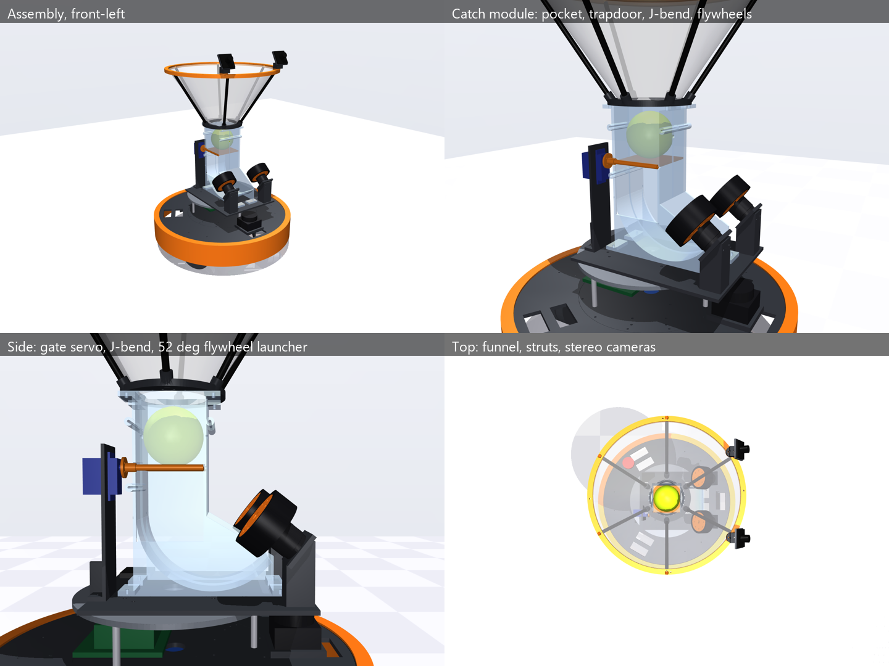
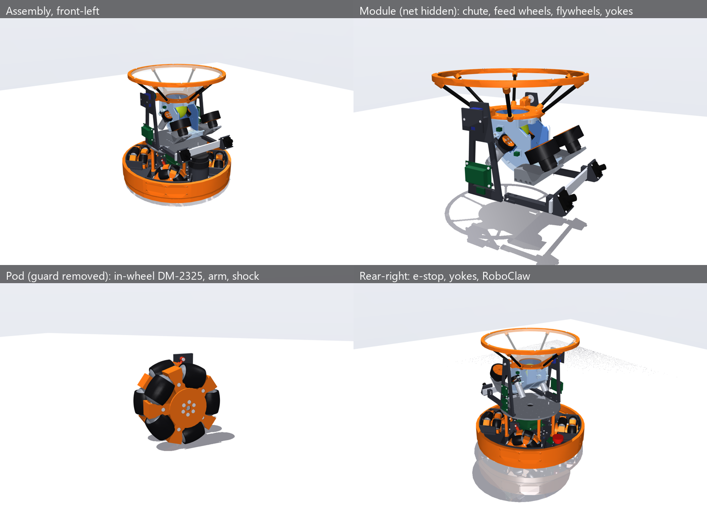

# Play-Catch Robot — Design Baseline

Oct 17, 2026 · Fernando (with Claude) · supersedes the Oct 16 design doc and the Oct 17 component study (both in [archive/](archive/))

## Start here (for a new session)

This is the single source of truth for the design. Each section states the **current baseline**, its **expected performance** (from the v2 MuJoCo simulation unless noted) and **why** it was chosen. Conventions used throughout:

- **(est)**: an engineering estimate waiting for bench data.
- **VERIFY**: a dimension or spec to confirm on the real part (searchable in `cad/` and the sim catalog).
- **Proposed**: not yet agreed with Fernando.

**Where things stand:** Phase 1 (simulation and design) is well under way.

- Three MuJoCo sims run: v1 is the hello world, v2 is the detailed physics model (the baseline), v3 is a **proposed compact redesign**, summarized in section 20. Its defaults are round 2 (v3b): a 4-wheel X base with the deck in the axle plane, and a tilting catch/launch module with a plunger feed. CG 95 mm, rim 387 mm.
- **v5 unlimited** (section 21) is the v3b robot with every firmware limit removed, a per-pixel vision model and a multi-ball hopper mode. It is an exploration of the envelope, not a proposal to drop safety limits. Headline: 81% → 89% caught (92% with a fast camera pipeline); the funnel only works as a hopper with a single-file magazine tube. Section 21.4 estimates the real cameras: 86–92% expected, 72% pessimistic. A thrower farther than ~4 m catches less, not more. Swerve is the base upgrade path, worth +2–4 points.
- **v6 shallow throw** (section 22) targets throwers 6-7 m away with the expected cameras and the X4 base. Firmware adult mode catches 96% of shallow throws (v5: 57%). Three changes:
  - a **roller feed**: two worm-geared feed wheels hold the ball and pass it to the flywheels, one per trigger, with zero misfires;
  - a padded pocket and catch tilt up to 35°;
  - an honest stereo track start (perception software).
- v6 catches 99–100% at 1.5–6 m with human-like scatter, and returns land a median 3 cm from the thrower at 6.5 m (sim upper bound). Multi-ball: the magazine tube works. A tennis-style indexer wheel feeds but catches only 20%, so a catch path that bypasses it is the open design question.
- Indoors under an 8 ft ceiling, a ceiling-aware return (~35–40°, ~4,500 rpm) still reaches a thrower 7 m away, with 0 ceiling hits and a median miss of 7 cm (section 22.5). The round-1 feed pocket only fed balls within about ±0.5 mm of 74 mm. Round 2's **chute pocket** (floor sloping into the feed-wheel nip, J-bend into the flywheels) feeds every 72–76 mm ball at every tilt, with the same catch rate and zero misfires (section 22.4).
- **v6 round 3** (section 23) replaces guesses with models and ranges:
  - feed wheels on direct-drive gimbal motors that hold the ball with current (no worm): the integrated **LK-TECH MF4005** or a GM3506;
  - viscoelastic contacts;
  - randomized worlds: **86% caught across 192 worlds** (per-world median 89%, 10–90% 72–97%), with stereo calibration the dominant unknown;
  - floors: an omni wheel can't climb a square rug edge sideways, and a missed ball under a wheel or a threshold hop can flip the robot (fixed by a skirt and slow zones);
  - a motor study: keep four wheels, but the AK40-10 isn't needed; the DJI M2006 catches the same for less.
- **Actuator choice, cost first** (section 24), on a new shared **actuator database** (`database/`: CSV + `actuator_db.py`; 981 motors, 106 servos, 60 controllers, 424 third-party dynamometer tests, each value with its source and provenance):
  - a brand sweep found the **Damiao DM-2325** ($86, integrated FOC + loops on CAN, 172 g), which catches the same as the AK40-10 in the sim;
  - cheapest compliant motor + controller set **~$682 on 7S**: DM-2325 drive, brushed Pololu 25D feed on DRV8874s, STS3250 tilt, F90 flywheels on an 8S AM32 4-in-1. With a RoboClaw for the feed: ~$738. With the AK40-10 drive: ~$937;
  - the DM-2325's data is reseller-only: bench two (and a DM-J3507 as runner-up) before ordering a set;
  - brushed gearmotors are out for the drive: they overheat in continuous play.
- **v7 home floor** (section 25): a base for real home floors, quantified with the explicit-roller wheel model over ~11,000 crossings at every body direction. A square rug edge stops an omni wheel moving along its axle unless the roller radius is well above the edge height. Fernando adopted the larger wheels (Oct 20):
  - printed **127 mm omni wheels with two rows of five 36 mm rollers**;
  - **sprung, damped wheel pods** (15 mm travel, ~3 N/mm, ζ 0.6).

  It crosses 8 and 12 mm square rugs, 6-18 mm thresholds and the other house transitions at all 24 body directions, with no airborne phase and no ball lost. Catching: home floor 89% vs flat 92%; a 45°-turned rug 88% (v6: 68%). Costs: +1 kg, CG +0.8 cm, ~2.7 points on a flat floor (25.5). It fixes the drive's speed margin on a low battery (+22% with the AK40-10, +57% with the DM-2325). Cross-axis swing pods, a rear rocker and mecanum were tested and rejected. `house.py` drives it through a house with the keyboard, a gamepad or a flight stick.
- **v8 swerve** (section 26, exploration): a three-module swerve base on the same drive.
  - **Terrain:** better. It crosses every house transition plus 16 and 20 mm rugs at every direction, its odometry is 5× better, and it needs no rocker or edge map. But its belly sits 21 mm up.
  - **Catching:** slightly fewer: 90% flat and 87.5% at home, against v7's 91 / 90%. The triangle rocks at the catch, and it needs a 47 cm footprint to stay upright.
  - **Cost:** the same (~$420 vs ~$444), 0.7 kg lighter.
  - Proposed: keep v7 for the catch robot; revisit the swerve for plush rugs or an arm.
- **v9 sensors** (section 27, step 1 of the move to ROS-like simulation): models of the IMU (ICM-42688-P), the RPLIDAR C1 and a downward optical-flow sensor, plus a `robot_localization`-style EKF and lidar matching to a known map.
  - **Localization:** with lidar every base knows where it is to **~1.2 cm median, < 3 cm 95%, 0.5°** through the whole house at up to 2 m/s, transitions and a wall push included. Without lidar they drift 0.5-1% of distance.
  - **Arms:** on its fused estimate the omni base holds 1 mm and makes 5-20 mm moves to ~1 mm. The arm limit is tipping (11-16 N at 35-50 cm), not positioning.
  - **Flow sensor:** the PMW3901 in section 7 is the wrong part; even a near-field PAA5100JE is blind above ~1.1 m/s and over rugs.
  - **Next:** step 2, a ROS 2 bridge (WSL2, Jazzy) so `slam_toolbox` and Nav2 run against the sim (done: v10).
- **v10 ROS bridge** (section 28, step 2): the v9 sim is a ROS 2 Jazzy robot in WSL2. It publishes `/clock`, `/scan` (now the RPLIDAR A2M12 model), `/imu` (BNO085), `/odom` and TF, and takes `/cmd_vel` through the firmware's limits. robot_localization, slam_toolbox and Nav2 run against it unchanged; RViz shows through WSLg, Foxglove connects from Windows, and the flight stick drives through a relay. One command per step: `ros/omni.sh map | save-map | localize | nav`.
  - **Map:** 2.1 cm median wall error, every wall found. It needed two small scan fixes the real robot needs too: drop floor returns (a 1.2° tilted A2M12 13 cm up sees the floor at 6.4 m, so 17% of returns are phantom walls), and de-skew scans (slam_toolbox doesn't).
  - **Localization:** slam_toolbox + EKF 9.0 cm median / 13 cm 95% while moving, against 1.3 / 2.4 cm for v9's matcher on the same readings. So v9's matcher stays the catch-time localizer.
  - **Nav2:** 24 of 24 goals through every door and onto every rug, ending a median 9 cm from the goal.
  - **Driving it:** double-click `Launcher.cmd` (repo root). Three clicks give MuJoCo's own 3D view of the running sim (drawn on Windows), Foxglove, and the flight stick, at ≈ 0.95-1.0× real time (`fast`: the sim's firmware at 1 kHz).
  - **Monorepo:** the robot's ROS packages live in the top-level `ros/`. `omni_bringup` and `omni_perception` go to the Jetson; `omni_sim` stays on the PC.
- **v7 CAD** (section 29, `cad/v7`): the whole current robot, down to every screw. It covers the v7 base, the v6 round-3 module and section 24's actuators.
  - 57 printed parts; pan / flat head M3 into 2.8 mm holes (no inserts), every screw checked for ≥ 6 mm of thread.
  - 0 interferences at every tilt and suspension state.
  - View it with `view.py` (Launcher: View CAD 3D; a slider tilts the module) or open `out/assembly.step` in SolidWorks / eDrawings (a coloured assembly with shared parts).
  - Round 2 (29.4, Fernando's review): the payload plate on six standoffs, 31 mm higher, so the A2M12 sees past everything but them (30° blocked, was 176°); open-top wheel guards; stiffer flywheel mounts; 48 short screws fixed.
  - Findings that need a new sim round:
    - the printed wheel weighs 515 g, not 285 (robot 7.7 vs 6.4 kg, CG 121 mm);
    - the front rocker is dropped;
    - the robot is Ø434 mm, not 37 cm;
    - `plate_gap` 0.096 (the module 31 mm higher) and the A2M12 at 150 mm with a standoff mask;
    - the cameras move 55 mm forward and 12.5 mm up (from the plate);
    - two IR beams move.
  - Open: battery swaps need the robot on its side (a rear drawer is proposed).
  - The DM-2325 now sits inside the wheel.
- **v11: the robot's own code in the loop** (section 30, `simulation/v11 sil`, `firmware/`, `ros/src/omni_catch`, `omni_mcu`). Fernando (Oct 21): start the real robot code, and run the MCU firmware with the ROS sim; assume a Teensy 4.1.
  - **Firmware:** a board-free C++ core (modes, watchdog, ramped stops, kid / adult limits, base controller, odometry, flywheel loop, feed, DM-2325 CAN, the Jetson link). It builds for the Teensy 4.1 (44 KB flash) with a pin map checked at compile time: 29 of 42 pins used, 13 spare. The same source runs in the sim every 1 ms (software in the loop) behind raw CAN frames and sensor values.
  - **Jetson code:** the MCU link with time sync, a colour-blob detector on camera pixels, the tracking filter on the MCU's odometry, the catch behaviour and the modes, as ROS nodes. Their cores have no ROS in them, and the sim also runs them in one process.
  - **Catching:** on the same 216 throws, 90.3% ± 2.0 through the real code against 93.1% ± 1.7 for the sim's own game. Through the full ROS stack, 41 of 48 (85% ± 5) at ≈ 1.0× real time, return throws landing a median 25 cm from the thrower. Zero link errors; the clock syncs to ~0.2 ms.
  - The same detector works on MuJoCo-rendered images (0.1 px). The house steps (map, localize, Nav2) now also drive through the firmware.
- The v2 CAD (`cad/`) stays as it was: printable, 0 clashes.
- A component trade study confirmed most choices and changed a few.
- No hardware has been bought or built. Perception is ground truth in v2; v3 onward model it (v5-v6: per-pixel vision).
- **Safety finding that applies to v2 today:** a zero-speed command on every wheel at 1.4 m/s (a naive fault stop) rocks the v2 kiwi 23° on a μ 0.95 floor and tips it over at μ 1.2. Stops must be ramped (sections 3 and 14).

**Repo map**

```
omni-robot/
├── design.md                       ← this file
├── archive/                        ← superseded docs (Oct 16 design doc, Oct 17 component study)
├── simulation/
│   ├── README.md                   ← Python venv setup, version index
│   ├── requirements.txt
│   ├── v1 hello world/             ← simple kiwi + catch loop (velocity-servo motors, launcher modeled by its output)
│   ├── v2 detailed physics/        ← CURRENT SIM
│   │   ├── catalog.py              ← datasheet values for every candidate part ((est) marks estimates)
│   │   ├── params.py               ← fitted parts + geometry + masses + limits (single source for sim AND cad)
│   │   ├── models.py               ← drive actuator, flywheel motor + ESC, gate servo, battery
│   │   ├── robot_model.py          ← MJCF builder (scene, base, omni wheels, funnel, gate, J-bend, flywheels)
│   │   ├── robot.py                ← firmware-facing robot: sensors in, commands out, electrical bookkeeping
│   │   ├── catch_game.py           ← toss → catch → aim → launch loop
│   │   ├── run.py                  ← viewer / headless / video
│   │   ├── launcher_bench.py, launcher_cal.json   ← flywheel rpm → exit speed calibration
│   │   ├── test_v2.py              ← 7 checks (~5 s)
│   │   ├── studies/                ← trade studies; results/ holds JSON, plots, logs
│   │   └── catch_demo.mp4, drive_demo.mp4
│   └── v3 compact/                 ← PROPOSED compact robot (section 20): same files as v2, plus
│       ├── traction.py             ← quasi-static N-wheel traction / tip model (also used for load-aware allocation)
│       ├── omni_control.py         ← N-wheel kinematics, jerk-limited base controller
│       ├── render.py, renders/     ← module poses
│       ├── test_v3.py              ← 13 checks (~10 s)
│       └── studies/                ← wheel_count.py, funnel_tilt.py, camera_view.py
│   └── v5 unlimited/               ← v3b with no firmware limits, vision.py, hopper (section 21; there is no v4)
│       ├── vision.py               ← per-pixel blob detector, stereo + known-size ranging, image-space EKF
│       ├── shoot_game.py           ← hopper mode: shoot at targets standing or on the move
│       ├── test_v5.py              ← 25 checks (~20 s)
│       └── studies/                ← envelope, vision_sweep, catch_sweep, hopper_rig, launcher_max, shoot_sweep,
│                                     camera_estimate, thrower_distance, base_types
│   └── v6 shallow throw/           ← 6-7 m shallow throws, chute feed, padded pocket, indexer (section 22) + round 3 (section 23)
│       ├── contact_model.py        ← round 3: Hunt-Crossley ball contacts, viscoelastic tire slides
│       ├── floor.py                ← round 3: rolling resistance, friction field/patches, thresholds, carpet
│       ├── randomize.py            ← round 3: the 17 guessed parameters, their ranges, randomized worlds
│       ├── test_v6.py              ← 43 checks (~45 s)
│       └── studies/                ← shallow_sweep, catch_rig, return_throws, hopper_rig, shoot_sweep, thrower_distance,
│                                     feed_tolerance, indoor; round 3: feed_motor, randomized, floor_wheels, motor_study;
│                                     actuator_choice (section 24: reads database/, ranks by cost, writes results/actuator_choice.md)
│   └── v7 home floor/              ← PROPOSED home-floor base (section 25): v6 + big-roller wheels, sprung pods, terrain-aware firmware
│       ├── house.py                ← drive the robot through a house: keyboard, gamepad, flight stick (pygame)
│       ├── floor.py                ← + edge map, turned / all-side-beveled rugs, walls, house transitions
│       ├── test_v7.py              ← v6's 43 checks + 11 v7 checks
│       └── studies/home_floor.py   ← crossings (A), catch games (B), costs (C), robustness / flat floor (R), pod tune
│   └── v8 swerve/                  ← EXPLORATION (section 26): v7 + three- / four-module swerve bases
│       ├── house.py                ← the house drive, default base = the swerve (--base v7 / v6)
│       ├── omni_control.py         ← + SwerveKinematics (flip-and-reverse, steering hold, odometry)
│       ├── test_v8.py              ← v7's checks + 6 swerve checks
│       └── studies/home_floor.py   ← + swerve configs, part S (moves, reversals, panic stops, steering torque), tune_swerve
│   └── v9 sensors/                 ← v8 + sensor models and localization (section 27)
│       ├── sensors.py              ← ICM-42688-P IMU, wheel encoders, PAA5100JE flow, RPLIDAR C1 (ray-cast, skewed scans)
│       ├── estimator.py            ← EKF (robot_localization style), likelihood-field scan matcher, shadow-mode Localizer
│       ├── house.py                ← + --sensors: the fused estimate live, the scan drawn where the robot thinks it is
│       ├── test_v9.py              ← v8's checks + 5 sensor / estimator checks
│       └── studies/localization.py ← house tour, catch-time motion error, positioning for an arm, tip-over forces
│   └── v10 ros bridge/             ← v9 + the sim side of the ROS 2 bridge (section 28); A2M12 + BNO085 models in sensors.py
│       ├── bridge_core.py          ← the sim side of the bridge, no ROS: physics, sensors, wheel odometry, cmd watchdog, tour
│       ├── map_quality.py          ← a SLAM map against the true house (wall error, coverage, per-wall offsets)
│       ├── test_v10.py             ← v9's checks + A2M12, BNO085, bridge core, map scorer
│       └── studies/ros_report.py   ← maps, localization tour, Nav2 goals from studies/results/ros_*.json
│   └── v11 sil/                    ← v10 + the robot's own code in the loop (section 30); omni.sh's default
│       ├── sil_robot.py            ← SilRobot: the C++ firmware ticked every 1 ms; DM-2325 CAN port, DShot eRPM models
│       ├── catch_world.py          ← the world: thrower, the cameras' frames per pixel, truth scoring (no robot code)
│       ├── sil_game.py, sil_link.py ← world + firmware + the Jetson's code in one process (--view: MuJoCo's window)
│       ├── robot_export.py         ← writes firmware/lib/omni_fw/fw_params.h and omni_catch's robot_v11.json from SimParams
│       ├── house_scene.py          ← section 31: a furnished house around the field (decoration only); fetch / overview
│       ├── rendered_camera.py      ← section 31: the stereo cameras as rendered images (motion blur, sensor model)
│       ├── assets/house/           ← the house's CC0 Poly Haven textures (fetched, not in git)
│       ├── test_v11.py             ← v10's checks + 22 firmware / catch-code / house checks
│       └── studies/                ← sil_catch.py (SIL vs the sim's own game), rendered_frames.py (detector on renders),
│                                     rendered_catch.py (section 31: the game on rendered vs sparse frames)
├── firmware/                       ← the MCU (section 30; README, PINS.md): Teensy 4.1, PlatformIO
│   ├── lib/omni_fw/                ← board-free core: firmware, base, module, dm_motor, protocol, hw_io, board_teensy41
│   ├── src/main.cpp                ← the Teensy's drivers and 1 kHz loop
│   └── sil/                        ← the core as a library for the sim (build_sil.py, omni_fw_sil.py)
├── ros/                            ← the robot's ROS 2 software (section 28; README there): runs on the Jetson later
│   ├── omni.sh                     ← one command per step, run in WSL (mirror to ~/omni_ws, build there, launch)
│   ├── setup/install_wsl.sh        ← one-time ROS 2 Jazzy + MuJoCo setup in WSL
│   ├── src/omni_bringup/           ← launch + config (EKF, slam_toolbox, Nav2, teleop, RViz), save_map      → robot
│   ├── src/omni_perception/        ← scan_prep: floor returns + de-skew                                    → robot
│   ├── src/omni_interfaces/        ← messages (McuState, McuCommand, BallTrack, SparseImage, ...), SetMode  → robot
│   ├── src/omni_mcu/               ← mcu_link + protocol.py: the MCU link, odometry, IMU, time sync         → robot
│   ├── src/omni_catch/             ← catch_perception, catch_behavior, mode_manager (+ ROS-free cores)     → robot
│   ├── src/omni_sim/               ← the MuJoCo bridges (house, catch), the firmware's USB port, viewer, scoring → PC only
│   ├── maps/                       ← saved maps (house = the main one, with its pose graph)
│   ├── foxglove/omni_layout.json   ← Foxglove layout: 3D, status, Teleop
│   ├── tools/mujoco_view.py        ← MuJoCo's 3D view of the ROS sim, drawn on Windows (the bridge starts it)
│   └── tools/joystick_sender.py    ← Windows side of the joystick relay
├── Launcher.cmd, launcher.ps1      ← double-click: buttons for the ROS steps, Foxglove, the joystick, the Windows sims (logs/)
├── database/                       ← shared actuator database (section 24; moves up to Robotics/database/ later)
│   ├── motors.csv, servos.csv, controllers.csv, motor_tests.csv, sources.csv   ← the data (edit in Excel); gaps.csv is generated
│   ├── actuator_db.py              ← schema, validator, DC model, requirement checks, costs, sim export, gaps
│   └── README.md, test_actuator_db.py
└── cad/
    ├── v7/                         ← CAD of the current robot (section 29): dims.py (from the v7 sim), hw.py (fasteners),
    │                                 wheel.py, pod.py, base.py, module.py, mounts.py, assembly.py, build.py, render.py;
    │                                 vendor/ (Damiao + Pololu STEPs); out/ (step, stl, assembly.step, BOM.md, PRINT_LIST.md)
    ├── README.md                   ← (v2 CAD below) print list, fasteners, assembly notes
    ├── dims.py                     ← CAD dimensions + coordinate-frame contracts (imports the sim's params)
    ├── base.py, catch.py           ← printed parts (drive base / catch module)
    ├── vendor.py, vendor/          ← purchased parts (official CubeMars AK40-10 STEP + drawing, envelopes)
    ├── build.py, render.py         ← export STEP/STL/assembly + clash check; MuJoCo renders + turntable
    └── out/                        ← step/, stl/, assembly.step, PRINT_LIST.md, renders/, funnel_net_pattern.svg
```

Outside the repo:

- **Python venv:** `C:\Users\ferna\.venvs\omni-robot-sim`. It holds MuJoCo 3.16 and build123d 0.13. The only base Python on this PC is PlatformIO's, so never install packages into PlatformIO's penv.
- **Sister project:** `C:\Dropbox\Personal Projects\Robotics\wheeled-leg-robot\simulation\mujoco\v4_twin_279mm_baseline`, a mature sim with motor, battery and thermal models, optimizers and a digital-twin link. Reuse its conventions.

**Common commands** (run from the folder shown; `$py = "$env:USERPROFILE\.venvs\omni-robot-sim\Scripts\python.exe"`):

| Folder | Command | What it does |
| --- | --- | --- |
| repo root | double-click `Launcher.cmd` | Buttons for everything below and the ROS steps: e.g. *Localize on map* → *Open Foxglove* → *Joystick → ROS* (section 28) |
| WSL (`wsl -d Ubuntu-24.04`), `ros` | `bash omni.sh map` (then `save-map`), `localize`, `nav`; `sim` to just drive; `auto-map`, `tour`, `goals` to score; `stop` | The ROS 2 stack against the sim (section 28; `ros/README.md`) |
| `ros/tools` | `& $py joystick_sender.py` | Stream the Extreme 3D into ROS (start after a WSL step; the 3Dconnexion is ignored) |
| WSL, `ros` | `bash omni.sh catch` (`dist:=6.5`); `catch-score tosses:=24` | The catch game on the robot's own code and firmware (section 30) |
| `simulation/v11 sil` | `& $py sil_game.py --view --returns` | The same in one process on Windows, with MuJoCo's window (section 30) |
| `simulation/v11 sil/studies` | `& $py sil_catch.py both` / `report`; `& $py rendered_frames.py --png` | SIL vs the sim's own game on 216 throws; the detector on rendered frames (section 30) |
| `simulation/v11 sil` | `& $py house_scene.py fetch` (once); `& $py sil_game.py --view --frames rendered --scene house` | The catch on rendered camera images in a furnished house, MuJoCo's window with the robot's left camera (section 31); Launcher group 4 picks any variation |
| `simulation/v11 sil/studies` | `& $py rendered_catch.py run --frames rendered --seeds 3 --workers 12` / `--frames sparse`; `report`; `pictures` | The 216-throw grid on rendered vs sparse frames (~35 min rendered on 12 GPU processes) (section 31) |
| `firmware` | `pio run` (PlatformIO); `& $py sil\build_sil.py --pins` | Build for the Teensy 4.1 (checks the pin map); the SIL library and PINS.md (section 30) |
| `simulation/v10 ros bridge/studies` | `& $py ros_report.py` | Maps, localization tour and Nav2 goal results (section 28) |
| `simulation/v9 sensors` | `& $py house.py --base v7 --sensors --camera top` | Drive with the IMU, flow and lidar fused live; the scan is drawn where the robot thinks it is (section 27) |
| `simulation/v9 sensors/studies` | `& $py localization.py` (`T`, `C`, `P`, `report`) | Localization: house tour, catch-time motion, arm positioning (section 27) |
| `simulation/v8 swerve` | `& $py house.py` (`--base v7`, `--base v6`) | Drive the three-module swerve (or the X4s) through the house (section 26) |
| `simulation/v8 swerve/studies` | `& $py home_floor.py S` / `A "swerve3 v2, r 170"` / `B "swerve3 v2 r 170, home"` | Swerve steering tests, crossings, catch games (section 26) |
| `simulation/v7 home floor` | `& $py house.py` (`--base v6`, `--no-assist`; needs pygame) | Drive the proposed v7 base through a house with the keyboard, a gamepad or a flight stick (section 25.8) |
| `simulation/v7 home floor/studies` | `& $py home_floor.py A` / `B` / `C` / `report` / `probe "v6" "rug edge 12 mm" 45 1.0` | Crossings, catch games, costs (section 25) |
| `simulation/v6 shallow throw` | `& $py watch_floor.py` (`--list`; `cross --obstacle "rug edge 8 mm" --dir 45`; `game`; `flip`) | Watch the robot on thresholds, rug edges and the home floor (section 23.4) |
| `simulation/v2 detailed physics` | `& $py run.py` | Catch demo in the MuJoCo viewer (`--drive` for the omni demo, `--wheel-model rollers` for explicit rollers) |
| same | `& $py run.py --headless -n 30` | Catch statistics without graphics |
| same | `& $py -m pytest -q` | Regression checks |
| same | `& $py launcher_bench.py` | Recalibrate the launcher table |
| same/studies | `& $py wheel_slip.py` (and the others) | Re-run a trade study |
| `cad/v7` | `& $py build.py` (`--quick`), then `& $py build.py --render-only; & $py render.py` | v7 CAD: STEP / STL, BOM, print list, clash checks over tilt and suspension, lidar occlusion, mass vs sim (section 29) |
| `cad` | `& $py build.py; & $py render.py --turntable` | Rebuild the v2 CAD outputs and renders |

**Suggested next steps (in order):**

0. Decide on the v3 compact proposals (section 20). Whichever base is kept, make firmware stops ramped, never a step to zero speed.
1. Perception: a first stereo noise/latency/dropout model and tracking filter now exist in the v3 sim (section 20, round 3), and they show perception timing is the biggest lever on catch rate. Next: run the spec sweep over latency, noise and frame rate (section 12), then calibrate the model on the bench (Phase 2).
2. Make the base acceleration limit direction-aware and jerk-limited (section 3). Done in the v3 sim (section 20, item 8): port it to v2 if v3 isn't adopted.
3. Bench work: order parts and print a test wheel pod with adapter and a flywheel hub with tire. Measure roller μ on the real floor, the foam ball's properties, and the launcher calibration. Resolve the VERIFY items.
4. Bring the CAD into SolidWorks as wrapper parts; add wiring, bumper switches, speaker, the ELRS receiver and the MCU board once chosen.
5. From v5 (section 21): set the camera spec by what the sweep says matters (latency, frame rate, calibration, global shutter, hardware sync), film throws to measure ball spin. (v5's open item, a retaining gate at the pocket exit, is answered by v6's roller feed.)
6. From v6 (section 22):
   - decide on the roller feed, the padded pocket and the 35° catch tilt;
   - port the honest track start into the perception code;
   - bench-test a feed-wheel pair on GM3506 gimbal motors (round 3, section 23.1): speed, current-limited holding, a rigid preloaded stop;
   - measure the net's rolling resistance and the ball's mass and drag;
   - choose a multi-ball path: the tube insert now, or an indexer whose catch path bypasses the wheel;
   - decide on the chute pocket (section 22.4) and bench-test a printed chute + J with two feed gearmotors and the exit beam;
   - for indoor play, use the ceiling-aware return planner and spin-test the flywheels to ≥ 5,000 rpm (section 22.5).
7. From v6 round 3 (section 23):
   - bench the stereo pair's calibration stability first: it is the biggest unknown in the randomized study;
   - drop-test the foam ball on the floor and the pad at three heights; film throws for spin;
   - rework the battery into two rows;
   - design the bumper skirt (down to ~20 mm) and the wheel-top guards; map thresholds as ≤ 1 m/s zones; avoid square rug edges;
   - in the tracking filter, model calibration error as a slowly varying bias.
8. From the actuator choice (section 24):
   - buy two Damiao DM-2325s and one DM-J3507 and bench them: torque constant and peak, undervoltage cutoff on a low 7S pack, winding temperature at ~0.4 N m RMS, backlash, comm-loss behaviour. Record the results in the database's `meas_*` columns;
   - then decide the drive: DM-2325 (~$682 set), DM-J3507, AK40-10 (~$937) or M2006 on 6S (~$714);
   - look at a counterbalance spring on the tilt pivot, and bench the $30 Hiwonder HTD-45H (either could replace the $74 STS3250);
   - add torque sharing to the X4's four speed loops (it cuts drive heating for any motor);
   - fill the database gaps (`database/gaps.csv`), prices first.
9. From v7 (section 25):
   - decide on the v7 base (big-roller printed wheels + sprung pods); drive it in `house.py` first;
   - print one 127 mm wheel (2 × 5 rollers of 36 mm, coned roller ends) and one pod on a 1/10 RC coil-over; measure roller grip and rolling resistance on wood, tile and carpet, the pod's rate and damping, and climb an 8 / 12 mm square rug edge sideways by hand-pushing a loaded wheel;
   - CAD: the 80 mm-wide wheel moves the motor 21 mm inward; check the deck slot against the battery;
   - decide where the floor-edge map comes from (the 2D lidar can't see a rug edge): app markup, IMU-bump learning, or stereo depth;
   - recover the ~2.7 flat-floor points (25.5).
10. From v8 (section 26): only if plush or 16-20 mm rugs are in the play area, or odometry matters more (an arm, mapping), bench one swerve module first: an ST3215-HS on a printed turntable, a DM-2325 on a belt to a 100 mm TPU-tread wheel. Measure steering speed under load, scrub torque and the cable loop; solve the 21 mm belly clearance.
11. From v9 (section 27):
   - set up WSL2 + Ubuntu 24.04 + ROS 2 Jazzy and a MuJoCo-to-ROS 2 bridge (`/scan`, `/imu`, `/odom`, `/tf`, `/clock`, `/cmd_vel`), then run `slam_toolbox` (mapping the house), `robot_localization` and Nav2 against it;
   - feed the lidar fixes into the catch-time estimator;
   - drop the PMW3901; choose between a PAA5100JE (+ ToF) and no flow sensor;
   - for an arm, budget tip-over first (ballast, stance, motion planning that keeps the CG inside the wheels);
   - if the swerve comes back, give it a fine-positioning mode.
12. From v10 (section 28):
   - map the house yourself with the stick (`omni.sh map`, then `save-map`), then try `nav` with goals from RViz or Foxglove;
   - when the A2M12 arrives: measure its scan-plane tilt on a flat floor and its range noise at 1, 3, 6 and 10 m; level the mount; check `rplidar_ros`'s scan direction and stamp against the bridge's;
   - port v9's matcher to the ROS side as the catch-time localizer on slam_toolbox's map; measure AMCL alongside;
   - before the Jetson: profile slam_toolbox + Nav2 at real time on its CPU.
13. From the v7 CAD (section 29):
   - re-run the v7 sim with the CAD's masses (wheel 515 g, sprung pod parts, yokes and bar), without the rocker, with the bumper ring at r 205-217 and the CAD's camera positions;
   - re-run the v10 stack with the lidar's self-occlusion mask (~176° blocked); decide where the lidar goes before printing the front wheel houses;
   - recalibrate `feed_clear_travel` for the moved feed-exit beam;
   - print and bench one wheel and one pod with a DM-2325; choose the shock spring (~12 N/mm at the shock).
14. From v11 (section 30):
   - write the three stub drivers in `firmware/src/main.cpp`: the BNO085 (SH-2 over SPI), bidirectional DShot, CRSF;
   - on the bench, with a Teensy 4.1 and one DM-2325: check its CAN ids, feedback ranges, reply to every frame, and comm-loss timeout and error D against `dm_motor.h`; measure the USB link's latency and the 1 kHz loop's CPU time. That is hardware in the loop: the same core and `mcu_link`, a real board;
   - schedule the coast, brake and dump on a crossing time refined after the freeze (SIL bounced 5 balls to the sim's 1);
   - feed rendered images into ROS in real time from a Windows render server (2-5 ms a frame); `catch_perception source:=image` is ready;
   - port the terrain assist (the edge map) into the firmware, or keep it on the Jetson as speed caps;
   - re-run v11 with section 29's CAD findings (masses, cameras, plate height, lidar mask).



## 1. Overview and goals

A kiwi omni-wheel robot tracks a tossed ball, drives under it, catches it in a funnel and throws it back with a flywheel launcher. Most tuning and training happens in a realistic MuJoCo simulation; the real robot is used for attended calibration and validation sessions.

**Goals**

- Fun to play catch with, including with kids (a dedicated kid mode).
- Technically impressive: stop-and-catch first, moving catches later.
- Improvable by Claude between sessions, mainly through overnight simulation runs.
- A general mobile platform: lidar SLAM, RC driving, a speaker, and swappable top modules (catch module now, robot arm later).
- Built mostly from 3D-printed parts (PLA, PETG, TPU on a ~256 mm Bambu bed) plus purchased actuators and electronics.

## 2. Requirements and expected performance

v1 targets stop-and-catch of gentle underhand throws. Requirements are still provisional; the right-hand columns show what the current design achieves in simulation.

| Parameter | Requirement | Expected (sim v2) | Notes |
| --- | --- | --- | --- |
| Throw distance (to robot) | 2–4 m underhand | Thrower at 3.0 m | |
| Apex above release | 1–2 m | 1.0–2.0 m tested | Gives 0.7–1.0 s after the 0.25 s perception delay |
| Detect + fit trajectory | by ~0.25 s after release | 0.25 s delay, 20 Hz updates (ground truth) | **Perception noise not modeled yet** |
| End-to-end latency | < 100 ms | not modeled | |
| Base acceleration | ~~4–5 m/s²~~ → **2.5 m/s² limit (proposed)** | Slip-free: ~2.4 m/s² worst direction, up to 4–7 toward a wheel (μ 0.95) | Traction-limited; see section 3 |
| Peak speed | ~1.4 m/s | 2.6 m/s full battery, 2.0 m/s at 10% charge | Firmware cap 1.4 m/s |
| Landing prediction error | ±5 cm | n/a (ground truth) | |
| Catch zone | ~1 m diameter | 100% within 0.65 m radius (30/30), with perfect perception | The funnel tolerates ~±12 cm of positioning error |
| Positioning at ball arrival | — | median 0.4 cm, max 1.9 cm funnel offset (20 tosses) | |
| Return throw | to the thrower | median 14 cm from the thrower's hands (20 throws) | 52° lob to chest height |
| Cycle time | — | ~4.5 s per toss in sim (toss → catch → aim → launch → reset) | |
| Ball | ~~70–75 mm hollow plastic~~ → **74 mm foam pickleball, ~22 g (proposed)** | Drag ≈ 25% of weight at 6 m/s | Drag must be in every predictor |
| Run time | one session per battery | ~3.9 h at 28 W average | |

Key insights:

1. **Stop-and-catch is easy in sim.** Requiring a full stop under the ball halves reach versus a moving catch, but in simulation it caught everything inside a 0.65 m radius. Even acceleration limits from 2.0 to 3.5 m/s² all scored 30/30; only 1.5 m/s² lost catches (26/30). Perception accuracy, not drive performance, will drive the real catch rate.
2. **The real error budget is about ±11 cm** (funnel radius minus ball radius).

## 3. Drive base

A three-wheel kiwi base on CubeMars AK40-10 actuators and 96 mm goBILDA omni wheels, running from a 7S Li-ion pack.

| Item | Baseline | Why |
| --- | --- | --- |
| Layout | Kiwi: 3 wheels at 60° / 180° / 300° (0° = forward = launcher side), 180 mm from center | Equal agility in every direction, always 3 wheels on the ground |
| Wheels | **goBILDA 96 mm omni, 14 mm bore, 50A rollers, part 3624-0014-0096** ($21.99, 119 g) | Lightest and grippiest of the candidates; lowers deck and CG. 125–127 mm wheels add ~1 kg and raise the CG for no catch benefit |
| Motors | 3 × **CubeMars AK40-10 V3.0 KV170** with driver ($135.90, 190 g): Kt 0.056 N·m/A, 10:1, 978 mΩ, 7.3 A peak (4.1 N·m), 435 rpm no-load at 24 V, CAN | Lightest actuator that meets speed; torque is never the limit |
| Wheel mount | Wheel overhung on the motor output via a printed adapter (3 × M2.5 to the output on PCD 27, 3 × M4 through the wheel's 32 mm pattern); motor bolts to a printed pod through its rear 4 × M2.5 on PCD 47 | Simple; VERIFY the AK40-10 output bearing's radial and moment rating |
| Battery | 7S1P Molicel P50B 21700 (5 Ah, ~126 Wh), BMS ≥ 40 A | See section 10 |
| Mass | **5.56 kg** total (sim with CAD masses), CG 151 mm high and ~21 mm forward (launcher, lidar) | Lighter than the old 6–9 kg planning range |

**Expected performance**

| Metric | Value | Source |
| --- | --- | --- |
| Top speed | 2.63 m/s (29 V), 2.0 m/s (22 V, 10% charge) | motor + battery model |
| Slip-free acceleration (μ 0.95) | ~2.4 m/s² worst in sim, rear diagonals 120° / 240° (quasi-static model 2.8); ~3.4 forward, 3.1–3.4 sideways, 4.7–7.4 toward a wheel | `studies/wheel_slip.py` |
| Same vs roller friction | worst direction 1.6 / 2.0 / 2.4 / 3.1 m/s² at μ 0.6 / 0.75 / 0.95 / 1.1 | same |
| Tip-over | ~5.9 m/s² toward a wheel-triangle edge (quasi-static) | model |
| 0.37 m stop-and-catch move | ~0.97 s to settle within 1 cm; 0.6 m in ~1.2 s | `studies/drive_components.py`, `drive_reach.py` |
| Motor heating | winding ≈ +2–3 °C over ambient in continuous catch duty (thermal constants est) | thermal model |
| Ground clearance | 22 mm (motor bottom) | geometry |

**Traction, not torque, limits acceleration.**

- Accelerating between two wheels is pushed by those two wheels alone, each needing 0.58·m·a, while load transfer unloads them.
- Quasi-static limit per wheel: a_max = μ·N₀·g / ((2/3)|t·u| + μ(2/3)(h/L)(u·r)); take the minimum over the three wheels. N₀ is the static load share (it includes the CG offset), t the wheel's rolling direction, r its radial direction, and u the acceleration direction.
- The sim matches this model in shape, and runs ~0.5 m/s² below it in the worst directions. The instant acceleration step rocks the robot, so jerk limiting should recover most of that.
- The explicit-roller wheel model agrees with the fast sphere model within ±25%. It also adds the real double-row 2–3% speed ripple and about ±2° of heading wander.
- **Proposed firmware behavior:**
  - cap at 2.5 m/s²,
  - make the limit direction-aware with the formula above (30–50% more acceleration in good directions),
  - add jerk limiting.

**Tipping.** The support polygon is the wheel triangle, so the tipping lever is its inradius: half the wheel-circle radius (90 mm here), not half the base width. The Oct 16 doc's "45 cm wide, CG at 40 cm, tips near 5.5 m/s²" example actually tips at about 2.2–2.5 m/s². Keep the battery and motors low (they are).

- Accelerating toward a wheel, or braking while driving forward (launcher first), the kiwi is right at its tip limit: the two loaded wheels do the pushing and gain grip as the third one unloads, so traction doesn't cap the acceleration before tipping does.
- **Dynamic check (v3 sim, `studies/wheel_count.py`, kiwi at v2's 180 mm):** cruising at 1.4 m/s, then every wheel commanded to zero speed at once, the base rocks 23° on a μ 0.95 floor and **tips over at μ 1.2**. At the 2.5 m/s² ramped limit nothing tips.
- So: stops are always ramped within the acceleration limit, including watchdog and fault stops; the e-stop cuts power so the wheels coast; the AK40-10's own comm-loss behavior must coast or ramp, not lock (VERIFY in its manual).

**Rejected drive options** (sim + datasheets, `studies/drive_components.py`):

| Option | Why rejected |
| --- | --- |
| AK45-10, DM-J4310-2EC | Too slow at 24 V: top speed 1.1–1.6 m/s with low-battery speed under 1.2 m/s |
| AK60-6 V3 | 2.6× the cost for torque the floor can't use; needs ≥127 mm wheels for clearance |
| SteadyWin GIM6010-8 | Budget option at ~$105, but 200 g heavier per motor and needs ≥100 mm wheels |
| RobStride 01/02, Damiao DM-J6006 | Need 36–48 V, or too slow at 24 V (from the Oct 16 doc) |
| Nexus 100 / 127 mm aluminum omnis | 3–4× heavier, lower μ (est) |

## 4. Compute and real-time control

A Jetson Orin runs perception, planning, SLAM and logging; a separate microcontroller runs motor control and is the safety authority. (Unchanged from Oct 16.)

**Main computer: Jetson Orin.** Start with the Orin Nano Super dev kit ($399) or an Orin NX 16GB module (~$999 plus a ~$150–250 carrier). Both share the same module footprint, so a carrier board can take the Nano now and the NX later. Prices reflect NVIDIA's July 2026 increase ([CNX Software](https://www.cnx-software.com/2026/07/22/nvidia-increases-the-price-of-jetson-modules-and-devkits-by-up-to-101/?amp=1)).

- Why Jetson over a Raspberry Pi 5: more MIPI camera lanes, CUDA for neural-net detection and visual SLAM (Isaac ROS), and headroom for an arm and more cameras later.
- Why not AGX Orin or AGX Thor: overkill, and now $3,499 / $5,499 dev kits. The cheaper Thor T3000/T2000 modules expected Q1 2027 ([ServeTheHome](https://www.servethehome.com/nvidia-announces-expanded-jetson-thor-lineup-with-mid-range-t3000-and-t2000-modules/)) are a possible future upgrade.
- Considered: x86 mini PC (cameras only over USB, no CUDA), RK3588 boards (weak robotics software support), VOXL 2 (drone-oriented, expensive).
- Runs full Ubuntu (JetPack) with a desktop; switch to headless boot when deployed to free ~1 GB of RAM.
- Placement: in the 65 mm layer between the deck and the payload plate, rear half (VERIFY the carrier hole pattern).

**Real-time microcontroller: STM32G4/H7 class with native CAN-FD** (Teensy 4.1 acceptable). **Fernando, Oct 21: assume a Teensy 4.1 for now.** Its firmware is written and runs in the sim (section 30): `firmware/`, pin map in `firmware/PINS.md`.

- Runs the 500 Hz–1 kHz base control loop and talks to the three AK40-10s over CAN.
- Enforces velocity, acceleration, current and flywheel-RPM limits; reads bumpers, e-stop and the RC receiver directly; stops the motors if the Jetson heartbeat stops.
- Closes the flywheel rpm loop from bidirectional-DShot eRPM telemetry and drives the gate servo.
- The Jetson only requests desired velocities, so a bad high-level change cannot exceed firmware limits.
- Placement: under the center plate beside the battery, with the power board (relay, DC-DC converters) opposite.

## 5. Software architecture and development workflow

ROS 2 for the overall system, with one low-latency catch path, a simple custom link to the microcontroller, and development done remotely on the Jetson from a Windows PC. (Unchanged from Oct 16.)

**Architecture**

- ROS 2 provides the RPLidar driver, slam_toolbox, Nav2, MoveIt (future arm), rosbag logging and Foxglove visualization, so none of that is rebuilt.
- **Fast catch path:** camera capture, ball detection, stereo triangulation, trajectory fitting with drag, and landing prediction run in one process (composable nodes or one C++ node), passing data in memory. It publishes only the target "go to (x, y) by time t" plus diagnostics.
- Camera frames carry hardware timestamps, and Jetson and microcontroller clocks are synchronized, so fits use real capture times.
- **Microcontroller link:** a small custom protocol over CAN or UART (velocity commands, heartbeat, status), not micro-ROS, to keep the safety MCU simple.
- Robot software runs in Docker so the PC simulation and the Jetson run identical code and ROS 2 versions.
- The sim already separates "firmware-facing" robot code (`robot.py`: sensors in, wheel/flywheel/gate commands out) from the world. Keep that boundary when the code moves to ROS.

**Development workflow**

- Windows PC is the front end: VS Code Remote-SSH into the Jetson for editing, building (colcon, natively on ARM) and running.
- Claude Code runs on the Jetson, so it can edit, build, read logs, run tests and restart nodes directly on the hardware.
- The MCU programmer (ST-Link or USB DFU) plugs into the Jetson, so flashing, serial console and GDB all work remotely. Flashing is allowed only in attended sessions and is blocked in unattended configurations; hard safety limits live in a separate firmware module changed only deliberately, together.
- One git repo on the Jetson, pushed to GitHub. Tunable parameters are kept separate from algorithm code. Today they live in `simulation/v2 detailed physics/params.py` and `catalog.py`, to become YAML.
- **Visualization:** Foxglove on Windows connects to foxglove_bridge over WebSocket, so no ROS networking or Linux is needed on the PC.
- **Simulation on the PC:** MuJoCo runs natively on Windows in the venv above. Since v10 (section 28), WSL2 + Ubuntu 24.04 + ROS 2 Jazzy run the real ROS stack against the MuJoCo sim through a bridge (its workspace in WSL's filesystem, Foxglove on Windows over localhost); Gazebo is not needed.
- Remote desktop (Ubuntu screen sharing or NoMachine) is available for occasional GUI use; it needs an HDMI dummy plug when headless.

**Improvement loop (sim-first):** every change, parameter or code, must pass the simulation regression suite before it reaches the robot (today: `test_v2.py` plus headless catch statistics). Real sessions score catch rate, positioning error and return accuracy; changes are kept only if they beat the current best, with automatic rollback. Firmware, safety limits and test-area geometry are outside what Claude changes unattended.

## 6. Cameras and perception

Two hardware-synchronized OV9782 color global-shutter cameras, on the funnel rim, looking forward and tilted 30° up.

| Item | Baseline | Why |
| --- | --- | --- |
| Placement | Printed pads on the front rim arcs at ±33.7°, 600 mm up | Works anywhere (mobile platform goal) |
| Configuration | Stereo, **190 mm baseline**, parallel optical axes | Stereo gives ~1–2 cm depth vs ~8 cm for mono size-based depth |
| Sensor | [OV9782](https://www.ovt.com/sensors/OV9782): 1280×800 color at 120 fps, global shutter, frame sync | Rolling shutter smears a fast ball |
| Exposure | < 1 ms | Ball moves ~5 cm per frame at 6 m/s and 120 fps |

**Pipeline:**

1. Color-blob detection of the brightly colored foam ball (CPU).
2. Stereo triangulation.
3. A ballistic filter **with quadratic drag**, whose output is a landing point and its uncertainty, computed where the ball crosses the funnel rim height (0.60 m), not the floor.

The 22 g foam ball has drag ≈ 25% of its weight at 6 m/s, so a vacuum-ballistic fit misses by tens of centimeters. The sim's predictor (`ball_flight.py`, MuJoCo's drag law, Cd 0.5 (est)) matches the simulated ball within 1 cm. The robot commits once uncertainty is small; each frame is corrected for robot motion using odometry and IMU. A small neural-net detector comes later if lighting or backgrounds get messy.

**Alternatives considered:** Arducam OV9281 stereo kit (about $174, but mono, 90 fps on Jetson, and only guaranteed on official dev kits); Stereolabs ZED X (about $599 plus a GMSL2 capture card; 60 fps is low for catching, but excellent for visual SLAM later).

**Caution:** Jetson camera support depends on drivers for the exact JetPack version and carrier board. Confirm OV9782 driver support for the chosen carrier before buying; the official dev kit is the safest choice.

## 7. Localization

Short-term motion tracking for the catch, lidar SLAM for long-term position, and three ways to find the thrower. (Unchanged from Oct 16.)

- **During a catch (about 1 s):** the ball is measured in the robot's camera frame, so only the robot's own motion over the flight matters. Wheel odometry and an IMU are fused on the microcontroller.
- **Slip handling:** omni wheels slip hardest during the acceleration bursts that matter most. A downward-facing PMW3901-class optical-flow sensor measures ground motion directly and is unaffected by wheel slip. The sim shows slip starts around 2.4 m/s² in the worst direction.
- **Long-term position:** RPLidar C1 with slam_toolbox builds a map, keeps the robot in the play area, avoids obstacles and returns it to a home spot. The lidar sits at the front of the deck under the payload plate (scan plane ~150 mm). Its only fixed obstructions are the three thin payload standoffs at 0° / 120° / 240°, which software masks out.
- **Finding the thrower:** (1) back-extrapolate the ball trajectory to its release point; (2) a person or pose detector on the Jetson at a modest rate, aiming return throws at chest height; (3) in a test setup, an AprilTag on a fixed target gives a precise, unambiguous aim point and a drift check.
- **Hardware added:** IMU on the microcontroller board, optical-flow sensor (optional, see below), lidar. **Fernando, Oct 20: the lidar is a Slamtec RPLIDAR A2M12 and the IMU a CEVA/Hillcrest BNO085.**
  - RPLIDAR A2M12: 16 kHz, 10 Hz typical (5-15 Hz), 0.225° at 10 Hz, 0.2-12 m, accuracy 1% of range to 3 m, 2% at 3-5 m, 2.5% beyond, ±1.5° scan flatness, UART 256 kbaud (Slamtec datasheet).
  - BNO085: 9-axis with on-chip fusion; game rotation vector up to 400 Hz, raw gyro up to 1 kHz; ~0.5°/min heading drift (reseller figure; VERIFY in CEVA's datasheet).
  - v9 (section 27) modelled the C1 and an ICM-42688-P; v10 (section 28) models these parts. The A2M12 must be mounted level, with its scan plane's tilt calibrated and floor returns filtered: a 1.2° unit 13 cm up sees the floor at 6.4 m (proposed, section 28).
- **v9 update (section 27, proposed):**
  - the flow sensor must be a near-field part (PAA5100JE, 15-35 mm), not the PMW3901 (≥ 80 mm). Even then it's blind above ~1.1 m/s and over rugs, so it is optional;
  - the catch-time estimator should take the lidar fixes. With lidar the robot's motion over a 1 s catch is known to 13-20 mm (95%), against 42-65 mm with wheels + IMU;
  - the lidar's scan plane is ~100 mm up on the v3b-and-later deck (not 150).

## 8. Catching

A 33 cm fabric-net funnel feeds a padded catch pocket closed by a servo trapdoor; an IR break-beam confirms the catch.

| Element | Baseline | Why / evidence |
| --- | --- | --- |
| Funnel | Ø330 rim at 600 mm, walls 35° from vertical, Ø84 throat at 424 mm. Fabric net laced to a printed collar and a 4-piece printed rim, held by 6 × Ø8 carbon struts | Steep walls redirect a ball arriving at 5–6.5 m/s, 20–30° off vertical |
| Net material | Grippy, soft mesh (sim: μ 1.0, high rolling resistance (est)) | A slippery cone lets off-center balls swirl and climb out. With a grippy, lossy net, 6/6 test arrivals were held (6.5 m/s, 20° tilt, up to 0.11 m off-center) |
| Catch pocket | Vertical-walled square tube (78 mm inside, 2 mm clearance) one ball diameter (85 mm) below the throat | With the gate at the throat, balls skated across and climbed back out of the cone |
| Gate | **Trapdoor** hinged on a Ø3 pin at the side wall, driven directly by a 25 kg·cm servo on the hinge axis; opens 95° into a wall window so it lies flush | A sliding shutter needs ~250 mm of side travel and drags the ball sideways. The padded impact (~0.6 N·m) is within servo holding torque |
| Gate pad | 3 mm EVA foam (restitution 0.15 (est)) | A hard gate bounces the ball back out of the pocket |
| Catch confirmation | IR break-beam (5 mm pair) across the held ball | Exact catch/miss score for logging and tuning; doubles as "ball loaded" |
| Misses | A person picks up the ball; a pickup mechanism is a possible future upgrade | |
| Camera occlusion | The funnel may block the ball in the final moments; acceptable because the landing prediction is committed by then | |

## 9. Throwing

A gravity-fed, gated, left/right dual-flywheel launcher at a fixed 52°, aimed by rotating the base.

**Ball path:**

1. The trapdoor opens.
2. The ball drops through a J-bend (50 mm centerline radius) that turns it up the 52° launch line.
3. It rolls into the nip between two Ø70 flywheels.
4. The flywheels throw it.

The flywheels sit left and right with axes perpendicular to the launch line (38° from vertical). Equal speeds launch without spin.

| Item | Baseline | Why / evidence |
| --- | --- | --- |
| Feed | Gravity through the J-bend; needs ≥15 cm of drop, so the lidar/Jetson layer is 65 mm (was 105) | A 52° launch can't be gravity-fed into over-under wheels; the J reaches the nip with margin in every sim shot |
| Flywheels | Printed PETG hub + TPU 95A tire, **Ø70 × 28 mm**, 8 × M4 steel bolt ring: 8.0e-5 kg·m², 120 g each; 10 mm squeeze on the ball (~15 N (est)) | Smallest shot dip and tightest scatter of 50–80 mm in the bench study |
| Motors | 2 × **T-Motor F90 2806.5 1300KV** (iFlight XING 2806.5 1300KV equivalent), M5 shaft | Huge margin: 14% throttle at max speed on a 22 V battery |
| ESC | **TBS Lucid 8S 60A 4-in-1, AM32, bidirectional DShot** (2 of 4 channels) | Must be 8S-rated (a full 7S pack is 29.4 V); eRPM telemetry for the MCU rpm loop |
| Aiming | Yaw from the base spinning in place; pitch fixed at 52°; distance set by flywheel rpm through `launcher_cal.json` | High, slow arcs are easy for kids to catch |
| Gating | The gate opens only when aimed, both wheels at speed (±2%) and safety checks pass | Every shot is a deliberate event |
| Spin | None (left/right wheels at equal speed) | Backspin would need over-under wheels; not needed for gentle lobs |

**Expected performance** (bench in sim, `launcher_bench.py`):

| Flywheel rpm | 1000 | 2000 | 3000 | 4000 | 5000 |
| --- | --- | --- | --- | --- | --- |
| Exit speed (m/s) | 2.4 | 5.1 | 7.7 | 10.2 | 12.6 |
| Elevation (°) | 43 | 50 | 51.4 | 51.8 | 51.9 |

- **Transfer:** about 0.70 of rim speed. Repeat shots agree within ±0.1–0.2 m/s; azimuth scatter is within ±2.6°.
- **Recovery:** each shot dips the flywheels ~20%, and they recover in 30–40 ms; the calibration table absorbs the dip.
- **Spin-up:** to 3 m-throw speed in 0.13 s, with a 4 A peak bus current.
- **Requirement:** 5.5 m/s for a 1.5 m return throw, 6.8 m/s at 3 m and 8.8 m/s at 5 m, all to chest height. Design max is 10.1 m/s (+15%), which needs ~3950 rpm.
- **Return accuracy in the full game:** median 14 cm from the thrower's hands.
- **Consistency** comes from feeding the ball the same way every time (the J and gate) and from the calibration table refined with logged throws.

## 10. Power

| Item | Baseline | Expected |
| --- | --- | --- |
| Pack | 7S1P Molicel P50B 21700 (5 Ah, 25.2 V nominal, 29.3 V full), BMS ≥ 40 A, main fuse, low-voltage cutoff | 612 g, R0 ≈ 137 mΩ incl. BMS and wiring (est) |
| Worst burst | Hardest base move + both flywheels spinning up | 12.6 A, 29.3 → 27.5 V |
| Average play | 28 W (Jetson + sensors ~22 W dominate) | ~3.9 h per charge |
| Low charge | 10% SoC, 15 °C | 22.4 V loaded; top speed still 1.97 m/s |

7S1P is enough. A 7S2P pack doubles the mass for runtime nobody needs in attended sessions. Sessions are sized to one battery; a charging dock is not needed.

## 11. Mechanical design and CAD

Python (build123d) generates every printed part as STEP (for SolidWorks) and STL (for Bambu Studio). Dimensions are imported from the simulation (`cad/dims.py` imports `params.py` and `geometry()`), so the CAD and the sim can't drift. SolidWorks remains the master assembly for mechanisms and fine work, using wrapper parts with named reference geometry. That workflow is unchanged from Oct 16: wrapper parts reference their own origin, STEP files are imported with 3D Interconnect, and each part follows the coordinate-frame contracts below.

**Coordinate-frame contracts** (`cad/dims.py`)

| Frame | Definition |
| --- | --- |
| ROBOT | Origin on the floor under the base center; x forward (launcher side), y left, z up |
| PAYLOAD | Origin at the payload-plate top center (z = 185 mm); axes parallel to ROBOT. The first contract, shared by every module |
| POD | Origin at the wheel center on the axle; +x along the axle toward the robot center |
| MOTOR | As in the CubeMars STEP: axis +Y, output face y = −14.0, rear face y = +26.2 |

**Current printable design** (38 printed pieces from 32 unique parts, ~2.3 kg of PETG/PLA/TPU, all ≤ 248 mm, 0 clashes; see `cad/out/PRINT_LIST.md`)

- **Base:**
  - 3 wheel pods, each one PETG print: motor bulkhead, top flange and outer wheel guard.
  - 3 wheel adapters.
  - A Ø240 center plate with 6 half-lapped 60° deck sectors, making a Ø450 deck at 108–114 mm.
  - 6 TPU clip-on bumper arcs, each bridging a sector joint, with a skirt to 45 mm above the floor.
  - A strapped battery tray under the plate and a lidar riser.
- **Payload interface:**
  - Ø240 PETG plate on 3 × 65 mm M4 standoffs (at 0° / 120° / 240°, r 100).
  - A 25 mm grid of M4 heat-set inserts.
  - Two asymmetric Ø4 dowels at (87.5, 37.5) and (−37.5, −62.5), so a module fits only one way.
  - Four captive M4 thumbscrews into grid inserts at (±50, ±50).
  - A Ø28 center hole for the power/CAN/USB connector.
- **Catch module:**
  - Launcher base plate carrying both tilted flywheel-motor pedestals.
  - Two channel halves (pocket, drop tube and J), split on the centerline and printed on their outer walls so the ball path comes out smooth.
  - Trapdoor flap, servo tower, flywheel hubs and tires.
  - Funnel collar, 4 rim arcs, 2 camera brackets.
  - A 1:1 sewing pattern for the net (`out/funnel_net_pattern.svg`).
- **Purchased:** the CubeMars AK40-10 STEP and drawing are in `cad/vendor/`; other parts are envelopes marked VERIFY.

Payload budget: size the base for about 3–4 kg of payload; firmware lowers acceleration limits automatically based on the attached module.

## 12. Simulation

MuJoCo is the primary simulator and the main training environment; Gazebo is added later for full-system navigation testing.

| Version | Content | Speed |
| --- | --- | --- |
| v1 hello world | Kiwi base (sphere omni wheels), velocity-servo motors, funnel, launcher modeled by its output, catch loop, 10 tests | ~9× real time |
| **v2 detailed physics** (current) | See the model list below; 7 tests; 5 trade studies | ~4× real time at a 0.5 ms step |
| v3 compact (proposed) | v2's models on a compact robot: N compliant wheels (+ rocker), jerk-limited direction-aware control, tilting catch/launch module with a plunger feed, base-mounted cameras, a stereo perception model, moving catches; 20 tests; 7 studies (section 20) | ~3× real time; ~1× with the perception model |
| v5 unlimited (exploration) | v3b with a "physics" limits profile (live back-EMF speed ceiling, full traction table, no jerk cap), a per-pixel vision model, extra balls, magazine tube / sweeper hopper, shooting game; 25 tests; 6 new studies (section 21) | ~2.5× real time; ~2× with the vision model |
| v6 shallow throw (proposed) | v5 plus a roller feed (driven feed wheels, one ball per trigger), padded pocket, 35° catch tilt, honest stereo track start, landing prior option, stirrer and tennis-style indexer hoppers, misfire scoring (section 22). Round 3 (section 23): datasheet feed-motor and driver models, viscoelastic contacts, randomized worlds, rolling resistance, floor friction fields, thresholds and carpet; 43 tests | ~1.5× real time (~2× with viscoelastic contacts) |

v2 models:

- **AK40-10:** FOC speed loop with current and back-EMF limits at the live bus voltage, gearbox, two-node thermal model.
- **Battery:** OCV, R0 and an RC branch, with BMS trip.
- **Omni wheels:** a fast sphere model, plus an explicit double-row roller model for validation.
- **Launcher:** physical flywheels on sprung slides, drone motor + AM32 ESC models, closed-loop rpm.
- **Gate:** the trapdoor servo.
- **Ball and funnel:** foam pickleball with drag, a lossy net.
- **Scene:** a nicer scene with video and HUD.

**Modeling choices:**

- The base uses three wheels with direction-dependent traction (the sphere model) plus the motor model, rather than every roller.
- The launcher is now physical, calibrated into `launcher_cal.json` the same way the real one will be.
- Perception is still ground truth plus delay. Next: synthetic detections with realistic noise, latency and dropped frames. The detector itself is trained and tested on real recorded images.

**MuJoCo lessons learned** (read before changing the models):

1. Frame sensors with `objtype="body"` report the inertial (CoM) frame; use `xbody`.
2. Soft-contact stiffness scales with the constraint's effective mass, so a ball pinched between two wheels gets huge forces (250 N). Model the squeeze compliance as sprung slides and keep the contact stiff.
3. Default soft friction acts like a weak damper. Friction-critical contacts (wheels on floor, ball on flywheels, ball on funnel, ball on gate) are explicit `<pair>`s with `solreffriction 0.002`.
4. Flywheel shots above ~4000 rpm are erratic at a 1 ms step; v2 uses 0.5 ms.
5. Thin collision panels let a 6.5 m/s ball tunnel through. Funnel panels are 10 mm thick with stiff contact.
6. The sphere-wheel contact body needs real mass (≥ 0.06 kg). A 20 g sphere drifts in yaw at a 2 ms step.
7. The roller model's bearing drag must be scaled by (r_roller/R)².
8. Keep Python out of the inner loop: the drag predictor uses plain floats, and the throw solver runs once per state change.
9. ESC model details: complementary-PWM braking; current limiting acts through the duty cycle.
10. build123d quirks: extrusion follows the face normal (winding order), and touching faces don't fuse (overlap by 0.5 mm).

**First job, the spec sweep (not yet run):** sweep acceleration, funnel size, perception latency, camera noise, throw distance and apex, and map catch rate across them to settle the provisional requirements. This needs the perception model first.

**Sim-to-real calibration:** once hardware exists, measure and feed back:

- motor step responses (refit `catalog.py`; a characterized motor is a new catalog entry),
- end-to-end latency and jitter,
- ball drag (film throws), mass and restitution,
- funnel bounce (drop tests),
- roller-floor μ,
- the launcher calibration (50–100 logged shots, rewrite `launcher_cal.json`).

Randomize each parameter within its measured range during training. **Key trust metric:** the gap between simulated and real catch rate for the same settings.

## 13. Real-world test area

Real sessions are short, attended calibration and validation runs, so the test area stays simple; unattended overnight training on hardware is not planned. (Unchanged from Oct 16; the sim models this same area.)

- **Area:** about 4×5 m with soft netting walls and foam bumpers along the bottom edge. Measure the floor's roller friction first: it sets the acceleration limit.
- **Throwing source:** a person throwing, or optionally a simple launcher (a copy of the robot's flywheel launcher on a pan-tilt base) for repeatable, logged pitches.
- **Referee camera:** a fixed overhead camera records every trial as ground truth for catches and onboard accuracy.
- **Logging per trial:** throw parameters (if launched), full ball track and landing prediction over time, robot path, break-beam result, return-throw settings and outcome, plus video. Stored as rosbag per session plus a summary table.
- **Metrics:** catch rate by distance from start, positioning error at ball arrival, prediction convergence time, return accuracy, cycle time, faults. The same metrics are computed in simulation (`catch_game.py` already reports catch rate, positioning error, return accuracy, battery and motor temperature).
- **Session outputs:** calibration data for the simulation, and validation of simulation-tuned settings before they are adopted.

## 14. Safety

Safety is layered so that no high-level code change can make the robot exceed hard limits; kids are the design case. (Unchanged from Oct 16, apart from the notes on the new mechanisms.)

**Hazards:** a ~5.6 kg robot at 1.4 m/s carries about 5.5 J (enough to hurt a small foot or knock over a toddler), pinch points at omni wheels, flywheels and the trapdoor, the launched ball, tipping, and the battery.

**Layers, most independent of software first:**

1. **Physical e-stop:** a 22 mm mushroom button on the rear-left deck sector (135°), cutting motor and payload power through a relay, independent of any code.
2. **Wireless e-stop:** ELRS receiver paired with the RadioMaster TX15, wired to the same power cutoff, failsafe set to stop on link loss.
3. **Firmware limits (microcontroller):**
   - caps on speed, acceleration (direction-aware, see section 3), motor current and flywheel RPM;
   - every stop is ramped, never a step to zero wheel speed: a stepped stop at 1.4 m/s can tip the kiwi (section 3);
   - a Jetson heartbeat watchdog;
   - the Jetson can request less but never more, and only Fernando flashes this firmware;
   - AK40-10 current limits set as a backstop; their comm-loss timeout is to be confirmed in the manual.
4. **Bumpers and guards:** TPU bumper skirt around the base (contact switches to add), printed guards over the wheels' outer faces and tops, enclosed flywheels (guard over the intake to add).
5. **Lidar people-awareness (Jetson software):** slow down when anyone is within about 1.5 m and keep target positions away from people. Useful but not trusted alone.

**Modes:**

- **Kid mode:** hard-capped speed (around 0.8 m/s) and acceleration, gentle lob throws only, launcher aimed at chest height or below.
- **Adult mode:** full performance envelope.
- **Rule:** settings trained in simulation must pass a supervised adult-only session before they are allowed in kid mode.

**Audible cues:** the speaker chirps before the robot starts moving and gives a distinct warning tone before the launcher fires.

**Battery:** Li-ion pack with BMS, main fuse, low-voltage cutoff; charge only while supervised, ideally in a fire-resistant bag or box.

## 15. Future features and modular payload interface

The base is a general mobile platform with the standard payload interface on top (section 11), so the catch module can be swapped for a robot arm or removed entirely. (Unchanged from Oct 16.)

- **Electrical:** one connector with e-stop-switched 24 V power, CAN, and USB or Ethernet to the Jetson.
- **Identity:** each module announces itself over CAN; software loads the matching behavior, safety limits and mass model (catch mode, arm mode, or bare base).
- **What lives where:**
  - The base carries everything every personality needs: lidar, IMU, optical flow, speaker, RC receiver, Jetson, battery, microcontroller.
  - Mission-specific parts ride on the module: stereo cameras and launcher on the catch module; the arm module brings its own wrist or gripper camera.
- **Planned features:**
  - **Speaker:** USB or I2S amp and speaker on the Jetson for personality (sounds, voice, celebrating catches) and safety cues.
  - **RC driving:** the ELRS receiver used for the wireless e-stop also carries stick inputs to the microcontroller over a serial link. A TX15 switch selects manual or autonomous. In manual mode the microcontroller drives the base directly under the same firmware limits, even with the Jetson off; link loss means stop.
  - **Robot arm module:** a second personality on the same payload interface, with its power cut by the e-stop chain.

## 16. Bill of materials

Core robot plus catch module: roughly $1,600–2,800, with the Jetson tier driving most of the spread. The AK40-10, goBILDA wheel and Jetson prices are verified; the rest are typical street prices.

| Item | Part | Est. cost (USD) |
| --- | --- | --- |
| Jetson | Orin Nano Super dev kit ($399), or Orin NX 16GB (~$999 + $150–250 carrier) | 400–1,200 |
| Drive actuators | 3 × CubeMars AK40-10 V3.0 KV170 with driver ($135.90) | 408 |
| Omni wheels | 3 × goBILDA 3624-0014-0096 ($21.99) | 66 |
| MCU, IMU, optical flow | STM32G4/H7 board with CAN-FD, ICM-42688/BNO085, PMW3901 | 70–120 |
| Lidar | RPLIDAR C1 | 70–100 |
| Cameras | 2 × OV9782 global-shutter color modules + cables | 150–250 |
| Battery | 7 × Molicel INR21700-P50B, 7S BMS ≥ 40 A, charger | 150–200 |
| Power | Fuses, e-stop relay, DC-DC converters, wiring, 22 mm e-stop | 80–120 |
| RC / audio | ELRS receiver (TX15 already owned), speaker + amp | 50 |
| Launcher | 2 × T-Motor F90 2806.5 1300KV, TBS Lucid 8S 60A 4-in-1 ESC, 25 kg·cm servo (e.g. DS3225MG) + 25T horn | 170–200 |
| (v6 round 3, proposed) Feed + tilt | 2 × LK-TECH MF4005-V2 integrated FOC motors ($100; DIY alternative: GM3506 + AS5048A + SimpleFOC Mini, $69), 12 V buck converter (~$10), Feetech STS3250 tilt servo ($74) in place of a PWM servo. Full motor + controller BOM: section 23.5 | ~284 |
| (section 24, proposed) Cheaper drive | 4 × Damiao DM-2325 ($86, integrated) instead of 4 × AK40-10 ($136): −$200. Cheapest compliant motor + controller set ~$682 vs ~$937 with AK40-10s (section 24) | −200 |
| Catch hardware | IR break-beam (5 mm), 6 × Ø8 carbon tubes, Ø3 hinge pin, EVA foam, mesh fabric | 30–50 |
| Printed parts | ~2.3 kg filament (PETG, PLA, TPU 95A) | 50–80 |
| Fasteners | M3/M4 heat-set inserts, M2.5/M4/M5 screws and nuts, 3 × 65 mm M4 standoffs, Ø4 dowels, 4 × M4 thumbscrews (full list in `cad/README.md`) | 40–60 |
| **Total** | | **~1,750–2,900** |

Sources: [CubeMars AK40-10 V3.0](https://www.cubemars.com/product/ak40-10-v3-0-kv170-robotic-actuator.html), [goBILDA 96 mm omni](https://gobilda.com/96mm-omni-wheel-14mm-bore-50a-durometer), [Jetson pricing, July 2026](https://www.cnx-software.com/2026/07/22/nvidia-increases-the-price-of-jetson-modules-and-devkits-by-up-to-101/?amp=1), [T-Motor F90](https://pyrodrone.com/collections/motors/products/t-motor-f90-2806-5-long-range-motor), [TBS Lucid 8S](https://www.rotorama.com/product/tbs-lucid-8s-4v1), [Molicel P45B datasheet](https://www.kronium.cz/uploads/p45b-datasheet.pdf).

## 17. Phased roadmap

1. **Simulation and design (buy only the Jetson)**. *In progress.*
   - Done: v1/v2 sims, component study, printable CAD.
   - Remaining: perception model and spec sweep, dev environment (Jetson + WSL2 + Foxglove + Claude Code), SolidWorks wrapper parts.
   - Exit: provisional requirements confirmed or revised from sweep results.
2. **Perception bench.** Cameras and lidar on the Jetson, no robot. Track hand-tossed foam balls and measure landing-prediction accuracy and how early it converges.
   - Exit: prediction within about ±5 cm early enough to leave ~0.7 s of motion time.
3. **Base and safety.** Print pods, deck and adapters; motors, microcontroller firmware with limits and watchdog, physical and wireless e-stop, bumpers, RC driving. Measure base dynamics and roller μ, and feed them back into the sim.
   - Exit: all safety layers tested; RC driving works with the Jetson off.
4. **Catch module.** Funnel, pocket, trapdoor and cameras on the robot; stop-and-catch with adult tosses; funnel drop tests to calibrate contact.
   - Exit: real catch rate tracked against simulation.
5. **Launcher and return throws.** Bench-calibrate the flywheels (rewrite `launcher_cal.json`), measure scatter, validate kid mode.
   - Exit: consistent, catchable return throws; kid mode signed off in an adult-only session.
6. **Improvement loop.** Simulation-driven tuning with real validation sessions; lidar SLAM/Nav2; speaker personality.
   - Exit: small, stable sim-vs-real gap.
7. **Arm module.** Second personality on the same payload interface.

## 18. Open questions and items to verify

**Decisions**

- [ ] Jetson tier: Orin Nano Super dev kit vs Orin NX 16GB, and which carrier board.
- [ ] Adopt the proposed changes: 2.5 m/s² direction-aware acceleration limit, 74 mm / 22 g foam ball, 96 mm wheels.
- [ ] MCU board choice (STM32G4/H7 with CAN-FD). Fernando (Oct 21): assume a Teensy 4.1 for now (section 30: the pin map fits with 13 pins spare; CAN3 is CAN-FD, kept for the payload connector).
- [ ] ROS 2 and Ubuntu version alignment between the Jetson and the PC Docker image. **VERIFY (section 28):** the Orin's JetPack 6 is Ubuntu 22.04, and the stack is ROS 2 Jazzy (Ubuntu 24.04): run it in Docker on the Orin, or confirm a JetPack 7 release for the Orin with 24.04 before planning a native install.
- [ ] v3 compact proposals (section 20): 4-wheel X base; rocker vs rigid chassis; tilting catch/launch module with a 55° funnel; cameras on the payload-plate front; tilt servo choice.
- [ ] v3b proposals: deck in the axle plane (moves the payload standoffs to 0/90/180/270°, a payload-interface change); plunger feed; flywheel brake-on-stop; direction-aware acceleration cap up to ~4 m/s².
- [ ] v6 proposals: roller feed in place of the plunger; padded pocket walls; catch tilt cap 35° (tilt range −30…+40°); honest track start; throw line out to 6–7 m; multi-ball by the tube insert or an indexer with a separate catch path.
- [ ] v6 round 3 proposals (section 23): GM3506 feed motors on a 12 V rail; M2006 + C610 drive instead of AK40-10 (after the voltage check); a serial-bus tilt servo with an encoder; bumper skirt to ~20 mm + wheel-top guards; threshold slow zones; a two-row battery pack (the one-row pack overlaps the motors in v3b's layout).

**Hardware to verify**

- [ ] OV9782 driver support for the chosen JetPack version and carrier.
- [ ] Flashing path for the chosen Jetson (SD card image vs SDK Manager on an x86 Ubuntu host).
- [ ] AK40-10: is the output's Ø15 feature a recess (assumed) or a boss? Does the driver accept a full 7S pack (29.4 V)? Radial and moment load on the output bearing with the overhung wheel. Comm-loss timeout and current-limit settings. Thermal constants (sim says the duty is light).
- [ ] goBILDA 96 mm omni: width (38 mm assumed) and 32 mm-pattern hole phase; behavior on the real floor's thresholds and carpet edges.
- [ ] Roller-floor μ on the play floor (0.95 assumed): sets the acceleration limit.
- [ ] Foam ball: diameter, mass, Cd (film throws), restitution on the floor and on the EVA pad.
- [ ] Launcher transfer on the bench (~0.70 assumed), squeeze force, TPU-on-foam grip; 2806.5 mount pattern (19 × 19 assumed) and M5 shaft fit.
- [ ] Gate servo horn pattern and tab spacing; Jetson, RPLIDAR C1 and OV9782 hole patterns (all marked VERIFY in `cad/`).
- [ ] Funnel net fabric choice (grippy, soft) and drop tests at varied speeds and angles.
- [ ] Confirm SolidWorks 3D Interconnect STEP updates keep wrapper references and mates on a first test part.
- [ ] AK40-10 behavior on CAN loss: coast, ramp or hold zero speed (holding can tip a kiwi, section 3).
- [ ] (v3) Roller vertical stiffness (30 N/mm assumed) and chassis/floor flatness: they decide rocker vs rigid.
- [ ] (v3) Ball rebound off the gate pad at 6 m/s (drop test): the tilted funnel needs an effective restitution ≈ 0.05 (sim) or a lower tilt gain.
- [ ] (v3) OV9782 module + 30–40 cm 22-pin FFC at 1280×800 / 120 fps on the chosen carrier.
- [ ] (v3b) RPLIDAR C1 scan-plane height vs the ~15 mm window between the wheel tops and the payload plate; plunger servo speed and horn/link geometry (0.4 m/s over 50 mm assumed); AM32 brake-on-stop on the Lucid ESC.
- [ ] (v5) Ball spin of real tosses (film them): 10 rad/s doubles the landing error. Stereo calibration quality reached in practice (0.02° assumed; 0.5° drops catches to 58%). End-to-end camera latency (50 ms assumed; 22–26 ms raw V4L2 / 40–50 ms Argus estimated, section 21.4): measure with an LED and a photodiode. Does the OV9782 driver for the chosen carrier offer 1280×800 at 120 fps (some listings give 60), and does the module expose the frame-sync pin? Printed-flywheel spin test behind a guard before any shot above 5,000 rpm.

- [ ] (v6 chute) Feed gearmotor at ~760 rpm on Ø40 wheels (or Ø60 at ~510) that still self-locks; J-bend and launch-run friction (μ 0.25 assumed); second IR beam at the feed-wheel exit; exit-speed calibration per ball batch (±3.5% across 72-76 mm).
- [ ] (v6) Ball diameter spread of a real batch (the chute takes 72-76 mm; the round-1 tangent fit needed ±0.5 mm); the room's ceiling height; printed-flywheel spin test to ≥ 5,000 rpm (indoor 7 m returns run at ~4,500).
- [ ] (v6) ~~Feed wheels: N20 worm gearmotor speed (~380 rpm assumed) and torque (0.3 N·m), self-locking under a ball push~~ (round 3: GM3506 gimbal motors, see below); feed-wheel preload (6 N) on a rigid stop; TPU-on-foam grip. Net rolling resistance (12 mm assumed; 4 mm lets the indexer feed). Pocket pad restitution on the side walls. Foam "practice dodgeball" mass, size, Cd if it replaces the pickleball foam ball.
- [ ] (v6 round 3) GM3506 + AS5048A + SimpleFOC Mini on a 12 V rail: bench a feed-wheel pair for 764 rpm, the hold stiffness against a dropped ball (sim: ≤ 3 mm back-drive at the tire), heating while holding a 6-ball magazine; the kt from ke assumption (est).
- [ ] (v6 round 3) Drop-test the foam ball at 3 heights (e.g. 5 cm, 1.25 m, 2.5 m: ~1, 5, 7 m/s) on the floor and on the catch pad: restitution 0.55 / 0.38 and 0.10 / 0.04 assumed. Squeeze-force vs rate on a flywheel (static 15 N, 2× at high rate assumed).
- [ ] (v6 round 3) Stereo calibration stability on the robot, measured over a session and after ball impacts: the randomized study's dominant factor (0.04° → 97%, 0.3° → 78%).
- [ ] (v6 round 3) Roller rolling resistance on the play floor and on carpet (Crr 0.02 / 0.06 assumed); real thresholds and rug edges in the play area.
- [ ] (v6 round 3) ~~DJI C610 input voltage range against a full 7S pack (29.4 V)~~ (section 24: run the M2006 on a 6S pack instead); M2006 P36 backlash and noise; motor and ESC supply (both out of stock at DJI on Oct 20).
- [ ] (Section 24) M2006 winding temperature on the bench at ~0.4 N m RMS (sim est 70 °C; 127 °C with the reseller's torque constant). AK40-10 maximum supply voltage (needed for the 7S integrated set). Feetech STS3250 continuous torque rating. LK-TECH MF4005 supply range (a listing says 7.4-32 V). Pilotix / Sequre 8S ESCs: bidirectional DShot with AM32. Is a tilt counterbalance spring practical?
- [ ] (Section 24) Damiao DM-2325 (reseller data only): torque labels (1.35 / 5 N m assumed), undervoltage cutoff vs a low 7S pack, backlash, supply. DM-J3507: maximum supply voltage for 7S. Hiwonder HTD-45H as the tilt servo (5.8 rad/s, potentiometer). Damiao DM-H3510: does it have a built-in driver (a $42 feed motor lead)?
- [ ] (Section 24) Decision: the drive (DM-2325 on 7S, DM-J3507, AK40-10 on 7S, or M2006 on 6S), after the bench test.
- [ ] (Section 25) Printed 127 mm big-roller omni wheel: TPU roller grip on wood / tile / carpet (0.9 assumed), rolling resistance, roller-end clearance, mass (~285 g est). A pod's coil-over rate and damping (~3 N/mm, ζ ~0.6 at the wheel). Roller sizes of the AndyMark DuraOmni and Rotacaster wheels (not published; est). Real rug, threshold and transition heights in the house.
- [x] (Section 25) The v7 base: Fernando (Oct 20) takes the larger big-roller wheels. Still open: the source of the floor-edge map.
- [ ] (Section 27) BNO085 gyro noise, bias stability and heading drift from CEVA's datasheet; the A2M12's scan-plane height on the deck (its 0.2 m minimum range hides anything closer, including the robot's own standoffs) and its triangulation accuracy on the home's real surfaces.
- [ ] (Section 27) ICM-42688-P residual bias after calibration and its drift with temperature on the board; RPLIDAR C1 range noise on the home's real surfaces (black, glossy); the PAA5100JE on wood, tile and rugs at the robot's height (and whether to fit it at all).
- [ ] (Section 28) The A2M12's scan-plane tilt on a flat floor (±1.5° spec; 1.2° sees the floor at 6.4 m from 13 cm up) and its range noise at 1 / 3 / 6 / 10 m (accuracy taken as 2.5σ, est); `rplidar_ros`'s scan direction, angle origin and stamp against the bridge's.
- [ ] (Section 30) DM-2325 on CAN: velocity-mode ids, feedback ranges (PMAX / VMAX / TMAX), a reply to every frame (also when disabled), the comm-loss timeout and its error D, mounting directions. F90 pole pairs (7 assumed). RoboClaw packet-serial baud and counts per revolution; STS3250 zero and direction on the pivot. The USB link's latency and jitter to the Jetson; the 1 kHz loop's CPU time on the Teensy with all drivers.
- [ ] (Section 26) If the swerve is revisited: steering-servo heating at 1.2-1.7 N m peaks (ST3215-HS stall 1.96), TPU tread grip, module CAD (turntable, belt, cable loop) and belly clearance.

## 19. Decision log

| Date | Decision | Reason |
| --- | --- | --- |
| Oct 16 | Kiwi base, AK40-10, 7S Li-ion, Jetson + STM32, ROS 2, stereo OV9782, MuJoCo-first | Original design doc |
| Oct 17 | Wheels 125 mm → **96 mm goBILDA** | Lighter, grippier, lower CG; catch performance unchanged |
| Oct 17 | Base acceleration target 4–5 → **2.5 m/s², direction-aware** (proposed) | Traction-limited kiwi; catches insensitive above 2 m/s² |
| Oct 17 | Ball → **74 mm foam pickleball ~22 g** (proposed) | Fernando's request; safe and soft; strong drag modeled |
| Oct 17 | **Catch pocket + EVA-padded trapdoor + J-bend gravity feed** | Sim failures: bounce-out, slide-out, no gravity path to over-under wheels at 52° |
| Oct 17 | Launcher: **left/right Ø70 flywheels, F90 2806.5 1300KV, 8S AM32 ESC** | Bench study; 7S needs an 8S-rated ESC |
| Oct 17 | Lidar/Jetson layer 105 → 65 mm | Drop height for the J-bend |
| Oct 17 | Printed-first mechanical design (PLA, PETG, TPU) | Fernando's preference; 2.3 kg printed, all parts fit a 256 mm bed |
| Oct 17 | Firmware stops always ramped; e-stop coasts (proposed) | A stepped zero-speed stop at 1.4 m/s tips the kiwi on grippy floors (v3 sim) |
| Oct 17 | v3 compact robot: X4 base, tilting catch/launch module, 55° funnel, base-mounted cameras (**proposed**, section 20) | Fernando's questions; v3 sim studies |
| Oct 17 | v3b: deck in the axle plane, plunger feed instead of the J, braked idle flywheels, return-throw bias learning (**proposed**, section 20) | CG 142 → 95 mm, rim 494 → 387 mm; J's 0.4 s feed → 0.1 s |
| Oct 17 | Adult mode: 2 m/s cap; moving catches only with a 20 cm clear path (stop included); arena stays 5 × 4 m | Fernando |
| Oct 17 | Moving catch = braking curve to the slowest on-time end speed, replanned at 20 Hz; brake at 3 m/s² with the ball aboard (**proposed**) | 83 → 86% caught with modeled perception; the safety gate costs ~0 |
| Oct 17 | v5 sim: no-limits envelope, per-pixel vision model, hopper mode (exploration; v3b's firmware limits stay the design) | Fernando's questions; section 21 |
| Oct 17 | Hopper mode needs a single-file magazine tube (proposed); the bare funnel stops after 2 balls | Two balls arch over the Ø84 throat (v5 hopper_rig) |
| Oct 17 | Camera spec (proposed): stereo pair triggered from the MCU, stiff stereo bar, raw V4L2 path if Argus > ~50 ms, driver must offer 1280×800 at 120 fps | Expected pipeline 86–92%; drifting calibration (0.3°: 85%) and a slow stacked pipeline (72%) are the risks (section 21.4) |
| Oct 17 | Throw line at ~2.5 m; long throws as high lobs (proposed) | Flight time comes from the apex, not distance; scatter and flat arrivals drop catches beyond 4 m (section 21.4) |
| Oct 17 | Keep the X4 omni for catching; 4-module swerve is the upgrade path for a general platform (proposed) | Traction-limited omni; swerve +2–4 points; mecanum and diff drive are worse here (section 21.4) |
| Oct 18 | v6: roller feed (worm-geared feed wheels as gate and active pass, one ball per trigger), padded pocket walls, catch tilt to 35°, honest stereo track start (**proposed**, section 22) | 6–7 m shallow throws 57% → 96% (firmware adult); 0 misfires in hopper shooting; returns 3 cm at 6.5 m (sim) |
| Oct 18 | Multi-ball: keep the magazine tube; a tennis-style indexer only with a catch path that bypasses it (proposed) | Bare funnel domes after 2 balls (stirrer, vibrator: unreliable); indexer feeds but catches 20% |
| Oct 19 | Feed wheels stay tangent to the nominal ball; ball spec ±0.5 mm until the pocket is made size-tolerant (proposed) | Pinching the resting ball for size tolerance perches caught balls on the tires (returns 3 → 45 cm) (section 22.4) |
| Oct 19 | **Chute pocket** replaces the roller pocket (proposed): floor sloping into the stopped feed wheels' nip, slick J-bend, 1.6 m/s feed, feed-exit beam | Fernando's choice; feeds every 72-76 mm ball at every tilt; catching, misfires unchanged; bursts 6/6 with no double feeds (section 22.4) |
| Oct 19 | Indoors: ceiling-aware return elevation (apex 0.25 m under the ceiling); 7 m returns in an 8 ft room at ~35-40° and ~4,500 rpm (proposed) | 0 ceiling hits, returns 7 cm median; the 50° lob hits the ceiling 96 times in 97 (section 22.5) |
| Oct 19 | Feed wheels on direct-drive gimbal motors holding with current instead of a worm: **LK-TECH MF4005-V2 (integrated FOC + encoder, CAN; Fernando prefers integrated devices)**, or the GM3506 + SimpleFOC Mini as the DIY fallback, on a 12 V rail (proposed) | Feeds 72-76 mm at every tilt; a fast catch back-drives them ≤ 3 mm; tightest bursts. The micro gearmotor and N20 worm can't do 764 rpm with torque; the 25D doesn't package (section 23.1) |
| Oct 19 | Sim: viscoelastic contacts (Hunt-Crossley ball, standard-linear-solid tires), rolling resistance, collidable bumper + skirt + wheel guards are the v6 defaults | More honest physics; catching and returns unchanged or better (sections 23.2, 23.4) |
| Oct 19 | Measure first: stereo calibration stability, then throw spin and camera latency; ball properties can wait (proposed) | Randomized worlds: calibration 0.04 → 0.3° costs 19 points; ball size/mass/drag/bounce within ±2 (section 23.3) |
| Oct 19 | Bumper skirt down to ~20 mm and guards over the wheel tops; slow to ≤ 1 m/s over mapped thresholds; no square rug edges in the play area (proposed) | A missed ball in a wheel slot, or a hop over a threshold onto it, flipped the robot; an omni wheel can't climb a square 8 mm edge sideways (section 23.4) |
| Oct 19 | Keep 4 wheels; the AK40-10 is not needed: DJI M2006 + C610 proposed, pending its voltage rating; tilt actuator → a serial-bus servo with an encoder (proposed) | The kiwi loses 11 points; every 4-motor set catches the same; the AK40-10 uses a third of its torque and runs out of speed on a low battery (section 23.5) |
| Oct 20 | Shared actuator database in `database/` (CSV + `actuator_db.py`; moves to `Robotics/database/` later) | Fernando's request: one sourced, provenance-marked part list for every project, with checks, costs and sim export (section 24) |
| Oct 20 | Cost-first actuator set, first pass (proposed): 6S pack, M2006 + C610 drive, brushed Pololu 25D + DRV8874 feed, Feetech STS3250 tilt, F90 + 8S AM32 4-in-1 flywheels, ~$714; integrated fallback on 7S (AK40-10, 25D + RoboClaw) ~$937 | Catches the same at 10% charge on 6S as on 7S; the C610 stays inside its 24 V rating; brushed drive motors overheat in continuous play (est 157 °C); the 25D is the cheapest feed motor that holds (0.7 mm) (section 24) |
| Oct 20 | After a brand sweep of every class (proposed, supersedes the line above): **7S pack, Damiao DM-2325 drive** (integrated, $86), same feed / tilt / flywheels, ~$682 (~$738 with a RoboClaw feed); bench two DM-2325s and a DM-J3507 first; fallbacks DM-J3507, AK40-10, M2006 on 6S | The DM-2325 catches 92-96% at 10% charge (AK40-10 94%, M2006 93%), runs cool, is integrated and the cheapest drive that passes; its data is reseller-only (section 24) |
| Oct 20 | v7 home-floor base (**proposed**, section 25): printed 127 mm omni wheels with 2 × 5 rollers of 36 mm, each wheel + motor on a sprung, damped pod (15 mm, ~3 N/mm, ζ 0.6); front rocker kept | Crosses 8 / 12 mm square rugs at every body direction (v6: stuck at 45°), no airborne phase (v6: 6 ms), 0 balls lost; home 89% vs flat 92%, 45° rug 88% (v6: 68%); speed margin on a low pack +22% (AK40-10) / +57% (DM-2325). Costs +1 kg, CG +0.8 cm, ~2.7 flat-floor points |
| Oct 20 | Rejected for home floors: cross-axis swing pods, a rear rocker with a differential, mecanum, 32 mm rollers + map alignment | The blocked wheel stays loaded, so a swing pod lowers the chassis rather than lifting the wheel; the rear rocker changed nothing; mecanum sticks and pitches 44° over 18 mm; the 32 mm wheel needs the map and loses 13 points on a 45° rug (section 25) |
| Oct 20 | **v7 base adopted by Fernando: the larger wheels** (printed 127 mm big-roller omnis on sprung pods) | Fernando: "assume the larger wheels for v7" (section 25) |
| Oct 20 | **Sensors chosen by Fernando: RPLIDAR A2M12 lidar, BNO085 IMU** | Replaces the C1 and the ICM-42688-P class part in sections 7 and 27; the v9 models follow |
| Oct 20 | v9: model the IMU, flow and lidar in MuJoCo and fuse them; next, a ROS 2 bridge in WSL2 rather than moving the physics to Gazebo (Fernando: yes) | The catch and terrain physics depend on what MuJoCo does well; ROS 2 tools need only the sensor topics (section 27) |
| Oct 20 | Lidar fixes go into the catch-time estimator; the PMW3901 flow sensor is dropped (a near-field PAA5100JE optional) (proposed) | Robot motion over a 1 s catch: 13-20 mm (95%) with lidar vs 42-65 mm without; the PMW3901 can't focus under 80 mm and a PAA5100JE is blind above ~1.1 m/s and over rugs (section 27) |
| Oct 20 | Three-module swerve explored (v8); **keep the v7 X4 for the catch robot** (proposed) | Swerve: better terrain (16 / 20 mm rugs at every direction, 2 cm odometry), same drive-set cost (~$420 vs $444), 0.7 kg lighter; but 87.5% vs 90% at home (the triangle rocks at the catch), a 47 cm footprint, 21 mm belly clearance, 3 more actuators (section 26) |
| Oct 20 | Terrain-aware firmware (edge map: speed caps + 0/90° alignment) only for edges the wheels can't climb, and never during a catch (proposed) | Turning away from the ball near an edge cost up to 30 points; the speed caps cost reach (v6 + assist on a 45° rug: 56% vs 68%) (section 25.4) |
| Oct 20 | v10: ROS 2 Jazzy in WSL2 Ubuntu 24.04; the ROS workspace builds in WSL's ext4 (`~/omni_ws`), synced from the repo by `ros/omni.sh`, not on `/mnt/c` | Small-file I/O ~110× slower in the Dropbox folder, and Dropbox locks fresh files; build output stays out of Dropbox (section 28.1) |
| Oct 20 | Joystick into ROS through a TCP relay from Windows (pygame → `joy_relay` → teleop_twist_joy), not usbipd-win | No admin rights needed; the 3Dconnexion device is filtered by name; usbipd stays an option (section 28.1) |
| Oct 20 | The ROS bridge runs on sim time (`/clock`); the house sim runs at ~0.7-0.9× real time on this PC | `mj_step` alone uses 0.3 of each 0.5 ms; results don't depend on the PC (section 28.2) |
| Oct 20 | A2M12 mounted level, its plane tilt bench-calibrated, floor returns filtered with the IMU's attitude; scans de-skewed before slam_toolbox (proposed) | A 1.18° unit 13 cm up on a pitching base: 17% floor returns, map 33 cm off; without de-skew yaw jumps 10-15° in spins. With both: map 2.1 cm median, localization 9 cm (section 28.3-4) |
| Oct 20 | **Monorepo (Fernando):** the robot's ROS 2 software in the top-level `ros/` (omni_bringup + omni_perception for the robot, omni_sim for the PC only); the repo stays in Dropbox, WSL builds from a mirror | One repo for design, sims and robot code; build output out of Dropbox; the Jetson builds from a clone (section 28.6) |
| Oct 20 | View the running sim in MuJoCo's own window, drawn on Windows from a state stream, + Foxglove, not Gazebo; `Launcher.cmd` for the common steps; `fast` mode (1 kHz firmware) for driving | Gazebo can't display MuJoCo's world; in WSL the view drew ~1 frame/s (D3D12 translation) or took the sim's CPU (llvmpipe); now ≥ 20 frames/s and ≈ 0.95-1.0× real time with the whole stack (0.60× before); scored runs keep every-step settings (section 28.6) |
| Oct 20 | slam_toolbox for the map and Nav2; v9's de-skewing matcher on that map stays the catch-time localizer (proposed) | Same readings: slam_toolbox localization 9.0 / 13.2 cm (median / 95%) while moving, v9's matcher 1.3 / 2.4 cm; Nav2 reached 24 of 24 goals (section 28.4-5) |
| Oct 21 | **v7 CAD rules (Fernando):** printed PETG / PLA / TPU; no heat-set inserts, M3 thread-forming into 2.8 mm holes; mostly M3 | Fernando's request; his stock of M3 hardware |
| Oct 21 | v7 CAD (proposed, section 29): DM-2325 inside the wheel; 48 mm trailing-arm pods, front-left / rear-right mirrored; T-slots; fixed wheel houses closing the slots; no front rocker; payload plate on the pod mounts; stereo bar on the front houses; ESC / RoboClaw / bucks on the yokes | The motor behind the 80 mm wheel reached r ~40 through the deck and battery; a 78 mm arm collided with its mirror pod's pivot; the sim's camera spot is swept by the flywheel motors; 0 interferences in 11 states |
| Oct 21 | v7 CAD round 2 (Fernando's review, section 29.4): **pan / flat head screws only**; every screw checked for ≥ 6 mm of thread; payload plate on six standoffs with `plate_gap` 0.096 so the A2M12 (scan plane 150 mm) sees past everything but the standoffs; open-top wheel guards; camera arms on the plate; solid flywheel-mount wedges; nested coloured STEP + an interactive viewer | Fernando's points. The lidar's self-occlusion falls from 176° to 30°; 48 screws were short of thread (2 into nothing); the module rises 31 mm (CG 110 → 121 mm, re-simulate) |
| Oct 21 | **Start the robot's real code (Fernando):** the Jetson's catch code, modes and camera pipeline as ROS 2 packages (`omni_catch`, `omni_mcu`, `omni_interfaces`); the MCU firmware in C++ on a **Teensy 4.1 (assumed for now)**, run in the sim as software in the loop | Fernando's request. The sim's firmware logic was Python on the true pose; the robot's will be C++ on its own odometry (section 30) |
| Oct 21 | Firmware structure (proposed): a board-free core (`firmware/lib/omni_fw`) behind one hardware boundary (`hw_io.h`), drivers only in `src/main.cpp`; constants generated from the sim (`robot_export.py`); the pin map checked by `static_assert` | One source for the Teensy, the sim and the tests; the pin check fails the build on a clash or a missing signal (29 used, 13 spare) |
| Oct 21 | Jetson ↔ MCU link (proposed): COBS + CRC-16 frames over USB; CMD at 100 Hz is the heartbeat (0.5 s → ramped stop, then disarm); STATE 200 Hz; IMU forwarded at 400 Hz; NTP-style time sync from the CMD / STATE echo | Section 5's "small custom protocol"; SIL: 0 errors, the MCU clock to ~0.2 ms |
| Oct 21 | The catch's after-arrival sequence runs on the MCU (proposed): the Jetson sends the predicted arrival time; the firmware coasts, brakes with the ball and holds, and the tilt dumps on that schedule | Millisecond timing without the link in the loop; the sim's game used the true crossing, so SIL bounced 5 balls to its 1 (refine the time after the freeze) |
| Oct 21 | The camera pipeline takes frames through one interface (proposed): sparse synthetic frames from the sim, rendered or real images (`sensor_msgs/Image`) | The same detector on MuJoCo renders: 0.1 px; the sim's frames cost ~100× fewer bytes than 1280 × 800 images |

## 20. v3 compact robot study (proposed)

**Everything in this section is Proposed.** The sim is `simulation/v3 compact` ([README](simulation/v3%20compact/README.md)). Perception is still ground truth.

Two rounds of questions from Fernando:

- **Round 1 (v3a):** do four omni wheels raise the acceleration limit? Can one pitch joint on the whole funnel + launcher shorten it, and also set the launch angle? How far can the cameras be from the Jetson? At the traction limit, can the robot tip over?
- **Round 2 (v3b, the sim's defaults):** lower the deck into the wheel-axle plane; replace the J-bend gravity feed with an active one; does the robot ever yaw to shoot back; how sensitive is catching to throws far from the baseline?
- **Round 3:** a perception model, and catching while moving (2 m/s, only with a 20 cm clear path, 5 × 4 m arena).


**The robots**

| | v2 baseline | v3a (round 1) | v3b (round 2) |
| --- | --- | --- | --- |
| Base | Kiwi, 3 × AK40-10 at r 180 mm, deck Ø450 above the wheels | X drive, 4 × AK40-10 at r 150 mm, deck Ø370 above the wheels, front pair on a ±3° rocker | Same wheels and rocker; **deck in the axle plane**, notched for wheels and motors; battery as a flat 7×21700 row under it |
| Catch module | Fixed, 35° cone 176 mm deep | Pitches −20°…+35° on one joint; 55° cone 86 mm deep | Same funnel; pitches −30°…+25° |
| Feed | Trapdoor + 145 mm gravity drop through a J | Trapdoor + 118 mm drop through a J | **Plunger**: the old gate servo pushes the ball 50 mm up an inclined pocket floor into the flywheels |
| Launch elevation | Fixed 52° | 35–60° (40° in the module minus tilt) | 30–60° (30° in the module minus tilt) |
| Rim height / plate-to-rim | 600 / 415 mm | 494 / 298 mm | **387 / 265 mm** |
| Mass, CG height | 5.56 kg, 151 mm | 5.85 kg, 142 mm | **5.34 kg, 95 mm** |
| Cameras | Funnel rim, ~1 m of cable | Payload-plate front, ~40 cm | Payload-plate front, ~34 cm |
| Catch game (perfect perception) | 30/30, returns median 14 cm | 60/60, returns median 13–14 cm | 60/60 (funnel offset ≤ 3.1 cm), returns median 13–14 cm |

### Round 3: modeled perception and the moving catch

Fernando's decisions for this round: adult mode may drive at 2 m/s; moving catches only when the path is clear by 20 cm; the arena stays 5 × 4 m.

**Perception model** (`perception.py`; all figures are estimates until the OV9782 pair is on the bench):

- Stereo detections at 120 fps, only when the ball is in both fields of view and not hidden by the robot, the funnel net or the thrower (ray cast).
- 5% dropped frames; 0.5 px centroid and 0.3 px disparity noise (depth error grows with distance squared); 3 mm camera-pose error; 50 ± 15 ms latency.
- A drag-aware Kalman filter (0.5 m/s² process noise for spin and drag error) reports the landing point and its uncertainty.
- It replaces "exact ball state after 0.25 s". A usable estimate arrives after 8 detections plus latency, about 0.12 s after release.

**What the catch module tolerates in motion** (`studies/moving_rig.py`; 6.4 m/s ball, 24° from vertical, 17 landing offsets up to 7 cm):

| Base moving at | 0.5 m/s | 1.0 m/s | 1.5 m/s | 2.0 m/s |
| --- | --- | --- | --- | --- |
| With the ball's travel | 17/17 | 17/17 | 17/17 | 17/17 |
| Sideways | 17/17 | 17/17 | 17/17 | 16/17 |
| Against it | 17/17 | 17/17 | 13/17 | 12/17 |

- Moving with the ball makes it arrive more vertically relative to the funnel (6° at 2 m/s).
- **Braking with the ball aboard** (from 1.5 m/s, in every direction, funnel at 0° or 15°, dump starting with the braking): held at 1, 2, 3 and 4 m/s². The game brakes at 3 m/s² after a catch, with a 0.05 s coast after a moving catch.

**The moving catch** (`intercept.py`):

- When the stop controller can't get there in time, the robot passes through the meeting point *on time* at the slowest possible speed: accelerate fully, brake fully, and end at v_f instead of rest.
- This is the same braking-curve controller with an end speed, replanned at 20 Hz: getting early lowers v_f to 0 (a plain stop-and-catch), getting late raises it.
- It commits only once the landing prediction's 1σ is under 10 cm.
- **The clear-path gate:** the path, the coast and the braking with the ball aboard must keep the robot's outline 20 cm from the netting and from the thrower. If that fails, v_f is capped at the fastest speed that passes.
- **Two earlier versions lost to the plain stop controller:**
  - chasing a virtual target that slides at the meeting velocity: the robot waited for a target that started behind it, then couldn't catch it;
  - constant-acceleration guidance: it arrives at twice the average speed, past the cap and with too little room to stop.

**Results** (`studies/catch_sweep.py`, 5 × 4 m arena, waiting spot 1.5 m from the back netting):

- **Grid:** thrower 1.5–3 m away; apex 0.5 m (line drive) to 3 m; landing 0.3, 0.6 or 1 m from the waiting spot.
- **Size:** 6 tosses per cell, the same throws for every robot (216 each).

| Robot | Caught | Robot not in place / bounced out | Funnel offset of catches (median) |
| --- | --- | --- | --- |
| Stop, 1.4 m/s, perception model | 82% | 38 / 1 | 5.7 cm |
| Stop, 2 m/s, perception model | 83% | 35 / 2 | 5.6 cm |
| **Moving, 2 m/s, perception model** | **86%** | 29 / 2 | 4.7 cm |
| Moving without the clear-path gate (reference only) | 86% | 27 / 3 | 4.6 cm |
| Stop, exact state after 0.25 s | 70% | 54 / 10 | 2.7 cm |
| Moving, exact state after 0.25 s | 83% | 36 / 0 | 0.7 cm |

- **Perception timing matters more than catching on the move.**
  - With the modeled pipeline (estimate at ~0.12 s), plain stop-and-catch already gets 83%.
  - Under the old 0.25 s assumption, the same robot gets 70%, and the moving catch is worth +13 points there.
  - With modeled perception it adds +3 points: 1 m-apex throws landing 1 m away go from 0–17% to 0–83%, and catches are more precise. Of 55 moving catches, 38 held.
- **The 20 cm safety rule costs almost nothing here** (86% with or without it). It caps 20 throws, mostly toward the back netting, but those would mostly not have been caught anyway.
- **What's left is physics.** Flights of 1 s or less landing 1 m away leave the robot ~0.65–0.85 s to cover 1 m at 2 m/s. Only a faster pipeline, a longer reach (cap above 2 m/s) or a bigger funnel would help.
- **Perception model accuracy:** catches land a median 5–6 cm from the funnel center, vs 0.7–2.7 cm with exact data. The filter's own landing 1σ at commit is ~17 cm on high lobs, which leave the cameras' view near their top and descend unseen above the robot. It is conservative: actual errors are smaller.
- **Proposed:** adult mode uses moving catches with the gate; kid mode stays stop-and-catch at a low speed cap.

### Round 2 (v3b)

**5. Deck in the axle plane: CG height 142 → 95 mm, rim 494 → 387 mm, no loss of ground clearance.**

- **Layout:**
  - The deck is a center piece plus four lobes between 110 mm-wide slots for the wheels and motors, starting 75 mm out.
  - The motors (bottom at 21 mm) still set the ground clearance. The battery becomes a flat row of 7 × 21700 (~150 × 72 × 23 mm) under the deck, level with them.
  - Everything above the deck drops 63 mm. Mass falls to 5.34 kg (lighter notched deck, shorter module).
- **Packaging changes (VERIFY in CAD):**
  - The Jetson moves to the center; its v2 spot collides with a rear motor.
  - The payload-plate standoffs move to 0/90/180/270° because the diagonals hold the motors. **This changes the payload interface contract** (section 11).
  - The lidar sits on a ~23 mm riser so its scan plane (~100 mm) clears the wheel tops (96 mm) and passes under the plate (116 mm). Check that window against the RPLIDAR C1's real scan height.
  - The e-stop moves to the rear lobe.
- **Effect on the base** (`studies/wheel_count.py`, μ 0.95):

| Base | CG height | Slip-free accel, worst / mean | Tip-over (model, worst) | Panic stop from 1.4 m/s, μ 0.95 / 1.2 |
| --- | --- | --- | --- | --- |
| Kiwi r150, high deck | 150 mm | 2.7 / 4.1 m/s² | 4.1 m/s² | falls / falls |
| Kiwi r150, axle deck | 100 mm | 3.3 / 5.4 m/s² | 6.4 m/s² | 12° / 17° |
| X4 + rocker, high deck (v3a) | 142 mm | 3.1 / 4.9 m/s² | 6.5 m/s² | 11° / 13° |
| **X4 + rocker, axle deck (v3b)** | **95 mm** | **3.5 / 5.3 m/s²** | **9.9 m/s²** | **4° / 6°** |
| X4 rigid, axle deck | 95 mm | 4.2 / 6.2 m/s² | 10.0 m/s² | 0.2° / 0.4° |

- On the lowered deck even a kiwi survives a panic stop.
- The rigid X4 still loses half its diagonal traction with one wheel 1 mm proud (1.8 m/s²); the rocker holds ≥ 3.5 m/s² with 0–2 mm. So the rocker stays.

**6. Active feed: a plunger replaces the J. The module is 33 mm shorter, and the ball leaves 0.10 s after the command (J: 0.4 s).**

- **Design:**
  - The pocket floor is inclined at the module's launch angle (30°, rising toward the flywheels), so a caught ball rolls back into the corner against a plunger face standing perpendicular to the floor.
  - The old gate servo drives the plunger 50 mm up the floor through a horn and link, into the flywheel nip 50 mm ahead.
  - The trapdoor is gone.
- **Four things failed in the sim first, and shaped the design:**
  - *Wedge jam.* A paddle hinged at the pocket corner wedge-jams the ball against the padded floor, because the wedge half-angle falls below the friction angle as it swings. A plunger keeps a 90° corner and can't.
  - *Launch path under the funnel.* The launch line must be shallower than the funnel wall (30° vs 35° from horizontal) and pass under the funnel's collar and 10 mm wall. The throat is raised until it does.
  - *Push distance.* The plunger must still be pressing when the wheels take the ball. With the nip 70 mm away, a 0.4 m/s plunger let go first and exit speed scattered 3.6%; at 50 mm the scatter is 0.0%. The 0.4 m/s is set so a hobby servo can do it (est).
  - *Live flywheels.* The pocket is open toward the nip, so idle flywheels must brake to a stop (AM32 brake-on-stop) rather than coast. Coasting wheels fired out balls that bounced forward during catches, which cut catches to 73%.
- **Catch tilt limit:** the floor must still slope back during a catch, so the catch tilt stays below the 30° launch angle (cap 25°, enough at 60% gain for arrivals up to ~42°).
- **Results:**
  - Calibration: 72/72 shots fed at tilts −30°…0°, 7.7 m/s at 3000 rpm (same ~0.70 transfer as v2), elevation within ~1.5° of geometric.
  - Funnel rig: 75/75 with the v3 funnel setting; upright cones get 84–88% with this pocket.
  - Catch game: 60/60.
- **Return throws: median 13–14 cm** (same as v3a), after three fixes:
  - **Spin bias.** The ball leaves with ~2 rad/s of spin (J: ~10). MuJoCo's air model includes Magnus lift and the planner doesn't, so each feed has its own range bias (+0.17 to +0.25 m here).
  - **Bias learning.** The game learns that bias from logged landings, as the real robot will (section 9). A learning gain of 0.25 works; at 0.5 it chased throw-to-throw scatter and the median rose to 19–20 cm.
  - **Fire only when settled.** The firmware waits for the flywheels to hold speed for 0.1 s and the base to be still (< 3 cm/s) before firing. Without this, returns were 35 cm.

**7. Does it yaw to shoot back? Not needed: 0.0° in all 60 tosses.**

- The robot catches facing the incoming ball. In still air that ball's horizontal path runs straight from the thrower's hand, so at the catch the robot already faces the thrower.
- Aiming is just tilting to the launch elevation and spinning up the flywheels: median 0.34 s.
- Yaw would be needed with wind or spin curving the ball, or a thrower who moves after throwing. The base can yaw at 4 rad/s anyway.

**8. Throw sensitivity: reach is the limit, and the tilt matters for long, fast throws** (`studies/toss_sweep.py`).

- **Grid:**
  - thrower distance 1.5–4.5 m;
  - apex 0.5 m (a flat line drive) to 3 m (a high lob) above a 1.0 m release;
  - landing 0.3, 0.6 or 1.0 m from where the robot waits.

  Each cell gets 6 tosses, for 3 robots: 864 tosses with perfect perception.
- **The throws at the rim:**
  - line drives (apex 0.5 m) arrive 22–49° from vertical at 4.8–6.6 m/s, 0.78 s after release;
  - apex 1 m arrives 14–37°, 1.0 s;
  - apex 2 m arrives 9–25°, 6.5–6.9 m/s, 1.3 s;
  - lobs (apex 3 m) arrive 6–18° at 7.2–7.5 m/s, 1.5 s.

| Landing offset | v3b catches |
| --- | --- |
| 0.3 m | 100%, except line drives from 3.5–4.5 m (67%: they arrive at 42–49°, beyond what the 25° tilt cap can meet) |
| 0.6 m | Line drives 0% (0.78 s is too short to move 0.6 m); apex ≥ 1 m: 83–100% |
| 1.0 m | Apex ≤ 1 m: 0%; apex 2 m: 67–83%; apex 3 m: 83–100% |

- **Overall** (final run, jerk-aware base planner, same throws for every robot):

| Robot | Caught | Misses: robot not in place / bounced out |
| --- | --- | --- |
| v3b as first reported (catch tilt up to 25°, brakes as soon as the ball is in) | 71% | 79 / 5 |
| Same, funnel held upright | 62% | 80 / 29 |
| + catch fixes (catch tilt ≤ 15°, coast 0.2 s after the ball enters) | 71% | 79 / 5 |
| **+ direction-aware acceleration limit (the v3b defaults)** | **73%** | 71 / 7 |

  An earlier run with a 4 m/s² flat cap got 74%, but 4 m/s² exceeds the worst-direction slip limit (3.5), so it isn't safe.

- **What it says:**
  - With perfect perception the robot covers about 0.3 m in 0.8 s, 0.6 m in 1.0 s and 1 m in 1.3 s. Faster, flatter throws have to land closer.
  - The upright funnel's extra misses are long, fast lobs. At 4.5 m with a 2 m apex it held 1/6 of the balls landing 0.3 m away; the tilted funnel held 6/6.
  - The one place the upright funnel does better is long line drives landing close (3.5–4.5 m, 0.5 m apex: 12/12 vs 8/12). Those arrive 42–49° from vertical, and with the tilt capped at 25° the inclined pocket floor bounced some out. Worth revisiting the tilt gain for flat arrivals.
  - **Reach is physics, not tuning.** With the 0.25 s perception delay, a line drive leaves 0.53 s to move and stop: about 0.3 m even at 4.5 m/s². A ball landing 0.6 m away needs ~1 s of flight to reach and *stop*. Beyond that the robot would have to catch on the move (roadmap), and every 0.1 s of perception latency shrinks the reach.
  - **Direction-aware acceleration limit** (`params.ACCEL_TABLE_V3B`): 85% of the slip-free acceleration measured in each direction, mirrored left/right and capped at 4.5 m/s². That is 3.0–4.5 m/s² instead of a flat 2.5, with no slip in 0.6 m test moves in 12 directions.
    - It cut reach misses from 79 to 71: 2 m-apex throws landing 1 m away went from 67–83% to 100%.
    - It first made positioning *worse* (worst funnel offset 4.4 → 11.8 cm). The cause: the stop was planned with the current direction's limit while the base yawed into a weaker one, and the jerk limit's 0.17 s acceleration reversal wasn't in the stopping-distance plan.
    - The fix plans the stop with the table's worst value and subtracts the distance covered while the acceleration reverses. The worst offset is now 2.2–3.1 cm, better than the flat limit's 4.4.
    - This is the "direction-aware, jerk-limited" firmware limit proposed in section 3, now tested in sim.
  - **Catch fixes** for line drives caught while the base is still moving: at a 25° catch tilt, the kicker's pocket floor slopes back only 5°, and braking right after the catch rolled the ball out. Capping the catch tilt at 15° and coasting 0.2 s after the ball enters helped on the hard cells (169 → 177/180) with the earlier planner, but shows no net gain over the full grid with the jerk-aware planner, which arrives calmer.
  - Kid throws are short and loopy, which is the easy corner of this map. Adult line drives are the hard one.

### Round 1 (v3a)

**1. Four wheels: yes, but mostly through load transfer and tip margin, and only with a rocker or suspension.**

- *Theory* (`traction.py`):
  - Without load transfer, any symmetric omni base has the same worst-direction limit, μg/2 (4.7 m/s² at μ 0.95). That is reached when the motion lines up with one wheel's rolling direction (kiwi) or with a diagonal (X4).
  - What 4 wheels change:
    - On a diagonal move, the two wheels that push gain and lose no load; only the two idle wheels trade load.
    - The tip lever is 0.71 L instead of 0.5 L.
    - The extra wheel leaves freedom to shift torque to the loaded wheels.
- *Sim, slip-free acceleration* (`studies/wheel_count.py`, μ 0.95, jerk-limited ramps):

| Base | Worst direction | Mean over directions | Tip-over (model, worst) |
| --- | --- | --- | --- |
| Kiwi at r 150 (compact) | 2.7 m/s² | 3.7 m/s² | 4.0 m/s² |
| Kiwi at r 180 (v2 size) | 3.0 m/s² | 4.8 m/s² | 4.9 m/s² |
| X4 at r 150, rigid | 4.2 m/s² | 5.9 m/s² | 6.3 m/s² |
| X4 at r 150, rigid, load-aware torque allocation | 4.3 m/s² | 6.2 m/s² | 6.3 m/s² |
| **X4 at r 150, front rocker (v3)** | **3.0 m/s²** | **4.8 m/s²** | 6.3 m/s² |

- *Four wheels are statically indeterminate.*
  - With stiff rubber rollers (30 N/mm (est)), one wheel 1 mm proud of the others (floor dip or build error) takes about half the load off the two wheels beside it (13 → 6 N). The rigid X4's diagonal limit drops from 4.2 to 2.0 m/s², and at 2 mm a wheel lifts off (1.0 m/s²).
  - A rocker keeps 3.0–3.5 m/s² whatever the unevenness. 8 N/mm sprung pods give 3.6 flat and 2.5 m/s² at 2 mm.
  - So the rocker is proposed; rigid only if the real floor and chassis are flat to well under 0.5 mm.
- *Load-aware allocation is optional.* With plain speed loops, the unloaded wheel micro-slips and the other three keep tracking, so the base redistributes force by itself. Explicit allocation adds only ~5%.
- Costs: one more AK40-10 ($136) and pod, +0.3 kg, the rocker. A bonus: four-wheel odometry is over-determined, so a slipping wheel can be detected.
- Every option clears the 2.5 m/s² firmware cap, the compact kiwi only barely (2.7 m/s² worst).

**2. Tilting funnel + launcher: yes. The funnel is half as deep, provided the tilt is partial and it "dumps".**

- Required tosses (2–4 m, apex 1–2 m) arrive 12–36° from vertical at 5–6.7 m/s.
- *Funnel rig* (`studies/funnel_tilt.py`): 6.4 m/s arrivals at 12°, 24° and 36°, landing 0–10 cm off-center, 75 trials per configuration.

| Funnel | Caught |
| --- | --- |
| v2 35° cone, upright | 93% (84% at 36°, 79% at 10 cm off-center) |
| 50° upright | 92% (76% at 36°) |
| 50° fully aligned | 55%. Centered balls hit the gate at full speed and bounce out; others stall on the far wall, which is nearly flat when the funnel is tilted |
| 50° fully aligned + dump | 100% |
| **55° (86 mm deep), tilted to 60% of the arrival angle + dump** | **100%** |
| 60° (71 mm), 65° (57 mm) + dump | 96%, 95% |

- How it works:
  - The robot faces the incoming ball and tilts to ~60% of its arrival angle, so the ball still glances off one wall and loses energy there.
  - 30 ms after the ball enters, the funnel swings upright, so a ball resting on the shallow far wall rolls into the throat.
  - The pocket floor must absorb a straight-in 6 m/s impact. The sim needed the gate pad's restitution at 0.05 (est, e.g. 10 mm slow-recovery foam) or a tilt gain of 0.3.
  - Spring-loaded one-way flaps at the throat were tried and rejected: they jam the ball and can't close before the rebound.
- *Launcher on the same joint.* Calibrated at 4 tilts × 9 rpm: 72/72 shots fed, exit speed as v2 (7.8 m/s at 3000 rpm), elevation within ~1° of geometric above 2000 rpm. The return lob at 50° lands a median 13–14 cm from the thrower's hands.
- *In the full game with perfect perception* (positioning errors ≤ 4.5 cm), an upright 55° funnel also catches 30/30. The tilt's margin shows at the larger errors and steeper arrivals that real perception will produce.
- *Tilt actuator.* It holds the module at ~0.4 N·m and saturates a 3 N·m servo during fast swings: a 35 kg·cm-class servo or a geared motor (est).
- Height: plate-to-rim drops 28% (415 → 298 mm). The tilt itself costs ~2 cm of clearance under the module.

**3. Cameras: keep them within ~30–40 cm of the Jetson, fixed to the base.**

- MIPI CSI-2 over ribbon (FFC/FPC) is commonly specified to ~30 cm, and well-made cables reach ~50 cm ([The Imaging Source](https://www.theimagingsource.com/en-us/support/knowledge-base/mipi-csi-2-cameras-fpc-cable-length/)). 22-pin 0.5 mm Jetson cables are sold up to 40 cm ([Kurokesu](https://www.kurokesu.com/main/tag/ffc/)).
- Longer runs need a serializer: GMSL2, FPD-Link/V3Link, or Arducam's LAN extension (10 m). None of these lists the OV9782 ([Arducam LAN kit](https://www.arducam.com/blog/?p=95847), [Arducam GMSL](https://docs.arducam.com/GMSL-Camera-Solution/GMSL-Camera-for-NVIDIA/Introduction/)).
- The OV9782 at 1280×800 / 120 fps RAW10 is ~1.2 Gbit/s over 2 lanes, so cable quality matters.
- v2's rim cameras are ~1 m from the Jetson, and on a tilting module the cable would also flex through the pivot and the extrinsics would change with the tilt.
- *Visibility* (`studies/camera_view.py`; 15 tosses per mount, ray-cast at 120 fps against the robot, funnel net and thrower):

| Mount | Cable to Jetson | Stereo, first 0.5 s (the fit) | Stereo, whole flight | Last stereo frame before the rim |
| --- | --- | --- | --- | --- |
| **Payload-plate front, fixed** | ~40 cm | 100% | 56% | ~0.5 s |
| Side posts at rim height, fixed (0.40 m baseline) | ~70 cm | 100% | 74% | ~0.3 s |
| Funnel rim (v2), tilts | ~1 m | 92% (worst 70%) | 36% | ~0.75 s |

- Proposed: plate front, with the Jetson's CSI connectors facing forward to stay at ~30 cm. Side posts track longer but need a serializer or USB3 cameras.

**4. Tip-over: yes for a kiwi, no for the X4.**

- At the ramped 2.5 m/s² limit, nothing tips.
- *Panic stop:* at 1.4 m/s, every wheel commanded to zero speed at once (a naive fault stop: traction-limited braking):

| Base | μ 0.95 | μ 1.2 |
| --- | --- | --- |
| Compact kiwi | falls over | falls over |
| v2-size kiwi | rocks 23° | falls over |
| X4 rigid | ≤ 6° | ≤ 10° |
| X4 + rocker | ≤ 11° | ≤ 13° |

- The kiwi is worst braking while driving forward. That is acceleration toward its rear wheel, where the loaded front pair keeps gripping while the rear wheel unloads.
- The X4's quasi-static tip limit (6.3 m/s²) is above its slip limit in every direction.
- This applies to v2 now (sections 3 and 14): ramped stops in firmware, a coasting e-stop, and the AK40-10's comm-loss behavior checked.

**What v3 does not cover yet:** CAD for the X4 base, notched deck, rocker and tilting module with the plunger; perception noise (the spec sweep, section 12); the tilt servo, plunger linkage and pocket pad as real parts; the explicit-roller wheel model on four wheels.

## 21. v5: no limits, a detailed vision model, and a hopper (exploration)

The sim is `simulation/v5 unlimited` ([README](simulation/v5%20unlimited/README.md)). It is the v3b robot (section 20). Fernando asked three questions: what can it do with every speed and safety limit removed; can a more detailed camera model (color blob + known size, besides stereo) show how sensitive catching is to the cameras; and can the compact module work as a multi-ball hopper that shoots while driving. **Removing the limits is an envelope study, not a proposal:** v3b's firmware limits stay the design, and `limits="firmware"` reproduces them.


### 1. The physical envelope (`studies/envelope.py`, μ 0.95)

Only physics is left: motor back-EMF at the live battery voltage, the driver's peak current, roller traction, tip-over and the 40 A BMS.

| | v3b firmware | Physics only |
| --- | --- | --- |
| Top speed | 1.4 m/s (2.0 adult) | **3.44 m/s** along the X's sides, 2.45 m/s on a diagonal (full charge); 2.9 / 2.1 at 20% charge |
| Acceleration | 3.0–4.5 m/s² (85% of v3's measurement, capped) | **3.4–5.0 m/s²** (worst front-right diagonal, best forward) |
| 0.3 / 0.6 / 1.0 / 2.5 m move, settled within 1 cm | 0.93 / 1.29 / 1.58 / 2.69 s | **0.64 / 0.89 / 1.13 / 1.79 s** (no jerk limit, no overshoot) |
| Turn 180° | 1.08 s at v3b's 15 rad/s² (slower still with its 4 rad/s cap) | 0.73 s (100 rad/s², ~16 rad/s, motor-limited) |
| Peak bus current | 2.6 A | 10.7 A (BMS trips at 40 A) |

- **Traction was already nearly used.** The real slip-free limit is only ~10% above v3b's table, which was 85% of it. v3's "9.9 m/s² forward" was a test artifact: its 1 m/s, 40 m/s³ ramp can't exceed 6.3 m/s².
- **The gains are speed and jerk.** No jerk limit was fastest, with no overshoot.
- **It can't tip.** Stopping from 3.4 m/s: the ramped stop takes 1.25 m with 0.2° of tilt. A naive all-wheels-zero stop takes 0.7–1.1 m with at most 8.8° (μ 1.2), and no fall.
- **The ball stays in the pocket** when braking from 2.5 m/s at every rate the floor allows (4.3–5.4 m/s²).

**Catch game** (`studies/catch_sweep.py`, the v3 grid, 216 identical throws per robot, vision model):

| Robot | Caught | Misses: not in place / bounced out |
| --- | --- | --- |
| Firmware, stop, 1.4 m/s | 81% | 36 / 5 |
| Firmware, moving, 2 m/s, 20 cm gate (v3 adult mode) | 84% | 27 / 8 |
| Physics, stop | 88% | 18 / 8 |
| **Physics, moving** (only rule: don't hit the netting or the thrower) | **89%** | 15 / 9 |
| Physics, moving, exact ball state after 0.25 s | 90% | 21 / 0 |
| Physics, moving, fast vision (200 fps, 20 ms latency, 90° lenses) | **92%** | 8 / 10 |

- No limits: 1 m-apex throws landing 1 m away go from 0% to 83–100%. Moving catches reach 2.9 m/s.
- What's left is line drives landing 1 m away (0–33%: physics) and bounce-outs, which become the largest miss category with fast vision. The next gains are in the catch module, not the drive.

**Launcher with no rpm cap** (`studies/launcher_max.py`, 40° launch). Range is to 0.15 m height with drag.

| rpm | 3,000 | 5,000 | 7,500 | 10,000 | 20,000 |
| --- | --- | --- | --- | --- | --- |
| Exit speed (m/s) | 7.2 | 11.2 | 14.6 | 18.1 | 32 |
| Range (m) | 4.5 | 8.6 | 12.0 | 15.0 | 24 |
| Spin-up from rest | 0.14 s | 0.23 s | 0.35 s | 0.47 s | 1.1 s |

- Drag makes range grow slowly. The 22 g ball's terminal speed is ~13 m/s.
- Above ~10,000 rpm the contact model is erratic, so treat those rows as indicative.
- Printed flywheel stress (est) is low (tire 1.6 MPa at 10,000 rpm), but VERIFY with a guarded spin test.

### 2. The vision model (`vision.py`, `studies/vision_sweep.py`)

Every frame the ball is rasterized on each camera's pixel grid: motion blur over the exposure, optional rolling shutter, 0.4 px edge noise, and occlusion ray-cast per pixel (the net shows half the ball through). A blob detector reports centroid and minor-axis radius. An EKF uses those pixels directly, with the exact projection of a sphere, so stereo, known-size ranging or both come from the same update.

The estimator doesn't know about calibration error (0.02°), stereo sync offset, the real ball size (±1%) or odometry drift (1%/m). Detector precision on its own is 0.28/√r px (r = blob radius in px): 0.04 px at 0.5 m, 0.13 px at 4 m.

Results: one change at a time, 144 identical tosses each, moving catches, physics limits. Catch rates carry about ±2.5% noise, so the landing error is the steadier signal.

| Change | Caught | Landing error 0.3 s out, median / 90% |
| --- | --- | --- |
| **Baseline**: OV9782 1280×800, 120 fps, 1 ms, 50 ms latency, stereo + size | 89% | 1.7 / 3.7 cm |
| v3's Gaussian model | 87% | 4.2 / 8.9 cm (2.5× too pessimistic) |
| Stereo only / one camera with size ranging only | 92% / 89% | 1.7 / 4.2, 2.1 / 4.5 cm |
| 60 / 200 fps | 90 / 88% | 1.6 / 1.7 cm (first estimate 0.18 / 0.12 s) |
| Latency 20 / 100 / 150 ms | 92 / 85 / **82%** | ~1.8 cm |
| 640×400 / 1920×1200 | 86 / 88% | 2.0 / 1.8 cm |
| Baseline 10 / 30 cm | 85 / 90% | 1.9 / 1.6 cm |
| FOV 90° / 50° | 91 / 88% | **1.3** / 2.5 cm |
| Exposure 0.5 / 4 / 8 ms | 89 / 90 / 91% | 1.7–1.9 cm |
| Calibration 0.2° / **0.5°** | 90 / **58%** | 1.6 / 2.5 cm (90%: 5.7 / 10.3) |
| Stereo sync 2 / **5 ms** | 90 / 86% | 2.4 / 4.0 cm |
| **Rolling shutter 20 ms** (row-stamped) | **72%** | 6.8 / 28.5 cm |
| Odometry drift 5%/m | 90% | 3.3 cm |
| 20% dropped frames / 5% clutter blobs | 83 / 88% | 2.0 / 1.6 cm |
| **Ball spin 10 rad/s** (tosses have none by default) | 92% | **2.9** / 7.5 cm |
| Fast pipeline: 200 fps + 20 ms + FOV 90° | **95%** | 1.3 / 3.1 cm |

- **What matters:** latency, calibration, a global shutter, hardware sync, a wide FOV, and real-world ball spin.
- **What barely matters:** resolution, exposure up to 8 ms, stereo baseline, the detector type, and the net.
- **Known-size ranging** adds little to a working stereo pair. But one camera alone with size ranging is almost as good (2.1 cm), so losing one camera degrades gracefully.
- The filter's σ is ~5–8× its actual error, which delays moving-catch commitment. A lower process noise helps spin-free tosses but is overconfident with spin, so it stays at 0.5 m/s² until throws are filmed.

### 3. Multi-ball hopper (`studies/hopper_rig.py`, `shoot_game.py`, `studies/shoot_sweep.py`)

- **The bare funnel holds 9–10 balls but fires only 2.** The pocket ball and the one standing in the throat feed fine; nothing lands behind the plunger. Then two balls arch over the Ø84 throat (two 74 mm balls can't pass at once) and feeding stops. That happens on a slick surface too, so it's geometry.
- **Agitation** (tilt flicks, base yaw shimmy) only partly breaks the arch: 1–2 s per ball, often stalls. A wire sweeper arm on the net feeds 6/6 upright but throws balls out when tilted.
- **Proposed: a single-file magazine tube** dropped into the funnel for hopper mode (12-sided printed tube, Ø82 inside, 33 cm above the throat, holds 6).
  - Stationary bursts: **6/6 fired at every launch tilt (30–60°), one ball per 0.36 s (2.8/s)**, 2–3% exit-speed spread, no double feeds. These were measured with a 30 cm tube; at 30 cm the 6th ball sticks out 2 cm and hard turns threw it out, hence 33 cm.
  - A 0.8 m/s plunger gives 4/s (3.5% spread); 1.2 m/s scatters 15%.
  - A 45 cm, 8-ball tube double-fed at the 60° launch.
- **The weak point is the open pocket while driving.** In hopper mode the flywheels run, so a waiting ball rolled forward by a hard turn or braking gets fired unaimed.
  - Braking the flywheels while turning, plus a settle hold, still leaves 19% misfeeds when stopping and turning between targets, and ~30% at 2 m/s.
  - A 4–6 mm retaining ridge was worse (balls don't seat at 60° launch).
  - Next step: a sprung retaining gate at the pocket exit that the plunger pushes open.
- **Shooting at targets 2–6 m away** (8 random layouts, range bias learned as it goes): standing 23 cm median miss (90%: 57 cm); on the move at 0.5–1 m/s 34–37 cm; at 2 m/s 47 cm. Range error dominates (lateral 6–15 cm): range goes with exit speed squared, so the feed's 2–3% speed spread alone gives ~5% range error.

### 4. Expected camera performance, thrower distance and base type

Fernando's questions: what should the real stereo pair do; does a farther thrower give the robot more time; what limits the base, and is another base type better as the long-term platform. Studies: `camera_estimate.py`, `thrower_distance.py`, `base_types.py`. All use the v5 vision model. Each catch rate is from 216 throws and carries about ±2.5% of noise.

**Why the cameras have unknowns.** The OV9782's sensor specs are published: a color global shutter, 1280×800 at 120 fps (VGA at 180), 3 µm pixels and a frame-sync input ([OmniVision](https://www.ovt.com/sensors/OV9782), [Luxonis](https://docs.luxonis.com/projects/hardware/en/latest/pages/articles/sensors/ov9782/)). The unknowns are all at the system level:

- **Latency** depends on the Jetson capture path, not on the sensor.
- **Frame rate** depends on the driver. NVIDIA ships no OV9782 driver; the vendors' drivers are built per JetPack, and some Arducam module listings give only 60 fps at full resolution.
- **Calibration** depends on the mount and how often it's redone.
- **Segmentation noise** depends on lighting and background.
- **Spin** is a property of the throws, not the cameras.

**Latency budget at 120 fps** (camera capture to the filter, built from published measurements):

| Stage | Time |
| --- | --- |
| Exposure midpoint, then the global-shutter readout | ~1 ms + ~7 ms |
| MIPI → VI → memory | ~1 ms |
| ISP and Argus buffering | +2–3 frames: 17–25 ms. NVIDIA calls 2–3 frames expected; Xavier users measure 48–60 ms from the capture stamp to the app ([forum](https://forums.developer.nvidia.com/t/latency-analysis-with-libargus/203673)) |
| *or* raw V4L2 with `low_latency_mode`, no ISP | measured 15 ms glass-to-software at 120 fps (OV2311 on a Nano, [forum](https://forums.developer.nvidia.com/t/latency-reduction-for-csi-mipi-camera-on-jetson-nano/298282)); the color threshold then runs on the raw Bayer ROI |
| Blob detection on the ROI, stereo pairing, EKF | 2–4 ms |
| Linux jitter, CAN to the MCU | 2–5 ms |
| **Total** | **raw V4L2 ~22–26 ms; Argus ~40–50 ms; GStreamer appsink + OpenCV conversions 60–90 ms** |

For comparison, RidgeRun measures 36–42 ms glass-to-glass, display included, on an AGX Orin with a raw path, and 73–116 ms with Argus on TX2/Xavier ([RidgeRun](https://www.ridgerun.com/post/glass-to-glass-assessment-of-the-holoscan-sensor-bridge-on-a-nvidia-agx-orin), [wiki](https://developer.ridgerun.com/wiki/index.php/Jetson_glass_to_glass_latency)).

**Scenarios** (each a consistent whole pipeline; spin 6 rad/s per axis (est) unless noted):

| Scenario | Physics limits, moving | Firmware adult mode | First estimate |
| --- | --- | --- | --- |
| v5 assumed baseline (50 ms, 0.02°, no spin) | 89% | 84% | 0.14 s |
| **Best:** raw V4L2, both sensors triggered from one MCU timer, metal/carbon stereo bar (24 ms, 0.04°) | 91% (93% with 90° lenses) | **90%** | 0.08 s |
| **Expected:** Argus, MCU trigger, printed bracket recalibrated per session (45 ms, 0.1°, 1% clutter, 5% drops) | **92%** | **86%** | 0.12 s |
| Expected, but the driver only offers 60 fps (60 ms) | 89% | | 0.18 s |
| Expected, but calibration drifted to 0.3° | 85% | | |
| Expected, but software sync (3 ms) | 92% | | |
| **Pessimistic:** GStreamer/OpenCV (80 ms), software sync, knocked bracket (0.3°), 10% drops, 5% clutter, 10 rad/s spin | **72%** | | 0.19 s |

- **The realistic band is 86–92%,** as good as v5 assumed, because 45 ms is a little better than its 50 ms. The difference between the best and expected rows is within noise for physics limits; with firmware limits the faster pipeline is worth about +4 points.
- **The cliffs are a drifting calibration and a slow, stacked pipeline,** not the sensor. Camera spec:
  - hardware-triggered sync from the MCU, which also gives hardware timestamps in the MCU clock;
  - a stiff stereo bar, not separate printed pads;
  - the raw V4L2 path if Argus measures above ~50 ms;
  - confirm the driver offers 1280×800 at 120 fps before buying.
- **Exposure:** 2–4 ms is fine (motion blur stretches only the long axis of the blob), and it gives more light indoors than the 1 ms assumed.

**Thrower distance: farther doesn't give more time.** Flight time is set by the apex: a 1 m apex flies 1.0 s from 1.5 m and from 6 m alike. What distance changes is the thrower's scatter, which grows with it, and the arrival angle: at a 1 m apex, 16° from vertical at 1.5 m and 45° at 6 m, beyond the 15° catch-tilt cap. Results with expected cameras, physics limits (firmware in brackets):

| Thrower distance | 1.5 m | 2 m | 3 m | 4 m | 5 m | 6 m |
| --- | --- | --- | --- | --- | --- | --- |
| Fixed landing offsets (0.3 / 0.6 / 1 m) | 92% (83) | 94% (83) | 92% (92) | 83% (78) | 81% (74) | 78% (68) |
| Human scatter, σ 7% × 5% of the distance (est) | 94% (99) | 96% (99) | **99% (96)** | 92% (92) | 79% (81) | 61% (69) |
| Median landing offset (human) | 11 cm | 14 cm | 22 cm | 30 cm | 34 cm | 45 cm |

- **Close catches aren't harder for lack of time.** With human-like scatter, 1.5–4 m all score 92–99%; the sweet spot is 2–3 m. Beyond 4 m both effects compound: the landing scatter is larger and the arrivals are flatter.
- **Proposed:** mark a throw line at ~2.5 m; for longer throws ask for high lobs (apex ≥ 2 m: 83–94% even at 5–6 m). The 5 × 4 m arena fits this.

**What limits the base: traction, then speed.**

- **Torque isn't the limit:** an AK40-10 can push ~85 N through a 96 mm wheel, but each wheel gets only ~12 N from the floor.
- **Omni and mecanum wheels can only push along one fixed direction.** In the worst direction two of the four wheels push, each at 45°: μg/2 before load transfer, whatever the wheel count. That gives 3.4–5.0 m/s².
- **Top speed** is back-EMF: a 2.43 m/s rim speed, 3.44 m/s along the X's sides.
- **Tipping** isn't a limit on the axle deck (9.9 m/s²).
- **With expected cameras the base causes only 15 of 216 misses** (`base_types.py`: 92% caught, 15 not in place, 2 bounced out).

Base types, compared on the same 5.3 kg robot with its CG at 95 mm and a ~150 mm footprint. Reach is a bang-bang move and stop, averaged over directions. The catch game uses the sim where it can represent the base:

| Base | Worst / best accel | Reach 0.3 / 0.6 / 1 m (mean, s) | Catch game | Notes |
| --- | --- | --- | --- | --- |
| **X4 omni + rocker (v3b)** | 3.4 / 5.0 m/s² | 0.55 / 0.77 / 1.00 | **92%** | Baseline |
| Kiwi omni (3 wheels) | 3.6 / ~6 | 0.51 / 0.72 / 0.93 | (not run) | Same traction, but tips at 6.9 m/s² and falls in a panic stop on a high deck (section 20); one wheel fewer |
| Mecanum | same as X4 × roller μ | 0.64 / 0.90 / 1.16 at μ 0.7 | **84%** at μ 0.7 | Kinematically the X4 (rollers at 45°). PU/hard rollers grip less, vibrate more and handle carpet worse. Only gains: rectangular packaging, load capacity |
| **Swerve** (4 steered modules, rubber μ 1.0) | ~8 every direction (tip-limited), 2.6 m/s, ~50 ms to steer | 0.43 / 0.59 / 0.75 | 90% at 8 m/s²; **94% at 6 m/s²** (96% with best cameras) | At 8 m/s² the base rocks 5–10° into the catch and bounce-outs rise (17 vs 9). Use it at ~6 m/s², or widen or lower it |
| Differential drive (2 rubber wheels + casters) | ~6.7 forward, 0 sideways | 0.85 / 1.02 / 1.20 (turn there and back); 0.64 / 0.81 / 0.99 if it doesn't turn back | (not run: reduced-order only) | Fastest straight ahead (0.42 s for 0.3 m), but a sideways landing costs two ~0.3 s turns. It must face the ball to tilt the funnel and face the thrower to shoot back |

- **For catching, the base is not where the misses are now.** Swerve removes most reach misses (1 m landings 79% → 90%). The rest are bounce-outs, which come from the catch module.
- **As the long-term platform, swerve is the ultimate base:**
  - full μg in every direction;
  - rubber tires, so it handles carpet, thresholds and outdoors;
  - odometry with no roller slip, and stiff lateral resistance for an arm.
- **What swerve costs:** 4 steering actuators with encoders, more mass and more firmware. Steering ±90° plus drive reversal avoids slip rings.
- **Mecanum and diff drive are not upgrades** for this robot. Kiwi saves a motor but tips sooner.
- **Proposed:** keep the X4 omni for the catch robot now. If the general-platform goal wins (arm, outdoors, carpet), a 4-module swerve with a lower CG or a wider (~r 200 mm) footprint is the step up; it is worth +2–4 points to the catch game.
- **Sim caveat:** "swerve-like" is the X4 model with tire grip, a flat 8 or 6 m/s² limit and +50 ms latency for steering. Real module dynamics and steering-motor sizing are not modeled.
- **One event to know:** in one missed line drive the robot, chasing at 1.9 m/s, drove over the ball on the floor and rocked 40°. Ball-under-wheel is a real hazard for a fast base; the bumper skirt should push balls, not ride over them.

**What v5 does not cover:** CAD for the tube or a pocket gate; a measured spin model for thrown balls; the tilt servo's real speed under a full tube; flywheel structural limits beyond the estimate.

## 22. v6: shallow throws from 6-7 m, an active feed, multi-ball (proposed)

The sim is `simulation/v6 shallow throw` ([README](simulation/v6%20shallow%20throw/README.md)). It is the v3b robot of v5 (X4 omni base, axle-plane deck, tilting module) with the **expected camera pipeline** (Argus, MCU-triggered pair, printed bracket recalibrated per session, 6 rad/s ball spin; section 21.4). Fernando asked for three things:

- catch more of the shallow throws from a thrower 6-7 m away, where the tilting funnel should matter;
- no misfires: a motor or servo should actively pass the ball to the launcher, not gravity or an open pocket;
- ideally a funnel and launcher that can fire several balls without clogging. Tennis-ball machines (a rotating plate of one-ball holes) were suggested as the model.

**Everything in this section is Proposed.** Catch rates come from 216 throws per robot (about ±1.5 points at 95%).


### 1. Catch rate: 57% -> 96% for 6-7 m shallow throws

**Throws** (`studies/shallow_sweep.py`): thrower at 6, 6.5 and 7 m; apex 0.75, 1, 1.5 or 2 m above a 1.0 m release; human-like landing scatter of 7% of the distance along the throw and 5% across (v5's estimate). They arrive 27-71 deg from vertical (median 45) at a median 7.3 m/s, after 1.1 s, landing a median 46 cm from the waiting spot.

| Robot (each row adds to the one above) | Firmware adult mode | Physics limits | Misses (firmware): not in place / bounced out |
| --- | --- | --- | --- |
| v5 robot | 57% | 60% | 59 / 33 |
| v5 robot, exact ball state after 0.12 s (diagnostic) | 62% | | 0 / 82 |
| **v6 catch module**: roller feed, padded pocket, catch tilt up to 35 deg | 75% | 78% | 48 / 5 |
| v6 module, exact ball state (diagnostic) | 100% | | 0 / 1 |
| **+ honest track start** (perception software) | **96%** | **99%** | 4 / 5 |
| + landing prior (planner, optional) | 97% | 97% | 2 / 4 |

The two diagnostic rows separate the problems: with exact ball data the v5 robot is always in place but a third of the balls bounce out (the catch module), and with the cameras it is also often out of place (perception).

**Why balls bounced out** (`studies/catch_rig.py`, a static robot, 6.5 and 8 m/s arrivals 30-60 deg from vertical, up to 8 cm off-center):

- A flat, fast ball goes through the throat almost at full speed and hits the pocket's bare PETG back and side walls, which bounce it at the ball's own restitution (0.45). Then it climbs out over the rim. The net itself is fine.
- v5 capped the catch tilt at 15 deg because the plunger pocket's floor tips forward above the 30 deg launch angle and the ball rolls into the flywheels.

| Catch module (rig) | Caught |
| --- | --- |
| v5 (plunger, bare walls, tilt cap 15) | 80% |
| v5, tilt cap 25 | 88% |
| v5 + padded pocket walls | 89% |
| Roller feed, bare walls, tilt cap 35 | 89% |
| **v6: roller feed + padded pocket + tilt cap 35** (60% of the arrival angle) | **99%** |
| v6 at 80% of the arrival angle, cap 40 | 100% |
| v6 at 40% | 88% |
| v6 with a slack cloth net (lumped model) | 92% |
| v6 with the tennis-style indexer (see 3) | 20% |

- **Padding plus tilt together** do it: padding alone or tilt alone each get ~89%.
- **A slack cloth net didn't help in the sim**, but the model is crude: whole panels move outward on spring-dampers, including at the throat collar, where real cloth is sewn tight, so the ball catches the pocket wall's edge. Keep the net taut and grippy near the throat; a slack upper net would need a real cloth model (MuJoCo flex) or a drop test.
- **Ball:** the 74 mm foam ball is kept. With the pocket padded the ball's own bounce matters little, so a softer "practice dodgeball" foam is optional. Its mass and drag change the launcher calibration and the predictor, so measure it first.

**Why the robot was out of place: the stereo track started overconfident.** A track starts from two frames 8 ms apart. v5 gave it a fixed ±5 cm and ±2 m/s. That is right at 2 m, but at 7 m the per-frame stereo depth noise is ~9 cm, so the first velocity is ~15 m/s off along the line of sight. The filter took half the flight to recover, with estimates ~10 sigma out (one landing estimate 16 m short), and the robot drove off after them. v6 starts the track with the covariance the stereo geometry actually gives: depth error growing with range squared, size ranging, and the velocity from two such positions. Same cameras, a software fix. It also helps closer throws (below).

**The landing prior** fuses the landing estimate with "throws are aimed at me" (40 cm sigma, which on hardware would be learned from the thrower's logged landings). It is within noise here, so it stays off by default.

**Close throws don't get worse; they get better** (v5's `thrower_distance.py` on the v6 robot):

| Thrower distance, human-like scatter | 1.5 m | 2 m | 3 m | 4 m | 5 m | 6 m |
| --- | --- | --- | --- | --- | --- | --- |
| v5, physics (firmware) | 94% (99) | 96% (99) | 99% (96) | 92% (92) | 79% (81) | 61% (69) |
| **v6, physics (firmware)** | **100% (100)** | **100% (100)** | **100% (100)** | **100% (100)** | **100% (99)** | **100% (99)** |

- With fixed landing offsets the remaining misses are physics: line drives (apex 0.5 m, 61-83%) and 1 m landing offsets (62-88%).
- **v5's advice to ask for high lobs beyond 4 m is no longer needed.** The throw line can move out to 6-7 m.

### 2. The trigger: roller feed (feed wheels as gate and active pass)

The plunger is replaced by two small TPU feed wheels (Ø40 × 12 mm, est), one each side just ahead of the resting ball, axes perpendicular to the pocket floor (small flywheels). Each runs on a worm gearmotor (N20 class, ~380 rpm, 0.3 N·m, est) on a sprung mount preloaded onto a stop (6 N, est). The plunger's rest position becomes a fixed padded back stop, and the flywheel nip moves 28 mm forward to clear the feed wheels.

- **Stopped**, a worm can't be back-driven, so the wheels close the pocket: no ball reaches the flywheels at any tilt, standing or driving. The flywheels no longer need to brake between shots.
- **Turning**, they pull the ball in and pass it to the flywheels at their surface speed (0.8 m/s), so every shot starts the same way.
- **One ball per trigger**, in firmware: stop the feed wheels once the ball is 30 mm past the break-beam, so the next ball, which drops in ~0.1 s later, waits for its own trigger. Feeding below ~0.4 m/s stalls on the steepest launch.
- **The catch tilt can go past the launch angle** (cap 35 deg; the tilt joint now ranges −30…+40 deg).

| | v5 plunger | v6 roller feed |
| --- | --- | --- |
| Single shots (bench) | 7.7 m/s at 3000 rpm, ~2 rad/s spin | 7.5 m/s at 3000 rpm (same ~0.70 transfer), ~6-8 rad/s spin, repeat shots identical; `launcher_cal_roller.json` |
| Return throws to a thrower 6.5 m away (`return_throws.py`) | median 27 cm from the hands | **median 3 cm** (90%: 9 cm) |
| Hopper shooting, misfires (a ball fired without a trigger) standing / 1 m/s / 2 m/s | 9 / 5 / 7 of 48 | **0 / 0 / 0** |
| Hopper shooting, median miss standing / 1 m/s / 2 m/s | 23 / 34 / 37 cm | **13 / 22 / 26 cm** |
| 6 shots at 6 targets | 9.5 s | 5.0 s |
| Magazine burst, 6 balls | 6/6, 0.36 s apart, ±2-6% speed | 6/6 at every tilt, **0.19-0.23 s apart**, ±1.7-5%, no double feeds |

- **Feed-wheel mounts must sit hard on their stops.** In the sim, a soft stop let the 6 N preload push them 3-4 mm inward. The wheels then caught a dropping ball 21 mm above the floor, and return throws scattered by half a metre. On hardware: a rigid stop, and the preload set so the wheels just touch a seated ball.
- **Rejected tweaks:** a reverse "seat" pulse before feeding made returns worse (44 cm); a settle wait before firing isn't needed.
- **The sim's launcher is very repeatable**, so 3 cm is an upper bound on return accuracy. Real tire wear, ball-to-ball spread and spin variation will add to it, and the logged-landing bias learning (section 9) still applies.
- **Cost:** two N20 worm gearmotors, two printed TPU wheels and an H-bridge channel each, in place of the plunger servo. Module mass about the same (robot 5.32 kg, CG 9.7 cm, rim 389 mm).

### 3. Several balls: tube, stirrers, and the tennis-machine indexer

`studies/hopper_rig.py`, 6 balls (10 for the indexer), burst fire at 30, 45 and 60 deg launch:

| Multi-ball option | Fired | Notes |
| --- | --- | --- |
| Bare funnel | 2/6 at every tilt | Three balls dome over the Ø84 throat |
| Stirrer arm next to the throat, vibration motor, slick lower net | 2-6/6, depends on tilt | No setting works at every tilt |
| **Magazine tube** (v5's single-file insert) | **6/6 at every tilt** | 0.2 s per ball, holds 6 through tilts and hard driving |
| **Tennis-style indexer** (Fernando's idea) | 2/6 with the net's 12 mm rolling resistance (est); 6/6, 6/6, 2/4 with 4 mm; 10 balls: 3/10, 10/10, 2/5 | No jams, no double feeds, ±1-3% speed. Loose balls spill when the module tilts to 60 deg launch |

**The indexer as modeled:**

- The funnel ends on a Ø206 mm wheel with 4 one-ball pockets (78 mm deep: one ball fits, two don't), running inside a fixed padded wall on a padded base plate.
- The plate has one exit hole at the front, over the pocket tube; the pocket, feed wheels and flywheels move 60 mm forward to sit under it. A fixed hood over the exit station stops the hopper refilling that pocket.
- Balls in the hopper rest on the moving wheel, so no dome over a fixed hole can stand, and each empty pocket takes a ball as it passes under them.
- **Its firmware matters:**
  - index one pocket only when the launch pocket is empty;
  - **dwell ~0.4 s over the exit** (stepping on while a ball is still falling shears it in the exit hole and jams the wheel);
  - back off and retry on a stall;
  - call the hopper empty after two turns with nothing dropping in.
- The indexer's surfaces need a slick skin over the foam (μ ~0.2, est): at the pad's 0.8 a ball dragged along the plate and the wall jams the wheel.

**But it catches only 20%** in the rig, against 99% for the v6 pocket:

- Balls land on top of the wheel and bounce off the hub and paddle tops. A pocket only accepts a ball centred within about ±5 mm radially.
- It also costs height: rim 389 → 455 mm, pivot +28 mm, CG 9.7 → 11.2 cm, tip-over 9.4 → 7.6 m/s² (still above the traction limit).

Tennis machines never catch; their balls trickle in.

**So, proposed:**

- Keep the v6 catch module (throat → padded pocket → feed wheels) for play-catch.
- Multi-ball stays a hopper mode: the magazine tube insert works now.
- An indexer is worth building only if the catch path bypasses it. Two options to try next:
  - a separate indexer magazine behind the funnel that feeds the same launch pocket through a side port;
  - an indexer that replaces the funnel for shooting sessions (a swap-in hopper bin).
- In either case, measure the real net's rolling resistance first: it decides whether balls roll into the pockets at all.

### 4. The feed-wheel to flywheel handoff (`studies/feed_handoff.py`)

Fernando asked how the worm-driven feed wheels hand the ball to the flywheels without holding it while the flywheels rip it away, and whether there is a ramp or a gravity-fed stretch between them.

- **The worm is only the feed motor's gearbox.** The ball is gripped first by the two TPU feed wheels and then by the two flywheels. All four are side wheels in the plane of the launch line.
- **The two grips don't overlap.** With the 74 mm ball the feed wheels push for the first 42 mm of travel and the flywheels grab at 52 mm (the nip is at 78 mm). The ball can't be held by one pair while the other pulls, so the self-locking worm is never back-driven.
- **No gravity feed.** Across the ~10 mm gap nothing drives the ball: it coasts uphill along the 30-60° launch line on its own 0.8 m/s. That sets a minimum feed speed, √(2·g·sin(launch)·gap) ≈ 0.45 m/s at the 60° launch, which is why 0.3 m/s stalled there.

| Ball, on hardware fitted to 74 mm | Feed wheels push | Flywheels grip | Unpowered gap | Exit at 3000 rpm |
| --- | --- | --- | --- | --- |
| 72 mm | not touched: **no feed** | | | |
| 74 mm | 0-42 mm | 52-65 mm | 10 mm | 7.6 m/s |
| 76 mm | 1-44 mm | 49-61 mm | 5 mm | 7.1 m/s |

**The open problem is ball tolerance.** If the wheels are placed to grip a 72 mm ball at rest (`feed_fit_diameter`), every ball from 72 to 76 mm feeds and the gap stays 3-13 mm. But then a caught ball, dropping in from above, perches on the tire edges about 15 mm above the floor. The pinch plus the back stop hold it there by friction, and return throws scatter to 45 cm. A reverse "seat" pulse doesn't free it.

So a fixed side-wheel pocket either pinches the resting ball and perches it, or doesn't pinch and misses undersized balls. The perch height is about half the tire width plus √(2·r·intrusion).

**Round 2: the chute pocket (`feed="chute"`, now the v6 default).** Fernando chose the sloped floor:

- The pocket floor descends toward the feed wheels at −40° in the module frame. At every launch tilt it still slopes 10-40° down toward them, and during catches more steeply.
- The ball rolls into the nip of the stopped feed wheels and rests there under its own weight, so any ball wider than the wheels' 66 mm gap touches both. Nothing pinches it at rest.
- Turning, the wheels push it into a J-bend (40 mm radius) that turns it up the launch line into the flywheels: still an active pass.
- The rim stays at 387 mm (the launch line now starts lower); the pivot rises 27 mm and the CG to 9.9 cm.

Three things failed first and shaped it:

- **The ball must coast up the J.** After the feed wheels let go, the ball climbs the bend unpowered. At 0.8 m/s a 72 mm ball stalled at the 60° launch, so the chute feeds at **1.6 m/s** (≈760 rpm on Ø40 wheels; VERIFY a worm gearmotor at that speed, or use Ø60 wheels).
- **The J must be slick.** On the catch pad (μ 0.8) a ball sliding round the bend lost 1 m/s and stalled. The next fed ball then pushed it into the flywheels, a double feed. The J and launch run are smooth printed PETG (μ 0.25, est); caught balls never reach them.
- **Stop the feed by a beam at the feed-wheel exit.** No time or distance after the pocket beam fits every ball size: too early brakes the ball in the wheels, too late feeds the next one. A second IR beam where the ball leaves the wheels stops them once it has passed.

Results (`feed_tolerance.py` and the studies above):

| | Roller pocket (round 1) | **Chute pocket (round 2)** |
| --- | --- | --- |
| Balls 72-76 mm, at 30 / 45 / 60° launch | 73 mm at 45° doesn't feed; 75-76 mm get 65-81 rad/s of spin and up to −6° of elevation | **all feed**; elevation within 0.2° across sizes, 18-23 rad/s spin |
| Exit speed by ball size at 3000 rpm | 7.0-7.9 m/s, erratic | 7.2-7.8 m/s, steady (±3.5%: calibrate per ball batch) |
| Feed-wheel and flywheel grips | never together (9-27 ms apart) | never together (51-69 ms apart) |
| Catch rig (fast, flat arrivals) | 99% | 99% |
| 6-7 m shallow throws, firmware adult / physics | 96 / 99% | 95 / 98% |
| Close throws 1.5-6 m, human scatter (physics) | 100% | 96-100% |
| Return throws at 6.5 m, median / 90% | 3 / 9 cm | 14 / 19 cm (a steady ~10 cm bias the learning removes slowly) |
| Magazine bursts, 6 balls (and 8, overfilled) | 6/6, 0.19-0.23 s, ±1.7-5% | **6/6 at every tilt, 0.18 s, ±0.5-1.6%, no double feeds**; 8 balls: the same |
| Hopper shooting misfires, stand / 1 / 2 m/s | 0 / 0 / 0 | 0 / 0 / 0 |
| Hopper shooting miss, stand / 1 / 2 m/s | 13 / 22 / 26 cm | 5 / 15 / 37 cm |
| Indoors, 8 ft: caught, ceiling hits, return miss | (roller) 90%, 0, 7 / 50 cm | 93%, 0, 13 / 23 cm |

- **The chute is the proposal.** It feeds every ball size the roller pocket missed, with no loss in catching or misfires and tighter bursts. Its return throws are ~10 cm less accurate in the sim (more, steadier spin).
- The bare funnel still domes (1/6) and the indexer was only modeled on the round-1 pocket.

### 5. Indoors: a one-storey ceiling (`studies/indoor.py`)

The question: in a standard one-storey room, can the robot still throw back 7 m?

- **The 50° return lob can't.** At 7 m it peaks at about 3.0 m.
- **A flatter return can.** In an 8 ft (2.44 m) room, 35-40° keeps the apex near 2.0-2.3 m. It needs 10.8-11.2 m/s, about 4,400-4,600 rpm, above v2's 10.1 m/s design maximum but inside the launcher's 5,000 rpm calibration.
- **The planner:** `GameConfig.ceiling` picks the steepest elevation from 50° down to 30° whose apex stays 0.25 m below the ceiling.
- **The sim room:** the ceiling is a surface the balls bounce off (`SimParams.ceiling_height`).
- **The thrower's lobs must clear it too:** an apex up to 1.25 m above the release at 8 ft, 1.5 m at 9 ft.

| Room, return planner | Caught | Returns hitting the ceiling | Return miss, median / 90% | Return elevation, speed |
| --- | --- | --- | --- | --- |
| 8 ft, **ceiling-aware** | 90% | **0 of 97** | **7 / 50 cm** | 32-50° (38° at 7 m), median 10.1 m/s, up to 5,000 rpm |
| 8 ft, fixed 50° | 91% | 96 of 97 | 282 / 406 cm | |
| 9 ft, **ceiling-aware** | 96% | **0 of 138** | **5 / 38 cm** | 35-50° (43° at 7 m), median 10.1 m/s |
| 9 ft, fixed 50° | 93% | 117 of 133 | 203 / 338 cm | |

- **Yes, 7 m works indoors.** 8 returns in 235 asked for more than the 5,000 rpm calibration covers, all at 6.5-7 m; within it, misses are 7 cm median at 8 ft and 5 cm at 9 ft.
- **Catches are a little lower in an 8 ft room** (90% vs 96%). The thrower's lobs must stay flat, and flat throws are the hard ones.
- **Cost:** the flat return arrives at the hands at about 6.5 m/s, 30-40° below horizontal. That is a firm throw for adults, not for kid mode, which should stay at shorter distances.
- **The flywheels now run near 4,500 rpm**, so the guarded spin test of the printed flywheels (section 18) becomes a prerequisite.

**What v6 does not cover:** CAD for the feed wheels, padded pocket, tube or indexer; a real cloth model of the net; ~~the feed motors' real speed, torque and self-locking~~ (round 3, section 23.1); a measured feed-wheel preload and stop; ~~a ball-size-tolerant pocket~~ (the chute, 22.4); launcher scatter beyond the sim's repeatability (round 3 randomizes the ball and tires, 23.3).

## 23. v6 round 3: real feed motors, viscoelastic contacts, randomized worlds, real floors, a motor study (proposed)

The sim is still `simulation/v6 shallow throw` ([README](simulation/v6%20shallow%20throw/README.md)); round 3 changes its defaults. Fernando asked for five things:

- a real motor for the chute's feed wheels; a worm shouldn't be needed if the motor controller holds them with current;
- viscoelastic contacts in place of the elastic ones, for more realistic bounce, grip and shot scatter;
- the studies run with random draws of the guessed parameters, giving catch-rate ranges and showing which guesses matter;
- the roller wheel model validated on four wheels, plus floor friction variation, thresholds and carpet edges;
- with all of that in place, a motor study: is every motor and controller right, are there cheaper ones, and are four AK40-10s needed?

**Everything in this section is Proposed.** Part numbers and specs below come from the makers' pages (October 2026); anything marked (est) is not on a datasheet.

### 1. Feed motors: a GM3506 gimbal motor holds the ball with current (`studies/feed_motor.py`)

The chute feeds at 1.6 m/s at the tire, ~764 rpm on the 40 mm wheels. Round 2 assumed an ideal velocity loop (0.3 N m that holds like a worm); the N20 worm assumed in round 1 turns at only 380 rpm. Each candidate is now modeled from its datasheet (`catalog.FEED_MOTORS`, `models.FeedDrive`):

- five datasheet points give R, kt, ke and the gearbox drag;
- the driver sets the rail and the current limit;
- the reflected rotor inertia is the joint's armature;
- the firmware runs a speed loop while feeding and, stopped, a position hold with the driver's current limit. That is Fernando's "hold current": nothing has to self-lock.

| Motor (driver) | Price per wheel | Torque left at 764 rpm | Feeds 72/74/76 mm at 30/45/60° launch | Caught balls pushed back into the nip | Back-driven by a fast catch (max) | 6-ball magazine burst, 30 / 60° |
| --- | --- | --- | --- | --- | --- | --- |
| Ideal (round 2) | | 0.19 N m | 9/9 | 0 | 0 | 6/6, 6/6 |
| N20 worm, 380 rpm (est) | ~$18 | 0 (too slow) | 9/9, but only half speed; exit ±4-5% | 0 | 1.4 mm | 6/6, **5/6** |
| Pololu #5210 30:1 micro HPCB 12 V (DRV8874) | $39 | 0.016 N m | **2/9** | 0 | 5.5 mm | **4/6, 5/6** |
| Pololu #4842 25D 9.7:1 HP 12 V (DRV8874) | $69 | 0.115 N m | 9/9 | 0 | 0.7 mm | 6/6, 6/6 |
| **Pololu #4842 25D 9.7:1 HP 12 V, brushed, on a RoboClaw 2x7A** (4 A limit) | **$97** (half a board) | **0.115 N m** | **9/9** | **0** | **0.8 mm** | **6/6 (±0.4%), 6/6 (±0.6%)** |
| iFlight GM2804 gimbal + AS5048A (SimpleFOC Mini) | $63 | 0.045 N m | 9/9 | 0 (deepest 58% of the way) | 8.7 mm | 6/6, 6/6 |
| **iFlight GM3506 gimbal + AS5048A (SimpleFOC Mini)** | **$69** | **0.079 N m** | **9/9** | **0** | **3.1 mm** | **6/6 (±0.5%), 6/6 (±0.8%)** |
| **LK-TECH MF4005-V2, integrated FOC driver + 18-bit encoder, CAN** (driver limits est) | **$100** | **0.12 N m (est)** | **9/9** | **0** | **4.5 mm** | **6/6 (±0.4%), 6/6 (±0.4%)** |

- **Proposed, either of two (Fernando prefers integrated devices and is happy with brushed):** the brushed **Pololu 25D + RoboClaw 2x7A** (~$194 for both wheels, datasheet motor, best hold), or the **LK-TECH MF4005-V2**.
- **The MF4005-V2:** Motor, FOC driver and 18-bit encoder are one unit; the µC sends speed or position setpoints over CAN, as it does to the AK40-10s. It performs like the GM3506 in every test (its torque and current limit are estimates from a reseller listing, so VERIFY on the bench). Rated 12 V: it shares the 12 V rail.
- **The GM3506, direct drive under FOC**, is the cheaper do-it-yourself route ($69). But the SimpleFOC Mini is only a 3-phase driver: the FOC loop and the encoder reading run on a µC (the STM32 or a small dedicated one), and the encoder magnet and calibration are set up by hand.
- **About the GM3506:** It feeds every ball size at every tilt, a fast flat catch back-drives the stopped wheels at most 3 mm at the tire, and bursts are the tightest of all (0.18 s apart, ±0.5-0.8%). The TPU tire goes on a printed hub on its hollow shaft; the Ø40 × ~25 mm motor fits the ~30 mm envelope the chute geometry assumed. No gearbox: no backlash, no wear, and the encoder reads the wheel directly.
- **Brushed works: the Pololu 25D holds best of all** (0.7-0.8 mm), feeds every ball and fires the tightest bursts with the GM3506 and MF4005. Brushless isn't needed: the feed wheels turn ~0.1 s per shot, so brush wear is negligible, and holding a resting ball takes ~0.05 A (est).
  - On a **RoboClaw 2x7A** (one board for both wheels, the encoders wired to it), the RoboClaw closes the speed and position loops itself: integrated control, like the drive's RoboClaw option.
  - **Packaging is not the problem I first thought.** Its ~70 mm body below each wheel stays inside the module's tilt clearance: up to 110 mm doesn't change the rim or pivot height (`SimParams.feed_motor_reach`). It is ~25 g heavier per wheel than the gimbal motors. VERIFY against the J-bend and the chute walls in CAD.
- **The micro metal gearmotor and the N20 worm are out:** too little torque at speed, or too little speed.
- **Holding costs almost nothing at rest.** A ball resting in the nip needs ~0.004 N m (est, ~0.07 A). The current only rises while feeding and during a catch's impact (peaks 2.3 A, for milliseconds).
- **The driver:** SimpleFOC Mini v1 (DRV8313, 2.5 A per phase) is rated 8-24 V, so the feed motors run from a 12 V rail (a small buck converter), not the 7S pack. On 12 V the GM3506 tops out at ~2.1 A, inside the driver's rating.
- **Catching is unchanged** (catch rig 103/104 for every motor that feeds). In the full 6-7 m game the final round-3 robot catches 96% in firmware adult mode and 100% with physics limits (round 2: 95 / 98%; table in 23.2).

### 2. Viscoelastic contacts (`contact_model.py`)

- **Ball contacts: Hunt-Crossley.** The damping grows with the compression, so a hard hit loses a bigger share of its energy than a soft one, and the force starts and ends at zero (no "sticky" release). Each material is fitted in MuJoCo, by drop tests, to its restitution at 1 and 7 m/s (est until drop-tested): the foam ball on hard surfaces 0.55 / 0.38, on the catch pad 0.10 / 0.04.
- **Tires: a standard linear solid** on the flywheel and feed-wheel squeeze slides: the static spring plus a Maxwell arm (2× stiffer at high rates, 3 ms relaxation, est). Through a shot the arms carry up to 10 N on top of the 28 N static spring and take ~0.2 J, which the flywheel motors make up.
- **Restitution on a hard floor, by impact speed:**

| Impact speed (m/s) | 1 | 2 | 4 | 6 | 7 | 10 |
| --- | --- | --- | --- | --- | --- | --- |
| Round 2 "e = 0.45" (as MuJoCo actually ran it) | 0.47 | 0.50 | 0.51 | | 0.52 | 0.52 |
| **Round 3 foam ball** | **0.55** | **0.52** | **0.46** | **0.40** | **0.38** | **0.32** |
| Round 3 catch pad | 0.10 | 0.09 | 0.07 | 0.05 | 0.04 | 0.03 |

  The old contact bounced harder the faster it was hit (MuJoCo's soft-contact impedance and gravity during the contact), the opposite of foam.

- **What changed, from the same studies:**

| | Round 2 (elastic, ideal feed) | Round 3 (viscoelastic, GM3506) |
| --- | --- | --- |
| Launcher exit speed, same rpm | | +0.4 to +2% (more grip from the stiffer squeeze); recalibrated, `launcher_cal_chute_ve.json` |
| Catch rig, fast flat arrivals | 99.0% | 99.0% |
| 6-7 m shallow throws, firmware adult / physics | 95% (6 not in place, 5 bounced) / 98% | **96% (8 / 0) / 100%** |
| Return throws at 6.5 m, median / 90% | 14 / 19 cm | **12 / 17 cm** |

- **So the elastic contacts were not hiding an error.** The pads were already very lossy, and the bounce-outs that mattered came from geometry (round 2's padding and tilt).
- **Within noise, round 3 catches and throws back as round 2 did**, with no bounce-outs in this sweep. The round-3 column is the final defaults (GM3506 feed, viscoelastic contacts, rolling resistance, collidable bumper). Intermediate runs ranged 96-98% caught and 8-12 cm returns, so treat ±2 points and ±3 cm as noise.
- **Shot scatter** in a deterministic sim still only comes from how each catch leaves the ball, so real scatter is a ball-to-ball and tire-to-tire matter: that is what 23.3 randomizes.
- **Cost:** ~25% more compute per sim second.

### 3. Randomized worlds (`randomize.py`, `studies/randomized.py`)

Each world draws all 17 guessed parameters at once, on a Latin hypercube over plausible ranges (all est):

- ball: diameter 72-76 mm, mass 18-26 g, Cd 0.42-0.58, foam stiffness, restitution ×0.75-1.25, grip ×0.75-1.25;
- pad restitution ×0.5-2; net grip 0.7-1.2 and rolling resistance 4-20 mm; tire grip 0.8-1.3; floor grip 0.7-1.1;
- cameras: latency 30-70 ms, calibration 0.04-0.3°, edge noise 0.4-0.9 px, 2-10% dropped frames, 0-3% clutter; ball spin 3-10 rad/s.

The robot doesn't know the draw: it is built for the 74 mm ball, predicts with the catalog ball (74 mm, 22 g, Cd 0.5), uses the nominal launcher table and an acceleration table that assumes a 0.95 floor. That is the robot before anything is measured. Catching: the round-3 robot in firmware adult mode, the 6-7 m shallow throws, 192 worlds × 36 throws. Returns: 96 worlds × 8 return throws at 6.5 m.

**Catch rate is a range, not a number:**

| | Caught |
| --- | --- |
| Nominal guesses (same throw seeds, 288 throws) | 93% (other seeds 94-98%: throw sampling alone moves it ±2) |
| **All 192 worlds (6,912 throws)** | **86%** |
| Per world: median / 10-90% / worst | **89% / 72-97% / 50%** |
| Worlds below 80% | 46 of 192 |

Misses: 752 not in place, 207 bounced out.

**Which guesses matter** (catch rate in the bottom vs top third of each range; logistic-regression effect per full range, cluster-bootstrapped by world):

| Parameter | Range | Bottom → top third | Effect (log-odds) | Verdict |
| --- | --- | --- | --- | --- |
| **Stereo calibration error** | 0.04-0.3° | **92% → 78%** | −2.3 ± 0.2 | **Dominant.** A direct A/B on the same throws: 97% at 0.04°, 78% at 0.3° |
| Net rolling resistance | 4-20 mm | 83% → 88% | +0.9 ± 0.2 | A lossy net helps catching (the indexer wanted the opposite) |
| Ball spin | 3-10 rad/s | 88% → 84% | −0.6 ± 0.2 | Film real throws |
| Camera latency | 30-70 ms | 87% → 85% | −0.4 ± 0.2 | |
| Dropped frames | 2-10% | 84% → 88% | +0.6 ± 0.2 | **Not a real benefit:** no effect at 0.1° calibration in a direct A/B (93.8 vs 94.1%). It grows with calibration error (+2 / +4 / +7 points): the filter treats a fixed calibration bias as white noise, so more frames make it more confident in a biased estimate |
| Floor grip | 0.7-1.1 | 85% → 87% | +0.3 ± 0.2 | Small, at the firmware's acceleration table |
| Ball diameter, mass, Cd, stiffness, restitution, grip; pad restitution; net and tire grip; edge noise; clutter | | within ±2 points | \|effect\| ≤ 0.3 | **Don't matter for catching** within these ranges |

**Return throws** (96 worlds): median miss 14 cm per throw (90%: 37 cm); world medians 7 / 14 / 32 cm (10-50-90%). Only tire grip shows a clear effect (bottom third 25 cm, top third 14 cm). The ball's mass and size don't; the learned range bias most likely absorbs them.

- **What to measure first, in order:** how well the stereo calibration holds on the robot (and how fast it drifts), the spin of real throws, and the camera latency. The ball's properties can wait: a 72-76 mm, 18-26 g batch catches the same.
- **A filter change worth making:** model the calibration error as a slowly varying bias, not per-frame noise. That would recover part of the calibration loss.
- **Caveat:** this run predates 23.4's rolling resistance and collidable bumper (the wheels rolled freely and the bumper was decoration). Neither moves the catch rate measurably on a flat floor (23.4).

### 4. Floors and wheels (`floor.py`, `studies/floor_wheels.py`)

**The roller model holds up on four wheels.** Every v3-v6 result used the fast sphere wheel; v2 had validated the explicit double-row rollers only on the kiwi. On the round-3 X4:

| | Sphere model | Explicit rollers |
| --- | --- | --- |
| Slip-free acceleration at body 30 / 45 / 60 / 90 / 135° (m/s²) | 4.1 / 3.8 / 3.7 / 4.9 / 4.7 | 4.1 / 4.3 / 3.7 / 4.5 / 5.5 |
| At 0° / 180° (the test tops out near 6.3) | ≥ 6.3 / 6.0 | 6.2 / 5.1 |
| Cruising 1.5 m/s: speed ripple, heading drift over 1.5 s | 0%, 0.0° | 0.1-0.4%, ≤ 0.2° |
| 6-7 m catch game, firmware adult (72 throws) | 93% | 94% |

- The two models agree within 18% in every direction (the rollers a little grippier on the diagonals), and in the game.
- The roller model costs ~2× the compute, so the sphere stays the default **on a flat floor**.

**Rolling resistance.** The rubber rollers lose energy as they roll (Crr 0.02 on a hard floor, 0.06 on carpet, est). It is now on by default, as joint drag that follows each wheel's load and the surface under it: Crr·N·R on the hub, Crr·N·r on the roller freedom. Cruising at 1 m/s draws 3-5% more battery current on a hard floor and 10-23% more on carpet (the 22 W of electronics included). It must not be MuJoCo rolling friction: in the elliptic friction cone, a wheel that always rolls keeps its rolling torque at the limit and loses sliding grip, so the base ran 2-7% slower than its wheels.

**Thresholds and carpet edges, crossed with a ball in the pocket** (6, 12, 18 mm thresholds with 20 mm ramps; 8 and 12 mm square rug edges; 8 mm carpet trim with a 25 mm bevel; at 0.5, 1 and 2 m/s; moving at body 0°, 45° and 90°). Results from the roller model; the sphere model can't represent a roller meeting a step sideways:

| Obstacle | Crossed (0 / 45 / 90°) | Ball kept | Peak body tilt at 0.5 / 1 / 2 m/s | Wheel-odometry error at 2 m/s |
| --- | --- | --- | --- | --- |
| Threshold 6 mm | all | all | 3 / 4 / 6° | 13 cm |
| Threshold 12 mm | all | all | 4 / 10 / 18° | 29 cm |
| Threshold 18 mm | all | all | 8 / 15 / **28°** | 49 cm |
| Rug edge 8 mm, square | **stuck at 45°** at 0.5 and 1 m/s; crosses at 2 m/s | all | 5 / 16 / 11° | 64 cm |
| Rug edge 12 mm, square | **stuck at 45° at every speed** | all | 4 / 8 / 16° | |
| Carpet trim 8 mm, 25 mm bevel | all | all | 3 / 6 / 10° | 11 cm |

- **An omni wheel can't climb a square edge sideways.** At body 45°, two of the X4's wheels meet the edge purely on their Ø16 mm rollers; a step at the roller's radius (8 mm) stops them, and the sphere model wrongly crosses it. Ramped edges (thresholds, carpet trim) are fine in every direction.
- **Proposed:** keep square rug edges out of the play area, or cross them only at body 0° or 90°. Thresholds up to 12 mm are fine; at 18 mm and 2 m/s the base pitches 28°, so slow to ≤ 1 m/s over thresholds (the lidar map can mark them).
- **Odometry is the casualty:** a crossing at 2 m/s costs 10-50 cm of wheel odometry. This is why the optical-flow sensor and the IMU are in the design (section 7); the X4's over-determined odometry can flag the slipping wheel.

**Floor friction that varies, and a home floor** (the catch game, firmware adult, 6-7 m throws; the acceleration table still assumes 0.95):

| Floor (72 throws each, ±3 points) | Sphere model | Roller model |
| --- | --- | --- |
| Uniform 0.95 | 96% | 97% |
| Friction field, σ 0.1 / σ 0.2 (0.5 m patches) | 94% / 99% | |
| Two slippery 0.5 stripes across the catch area | 97% | |
| Home floor: σ 0.1 field + 12 mm threshold 0.5 m in front + 8 mm rug behind | **86%** (one flip) | **86%** |
| Same, firmware crosses the threshold at ≤ 1 m/s | 92% (no flip, peak tilt 10°) | 82% |

- **Varying friction doesn't matter** at the firmware's acceleration table (it plans at 85% of the 0.95 floor's limit).
- **A threshold or a rug inside the catch area costs about 10 points**: the base hops or pitches up to ~24° while chasing at 1.5-2 m/s. Slowing over it removes the flip but not the lost reach.
- **Proposed:** wait at least ~1 m from thresholds and rug edges (keep the catch area flat), and cross mapped thresholds at ≤ 1 m/s elsewhere (`SimParams.slow_zones`).
- **The 180° row is the second way to flip** (the first is below): crossing that threshold at 1.7 m/s, the base hopped (all four wheel loads at zero for ~60 ms) and landed on a missed ball beside it.

- **A missed ball under a wheel can flip the robot.** In one moving catch at 2 m/s, a missed ball bounced into a wheel slot and the wheel climbed it: the robot turned over (roller model; it rocked 37° in the sphere model). v5 saw a 40° rock from the same thing. In the sim the TPU bumper ring was decoration. It now collides (`bumper_collides`, the default), together with:

  - a flexible skirt down to ~19 mm. The 34-62 mm ring alone meets a resting ball above its 37 mm centre, so a pitched-up base can still ride over it; the skirt touches only balls, since it flexes over thresholds and rugs;
  - guards over the wheel tops, as v2's pods have.

  On the same throw the base rocks 25° and recovers (sphere model: 4°). **Proposed:** the real bumper skirt must reach ~20 mm above the floor and close the wheel slots (v2's CAD stops at 45 mm), and the wheels need top guards. The planner could also avoid a missed ball's landing spot, which the vision tracker knows.

### 5. Motor study: right-sized? cheaper? four AK40-10s? (`studies/motor_study.py`)

**What each actuator actually does in play** (round-3 robot, catch + return throws from 3 m and 6.5 m, 24 tosses per row):

| Actuator | Demand in play (peak / 99% / RMS) | Fitted part | Verdict |
| --- | --- | --- | --- |
| Drive wheel torque | firmware 1.3 / 0.8-0.9 / 0.2-0.3 N m; physics 2.0 / 1.1-1.2 / 0.3-0.4 N m | AK40-10: 3.7 N m peak, 1.4 rated | **2-3× more torque than used.** The floor takes ~0.6 N m per wheel (12 N at the rim); the peaks above that are short transients, most likely the four speed loops working against each other on the over-determined X4 (not traction). Winding +0.5 °C |
| Drive wheel speed | firmware 376 rpm (2 m/s at 6.5 m), physics 406 rpm | AK40-10: 435 rpm at 24 V, **399 at 22 V** | **Speed is the tight one:** on a low battery 2 m/s along a diagonal needs all of it, with no torque left |
| Flywheels | 5,000-5,250 rpm, 25 A spin-up (the ESC limit), 5 A RMS | F90 2806.5 1300KV + Lucid 8S | Right. ~14% throttle at the top speed; spin-up 0.14 s to 3,000 rpm, 0.21 s to 4,500 |
| Tilt | **3.0 N m (saturated at the sim's cap)**, 1.05 RMS, 6.5 rad/s | "35 kg cm class" servo (3 N m, 5 rad/s in the sim) | **Undersized**; see D |
| Feed wheels | 2.3 A peak, 0.24 A RMS | GM3506 + SimpleFOC Mini | Right (23.1) |
| Battery | 12 A peak, 1.2 A mean | 7S1P P50B, 40 A BMS | Unchanged |

**Drive alternatives** (the 6-7 m catch game, 72 throws per row, so ±2.5 points):

| Drive set | Firmware adult / physics | Peak drive torque used (of the motor's) | Robot mass | Ground clearance | Set price |
| --- | --- | --- | --- | --- | --- |
| **4 × AK40-10** (baseline) | 96% / 99% | 1.5 / 3.0 (3.7) N m | 5.43 kg | 22 mm | $544 |
| **4 × DJI M2006 P36 + C610** | 93% / 99% | 1.6 / 2.7 (2.7) N m | 5.10 kg | **36 mm** | **$320** |
| 4 × Pololu 37D 24 V 19:1 + DRV8874 (brushed) | 97% / 97% | 1.0 / 1.0 (1.0, saturated) | 5.53 kg | 30 mm | $292 |
| 4 × SteadyWin GIM6010-8 | 96% / 96% | 1.7 / 3.7 (9.8) | 6.22 kg | 14 mm | $420 |
| **3 × AK40-10 (kiwi)** | **85%** / 92% | 1.3 / 3.0 (3.7) | 4.92 kg | 22 mm | $408 |

- **Four wheels: yes.** The kiwi saves one motor ($136, 0.5 kg) and loses 11 points in firmware adult mode (11 throws not reached in 72). Most likely its flat 2.5 m/s² limit and weaker diagonals cost the reach (on the axle deck it does survive a panic stop, section 20).
- **Four AK40-10s: no.** Every 4-motor alternative catches the same within noise. The AK40-10's torque is never used, and its speed is the binding limit.
- **Proposed: the DJI M2006 P36 + C610** ($80 a wheel, ~$224 less for the set):
  - 15% more top speed (2.3 m/s at the rim on a 22 V battery, against 2.0);
  - torque still left at 2 m/s on a low battery (0.9 N m against the AK40-10's ~0);
  - 330 g lighter, and 36 mm of ground clearance instead of 22 (a 24 mm motor);
  - CAN, with an FOC ESC that takes current commands at 1 kHz; the MCU closes the speed loop, as it does now.
- **Before switching, VERIFY:**
  - the C610's input voltage against a full 7S pack (29.4 V). RoboMaster packs are 6S; if it is a 6S part, the pack becomes 6S. A 6S pack also allows a cheaper 6S flywheel ESC;
  - the P36's backlash and noise;
  - the M2006's thermal constants (the sim's 33-38 °C winding uses estimates);
  - supply.
- **The Pololu 37D is the budget fallback** ($73 a wheel with its H-bridge). It saturates at its ~1 N m stall torque, and it is the heaviest of the 4-motor sets but one.
- **Packaging:** the 65-68 mm M2006 and 37D reach in to r ≈ 60 mm along the diagonals and overlap v3b's one-row 150 × 72 mm battery by 4-13 mm. Even the AK40-10 overlaps it by ~1 mm, so it is a v3b packaging issue regardless. A 4 + 3 two-row pack (~86 × 43 × 23 mm) clears all of them (AK40-10 17 mm, M2006 10 mm, 37D 2 mm). VERIFY in CAD.

**Flywheel motors** (bench, from rest): the F90 2806.5 reaches 3,000 / 4,500 rpm in 0.14 / 0.21 s, and a shot dips it 23-24% for ~140 ms. The iFlight XING 2806.5 is identical in the sim and $4 cheaper. A 2207 1750KV is slower (0.19 / 0.28 s); a 3115 900KV is faster (0.10 / 0.14 s) but heavier and pricier. Keep the 2806.5 class. The ESC must be 8S-rated because a full 7S pack is 29.4 V; the Lucid 8S 4-in-1 ($90, two channels spare) stays unless the pack goes 6S.

**Tilt servo** (D, 72 throws per row, firmware adult):

| Tilt actuator at the pivot | Caught (not in place / bounced) |
| --- | --- |
| Sim default (3 N m, 5 rad/s) | 93% (4 / 1) |
| DS3235 at 8.4 V (3.4 N m stall, 0.11 s/60° = 9.5 rad/s), ~$25, PWM | 92% (5 / 1) |
| Feetech STS3250 at 12 V (4.9 N m stall, 0.133 s/60° = 7.9 rad/s), $74, 12-bit absolute encoder on a TTL bus | 89% (7 / 1) |

- **Catching doesn't separate them** (±3 points of noise).
- **The choice is about holding and knowing the angle.** The tilt sits at the servo's torque limit in fast swings and holds ~1 N m RMS through play. That is a third of a hobby servo's stall torque, all the time. The tilt angle is also the launch elevation, so the firmware should read it back.
- **Proposed:** a serial-bus servo with an absolute encoder (STS3250 class) on the 12 V rail it shares with the feed motors. The DS3235 is the cheap fallback; it needs an 8.4 V rail and reports nothing.

**Integrated wheel drives, and Dynamixels:**

- **Dynamixel servos can't drive the wheels.** The fastest 12 V X-series (XM430-W210, XW540-T140) turn ~72-77 rpm with no load; the wheels need ~400 rpm at 2 m/s. Geared up 5:1 by a belt, they would have no torque left at speed. The P series is fast enough but costs $1,000+ each.
- **The AK40-10 is already the integrated choice:** motor, encoder, FOC driver, and speed and position modes over CAN.
- **The M2006 + C610 is integrated hardware but not integrated control.** The motor has its own rotor-position sensor, so sensored FOC is smooth down to standstill, with 0-8191 counts per motor turn × 36 at the wheel. But the C610 only takes a current command over CAN and reports angle, speed and torque at 1 kHz; the speed or position loop runs on the µC.
- **The Pololu 37D + RoboClaw 2x7A** is integrated in the same sense as the AK40-10: the encoder is built into the motor, and the RoboClaw closes speed and position PID itself, with an autotune tool. It takes 6-34 V (7S full is 29.4 V) and drives two motors per board.
- **A Teensy 4.1 could drive four brushed motors itself.** Its i.MX RT1062 has four hardware quadrature decoders, and a 1 kHz loop is easy. That needs four H-bridges and your own loop tuning, which is the custom route.

**Motor and controller BOM** (every actuator; USD from the makers' or resellers' pages, October 2026). *Superseded by section 24*, which re-checked the prices (the M2006 is now $55, the XING $40.99), ran the drives on a low battery and on 6S, and ranks every class by cost:

| Item | Option | Qty | Each | Total |
| --- | --- | --- | --- | --- |
| Drive | **CubeMars AK40-10 V3.0 with driver** (integrated, CAN) | 4 | 135.90 | **543.60** |
| | DJI M2006 P36 + C610 (host runs the speed loop) | 4 | 41 + 39 | 320.00 (motor listings run $75-95: up to ~536) |
| | Pololu 37D 24 V 19:1 with encoder #4691 + RoboClaw 2x7A (1 per 2 motors) | 4 + 2 | 60.95 / 79.95 | 403.70 |
| Flywheels | T-Motor F90 2806.5 1300KV (or iFlight XING 2806.5, $26) | 2 | 30 | 60.00 |
| Flywheel ESC | TBS Lucid 8S 60A 4-in-1, AM32 | 1 | 90 | 90.00 |
| Tilt | **Feetech STS3250** (12 V, encoder, TTL bus) | 1 | 73.99 | **73.99** |
| | DSServo DS3235 (PWM, no feedback) + 8.4 V BEC | 1 | ~25 + ~10 | ~35 |
| Feed | **LK-TECH MF4005-V2 (CAN)** (integrated) | 2 | 100 | **200.00** |
| | **Pololu 25D 9.7:1 HP 12 V with encoder + 1 RoboClaw 2x7A** (brushed, RoboClaw runs the loops) | 2 + 1 | 56.95 / 79.95 | **193.85** |
| | iFlight GM3506 + AS5048A + SimpleFOC Mini | 2 | 53.63 + 15 | 137.26 |
| Power for feed + tilt | 12 V buck converter, ~3 A | 1 | ~10 | ~10 |

| Set | Drive | Others (flywheels, ESC, tilt, feed, 12 V) | Total |
| --- | --- | --- | --- |
| **All integrated (proposed): AK40-10, F90, Lucid, STS3250, MF4005** | 543.60 | 433.99 | **~978** |
| Integrated, brushed drive: 37D + RoboClaw, the rest as above | 403.70 | 433.99 | ~838 |
| DJI drive (host loops): M2006 + C610, the rest as above | 320-536 | 433.99 | ~754-970 |
| Cheapest DIY: M2006 + C610, XING, Lucid, DS3235, GM3506 + SimpleFOC | 320 | ~324 | ~644 |

The motors and controllers come to ~$650-980 of the robot. The drive set is the swing item (±$220), and the integrated feed and tilt parts add ~$110 over the DIY ones.

**Controllers everywhere:**

| Actuator | Controller | Fit |
| --- | --- | --- |
| Drive | AK40-10's integrated driver over CAN (or C610 over CAN) | Fine. VERIFY the comm-loss behavior (coast, not hold) |
| Flywheels | Lucid 8S AM32 over bidirectional DShot, MCU rpm loop | Fine |
| Feed | 2 × LK MF4005 (integrated FOC, CAN), or 2 × SimpleFOC Mini with the FOC loops on a µC | Integrated: FOC lives in the motor. With the SimpleFOC route the STM32G4 can run both loops (3 PWM + an SPI encoder each), or a small dedicated board can |
| Tilt | Hobby PWM servo, no position feedback | **Change:** a serial-bus servo with an absolute encoder (Feetech STS3250, 12 V rail). The launch elevation is the tilt angle, so the firmware should read it, not assume it |

## 24. Actuator choice, cost first, every actuator class; a shared actuator database (proposed)

Fernando asked for two things: a reusable actuator database for all his robotics projects, and a re-run of this robot's actuator choice with cost as a primary criterion and every actuator class considered, not only brushless. Prices were re-checked on Oct 19-20, 2026. A second pass (Oct 20) swept the other brands of each class into the database. It found a cheaper integrated drive, the **Damiao DM-2325**, which changes the recommendation (24.7). **Everything here is Proposed.**

### 1. The actuator database (`database/`)

- **Where:** `omni-robot/database/` for now; it moves one level up (`Robotics/database/`) once it settles, so it imports nothing from omni-robot. [README](database/README.md) has the full schema and the rules.
- **What:** plain CSV you can edit in Excel:
  - `motors.csv`, 981 rows:
    - complete maker catalogs: Pololu micro metal gearmotors, 25D and 37D (every ratio and voltage); CubeMars AK / AKA / AKH / AKE, GL gimbal and RI / RO frameless; ODrive motors;
    - the integrated-actuator brands: Damiao, LK-TECH, MyActuator, RobStride, SteadyWin, Unitree, Xiaomi, DJI;
    - goBILDA, REV and AndyMark gearmotors, hub / scooter motors, closed-loop steppers;
    - 121 drone motors from the Tyto Robotics database;
    - 614 RobotShop listings, with specs parsed from their titles;
  - `servos.csv`, 106 rows: the Dynamixel X series (plus AX / MX / P prices), Feetech, Waveshare, Hiwonder, Lynxmotion, HerkuleX, DSServo and generic RS485 servos;
  - `controllers.csv`, 60 rows: Pololu and Cytron H-bridges, every RoboClaw, Jrk, ESCs; SimpleFOC boards, ODrive S1 / Pro / Micro / v3.6, moteus, VESC, SOLO MINI and SPARK MAX; DJI C610 / C620, stepper drivers, an MCU host, DC-DC converters;
  - `motor_tests.csv`, 424 third-party dynamometer runs (Tyto Robotics), with each run's maxima (rpm, current, power, torque, thrust, efficiency), linked to their motors;
  - `sources.csv`, 134 rows.
  - The README says what was read in full and what was only skimmed: RobotShop's planetary and BLDC collections, first 3 pages each.
- **Rules:** SI units in the column names (`torque_stall_Nm`, `speed_noload_rpm`, `price_usd`). Speeds and torques are at the output shaft. Blank means unknown. Every row has a default provenance (datasheet / reseller / forum / est / measured) plus per-value overrides, its source ids and the date checked. An empty `meas_*` column group waits for bench data and wins over the datasheet when filled (sim-to-real).
- **`actuator_db.py`:** loader and validator; the DC model from the five datasheet points (as `catalog.FeedMotor`); requirement checks (PASS / FAIL / UNKNOWN); cost of a complete function (part + share of a controller + power conversion); $ per N m at speed; N m per kg; motor-controller compatibility; export to this sim's `DriveMotor`, `FeedMotor`, `FlywheelMotor` and `Esc`; and a gaps report (`gaps.csv`: ~1,100 parts with blanks to fill, mostly the RobotShop listings' torque and current, and prices the catalogs don't show). 15 tests, including the export round trip against `catalog.py`.
- **Not used yet:** the Tyto Robotics dynamometer database (database.tytorobotics.com) renders client-side; it is listed as source S042 for flywheel-motor curves later. The sister project's early `bom.yaml` / `COMPONENTS.md` / `NewWheelMotor.md` were mined for the owned parts (AK45-10, MTO5065, ODESC 3.6) and the 5010 class.

### 2. The study (`studies/actuator_choice.py`, `studies/motor_study.py`, `studies/feed_motor.py`)

`actuator_choice.py` reads the database, checks every candidate against this robot's requirement records, ranks them by function cost and joins the sim results; its output is `studies/results/actuator_choice.md`. Two sim changes made the drive check honest:

- **Low battery:** `SimParams.battery_soc` (default 1.0). Earlier drive runs started on a full pack; the requirement is at the minimum voltage, so the new rows start at 10% (7S: 22-23 V under load).
- **A 6S pack** (`6S1P-P50B` in the catalog), for the parts rated 24 V.
- `motor_study.py` B now also reports each drive's **session steady-state winding temperature** (the hottest motor's mean copper loss × its thermal resistance, est), and runs only named rows (`motor_study.py BD 10% STS`), keeping the others.

**Requirements** (duty in play, 23.5): drive peak 1.3 N m firmware (2.0 physics), RMS 0.2-0.36 N m (0.38-0.41 at 10% charge), **376 rpm in firmware adult mode** (2 m/s on a diagonal; 406 with physics limits) at the low-battery voltage, encoder; flywheels to ~5,250 rpm with ~0.15-0.2 s spin-up; tilt ≥ 3 N m peak, ~1 N m RMS, ~6-8 rad/s, angle feedback; feed wheels 764 rpm with ≥ 0.06 N m left, back-driven ≤ 5 mm by a catch.

### 3. Drive wheels (per wheel; 6-7 m catch game, 72 throws per row, ±3 points)

| Cost per wheel | Option | Integration, firmware | Caught at 10% charge, firmware / physics | Session winding (est) | Verdict |
| --- | --- | --- | --- | --- | --- |
| $73 | Pololu 37D 24 V 19:1 + DRV8874 (brushed) | MCU runs PWM, encoder, PID | 90% / 92% (7S); 89% / 90% (6S) | **157 °C** | **Fails:** 0.93 N m stall < 1.3 peak, overheats |
| **$86** | **Damiao DM-2325** (28 mm, 1:25, built-in FOC driver, 172 g) | **integrated: CAN, MIT / speed / position** | **92% / 97%** (7S); 96% / 94% (6S) | 37 °C | **Cheapest that meets them, and integrated.** Reseller data only (VERIFY) |
| $92 | Damiao DM-J3507-2EC (7:1, dual encoder, 150 g) | integrated: CAN, MIT | 96% / 96% | 34 °C | Passes; torques from Damiao's manual. 7S maximum unknown |
| $94 | DJI M2006 P36 + C610, on 6S | sensored FOC ESC; MCU runs the speed loop over CAN | 93% / 97% (6S full: 93% / 99%) | 70 °C | Passes; out of stock |
| $94 | DJI M2006 + C610 on 7S | same | 93% / 100% | 69 °C | C610 at 29.4 V unverified |
| $101 | Pololu 37D + RoboClaw 2x7A (1 per 2) | RoboClaw runs the loops | as the 37D | 157 °C | Fails, as above |
| $102 | Damiao DM-S3519 (42 mm, 1:19.2, M3508 class with driver) | integrated: CAN | 93% / 100% | 31 °C | Passes; 396 g a wheel (robot 6.26 kg) |
| $105 | SteadyWin GIM6010-8 (GDS68 driver) | integrated, CAN | 96% / 96% (full pack) | | Passes; +0.8 kg robot, 14 mm clearance |
| $136 | **CubeMars AK40-10** | **integrated, CAN** | **94% / 97%** | 32 °C | Passes; the best-documented (maker datasheet) |

Rejected on the datasheet:

- **Hub motors:** the Waveshare DDSM115 / 315 / 350-CT (200-350 rpm, 0.77-1.29 kg, tyred wheels, not omnis) and the Damiao DM-H6215 (120 rpm).
- **Steppers:** closed-loop NEMA 17s ($32-70, 0.48 N m holding that falls with speed). NEMA 23 kits (~2 N m, ~$80-120) weigh ~1 kg a wheel.
- **Dynamixel X-series:** 30-104 rpm.
- **12 V brushed motors:** goBILDA 5203 (0.15 N m left at 400 rpm on a 12 V rail), REV HD Hex and AndyMark NeveRest (12 V, or 160 rpm).
- **Joint actuators too slow at 24 V:** Damiao DM-J4310 (200 rpm), AK45-10 (180), the CubeMars AKE / AKA (240-330), Xiaomi CyberGear (296 rpm, 28 V max), RobStride 01/02 (36-48 V parts, ~200 rpm at 24 V), Unitree GO-M8010-6 (286 rpm, 530 g).
- **Too costly:** MyActuator RMD-X4 1:6 ($229, a non-standard high-speed version).
- **Heavy or costly per wheel:** the DJI M3508 + C620 (365 g, ~$100-125 + an ESC; also 24 V-rated), the REV NEO 550 + SPARK MAX (12 V FRC parts, a gearbox and a $90 controller each), MTO5065 + ODESC (450 g, DIY setup).
- **RC-car sensored systems** (Hobbywing QuicRun 10BL60 + 3650, now in the database): 2-3S only, no speed or position feedback to the MCU, and they need a ~30:1 gearbox.

- **Brushed is out for the drive (it stays fine for the feed).** The 37D's 8 Ω winding turns the play RMS (0.35-0.42 N m) into ~10 W of copper loss per motor, continuously. The 157-193 °C steady state rests on estimated thermal constants, but a 37 mm can motor won't shed 10 W. It also saturates at 0.96 N m and catches 6-7 points less on a low battery. The feed wheels differ: they turn ~0.1 s per shot.
- **The M2006 doesn't need 7S.** On a 6S pack it catches the same as on 7S, full or at 10%, and its C610 ESC stays inside its 24 V rating (DJI publishes no maximum; RoboMaster robots run 6S).
- **Its thermal margin needs a bench check.** DJI rates it 1 N m continuous against 0.41 N m RMS in play, and the sim estimates ~70 °C. With a reseller's lower torque constant (0.18 N m/A at the output, 1.8 N m at 10 A; `M2006-lowkt`) it still catches 93% / 97%, but the estimate rises to ~127 °C.
- **Price and supply:** the DJI store now asks $55 for the motor (was $41) and $39 for the C610, and both were out of stock on Oct 20.
- **The AK40-10 needs 7S:** on 6S at 10% its no-load speed falls to ~350 rpm (by its constants, not simulated).
- **The Damiao DM-2325 is the find of the brand sweep.**
  - It catches as the AK40-10 and M2006 do at 10% charge, on 7S and on 6S, and runs cool (est 36-47 °C).
  - It is integrated: motor, encoder and FOC driver with MIT, speed and position modes over CAN.
  - It is listed for 24-48 V and costs $86, against $94 for the M2006 + C610 and $136 for the AK40-10. At 28 mm it also leaves more ground clearance.
  - Its data is reseller-only, and the two listings swap the torque labels (5 / 2 N m vs 1.35 / 5 N m). The currents (13 A peak) and the speed constant support ~1.35 rated / ~5 N m peak; a cautious 2 N m-peak model catches the same (92% / 96%).
  - **VERIFY on the bench:** the torques; the driver's undervoltage cutoff (a "24-48 V" supply would be marginal at 22 V on a low 7S pack and rules out 6S if 24 V is a hard minimum); backlash; supply (one reseller shows a backorder).
- **The full catalog sweep (981 motors) adds no better drive.**
  - Every 24 V-class part with 376-900 rpm at a low 7S pack and stated torque is in the table above.
  - Cheap generic brushless gearmotors on RobotShop (24 V, 400-900 rpm, $14-45: 24, 25, 36, 37 and 42 mm frames) have the speed but publish no torque or current. They need a Hall-sensor BLDC driver with a speed loop. They are bench leads only.
- **The DM-J3507 is the better-documented runner-up** ($92; Damiao's manual gives 0.8 / 3 N m and 460 rpm at 24 V). It catches 96% / 96%, but its maximum supply for 7S isn't published.
- **Drive RMS rises on a low battery** for every motor (0.29 → 0.38-0.41 N m firmware). That is most likely the four speed loops fighting on the over-determined X4 (23.5). A torque-sharing allocation in the base controller would cut heating whichever motor is chosen.

### 4. Feed wheels, tilt, flywheels

| Feed wheel (per wheel, 12 V rail) | Cost | Feeds 9/9 | Worst back-drive | Verdict |
| --- | --- | --- | --- | --- |
| iFlight GM3506 + AS5048A + SimpleFOC Mini | $68.63 | yes | 3.1 mm | Passes; DIY FOC on the MCU |
| **Pololu 25D 9.7:1 HP 12 V + DRV8874** | **$68.89** | yes | **0.7 mm** | **Cheapest that meets them** (brushed, MCU loops) |
| LK-TECH MS4005-V3 (new, $75, integrated) | $75 | yes | 5.8 mm | Fails the hold; ~0.04 N m left at 764 rpm |
| **Pololu 25D + RoboClaw 2x7A (1 per 2)** | **$96.93** | yes | 0.8 mm | **Preferred integrated** (the RoboClaw runs the loops) |
| LK-TECH MF4005-V2 (integrated) | $100 | yes | 4.5 mm | Passes; its listing says 7.4-32 V: it might run from the pack (VERIFY) |
| iFlight GM2804 / Pololu micro 30:1 | $63 / $39 | yes / 2 of 9 | 8.7 / 5.5 mm | Fail |

| Tilt actuator | Cost | Caught (72 throws, ±3) | Verdict |
| --- | --- | --- | --- |
| DSServo DS3235 + BEC | ~$30 | 92% (at 8.4 V) | Fails: its datasheet stops at 7.4 V (the 8.4 V figures are from listings); no angle feedback |
| Feetech STS3215 (new, 12 V) | $26-49 | **96%** | Fails on paper: 2.9 N m, 4.7 rad/s, and its 1 N m rating equals the tilt's 1.05 N m RMS (no thermal margin) |
| **Feetech STS3250** | **$73.99** | 89% | **Cheapest that meets them**; no rated torque published (VERIFY) |
| LK-TECH MG4010E-i10 (new) | $165 + driver | 94% | Passes; nothing gained for the price |
| Dynamixel XM430-W210 | $310 | | Passes; 4× the price |
| Hiwonder HTD-45H (sweep) | **$29.99** | 92% | Fails on paper by 3%: 5.8 rad/s (wants 6); 4.4 N m; potentiometer, 240° (covers the −30…+40° tilt); no rated torque. Worth a bench test |
| Hiwonder HTS-35H (sweep) | ~$27 | | Fails: 3.4 N m but 5.8 rad/s |
| Waveshare ST3025 (sweep, brushless) | $79.99 | 93% | Passes (3.9 N m, 9.0 rad/s; current and temperature feedback); no rated torque |
| Waveshare ST3215-HS (sweep) | $21.99 | | Fails alone (2.0 N m, 11 rad/s); a printed 2:1 gear pair would give ~3.9 N m at ~5.6 rad/s |
| Feetech STS3095 / HLS3930M, Dynamixel XM430-W350, Damiao DM-J4310 (sweep) | $76-270 | | Too slow (3-5 rad/s) or no speed data; the DM-J4310 ($116, 3 / 7 N m, CAN) passes |

- **Catching doesn't separate the tilt actuators** (89-96%, within noise). The choice is holding torque and the angle readback.
- **A counterbalance spring on the tilt pivot would make the $26-49 STS3215 enough.** The ~1 N m RMS is mostly the module's weight held off-centre; a printed or wire torsion spring that carries it would drop the RMS far below the STS3215's rating. Worth a CAD look before buying the servo.

**Feed (sweep):** an ODrive Micro ($89; FOC and encoder onboard, CAN FD) would turn the GM3506 into an integrated feed drive, but at $143 a wheel. The Damiao DM-H3510 ($42, 24 V, 1,800 rpm no-load, 0.45 N m peak) is a lead worth checking: if it has a built-in driver it could hold and feed from the pack (VERIFY). The 25D-on-DRV8874 choice stands.

**Flywheels:** a 6S pack spins up exactly as 7S does (0.14 / 0.21 s to 3,000 / 4,500 rpm): the 25 A ESC current limit sets it, not the voltage. The F90 2806.5 is the cheapest of the class ($30 on Oct 17; $35.50 at another shop), and the XING is now $40.99 (was $26). For the ESC, an 8S AM32 4-in-1 works on either pack: the Pilotix 65A (~$56, converted from €48) or Sequre Blueson A2 8S (~$60, bidirectional DShot to VERIFY) undercut the Lucid (~$73, from €63; design.md 16 had $90). The BrotherHobby Avenger 2806.5 1300KV ($26.99) is the cheapest of the class seen, on the same 19×19 M3 mount; it is not simulated (its winding resistance isn't published).

### 5. System choices

| Choice | Finding |
| --- | --- |
| **Pack: 6S or 7S** | 6S keeps the C610 (24 V) and any 6S part inside its rating; flywheels identical; one cell fewer (~70 g, ~$15 est). It rules out the AK40-10 (too slow on a low 6S pack). With the Damiao DM-2325 (listed 24-48 V), **keep 7S**: 6S would sit below its listed 24 V minimum. So: **7S with the DM-2325 or AK40-10, 6S only with the M2006** (VERIFY the DM-2325's undervoltage cutoff and the AK40-10's maximum) |
| 12 V rail | Needed either way: the 25D feed motors, the STS3250, the GM3506's SimpleFOC Mini (8-24 V) are 12 V parts. One ~3 A buck (~$10 est). The MF4005 may not need it (VERIFY its range) |
| Sharing controllers | One RoboClaw 2x7A per two brushed motors ($40 a motor) vs a DRV8874 each ($11.94): the RoboClaw buys onboard loops for $28 a motor. The flywheel 4-in-1 has two spare channels |
| MCU buses | DM-2325 set: four CAN nodes (Damiao's MIT frames, one per motor each way: ~1 Mbit/s at 1 kHz, so run 500 Hz or use CAN FD, which the DM-2325 supports at 5 Mbit/s). M2006 set: one CAN bus for four C610s (one command frame drives all four; 4 feedback frames per ms ≈ 0.5 Mbit/s), 2 DShot timers, the feed's 2 PWM + 2 encoder timers + 2 current-sense ADCs, one half-duplex UART for the servo. Preferred set: four AK40-10s on CAN (plus two MF4005s if chosen: at 1 kHz six nodes need ~1.3 Mbit/s, over classic CAN's 1 Mbit/s, so a second FDCAN or 500 Hz); the RoboClaw on a UART. An STM32G474 has 3 FDCANs and enough timers for either; a Teensy 4.1 (4 hardware quadrature decoders, 3 CAN) also could |

### 6. Motor + controller BOM

All sets are on 7S except the M2006 set.

| Function | Cheapest compliant | Preferred integrated | Datasheet-backed integrated | M2006 set (6S, round 1) |
| --- | --- | --- | --- | --- |
| Drive | 4 × Damiao DM-2325 ($86): $344 | same: $344 | 4 × CubeMars AK40-10 ($135.90): $543.60 | 4 × M2006 + C610 ($94): $376 |
| Flywheels | 2 × F90 2806.5 1300KV ($30): $60 | same | same | same |
| Flywheel ESC | Pilotix 65A 8S 4-in-1 (~$56 est) | same | same | same |
| Tilt | Feetech STS3250: $73.99 | same | same | same |
| Feed | 2 × Pololu 25D + 2 × DRV8874: $137.78 | 2 × Pololu 25D + RoboClaw 2x7A: $193.85 | same as preferred | as cheapest |
| 12 V rail | buck (est): $10 | same | same | same |
| **Total** | **~$682** | **~$738** | **~$937** | **~$714** |

Against 23.5's sets: its all-integrated set was ~$978 (MF4005 feed, Lucid at $90) and its cheapest DIY set ~$644 (old M2006 and XING prices, a DS3235 with no feedback, GM3506 + SimpleFOC).

Possible further savings, not yet compliant on paper:

- the Hiwonder HTD-45H tilt servo (−$44; 3% under the speed asked for, catches the same in the sim);
- the BrotherHobby Avenger flywheel motors (−$6; not simulated).

### 7. Recommendation

*Updated after the brand sweep; the first pass recommended the M2006 set on 6S.*

**Build on a 7S pack with the Damiao DM-2325 drive.** Cost and Fernando's preference for integrated devices now point the same way: the cheapest drive that meets the requirements is also integrated.

- **Drive: 4 × Damiao DM-2325** ($344). It catches the same as the AK40-10 and M2006 in the sim, and carries its own encoder, FOC driver and speed / position loops on CAN.
- **Feed: Pololu 25D.** On DRV8874s for the cheapest set (~$682); on one RoboClaw 2x7A if the feed loops should live off the MCU too (~$738).
- **Tilt: the STS3250**, unless a counterbalance or a bench test of the $30 Hiwonder HTD-45H says a cheaper servo is enough.
- **Flywheels: F90s on an 8S AM32 4-in-1.**

**Conditions** (the DM-2325's data is reseller-only):

- buy two DM-2325s and one DM-J3507 first (~$264);
- bench them for:
  - peak torque and torque constant;
  - the driver's undervoltage cutoff on a low 7S pack;
  - winding temperature at ~0.4 N m RMS;
  - backlash and CAN behaviour on comm loss (coast, not hold);
- fill their `meas_*` columns in the database.

**Fallbacks, in order:**

1. The DM-J3507 ($92, same sim result, documented torques; check its 7S rating).
2. The AK40-10 (~$937 set; the best-documented part).
3. The M2006 + C610 on 6S (~$714 set; out of stock at DJI on Oct 20).

## 25. v7: a base for home floors (proposed)

The sim is `simulation/v7 home floor` ([README](simulation/v7%20home%20floor/README.md)). It is the v6 round-3 robot with options for wheels, suspension and terrain-aware firmware. `SimParams()` still builds v6; the proposal is `house.BASES["v7"]` and `studies/home_floor.V7`. Fernando asked to handle home-floor obstacles much better without losing flat-floor catching, and to quantify five ideas with the explicit-roller wheel model:

1. bigger omni wheels (~127-152 mm), with real catalog entries, and their effect on mass, CG, tip-over, the motors' margins and printability;
2. suspension: sprung, damped pods with 10-20 mm of travel, a wider rocker range, a rocker on both axles, and cross-axis compliance so a wheel moving along its axle can swing back when it hits an edge;
3. roller design: more or larger rollers, staggered rows; mecanum only if it beats omni;
4. terrain-aware speed: a map of floor edges, speed limits and a 0/90° body direction when crossing an edge;
5. rerun the crossings and the catch game.

**Done means:** square 8 and 12 mm edges crossed at every body direction; no airborne phase over 12 mm at 2 m/s; the home floor within ~3 points of the flat floor; flat-floor catching kept; the ball kept in every crossing. Plus the costs, and a sim to drive with the keyboard or a joystick (`house.py`, 25.8).

**Everything in this section is Proposed.** Wheel specs come from maker and reseller pages (Oct 2026); roller sizes that no page gives are (est). Every crossing uses the explicit-roller wheel model: the sphere wheel can't get stuck on a square edge sideways.

Section 24 (actuator choice) was written in parallel and proposes the Damiao DM-2325 drive. v7 carries 24's catalog entries and `battery_soc`, and checks the proposed base on both the AK40-10 and the DM-2325 (25.6).


### 1. Why a square edge stops the X4, and what doesn't fix it

- **The physics.** At body 45° two of the X4's wheels move along their axles, so they meet the edge on a roller alone. A free roller pushed into a square edge of height h needs a push of N·tan φ to climb, where N is the wheel's load and cos φ = (r − h)/r. At h ≥ r it can't climb at all, and below that the push grows fast. Pushing the edge on the diagonal, the other wheels have about μ·(their loads) to give.
- **The numbers** (`OmniWheel.edge_radius`):

| Roller radius | 8 mm edge | 12 mm edge |
| --- | --- | --- |
| 8 mm (goBILDA 96, v6) | can't (r = h); only momentum gets it over at 2 m/s | can't |
| 12 mm (Rotacaster 125, est) | 1.4 × N | can't |
| 16 mm (printed 32 mm rollers) | 0.6 × N | 3.9 × N: too much for the other wheels; sticks at 45° |
| 18 mm (36 mm rollers) | 0.5 × N | 2.8 × N: crosses with momentum and the rolling wheels' push |

  Meeting an edge at 45° to its axle, a wheel presents a radius of (cos²β/R + sin²β/r)⁻¹: 13.7 mm on the goBILDA 96, 28 mm with 36 mm rollers on a 127 mm wheel. That is why body 0° and 90° cross everywhere.
- **Cross-axis swing pods don't help** (`swing="pendulum"` / `"parallel"`: the pod hangs from a pivot 50 mm above the axle, its axis along the rolling direction). The idea was that a wheel pushed back along its axle swings up. In the sim the blocked wheel doesn't rise: it still carries its share of the load (the X4's CG sits on the diagonal through the other two wheels, and the rocker shares load across its pair), so the pod's swing lowers that corner of the chassis instead. There is nothing to lift the wheel when the edge is above the roller's centre. The pendulum version crossed a little more (67/72 at 12 mm against v6's 63) only by momentum at 2 m/s.
  - One trap worth recording: an omni wheel slides freely along its axle, so on a swing pod the deck rides the pivots like an inverted pendulum (~N·L ≈ 0.6 N m/rad trying to splay the wheels). With a 0.3 N m/rad centring spring all four wheels splayed to their 30° stops, the deck sank 10 mm and the robot "crossed" the 12 mm rug. Real pods need a preloaded centring spring (`swing_preload`).
- **Mecanum (goBILDA 140 mm, with its own kinematics: `OmniKinematics(roller_angle_deg=45)`) is worse.** 67-70/72 at 12 mm, 61-63/72 on the 16 mm rug, and 44° of pitch over an 18 mm threshold at 2 m/s without pods. Its rollers carry force along the axle too, which rules out any cross-axis compliance. Rejected.
- **A rocker on both axles** (front and rear beams tied by a differential, ±6°) changed nothing measurable (62/72 at 12 mm; run with the first pod tune). Rejected.

### 2. Crossings: wheel, roller and suspension (`studies/home_floor.py A`)

Each obstacle's edge is crossed at 24 body directions (every 15°) × 0.5 / 1 / 2 m/s = 72 crossings, with a ball in the pocket. **Not one ball was lost in ~11,000 crossings.**

| Base (roller model) | 8 mm square rug | 12 mm square rug | 16 mm plush rug | Peak tilt over the 12 / 18 mm threshold at 2 m/s | Longest airborne |
| --- | --- | --- | --- | --- | --- |
| v6: goBILDA 96 mm, 16 mm rollers, rubber compliance only | 68/72 | 63/72 (stuck at 45/135/225/315°) | 60/72 | 24 / 23° | 6 ms |
| v6 + sprung pods | 69/72 | 61/72 | 60/72 | **11 / 13°** | **0** |
| v6 + pendulum swing pods | 71/72 | 67/72 | 68/72 | 10 / 15° | 0 |
| Mecanum 140 mm + pods | 72/72 | 67/72 | 61/72 | 9 / 17° | 0 |
| Rotacaster 125 (r 12 est), no pods | 72/72 | 67/72 | | 22 / 34° | 2 ms |
| Printed 127 mm, 2 × 6 rollers of 32 mm, no pods | 72/72 | 66/72 | | 21 / 33° | 2 ms |
| AndyMark DuraOmni 6 in (r 17 est) + pods | 72/72 | 71/72 | 64/72 | 8 / 12° | 0 |
| **Printed 127 mm, 2 × 5 rollers of 36 mm, + pods (v7)** | **72/72** | **72/72** | 65/72 | **7 / 12°** | **0** |
| Printed 140 mm, 2 × 6 × 36 mm + pods | 72/72 | 68/72 | 66/72 | 8 / 13° | 0 |
| Printed 152 mm, 2 × 7 × 36 mm + pods | 72/72 | 71/72 | 63/72 | 8 / 14° | 0 |
| Printed 152 mm, 2 × 6 × 40 mm + pods | 72/72 | 71/72 | 66/72 | 7 / 13° | 0 |
| v6 + pods + terrain assist (25.4) | 72/72 | 72/72 | 72/72 | 8 / 10° | 0 |

The v7 base also crossed:

- every other house obstacle at every direction and speed: 6 mm bath mat, 6-18 mm thresholds, 8 mm carpet trim, 8 mm reducer, 5 mm T-molding;
- the 8 and 12 mm rugs at the 24 directions offset by 7.5°, on 0.95 and 0.7 floor grip (288 more crossings).

What it says:

- **Roller radius decides square edges.** 36 mm rollers (r = 18) carry the 12 mm edge at every direction. Wheel diameter matters less: the 152 mm wheels with 36 mm rollers stuck once or twice where the 127 mm one didn't, probably because its five longer rollers a row present more roller to the edge. The 16 mm plush rug still stops every design at 45° at low speed.
- **Sprung pods stop the hop.** On v6's wheels they cut the 2 m/s pitch over 12 / 18 mm thresholds from 24 / 23° to 11 / 13°, with no airborne phase anywhere (v6: up to 6 ms with all four wheels off the floor). They don't free a wheel stuck on a square edge.
- **Pod tune** (`home_floor.py tune`: travel 10-20 mm × 800-3000 N/m × ζ 0.3-1.0 × 2-6 N preload, on the 18 mm threshold and 12 mm rug at 2 m/s): a flat optimum, peak tilt 9.4-12° for most settings against 18-21° unsprung. Chosen: **15 mm travel, 3000 N/m at the wheel (in series with the rollers' 30 N/mm), ζ 0.6, 2 N preload** (static sag ~2.6 mm). Damping below ζ 0.3 or a 10 mm travel lets the wheel top out on 18 mm.

### 3. The v7 wheel

**Printed 127 mm omni, two staggered rows of five 36 mm rollers** (`Printed-127-2x5-36`, `catalog.printed_omni`; est): PETG hub plates, TPU-tread rollers on PETG cores spinning on 3 mm steel pins.

| Mass | Width | Price | Roller length | Hub room inside the rollers |
| --- | --- | --- | --- | --- |
| ~285 g (goBILDA 96: 119 g) | **80 mm** (goBILDA: 38) | ~$10 in filament and pins (est) | 48 mm | r 27 mm (motor flange and bolts fit) |

- It fits the 256 mm bed.
- **CAD must check:**
  - the roller ends need cones: adjacent rollers in a row would otherwise overlap near the hub by ~7 mm;
  - the wider wheel moves the motor 21 mm further in (its inner face at r 110 mm), so the deck slot must start at ~r 60 mm (VERIFY against the battery);
  - TPU-on-floor grip is assumed 0.9 (est, measure).
- **Smoothness:** 0.4-0.8% speed ripple cruising at 1.5 m/s (v6: 0.1-0.4%), and up to 2.9° of heading wander at body 90° (v6: 0.2°). The contact moves ~40 mm sideways each time it passes between the two rows of the wide wheel. That ripple alone exceeds `common.max_clean_accel`'s 0.05 m/s tracking tolerance, so `home_floor.accel_job` uses 0.12.
- **Bought alternatives:**
  - the AndyMark DuraOmni 6 in ($42; roller size not published, est 34 mm) was nearly as good (71/72 at 12 mm) but weighs 449 g a wheel;
  - Rotacaster's 125/150 mm doubles (85A PU, 315/510 g) have ~24-30 mm rollers (est);
  - the goBILDA 120 mm (139 g, 70A) is discontinued.

### 4. Terrain-aware firmware (`terrain_assist`, `robot.Robot._terrain`)

The firmware holds a map of floor edges: segments with a height, square or ramped (`floor.edges()` builds a perfect one from the floor features; `terrain_map` takes any). At 100 Hz it:

- caps the speed so the base meets each edge no faster than `edge_speeds` (2.5 m/s up to 7 mm, 1.5 up to 13 mm, 1 up to 20 mm);
- turns the base, when the path is about to cross a square edge taller than 0.7 × the roller radius (v6: 6 mm; v7: 13 mm), so the edge's normal sits at 0 / 90 / 180 / 270° in the body frame. Every wheel then meets it at 45°.

Results:

- **For crossing, it works on any base:** with pods it took v6's wheels across everything, the 16 mm plush rug included (72/72 at every obstacle).
- **For catching, it hurt until it was gated.** Turning the base 45° to meet a rug edge near the waiting spot points the funnel away from the ball: 56-59% caught on a home floor with a 12 mm rug turned 45°. The game now clears `Robot.align_ok` during a catch (`catch_game`), so the firmware never turns away from the ball.
- **The speed caps still cost reach near the catch spot:**
  - v6 + assist catches 56% on that floor against v6's 68% without it;
  - v7 + assist catches 86-88% against 88-89% without it.
- **Proposed:** v7 doesn't need the assist for ≤ 12 mm edges. Keep it as a map feature for the 16 mm+ rugs and for driving between rooms, never during a catch.
- **The map is the open question:** the RPLIDAR's scan plane is ~100 mm up, so it can't see an 8-12 mm rug edge. Options: mark edges in the app, let the robot learn them from IMU bumps and odometry slip on its first slow pass (the X4's over-determined odometry flags a slipping wheel, 23.4), or find them in stereo depth.

### 5. Catch game on flat and home floors (`home_floor.py B`)

The 6-7 m shallow throws, firmware adult mode, expected cameras, roller wheel model. 432 throws per row in bold (±1.6 points), 216 otherwise (±2.3). "Home" is 23.4's floor: a σ 0.1 friction field, a 12 mm threshold 0.5 m in front of the waiting spot, an 8 mm rug behind it. "45° rug" swaps the rug for a 12 mm square rug turned 45° behind the waiting spot.

| Base | Flat | Home | 45° rug |
| --- | --- | --- | --- |
| v6 | **94.4%** | 87.5% (peak tilt 41°, airborne 8 ms) | 67.6% |
| v6 + terrain assist | | | 55.6% |
| v6 + pods | **94.2%** | | |
| v7 wheels without pods | **92.1%** | | |
| **v7** (127 mm, 36 mm rollers, pods) | **91.7%** | **89.1%** (peak tilt 9°, airborne 0) | 87.5% |
| v7 + terrain assist | | 88.0% | 86.1% |
| v7 with the 32 mm-roller wheel + assist | **91.0%** | **89.8%** | 74.5% |
| v7 on DM-2325, battery at 10% | | 90.3% (cautious 2 N m model: 90.3%) | |
| v7 on AK40-10, battery at 10% | | 88.4% | |

**Where v7's flat-floor loss comes from** (432 throws per row, all flat):

| Variant | Caught |
| --- | --- |
| v6 (three runs: rollers, rollers + pods, sphere wheels) | 94.2-94.4% |
| v7 as proposed | 91.7% |
| v7 without pods | 92.1% |
| v7 with its own measured acceleration table | 91.9% |
| v7 on the DM-2325 | 91.0% |
| v7 with 0.95 roller grip | 91.4% |
| a smoother, narrower 127 mm wheel (2 x 7 rollers of 28 mm) | 92.1% |
| v7 on smooth sphere wheels | 92.6% |
| v7 sphere wheels at the goBILDA's 119 g | 92.8% |
| v7 sphere wheels with speed loops retuned for the bigger wheel | 93.1% |

- **The loss is real but small:** about 2 points across seven variants, all as "not in place" (27-34 throws against v6's 19-22).
- **Ruled out:** the pods (v6 + pods 94.2%), the acceleration table, motor torque, roller grip, wheel mass and speed-loop tuning. The rollers' row-handover ripple adds at most ~1 point.
- **Not yet tested:** on the axle-plane deck everything above it (module, cameras, funnel rim) sits 15.5 mm higher with the 127 mm wheel. Next: a v7 with the module lowered back, which needs a deck below the axle.
- **Against the done criteria:** the home floor is within ~3 points of the flat floor (89.1 vs 91.7%), but the flat floor itself is ~2.7 points under v6, not "still ~96%". (This run's v6 scores 94.4% flat; 23.4's 96-97% came from 72 throws on other seeds.)
- **In a real home the trade is clearly worth it:**
  - v6 loses 7 points to a threshold and a rug, and 27 to one rug turned 45°;
  - v7 loses 2.6 and 4.

### 6. Costs (`home_floor.py C`)

| | v6 | **v7** (AK40-10) | v7 on DM-2325 |
| --- | --- | --- | --- |
| Robot mass | 5.45 kg | **6.48 kg** (+0.66 kg wheels, +0.36 kg pods) | 6.40 kg |
| CG height | 9.9 cm | 10.7 cm | 10.7 cm |
| Worst-direction tip-over (quasi-static) | 8.8 m/s² | 8.4 m/s² (still twice the 4.5 m/s² firmware cap) | 8.4 m/s² |
| Belly clearance, static / pod at its bump stop | 21 / 16 mm | **35 / 23 mm** | 35 / 23 mm |
| Wheel rpm for 2 m/s on a wheel's rolling line | 398 | 301 | 301 |
| Available at 22 V (95%) | 367 (**−8%**: the AK40-10 can't hold 2 m/s on a low pack) | 367 (**+22%**) | 472 (**+57%**) |
| Top speed on a low pack | 1.84 m/s | 2.44 m/s | 3.14 m/s |
| Peak force at the rim | 77 N | 58 N | 78 N (31 N on the cautious 2 N m reading) |
| Wheels + suspension | $88 (4 × goBILDA) | ~$100 (printed wheels ~$40 + four pods ~$60, est) | same |
| Complexity | none | four pods, each with a coil-over, two bearings and a pivot; four printed wheels with 40 rollers and pins | same |

- **The bigger wheel fixes the drive's speed margin.** On v6's 96 mm wheel the AK40-10 runs out of speed on a low battery (23.5); on 127 mm it has 22% in hand, and the DM-2325 57%.
- **Torque is not the limit on the bigger wheel.** The crossings saturate briefly on either motor, and the DM-2325's cautious 2 N m reading crosses the same.
- **Pod parts (est):** a 1/10 RC-car coil-over (~60 mm, a ~3 N/mm spring at the wheel via the linkage), two flanged bearings and an M4 pivot, in a printed PETG arm that carries the motor and wheel. VERIFY the spring rate and damping on the bench.

### 7. Recommendation

*Fernando, Oct 20: assume the larger wheels for v7.* Section 26 compares this base with a three-module swerve.

**Proposed v7 base: printed 127 mm omni wheels with two staggered rows of five 36 mm rollers, each wheel and its motor on a sprung, damped pod (15 mm travel, ~3 N/mm, ζ ~0.6), the front rocker kept at ±3°.** The terrain-aware firmware is a map feature for 16 mm+ edges, never active during a catch.

Against the done criteria:

| Criterion | Result |
| --- | --- |
| Square 8 and 12 mm edges crossed at every body direction | **Yes**: 144/144 at 24 directions × 3 speeds, plus 288 more at offset directions and on a 0.7 floor |
| No airborne phase over 12 mm at 2 m/s | **Yes**: 0 ms in every v7 crossing (v6: 6 ms) |
| Home floor within ~3 points of the flat floor | **Yes**: 89.1% vs 91.7% (v6: 87.5% vs 94.4%); a 45° rug costs v7 4 points, v6 27 |
| Flat floor still ~96% | **Not quite**: 91.7% against v6's 94.4% on the same 432 throws (25.5) |
| Ball kept in every crossing | **Yes**: 0 lost in ~11,000 crossings |

**Not adopted:**

- cross-axis swing pods (they lower the chassis instead of lifting the wheel);
- a rear rocker;
- mecanum;
- the 32 mm-roller wheel with the assist (sticks on edges the map doesn't have, and loses 13 points on the 45° rug);
- 152 mm wheels (heavier and higher for no crossing gain).

### 8. Driving it: `house.py`

A one-storey house (12 × 9 m):

- a wood living room and laminate hallway;
- a tile kitchen 6 mm up behind 40 mm reducers;
- wall-to-wall bedroom carpet (12 mm) behind carpet trim;
- a 12 mm marble threshold into the bathroom and a 5 mm T-molding into the office;
- a 12 mm rug turned 15°, an 8 mm runner turned −30°, a 16 mm plush rug and a 6 mm bath mat;
- half-height partition walls with doorways, and floor friction by surface (wood 0.95, laminate 0.9, tile 0.85, est).

Controls:

- **Inputs:** keyboard (WASD + QE, SHIFT for 2 m/s), an XInput gamepad, or a flight stick (the Logitech Extreme 3D: the twist turns, the throttle slider sets 1-2 m/s). The 3Dconnexion mouse's virtual joystick is ignored.
- **Keys:** T toggles the terrain assist, F fires and L loads the ball, 1-9 jump to each transition, C changes the camera.
- **HUD:** speed and its cap, body tilt and its peak, the longest airborne phase, the alignment state, the ball, and the floor and load under each wheel.
- `--base v6` drives the v6 base on the same floor.
- The roller model is heavy: on an idle PC the physics runs at ~0.9× real time for v7 (0.7× for v6, whose rollers are more numerous), a little less with rendering. The scene slows down rather than skip physics. `--model sphere` runs 1.6× real time but can't get stuck sideways.

### What v7 does not cover

- CAD for the pods, the printed wheel (coned roller ends, 80 mm width, motor and slot packaging) and a real coil-over.
- Measured TPU-roller grip, roller rolling resistance on carpet, and the pod's damping.
- Where the edge map comes from (25.4).
- A wheel that is both smooth and big-rollered: three narrower rows, or rollers with a smaller lateral pitch, could recover flat-floor smoothness (25.3).
- Climbing the 16 mm plush rug at 45° without the map.

## 26. v8: a three-module swerve base (exploration)

The sim is `simulation/v8 swerve` ([README](simulation/v8%20swerve/README.md)): v7 plus swerve bases. Fernando's question: **with three modules to keep the cost low, is a swerve better on home floors, and does it still make most catches?** v7 is taken with its big-roller wheels, as Fernando decided. Both bases run on section 24's proposed Damiao DM-2325 drive, so they compare like for like. Everything here is **an exploration**; v7 stays the proposal unless Fernando picks the swerve.


### 1. The modelled swerve

- **Modules:** three at 60 / 180 / 300° (two in front, either side of the launcher), each a vertical steering hinge over the wheel's contact.
- **Steering:** a **Waveshare ST3215-HS** serial-bus servo ($21.99, 1.96 N m, 11 rad/s, 12-bit absolute; `database/servos.csv`), slew- and torque-limited. ±180° of travel: the drive cable loops round the pivot, no slip ring.
- **Wheel:** printed 100 mm, TPU tread (μ 1.0 est), on a v7-style pod.
- **Drive:** a DM-2325 standing beside the wheel, through a 1:1 belt or bevel (est). That sets each module's swept circle (r 69 mm), and the deck and bumper grow to cover the modules.
- **Firmware (`SwerveKinematics`, `robot.py`):**
  - each module points along v + ω × p, taking the nearer of the two headings (reversing the wheel rather than turning past 90°);
  - below 5 cm/s a module keeps its heading and drives only its velocity's component along it;
  - while a module turns, its wheel speed is scaled by cos(steer error);
  - the acceleration table is 85% of the lower of the quasi-static tip-over limit and 0.8 μ g, capped at 4.5 m/s² as the X4's is;
  - odometry is a least-squares fit at the measured angles.
- **Pods retuned for three wheels** (`home_floor.py tune_swerve`): each pod carries a third more load, so v7's 15 mm pods bottomed out (23° and 11 ms airborne over an 18 mm threshold at 2 m/s). Chosen: **20 mm travel, 3000 N/m, ζ 0.6, 6 N preload** (13.5°, nothing airborne).

### 2. What it took to catch with three modules

| Step (flat floor, 432 throws) | Caught | Peak tilt in play |
| --- | --- | --- |
| v7 X4 (DM-2325), the reference | 91.0% | 4° |
| Swerve, first try (r 150, v7 pods, no steering hold) | 88.2% | 16° |
| + pods retuned, steering hold | 89.8% | **60°** (one near-tip) |
| ... acceleration at 70% / 60% of the tip limit instead of 85% | 87.3% / 88.2% | 36° / 16° |
| ... **modules 170 mm out instead of 150 (tip limit 5.5 → 6.4 m/s²)** | **90.3%** | **17°** |
| Four modules (r 150), for reference | 91.2% | 53° |
| Slower steering servo (ST3215: 4.7 rad/s) | 78.2% (216 throws) | 19° |
| 127 mm wheels (CG 11.8 cm, tip limit 4.9) | 85.6% | 34° |

- **The steering must not hunt.** Without the hold, the modules chased the jittering velocity direction as the base settled on a target: the worst 0.6 m move took 2.8 s. With it, every direction settles in 1.35-1.38 s (v7: 1.42).
- **Steering speed matters.** The 4.7 rad/s ST3215 cost ~10 points against the 11 rad/s ST3215-HS.
- **The triangle is the risk.** After a fast line-drive catch the base brakes at 3 m/s² with the ball aboard and the funnel tilted 28°. One module took 59 N, the others 5-6. The robot rocked onto its deck edge (59°) and fell back. Lowering the acceleration table removed the rock but cost reach. A wider footprint did both. Four modules have the X4's 8.8 m/s² tip limit but still rocked 53° once (soft 20 mm pods under a high module).

### 3. Swerve vs v7, both on the DM-2325

| | **v7 X4 omni** (127 mm big-roller wheels, pods) | **v8 swerve ×3** (100 mm tyres, r 170, pods) |
| --- | --- | --- |
| **Crossings**, 24 directions × 0.5 / 1 / 2 m/s, ball aboard | | |
| 8 / 12 mm square rugs, 6-18 mm thresholds, reducer, T-molding, carpet trim, bath mat | all 72/72 | all 72/72 |
| 16 mm plush rug | 66/72 (stuck at 45° at low speed) | **72/72** |
| 20 mm square rug | 64/72 | **72/72** |
| 25 mm threshold (beyond a house) | 72/72 | 58/72: **the belly grounds** (battery at 21 mm) |
| Peak tilt over the 12 / 18 mm threshold at 2 m/s | 8 / 12° | 8 / 14° |
| Airborne on any house obstacle | 0 | 0 |
| Balls lost | 0 of 864 | 0 of 864 |
| Wheel-odometry error after a 2 m/s crossing (median) | 11 cm | **2 cm** |
| **Catch game** (6-7 m, firmware adult) | | |
| Flat floor (432) | 91.0% | 90.3% |
| Home floor (432) | 90.0% | 87.5% (19 bounce-outs vs 6) |
| 12 mm rug at 45° (216) | 87.5% (AK40-10, 25.5) | 87.5% |
| Home floor on a 10% battery (216) | 90.3% | 89.4% |
| **Dynamics** | | |
| 0.3 / 0.6 m stop-and-go moves (worst direction) | 1.10 / 1.44 s | 1.15 / 1.38 s |
| Reverse 1.5 → −1 m/s | 0.73-0.90 s | **0.61 s** (it reverses its wheels) |
| Naive panic stop from 2 m/s (fault, not normal play) | 6° | 15° (none fell) |
| Peak steering torque | | 1.16-1.65 N m of the servo's 1.96 |
| **Costs** | | |
| Mass, CG, worst tip-over | 6.40 kg, 10.7 cm, 8.4 m/s² | **5.71 kg**, 10.5 cm, **6.4 m/s²** |
| Footprint (deck diameter) | 37 cm | **47 cm** (the modules' swept circles) |
| Belly clearance, static / pod at its stop | 35 / 23 mm | **21 / 5 mm** (100 mm wheels in the axle-plane deck) |
| Speed at 2 m/s on a 22 V pack | 301 of 472 rpm | 382 of 472 rpm (+24%) |
| Drive set: motors, wheels, pods, steering servos, module hardware (est) | $444 (4 × DM-2325, 4 printed omnis, 4 pods) | **$420** (3 × DM-2325, 3 × ST3215-HS, 3 module kits ~$12, 3 printed tyres, 3 pods) |
| Parts to make | 4 big-roller omnis (40 rollers + pins), 4 pods | 3 tyred wheels, 3 pods, 3 steering turntables with a belt or bevel to the wheel, 3 cable loops |
| Firmware | X4 kinematics | swerve kinematics, steering hold, cos scaling, servo bus |

Cost per drive set is within $25. A four-module swerve catches 91.2% flat and has the X4's tip limit, but costs ~$560 and weighs 6.3 kg.

### 4. Answer and recommendation

- **Better for terrain: yes.**
  - A tyre always rolls straight at an edge, so the swerve crosses every house transition at every direction, including the 16 mm plush and 20 mm rugs the omni X4 can't take at 45°.
  - It needs no rocker (three points always touch) and no edge map.
  - Its odometry is ~5× better.
  - Its one weakness is clearance: with 100 mm wheels the battery sits 21 mm up, and anything over ~20 mm touches it. 127 mm wheels fix that (they crossed a 25 mm threshold everywhere), but raise the CG and cut catching to 86%.
- **Makes most catches: yes, but not quite as many.** 90% flat and 87.5% at home, against v7's 91% / 90%. The loss is bounce-outs from the triangle rocking at the catch. It needs a 47 cm footprint (modules at r 170) to stay upright through hard post-catch braking; at the v7's 37 cm it rocked 59° once.
- **Cost:** the same (~$420 vs ~$444), 0.7 kg lighter, three more actuators and the steering mechanics to build.
- **Recommendation: keep v7 (X4 omni, big-roller wheels, pods) as the catch robot.** It catches 2.5 points more on the home floor, is smaller, sits higher off the floor and has the bigger tip margin. The swerve wins only above 12 mm edges and on odometry.
- **Revisit the three-module swerve if:**
  - the house has plush or 16-20 mm rugs in the play area;
  - precise odometry matters more (mapping, an arm);
  - the footprint can be 47 cm.

  In that case, build it with 100 mm wheels, modules at r 170, the ST3215-HS (or faster) steering, the steering hold, and a lower battery tray or a deck under the axle for clearance.

### What v8 does not cover

- CAD for a module: the turntable bearing, the drive belt or bevel, the motor beside the wheel, the cable loop and the 47 cm deck.
- A real tyre model (one cylinder here; TPU grip est).
- Steering-servo heating in continuous play: 1.2-1.7 N m peaks against 1.96 stall.
- A four-module swerve with a lower module height (it rocked 53° once).
- A higher-clearance three-module layout (127 mm wheels at r 170).

## 27. v9: the robot's own sensors and where it thinks it is (step 1 of the move to ROS-like simulation)

The sim is `simulation/v9 sensors` ([README](simulation/v9%20sensors/README.md)): v8 plus models of the IMU, the optical-flow sensor and the RPLIDAR C1, and a fused estimate. Fernando asked two things:

- how the omni base affects SLAM and future arm work: can it position precisely on a flat floor, or only lose accuracy at transitions?
- whether it is time to model the IMU and lidar, perhaps in Gazebo for a more ROS-like simulation.

**The plan agreed:**

1. **Model the sensors in MuJoCo** (this section): the physics the catch and terrain studies depend on (rollers, foam contacts, 0.5 ms steps) stays where it is good.
2. **A ROS 2 bridge in WSL2 (Ubuntu, ROS 2 Jazzy):** MuJoCo publishes `/scan`, `/imu`, `/odom`, `/tf` and `/clock`, so `slam_toolbox`, `robot_localization`, Nav2 and Foxglove run unmodified against it.
3. **Later:** firmware in the loop; Gazebo or Isaac Sim only if large worlds or visual SLAM need them.

**Everything here is Proposed.** Sensor values come from datasheets (sources below); the rest is (est).


### 1. The sensor models (`sensors.py`)

| Sensor | Part | Model |
| --- | --- | --- |
| IMU | TDK ICM-42688-P on the MCU board | 1 kHz; gyro 2.8 mdps/√Hz, accelerometer 70 µg/√Hz (TDK DS-000347); residual bias after an at-rest calibration and its random walk (est). On an edge or under a push the base tilts and gravity leaks into the horizontal accelerations |
| Wheel encoders | the drive motors' | 1 kHz; the kinematics turn them into a body twist (the swerve with its measured steering angles); 1% radius error (est). They don't see slip; the over-determined wheels' disagreement flags it |
| Optical flow | **PixArt PAA5100JE** (Pimoroni "near optical flow") | 15-35 mm working range, ~1.14 m/s at 25 mm (scales with height), 42° field of view (pimoroni.com). Mounted 25 mm above a hard floor. Pixels → metres with the nominal height (no ToF unless `flow_tof`). **No reading** out of range or too fast |
| Lidar | Slamtec RPLIDAR C1 | 5 kHz samples, 10 Hz, 0.72°, 0.05-12 m (6 m on black), ±30 mm, 15 mm resolution (slamtec.com). Rays are cast one by one as the head turns, so a moving robot's scan is skewed. Returns from the robot itself are masked |

- **The flow sensor in section 7 was the wrong part.** The PMW3901 needs ≥ 80 mm to focus. Under the deck it must be a near-field part like the PAA5100JE.
- **Even that part is blind for this robot much of the time.** It can't follow faster than ~1.1 m/s (the robot drives 2 m/s), and over a 12 mm rug the floor comes within ~13 mm, below its range.

### 2. The estimator (`estimator.py`)

- **The filter:** a planar EKF in the style of ROS 2's `robot_localization`. State: x, y, yaw, body velocity and gyro bias.
  - It predicts with the IMU at 1 kHz.
  - It corrects with the wheel twist (trusted less when the wheels disagree, i.e. slip), the flow and lidar pose fixes.
- **Lidar localization** in a known map (the role of AMCL or `slam_toolbox` in localization mode; building the map itself is step 2):
  - the static scene at the scan's height is rasterized at 2 cm into a distance field;
  - each scan is de-skewed with the filter's own pose history, then matched by Gauss-Newton with a robust loss;
  - poor fits are skipped, and after five rejections in a row it searches ±1 m / ±20° and re-localizes.
- **How good the matcher is:** with a perfect de-skew it is accurate to ~1 cm standing or at 1.5 m/s. Its covariance is floored at 1.5 cm / 0.3°.
- **Two lessons from building it:**
  - an over-confident matcher covariance made the filter reject honest 2-4 cm fixes;
  - with no position process noise, a 1% wheel-radius error left a steady 4-8 cm lag between lidar fixes.
- **The variants run side by side on the same readings** (shadow mode): wheels; + IMU; + IMU + flow; + IMU + lidar; all.

### 3. Results (`studies/localization.py`)

**House tour:** 43 m through every door and transition at up to 2 m/s, then 3 s pushing into a wall, 3 sensor seeds. Position error median / 95% / max:

| Estimate | v6 (96 mm omni) | **v7 (127 mm big-roller omni, pods)** | v8 swerve (r 170) |
| --- | --- | --- | --- |
| Wheels only | 2.0 m / 9.6 m / 10.8 m (stuck on square rugs, wheels spinning) | 29 / 57 / 86 cm, yaw 7° | 1.5 / 2.4 / 3.2 m (yaw from the steered wheels is poor: 28°) |
| Wheels + IMU | 20 cm / 2.1 m / 2.2 m | 16 / 41 / 64 cm, yaw 1.9° | 9 / 20 / 30 cm, yaw 2.5° |
| + flow | 17 cm / 2.1 m / 2.2 m | 17 / 41 / 64 cm | 10 / 25 / 35 cm |
| **+ lidar (and all)** | 1.2 / 4.4 / 140 cm (lost once on a rug, re-localized) | **1.2 / 2.7 / 5.3 cm, yaw 0.5°** | 1.2 / 2.0 / 7.4 cm, yaw 0.6° |
| After pushing a wall for 3 s (lidar) | 1.2 cm | 1.2 cm | 1.3 cm |

**During catches** (the 6-7 m catch game, flat and home floors, 72 throws each). Error of the robot's own estimated displacement over every 1 s window while it moves, median / 95%:

| Estimate | v6 flat / home | v7 flat / home | v8 flat / home |
| --- | --- | --- | --- |
| Wheels + IMU | 4 / 22 mm, 16 / 116 mm | 10 / 42 mm, 14 / 65 mm | 11 / 38 mm, 11 / 42 mm |
| **All (with lidar)** | 2 / 6 mm, 4 / 38 mm | **4 / 13 mm, 5 / 20 mm** | 4 / 16 mm, 5 / 18 mm |

**Positioning for an arm**, the robot driving on its own fused estimate:

| | v6 | v7 | v8 swerve |
| --- | --- | --- | --- |
| Station keeping, 30 s | 1.1 mm, 0.01° | 1.0 mm, 0.01° | 1.3 mm, 0.00° |
| 5 / 10 / 20 mm moves, worst error | 1.3 / 1.5 / 1.2 mm | **1.2 / 1.3 / 1.1 mm** | **5 / 10 / 12 mm: it doesn't make them** |
| 10 N push at 0.35 m: deflection / after release | 9 / 1.2 mm | 17 / 1.2 mm | 4 / 1.2 mm |
| Push that tips it at 0.35 m (worst-best direction) | 14-25 N | 16-29 N | 11-30 N |
| ... at 0.5 m | 10-18 N | 11-20 N | 8-21 N |

### 4. What it means

**For SLAM:**

- The omni base positions as precisely as the others on a flat floor. Its weakness was always odometry through slip and transitions, and the lidar removes it: **1.2 cm median, under 3 cm 95%, 0.5° on v7 through the whole house**, including the transitions and a wall push.
- Without lidar, every base drifts about 0.5-1% of distance. The swerve's wheel odometry is better than the omni's, but only once the IMU fixes its heading.
- `slam_toolbox` building its own map (step 2) will be somewhat worse than localizing in a perfect map, and people and furniture moving will add to it.

**For catching:**

- Over a ~1 s flight the robot's own motion is known to ~1-2 cm (95%) with lidar, against 4-6.5 cm with wheels and IMU alone. Against the funnel's ±11 cm budget that is the difference between negligible and significant.
- **Proposed:** the catch-time estimator (on the MCU, design.md 7) takes the Jetson's lidar fixes, and the vision filter's motion compensation uses the fused estimate.
- **The optical-flow sensor earns little:** blind above ~1.1 m/s and over rugs. It helped only when the wheels spun against a wall at walking speed.
- **Proposed:** keep it optional, with a ToF height sensor if fitted, or drop it.

**For an arm:**

- **Positioning is not the limit.** On the fused estimate the omni base holds 1 mm for 30 s and makes 5-20 mm moves to ~1 mm. Its rollers do give: 17 mm under a 10 N sideways push.
- **Tipping is the limit.** A 6.4 kg base with a 10.7 cm CG and wheels 150 mm out tips under 11-16 N at an arm's 35-50 cm reach in its worst direction. Before an arm, plan for a ballast or a wider stance, and arm motions that keep the CG inside.
- **The swerve can't yet make small moves.** The steering hold that stops its modules hunting near a target also stops them turning for a 5-20 mm sideways move. Letting them re-steer brought small moves to 1-7 mm, but 3 of 8 normal moves then hunted for ~3 s, so v9 keeps v8's hold.
- A swerve needs a dedicated fine-positioning mode: stop, steer all modules to the move's direction, then drive a straight-line profile with the headings locked. An omni base needs nothing special.

**Proposed changes to the baseline:**

| Item | Change |
| --- | --- |
| Section 7, the flow sensor | The PMW3901 → a PAA5100JE-class near-field sensor, optional. It is blind above ~1.1 m/s and over rugs |
| Section 7, catch-time motion tracking | The lidar fixes go into it |
| The lidar | Stays the backbone of localization. Its scan plane (~100 mm on v3b+) still can't see rug edges (25.4) |
| An arm | Needs a tip-over budget before a reach budget |

### What v9 does not cover

- Map building (`slam_toolbox` in step 2) and dynamic obstacles: people walking, the ball, chairs moved after mapping.
- The IMU's tilt compensation (a 3D attitude filter), and its temperature drift.
- Lidar reflectivity: black surfaces return to 6 m only, glass and mirrors not at all.
- Timestamp jitter and latency between the MCU and the Jetson.
- A swerve fine-positioning controller.
- An arm's own dynamics.

## 28. v10: the sim as a ROS 2 robot; slam_toolbox, robot_localization and Nav2 against it (step 2 of the move to ROS-like simulation)

The sim is `simulation/v10 ros bridge` ([README](simulation/v10%20ros%20bridge/README.md)): v9 plus a ROS 2 bridge. MuJoCo keeps the physics. A ROS 2 node publishes the robot's sensors and takes `/cmd_vel`, so the real software stack runs against the sim unchanged. Scene: the v7 house (`house.py`), base `house.BASES["v7"]`, 0.5 ms physics, sensors at their real rates. The sensor models are now the parts Fernando chose (section 7): the **RPLIDAR A2M12** and the **BNO085**.

**Everything here is Proposed and simulated, not measured.** Datasheet values carry a source; the rest is (est).


### 1. The environment (one-time, done)

- **WSL2 was already installed** (WSL 3.0.3 with WSLg, from Docker Desktop). Adding **Ubuntu 24.04.5** needed no admin rights and no reboot.
- **Installed there** (`ros/setup/install_wsl.sh`, re-runnable): ROS 2 **Jazzy** desktop, colcon, slam_toolbox 2.8.5, robot_localization 3.8.3, Nav2 1.3.13, foxglove_bridge 3.6.0, joy / teleop_twist_joy, and **MuJoCo 3.16.0** in `~/.venvs/omni-ros`, the same version as the Windows venv.
  - The venv sees the system packages, so rclpy and apt's numpy 1.26 are shared.
  - Linux user `fernando`, with passwordless sudo inside WSL only.
- **The ROS workspace builds in the WSL filesystem (`~/omni_ws`), not on `/mnt/c`.** The sources stay in the repo.
  - Measured: 2,000 small files take **0.06 s on ext4 against 6.8 s in the Dropbox folder** (~110× slower). Dropbox also held a just-written folder ("Permission denied" on delete).
  - colcon writes thousands of build files, and Dropbox would sync every one.
  - So `ros/omni.sh` mirrors the ROS packages (`ros/src`) and the sim (`simulation/v10 ros bridge`) into `~/omni_ws` on every command (well under a second), rebuilds when something changed, and copies maps and results back into the repo (28.6).
- **RViz runs through WSLg** (OpenGL 4.5 on the GPU), as a normal Windows window ([screenshot](simulation/v10%20ros%20bridge/renders/v10_rviz_wslg.png)).
- **Foxglove on Windows connects** to `ws://localhost:8765`. WSL forwards localhost TCP.
  - foxglove_bridge 3.6 speaks the Foxglove SDK protocol (`foxglove.sdk.v1`), so use a current Foxglove app.
  - Checked with a protocol client from Windows: 35 topics advertised, and `/scan` streams.
- **The joystick:** WSL doesn't see USB devices without usbipd-win, which needs admin rights. So a relay does it instead:
  - `ros/joystick_sender.py` (pygame in the Windows venv) streams the stick over TCP to a `joy_relay` node, which publishes `sensor_msgs/Joy` in ROS joy_node's axis convention;
  - `teleop_twist_joy` turns it into `/cmd_vel`;
  - checked: the **Logitech Extreme 3D** is used and the **3Dconnexion KMJ Emulator is ignored**;
  - hold the thumb button (the dead man) to drive at 1 m/s, add the trigger for 2 m/s. Release it and the firmware ramps to a stop.
  - usbipd-win remains an option (admin rights): attach only the stick, and the standard `joy_node` runs instead.

### 2. The bridge (`bridge_core.py`, `ros/src/omni_sim/omni_sim/bridge_node.py`)

| Topic | What | Rate (sim time) |
| --- | --- | --- |
| `/clock` | the sim's time; every other node runs with `use_sim_time` | 1 kHz |
| `/scan` | `LaserScan`, one A2M12 turn: 1,600 samples, stamp = the first sample, `time_increment` 62.5 µs, so each sample keeps its own time (a moving robot's scan is skewed) | 10 Hz |
| `/imu` | `Imu`, BNO085: game rotation vector (gyro + accelerometer, its yaw starts at 0), calibrated gyro, accelerometer with gravity | 400 Hz |
| `/odom` | wheel odometry: the encoders' twist averaged over the period, with a covariance that grows with speed and the wheels' disagreement (slip) | 50 Hz (est) |
| `/tf`, `/tf_static` | odom → base_link (when no EKF runs), base_link → laser (0.14, 0, 0.131 m), base_link → imu_link, from the model | |
| `/ground_truth/odom`, `/v9/*/pose` | the truth, and v9's own estimators on the same readings, for scoring only | 50 Hz |
| `/lidar/tilt_cal` | the lidar's scan-plane tilt as a one-time bench calibration would measure it (0.2° error, est) | latched |
| `/cmd_vel` (in) | body-frame twist → `Robot.drive_velocity`: the firmware's speed, acceleration, jerk and terrain limits apply; no command for 0.5 s → a ramped stop | |

**New sensor models** (`sensors.py`, `SensorConfig.parts("BNO085", "A2M12")`):

- **A2M12** (Slamtec datasheet): 16 kHz, 10 Hz, 0.2-12 m; accuracy 1% of range to 3 m, 2% at 3-5 m, 2.5% beyond, taken as 2.5σ like v9's C1.
  - Its ±1.5° scan flatness is a fixed tilt of each unit's plane, drawn up to 1.5° (est). The modelled unit drew 1.18°.
  - Scans are cut at whole turns. (Fixed on the way: v9's first scan after a time jump could be several turns long.)
- **BNO085** at 400 Hz: the game rotation vector's 0.5°/min heading drift and 2.5° / 1.5° error are reseller figures (SparkFun, for the BNO086; VERIFY in CEVA's datasheet). Noise densities are (est).

**Real time:**

- The physics alone runs at **0.88-0.93× real time** on this PC (i7-14700K): `mj_step` takes 0.3 ms of each 0.5 ms step, and the Python firmware and floor hooks the rest.
- Trimmed in v10 without changing results: scalar `np.clip`s, `Driver.step`'s bookkeeping, and lidar rays cast every 1 ms instead of every step (each sample keeps its time; ≤ 1 mm older at 2 m/s).
- With those, the bridge alone runs at **0.83-0.87×**, and **0.66-0.71×** with the whole stack and RViz.
- **Everything runs on sim time:** results don't depend on the PC's speed.
- For driving it, the `fast` mode (28.6) gets the interactive stack to ≈ 0.95-1.0×. The scored runs below keep the settings above.

### 3. The stack

| Step | `omni.sh ...` | Nodes |
| --- | --- | --- |
| Drive | `sim` | bridge (its odometry publishes odom → base_link), RViz, Foxglove, joystick |
| Map | `map`, then `save-map` | + robot_localization `ekf_node` (wheel twist + BNO085 yaw, yaw rate and accelerations, 2D) + scan prep + slam_toolbox mapping |
| Map, automatic | `auto-map` | the same, driven along v9's house tour; saves the map (grid + pose graph) at the end |
| Localize | `localize` | + slam_toolbox localization on `ros/maps/house` |
| Navigate | `nav` | + Nav2: NavFn planner, MPPI controller in Omni mode (0.8 m/s, est home pace), radius 0.24 m (outline 0.234 m), inflation 0.4 m so the 0.9 m doors stay open |
| Score | `tour`, `goals`, `score-map` | localization along v9's tour against the truth; Nav2 goals; map quality |

**Two problems surfaced in the stack. Each needed a small scan-preparation node** (`omni_perception/scan_prep`, `/scan` → `/scan_filtered`, on by default):

1. **The A2M12 sees the floor.**
   - Its plane is 13 cm up. A 1.18° unit's down-tilted rays meet the floor at 6.4 m, inside the house.
   - The sprung base also pitches: 1.5° at the 95th percentile on the tour, up to 7° at transitions.
   - Result: **17% of the returns were floor hits closer than 6 m** (a perfectly level unit: 4.7%). They are phantom walls that move with the robot.
   - Unfiltered, slam_toolbox's map came out **33 cm off with 59% of the walls found** (with a 12 m range: 37 cm and 2.2° off).
   - The filter predicts each ray's floor hit from the calibrated tilt and the BNO085's roll and pitch, and drops returns at or beyond it (2-10% of them).
2. **slam_toolbox doesn't de-skew.**
   - One A2M12 turn takes 0.1 s. The tour drives at 2 m/s and turns at up to 230°/s, i.e. 20 cm and 23° per scan.
   - Undistorted, the localization's yaw jumped 10-15° in every spin. And because a scan is stamped at its first sample, the matched pose ran half a turn late (~10 cm at 2 m/s).
   - The node moves every sample into the laser frame at the stamp, using the EKF's odom → base_link at that sample's own time (what v9's matcher does with its own history).

Also: slam_toolbox uses returns to 6 m (`slam_range`, est). Beyond 5 m the A2M12's 2.5%-of-range accuracy smears walls by ±10-20 cm, and the cap also drops what floor hits remain. Its effect wasn't isolated from the other two fixes.

### 4. Results (sim, 3 sensor seeds)

**Map** (auto-map along v9's 43 m tour at up to 2 m/s, 5 cm grid). Wall error = each occupied cell's distance from the true surface at the scan height:

| Map | Wall error median / 95% / max, as anchored | Share > 10 cm off | Walls found | After the best SE(2) fit |
| --- | --- | --- | --- | --- |
| No floor filter, no de-skew | 9.6 / 39.7 / 73.1 cm (33 cm off) | 49% | 59% | 2.6 / 16.3 cm |
| Floor filter | 3.5 / 14.6 / 78.5 cm | 13% | 100% | 3.0 / 15.0 cm |
| **Floor filter + de-skew** | **2.1 / 9.9 / 19.0 cm** | **4%** | **100%** | **1.7 / 6.8 cm (7 cm, 0.17° offset)** |
| Level unit, filter + de-skew | 3.2 / 9.8 / 18.3 cm | 1.4% | 98% | 2.1 / 7.6 cm |

The partition walls' faces land a median 17 mm (max 38 mm) from where they are.

**Localization** over v9's house tour (`studies/localization.py` T: the same waypoints and wall push, driven on the truth). All estimators get the same A2M12 + BNO085 readings. Position error median / 95% / max, yaw 95%; error at the end of the tour → after the 3 s wall push:

| Estimate | Error | Yaw 95% | End → after the wall push |
| --- | --- | --- | --- |
| **ROS: slam_toolbox localization + robot_localization** (map → base_link) | **9.0 / 13.2 / 22.3 cm** | 0.6° | 3.7 → 5.6 cm |
| ... against its own map (the map frame's 7 cm offset removed) | 5.1 / 9.3 / 15.1 cm | 0.5° | 4.3 → 5.7 cm |
| ... slam_toolbox's defaults (loop search 3 m) | 10.0 / 141 / 209 cm: lost 1.8 m for 14 s in 1 seed of 3 | 0.7° | |
| ... without de-skew (and its map) | 9.6 / 18.4 / 70.1 cm | 10.2° | |
| ROS: robot_localization alone (wheels + BNO085) | 13.5 / 42.8 / 49.6 cm | 1.7° | 13.1 → 8.1 cm |
| v9's EKF, wheels + IMU | 19.7 / 52.5 / 68.1 cm | 5.3° | 46.6 → 31.1 cm |
| **v9's EKF + known-map matcher** | **1.3 / 2.4 / 9.1 cm** | 0.4° | 1.5 → 1.4 cm |

With the C1 and ICM-42688-P (section 27) the last row was 1.2 / 2.7 / 5.3 cm.

- The one loss came from a false loop closure near the bathroom door. Two localization changes stopped it in all 3 seeds: loop search 3 → 1 m, and minimum fine response 0.45 → 0.55.

**Nav2:** 8 goals from the hallway, each through a doorway or onto a rug or transition. The goals are the bedroom (25 mm carpet trim), office (T-molding), bathroom (12 mm marble threshold, bath mat), kitchen (tile reducer), the 12 mm square-edged rug, the 8 mm runner, the 16 mm plush rug, and back.

- **24 of 24 goals reached** over 3 seeds, 1 recovery in all.
- **99-109 s per round** of 8 goals (37 m), averaging 0.36 m/s against the 0.8 m/s cap. The terrain-aware firmware still caps speed at the mapped edges; Nav2 can't see them.
- **The true end error is a median 9.3 cm, max 22 cm** (the plush rug, 21 cm; the kitchen, 17 cm), and ~8° in yaw. Nav2 stops inside its own 10 cm / 8.6° tolerance on its estimate, so its ~9 cm localization error adds on top.

### 5. What it means

- **The real stack runs against the sim unchanged.** It can map the house, localize, and drive through every door and onto every rug.
- **Two things the real robot needs, which a plain bring-up would have missed:**
  1. a floor-return filter with a bench-calibrated scan-plane tilt, or a lidar mounted level and higher;
  2. scan de-skew before slam_toolbox.

  Both cost nothing in hardware.
- **For navigation, slam_toolbox is enough. For catching, it isn't yet.**
  - While moving it knows where the robot is to ~9 cm (95%: 13 cm); standing, ~4 cm.
  - v9's de-skewing likelihood-field matcher, on the same readings in a known map, holds 1.3 cm (95%: 2.4 cm). Section 27 wants ~1-2 cm in the catch-time estimator.
- **Proposed:** slam_toolbox builds and serves the map, and Nav2 navigates with it. The catch-time localizer is v9's matcher running on the Jetson against that map, feeding the MCU's estimator (section 27.4). AMCL is a candidate to measure in between.
- **robot_localization on wheels + BNO085 beats v9's own wheels + IMU EKF** (13.5 vs 19.7 cm median, yaw 1.7° vs 5.3°). The game rotation vector's heading does better than integrating a gyro in the filter.

**Proposed changes to the baseline:**

| Item | Change |
| --- | --- |
| Section 7, the lidar | Mount the A2M12 level, shimmed at assembly. Calibrate its plane tilt on the bench (scan a flat floor) and filter floor returns using the IMU's attitude. Specify ≤ 0.5° flatness if Slamtec bins units |
| Section 5, the ROS stack | A scan-prep node (floor filter + de-skew) before slam_toolbox and Nav2; slam_toolbox's localization loop search at 1 m |
| Section 5, development | One monorepo: the robot's ROS packages in `ros/` (built in WSL's `~/omni_ws` by `ros/omni.sh`, on the Jetson from a clone); Foxglove on Windows over localhost; `Launcher.cmd` for the common steps |
| Section 27, catch-time localization | v9's matcher stays the fine localizer, on slam_toolbox's map |

### 6. One repo, seeing it, driving it in real time

Fernando's follow-up: keep everything in one repo, view the sim alongside Foxglove (Gazebo?), drive it at real speed, and launch it with buttons, not terminals.

**Monorepo** (`ros/`, [README](ros/README.md)): the robot's software moved out of the sim version folder to a top-level `ros/`, as three ROS packages.

| Package | What | Runs on |
| --- | --- | --- |
| `omni_bringup` | launch files and configs; the map saver | the robot |
| `omni_perception` | `scan_prep` (floor returns, de-skew) | the robot |
| `omni_sim` | the MuJoCo bridge, its viewer process, scoring, Nav2 goal runs, the joystick relay | the PC only (`colcon build --packages-skip omni_sim` on the robot) |

- The repo stays in Dropbox and doesn't need pausing: WSL builds from a mirror in `~/omni_ws`, so no build files ever land in Dropbox. The Jetson will build from a GitHub clone.
- **Jetson caveat (VERIFY):** the Orin's JetPack 6 is Ubuntu 22.04, and Jazzy needs 24.04. So it either runs in Docker (section 5) or waits for a JetPack 7 release for the Orin, if one exists by then.

**Seeing it:**

- **Gazebo can't show this sim:** it displays only its own physics world. Converting the robot and house and copying MuJoCo's poses across every frame would give a second picture of the same thing. Switching the physics to Gazebo is what section 27 ruled out.
- Instead, two views:
  - **MuJoCo's own 3D window** of the running sim (`viewer:=true`): it follows the robot and draws the lidar's hits. It runs on Windows (`ros/tools/mujoco_view.py`, started by the bridge through WSL's interop) from the same sim folder, fed the state at 30 Hz;
  - **Foxglove** (`ros/foxglove/omni_layout.json`): the SLAM map, the filtered scan, the true house and robot (`/sim/house`, `/sim/robot` markers), a status panel, and a Teleop panel to drive without the stick. Clicking in the 3D panel sends Nav2 goals.

**Real time.** Measured on this PC: the house in WSL, the localization stack plus Foxglove plus the MuJoCo view.

| Configuration | Real-time factor |
| --- | --- |
| As in 28.2, viewer in the bridge's process, CPU rendering | 0.60× |
| + firmware at 1 kHz, floor / electrical hooks at 500 Hz (est), lidar in 2 ms batches (`fast`) | 0.73× |
| + the viewer in its own process | 0.79× |
| **+ the view drawn on Windows** (`ros/tools/mujoco_view.py`, native OpenGL; the bridge streams the state over localhost) | **~1.0× standing, 0.94-0.98× driving, ~0.9× pushing a wall** |
| Same, plus RViz (software OpenGL in WSL, 4 threads) | 0.97× standing |

**Drawing the view in WSL fails in both directions:**

| One frame of the house at the viewer's size, in WSL | With shadows and reflections | Without |
| --- | --- | --- |
| WSLg's GPU path (Mesa D3D12) | 844 ms | 244 ms |
| CPU (llvmpipe) | 88 ms | 29 ms |

- MuJoCo makes many small legacy OpenGL calls, and the D3D12 path carries each one out of the VM.
- An intermediate fix (GPU rendering in WSL) gave the sim its speed back, but the view then drew about once a second (Fernando saw it; it measured ~0.2 visible frames a second).
- On Windows the view draws at ≥ 20 visible frames a second (the capture limit; it streams at 30 Hz).

- The 1 kHz firmware matches section 4's 500 Hz-1 kHz MCU loop. Contacts, the motor drivers and the physics still run every 0.5 ms; a 1 ms physics step would give ~1.46× but changes contact physics, so it was not used.
- Each batched lidar ray is turned back by the robot's rotation since its own sample time, so batching costs only the translation (≤ 4 mm at 2 m/s).
- **`fast` is for driving**; the scored runs keep every-step settings.
- The rest is `mj_step` itself: 0.3 of each 0.5 ms.

**The launcher** (`Launcher.cmd`, repo root): a window with buttons for each ROS step (with checkboxes: MuJoCo view, Foxglove, joystick, RViz, fast), Open Foxglove, the joystick, the scored runs, the Windows MuJoCo sims, and tools.

- Each job runs without a console and its log shows in the window. *STOP ROS* stops everything.
- Typical use is three clicks: *Localize on map* → *Open Foxglove* → *Joystick → ROS*.
- Tested by clicking its buttons through Windows UI automation: the stack came up at 1.00× real time with the stick connected (Extreme 3D used, 3Dconnexion ignored), and *STOP ROS* left nothing running.

### What v10 does not cover

- The real `rplidar_ros` driver's conventions: clockwise scans, its stamp, the angle origin. The bridge publishes REP-standard counter-clockwise scans.
- A real robot's CPU budget for slam_toolbox and Nav2 at real speed (the PC runs them at ≈ real time; the Jetson is unmeasured).
- Whether `fast` mode's 1 kHz firmware and 500 Hz floor updates change any study result. They are for driving only; the scored runs keep every-step settings.
- The Jetson, Docker, and DDS across machines; the MCU link's latency and jitter.
- Dynamic obstacles; mapping driven by a person (the tour drives on the truth); maps over days.
- The 6 m slam range cap and its effect on its own; AMCL; a 2.5 cm map.

## 29. v7 CAD: the whole robot to the fastener level, and what it found (proposed)

The CAD is `cad/v7` ([README](cad/v7/README.md)), build123d → STEP / STL. It models the robot this doc describes today: the v7 base (section 25, adopted) and the v6 round-3 catch / launch module (sections 22-23), on section 24's choices (DM-2325 drive, Pololu 25D feed on a RoboClaw, STS3250 tilt, F90 flywheels, 7S1P). `dims.py` builds its dimensions from `simulation/v7 home floor` (`SimParams` + `geometry()`). Fernando's rules (Oct 21): printed in PETG / PLA / TPU, **no heat-set inserts**, M3 screws thread-forming into **2.8 mm** holes, M3 wherever possible.

**Everything here is Proposed.** Vendor STEPs: Damiao DM-S2325-1EC (with its drawing), Pololu 25D 9.7:1 + encoder, Pololu #1999 / #1997 hubs. Everything else is an envelope from listings (VERIFY in the code).



### 1. What it is

| | |
| --- | --- |
| Parts | 57 unique printed parts, 165 prints, ~4.3 kg of filament; every part ≤ 250 mm (round 2) |
| Fasteners | 356 (344 M3; 331 screws, all pan or flat heads, each with ≥ 6 mm of printed thread or a nut / metal thread), all placed in the assembly and counted in `out/BOM.md`; nuts only on pivots and bolted joints (round 2) |
| Checks | 0 interferences between any two solids (screws, pins and bearings included) at the static pose, at module tilts −30, −20, −10, +10, +15, +20, +30, +40° and with all wheels at the bump stop (+15 mm) and at droop (−3 mm). The check does see real interference: at +60° tilt the flywheel mounts hit the plate (11 clashes), and at 30 mm of bump the wheels hit the pod mounts and camera posts (70). Backward, −55° still clears |
| Outputs | STEP per printed part in its frame (ROBOT / POD / MODULE) for SolidWorks wrapper parts; print-ready STL; `assembly.step` (a nested, coloured assembly: 641 instances of 118 parts); `view.py` (interactive, with a tilt slider); print list; BOM; 1:1 net pattern; foam-pad templates |

**The design in brief:**

- **In-wheel drive.** The DM-2325 sits inside the wheel, held by its face in a printed cup. Its 17 mm D-shaft drives the wheel's outer plate through a Pololu #1999 hub, and the wheel's inner end runs on a 61808 on the arm.
- **Wheel.** Three PETG hub prints split on the row planes clamp the ten 3 mm roller pins. The rollers have the exact barrel profile, coned ends and a TPU tread.
- **Pods.** A 48 mm trailing arm (two 623s) and a 1/16-scale RC shock to a tower on the deck. The front-left and rear-right pods are mirror images, so each side lobe carries both of its side's mounts and the front and rear lobes stay free.
- **Deck.** A centre and four lobes, with T-shaped slots. Open-top wheel guards (front panel, side walls) close the slots' outer ends; TPU bumpers wrap them, with a 1.5 mm skirt to 20 mm. The payload plate rides on six standoffs over the lidar's layer (round 2).
- **Module.** Two PETG halves split on the centreline, foam-lined. The feed carriages are hinged, held on an M3 stop screw by a torsion spring. The collar's arms run under the net to the pivot bosses: an 8 mm shaft in a 608 on one side, the STS3250 horn on the other. The yokes carry the ESC, the RoboClaw and both bucks outside the swept volume.

### 2. What the CAD found

Each finding says what it changes and whether the sim must be re-run.

| # | Finding | What the CAD does | Re-simulate? |
| --- | --- | --- | --- |
| 1 | **The motor behind the wheel doesn't fit.** The 80 mm wheel puts its inner face at r 110 mm; the 60.6 mm DM-2325 behind it reaches r ~40, through the centre deck and the battery (25.3 predicted r 60 with the AK40-10) | Motor inside the wheel; nothing of the drive is inboard of r 93 | No (same masses on the same axle) |
| 2 | **Mass: 7.50 kg (CAD) vs 6.40 kg (sim), CG 110 vs 107 mm.** The printed wheel is **515 g vs the sim's 285 g** (ten 36 mm rollers: 25 g each with a 20 % core and a solid TPU tread; 178 g of hub). Unsprung per corner 800 g vs 672 g. Sprung pod parts (mount, house, shock) 124 g per corner, the yokes, stereo bar and boards ~250 g, neither in the sim | Mass by group in `out/BOM.md`; lighter rollers (15 % cores, 2 mm treads) and 40 % hubs would save ~0.3 kg | **Yes:** `printed_omni` mass ~0.515, `m_pod` + `m_pod_suspension` per the CAD, +0.75 kg sprung; then the catch game, crossings, tip-over |
| 3 | **No front rocker.** v7 kept v6's ±3° rocker *and* added sprung pods. In CAD the rocker would need its own beam and pivot across the front lobe; the pods already take floor unevenness | Four pods on a rigid deck | **Yes:** v7 with `rocker_deg=0` (flat-floor traction table, crossings, home floor) |
| 4 | **Pod kinematics.** A trailing arm, not the sim's vertical slide: 48 mm arm, so ~2.4 mm of fore-aft wheel shift over the travel. Motion ratio 0.50: the spring at the shock is ~12 N/mm (an RC 1/16 spring is ~1-4); the shock's stroke gives 16.8 mm bump and 3.4 mm droop (sim 15 / 2.6 sag). A 78 mm arm, the first try, put the two left pivots 18 mm apart on the left lobe | Shorter arm, mirrored pods, T-slots (141 mm only where the wheel is) so the outer pivot ear stands on the deck | Optional: the pod as a hinge in `robot_model._wheel` |
| 5 | **The robot is bigger than the sim's deck.** The wheels' outer faces are at r 190 (the sim's deck radius is 185, and its collidable bumper ring at r 193 passes through the wheels). The CAD's deck and wheel houses reach r 205, the bumper r 217: **Ø434 mm** | Wheel houses close the slots, as 23.4 asked | **Yes:** bumper / skirt ring at r 205-217 in `_robot` and `_guards`; Nav2's radius is 0.24 m (still covers 0.217) |
| 6 | **The lidar sees ~184° of 360°** (round 2: fixed, 330° clear, 29.4). At the sim's position (x 140, scan plane 131 mm) the robot itself blocks 70-126° and 234-290° (the front wheel houses, which must stand above the wheels at their bump stop, z 146-149) and 137-169° / 191-223° (pod towers, rear houses). Clear: −70…+70°, 126-137°, 169-191°, 223-234°. The plate's underside is 0.5 mm above the scan plane | Sectors in `out/checks.json` (`lidar`) | **Yes:** mask these sectors in the v10 A2M12 model and re-run map, localize, Nav2 and v9's matcher. Alternatives: a scan plane above 150 mm (on a mast or the module), or a second lidar at the rear |
| 7 | **The cameras can't sit where the sim puts them.** At (115, ±95, 157.5) the flywheel motors sweep through them at ~+15° of tilt, and the front wheel houses are 2-4 mm below them | Stereo bar (6061, 25 × 6) at x 165, on posts on the front houses: cameras at (≈178, ±95, 170), 30° up, same 190 mm baseline | **Yes:** `camera_positions` to the CAD's; `camera_view` and the vision sweep |
| 8 | **The two IR beams move.** The feed-exit beam's spot (J0) is inside the feed wheel's window, where no wall can hold a sensor; the catch beam crosses the ball's centre where the feed wheels' sensors would sit | Feed-exit beam 10 mm down the bend; catch beam a chord 12 mm up the chute and 10 mm above the centre | **Yes:** firmware `feed_clear_travel` for the moved exit beam (`feed_tolerance.py`) |
| 9 | **The tilt pivot is inside the funnel.** It's 13 mm above the throat, inside the cone | The collar's arms run under the net to bosses at \|y\| 76-90 outside it; the net needs no holes | No |
| 10 | **The module's electronics.** In the sim, the ESC rides the module | ESC, RoboClaw and bucks on the yokes; the motor, encoder and beam leads cross the tilt joint (±35°) in a service loop | No |
| 11 | **The deck is crowded.** The slots leave the rear lobe ~40 mm wide at its neck. Section 20's "two-row battery pack" also doesn't exist as written (86 × 43 × 23 ignores the 70 mm cell length) | Flat 7S1P under the centre (in-wheel motors free the space); power board and BMS under the Jetson on 16 mm posts; MCU under the rear lobe; e-stop on a riser | No |
| 12 | **The feed wheels' sprung mount.** The sim's slide (800 N/m, 6 N preload) is a hinged carriage on a torsion spring with an adjustable M3 stop | Spring rate at the wheel est, VERIFY | Only if the bench rate differs |
| 13 | **The payload interface changes.** M3 on 2.8 mm holes (no inserts); the plate sits on the four pod-mount pads (no standoffs), notched at the diagonals for the wheels at their bump stop and at the front for the lidar (round 2: a full disc on six standoffs, 31 mm higher, 29.4) | Two Ø4 dowels and the 25 mm grid kept | No |
| 14 | **Shaft loads to VERIFY.** The DM-2325's shaft carries about half the wheel's radial load (≪ its 395 N) and all of an outward axial push (rating unpublished). The tilt servo's output carries half the module | VERIFY on the bench | No |

### 3. Recommendation

- **Re-run the v7 sim** with the CAD's masses (finding 2), without the rocker (3), with the real bumper ring (5) and the CAD's camera positions (7), and with round 2's `plate_gap` 0.096 (29.4). Then run the v10 stack with the A2M12 at 150 mm and its standoff mask.
- **Print first:** one wheel (3 hubs, 10 rollers, 10 pins) and one pod (cup, arm, mount, guard), with a DM-2325, to check the barrel rollers' grip, the 61808 / shaft-hub fit and the shock's spring.

### 4. Round 2: Fernando's review (Oct 21)

| Fernando's point | What changed | Result |
| --- | --- | --- |
| How to view it; SolidWorks? | `view.py`: MuJoCo's viewer with groups on keys 0-5 and a slider that tilts the module. `step_export.py`: a nested, coloured assembly STEP with shared parts (robot > base / pod chassis / pod wheel / module / mounts > fasteners), or one multi-body part (`--bodies`), any tilt, bump or group. Launcher buttons for both | `out/assembly.step`: 641 instances of 118 parts, 26 MB (was 642 unrelated solids, 58 MB). SolidWorks and eDrawings open it directly. It is a reference: the model stays the Python |
| His M3 stock is pan and flat heads, no socket heads | Every screw is a pan head (ISO 7045 / 14583) or a flat head (ISO 7046 / 14584); pan-head counterbores 6.4 × 2.2 | BOM regenerated |
| Some columns had no hole to fasten into | A per-screw **engagement check**: a probe tube around each shank, between the tapped and clearance radii, measures the thread it engages. It found 48 screws short of 6 mm. Two went into nothing: the front wheel guards' feet beside the lidar riser, cut away by the riser's clearance. Others: the Jetson's posts (an M3 × 25 through each, 3.4 mm into the deck), the collar into the chute flanges (5 mm), the rim laps (5), the servo horn (4.5), the servo cap (2.9), the camera boards (1.7), the F90s (2 mm in the motor), and the MCU and speaker holes overlapping. Fixes: posts and bosses printed with the centre deck, tapped from the top (the battery sits right under it, so nothing can come up from below); a 7 mm chute flange and 6 mm rim laps; longer screws; that guard foot dropped | **331 screws, 0 short** |
| The lidar should see past everything but standoffs | The payload plate rides on **six printed standoffs** (Ø12), 31 mm higher: `plate_gap` 0.065 → 0.096, so the module and its pivot rise with it and keep every tilt clearance. Scan plane 150 mm: over the wheels at their bump stop (142), under the plate (162.5). Front pair on the lidar's rays through the side pair (shared shadows); side pair under the yokes. The camera bar moves from the wheel houses onto two arms on the plate (same height over the plate as before) | **30° blocked in 4 sectors, only by the standoffs** (finding 6 was 176° in 6). Mass 7.69 kg, CG 121 mm (was 7.50 kg, 110 mm): re-simulate tip-over |
| The pods need no top cover | Open-top wheel guards: the curved front panel (to z 100, it carries the corner bumper and closes the slot to the skirt) and two side walls | |
| The flywheel structure looks thin | Each F90 sits on a solid wedge (y 48-87, the motor's full width) back to the side wall and keel, 4 × M3 × 16 (was a 6 mm arm and 2 screws into a 5-10 mm keel); M3 × 10 into the motor (was 2 mm of thread). The plate's front edge stays put: it is the module's lowest point at +40° (1.5 mm over the payload plate), so the wedge fills only above the +40° line | 0 clashes over the tilt range |
| Is the battery easy to change? | Not yet: lay the robot on its side, undo two straps, unplug the XT60 and balance lead (the tray's lead exit now matches the deck hole at the −x end). Proposed: a rear drawer. The path under the deck between the rear wheels is clear at \|y\| < 36; it needs a removable rear bumper section and the MCU board moved | Open |
| Do the wheels need encoders? | No. The DM-2325 has its encoder and FOC driver inside and reports position and speed over CAN (database: incremental, motor side of the 1:25 gearbox, resolution unpublished, VERIFY); the CAD uses Damiao's STEP of the whole unit. The feed 25Ds carry Pololu's 48 CPR encoder (in their STEP), the STS3250 has a 12-bit absolute encoder, and the F90s report eRPM through the ESC's bidirectional DShot | |

Two fixes the new STEP export turned up: the mirrored pods (front-left, rear-right) need a mirrored motor cup (`motor_cup_M`; the old print list had one cup for all four pods, but the mirrored arm's screws sit at mirrored angles), and their wheel is the same print, turned half a roller pitch (36°): that is its mirror image.

## 30. v11: the robot's own code in the loop: the MCU firmware (SIL) and the catch on ROS (proposed)

Fernando (Oct 21) asked to start the robot's real software: the ROS code for catching, mode changes and the rest of the high-level behaviour, the camera code that reads and processes images (with a way to feed it rendered images for testing), and the Teensy firmware, run with the ROS sim and time-synced to it, simulated in software (SIL). Assume a Teensy 4.1 for now.

Where it lives:

- `firmware/` ([README](firmware/README.md), [PINS.md](firmware/PINS.md));
- `ros/src/omni_interfaces`, `omni_mcu` and `omni_catch` ([ros/README](ros/README.md));
- `simulation/v11 sil` ([README](simulation/v11%20sil/README.md)), now `ros/omni.sh`'s default sim.

**Everything here is Proposed and simulated.** The robot is v7's sim robot (section 25 base, section 22-23 module, section 24 actuators, firmware adult limits). Section 29's CAD findings are not in it yet.

### 1. What runs where

| | On the robot | In the sim |
| --- | --- | --- |
| **MCU firmware** (`firmware/lib/omni_fw`, C++17, no Arduino in it) | Teensy 4.1, wrapped by `src/main.cpp` (drivers, 1 kHz loop) | The same source as a library, ticked every 1 ms of sim time by `sil_robot.SilRobot`, through the same `FwHwInputs` / `FwHwOutputs` |
| **Jetson code** (`omni_mcu`, `omni_catch`: ROS-free cores + thin nodes) | ROS 2 nodes | ROS 2 nodes in WSL (`omni.sh catch`), or the cores in one deterministic process (`sil_game.py`) |
| **The world** | | MuJoCo: physics, the thrower, image formation, the parts' own loops (DM-2325 speed loop, ESC, RoboClaw, servo), the truth for scoring |

**What crosses the boundary** (the sim models each part's side of it):

- **DM-2325s:** raw CAN frames. Velocity mode, enable / disable / clear; each frame gets a feedback reply with 16-bit position and 12-bit velocity; a latched error needs a clear; a comm-loss timeout disables the motor with error D (VERIFY all of it on the bench).
- **BNO085:** game rotation vector, gyro and accelerometer at 400 Hz.
- **ESC:** DShot throttle out; eRPM telemetry back at its real resolution (the period as 9 significant bits, ~0.2%).
- **RoboClaw:** feed speeds (100 Hz). **STS3250:** tilt position (4096 counts per turn, 200 Hz).
- The two beams, e-stop, bumper and battery volts.
- **To the Jetson:** USB bytes only. In the sim they travel over a localhost TCP port (`omni_sim/mcu_port.py`) or an in-process queue with ~0.5 ms latency. The MCU's clock is offset from the Jetson's by its boot time.

### 2. The firmware

- **Modes:** DISARMED (boot; motors disabled), AUTO (the Jetson's CMDs), MANUAL (the RC switch; sticks, Jetson or not), ESTOP.
- **The Jetson can only ask for less.** The profile's caps (adult: section 3's limits; kid: 0.8 m/s, 60% acceleration, 2,600 rpm flywheels, est) and its speed cap bound every request.
- **Safety rules (section 14):**
  - no CMD for 0.5 s (est) → a ramped stop, flywheels off, feed holding; disarm after 0.5 s at rest;
  - a bumper → a ramped stop;
  - e-stop → everything reset;
  - firing needs AUTO, both flywheels within 3% and no bumper (refusals are counted for the Jetson);
  - a motor reporting error D or another latched error is cleared and re-enabled; one that goes quiet sets a fault.
- **Base:**
  - a port of the sim's controller: X4 kinematics, jerk-limited direction-aware velocity control, the braking-curve goto with an end speed;
  - heading hold for teleop (wz = 0).
- **Odometry:**
  - wheel speeds from the DM-2325s' position differences (their 12-bit speed is too coarse), through the X4's pseudo-inverse;
  - heading and attitude from the BNO085's game rotation vector;
  - integrated at 1 kHz; the four wheels' disagreement reported as slip.
- **Module:** the flywheel rpm loops (the sim's PI + back-EMF feed-forward, now on DShot eRPM); the chute feed's one ball per trigger (exit beam blocked, then clear); tilt with a scheduled change.
- **The catch's after-arrival sequence runs here.**
  - The Jetson sends the predicted arrival time in MCU time. The firmware then holds the commanded velocity for the coast, brakes at 3 m/s² with the ball, and holds where it stops; the tilt dumps 30 ms after arrival.
  - These need millisecond timing without the link in the loop.
- **Link (`protocol.h`, Python mirror `omni_mcu/protocol.py`):**
  - COBS + CRC-16 frames;
  - CMD 74 bytes at 100 Hz (it is the heartbeat), STATE 116 bytes at 200 Hz, IMU 48 bytes at 400 Hz, ~45 KB/s in all;
  - time sync from the CMD / STATE echo (NTP-style, the shortest round trip of the last 5 s).
- **Constants** come from the sim (`robot_export.py` → `fw_params.h`), like the CAD's `dims.py`.
- **Teensy build** (PlatformIO, Teensyduino 1.60):
  - 38 KB code + 5 KB data of 8 MB flash; 24 KB of RAM1 variables;
  - drivers written: CAN1 (FlexCAN_T4), USB, RoboClaw packet serial, STS3250 bus, beams, e-stop, bumpers, ADC, buzzer;
  - stubs: BNO085 (SH-2), bidirectional DShot, CRSF.
- **The pin map** (`board_teensy41.h`) is checked by `static_assert`s: a signal on a pin that can't do it, two on one pin, a missing signal, or fewer than 4 spare pins fails the build.
  - 29 of the 42 header pins are used, 13 spare.
  - CAN1 drives the motors; CAN3 (CAN-FD) is kept for the payload connector (section 15).
  - The BNO085 is on SPI0, whose clock shares pin 13 with the on-board LED.

### 3. The Jetson's code

- **`mcu_link`** (omni_mcu):
  - sends the mode manager's request at 100 Hz; with no request for 0.3 s it sends a ramped stop;
  - publishes `/mcu/state`, `/odom` (with the slip-aware covariance v10's bridge used), `/imu` and odom → base_link, all stamped on the Jetson's clock;
  - USB serial on the robot, TCP in the sim.
- **`catch_perception`** (omni_catch), one process from frame to track:
  - frames come through one interface, so the same detector takes the sim's sparse frames, `sensor_msgs/Image` from real cameras, a rosbag or MuJoCo's renderer. Sparse frames are the ball's pixel list: ~1 KB instead of 3 MB at 1280 × 800;
  - the detector searches a window around the predicted ball when tracking, otherwise the whole frame decimated by 4 then a full-resolution window; a hue, saturation and value threshold; the blob's moments (as `vision.py`); the candidate nearest the prediction wins;
  - the filter (v6's image-space EKF) places each camera from the MCU's odometry at the exposure time, the BNO085's roll and pitch and the calibrated extrinsics;
  - a track starts only on a ball moving faster than 1.5 m/s (a ball in a hand or on the floor isn't a throw).
- **`catch_behavior`:** `catch_game`'s robot half, deciding only on what the robot has:
  - the track, the MCU's STATE, the catch beam;
  - the thrower's position refined from each throw's back-extrapolated release point (section 7);
  - the play area in its odom frame.
- **`mode_manager`:** IDLE / TELEOP / CATCH (`/set_mode`), kid on / off; the single writer of `/mcu/cmd`.
- **The house steps run through the firmware too:** `/cmd_vel` → mode_manager → mcu_link → the firmware. EKF, slam_toolbox and Nav2 consume the MCU's `/odom` and `/imu` unchanged. The terrain assist (25.4) isn't in the firmware, so the house runs without it.
- **The robot config** (`omni_catch/config/robot_v11.json`) is generated with the firmware's constants: the module geometry against tilt, the launcher calibration, the ball, the cameras, the planning limits.

### 4. Results (sim)

**The same 216 throws** (home_floor B's grid: 6 / 6.5 / 7 m × apex 0.75 / 1 / 1.5 / 2 m × 3 seeds × 6, human scatter, 6 rad/s spin, expected cameras, flat floor), `studies/sil_catch.py`:

| | Caught | Not in place / bounced | Funnel offset median / 95% | By apex 0.75 / 1 / 1.5 / 2 m |
| --- | --- | --- | --- | --- |
| The sim's own game: Python firmware on the true pose every 0.5 ms, perfect timing | 93.1% ± 1.7 | 14 / 1 | 2.2 / 29.5 cm | 83 / 96 / 93 / 100% |
| **SIL: C++ firmware at 1 kHz, the MCU's odometry, the Jetson's code at 100 Hz, the link** | **93.1% ± 1.7** | 11 / 4 | 2.8 / 21.8 cm | 76 / 96 / 100 / 100% |
| SIL as first run (the detector's acquisition before section 31: the largest blob starts a track) | 90.3% ± 2.0 | 16 / 5 | 2.5 / 33.0 cm | 76 / 89 / 96 / 100% |

The SIL row is re-run with section 31's acquisition (the robot's default since then); the change is within the noise here, where the sparse frames have no still clutter.

- No link errors in 216 throws; the time sync holds the MCU clock to ~0.2 ms (the 1 ms tick's stamping).
- **Through ROS** (`omni.sh catch-score`, WSL, two runs of 24 throws at 6.5 m, apex 0.75-2 m, return throws on): **21 and 20 of 24 caught (41 / 48, 85% ± 5)**, at 0.95-1.00× real time.
  - That's a little under the in-process 90%, within the noise. If it holds over more throws, the cause is ROS's real delays (executor scheduling, DDS), which the harness only models.
  - Every caught ball in the second run was thrown back: the 20 returns landed a median 25 cm from the thrower's hands (worst 1.03 m).
  - Perception takes 1.1-1.2 ms per stereo pair (95%: 2.7-2.8 ms) in Python.
  - The link: ~22,000 STATE, 44,000 IMU and 11,000 CMD a run, 0 errors, 1.0 ms round trip.
- **The house through the firmware:** 0.5 m/s on `/cmd_vel` for 4 s drove 2.08 m (truth), and the MCU's odometry said 2.10 m. `/imu` arrives at 400 Hz, `/scan` at 10 Hz, at 1.00× real time.
- **Rendered images** (`studies/rendered_frames.py`, 6 throws, the robot standing):
  - the same detector on MuJoCo's 1280 × 800 renders finds the ball in as many frames as on the sparse ones, its centre 0.11-0.12 px from the truth (sparse: 0.15-0.19 px with the edge noise);
  - the filter's rim-crossing predictions agree within a few mm;
  - rendering costs 2-5 ms a frame on this PC's GPU.

  
- **Tests:** `test_v11.py`, v10's 66 checks + 19, pass on Windows (zig c++) and in WSL (g++). The 19 cover:
  - the protocol and CRC against the C++;
  - time sync;
  - the DM-2325 codec;
  - a ramped stop and disarm when the Jetson goes silent;
  - a CAN bus cut for 0.25 s: every motor times out with error D, the firmware sees them go quiet, clears and re-enables them, and the base resumes;
  - the bumper's ramped stop and the e-stop;
  - the fire interlock;
  - the kid cap;
  - DShot's resolution;
  - the detector on sparse and dense frames;
  - the robot config against the sim's geometry and `catch_plan` against the sim's game;
  - a short game with a return throw through the whole stack;
  - the pin map.

### 5. What it means

- **The catch survives the move to real code.** 90.3% (first run; 93.1% with section 31's acquisition) vs 93.1% on the same throws is within the noise (± 2.6 on the difference). The difference sits where it should: the shortest flights (0.75 m apex: 76 vs 83%), where the real chain's delays count.
  - The MCU's odometry replaces the true pose.
  - Commands go out at 100 Hz, through a link, to a 1 kHz loop.
  - The after-catch timing runs on the predicted arrival, not the true one.
- **What running the real code turned up** (each fixed):
  - the behaviour called a catch a miss before the ball stopped blinking the beam;
  - it noticed the next throw 0.3 s late while still deciding the last one;
  - return throws left before the world scored them;
  - `/clock` at 4 ms made the time sync coarse (1 ms now with the firmware);
  - a Windows / Linux last-bit difference in the generated config.
  None of these could show in the sim's own game, where one Python object was both world and robot.
- **What the firmware has to handle, now written and tested:** the DM-2325's comm-loss and latched errors (clear, then enable), its coarse speed feedback (odometry from position), the ESC's eRPM resolution, the Jetson disappearing, a stale fire request at connect.
- **The Teensy 4.1 fits:** 13 pins spare, ~0.5% of its flash.
- **Rendered images can feed the robot's perception.** 2-5 ms a frame on the GPU puts a real-time stereo stream within reach of a Windows render server publishing `sensor_msgs/Image`; the node already takes them (`source:=image`).

**Proposed changes to the baseline:**

| Item | Change |
| --- | --- |
| Section 4, the MCU | Teensy 4.1 (Fernando: assume for now), pin map `firmware/PINS.md`; CAN1 for the drive, CAN3 (FD) for the payload connector |
| Section 5, the link | The protocol above: COBS + CRC frames, CMD at 100 Hz as the heartbeat, STATE 200 Hz, IMU 400 Hz, time sync from the echo |
| Section 5, development | The firmware core is board-free and runs in the sim before it is flashed; the firmware's constants and the Jetson's robot config are generated from the sim |
| Section 8, catching | The coast, the brake with the ball and the dump run on the MCU, scheduled from the predicted arrival |
| Section 14, safety | 0.5 s link watchdog (est) → ramped stop, then disarm; kid profile caps 0.8 m/s, 60% acceleration, 2,600 rpm (est) |

### What v11 does not cover

- **Drivers not written:** the BNO085, bidirectional DShot and CRSF drivers are stubs. The RoboClaw and STS3250 drivers are untested. No hardware in the loop yet: the Teensy's real CPU time, USB latency and jitter.
- **Terrain assist** is not in the firmware.
- **Lidar fixes into the catch-time estimator** (27.4) are not done either.
- **The Jetson:** its CPU budget for this code (Python here; a C++ catch path is section 5's plan), Docker, the cameras' driver and ISP.
- **Not re-simulated:** section 29's CAD findings (masses, plate height, cameras, lidar mask).
- **Rendered images not in real time:** section 31 runs the whole game on rendered images in one process on sim time (~0.03× real time); through ROS in real time they need the Windows render server.
- **Return throws:** the robot doesn't learn its range bias from them (that needs the outgoing ball tracked).

## 31. v11 round 2: the catch on rendered camera images, in a furnished house (proposed)

Next step 14 (section 30), option 1: make the cameras' input as realistic as MuJoCo allows, then measure the catch with the robot's code seeing only rendered images. In one process on sim time (`sil_game.py`), not through ROS in real time.

Where it lives: `simulation/v11 sil` ([README](simulation/v11%20sil/README.md)):

- `house_scene.py`, the house;
- `rendered_camera.py`, the cameras as images;
- `studies/rendered_catch.py`, the measurement;
- the robot's acquisition change in `ros/src/omni_catch` (`detector.py`, `tracker.py`, `perception.py`, `perception_node.py`).

**Everything here is Proposed and simulated.** The colours, lights and sensor figures are (est) unless marked.

### 1. The house (`house_scene.py`, `scene="house"`)


- **A great room** 15.6 × 11 m with a 3.4 m ceiling (est: the 2 m apex throws peak at ~3.05 m), the 12 × 6 m field in the middle:
  - behind the thrower: a painted-brick wall with a built-in bookcase, a 65-inch TV on a console (a dim landscape on screen), plants, a glass patio door to the garden;
  - the +y side: three windows with linen curtains, a sofa on a rug, a coffee table, an armchair, floor and table lamps, a desk, a toy basket;
  - the -y side: a kitchen (counters, upper cabinets, a sink under a window, a fridge), an island with three stools and two pendants, an upright piano;
  - behind the robot: a dining table with four chairs, a sideboard, a door open to a dim hallway;
  - outside: grass, a patio, hedges, a fence and twelve trees under a sky.
- **People:** the thrower (an underhand toss; the ball leaves their cupped right hand, and the next ball shows in that hand for the last second before each throw), a bystander on the sofa, one standing by the bookcase.
- **Ball-coloured clutter, on purpose** (the detector's hue window is 45-100°):
  - a tennis ball on a shelf;
  - a mustard cushion (50°), the standing bystander's yellow shirt (51°), a yellow toy truck (50°);
  - lemons (52°) and limes (84°) in a bowl, a lime toy ball (82°);
  - sunlit foliage through the patio door and the windows (79-95°; the outside is brightened, as a camera exposed for the room would clip it);
  - the next ball in the thrower's hand.
- **Materials:** 13 CC0 photo textures from Poly Haven (wood floor, plaster, painted brick, plaster ceiling, velvet, leather, wool rug, linen, wood, kitchen wood, marble, grass, oak). They are md5-checked against Poly Haven's API, the walls, ceiling, brick, curtains and sofa are recoloured, and they are fetched once by `house_scene.py fetch` into `assets/house/` (not in git; without them the house builds with flat stand-ins). Books, art and the TV picture are procedural.
- **Lights** (the fixed-function renderer draws at most eight):
  - daylight through the windows, which casts shadows so the sun reaches the floor only through the openings;
  - four ceiling spots over the field, two casting shadows;
  - two dim fills for light bounced off the floor and the walls. MuJoCo has no global illumination: without them a ball seen from below is lit by the ambient term alone.

  4096² shadow maps and 8× multisampling.
- **Decoration only:** every geom is `contype` = `conaffinity` = 0, massless and outside the field (the ceiling is above the highest ball). `test_v11` checks this, and that a throw's physics are bit-identical to the arena's. People and furniture still occlude the cameras: the renderer draws them, and CameraSim's rays hit them.
- **MuJoCo detail:** a 2D texture shows undistorted only on a box's local ±z faces, so every panel is turned to put its thin side on local z.

### 2. The cameras as images (`rendered_camera.py`, `frames="rendered"`)

Each camera frame is rendered at the frame time and goes through a sensor model, then reaches the robot's code as a full 1280 × 800 RGB `ArrayFrame`, after the same capture latency as the sparse frames (`expected_cameras()`, 45 ± 10 ms minus processing).

| Effect | Model | Value |
| --- | --- | --- |
| Resolution, shutter, frame rate | the OV9782 | 1280 × 800, global shutter, RAW10, 120 fps (product brief; VERIFY against the datasheet) |
| Calibration error | the render camera moved off its calibrated pose, its focal length scaled; the robot's code assumes the calibrated camera. The same random numbers as CameraSim, so a seed gives the same cameras either way | 0.1° per axis, 0.5 mm, 0.2% |
| Ball size | the rendered ball is the real one; the filter assumes the nominal size | 1.5% spread |
| Stereo sync | the right camera's exposure starts later | 0.1 ms |
| Motion blur | the 3 ms exposure is the mean of K renders spread over it; the whole scene is moved to each sub-time (`mj_integratePos`: ball, robot and cameras, flywheels). K is one render per pixel of image motion, at most 6 | K = 1.7-1.8 on average |
| Radiometry | the render is taken as display-referred colour: linearised (γ 2.2), times the relative illumination left after lens-shading correction, as electrons | 20% darker in the corners (est); 1,500 e⁻ at full scale (est: the analogue gain a 3 ms indoor exposure needs) |
| Noise, ADC | shot noise and read noise, 10-bit quantisation | 5 e⁻ read noise (est) |
| ISP output | γ 2.2 back to 8-bit RGB | |

- **Not modelled:**
  - lens distortion (the real pipeline rectifies before the detector);
  - Bayer demosaicing and its colour fringes, denoising, sharpening;
  - auto exposure (the lights are set so the render is well exposed);
  - flicker, flare, bloom, a lens PSF beyond MuJoCo's multisampling.
- **The rendered ball:** hue 61-76°, saturation ≥ 0.72, value 0.36-0.45 (1-99%). It is dim where the cameras see it, from below, and close to the detector's 0.35 value floor.


### 3. What the rendered house showed about the robot's code

RESULTS_31

### What round 2 does not cover

- **Rendering realism:** no global illumination (two fill lights stand in), no auto exposure, no Bayer artefacts or lens distortion, no flicker. The colours are (est), not a measured camera's.
- **Not real time:** ~0.03× real time on this PC (12 GPU processes). Through ROS in real time it needs the Windows render server (next steps).
- **The Jetson's CPU:** the acquisition search triangulates every left × right candidate pair in Python. A C++ or GPU detector is section 5's plan; the cost is unmeasured on the Orin.
- **Rendered runs are not bit-reproducible:** GPU rasterisation differs run to run by a pixel here and there. Two runs of the same 216 throws differed by one or two misses.
- **One house, one lighting** (afternoon sun). No night, no lamps-only, no backlit thrower in front of a window.

## Appendix A. design.md as of Oct 28, 2026 (before the Oct 28 rewrite)

Added Oct 28, 2026, when design.md was cut down to the baseline, the major findings and the path to hardware. This is that file verbatim, headings demoted one level. Code comments and CLAUDE.md that cite "design.md 10" to "design.md 16" (10 time / frames / calibration / tags, 11 and 11.1 the arm and picking, 12 to 12.3 the layout for both payloads and the head and arm kit as drawn, 13 offloading to the PC, 14 and 14.1 CAD v8 and its round 2, 15 electronics, 16 the base trade) mean the sections below; every other "design.md N" / "§N" means this file's own section N above.

### design.md as it stood (title: Play-Catch Robot — Design Baseline)

Condensed Oct 21, 2026 · Fernando (with Claude). This file holds only what a new session needs: the current design, its expected performance, important findings from designs that were not adopted, the sim strategy and options, where things live, next steps and the decision log.

**The full history is in [design full history.md](design%20full%20history.md)** (every study, table and the long decision log, 2,806 lines). Section numbers written "§N" below point there. Superseded documents are in `archive/`. Don't edit either; don't start parallel design docs.

Conventions: **(est)** = engineering estimate awaiting bench data. **VERIFY** = confirm on the real part. **Proposed** = not yet agreed with Fernando. No hardware has been bought or built; everything below is simulation and CAD.

### 1. Goal

A kiwi-style omni robot tracks a tossed 74 mm foam ball with stereo cameras, drives under it, catches it in a funnel on a tilting module and throws it back with a flywheel launcher. It is also a general mobile platform (lidar SLAM, RC driving, swappable top module, an arm later). Fun with kids (kid mode), mostly 3D printed (PLA / PETG / TPU, ~256 mm Bambu bed). Most tuning happens in MuJoCo; real sessions are short, attended calibration and validation runs.

### 2. Current design (the baseline)

The current robot is the **v7 base + v6 round-3 catch module + §24 actuators + v11 firmware / ROS code**, drawn to the fastener level in `cad/v7`. Status: Proposed, except where it says Fernando decided. **Fernando baselined the drawn layout on Oct 25** (section 12.2-12.3): the head (camera bar, 5 in face), the Ø8 front rods, and the arm kit for the SO-101; the v11 sim's robot is the drawn one. Also Oct 25: the face redrawn for the 5 in 800×480 at the front, the console's Say box (text to speech with an expression), antics, voice commands, the Thrower bench mode's 25° floor (firmware too), and the case for offloading to the operator PC (section 13). **Oct 26: CAD v8 (`cad/v8`, proposed, section 14)**: a fork round each wheel (a second 61808 outboard, bumper Ø458), hex-drive pan heads, magenta fasteners, labelled boards, stronger cheeks, both robots as STEP. Oct 26: the face talks less, speaks with Kokoro's neural voice, and has a persona per mission (Patrol stern, Explore adventurous, Tidy joyful). **Oct 27: Fernando baselined Nav2's speed**: up to 2.0 m/s, the firmware's adult limit (Go To's default; Nav2 slows for each goal by itself). The console's **Driving** choice (forward by default, agnostic, spinning) decides which way the robot faces on the way. **Oct 27: electronics (section 15, proposed)**: the block diagram, one custom PCB (the Teensy's carrier), the power side off the shelf first. **Oct 27: CAD v8 round 2 (`cad/v8`, proposed, section 14.1)**: each wheel's fork pivots on a shaft held on both sides of the wheel, with a shock on each side; the face, speaker and mics on a mast at the rear, the same on both robots (0.54 m tall); one electronics bay; a round on/off switch instead of the e-stop; the bumper skirt at 34 mm; Ø462. **Oct 27: base trade (section 16, analysis)**: against a rigid X4 and a three-wheel kiwi, the four sprung wheels keep 8–20 more balls in 100 than the kiwi and 6–16 more than the rigid X4 on an imperfect home floor (equal on a flat one), and halve the pitch over edges at 2 m/s; every base reaches 2 m/s goal to goal. Oct 28: a rigid X4 with one front rocker catches and crosses as well as the pods, but pitches twice as much: rocker or pods is open. A terrain course (steps 20–40 mm, 0.5–1.5 in bumps) in the sim's kitchen to drive over.

| Subsystem | Baseline | Notes |
| --- | --- | --- |
| Base | 4-wheel X (not the original 3-wheel kiwi), deck in the axle plane. Ø434 mm in CAD, 8.4 kg with the display, CG 127 mm | v3b/§20: CG 95 mm, rim 387 mm in the sim. The sim has the CAD's masses since Oct 25 (`robot_export.drawn_params`: 8.19 kg, CG 125 mm) |
| Wheels | **Printed 127 mm omni wheels, two rows of five 36 mm TPU-tread rollers** (Fernando, Oct 20), 515 g each in CAD | Crosses square rug edges an omni wheel otherwise can't (§25) |
| Suspension | Each wheel + motor on a **sprung, damped pod**: 15 mm travel, ~3 N/mm at the wheel (~12 N/mm at the shock), ζ 0.6; 48 mm trailing arm | No front rocker in CAD (sim v7 still has ±3°) |
| Drive motors | **4 × Damiao DM-2325** ($86, integrated FOC + encoder, CAN, 172 g), mounted inside the wheel | Data is reseller-only: bench two (+ a DM-J3507) before ordering a set. Fallbacks: DM-J3507, AK40-10 (~$937 set), M2006 + C610 on 6S |
| Battery | 7S1P Molicel P50B 21700 (5 Ah, 29.4 V full), BMS ≥ 40 A | Flat under the deck; swapping needs the robot on its side (rear drawer proposed) |
| Compute | Jetson Orin (Nano Super dev kit or NX 16GB) for perception, planning, SLAM; ROS 2 Jazzy | **VERIFY:** the Orin's JetPack 6 is Ubuntu 22.04, the stack is Jazzy (24.04): Docker on the Orin, or a JetPack 7 for Orin |
| MCU | **Teensy 4.1** (Fernando: assume for now), the safety authority; 29 of 42 pins used, CAN1 = motors, CAN3 (FD) = payload connector | Firmware written and running in the sim (§3) |
| Cameras | Stereo pair of OV9782 (1280×800, global shutter, 120 fps, MCU-triggered), 190 mm baseline, 30° up, on **one camera bar** (20 × 20 aluminium tube) at the plate's front edge, indexed 30° up (catch) / 40° down (arm): optical centres at (192, ±95, 211) mm | Drawn in CAD Oct 24 (section 12.2, `cad/v7/head.py`). Calibration stability is the biggest unknown (below) |
| Lidar / IMU | **RPLIDAR A2M12** at 150 mm scan plane, **BNO085** (Fernando, Oct 20) | Level mount, bench-calibrate plane tilt, filter floor returns, de-skew scans |
| Time, frames, calibration, tags | MCU-triggered cameras + strobe, 1 Hz SYNC_OUT to a Jetson GPIO (clock map: offset + drift), every MCU time stamped at the event (protocol 4); REP-105 frames from one generated description; `omni_calib` workflow; AprilTag landmarks + localization health (`omni_slam`) | Proposed, section 10. Teensy pins 24–27, 29 added (PINS.md) |
| Catch module | Tilting module (−30…+40°, catch tilt up to 35°): fabric-net funnel (Ø330 rim, 55° walls), **padded pocket**, **chute pocket** (floor sloping into the nip of two driven feed wheels, J-bend to the flywheels), IR beams for catch and feed-exit | One ball per trigger, 0 misfires |
| Feed wheels | Two small TPU wheels on **direct-drive gimbal-class motors that hold the ball with current** (LK-TECH MF4005 integrated, or GM3506 + SimpleFOC) in the proposal; the cost-first set uses a **brushed Pololu 25D on a RoboClaw** | §23.1 vs §24: decide after the bench |
| Launcher | 2 × Ø70 printed PETG/TPU flywheels, **T-Motor F90 2806.5 1300KV** on an **8S AM32 4-in-1 ESC** (bidirectional DShot); fixed elevation, aimed by turning the base; rpm → exit speed table in `launcher_cal.json` | Indoors 7 m returns need ~35–40° and ~4,500 rpm; spin-test flywheels to ≥ 5,000 rpm behind a guard |
| Tilt actuator | Feetech STS3250 (serial bus, encoder); a $30 Hiwonder HTD-45H might do | |
| Payload plate | On six standoffs (four printed Ø12, the front pair Ø8 6061 rods), `plate_gap` 0.096; 25 mm M3 grid, two Ø4 dowels, Ø28 power/CAN/USB hole | The lidar sees past everything but the standoffs (22° blocked, widest wedge 8°) |
| Ball | 74 mm foam pickleball, ~22 g (proposed); drag ≈ 25% of weight at 6 m/s, so every predictor needs drag | Firmware ball spec ±0.5 mm unless the pocket is made size-tolerant (chute takes 72–76 mm) |
| Safety | Stops are **always ramped** (a stepped zero-speed stop at 1.4 m/s rocks the kiwi 23° and tips it at μ 1.2); a round on/off switch and the radio, no e-stop button (Fernando, Oct 27; CAD v8 round 2, section 14.1); 0.5 s link watchdog → ramped stop, then disarm; firing needs AUTO, both flywheels within 3%, no bumper, a launch ≥ 25° (tilt ≤ +5°: the face) | Adult: 2 m/s cap, acceleration ~2.5 m/s² direction-aware (up to ~4 toward a wheel); kid: 0.8 m/s, 60% accel, 2,600 rpm (est) |
| Rules for parts | Printed PETG/PLA/TPU; **no heat-set inserts**; M3 thread-forming into 2.8 mm holes (≥ 6 mm engagement), 3.4 mm through; mostly M3; pan and flat heads only (Fernando); fillets on load paths, lead-ins on bearing seats, first-layer chamfers where faces mate | CAD: 61 printed parts (167 prints), 362 screws (377 fasteners), 8.2 kg; 0 interferences at every tilt and suspension state and over the camera bar's index swing; every screw clamps something and can be driven; every print one solid (`cad/v7/README.md`: assembly order) |
| Face and voice | **5 in 800×480 HDMI display at the front**, between the cameras, leaning back 10° behind a 2 mm polycarbonate window (baseline, Oct 25, section 12.2); **USB 2-mic array (echo cancelling) and a 3 W speaker** in the audio box at the plate's rear (Fernando, Oct 22) | Every viewer in front sees all of it; the launch line clears it from 24° up, so nothing fires flatter than 25°. Software: `omni_face` (below), drawn for the 800×480 (Oct 25) |
| Arm kit (the other payload) | The SO-101 at the plate's front edge on a 50 mm riser and an adapter over the camera bar (base origin x 140 mm), the bar at its arm index (40° down), a 120 × 120 × 70 bin on the plate's rear, the same face unit and audio box on two uprights over it (baseline, Oct 25, section 12.3) | Floor grasps 0.26–0.42 m from the centre (fingers straight down 0.26–0.36); the tidy 102/120 in the sim; swap list `cad/v7/out/ARM_KIT.md` |

**Cost-first actuator set (§24): ~$682 on 7S** (DM-2325 drive, Pololu 25D feed on DRV8874s, STS3250 tilt, F90 flywheels on an 8S AM32 4-in-1); ~$738 with a RoboClaw feed; ~$937 with the AK40-10 drive. Brushed gearmotors are out for the drive (overheat in continuous play).

**Software split.** *MCU firmware* (`firmware/lib/omni_fw`, C++17, board-free): modes (DISARMED / AUTO / MANUAL / ESTOP), the Jetson can only ask for less, X4 base controller (jerk-limited, direction-aware), odometry from DM-2325 positions + BNO085, flywheel rpm loop, one-ball feed, tilt, DM-2325 CAN, link. The catch's after-arrival sequence (coast, brake with the ball, hold, tilt dump 30 ms after arrival) runs here from the Jetson's predicted arrival time. *Jetson code* (`ros/src/omni_mcu`, `omni_catch`, ROS-free cores): `mcu_link`, `catch_perception` (colour-blob detector on sparse, rendered or real frames; image-space EKF with drag; a track starts only on a ball moving > 1.5 m/s), `catch_behavior`, `mode_manager` (IDLE / TELEOP / CATCH / THROWER; it sends the MCU one fire counter that advances once per new request of the source in control, so switching sources never fires a ball). The link: COBS + CRC-16 over USB, CMD 100 Hz (heartbeat), STATE 200 Hz, IMU 400 Hz (each sample at its own time), INFO 10 Hz (protocol version 4, the firmware's build id = a hash of `lib/omni_fw` from `firmware/fw_build_id.py`, the RC receiver's channels, each DM-2325's winding and driver temperature), TIME events (sync pulse, camera triggers, strobe); the clock map from the sync pulses, the NTP-style echo as fallback (section 10). Constants are generated from the sim (`robot_export.py`), like the CAD's `dims.py`. Lidar mapping/Nav2 use `slam_toolbox`, `robot_localization` and Nav2; v9's scan matcher on that map stays the catch-time localizer.

**Operator console** (`ros/src/omni_console`, Oct 21–22, every tab working against the sim). This is how Fernando sees and commands the robot from the PC or an iPad. It is a web page that the robot serves itself at `http://<robot>:8080` (on the robot `http://omni.local:8080`); in the sim that is `http://localhost:8080`.
- **The page is the launcher.** A small supervisor (`supervisor.py`, standard library, no ROS) serves the page and starts and stops the robot's software. On the Jetson systemd starts it at boot and it starts the `robot` step at once (`systemd/README.md`; VERIFY on the robot); in the sim `omni.sh console` (the Launcher's "Console (start here)" button) does the same in WSL. Home has a card per mode; Robot > System starts, stops and restarts steps (the sim's catch world and scored runs too), shows the step's log, the robot computer and, on the robot, shutdown and reboot. A `keep_running` step is started again if it crashes (3 times in 5 min at most). No browser runs on the Jetson: for a screen on the robot, a phone or tablet shows the page.
- **The Jetson only sends data.** The browser does the drawing and the arithmetic. The map, the lidar scan and the MCU's 200 Hz samples go to the page as the publisher's own bytes (rosbridge `cbor-raw`; `web/js/cdr.js` decodes them; the page places the scan with the status's pose at the scan's stamp). The mission node reads `/tf` and the ball track as raw bytes too (`tflite.py`, `cdr.py`), takes the MCU's state at 10 Hz (`/mcu/state_10hz` from `mcu_link`), and drains its inputs 20 times a second instead of being woken per message. The camera goes as a small, slow JPEG preview made once (`omni_perception/image_preview.py`; on the robot the camera pipeline's VIC can make it) that `web_video_server` forwards without encoding (the Orin Nano has no hardware video encoder). Measured in the sim (WSL core): the console's processes 12–13% of a core → **5–6%**, the mission node 10% → 2.7%.
- **Connection.** The page reaches ROS through rosbridge (`ws://<robot>:9090`). It is plain JavaScript with Preact, htm and roslib vendored, so there is no build step and no Node. Because the robot serves the page over plain HTTP, its `ws://` connection to rosbridge is allowed in every browser. Foxglove's HTTPS web app can't open `ws://` to the robot, iPad Safari included.
- **Mission node.** `mission_node` switches between IDLE, MANUAL, GOTO, EXPLORE, PATROL, CATCH, THROWER, FOLLOW, PROGRAM and CALIBRATE on top of `mode_manager` and Nav2. It keeps the per-mode settings, per map the saved places, routes, no-go zones and floor edges, the programs, calibration results, throw log, health counters and session logs. It publishes a 10 Hz status and a 1 Hz path; the camera blobs flow only while the Vision tab is open. Every command goes through one service, `/console/command` (verb + JSON). The page draws each mode's settings form, with hints, from the schema the node publishes.
- **`omni.sh robot`** ("Robot (all modes)") runs everything at once, so the modes switch at runtime:
  - **SLAM:** the console runs slam_toolbox itself (its own launch files, as a child process): New map, Save as (only while mapping; slam_toolbox can't serialize a map it localizes on), Load (here, or then Set position).
  - **Nav2:** counts only when its lifecycle manager reports it active. A bring-up that failed because the map frame came late is reset and restarted (~4 s). SLAM that gives no map frame within 40 s (its lifecycle activation reply timed out, seen after restarts under load) is started again.
  - The catch game keeps its own world (`catch`); Home switches to it and back through the supervisor.
- **Catch** has a throw radar (each throw's speed, apex and aim, replayed in a side and top view from the path the robot tracked), players and a leaderboard (`throws.py`), and the **pass game**: with "Throw it to: the other player" the robot learns two throwing spots and throws each ball to the one who didn't throw it (`omni_catch/game.py` `return_to`; the sim's `catch_world` has two throwers, `pass_game:=true`). In the sim the first return goes back to the thrower (it hasn't seen the second throw yet), the next ones land 0.27–0.62 m from the other player 2.5 m away.
- **Follow / Tag** (`people.py`): legs in the lidar scan (clusters 4–30 cm, paired within 55 cm; furniture on the map dropped), followed at a set distance, or chased at kid speed with a tag at 0.5 m, a back-off and a 3 s count. The sim's house has a person walking ahead of the start (`person:=true`, `bridge_core.Walker`). Through the collision monitor when Nav2 runs.
- **Program** (kids, `program.py`): blocks (forward, back, slide, turn, spin, wiggle, wait, go to a place, repeat) run closed on the odometry, each measured from where the last one should have ended (a square closes within 2–4 cm), a time limit per block.
- **Map edit** (`zones.py`): no-go zones (Nav2's keepout filter: Go To refused a goal inside one) and floor edges with their height and speed (a 35 cm slow band: Nav2's speed filter, and the stick capped in every mode). The masks are the map's grid, published by the mission node.
- **Calibrate** (`calibration.py`): odometry on a straight line and on a spin (you enter the tape measure's answer), IMU level (measured here and turned half round: mount offset vs floor slope), the launcher (shots at five rpm in Thrower mode, landings measured: the rpm correction to the table), camera latency (entered). Results are kept with their time; nothing is applied by itself.
- **Health** (`health.py`): 30 min of battery, the robot computer (GPU too on the Jetson, VERIFY path), each motor's temperatures; lifetime km, hours, throws, catches, balls fired; maintenance reminders (intervals est).
- **Logbook** (`session_log.py`, omni-log/1): every session as JSON Lines (pose 2 Hz, status 1 Hz, throws, events), read by the page over HTTP and replayed on the map. The sim writes the same format (`sil_game.py --log`), and `studies/replay_log.py` replays a log's throws in the sim (below, section 5).
- **Faults (sim):** System tab, the sim only: the link, a motor, the battery, the e-stop, the bumper, the IMU, the flywheels' telemetry (`simulation/v11 sil/faults.py` through `/sim/fault`). The console says each fault once with its hint, an e-stop ends the mission, a silent MCU is called out and the robot's position marked stale (the EKF keeps predicting with its last velocity while no odometry comes: found this way).
- **Explore** is frontier exploration (`explore.py`) with Nav2: openings it can't reach are skipped. It mapped 34 → 100 m² of the house in 45 s, with a few skips early on.
- **Patrol** drives a route: once, in a loop or back and forth, with laps and a wait at each point.
- **Speed and driving on the way** (Go To, Patrol, Explore; Oct 27, the speed baselined by Fernando): speed up to 2.0 m/s, the firmware's adult limit and the real cap (Go To 2.0 by default, Patrol 0.8; the kid profile caps it at 0.8); without the console (the `goals` and `nav` steps) Nav2 runs at the Go To defaults. **Driving**, three buttons near the top of each of the three tabs: forward (default: the face turns toward where it's going), agnostic (Nav2's own heading: it drove sideways or backwards most of the time) or spinning (it spins all the way, at the Spin rate setting, 120°/s by default; Explore greys it out and drives forward). `omni_bringup/heading.py` (core) and `heading_node` sit between Nav2's velocity smoother and its collision monitor. They change only the turn rate (the footprint is a circle, so the heading never matters to Nav2), hand the turn back to Nav2 in the last 0.4–0.9 m so it ends at the goal's heading, and re-aim Nav2's velocity at 50 Hz with the yaw predicted for when the firmware holds it. The firmware turns each body-frame command with its own yaw at 1 kHz, so a 20 Hz command held while spinning bends the course: 41 cm off over 4 m at 120°/s in the core's test loop, 1 cm shaped.
- **Thrower** is a bench mode: base parked, flywheel rpm, tilt and Fire, all still behind the firmware's interlocks. Fire only at a launch of 25° or steeper (tilt ≤ +5°: the launch line hits the face below 24°), refused by the console and by the firmware (`FIRE_TILT_MAX`, from `robot_export.py`'s `FIRE_MIN_ELEVATION_DEG`); the game's flattest return is 30°.
- **Base, Vision, RC and Version** show, respectively:
  - Base: wheel states and the speed, turn, slip and tilt charts.
  - Vision: track, detector, and the camera (the small preview through `web_video_server` on :8081, or another image topic asked at 320 px; the sim's sparse frames as blobs).
  - RC: the receiver's 8 channels and MANUAL takeover.
  - Version: software commit, packages, the firmware's build id against this checkout's, and the protocol. A mismatch shows a red banner on every tab.
- **Layout.** Home and a tab per mode (Manual, Go To, Explore, Patrol, Catch, Follow, Program); the subsystems and tools under "Robot" (Base, Thrower, Face, Vision, SLAM, Map edit, Calibrate, Health, Logbook, RC, System, Version, ROS). Each tab has a "How to use" box. A fixed status bar shows:
  - connection and round trip, the mode and the current task;
  - the MCU mode and profile;
  - battery (estimated from `v_bus`), Wi-Fi, faults with hints, MCU SILENT when its state stops;
  - while the software isn't running: "Robot software stopped" or "Starting ..." (from the supervisor);
  - the latest message, with a log drawer;
  - STOP (also the space bar).
- **Manual driving.** It works from a gamepad, the keyboard or on-screen pads, all behind a dead man. The robot stops 0.3 s after the input stops. **Oct 27 (Fernando): the gamepad / Logitech flight stick works on every tab**: the drive loop runs in the App, and a fresh press of its dead man switches any mission (Go To, Explore, Patrol...) to MANUAL and drives (`web/js/drive.js`). Oct 27 fix: the page read only the browser's first controller, which on the sim PC was the 3Dconnexion driver's "KMJ Emulator" (a virtual joystick), so neither the Xbox pad nor the Extreme 3D drove; now every connected controller is read, whichever holds its dead man drives, virtual ones (SpaceMouse, vJoy) are off by default, and the Manual tab lists each with an on/off box (a flight stick's mapping under it). The keyboard and pads stay on the Manual tab. The Explore tab has a **Save map** box (the `slam_save` verb, also while exploring).
- **Debugging** stays in Foxglove.

**Face, voice and ears** (`ros/src/omni_face`, Oct 23; redrawn and given ears Oct 25; proposed). The Jetson stays headless (no desktop, no browser). One small program owns the 5 in 800×480 panel at the front, the speaker and the mic array: `display.py` (pygame / SDL) full screen at boot (`systemd/omni-face.service`, SDL straight on the panel through KMS/DRM; fallback a bare X server with only the face, VERIFY on JetPack). `face_node` (with the console's nodes in every step) turns `/console/status`, the console's events and `/face/say` into what to show and say (`moments.py`) and streams it to the display (TCP, JSON lines both ways); with no node it asks the supervisor and says the software stopped or is starting.
- **Shows** (no engineering data), laid out for the 800×480 at the front: the eyes take the middle (they, their colour and the score's big digits are what carries to the thrower at 6–7 m: text on a 5 in panel can't be read there), a top line (the mode in words, the score, the battery), a text band at the bottom for kids and adults at 1–2 m. Eyes with moods (idle, happy, sad, focused, surprised, sleepy after 2 min, worried, alert) that follow the ball in catch and the person in Follow, worked out for a screen facing forward (`facing_deg` 0); a mouth while it speaks; in catch "Throw it to me!", "Here it comes!"; a fault card (red: e-stop, motors; amber: bumper, battery, sensors) with the console's hint; what it heard; a short note for warnings.
- **Says** (by priority: a fault interrupts anything; game lines, the Say box and voice answers next; chatter dropped when stale): catches, misses ("too far" when the throw missed the spot by > 1.5 m), streaks (3, 5, 10, a new record once), "throw it to me!" three times at most while waiting (after 8 s, then 30 s and 60 s apart; then only the screen asks; Fernando, Oct 26: it talked too much), mission greetings, faults in plain words, low battery, lost / found. Synthesized sound effects and songs. Voice (Oct 26): **Kokoro-82M** (offline neural TTS, Apache 2.0, onnxruntime; voice af_heart raised 12% in pitch: cute, a small speaker) on the PC and the robot (VERIFY its speed on the Orin's CPU; PC 0.2× real time), Piper then espeak-ng as fallbacks, Windows' own voice if none is installed; phrases cached as WAVs. Everything plays through the mic array's output so its echo cancelling hears it.
- **Personas** (Oct 26, Fernando): Patrol is stern (red-orange eyes under angry brows, dark red background, radar sweeps, a lower and slower voice), Explore adventurous (green, wide eyes, an open grin, looking around), Tidy a joyful worker (sunny yellow smiling eyes with blush, sparkles, whistling, a cheer for each thing in the bin). Each has its own greetings, quips and antics; faults keep their own colours and are said in the plain voice.
- **How it's going** (Oct 27, Fernando: phrases after each goal, at checkpoints, when Follow loses you; progress when it's useful; funny or cool for every mode): Go To ("Yes, my master!", "Onward to the kitchen!", halfway, "almost there, I can see the goal!", "mission accomplished" or "I can't get there"), Patrol (checkpoint N of M all clear, laps, the end), Explore (every 25 m² mapped, the way back, the total), Follow ("got you", "wait for me!", "where are you going? Don't leave me!"; Tag's chase and tags), Program (its steps), Tidy (a count per thing in the bin, the total). Each line at most every 20–45 s per kind; the ends at game priority; "be quiet" hushes all (`moments.MISSION_SAY`).
- **The Say box** (console, Manual and Face tabs): a typed line is said at once with an expression (happy, excited, silly, love, wink, thinking, sad, worried, sleepy) that the face shows while it speaks; on the Manual tab Enter jumps into the box from driving and Esc goes back (the gamepad keeps driving). Quick phrases and the last eight lines are buttons.
- **Antics** (the Face tab: off / quiet / normal / lively, default normal = every 90–240 s, a spoken quip at most every 5 min; Tricks buttons play one now): it yawns, naps (Zzz, snores, "huh? I'm awake!"), sings on "la" (Twinkle Twinkle, Frère Jacques, Ode to Joy, its own jingle), hums, whistles, giggles, winks, sneezes, hiccups, babbles in beeps, looks around, sighs or says something silly; naps and yawns once it has been idle for a while. Driven fast (> 1.3 m/s) it says "wheee!"; after a fast spin (1.5 turns at > 2.5 rad/s) it gets dizzy. Only light ones while it drives or waits for a throw; none during a fault, a throw, the Thrower bench mode or a calibration.
- **Voice commands** (`commands.py`, `listen.py`; the Face tab: off / chat only / on, default on). Its name first ("Omni, follow me"), or the name, a chime, then the command within 6 s. A closed grammar (the commands plus the map's places) in an offline recognizer: Vosk with its small English model on the Jetson (VERIFY speed and accuracy with the mic array), Windows' System.Speech in the sim (the PC's microphone; L on the face window switches it off). Stop, follow me / come here, tag, let's play catch, go to the <place>, go home, explore, go to sleep, wake up, be quiet / you can talk; the face answers jokes, songs, dance, battery, name, how are you, time, hello, thanks, good robot. The console's commands go through `/console/command` as if clicked (its checks and the MCU's interlocks apply); "chat only" refuses the ones that drive; stop always works; while it is speaking only "stop" is taken. The Face tab types a command as if heard (`/face/hear`) and lists what it heard.
- **In the sim** the same program opens an 800×480 window with sound and the microphone on Windows by itself (like the MuJoCo view); the Launcher has **Robot face** and **Face demo** (a scripted session with driving and antics, no ROS). On the catch step: streaks, records and misses come out as in the game. M mutes. Checked through the `robot` step: the Say box and a trick reach the face, typed "omni follow me" starts Follow, "omni stop" stops, a command without the name is ignored; Windows' recognizer hears a synthesized "Hey omni, follow me" (the tests).

### 3. Expected performance (simulation)

| Metric | Result | Source |
| --- | --- | --- |
| Catch, thrower 6–7 m, expected cameras, flat floor | **93%** (216 throws, ±1.7); 99–100% at 1.5–6 m | §22, §30 |
| Same through the robot's real code (C++ firmware at 1 kHz + Jetson code + link) | 93.1% in one process; **85% ± 5 (41/48) through the full ROS stack** at ≈ 1.0× real time | §30 |
| The robot as drawn (the baseline since Oct 25: plate 96 mm over the deck, the head's cameras), same throws | **90.7%** in the sim's game, **87.5%** through the real code (216 throws, ±2); 92.6% / 89.8% with the head's mass added; the robot before the head 93.1% / 88.4% | `studies/sil_catch.py both` (`--robot cad`: + the head's mass), section 12.2 |
| The drawn robot with the CAD's masses (8.19 kg, CG 125 mm, 515 g wheels, no rocker, the bumper ring; Oct 25) | **93.1%** in the sim's game, **88.0%** through the real code (216 throws): the extra 1.8 kg and the higher CG cost no catches | `sil_catch.py both --robot drawn` |
| The "drift" of the real code's catch rate (92.1% at the Oct 21 commit, 88.4% on Oct 24) | **None**: today's code against the Oct 21 code on the same throws: 90.7% vs 92.1% on the grid, and at the 0.75 m apex (where the gap was) 81.5% vs 78.2% on 486 fresh throws (today better). A code change reshuffles which marginal throws are caught: 162 throws swung 8 points the other way. Compare versions on ≥ 500 throws at the 0.75 m apex | Oct 25 bisection (worktree, component swaps) |
| Pass game: returns to the other player 2.5 m away (6 seeds) | Median **0.20 m** (was 0.58 m on the drawn robot, 0.45 m before it) since the thrower's spot is learned from the track's converged state instead of its first one | `omni_catch/game.py` `_learn_hand`, Oct 25 |
| Arm robot as drawn (arm kit, section 12.3): the tidy through the robot's own code | **102/120** in the bin (85%; the Oct 24 nose layout 98/120): arena 28 + 22, house 28 + 24 of 30 (toys + clutter); ~50 s of sim per thing | `studies/arm_pick.py --seeds 6` |
| Arm robot: ramped stops from 1–2 m/s, arm stowed / upright / reaching, 0–0.25 kg, both mass models | 48 stops, **none tip**; worst 8.2° tilt (upright, 0.25 kg, 1 m/s toward a wheel) of 25.5° to the edge; a wheel off the floor up to 0.84 s | `studies/arm_study.py K` |
| Home floor vs flat (v7) | 89% vs 92%; a 45°-turned rug 88% (v6: 68%) | §25 |
| Randomized worlds (192) | **86%** (per-world median 89%, 10–90% 72–97%); calibration 0.04° → 97%, 0.3° → 78% | §23.3 |
| Camera pipeline estimate | 86–92% expected, 72% pessimistic (slow stacked pipeline), 85% at 0.3° calibration drift | §21.4 |
| Return throws | Median 3 cm from the thrower at 6.5 m (sim upper bound); 25 cm through ROS | §22, §30 |
| Indoors, 8 ft ceiling | Ceiling-aware return (~35–40°, ~4,500 rpm) reaches 7 m, 0 ceiling hits, 7 cm median | §22.5 |
| Floor crossings (v7) | 8 / 12 mm square rugs, 6–18 mm thresholds at all 24 body directions, no airborne phase, 0 balls lost in ~11,000 crossings | §25 |
| Cost of v7 over v6 | +1 kg, CG +0.8 cm, ~2.7 points on a flat floor; speed margin on a low pack +22% (AK40-10), +57% (DM-2325) | §25 |
| Localization with lidar | ~1.2 cm median, < 3 cm at 95%, 0.5° at up to 2 m/s (v9 matcher); slam_toolbox + EKF 9 cm median | §27, §28 |
| Map / Nav2 | 2.1 cm median wall error; 24 of 24 goals (v10). On the v11 stack 4 of 8 failed until Oct 25 ("Unable to transform goal pose": a late map → odom, MPPI waited 0.1 s); now **8 of 8**. The "~1 s stall every 32 s" was WSL's clock stepping, not slam_toolbox (Oct 26, section 10), also after MPPI's goal-approach fix (a goal 1.2 m away behind a wall, 8.6 m by the path: the robot turned in place until Nav2 gave up; now 32 s) | §28, `omni.sh goals` |
| Nav2 speed and facing (Oct 27): the 8 house goals (`omni.sh goals speed:=1.5 heading:=forward`, the v7 base, with the firmware in the loop, run alongside another stack) | Before: **114 s**, peaks 0.50–0.64 m/s under the 0.8 cap (MPPI's 2.8 s horizon ran off the 3 m local costmap, which it scores as collisions), heading 51–173° off the direction of travel (median per goal). Now, at 1.5 m/s: forward **83 s**, peaks 0.45–1.33 m/s (medians 0.33–0.58: the legs are 2–7 m through doorways), heading 1–5° off travel; agnostic (the old turning; run as "free") 87 s, peaks 0.47–1.10 m/s, heading 52–165° off travel, so facing forward costs nothing; spinning (run as "ballerina") 99 s, 2–5 turns per leg, paths 3–7% longer than forward. At 1.0 m/s, forward: 83 s, peaks 0.43–1.03 m/s. **The baseline** (`omni.sh goals` with no arguments: 2.0 m/s, forward, MPPI's samples and path target sized for 2 m/s): **80 s**, peaks 0.44–1.22 m/s (MPPI asked for ≤ 1.24), heading 2–4° off travel, ending 2–13 cm from the goal. The cap no longer binds in this house: legs of 2–7 m through doorways leave no room to reach 2 m/s (1.0, 1.5 and 2.0 m/s all take 80–83 s). On a long open leg it does: `omni.sh goals route:=sprint` (the hallway end to end, 8.2 m east, 10.4 m west, back) peaks at 1.89 and 1.95 m/s true (MPPI and the robot commanded 1.96 and 2.00), 9.6 s per leg, 0 recoveries, ending 8 and 15 cm from the goal (`studies/results/ros_nav_sprint.json`). The baseline run is `studies/results/ros_nav_goals.json` All 8 of 8, ending 3–17 cm / ≤ 9° from the goal (as before) | `nav_goals.py` (speed, heading off travel, MPPI's and the final commanded speed) |
| Catch in the house (the robot step, Oct 25): the console's Catch, a thrower 6.5 m down the hallway | **16 of 16** caught and thrown back in 120 s; back to Manual, the thrower leaves | `omni_sim` bridge `catch:=true`, `house_catch.py` |
| Soak (Oct 25): the drawn robot patrols all 8 rooms' spots in a loop through the console, the full robot step running | **2 h, 43 laps, 336 points: no crash, freeze, restart or stuck robot**; localization vs truth 7.4 cm median, 13 cm p95, 19 cm max; resident memory +8 MB at most per process (none climbing). It found three things, fixed since (section 7, 13): 4 goals lost to slam_toolbox's map → odom stalls, the console republishing Nav2's filter masks ~800 times, the mission node's "/tf flood" | `ros/tools/soak.py --hours 2` (`omni.sh soak`, the Launcher's "Soak test") |
| Base trade (Oct 27–28, section 16): the drawn robot as X4 + pods / X4 rigid / X4 rocker / kiwi, same 216 throws | Flat 90.7 / 93.1 / 92.6 / 82.9%; home 89.8 / 88.4 / 88.0 / 69.9%; a 12 mm rug at 45° 81.0 / 65.3 / 83.8 / 64.8%; a wheel 1 mm low, flat: rigid 87.0%, rocker 92.1%. House tour at 2 m/s: 44 / 44 / 44 / 47.5 s, peak pitch 9–11 / 14–18 / 12–13 / 26–32° | `studies/base_trade.py` |
| Launcher (v2 bench) | rpm 1000/2000/3000/4000/5000 → 2.4/5.1/7.7/10.2/12.6 m/s; transfer ~0.70 of rim speed | `launcher_bench.py` |
| Power | Worst burst 12.6 A; 28 W average (Jetson ~22 W) → ~3.9 h | v2 |
| Operator console (sim, PC) | Status 10 Hz, ~520 kbit/s over the link (raw map and full scan, status), page 144 fps. **The console's processes 5–6% of a WSL core with a page open (mission node 2.7%, rosbridge 2–3%), was 12–13%** (mission node 10%). Closing the page mid-drive: stopped within 0.8 s. Go To reaches a goal 2.5 m away; one inside a no-go zone is refused. A program drives out and back to within 4 cm. Follow tracks the sim's walking person; an edge caps the stick to its 0.4 m/s. A link drop: the MCU stops the robot by itself (2.0 → 0.002 rad/s), the console says so. Thrower fires once; Patrol finishes; the catch world is switched to and back from the page, two throws reach the leaderboard. Explore maps 34 → 100 m² in 45 s | `ros/tools/console_smoke.py --tabs --faults --catch --cpu` (75 checks), `--slam` |
| Ball detector, C++ pixel loops vs Python (PC) | The same blobs on every frame; rendered house: full search 1.8 → 0.28 ms, acquisition among 40 candidates 3.8 → 0.62 ms, tracking window 0.15 → 0.02 ms per camera frame (6–7×); a frame full of clutter 15 → 2.6 ms | `studies/detector_speed.py` |
| A session log replayed in the sim | A sim session's 6 throws replayed from the robot's own tracked states: 6/6 the same outcome. The replayed release sits ~0.35 m behind the true hand and ~5% fast (spin isn't in the replay) | `studies/replay_log.py --demo` |

Key lessons behind these numbers:

- **Perception, not drive or catcher, limits the catch rate:** latency and frame rate, then stereo calibration stability (0.5° drops catches to 58%), global shutter and hardware sync. Spin of real throws (10 rad/s doubles landing error) and camera latency (50 ms assumed) are unmeasured.
- **The honest stereo track start** (covariance from the stereo geometry, not a fixed ±5 cm) took 6–7 m throws from 75% to 96%; roller feed + padded pocket + 35° catch tilt took the module from 80% to 99% (static rig). Padding alone or tilt alone each reach ~89%.
- **A thrower farther than ~4 m was a problem for v5, not for v6:** with the v6 module the throw line can be 6–7 m without high lobs.
- Traction, not torque, limits acceleration. The tip lever of a 3-wheel kiwi is half its wheel-circle radius; the X4 has a larger support polygon.

### 4. Important findings from designs that were not adopted

| Design | Finding to keep | Where |
| --- | --- | --- |
| **v2 baseline** (3-wheel kiwi, 96 mm goBILDA, AK40-10, J-bend gravity feed) | Stop-and-catch inside a 0.65 m radius is easy with perfect perception; real error budget ±11 cm. Gravity J-feed can't serve a 52° launch from over-under wheels. Wheels 125 → 96 mm saved weight but the home-floor base returned to 127 mm. The kiwi tips at ~2.2–2.5 m/s² toward the wheel-triangle edge | §2, §3 |
| v3 compact | The X4 base, axle-plane deck, tilting module and base-mounted cameras. Rim 494 → 387 mm; the plunger feed (replaced by v6 roller / chute feed) | §20 |
| v5 unlimited | Real firmware limits cost little; a **bare funnel stops after 2 balls**: multi-ball needs a single-file magazine tube; camera spec by what the sweep says matters | §21 |
| v6 | A tennis-style indexer wheel feeds but catches only 20%; stirrers/vibrators unreliable; the **tube insert** is the multi-ball path (open: a catch path that bypasses an indexer). Pinching the resting ball for size tolerance perches caught balls on the tires. Missed balls under a wheel or a threshold hop flipped the robot: bumper skirt to ~20 mm, wheel-top guards, ≤ 1 m/s over mapped thresholds | §22, §23.4 |
| v6 motor study | Keep four wheels (three lose 11 points); the AK40-10 uses a third of its torque; DJI M2006 catches the same for less | §23.5 |
| **v7 rejected options** | Cross-axis swing pods (lower the chassis instead of lifting the wheel), a rear rocker, mecanum (sticks, pitches 44° over 18 mm), 32 mm-roller wheels with the edge map (lose 13 points on a 45° rug), 152 mm wheels | §25 |
| v7 terrain assist | Turning away from the ball near an edge cost up to 30 points; use the edge map only for 16 mm+ edges, never during a catch | §25.4 |
| **v8 swerve** | Better terrain (16 / 20 mm rugs, 5× better odometry, ~$420 vs $444, 0.7 kg lighter) but 87.5% vs 90% at home (the triangle rocks at the catch), 47 cm footprint, 21 mm belly clearance, 3 more actuators. **Keep v7 for the catch robot**; revisit for plush rugs or an arm | §26 |
| v9 sensors | The PMW3901 flow sensor is the wrong part (blind under 80 mm); a PAA5100JE is blind above ~1.1 m/s and over rugs: optional or dropped. An arm base is limited by tipping (11–16 N at 35–50 cm), not positioning | §27 |
| v10 ROS bridge | Two scan fixes the real robot needs: drop floor returns (a 1.2° tilted A2M12 13 cm up sees the floor at 6.4 m) and de-skew scans. Small-file I/O in the Dropbox folder is ~110× slower: build in WSL ext4 | §28 |
| v7 CAD | The motor can't sit behind the 80 mm wheel (→ in-wheel); the printed wheel is 515 g not 285; the lidar would see only ~184° at the sim's position (fixed to 330° by the six-standoff plate); the sim's camera spot is swept by the flywheel motors. Oct 22 review: static clash and thread checks missed six assembly blockers (motor connector, lidar and e-stop risers, a buried keel screw, unjoined side lobes, yoke bosses floating in a window) and thin skins (0.15 mm over the wheel bearing's seat); the build now checks access, insertion paths, single solids and wall thickness. Launch elevations under ~8° (tilt > +22°) hit the stereo bar | §29, `cad/v7/README.md` |

### 5. Simulation strategy and options

**Strategy.** MuJoCo is the physics master (not Gazebo). Each version copies the previous one and adds one layer, so old results stay reproducible and `SimParams()` defaults mostly stay put. The path: physics and catch game (v2–v6) → home floors (v7–v8) → sensors and localization (v9) → ROS 2 in WSL against the sim (v10) → the robot's own code in the loop: MCU firmware as software-in-the-loop plus the Jetson's ROS code (v11) → hardware in the loop (next). Every change must pass the version's tests. **Key trust metric once hardware exists: the gap between simulated and real catch rate for the same settings.** The robot logs every session in the sim's own format (omni-log/1), and `studies/replay_log.py <log>` throws each logged throw again at the robot's code in the sim and prints the gap. Real data to feed back: motor step responses, end-to-end latency, ball drag/mass/restitution, funnel bounce, roller μ, launcher calibration (50–100 logged shots). Randomize each parameter within its measured range.

| Sim | What it is | Tests / speed |
| --- | --- | --- |
| v1 hello world | Simple kiwi + catch loop | 10 tests |
| **v2 detailed physics** | Baseline physics: motor/battery/thermal, omni wheels (sphere or explicit rollers), physical flywheels with ESC, trapdoor gate, foam ball with drag, lossy net. Ground-truth perception | 7 tests; ~4× real time |
| v3 compact (§20) | X4 base, tilting module, stereo perception model | 13 tests (`test_v3.py`) |
| v5 unlimited (§21) | v3b with `limits="firmware"` off by default, per-pixel vision model, hopper mode (no v4) | 25 tests |
| **v6 shallow throw** (§22–23) | 6–7 m throws, chute feed, padded pocket, 35° tilt, honest track start, ceiling-aware returns, hopper options; round 3: GM3506 feed motors, viscoelastic contacts (`contact_model.py`), randomized worlds (`randomize.py`), floors (`floor.py`), motor study | 43 tests; ~1.5× real time |
| **v7 home floor** (§25) | v6 + big-roller wheels, sprung pods, terrain-aware firmware, mecanum and swing-pod options, `house.py` (drive with keyboard / gamepad / flight stick). Crossings need `wheel_model="rollers"` | + 11 tests (`test_v7.py`) |
| v8 swerve (§26) | v7 + 3/4-module swerve (`layout="swerve3"`); `house.py` defaults to the swerve | + 6 tests |
| v9 sensors (§27) | v8 + `sensors.py` (IMU, encoders, flow, RPLIDAR) and `estimator.py` (EKF, map scan matcher, `Localizer`) | + 5 tests |
| v10 ros bridge (§28) | v9 + `bridge_core.py` (no ROS), A2M12 / BNO085 models, `map_quality.py` | 66 tests |
| **v11 sil** (§30–31) | v10 + the real firmware ticked at 1 ms (`sil_robot.SilRobot`), the Jetson's catch code (`sil_game.py` or ROS nodes), `robot_export.py`, `scene="house"` (furnished house, decoration only), `frames="rendered"` (MuJoCo renders through a camera sensor model, sim time only). Oct 22: fault injection (`faults.py`, `/sim/fault`), session logs (`sil_game.py --log`) and their replay (`studies/replay_log.py`), the pass game (`WorldConfig.throwers=2`), a walking person in the house (`params.person`, `bridge_core.Walker`). Oct 22 (section 10): `timing="real"` (drifting MCU clock, CAN timing), the GPIO sync model, `tag_sim.py`, `studies/tag_slam.py`. Oct 23 (section 11): `payload="arm"` (an SO-101 in place of the catch module, `arm_so101.py`), `extra_masses`, `arm_view.py`, `studies/arm_study.py`. Oct 24 (11.1): the picking arm robot (`robot_export.ARM`, `arm_bus.py`, `arm_objects.py`, `sil_pick.py`, `studies/arm_mount.py`, `arm_pick.py`, `CoreConfig(payload="arm")`). **Default sim for `ros/omni.sh`** | 113 tests (`test_v11.py`), ~7 min |

Which sim to use: **v11** for anything about the robot's code, the ROS stack, the catch end to end; **v7** (inside v11) for the current robot's physics; **v6** for catch-module / feed / vision studies; **v2** only for its own regression. `simulation/v7`'s `house.BASES["v7"]` is the proposed base.

**MuJoCo lessons (read before changing the models)**

1. Frame sensors with `objtype="body"` report the inertial frame; use `xbody`.
2. Soft-contact stiffness scales with effective mass: a ball pinched between wheels gets 250 N. Model squeeze compliance as sprung slides, keep the contact stiff.
3. Friction-critical contacts are explicit `<pair>`s with `solreffriction 0.002`.
4. Flywheel shots above ~4,000 rpm are erratic at a 1 ms step; v2 uses 0.5 ms.
5. Thin collision panels let a 6.5 m/s ball tunnel through: 10 mm panels.
6. Sphere-wheel contact bodies need ≥ 0.06 kg.
7. Roller bearing drag scales with (r_roller/R)².
8. Keep Python out of the inner loop (plain floats for the drag predictor).
9. build123d: extrusion follows the face normal; touching faces don't fuse (overlap 0.5 mm).
10. A 2D texture shows undistorted only on a box's local ±z faces. Don't draw MuJoCo inside WSL (D3D12 ~0.8 s/frame): the 3D view is `ros/tools/mujoco_view.py` on Windows.

**Not modelled / honest limits:** the CAD's masses (wheel 515 g, robot 8.2 kg, CG 125 mm), no front rocker, Ø434 mm bumper, the 150 mm scan plane and the lidar mask are not in `SimParams()`'s defaults: they are the drawn robot, `robot_export.drawn_params()` (the masses as one point mass that matches the BOM's total and CG; the head's and face's own inertia isn't modelled), `CoreConfig(base="drawn")` in the ROS bridges (the interactive steps' default: `robot:=drawn`), `sil_catch.py --robot drawn`. The CAD's plate height and head cameras are the v11 robot's since Oct 25 (`robot_export.V11`); the head's own mass is not (`sil_catch.py --robot cad` adds it). Rendered images lack global illumination, auto exposure, Bayer artefacts, lens distortion; rendered runs run ~0.03× real time and are not bit-reproducible. Perception noise values, contact parameters and floor μ are guesses until measured.

### 6. Where things live

```
omni-robot/
├── design.md                 ← this file;  design full history.md ← everything (§N)
├── archive/                  ← superseded docs
├── todo.md, Launcher.cmd + launcher.ps1   ← Fernando's launcher = the sim's controller; launcher_full.ps1 = every step and study (its More menu); keep both working when steps change
├── simulation/               ← README.md (venv, version index); v1 … v11 as in section 5
│   ├── v2 detailed physics/  ← catalog.py (part data), params.py (fitted config), models.py, robot_model.py, robot.py, catch_game.py, run.py, launcher_bench.py, studies/
│   ├── v3 compact/ v5 unlimited/ v6 shallow throw/ v7 home floor/ v8 swerve/ v9 sensors/ v10 ros bridge/   ← each has README.md, test_vN.py, studies/ (results/ holds JSON, plots, logs)
│   └── v11 sil/              ← sil_robot.py, catch_world.py, sil_game.py, sil_link.py, robot_export.py, house_scene.py, rendered_camera.py, faults.py, studies/ (replay_log.py, detector_speed.py ...)
├── firmware/                 ← Teensy 4.1 (README, PINS.md): lib/omni_fw (board-free core), src/main.cpp (drivers), sil/ (SIL library: zig c++ on Windows, g++ in WSL)
├── ros/                      ← omni.sh (every ROS step, in WSL), src/omni_bringup omni_perception omni_interfaces omni_mcu omni_catch omni_console omni_face omni_calib omni_slam (→ Jetson; omni_console/web = the operator page, supervisor.py + systemd/ = the page as the launcher; omni_calib/README.md = the calibration procedure), omni_sim (PC only), maps/ (+ <map>.places.json, <map>.tags.json), foxglove/, tools/ (console_smoke.py, cpu_sample.py)
├── database/                 ← shared actuator DB: motors/servos/controllers/motor_tests/sources CSV + actuator_db.py (981 motors, 106 servos, 60 controllers, 424 dyno tests; every value has a source); keep it free of omni-robot imports
└── cad/                      ← one folder per version, each with its own out/ (README.md): v8/ = latest (section 14; out/assembly.step, out/assembly_arm.step), v7/ = the Oct 25 baseline the v11 sim reads (to the fastener level: build.py, render.py, view.py, step_export.py; out/ has STEP, STL, BOM.md, PRINT_LIST.md), v2/ = the v2 CAD
```

**Environment**

- Python: `$py = C:\Users\ferna\.venvs\omni-robot-sim\Scripts\python.exe` (MuJoCo 3.16, build123d 0.13). `python` on PATH is PlatformIO's: never install into it.
- ROS runs in WSL (`wsl -d Ubuntu-24.04`, Jazzy, Python `~/.venvs/omni-ros`); always use `ros/omni.sh <step>`, which mirrors `ros/src` and the sim into `~/omni_ws` (ext4) and builds there. Never build on `/mnt/c`. Several runs at once need separate `ROS_DOMAIN_ID`s.
- Sister project with motor / battery / thermal models: `C:\Dropbox\Personal Projects\Robotics\wheeled-leg-robot\simulation\mujoco\v4_twin_279mm_baseline`.
- Flashing only in attended sessions. `protocol.h` and `omni_mcu/protocol.py` change together. Rerun `robot_export.py` after any params / catalog / model change (a test checks).

**Common commands** (from the folder shown)

| Folder | Command | What it does |
| --- | --- | --- |
| repo root | double-click `Launcher.cmd`, then **Start** | The sim's controller (`launcher.ps1`, Oct 26). Start runs `omni.sh console --autostart robot|arm` at real time with the firmware in the loop and opens the console in Manual (`?drive=1`: a gamepad drives from its Manual tab), the 3D view and the face. Robot (catch / arm), map and kid mode restart the sim (the supervisor's `/api/start`); person, clutter (none / toys / toys + obstacles) and thrower change live (`simulation/v11 sil/sim_world.py`: the bridge's control port, TCP 9873, `live_world` in the robot and arm steps); the 3D view's camera (follow, chase, free, top, the robot's camera: `mujoco_view.py`, UDP 9872) and the face's size / mute / hide (`omni_face/display.py`, UDP 9883) are local. Choices persist in `logs\controller.json`. More: CAD, firmware, setup, tests, and `launcher_full.ps1` (every step, the studies, the scored runs) |
| `ros` (WSL) | `bash omni.sh console --autostart robot [person:=true ...]` / `stop-console`; `bash omni.sh robot` (all console modes, Catch too; `robot:=drawn|v7`, `catch:=true`) / `map` / `save-map` / `localize` / `nav` / `sim` / `catch` (`dist:=6.5`, `pass_game:=true`) / `catch-score tosses:=24` / `soak --hours 2` (with `robot` running; the Launcher's "Soak test") / `test` / `stop` | The supervisor (page + launcher); the ROS 2 stack against the sim. The interactive steps start the operator console (`console:=false` turns it off; `web:=false` when the supervisor serves the page); `mcu_port:=5771` with another `ROS_DOMAIN_ID` runs a second stack alongside |
| repo root (Windows) | browser at `http://localhost:8080`; `& $py ros\tools\console_smoke.py --tabs --faults --catch --cpu --shots <dir>` (`--slam`); `& $py -m pytest -q ros/src/omni_console/test` | The operator console; its end-to-end check in Edge (Playwright) against a running `robot` step started by the supervisor with `person:=true` (~10 min; `--slam`: also New map + Explore); its core's tests (the supervisor's and rclpy's checks run in WSL) |
| `simulation/v11 sil` | `& $py sil_game.py --view --returns`; `--frames rendered --scene house` | Catch game on the real code in one process; on rendered images in the furnished house (`house_scene.py fetch` once) |
| `simulation/v11 sil/studies` | `sil_catch.py both` (`--robot cad`: the drawn robot) / `report`; `rendered_frames.py --png`; `rendered_catch.py run --frames rendered --seeds 3 --workers 12`; `replay_log.py <log.jsonl>` (`--demo`); `detector_speed.py --rendered` | SIL vs the sim's own game on 216 throws; detector on renders; the 216-throw grid on rendered vs sparse frames (~35 min); a session log's throws replayed in the sim (the sim-vs-real gap); the C++ detector against the Python one |
| `simulation/v11 sil` | `& $py arm_view.py --payload 0.25` (`--mount front`, `--png`); `& $py arm_so101.py fetch` once; `& $py studies\arm_study.py` (`R S D T F B`, `report`) | The robot with an SO-101 instead of the catch module (keys 1-6 poses, space drives 2 m/s and stops); the arm's meshes; reach, static tipping, stops, swings, floor edges, the firmware check, fixes (~12 min, section 11) |
| `simulation/v11 sil/studies` | `& $py layout_trade.py` (`L`, `png`, `report`) | Section 12's layout trade: lidar, camera, display and arm checks on every layout, C2 / A6 on the CAD's head meshes (~1 min); `L` the house tour with each layout's lidar shadows (~5 min); `png` the renders |
| `simulation/v11 sil` | `& $py sil_pick.py --view --world house --n 5`; `& $py studies\arm_pick.py` (`--worlds house`); `& $py studies\arm_mount.py`; `& $py -m pytest -q ros/src/omni_arm/test` (repo root) | The arm robot tidying up on its own code (section 11.1); the tidy scored (~25 min); where the arm goes; omni_arm's cores. ROS: `bash omni.sh arm` (WSL; the Launcher's "Arm robot: tidy up"), then the console's Tidy tab |
| `firmware` | `pio run`; `& $py sil\build_sil.py --pins` | Teensy build (checks the pin map); the SIL library and PINS.md |
| `simulation/v7 home floor` | `& $py house.py` | Drive the v7 base through a house (keyboard, gamepad, flight stick) |
| `simulation/v11 sil` | `& $py house.py --base drawn --course` (`--base x4-rigid / x4-rocker / kiwi / kiwi-pods`); `& $py studies\base_trade.py T / A / S / G / B / report` | Drive the drawn robot (or the simpler bases) over the kitchen's terrain course, key 0; section 16's base trade (~35 min for all parts) |
| `simulation/v7 home floor/studies` | `home_floor.py A` / `B` / `C` / `report` | Crossings, catch games, costs |
| `simulation/v9 sensors` | `house.py --base v7 --sensors --camera top`; `studies/localization.py` | Fused estimate live; localization study |
| `simulation/v6 shallow throw` | `watch_floor.py` ; `studies/actuator_choice.py` | Watch thresholds / rugs; cost-ranked actuator study |
| `simulation/v2 detailed physics` | `run.py` (`--headless -n 30`, `--drive`) ; `-m pytest -q` | Catch demo; regression checks |
| `database` | `actuator_db.py validate`; `-m pytest -q` | After any database edit |
| `cad/v8` (latest; `cad/v7` the same) | `build.py` (`--quick`, `--head-only`), then `build.py --render-only; render.py`; `view.py` (`--arm`); `step_export.py --kit arm`; `walls.py <part>` | STEP/STL, BOM, clash checks over tilt and suspension, thread, screw access and clamping, insertion paths, single solids, wall thickness (full build); interactive view |

After CAD changes run `build.py` (must report 0 clashes, 0 short of thread, 0 access problems, every print one solid). Run `python -m pytest -q` in the sim folder you touched.

### 7. Next steps

1. **Re-simulate with the CAD's findings:** done Oct 25 for the masses (8.19 kg, CG 125 mm, 515 g wheels), no rocker, the bumper ring, the A2M12 at 150 mm and its standoff mask (`drawn_params`, `sensors.BLOCKED_CAD`; the catch 93.1% / 88.0%, the ROS steps run it), and the launch elevation (≥ 25°, the face). Left: recalibrate `feed_clear_travel` for the moved feed-exit beam and the catch beam (22 mm up the chute from the resting ball, 10 above its centre); the v9 localization tour with the mask (`studies/localization.py`).
2. **Bench, in this order:** stereo calibration stability on the robot (the dominant unknown); two DM-2325s + a DM-J3507 (torque constant/peak, undervoltage cutoff on a low 7S pack, winding temperature at ~0.4 N·m RMS, backlash, comm-loss behaviour, CAN ids and feedback ranges; record in `meas_*` columns) → decide the drive; throw spin and camera latency (LED + photodiode); foam-ball drop tests; one printed 127 mm wheel + one pod (roller grip and rolling resistance on wood/tile/carpet, pod rate and damping, hand-push an 8 / 12 mm square rug edge); a feed-wheel pair + printed chute and J with the exit beam.
3. **Hardware in the loop:** write the stub drivers (BNO085 SH-2 over SPI, bidirectional DShot, CRSF); with a Teensy 4.1 and one DM-2325 check the CAN against `dm_motor.h`, the USB link latency and the 1 kHz loop CPU time; schedule the coast / brake / dump on an arrival time refined after the freeze (SIL bounced 5 balls to the sim's 1).
4. **Jetson:** profile slam_toolbox + Nav2 and the catch code on its CPU (the detector's pixel loops are C++ now, `omni_catch/fast_detector.py`, 6–7× faster on the PC; the tracker is Python; a GPU detector only if that's not enough); resolve the JetPack / Jazzy question; confirm OV9782 driver support (1280×800 at 120 fps, frame-sync pin) for the carrier, and have its pipeline make the console's camera preview with the VIC.
5. **Software gaps:** port the terrain assist (edge map) into the firmware or keep it on the Jetson as speed caps (and decide where the edge map comes from: app markup, IMU-bump learning, stereo depth); feed the lidar fixes into the catch-time estimator; model calibration error as a slowly varying bias in the tracking filter; feed rendered images into ROS in real time from a Windows render server (2–5 ms a frame; `catch_perception source:=image` is ready); port v9's matcher to the ROS side.
6. **Design gaps:** a rear battery drawer; a counterbalance spring on the tilt pivot; a bumper skirt and wheel-top guards (done in CAD); a multi-ball path (tube insert now); choose the shock spring (~12 N/mm at the shock); rework the deck for the 80 mm wheel (motor 21 mm inward).
7. Print and bench: one wheel (3 hubs, 10 rollers, 10 pins) and one pod, with a DM-2325, before printing the rest (check the connector and its plug in the cup's 12 mm channel). Buy 5 × 6808-2RS (9 with v8's forks; the 623s and the 608 are kit sizes). VERIFY the display, mic board, speaker, on/off switch and payload connector sizes before printing their parts. Round 2 (section 14.1) adds 8 × 608 (kit), 4 × 8 mm shafts and 4 more shocks. SolidWorks: open `cad/v8/out/assembly.step` (catch) or `assembly_arm.step` (arm); v7's is the baseline.
8. **Face and voice:** done in the sim (`omni_face`, section 2; Oct 25): the face at 800×480 facing forward, the Say box, antics, voice commands. Left, on the Jetson: SDL on KMS/DRM vs a bare X server, the panel's 800×480 mode over HDMI, backlight control, Piper's voice and speed on the Orin; Vosk on the Orin with the mic array (its ALSA name, echo cancelling while it talks, kids' voices, a noisy room, false wakes on "robot": drop that wake word if so); the direction of the voice from the mic array (DOA) so the eyes look at the speaker and "come here" turns to them.
9. **Time, calibration, tags (section 10):** bench the timing constants with a scope (SYNC_OUT vs the Jetson's GPIO stamp, CAN reply turnaround, FSIN → exposure, strobe); an HTE-capable GPIO on the carrier; sllidar's index order; the camera node on `FrameStamper`; calibration sessions as rosbags + scripts over `omni_calib`; slam_toolbox and `/initialpose`; print and hang the tags (36h11, 16 cm, measure the print). (Done Oct 25: the Nav2 goals step's 4 failures of 8, see section 3.)
10. Fill the database gaps (`database/gaps.csv`), prices first. Spec sweep over perception latency, noise and frame rate is still open.
11. **Arm robot (sections 11.1, 12.3):**
   - Done in the sim and ROS (Oct 24): the "arm out" base caps, the wrist camera, the tidy. Oct 25: the arm kit drawn and baselined (riser, adapter, bin, uprights, shelf), the arm robot moved to it in the sim and in `robot_arm.json` (poses, keep-outs, the reach's sweet spot).
   - Left: VERIFY the SO-101 base's hole pattern on TheRobotStudio's STEP before printing the adapter.
   - What the e-stop does to the arm (the SO-101 has no brakes).
   - Bench one STS3215 at the shoulder's load.
   - Calibrate the real servos with LeRobot's tool.
   - Long approaches through Nav2.
   - A learned floor-thing detector.
   - The LeRobot side for learned grasps, through the trajectory action or a LeKiwi-compatible host.
12. **Layout for both payloads (section 12, baseline since Oct 25):**
   - Done in CAD: the head (camera bar, holders, cheeks, index), the 5 in face, the Ø8 front rods (12.2); the arm kit and the swap (12.3); the base's own boards off the catch kit's yokes (the Jetson's 19 V buck, the RC receiver).
   - Done Oct 25: the Thrower bench mode fires only at ≥ 25° (console and firmware); the face redrawn for 800×480.
   - Left: VERIFY the 5 in panel's outline and connectors and the OV9782 lens's optical centre before printing; at the arm index the lenses' barrels come to 5.5 mm over the scan plane (bench the A2M12's plane tilt).
13. **Operator console, what's left:**
   - **One sim world for everything:** done Oct 25. In `robot` (catch:=true) the house has the cameras' frames and a thrower who steps in front of the robot when Catch starts (`house_catch.py`; refused with the reason when the room is under 3.1 m); the robot's catch code runs in the step and takes the field from `/catch/setup`. The `catch` step stays (the open field, the scored grid).
   - **Soak** (Oct 25, `soak.py`): run it after stack changes and before a long real session; longer than 2 h still to do (no longer for the slam "stall": that was WSL's clock, section 10).
   - **Filter masks** (Oct 25): published when the map outgrows them or the zones change (`zones.covers`), not on every slam_toolbox rebuild.
   - **Explore:** tune it on the real house (skipped openings, goal clearance 0.35 m against Nav2's 0.40 m inflation).
   - **Optionally:** a firmware software e-stop request; a PIN on the System tab for kid-proofing (`OMNI_CONSOLE_PIN`, there, untested on an iPad).
   - **On the Jetson:** install the supervisor's systemd unit, `omni.local` and the sudoers line for shutdown (`ros/src/omni_console/systemd/README.md`); read the mission node's own load (`LoadMeter`, its "busy:" log lines and the Version data) and `ros/tools/cpu_sample.py`; check the GPU load path; check that the Teensy's INFO arrives (the CRSF driver is still a stub, so RC shows "no link"). The "/tf flood" (Oct 25): never a flood. The capped drains held 1-3 distinct messages taken over and over while a normal /tf subscriber saw nothing unusual: rmw hands a raw take's message back again. `Feed.drain` now stops at the first exact repeat (0 floods since, 42 warnings in the 2 h soak before).
   - **Calibration results** are numbers to apply by hand: feed them into `robot_export.py` / the launcher table once a few repeats agree.
   - **The session log's replay:** spin isn't logged (unmeasured); the replayed release sits ~0.35 m behind the true hand at ~5% more speed. Check against the first real sessions.

### 8. Open items (VERIFY)

- **Electronics (section 15):** the DM-2325's undervoltage cutoff against the 7S pack (7S vs 8S); the Orin dev kit's DC input range (19 V buck headroom); DP→HDMI for the display; a USB hub for the arm kit; `BUS_EN` into the e-stop chain; the STS3250 bus level; board space for a ~90 × 55 carrier.
- **Decisions:** the drive (DM-2325 vs fallbacks); Jetson tier and carrier; feed motor (MF4005 / GM3506 vs Pololu 25D); chute pocket vs round-1 roller pocket; tube vs indexer for multi-ball; the proposed limits (2.5 m/s² direction-aware, 74 mm / 22 g ball, honest track start, 35° tilt cap).
- **Parts:** DM-2325 torque labels (1.35 / 5 N·m assumed), supply range and comm-loss timeout; DM-J3507 and AK40-10 voltage rating on 7S; STS3250 continuous torque; F90 pole pairs (7 assumed); RoboClaw baud/counts; 8S ESC with bidirectional DShot under AM32; A2M12 scan-plane tilt (±1.5°) and range noise at 1/3/6/10 m, `rplidar_ros` direction and stamp; BNO085 drift (CEVA datasheet); shaft loads on the DM-2325 and the tilt servo.
- **Physics:** roller μ on the real floor (0.95 assumed) and TPU-roller grip (0.9 assumed); rolling resistance (Crr 0.02 / 0.06 on floor / carpet assumed); foam ball diameter, mass, Cd, restitution (0.55 / 0.38 floor and 0.10 / 0.04 pad assumed); squeeze force on a flywheel; feed-wheel preload and TPU-on-foam grip; net rolling resistance; ball spin; room ceiling height; real rug and threshold heights.
- **Camera:** end-to-end latency (50 ms assumed; 22–26 ms raw V4L2, 40–50 ms Argus estimated); stereo calibration (0.02° assumed); OV9782 shutter/ISP behaviour on the Orin; FSIN level (1.8 V DOVDD?) and minimum pulse, trigger → exposure delay, STROBE output on the module's connector.
- **Timing (section 10):** which Orin 40-pin GPIO has HTE (pin 7 / PAC.06 is an AON GPIO: check) and JetPack's gpiod clock options; FlexCAN's timestamp capture point and clock; the DM-2325's reply turnaround; the BNO085's SH-2 timestamps on the bench (CEVA 1000-3625); the Teensy crystal's ppm; the USB path's asymmetry (the echo-minus-pulse number); sllidar_ros2's array order and stamp.

### 9. Decision log (condensed)

| Date | Decision | Reason |
| --- | --- | --- |
| Oct 16 | Kiwi base, AK40-10, 7S Li-ion, Jetson + MCU, ROS 2, stereo OV9782, MuJoCo-first | Original design |
| Oct 17 | Printed-first mechanics (PLA / PETG / TPU); 74 mm foam pickleball (proposed); stops always ramped; adult mode 2 m/s, moving catches only with a 20 cm clear path | Fernando; a stepped zero-speed stop tips the kiwi |
| Oct 17 | v3 compact X4 base with tilting module and axle-plane deck (**proposed**); keep the X4 omni for catching, swerve only as the upgrade path | CG 142 → 95 mm; swerve only +2–4 points |
| Oct 17 | Camera spec (proposed): MCU-triggered stereo, stiff bar, raw V4L2 if Argus > ~50 ms, 1280×800 at 120 fps | Pipeline 86–92%; calibration drift and a slow stack are the risks |
| Oct 18–19 | v6: roller feed, padded pocket, 35° tilt, honest track start; then the **chute pocket**; ceiling-aware returns; multi-ball via a magazine tube (**proposed**) | 6–7 m throws 57% → 96%; 0 misfires; indexer catches only 20% |
| Oct 19 | Feed wheels on direct-drive gimbal motors holding with current (MF4005 integrated, or GM3506); viscoelastic contacts and rolling resistance are v6 defaults; measure stereo calibration first | Feeds 72–76 mm at every tilt; calibration 0.04 → 0.3° costs 19 points |
| Oct 19 | Keep 4 wheels; skirt to ~20 mm and wheel guards; ≤ 1 m/s over thresholds; no square rug edges | Missed balls and threshold hops flipped the robot |
| Oct 20 | Shared actuator database in `database/`; **7S pack with Damiao DM-2325 drive** (~$682 set), bench two first | Cheapest drive that passes and is integrated (Fernando prefers integrated devices) |
| Oct 20 | **v7 base adopted by Fernando: the larger wheels** (127 mm big-roller printed omnis on sprung pods); swing pods, rear rocker, mecanum, 32 mm rollers rejected | Crosses all rug edges and thresholds; home 89% vs 92% flat |
| Oct 20 | **A2M12 lidar and BNO085 IMU (Fernando)**; PMW3901 dropped; lidar fixes go into the catch-time estimator | Motion over a 1 s catch 13–20 mm with lidar vs 42–65 mm without |
| Oct 20 | Swerve explored (v8); **keep the v7 X4 for the catch robot** | Terrain better, catching 2.5 points worse, bigger footprint |
| Oct 20 | ROS 2 Jazzy in WSL2 Ubuntu 24.04, built in `~/omni_ws` from `ros/omni.sh`; monorepo with `ros/`; joystick via TCP relay; MuJoCo view drawn on Windows + Foxglove, not Gazebo; slam_toolbox for the map and Nav2, v9 matcher for catch time | I/O speed in Dropbox; no admin rights; D3D12 draw speed |
| Oct 21 | **v7 CAD rules (Fernando):** no heat-set inserts, M3 thread-forming into 2.8 mm, pan/flat heads only; payload plate on six standoffs (A2M12 sees past everything but them) | Fernando's stock and review |
| Oct 21 | **Start the robot's real code (Fernando):** Teensy 4.1 firmware (board-free core, pin map checked by `static_assert`) in the loop as SIL; Jetson ROS packages `omni_catch`, `omni_mcu`; COBS + CRC link, CMD 100 Hz heartbeat; after-arrival sequence on the MCU; camera pipeline takes sparse, rendered or real frames through one interface | Real code must be tested against the sim; the sim's Python firmware used the true pose |
| Oct 21 | v11 round 2: furnished house scene and rendered-camera frames (proposed); acquisition change in the detector | Realistic camera input; results table (§31.3) was never filled in the history file |
| Oct 21 | **Operator console (Fernando):** a web console served by the robot over rosbridge (`omni_console`), with a tab per mode and subsystem and a fixed status bar. Foxglove is kept for debugging. Driving by gamepad, keyboard or on-screen pads. Phased: Manual, Go To, Catch and ROS now, the rest in phase 2 | Works on the PC and the iPad with nothing installed, and always matches the robot's software. Foxglove is a viewer, not an operator console: no fixed status bar, goals hidden in a menu, sign-in, and its HTTPS app can't open `ws://` to the robot. A Python GUI wouldn't be faster: the link is the limit, so high-rate data is summarized on the robot and the camera goes as video, not through rosbridge |
| Oct 22 | **Operator console, all tabs:** Explore (frontiers), Patrol (routes per map), SLAM run by the console in the new `robot` step (new / save / load / set position), Thrower bench mode (THROWER in `ModeMux`), Base charts, Vision (MJPEG via web_video_server; sim blobs), RC and Version. The link gets an INFO message (protocol 2: build id, RC channels), and `mode_manager` one fire counter | Fernando: do the other tabs. A source switch must never fire a ball. The console must say when the MCU runs other firmware than the Jetson expects. slam_toolbox can't save a map it localizes on, and its map saver gives up on a slow `/map`, so the console writes the image itself |
| Oct 22 | **Operator console round 3 (Fernando): the Jetson only sends data, the page is the launcher, new tabs.** Raw map / scan / MCU samples decoded in the browser (cbor-raw), raw `/tf` and drained inputs in the mission node, a 10 Hz MCU state; a supervisor serves the page and starts / stops the steps (systemd at boot on the robot); Home and System; Follow / Tag, Program, Map edit (Nav2 keepout and speed filters), Calibrate, Health (protocol 3: motor temperatures in INFO), Logbook (omni-log/1, also written by the sim and replayed in it), the throw radar, leaderboard and pass game; the detector's pixel loops in C++; fault injection in the sim, checked end to end | Console CPU 12–13% → 5–6% of a core; no browser on the Jetson (a face on its display stays a light native renderer); the robot must boot and come up unattended (SLAM and Nav2 bring-ups retry themselves); the sim-vs-real gap needs the robot's sessions in the sim's format |
| Oct 22 | **Time sync, frames, calibration and AprilTag landmarks (Fernando's spec; implemented, proposed: section 10).** Protocol 4: every MCU time taken where it happened (CMD arrival, CAN reply interrupt, BNO085 SH-2 sample times); a 1 Hz SYNC_OUT pulse stamped on a Jetson GPIO maps the clocks by a fitted line (offset + drift); the MCU triggers the stereo pair and reports each trigger and the left strobe. One generated frame description (REP-105 / 103) and a checker. `omni_calib` (solvers, checks, bounded online refinement) and `omni_slam` (tag landmarks in a factor graph next to slam_toolbox, localization health → speed scale and relocalization) | The USB echo can't see its own path's asymmetry (≈0.25–0.5 ms in the sim) and arrival stamps carry the 1 ms tick; tags map, bridge lidar gaps and relocalize but don't beat a good lidar localizer; a planar tag model needs the IMU's roll / pitch (the sprung base); one tag's mirror pose can be metres off |
| Oct 22 | **CAD review (Fernando): make every part assemblable and structurally sound; add a 7 in display, USB mics and a speaker.** Fixed the six assembly blockers and the thin sections the new wall scan found (wheel-bearing boss skin, yoke shoulder, collar servo boss, flywheel-mount pockets, battery tray, camera arms); fillets, lead-ins and chamfers; solid yokes; pod mounts tie the side lobes to the centre; display and audio at the plate's rear edge facing the rear | The build checked clashes and thread only, so parts that couldn't be put together or would print thin passed; the front of the robot has no room for a 7 in panel without blocking the cameras, launch line, catch or lidar |
| Oct 23 | **Face and voice (Fernando: status, eyes, the catch game's prompts and score, fault reasons; sounds and speech; "execute", testable in the sim):** headless Jetson, one pygame program on the panel and the speaker, fed by `face_node` from the console's status; Piper / espeak-ng on the robot, Windows' voice in the sim | No desktop or browser on the Jetson (memory, GPU, boot time); one process for screen and sound needs no sound server; the same program runs on Windows against the sim |
| Oct 23 | **Arm module in the sim (Fernando: the arm, likely an SO-101, replaces the catch module; sim it on the payload plate, flag-based, no CAD yet):** `payload="arm"` with the official SO-101 model; reach and tipping study (section 11, proposed) | It doesn't tip under today's firmware limits, the arm's servos limit the payload long before the base does; the arm out needs a gentler base profile and unloads wheels; floor reach is only 2-23 cm past the bumper, no dining tables |
| Oct 24 | **Arm picking (Fernando: drive the arm from ROS, toward picking small things off the floor; the Jetson drives the servos, a wrist camera, a bin on the robot, the arm lower and forward, the cameras moved down):** own stack `omni_arm`, not MoveIt; the arm robot layout (nose bracket, stereo pods 35° down, lidar at the rear, bin with the display on its back); the tidy task, PICK mode with the arm-out caps, the console's Tidy tab (section 11.1, proposed) | A 5-joint arm in a small fixed space needs exact top-down IK and a few checked waypoints; the hard parts are perception, calibration and grasp checks. The plate mount reaches 2-17 cm past the bumper, the nose 3-25 cm |
| Oct 25 | **Baseline the drawn design; draw the arm kit too (Fernando).** v11's robot is the drawn one (plate 96 mm, head cameras). The arm kit (section 12.3): the SO-101 on a 50 mm riser at x 140 mm with an adapter over the camera bar, the bin on the plate's rear, the face and the audio box over it on uprights; the Jetson's 19 V buck and the RC receiver moved off the catch kit's yokes to the base. omni_arm takes the layout's poses, keep-outs and sweet spot from `robot_arm.json`; the catch code learns the thrower's spot from the converged track | The study's A5 (the arm on the plate at x 100) put the SO-101's base and shoulder bracket where the camera bar is: its capsules missed them; the arm's own meshes against the CAD (`mesh_sdf.py`) found it. On the riser it reaches 0.26–0.42 m and drops 10° off vertical; a face over the bin blocks straight swings back, so a pre-drop pose folds the arm first. The tidy 102/120 (nose layout 98), no tip in 48 stops. The pass game's returns had got worse on the drawn robot (median 0.58 m): the first track state's noisy velocity, integrated back 2 m to the hand |
| Oct 25 | **Re-simulated with the CAD's masses; the catch "drift" was noise; Nav2's goals fixed; Catch in the house's one world; a soak test (Fernando: next steps 1, 2, 3, 5, 6 and a long robustness run)** | The drawn robot (8.19 kg, CG 125 mm) catches as well (93.1% / 88.0%). Bisecting Oct 21 against today on the same throws found two "causes" that reversed on 486 fresh throws: code changes reshuffle marginal throws, so versions need ≥ 500 throws to compare. MPPI's 0.1 s TF wait aborted goals when slam_toolbox's map → odom stalled (0.5–0.9 s on the loaded stack). One world: the console's Catch no longer needs a step switch; the thrower steps up where the room allows. A 2 h soak patrol: no crash or freeze; it and the smoke check found the console's filter masks republished on every map rebuild, MPPI dropping the path for a goal just behind a wall (its critics' 1.4 m straight-line switch), and the "/tf flood" (rmw handing a raw take back again, not a flood): fixed. slam_toolbox's ~1 s map → odom stall every 32 s stays open (tolerated) |
| Oct 26 | **The slam_toolbox "stall" is closed: WSL's clock, not slam_toolbox (section 10).** One clock discipline in WSL: systemd-timesyncd off (`install_wsl.sh`); Nav2's 1.0 s waits kept as margin | Windows 0.64 s off NTP: WSL's host sync and timesyncd fought, the clock ran 3% slow and stepped ~1 s every 32 s. Stock slam_toolbox, our localize step and the robot step on patrol showed 0 stalls on a monotonic probe |
| Oct 27 | **The face says how each mission is going (Fernando)** | Lines tied to real progress (goal reached, checkpoint, person lost) are useful, unlike the idle prompts it had too many of: each kind at most every 20–45 s, endings at game priority, idle quips still at most every 5 min |
| Oct 26 | **The face talks less, speaks with a neural voice and has a persona per mission (Fernando)** | "Ready when you are!" every 25 s was annoying: three asks per wait, quips at most every 5 min, antics half as often. Kokoro (free, offline) over Piper: clearly more natural, and a 12% pitch raise makes it small and cute without slowing it; 54 voices to pick from (`OMNI_KOKORO_VOICE`). Personas carry at 6–7 m through colour and eye shape, not text |
| Oct 26 | **The Launcher becomes the sim's controller (Fernando):** Start always runs the console (browser, Manual, gamepad), the 3D view and the face at real time; robot / map restart the sim, person / clutter / thrower change live (`sim_world.py`), the camera and the face are set from the Launcher; studies and scored runs move to `launcher_full.ps1` (More), CAD to the More menu | Every mode is a console tab, so the Launcher only shapes the world. Live changes keep the robot's place and map (a restart costs ~1 min); clutter = the arm's toys plus larger obstacles in the rooms (boxes, bag, shoes, basket, stool, play ball) |
| Oct 27 | **Nav2 faster, and a Facing setting (Fernando asked: go faster than 0.8 m/s; face forward while driving, or a ballerina spin): proposed.** MPPI up to 1.5 m/s with a 9 m local costmap (its horizon at top speed), `vx_std` 0.4 and the path-follow target 12 points ahead; Go To 1.0 m/s by default. A heading node after the velocity smoother: forward (default), free, ballerina | The 3 m costmap, not the 0.8 cap, held the robot under ~0.6 m/s: MPPI scores trajectory points off the costmap as collisions. Then MPPI itself commanded ≤ 0.84 m/s until its samples and target reached further. The shaper sits after the smoother because the smoother's body-frame acceleration limits fight a velocity that rotates in the body frame while spinning. Open: tune on the real house; spinning with the real A2M12 (the sim's de-skewed scans localized fine) |
| Oct 27 | **Fernando baselined the speed change and asked for the facing choice in the GUI.** The setting is now "Driving": forward, agnostic, spinning (were forward, free, ballerina), three buttons near the top of the Go To, Patrol and Explore tabs. Without the console, Nav2 runs at the Go To defaults: the velocity smoother at 1.0 m/s (was 0.8), the heading node forward (was free) | The scored `goals` step now measures what an operator gets from Go To by default |
| Oct 27 | **Nav2 up to the real cap, 2.0 m/s (Fernando: "is 1.5 the fastest? find the real cap and set it", sprints between goals, slow near them); Fernando baselined it.** The baseline goals result is `studies/results/ros_nav_goals.json` (80 s; Oct 26's, 115 s, kept as `ros_nav_goals_oct26.json`; `studies/ros_report.py goals` shows both). MPPI and the velocity smoother at 2.0 (vx_min -2.0), Go To 2.0 by default (Patrol 0.8, up to 2.0); the local costmap 12 m (2.8 s × 2 m/s each way), prune 6 m, the lidar's obstacles to 6 m; `vx_std` / `vy_std` 0.6, the path-follow target 30 points ahead | The chain: drive motors 3.5 m/s diagonally / 5.0 straight (0.95 of no-load, less under load), the firmware's adult limit 2.0 (Oct 17; stops and tipping simulated to it), kid 0.8, the lidar 12 m. Going past 2.0 is a firmware change that needs the stop and tip studies above 2 m/s. MPPI slows for the goal itself (GoalCritic within 0.5 m, the heading hand-back in the last 0.4–0.9 m); the goals still end 2–13 cm off. The hallway sprint (`route:=sprint`) reaches 1.95 m/s, so the cap is reached when a leg is long enough |
| Oct 27 | **Base trade (Fernando: is the sprung X4 really much better than a rigid X4 or a kiwi before building it?): analysis, section 16.** Keep four wheels; the pods earn their place on real home floors, not on a flat one. A terrain course (steps, triangular bumps) in the sim's kitchen, switchable (`terrain:=true`, the Launcher, `house.py --course`) | Kiwi: −8 points flat, −20 at home, 30°+ rocking on 12 mm edges (tip limit 3.9 m/s² with the forward CG). Rigid X4: equal on a flat floor, −16 with a 12 mm rug at 45°, −6 with one wheel 1 mm low, twice the pitch and a wheel in the air up to 164 ms. All reach 2 m/s. Every X4 stall is at the diagonals (rollers along the edge): driving forward, both X4s climb 40 mm steps; the pods halve the pitch rather than climb higher. The 1.5 in bump scrapes the 34 mm belly on every base |
| Oct 28 | **Base trade, the middle option: the rigid X4 with a front rocker (section 16).** `mass_model="cad"` now drops the rocker only on pods, so the trade can run it | It catches as well as the pods on every floor (92.6 / 88.0 / 83.8%, 92.1% with a wheel 1 mm low), the same tour time and step limits, wheels down. It pitches like the rigid X4 (17 vs 8° on a 12 mm threshold at 2 m/s). The choice between rocker and pods is the pitch's cost to the lidar, cameras and arm, not measured; not rigid, not a kiwi |
| Oct 27 | **Electronics block diagram; do we need a PCB (Fernando's todo): proposed, section 15.** Power tree (always-on logic for the Jetson and the MCU, an e-stop-switched motor bus with soft start) and the signal map. One custom PCB, the Teensy's carrier (2 CAN transceivers, level shifters, drivers, protected inputs, keyed connectors); the power side off the shelf until after the bench | The pin map is fixed and checked, so a carrier is low risk; perfboard would be ~150 joints in a shaking robot. Sim currents 8–19 A in hard bursts to 2 m/s (fuse 40 A). Found: the DM-2325's listed 24 V minimum sits above the 7S pack's last ~10–15% and the firmware's 22.4 V low-battery fault; the arm kit runs out of the dev kit's USB ports; no MCU output into the e-stop chain (`BUS_EN` proposed); the CAD's MCU board space (40 × 30) is too small for a carrier (~90 × 55) |
| Oct 27 | **CAD v8 round 2 (Fernando's review of the arm robot): proposed, section 14.1.** The fork pivots on an 8 mm shaft held by an ear on each side of the wheel (a 608 in each plate), a shock on each side, thicker plates and bar; the face, speaker and mics on a two-post mast at the rear for both robots; one electronics bay on the deck's centreline (MCU carrier 55 × 90 under the Jetson) and one payload connector panel; a round on/off switch, no e-stop; rigid bumper from 48 mm, skirt from 34 | Both-sides support was Fernando's must; the only spot for the face that neither the arm (front) nor the funnel (plate's rear) sweeps is above and behind the funnel. The diameter could not shrink with a both-sides pivot (Ø462, v8 458): the ear and boss at the slot's corner set it, and moving the wheels in makes the pods sharing a lobe collide; a one-sided pivot at L 140 would give ~Ø430 (Fernando's call) |
| Oct 25 | **The face at 800×480 at the front, the Say box, antics, voice commands; the Thrower's 25° floor (Fernando); offloading weighed (section 13, proposed)** | The panel moved to the front (12.2): the eyes carry to the thrower, text only to 1–2 m. Typed lines with an expression are said at the game's priority. Antics only when nothing else is going on and never during a fault or a throw. Voice commands use a closed grammar behind the robot's name in an offline recognizer, through the console's own verbs (its checks, the MCU's interlocks), "chat only" for no voice driving. The launch line hits the face below 24°: the console and the firmware refuse flatter shots. Offloading pays for the tidy's perception and for chat, never for the catch or anything that must work without Wi-Fi |
| Oct 26 | **CAD v8 (Fernando's review, proposed: section 14):** a fork round each wheel (second 61808 outboard on hub A, outer plate, 6061 bar under the deck; deck radius 205 → 217), hex-drive shallow pan heads (M3 6.5 × 2.5), magenta fasteners, labels on the boards, cheeks with a jaw under the plate and a 14 mm web, STEP of both robots; the v2 CAD into `cad/v2` | A wheel hung off one printed arm loads one plate and four printed threads; the fork closes a loop round the wheel. The outer plate needs the guard's panel 12 mm further out. The module's sweep leaves no room over the cheek's pad, so the cheek grows down (a jaw clamping the plate's edge) and out |
| Oct 24 | **The head drawn in CAD (Fernando: a detailed CAD of the sim's layout; cameras, lidar shadows and the display in front first; everything else can move):** `cad/v7/head.py` (20 × 20 tube bar, axis x 155 z 195, holders with journals in two cheeks, one index screw), the 5 in face at the front (`display.py`), the front standoffs as Ø8 rods; the audio box stays at the rear; section 12.2 | Lidar 31 → 22° blocked; the cameras see 95% / 92% of the last 1.5 s of 6.5 m throws, nothing of the robot; every viewer sees the face; catch unchanged on the drawn robot (92.6% vs 93.1%, SIL 89.8% vs 88.4%). The bar sits as low as the arm needs (its top under 210 mm, else the SO-101 behind it reaches no floor), so its axis can't pass through the lenses |
| Oct 24 | **One layout for both payloads (Fernando: rearrange for both missions; swaps are rare; one stiff camera bar; a display at the front; more arm reach if possible): proposed, section 12.** The lidar stays at the front of its layer under the plate and nothing goes into that layer. One stiff camera bar on the plate's front edge serves both robots; it turns about its own axis between indexed stops. A 5 in display between the cameras on the catch robot. On the arm robot, the arm sits at the plate's front edge behind the bar, the bin at the rear and the display on a post over the bin | `studies/layout_trade.py`. The arm robot's rear lidar has blind lanes straight ahead (a nose arm in the layer). A display in the head blocks every floor grasp. A 7 in panel hits the 30° launch line. A high camera mast puts the stowed arm in the cameras' view and doubles the range to the near floor. The plate-edge arm loses 5 cm of reach (0.47 → 0.42 m) and keeps a bin drop |

### 10. Time, frames, calibration and landmarks (Oct 22, proposed)

Fernando's spec (Oct 22): timestamps at acquisition, hardware capture where possible, one ROS time domain, sub-ms sync measured not assumed; REP-105 frames; a calibration workflow with validation and bounded online refinement; AprilTags as unknown landmarks in a factor graph next to the lidar; localization health that slows the robot and relocalizes. Code comments cite it as "design.md 10". All of it runs in the sim; every hardware number is (est) or VERIFY.

**Time: where each stamp comes from (protocol 4).**

| Sensor (part) | Stamped where | How | Error (sim / est) |
| --- | --- | --- | --- |
| MCU ↔ Jetson clocks | both ends of a wire | Teensy pin 25 **SYNC_OUT** rises on every whole second of MCU time (a PIT one-shot; the interrupt reads when it really fired); a Jetson 40-pin GPIO stamps the edge (HTE on an AON pin, VERIFY which; else the GPIO interrupt). `omni_mcu/clock_sync.py` fits `t_jetson = a·t_teensy + b` over 120 s, drops late stamps; the CMD/STATE echo is the fallback and pairs pulses with edges | HTE ≤ 5 µs; interrupt 9 µs (its fixed ~8 µs is a bench constant: `edge_latency_us`); **echo alone 0.25–0.5 ms biased** by the USB path's asymmetry, which it cannot see. Drift (20 ppm crystal) recovered to ±1 ppm. In the ROS stack: `/mcu/clock` pulse mode, 3.6 µs RMS |
| Drive encoders (DM-2325 ×4, CAN1) | the reply's CAN RX | FlexCAN's 16-bit bit-time stamp (captured in hardware) + micros64 → reply end; sample = end − `DM_SAMPLE_TO_RX_US` (140 µs est, scope it). Odometry speeds use the samples' own intervals | At 1 kHz the 4 commands + 4 replies keep the bus **~85% busy**; the 4th reply lands ~0.8 ms after the tick (the old per-tick stamp was off by that). A reply waiting for the bus is off by ≤ one frame (~90 µs) |
| IMU (BNO085, SPI, all pins wired: INT, RST, WAKE/PS0, PS1, BOOTN) | its INT edge | the INT interrupt stamps H_INTN; each SH-2 report's time = INT − base delta + rebase + its delay (100 µs steps; `sh2.cpp`, as CEVA's sh2.c); a FIFO batch keeps every sample's own time (IMU msg = sample time) | 100 µs resolution; the hub's own latency is inside its delay (VERIFY) |
| Cameras (OV9782 pair) | the MCU's trigger | pin 24 **CAM_TRIG** pulses both FSIN at 120 Hz (external-trigger mode: the pair exposes together); each trigger and the left camera's **STROBE** (pin 26, exposure start + length) are TIME events. `omni_perception/camera_time.py` pairs V4L2 frames (sequence + SOF stamp) with triggers and stamps **mid-exposure** = trigger + delay + exposure/2; it re-locks after a lost trigger or frame | trigger-exact; the SOF's jitter (20 µs modelled) stays out. Stereo skew = each sensor's trigger response (bench, strobes). Semantics: ROS stamp = middle of the exposure |
| LiDAR (A2M12) | the Jetson (no clock in the lidar) | the driver stamps a turn; per point t = stamp + i·dt, assuming a steady head (`time_order` −1 when the driver flips the array: VERIFY sllidar's setting); `ScanClock` fits turn starts on the line under the stamps (serial jitter out) minus a bench latency; scans de-skewed with odom at each point's time (`scan_time.py`) | ~1.5 ms delivery jitter → < 0.6 ms; wrong time order = 15+ cm smear at 1.5 m/s + 3 rad/s (as no de-skew). Option if needed: the lidar's UART through a Teensy port, stamped per packet |

Everything reaches ROS on the Jetson's clock (system time on the robot, sim time in the sim): the MCU's times through the clock map, never by arrival. `/mcu/time_ref` carries the camera triggers and strobes (`sensor_msgs/TimeReference`).

**Frames (REP-105 / REP-103).** `robot_export.py` writes every fixed frame into `robot_v11.json` (`frames`): base_link → laser, imu_link, cam_left/right (x along the view) → cam_*_optical (z forward, x right, y down), module_pivot (the tilt axis; `robot_frames` adds module at the measured tilt), arm_mount (plate top centre). `robot_frames` publishes them on the robot; the bridges publish the same list in the sim. Calibration overrides a frame only from a passed run and only within 2 cm / 3° of the drawing. `frame_check` audits a live /tf: one parent per frame, map → odom → base_link, sensors on base_link, optical frames REP-103, jumps in odom → base_link (must be none) and the size of map → odom corrections. On the sim's goals step: no problems, 0 odom jumps, map → odom corrections up to 6 cm. Rules: **one** map → odom publisher (slam_toolbox where it runs; tag_slam only without it), odom → base_link from the EKF (or mcu_link), dock and tags hang off map.

**Calibration** (`ros/src/omni_calib`, README.md is the procedure, in order: clocks, intrinsics, stereo, camera timing, camera-IMU, lidar-camera, lidar timing, sensors on base_link, dock tag). Solvers in numpy / scipy (OpenCV only to detect), checked on synthetic data in the robot's geometry: focal length to 0.3%, stereo rotation < 0.02° and epipolar error < 0.3 px (the drawing's 0.15°-off rotation shows as 0.65 px), camera-IMU time offset ±0.2 ms and rotation < 0.3° from a 8 s wiggle (a constant spin is refused as unobservable), lidar-camera < 6 mm / 0.4° from 14 board poses with projected points on the board, lidar on base 4 mm / 0.3° (planar hand-eye), dock tag to contacts < 4 mm / 0.6° from 8 dockings. Every run is kept with its metrics; limits decide what may be used; session-to-session drift of the stereo rotation (> 0.1°) is flagged. **Online refinement** only bounded (`online.BoundedParam`: prior, bound, holds while unobservable, half its updates refused = inconsistent → recalibrate) and in the tag graph the camera's mount rotation (prior 0.5°, bound 1°, on only when the lidar fixes the map).

**AprilTag landmarks** (`ros/src/omni_slam`). Detection (OpenCV 36h11 on the robot; `tag_sim.py` in the sim: 16 cm tags at picture height every 2.4 m along the house's walls, a 10 cm dock tag, misses, misdecodes, corner noise 0.25 + 4/side px, 2D wall occlusion). Each view's pose from its corners; refused when small, oblique, far, badly fitted or low margin; **ambiguous** (its mirror pose fits within the noise) views don't start a landmark or relocalize. The graph (`graph.py`, sparse Levenberg-Marquardt; GTSAM's Pose2/Pose3/projection factors map one to one, `ros-jazzy-gtsam` if iSAM2 is needed): SE(2) keyframes with the IMU's roll / pitch as known attitude, SE(3) tags, odometry between-factors, the lidar's poses as absolute factors (or the first keyframe anchors the gauge), tag-corner reprojection factors (Huber), saved tag maps as priors; views still > 4 px after the fit dropped. `tag_slam` node next to slam_toolbox (it keeps map → odom): `/tag_slam/pose`, the tag map (`<map>.tags.json`), map → tag_<id> / dock / dock_contacts, `/initialpose` relocalization, `/localization/health`.

On v9's house tour (45 s, 46 m, 0.3° camera calibration error, the BNO085's own tilt bias; `studies/tag_slam.py`, `results/tag_slam.json`), position error median (95%):

| Estimator | Whole tour | 15 s without lidar fixes |
| --- | --- | --- |
| odometry (wheels + IMU EKF) | 24 cm (57) | 32 cm |
| tags + odometry (no lidar, unknown tags) | 11 cm (30) | 15 cm |
| lidar (v9 matcher on the known map; dead reckoning in the gap) | 1.4 cm | 11.4 cm |
| lidar + tags, camera refined | 3.0 cm | **9.0 cm** |

Tag map: 7 cm median from odometry alone, 3.2 cm with the lidar, **1.7 cm** with the camera refined (it recovers the camera error plus the IMU's tilt bias to 0.06°). Relocalization from the map's tags: single close views ≤ 12 cm; two independent views that agree (different tags, or one tag from 0.3 m apart) **2.8 cm median, max 9 cm / 1.7°**.

Findings: (1) **the tags don't beat a good lidar localizer in a known map**; they map themselves, bridge lidar gaps, relocalize (kidnap, start-up), check the lidar's answer and dock: keep the lidar primary, as the spec says; (2) the planar model must see through the IMU's roll and pitch: the sprung base's 1–2° is 10–20 px and dropped 70 views a tour, 1 with it; (3) a small near-frontal tag's mirror pose can fit better than the true one (0.01 vs 0.19 px) and be 1–2 m off: refine both branches and judge against the noise, never relocalize from one view, and two frames of one view are not two votes; (4) a lidar fix taken "latest" instead of at its time reads as a camera yaw (0.7°) in the refinement: every input at its own time. **Health** (`health.py`): σ ≤ 5 cm full speed, ≤ 12 cm 0.6, ≤ 25 cm 0.3, beyond stop; no absolute fix for 5 / 15 s one level down / POOR; a poor lidar match for 5 scans one level down; tags that agree with each other but not the estimate → relocalize from them; POOR for 3 s → LOST (stop, relocalize); the catch waits for the pulse clock. The console scales Follow / Program / Calibrate by it and shows it; Nav2's `/speed_limit` from it is optional (the speed filter also publishes there).

**What's left:** bench the timing constants (scope SYNC_OUT vs the Jetson's stamp, CAN reply turnaround, FSIN → exposure, the strobe), find an HTE-capable 40-pin GPIO on the Orin carrier, check sllidar's index order and stamp; write the camera node (V4L2 sequence + SOF → `FrameStamper`); record calibration sessions as rosbags and the scripts that run the solvers on them; check slam_toolbox takes `/initialpose` in localization; the catch tracker should take the camera stamps and model calibration error as a slow bias. **Nav2 goals step** (fixed Oct 25): 4 of 8 goals failed with "Unable to transform goal pose into costmap frame". MPPI transforms the plan's last pose at the robot pose's stamp and waited 0.1 s for map → odom; slam_toolbox's transform (post-dated 0.2 s) stalls up to ~0.9 s on the loaded sim stack. Now MPPI and both costmaps wait up to 1.0 s (`nav2.yaml`) and slam_toolbox restamps (`restamp_tf`): 8 of 8. The "stall" (probed Oct 25: ~1 s every 32.2 s of wall time, whatever slam_toolbox's settings, growing 0.8 → 1.1 s) **was WSL's clock, not slam_toolbox** (Oct 26). Two agents steer the Linux clock. WSL pulls it toward Windows' time through the kernel's `tick` (seen at 9444–9798 of 10000: up to 6% slow). systemd-timesyncd polls ntp.ubuntu.com every 32 s and jumps it forward when it is > 0.4 s behind. Windows ran 0.64 s behind NTP, so they never agree: steady time ran 3.2% slow against Windows and realtime stepped +0.9…+1.3 s every 32.25 s, with nothing running. A gap timed on the wall clock shows each step as a ~1 s stall. Checked with a probe that times on the monotonic clock (`/tf` map → odom arrival and stamp against `/clock`, slam_toolbox's `/pose`):
- stock slam_toolbox on a synthetic room, wall or sim time: 0 stalls across the steps;
- our localize step, standing, turning and driving: 0;
- the robot step on the soak patrol, 7 min each with `restamp_tf` true and false (13 steps each, ~650 scans localized): 0 arrival gaps and no stamp lag (one 0.34 s at start-up).

Our robot code times durations on `time.monotonic()`; `time.time()` only stamps logs and events. The fix is one clock discipline in WSL: `sudo systemctl disable --now systemd-timesyncd` (now in `ros/setup/install_wsl.sh`; with it stopped: 0 steps in 120 s, tick back to 10000, realtime within 25 ms of Windows). The Nav2 waits stay at 1.0 s as margin. On the Jetson: one NTP client (chrony), stepping only at boot. MPPI's `GoalCritic` and `PathFollowCritic` switch at 0.5 m now (1.4: straight-line distance, so a goal just behind a wall dropped the path).

### 11. Arm module: an SO-101 in place of the catch module (Oct 23, proposed, sim only)

Fernando (Oct 23): the robot will carry an arm, likely an SO-101, where the catch module (funnel, pocket, launcher) is now. This is the sim of that, flag-based, with no CAD yet; the history file's §15 has the payload interface.

**In the sim** (`simulation/v11 sil`):
- `SimParams(payload="arm")` drops the tilt body and the whole catch module (funnel, pocket, feed, flywheels, tilt servo: 1.23 kg in the sim) and bolts `arm_so101.py`'s arm onto the payload plate at `arm_mount` (x, y, yaw).
- The arm is TheRobotStudio's official SO-101 MuJoCo model, its links, ranges and inertials verbatim (0.63 kg, Apache-2.0, pinned commit). Added (est): adapter, bus board and cables 0.10 kg, wrist camera 0.03 kg, `arm_payload_kg` at the tool.
- Six STS3215 12 V from the database (2.94 N·m stall, 4.7 rad/s); their torque falls with speed. The arm's capsules collide with the floor only.
- `extra_masses` adds point masses (ballast, the CAD's mass gap). `Robot` and `SilRobot` (the firmware in the loop) run it unchanged, and the defaults reproduce earlier results.
- `arm_view.py` shows it (Launcher: "Arm (SO-101) on the base"); the meshes come from `python arm_so101.py fetch`, not in git.
- `studies/arm_study.py` writes `results/arm_study.json`, `arm_reach.png`; `renders/v11_arm_poses.png` shows the poses.

**Setup.**
- Plate: the CAD's (`plate_gap` 0.096, top 168.5 mm).
- Mounts: the plate's centre, or 60 mm ahead.
- Two mass models:
  - "sim": 5.93 kg with the arm.
  - "cad": a 1.93 kg point mass added so that the robot without its module matches the CAD's 7.10 kg (cad/v7 BOM), 7.86 kg with the arm.
- Firmware limits: 2 m/s, the direction table up to 4.26 m/s² (stops ramp at the table).
- Explicit rollers, sprung pods.
- The X4's support square has its edges 106 mm out ahead, behind and to each side, and its corners at the wheels, 150 mm out.

**Reach** (the tool point, m from the robot's centre; the bumper is at 0.217):

| Mount | Arm | Floor | Floor, top-down | Coffee table 0.45 m | 0.75 m / 0.90 m | Highest |
| --- | --- | --- | --- | --- | --- | --- |
| centre | ahead | 0.23-0.39 | 0.23-0.37 | to 0.44 | out of reach | 0.70 |
| centre | side | 0.23-0.35 | 0.23-0.33 | to 0.40 | out of reach | 0.70 |
| 60 mm ahead | ahead | 0.23-0.45 | 0.23-0.43 | to 0.50 | out of reach | 0.70 |

The stereo bar across the plate's front edge blocks the front mount (it must split into two pods) and steep reaches just past the bumper. Reaching for the floor ahead hides 11-21° of the lidar's scan.

**Findings**

1. **It doesn't tip.** No run tipped:
   - 486 stops from 1 and 2 m/s with the firmware's ramp, in 4 directions, the catch-module baseline included. The arm cases cover 5 poses, 0-0.5 kg at the tool, both mounts and both mass models.
   - 24 parked full-speed swings.
   - 32 crossings at 1 m/s of a 12 mm square rug edge and an 18 mm threshold.

   Peak tilts against the tilt that would put the CG over an edge:
   - stops: ≤ 12° (16-45° depending on pose and payload);
   - over the threshold, arm level with 0.25 kg: 13.5° (26°).

   The C++ firmware (SilRobot) agrees with the Python controller: 8.9 vs 9.2°, 12.2 vs 11.4°.
2. **The margin shrinks with the arm out, most with the mount ahead.** The closest case is the front mount, arm level at full reach with 0.5 kg: 11.4° of 16.4°. The servos can't hold that pose anyway; it sags 41 mm. Heading toward a wheel (45°) is the worst direction on the sprung pods, which pitch about a diagonal, even though statically the wheel side has the most support.
3. **Wheels unload, as the catch robot's already do.**
   - Catch robot: a loaded wheel is off the floor for 0.17-0.24 s per stop.
   - Arm stowed: 0.04-0.19 s.
   - Arm out with 0.25 kg: 0.4-1.4 s, and its lightest wheel carries only 3-10 N at rest. That costs traction and odometry, but it is not a tip.
4. **The SO-101, not the base, limits the payload.**
   - At full reach (0.36-0.52 m from the centre) the servos hold 0.55-0.8 kg at stall, but only 0.03-0.09 kg at their rated 0.98 N·m (continuous).
   - Holding the arm level and empty uses half of stall.
   - At the same reach the base tips only at 1.1-2.0 kg (sim masses) or 1.7-3.0 kg (CAD masses).
   - A horizontal push at the tool at shoulder or table height tips the sim robot at 10-26 N, about what the arm can push close in. Floor-level pushes take over 100 N.
5. **Fixes for heavier work** (the worst stops the servos can hold, ≤ 0.25 kg):
   - Half the acceleration table: peak tilt 8.6 → 2.5° and 8.1 → 5.3°. The firmware already scales the table (kid mode's `accel_scale`).
   - 2 kg of ballast under the battery: about half the lifted-wheel time, less effect on tilt.
   - Proposed: an "arm out" profile the Jetson asks for (accel × 0.5, 1 m/s) while the tool is outside the support polygon or above 0.4 m; drive with the arm stowed or carrying.

**Not modelled:** the arm's self-collisions (joint limits only), cable drag, servo backlash and heating, the LeRobot side, the CAD's masses for the base (the "cad" point mass stands in).

#### 11.1 Picking things off the floor (Oct 24, proposed, sim and ROS)

Fernando (Oct 24): drive the arm from ROS. The end goal is to pick up small things from the floor by itself, like a cleaning robot. He asked whether MoveIt is right first, then chose:
- the Jetson drives the servos (a USB bus board, not the Teensy);
- the wrist camera now;
- a bin on the robot;
- the arm may sit lower and further forward, off the plate or on a wider one;
- the stereo pair may move down to see the floor.

**Not MoveIt.** The SO-101 has 5 joints and works in a small, fixed space just in front of the bumper.
- A top-down grasp has an exact solution, and the robot's outline doesn't move, so a few checked waypoints are all the planning it needs. MoveIt's IK expects 6 joints.
- The hard parts are seeing the floor, the servos' calibration error, and knowing that the grasp held. MoveIt does none of these.
- `arm_node` still serves `control_msgs/FollowJointTrajectory`, so MoveIt (for tables and clutter later) or a LeRobot policy (learned grasps for odd things) can drive the same arm.

**The arm robot of Oct 24** (`studies/arm_mount.py`, `results/arm_mount.json`). Superseded on Oct 25 by the arm kit as drawn (section 12.3), which is `robot_export.ARM` now; this layout stays as an option (`arm_mount_z`, `camera_mount="nose_pods"`) and its findings below stand.

| Part | Where | Why |
| --- | --- | --- |
| Arm | On a nose bracket from the deck's front lobe, adapter at x 0.12, z 0.105 m (the plate gets a notch) | Floor grasps fingers-down reach 0.25–0.47 m from the centre (3–25 cm past the bumper), against 0.25–0.38 on the plate. It drops into the bin behind it and folds inside the bumper's edge. Mounts 30–50 mm further forward reach 3 cm more but stow outside the bumper |
| Stereo pair | Two pods either side of the bracket, x 0.17, z 0.125, ±95 mm, looking 35° down | The floor from 0.22 m to the horizon |
| Lidar | The deck's rear edge, the same scan plane | The low arm is where it was. The arm base hides ~15° of the forward scan |
| Bin and display | Bin 150 × 140 × 70 mm on the plate behind the arm. The 7 in display in a 25 mm housing on the bin's back, facing the rear | The CAD's 65 mm display housing sat where the bin goes. The display backs the drops |
| Wrist camera | A 32 × 32 mm UVC module 40 mm beside the fixed jaw, looking down past the fingers (est) | The SO-101's own wrist mount looks along the fingers, so a top-down hover sees them, not the object |
| Poses | stow (upper arm up, forearm folded down over the nose), high, ready (fingers down 16 cm up), drop (tool 5 cm behind the bin's middle, fingers 50° back) | The arm reaches behind itself only that far |

**The tidy** (`omni_arm/pick.py`). It looks, approaches, takes a close look, hovers, takes a wrist look, descends, closes, lifts and drops, in that order.
- **Looking.** Depth comes from the left pod. Floor things are separated from the floor plane and from rug levels, then grouped on a top-down grid. Each one needs seen floor around it, which rules out rug edges and things cut off at the image edge.
- **Approaching.** The base drives straight to each thing (no Nav2 yet) until it sits 0.33 m ahead, then takes a closer stereo look.
- **The wrist look.** The arm hovers 8 cm over the thing. The wrist camera masks out the gripper's own pixels and segments by colour against the floor around the thing. This cancels the servos' calibration error, which the sim shows at 1–3 cm.
- **The grasp.** The fingers close across the short side, tips 5 mm off the floor (2 mm for things under 20 mm). The gap the fingers stop at says whether it held. A miss or a drop means stow, then a fresh close look, then retry (two retries).
- **Searching.** When nothing is in view it turns 60° at a time, goes back to its start for a look round, and drives toward far sightings.
- **The base while the arm is out.** The base is capped at 1 m/s and 2.1 m/s², whoever drives: `ModeMux.arm_out`, from `/arm/out`.

**In the sim:**
- `arm_pick=True` gives each finger a pad that grasps (contact bit 8) and a fingertip contact with the floor.
- `arm_objects.py` puts the things on the floor: blocks, cubes, crayons, a marker, caps, a ball.
- `arm_bus.py` emulates the six servos' bus, with a 1° rms calibration error per joint.
- `sil_pick.py` runs the whole stack in one process. Its stereo error model is 0.25 px disparity on the full pair plus 3% unmatched pixels, and the left camera is 0.3° off its calibration.
- ROS: `omni.sh arm` (the bridge serves the bus on TCP 5763 and renders the cameras on request through EGL in WSL), `arm_node`, PICK in `mode_manager`, and the console's Tidy tab. Besides the tidy, the tab moves the arm by hand: the poses stow, ready, high and over the bin (checked paths), the gripper, torque, and one joint at a time (`jog`: up to 30° a step, kept in range, refused if it would hit the robot, the bumper or the floor; `motion.jog`).

**Results** (`studies/arm_pick.py`, 5 things per run, 6 seeds per set and world, `results/arm_pick.json`). The robot's own code ran with the C++ firmware, the servos 1° off their calibration and the camera 0.3° off:

| World | Toys (blocks, cubes, a crayon, a ball) | Clutter (markers, caps, a brick, cubes, crayons) |
| --- | --- | --- |
| Arena (bare wooden floor) | 28/30 | 26/30 |
| House (hallway and living room: a runner, rugs, carpet through a doorway) | 23/30 | 21/30 |

- **Overall:** 98/120 in the bin (82%), about 46 s of sim per thing picked.
- **Grasping:** once a thing is reached the grasp mostly works: 4 missed grasps and 12 dropped on the lift (caps, a ball) over 120 things, most recovered on the retry.
- **What it lost:** things never found (the house: sightings beyond 1.6 m, partial views), a few things dropped beside the bin, and 3 too big (a 13 cm marker seen whole).
- **The cost of phantoms:** 90 close looks found nothing (carpet seen through a doorway, rug patches at range). Each costs ~5 s and none got grasped.
- **Through ROS** (`omni.sh arm`, WSL, ~0.75× real time): `arm_node` on the bridge's servo bus picked a thing into the bin end to end in ~50 s, with the console's mode switch, PICK and the arm-out caps.

**Not modelled / limits:**
- Contacts: the wheels pass through loose things below the bumper (the tidy stops short of them), and the arm's links touch things only with the finger pads.
- Stereo: rendered depth plus noise, with no matching failures on bare floors or reflections. Heights read ~1 cm low on the house's renders.
- Segmentation: by colour only, so a thing the floor's colour falls back to the stereo estimate.
- Arm: no servo backlash or deadband.
- Approach: straight driving with no obstacle check beyond the bumper.

**Next:**
- CAD of the nose bracket, the pods, the bin and the thin display, plus the plate's notch.
- What the e-stop does to the arm (it drops).
- Long approaches through Nav2.
- A learned floor-thing detector and segmenter on the Jetson.
- Calibrate the real servos with LeRobot's tool (`ros/src/omni_arm/README.md`).
- Bench the wrist camera's pose.
- Learned grasps (a LeRobot policy) for things the top-down grasp can't take.

### 12. One layout for both payloads (Oct 24; drawn and baselined Oct 25: 12.2, 12.3)

Fernando (Oct 24): the catch robot and the arm robot each have a layout that suits neither well. He asked for a layout that serves both, from the same base, with:
- the lidar's view weighed: is a blocked back costly, or worth a high, clear spot?
- the stereo pair on one stiff bar, tilted per mode, unless separate pods are fine once calibrated;
- a display at the front, so people see what the robot is doing and it has a clear forward direction (5 in is fine if 7 in won't fit);
- as much arm reach as can be had.

Swaps are rare and may take hours; plug-in plates would be a bonus.

**How it was checked.** `simulation/v11 sil/studies/layout_trade.py` builds each layout as the v11 model with the CAD's 96 mm plate gap. The sim's own lidar, cameras, standoffs and display are swapped for the layout's (MjSpec). Every check then casts rays or measures distances against the sim's own geometry: the catch module at every tilt, and the SO-101's meshes at its poses.
- **Lidar:** rays in the A2M12's 150 mm scan plane. It reports the degrees blocked, the widest blocked wedge, and the travel directions with a *hidden lane*: a strip of the robot's path, 0.4-1.5 m ahead, that stays in a shadow the whole way. A thin shadow hides a thin thing only while the robot drives along that shadow.
- **Cameras:** the ball's last 1.5 s of a 6.5 m throw, seen by both cameras with the module at the 35° catch tilt; the floor ahead, seen by both cameras with the arm stowed.
- **Display:** the share of the panel each viewer sees: an adult at 1.5 m, a kid at 1.2 m (straight on and 40° off), the thrower at 6.5 m.
- **Clearances:** the module against the head at −30…+40° of tilt, and the launch line (the ball plus 5 mm).
- **Arm:** `arm_mount.py`'s sweep with the layout's obstacles (top-down floor grasps), a search for bin positions it can drop into, and a stow search. A stow must stay inside the bumper and above the plate, and is chosen to leave the cameras the most floor.
- **`L`:** v9's house tour (v7 base, BNO085 + A2M12, wheels + IMU + lidar EKF, 3 seeds) with each layout's shadow blanked from the scans.

Renders: `renders/layout_trade.png` and `renders/layout_lidar.png`. Results: `results/layout_trade.json` and `layout_lidar.json`.

**The lidar: what a blocked sector costs.** The house tour with sectors blanked:

| Scan | Blocked | Position median / p95 | Yaw p95 |
| --- | --- | --- | --- |
| Full 360° | 0° | 12.9 / 26.6 mm | 0.34° |
| Front lidar, the CAD's six standoffs (catch robot; proposed arm robot, stowed) | 31° | 12.9 / 27.2 mm | 0.34° |
| Proposed arm robot during a far grasp (the arm crosses the scan ahead) | 45° | 12.8 / 26.6 mm | 0.35° |
| Rear lidar with the nose arm (arm robot today) | 50° | 13.1 / 25.4 mm | 0.35° |
| Rear 90° blocked | 90° | 14.0 / 32.0 mm | 0.33° |
| Rear half blocked | 180° | 21.3 / 49.9 mm | 0.42° |

- **Localization doesn't care until about a quarter of the view is gone; half gone doubles the p95.** A clear 360° buys nothing measurable over today's 330°.
- **What a shadow costs is obstacle sight, and it depends on where the shadow points.**
  - The front lidar's shadows are thin wedges at the rear diagonals: 128-152°, 208-232° and around 180°.
  - The arm robot as drawn on Oct 24 (lidar at the rear, the arm's base and the side standoffs ahead of it) has **hidden lanes straight ahead**: 0-20°, 32-58° and 302-358°. That is the way it drives.
  - The widest wedges (12.5°) come from the front pair of 12 mm standoffs, only 55 mm from the lidar. 8 mm steel rods would make them 8°.
- **Keep the lidar at the front of its layer and keep that layer free**, in both modes. A high mast is not worth it: no spot over the funnel or the arm is free, and a high scan misses chair rungs and low furniture.

**The cameras: one bar.** The catch rate depends most on the stereo pair's *relative* calibration (0.04° → 97%, 0.3° → 78%, section 3), and the arm's depth depends on it too.
- Two pods on separate printed posts from the deck's front lobe move against each other whenever the sprung deck flexes, the PETG creeps or warms unevenly (est: 0.05-0.1° for a 10 K gradient across a post).
- A bar carrying both cameras keeps them together. Then only the bar's pose on the robot changes, which `omni_calib`'s "sensors on base_link" step and the floor plane recover.
- Make it a 20 × 20 mm aluminium square tube, not today's 25 × 6 flat bar. The flat bar is weak fore and aft, and a fore-aft bend shows as camera yaw, the direction that biases disparity. Hold it at one fixed point and one sliding one, so plate flex can't bend it.
- The bar turns about its own axis in two pillow blocks between **indexed stops: 30° up for catching, 40° down for the arm**. Swapping payloads moves one pin. Both cameras stay where the CAD has them (x 0.184, ±95 mm, z 0.201).
- With the bar 40° down on the arm robot:
  - The floor is seen from 0.25 m ahead.
  - Both cameras see 87% of the near zone (0.25-0.6 m, |y| < 0.2) and 94% of the far zone (0.6-1.6 m, |y| < 0.6). Today's pods see 77% and 93%.
  - The mean range to the near zone is 0.34 m.
- A head on a 43 cm mast (A2) sees the floor only from 0.44 m, the stowed arm fills a third of each image, and its near-zone range doubles (0.68 m): ~4× the depth error.

**The display: 5 in at the front, between the cameras.** The catch game never launches flatter than 30° (`min_return_elevation_deg`), so below the launch line there is room at the plate's front edge.
- **The 5 in fits.** A 5 in 800×480 panel (housing 129 × 85 mm) hangs from the bar between the cameras:
  - leaning back 10°, its face behind the lenses (x 0.194);
  - its bottom 2.5 mm over the lidar's top and ahead of it, so the scan passes under it.
  - Every viewer sees all of it, the thrower 2° off its axis. Today's rear-facing 7 in: no viewer in front sees it.
  - Clearances: the module (whole tilt range) stays ≥ 16 mm away; the closest part is the launcher's motor bracket at −6° in the sim's model (VERIFY in CAD). The launch line clears it from 22° up, with 17 mm to spare at 30° after a 5 mm margin. The Thrower bench mode's lowest elevation rises from ~10° to ~25°.
  - It wants a 2 mm polycarbonate window: a ball thrown low hits it.
- **The 7 in does not fit:** it hits the motor bracket at −10° tilt and the 30° launch line (−7 mm), and it needs a 230 mm baseline.

**The arm: at the plate's front edge, right behind the bar.**

| Layout | Floor, top-down (m from the centre; bumper 0.217) | Pan 60° / 90° | Bin drop | Lidar | Display |
| --- | --- | --- | --- | --- | --- |
| A0 today: nose bracket in the lidar layer, pods, rear lidar | 0.25-0.47 | 0.41 / 0.35 | 45° off vertical | 50° blocked, lanes hidden ahead | 7 in facing the rear |
| A1: on the plate behind the full head (x 0.05) | 0.25-0.36 | 0.32 / 0.28 | none | 31° | in the head |
| A1 on a 60 mm riser | 0.25-0.31 | 0.28 / - | none | (the sim draws the riser down to the deck) | in the head |
| A3: plate edge (x 0.10), display still in the head | **none** | - | - | - | in the head |
| **A5: plate edge (x 0.10) behind the bar, bin at the rear, display on a post** | **0.26-0.42** | 0.37 / 0.31 | **18° off vertical** | 31° stowed, 45° grasping | all of it seen |
| A2: plate edge (x 0.12), cameras on a 43 cm mast | 0.25-0.44 | 0.38 / 0.32 | none within 12 cm of the rim | 31° | on the mast |

- **A display in the head's middle blocks every floor grasp**, because the arm comes down exactly there. On the arm robot the display moves to a post at the plate's rear, its centre 0.40 m up, over the bin. There every viewer sees all of it, over the stowed arm.
  - On the bin's front wall instead it would be hidden behind the arm's base: kid 59%, thrower 26%.
- **Reach:** the plate-edge arm gives up 5 cm against the nose (0.42 vs 0.47 m). The tidy works at 0.33 m.
  - Without the bar in front it would reach 0.44 m (A2's mount).
  - Mounting it lower bought ~1 cm in the Oct 24 study; mounting it higher costs (riser: 0.31 m).
- **Bin:** 12 × 12 × 7 cm at the plate's rear (x −0.07, overhanging the plate inside the bumper).
  - The arm folds back over itself to drop with the fingers 18° off vertical. Bins nearer the arm need it folded tighter than it can go.
  - The pose sits at the elbow's and wrist's limits (3 grid poses): bench it. A bin reaching forward to x −0.01 drops at 45-60°.
- **Stow:** folded sideways (pan −90°), top 0.315 m, clear of the cameras' view, the display and the lidar layer.
- **Mass:** CG 18 mm higher than A0 (z 0.104 vs 0.086, sim masses), because the arm sits on the plate. The Oct 23 study found no tip with the arm on the plate.

**The proposal.**
- **Base, both modes:** the lidar at the front of its layer, the layer kept free; one camera bar on the plate's front edge.
- **Catch kit:** the module, as now, plus the 5 in panel in the head's middle.
- **Arm kit:** the arm on a plate-edge adapter, the rear bin and the display post.
- **A swap:** unbolt one kit, bolt the other to the plate's M3 grid and dowels, move the bar's index pin, move the panel (one HDMI and one USB cable), then check the cameras on the floor plane. It is close to plug-in plates.

**Not modelled / limits:**
- Geometry only, from the sim's module, not the CAD's: the yokes, the ESC and the bracket details differ.
- The ball's flight is drag-free.
- No vibration or thermal model of the bar.
- The display's viewers are points.
- The arm's grasps are the sweep's, not run through `arm_pick.py`.
- The lidar tours use v9's matcher, not slam_toolbox.

#### 12.1 CAD brief (for drawing the proposal in `cad/v7`)

Everything below is in the ROBOT frame of `cad/v7/dims.py`, in mm: origin on the floor under the centre, x forward, z up. Fixed context: plate top 168.5 and underside 162.5, plate radius 120; A2M12 at (140, 0), scan plane 150, top 160.5, head radius 35 (x 105-175); bumper radius 217; e-stop at (−168, 0). The study's numbers are constants in `layout_trade.py` (`HEAD_BAR`, `HEAD_CAM`, `HEAD_5`, `DISPLAY_BOT`, `BIN_SIZE`, `POST_5`, `LAYOUTS["A5"]`). After drawing, set those to the CAD's values and rerun it (`python layout_trade.py`, then `png`), so the checks run on the drawn geometry.

**Kept from today's CAD** (base, both modes): the deck, pods, wheels, battery, Jetson and lidar; the payload plate with its 25 mm M3 grid, two Ø4 dowels and Ø28 pass-through; the catch module, yokes and their boards.

**Removed from today's CAD:**
- `mounts.py`: `cam_arm` ×2, `cam_mount` ×2 and the 25 × 6 `stereo_bar`.
- `display.py`: the rear 7 in housing and bezel.

**New, base (both modes): the head.**
- **Camera bar:** 6061 square tube 20 × 20 × 1.5, ~250 long, along y. It turns about its own axis.
  - Put the axis through both cameras' optical centres, at about (160, ±95, 201). The index then changes only their pitch. Turned about an axis below and behind the lenses, the cameras would drop into the scan plane at −40°.
  - Keep the tube at x 150-170, so it passes behind the display.
- **Pillow blocks:** two printed blocks on the plate's front edge, one at each end inboard of the cameras, at |y| ≈ 110.
  - The bar overhangs the plate (radius 120), so the blocks need a short tongue or bracket forward from the plate's edge.
  - Everything stays above z 162.5, because the lidar is underneath.
  - One block is fixed and the other lets the tube slide along its axis, so plate flex can't bend the bar.
  - Kit bearings (608) or a printed bushing with a clamp screw.
- **Index:** a printed disc clamped on the tube, with an M3 pin (or a dowel) into holes for +30° (catch) and −40° (arm), plus a clamp screw so it holds without play.
- **Cameras:** OV9782 boards on clamps at the tube's ends, lens on the axis (est board 38 × 38, M2 at ±17: VERIFY), 190 mm apart. Each clamp is keyed to the tube's flat face. The pair is calibrated once on the bar.

**New, catch kit: the 5 in display at the front.**
- **Panel:** a 5 in HDMI 800×480, about 121 × 77 module, in a housing 129 × 85 × 16 (est; pick the part and VERIFY its outline, HDMI and USB connectors and driver board).
- **Where:** a bracket from the pillow blocks (not the turning tube) holds it between the cameras (|y| ≤ 64.5), leaning back 6°:
  - its front face at x 194, behind the lenses;
  - its bottom at z 163, ahead of the lidar's head (x > 175);
  - its top about z 248.
  - At the study's 10° lean its back would cross the tube's front face (x 170) near z 211; 6° leaves ~3 mm.
- **Window:** a 2 mm polycarbonate front window.
- **Clearances to keep** (sim geometry; check against the CAD's module):
  - ≥ 16 mm to the launcher's motor bracket at −6° tilt;
  - the launch line (ball plus 5 mm) clear for every elevation ≥ 22°;
  - the funnel's rim at +40° (x 171, z 304).
- **Firmware:** the Thrower bench mode's lowest launch elevation becomes 25°. The game's flattest is already 30°.

**New, arm kit:**
- **Arm adapter:** a printed plate on the plate's M3 grid and dowels.
  - It puts the SO-101's base origin at (100, 0, 168.5 + 6 mm adapter); the shoulder-pan axis is then at x 139.
  - It overhangs the plate's front edge above the lidar.
  - Take the base's hole pattern from TheRobotStudio's SO-ARM100 STEP files (`arm_so101.py` pins the commit; VERIFY).
  - The servo bus board goes beside the base.
- **Bin:** 120 × 120 × 70 at (−70, 0) on the plate.
  - Its corners reach radius 143, past the plate, so it needs a lip or brackets.
  - It sits inside the bumper (radius 217).
  - It must not cover the plate's rear standoffs' screws, or the e-stop's reach.
- **Display post:** the 5 in panel's centre at (−132, 0, 400), facing forward, leaning back 10°.
  - The study's post stood at x −152…−172 on the centreline, which is **where the e-stop is**.
  - Move the post off the centre (two posts at |y| ≈ 40, or one at y ≈ 45), or stand it on the bin's back wall. Then recheck the drop pose against it.
- **Arm poses** to check for clashes (degrees, joint order pan / lift / elbow / wrist flex / wrist roll / gripper):

  | Pose | Pan | Lift | Elbow | Wrist flex | Wrist roll | Gripper |
  | --- | --- | --- | --- | --- | --- | --- |
  | Stow | −90 | 100 | 87.6 | −31.7 | 0 | 0 |
  | Far grasp (0.417 m) | 0 | 100 | −70.1 | 49.1 | 0 | 0 |
  | Near grasp (0.259 m) | 0 | 65.5 | 23.4 | 9.8 | 0 | 0 |
  | Drop | 0 | −60 | −96.8 | −95 | 0 | 0 |

  - The drop pose sits at the elbow's and wrist's limits.
  - `build.py` checks the catch module over its tilt range but has no arm: add the SO-101 (STEP from the same repo) at these poses.

**Open decisions to settle in CAD:**
1. **Mics and speaker.** Today they sit in `display.py`'s audio base at the plate's rear (x −121…−70), which is where the arm's bin goes.
   - Proposal: one "face" unit (panel, mic array and speaker) that moves between its two seats.
   - If it doesn't fit in front of the bar, keep the audio base on the catch robot and put a second spot for it beside the bin on the arm robot.
2. **Front standoffs.** Replace the front pair (Ø12 printed, 55 mm from the lidar, the 12.5° wedges) with 8 mm steel rods or thicker-walled printed ones nearer Ø8 (about 8°). They must still carry the arm's moment at the plate's front edge.
3. **Cables.** Two FFC or MIPI runs from the bar to the Jetson along the pillow blocks; the panel's HDMI and USB, which move with the panel between seats.

**The swap** (catch → arm):
1. Remove the catch module and its yokes from the plate.
2. Move the panel (and the face unit) to the arm seat.
3. Turn the bar from +30° to −40° and set the pin.
4. Bolt the arm adapter, the bin and the display post to the grid.
5. Check the cameras against the floor plane (`omni_calib`'s sensors-on-base step).

#### 12.2 As drawn (cad/v7, Oct 24)

Fernando (Oct 24): a detailed CAD of the sim's layout; the cameras, the lidar's shadows and the display at the front come first, everything else can move. Drawn for the catch robot, with the bar's arm index checked; the arm kit (adapter, bin, post) is not drawn. Files: `cad/v7/head.py`, `display.py`, `base.py` (rods); README "Head" and "Face and voice".

**What was drawn** (ROBOT frame, mm):
- **Camera bar:** 6061 square tube 20 × 20 × 1.5, 228 long, axis at x 155, z 195, behind the display. It can't pass through the lenses as the brief wanted: the display stands in front of it.
- **Camera holders** (printed, one per end): a sleeve on the tube (one M3 × 30 through the sleeve and both tube walls), the OV9782 board on its front face. Optical centres at **(192, ±95, 211), 30° up** at the catch index: 7 mm behind the study's camera, so the lenses stay inside the bumper's 217 mm radius. At the arm index (−40°): (183, ±95, 166).
- **Cheeks** (printed, |y| 64–72): a pad on the plate's front edge (3 × M3), a web under the module's swept volume, a ring round each holder's 34 mm journal, a horn beside the face. **Index:** one M3 × 10 radially through the left ring into one of two tapped holes in the left journal (6.5 mm of thread at both); the right journal slides in its bore, so plate flex can't bend the bar.
- **Face:** 5 in 800 × 480 panel between the cameras, front-bottom edge at (198, 160), leaning back 10°: housing (lip, rails for the screws), 2 mm polycarbonate window, back cover, 2 × M3 × 16 from each cheek. The audio box (mics, speaker) stays at the plate's rear; the rear 7 in and its shelf are gone.
- **Front standoffs:** Ø8 6061 rods (M3 tapped at both ends, 1 mm recesses in deck and plate) in place of the printed Ø12 pair. The other four stay printed and carry the sway.

**Checked:**

| Check | Result | Where |
| --- | --- | --- |
| Clashes: static, module at −30…+40°, wheels at bump and droop, the bar turned from +30° to −40° (module and face off) | 0 | `build.py` (`checks.json` "sweep", "index") |
| Screws, prints | 0 short of thread, 0 access problems, every print one solid; no new thin walls | `build.py`, `walls.py` |
| Module to the head (exact) | ≥ 6 mm (a flywheel mount near a cheek) | `checks.json` "head" |
| Launch line (ball + 5 mm) | clears the face from **24°** up; 13.5 mm to spare at 30° (study: 22°, 17 mm). Thrower bench mode ≥ 25° | same |
| Lidar (scan plane 150) | **22° blocked** (was 31°), widest wedge **8.2°** (was 12.5°); nothing of the head below z 157 | `build.py`; `layout_trade.py` C2 |
| Cameras at the catch tilt (the CAD's meshes) | both see 95% / 92% of the last 1.5 s of 6.5 m throws (apex 1.6 / 2.4 m); the robot fills 0% of either image | `layout_trade.py` C2 |
| Display | adult, kids and thrower see all of it (thrower 2° off its axis) | same |
| Localization with that shadow (v9 house tour, 3 seeds) | 12.8 mm median, 27.0 mm p95: the same as a clear 360° (12.9 / 26.6) | `layout_trade.py L` |
| Arm index with the SO-101 (A6: as A5, the drawn head) | top-down floor grasps 0.26–0.42 m, bin drop 18° off vertical: as A5. Both cameras see the floor from 0.23 m ahead (A5: 0.25), 85% of the near zone, 94% of the far one. With the bar 10 mm higher (top at 219) the arm reached no floor at all, so the bar sits at z 195 | `layout_trade.py` A6 |
| Catch on the drawn robot | 92.6% (sim game), 89.8% (real code) vs 93.1% / 88.4% for today's sim robot, the same 216 throws | `sil_catch.py both --robot cad` |

The study's C1 / A5 used boxes; C2 / A6 load the CAD's own meshes (`cad/v7/out/head_stl`, from `build.py` or `build.py --head-only`) and take the module and launch clearances from the CAD's exact check.

**Open:** VERIFY the 5 in panel (outline, depth, HDMI / USB connectors), the OV9782 board holes and its lens's optical centre (16 mm ahead of the board's back assumed), 8 mm aluminium rod or Ø8 M3 round standoffs of 98 mm. Route the head's cables down the side standoffs on the side away from the lidar (inside the rods' wedges). The arm kit. (Done Oct 25: the face's software for 800 × 480, the Thrower's 25° floor.)

#### 12.3 The arm kit, as drawn (cad/v7 arm_kit.py, Oct 25, baseline)

Fernando (Oct 25): baseline the drawn design, and do the arm kit too. Files: `cad/v7/arm_kit.py`, `display.py` (the face's two seats), `assembly.build(kit="arm")`; `simulation/v11 sil`: `robot_export.ARM`, `arm_so101.py` (`arm_riser`, `arm_display="face"`, `start_pose`), `mesh_sdf.py`, `studies/layout_trade.py` A6 (`arm-check`, `arm-stl`), `studies/arm_study.py K`; `omni_arm` (`poses`, keep-outs and `reach` from `robot_arm.json`).

**What the brief got wrong.** The study's A5 put the SO-101 on the plate at x 0.10, right behind the camera bar. The SO-101's base reaches 65 mm ahead of its frame and its shoulder bracket 86 mm, from 0 to 100 mm up: both stand where the bar is. The reach study checked thin capsules along the links and never saw them. Every arm check now uses the arm's own meshes against the CAD's (`mesh_sdf.py`: a 1.5 mm distance field of the drawn parts; ≥ 3 mm wanted). Mounts on the plate clear only at x ≤ 0.05 (floor to 0.36 m, no bin drop); a riser lets the arm stand further forward.

**The kit** (ROBOT frame, mm):

| Part | What | Why |
| --- | --- | --- |
| Riser + adapter | A hollow printed block on the plate's front edge (4 × M3, keyed by the front dowel), 43.5 tall; a 10 mm adapter on it running forward over the camera bar. The SO-101's base origin at (140, 0, 224.5) | The base clears everything but its adapter by 9.8 mm and the bar's top by 3+ mm at any index; its front edge stays inside the bumper (x 150 would not) |
| Bin | 120 × 120 × 70 on the plate's rear (x −130…−10), the audio box's 4 holes | A5's spot: the drop 10° off vertical |
| Uprights, face, shelf, audio box | Two uprights as the cheeks (y ±64-72) on the bin's walls carry the same face unit, its front-face middle at (−132, 0, 400), facing forward; the audio box on a shelf above it (top 0.50 m) | Every viewer sees all of the face over the stowed arm. The e-stop stays reachable from behind (the face's back edge is 25 cm over its front 2 cm) |
| 12 V buck | On the riser's left wall; the bus board rides on the arm's base | The catch kit's 12 V buck leaves with its yokes |
| Moved to the base | The Jetson's 19 V buck on posts on the front deck splice (under the plate, out of the scan plane); the RC receiver on the right cheek | They were on the catch kit's yokes |

**Poses** (`robot_export.ARM_POSES`, rad; omni_arm takes them): a stow folded sideways over the plate's right half (0.41 m up, 14 mm from the robot), an upright transit pose (high), a pre-drop folded back low, the drop 10° off vertical over the bin's middle. Each straight joint path stow–high, high–ready, high–pre-drop, pre-drop–drop clears the drawn robot by ≥ 9.8 mm (meshes) and omni_arm's keep-outs; a straight swing back to the drop would hit the face. The reach's sweet spot (where the base brings a thing) is 0.31 m: the middle of the fingers-down reach (0.26–0.36 m; it was 0.33 for the nose).

**Checked:**

| Check | Result | Where |
| --- | --- | --- |
| Arm robot clashes (static), the kit's 49 screws, prints | 0 clashes, 0 short of thread, 0 access problems, every print one solid, 7.8 kg | `build.py` (`checks.json` "arm_robot"), `out/ARM_KIT.md` |
| The SO-101's meshes at its fixed poses and grasps | ≥ 14 mm from the drawn robot; its base 9.8 mm from all but its adapter | `checks.json` "arm" |
| Reach (layout_trade A6, the CAD's meshes) | top-down floor 0.26–0.42 m (pan 30 / 60 / 90: 0.40 / 0.36 / 0.30); a drop 10° off vertical; the floor seen by both cameras from 0.23 m, 85% of the near zone, 94% of the far | `layout_trade.py` |
| Lidar | 22° blocked stowed, 36° while reaching far ahead | same |
| The tidy (6 seeds × toys / clutter × arena / house, the robot's own code, 1° servo and 0.3° camera calibration error) | **102/120** in the bin (nose layout 98/120); 14 missed grasps, 10 dropped on the lift, 71 close looks that found nothing | `arm_pick.py --seeds 6` |
| Ramped stops, 1-2 m/s, stowed / upright / reaching, 0-0.25 kg | none tip; worst 8.2° of 25.5° (upright, 0.25 kg) | `arm_study.py K` |

**The swap** (catch → arm; `cad/v7/README.md` has the steps): the face and the audio box off; the module and its yokes (with their ESC, RoboClaw, 12 V buck, servo) off; the bar to −40° (one screw); the riser, adapter and arm; the bin, uprights, face, shelf, audio box; check the cameras against the floor plane.

**Open:** VERIFY the SO-101 base's hole pattern (the adapter's 4 holes are est). What the e-stop does to the arm (no brakes).

### 13. Offloading compute to the operator PC (Oct 25, analysis, proposed)

Fernando (Oct 25): would it pay to send the larger operator computer some of the heavy work, for example a high-res image in which it finds the clutter to pick up?

**Where it can't help: anything on the catch's clock or that must work without Wi-Fi.**
- **The catch.** The stereo pair is 2 × 1280×800 at 120 fps, ~250 MB/s raw (~2 Gbit/s), about four times what home Wi-Fi carries at best. JPEG would cost encode time on an Orin Nano that has no video encoder (section 2). Latency is the catch's most sensitive input (section 3: perception, not the drive, limits it; 50 ms assumed end to end). One Wi-Fi stall of 50–200 ms during a 1 s flight loses that ball. Tracking, the intercept and the after-arrival sequence stay on the robot.
- **Never offloaded:** the MCU and the base's control, localization at catch time, Nav2's local planner and collision monitor, the face's drawing, "stop" by voice. The robot must work, and stop, with the PC off or the Wi-Fi down.

**Where it pays: the tidy, and talking.**
- **The tidy's looks are already stop-and-go.** The base stops, takes a close look (~5 s each), then grasps. A 1280×800 stereo pair as JPEG is ~0.5 MB (est), 40 ms at 100 Mbit/s and 0.2 s at a poor 20 Mbit/s. A desktop GPU (VERIFY which Fernando's PC has) then runs models the Orin can't run at all or runs slowly, in ~0.3–1.5 s (est) per look:
  - learned stereo (FoundationStereo, RAFT-Stereo class) in place of block matching;
  - open-vocabulary detection and segmentation (OWLv2 / Grounding DINO / YOLO-World plus SAM 2) in place of the colour segmenter;
  - a vision-language model to decide what is clutter and what is not ("a sock: pick it up", "a cable: leave it").
- **What that targets** (section 12.3's tidy, 102/120 in the bin): the 71 close looks that found nothing (carpet through a doorway, rug patches, ~5 s each), things never found (sightings beyond 1.6 m, partial views), things the colour segmenter merges with the floor, the 13 cm marker judged too big. Not the grasps themselves (14 missed, 10 dropped on the lift), unless a grasp-pose model runs on the wrist camera's view too. The gain is unmeasured until the sim scores both pipelines.
- **The Orin can do part of it itself:** a YOLO-class detector with TensorRT, a small SAM (MobileSAM / EfficientViT-SAM) (est: tens of fps / ~100 ms on an Orin Nano Super, VERIFY). The big stereo nets, SAM 2's large models and VLMs are the PC's.
- **Talking:** Whisper on the PC for free speech, and an LLM for conversation beyond the fixed grammar (a kid asking it anything), at chat's 1–2 s latency. The grammar recognizer stays on the robot for stop and the core commands, so voice still works with the PC off.
- **Always on the PC anyway:** training (LeRobot policies, fine-tuning the detector on logged images), map post-processing, session replay in the sim (`studies/replay_log.py`).

**How, if adopted.**
- One interface for the tidy's perception, `detect(images, pose) -> things`, with two backends: on the robot (today's) and an assist server on the PC.
- The robot asks with a deadline (e.g. 1 s) and uses its own answer when none comes, so the PC is an accelerator, never a dependency.
- Transport: plain HTTP (one JPEG pair + camera info + pose up, JSON with boxes, masks as polygons and depths down), or zenoh. Not DDS over Wi-Fi for images (fragmentation, multicast discovery) and not rosbridge (the console's rule: no images through it).
- The sim exercises it as is: its rendered frames go to the same server, so `studies/arm_pick.py` can score both backends on the same seeds before anything is bought.

**Measure first:** the house's Wi-Fi where the robot works (iperf3 throughput and a ping histogram while it drives); the PC's GPU and its time per look; the Orin's own detector speed. Status: analysis only, nothing built; the decision is Fernando's.

### 14. CAD v8: wheel forks, hex-drive heads, labels, stronger cheeks (Oct 26, proposed)

Fernando's review of `cad/v7` (Oct 26), for both robots (catch and arm): more detailed fasteners (hex-drive shallow pan heads, M3 head 6.5 × 2.5), every fastener magenta, the wheels supported on both sides (a single printed support will break), text labels on the green boxes and other non-obvious parts, the cheeks too thin where the pad turns into the web, both robots viewable as STEP in SolidWorks, and `cad/out` cleaned up. All of it is in `cad/v8` (README "v8"); `cad/v7` stays as the Oct 25 baseline the v11 sim reads.

**What changed** (ROBOT / POD frames, mm):
- **Fork round each wheel.** v7 hung the wheel, cup and motor off one printed arm. v8: a second 61808 on a boss on hub A (outboard of its end plate; the #1999's screws are driven through the boss's Ø31 bore), held by a printed **outer plate** (Ø62 housing with a 3 mm lip, a web over the wheel's outer face 1.9 mm off the rollers, a lug), joined to a **leg** on the arm by a **6061 bar 6 × 20 × 104** on edge under the deck (2 × M3 × 14 at each end, 8 mm of thread). The bar is on the pivot's side, where bump moves it down 6 mm and inward (on the far side a point would rise ~36 mm into the deck). The outer plate stood where the wheel guard's panel was, so **the deck, guards and bumpers grew 12 mm in radius: DECK_R 217, bumper Ø458 (v7 Ø434)**; the corner bumpers' side screws moved over the deck (z 72, 88).
- **Fasteners:** hex-drive shallow pan heads (M3 6.5 × 2.5, 2 mm hex, rounded top edge) in 7.2 × 2.9 counterbores; flat heads keep the ISO 7046 head with a 2 mm hex; chamfered nuts and shank tips, the nyloc's collar. The taller heads moved the STS3250 out 0.7 mm (room for its horn's screws), opened the chute's keel-screw bore, and shortened the arm adapter's screws to M3 × 18.
- **Magenta** fasteners (screws, nuts, washers, shims, set screws) in the STEP, renders and viewer.
- **Labels:** raised white text on the Jetson, power board, BMS, MCU + IMU, 19 V / 12 V bucks, ESC, RoboClaw, ELRS receiver, mic array, speaker, battery, lidar (`hw.label`, `Hardware.part(text=)`); cosmetic (no mass, BOM line or check).
- **Cheeks:** the module's sweep keeps the web low over the pad, so the cheek grows down and out: an 8 mm **jaw** under the plate's edge (z 154.5, 4.5 mm over the scan plane, ≥ 64 mm from the lidar's axis) that pad and jaw clamp like a C (the pad's 3 × M3 × 20 pass through the plate, now clearance holes, into the jaw), the web filled down past the edge, and 14 mm thick (|y| 64–78, was 8) below the bar's ring. The module still comes no closer than 6.2 mm; the launch line still clears from 24°. The RC receiver moved to cheek R's new outer face.
- **STEP of both robots:** `out/assembly.step` (catch) and `out/assembly_arm.step` (arm kit, bar at −40°, the SO-101 stowed: TheRobotStudio's own STEP of every part and the STS3215, vendored unmodified in `cad/v8/vendor/so101` (Apache-2.0, the sim's pinned commit; editable), placed at the sim's stow pose by `layout_trade.py arm-poses`). `view.py --arm`; the Launcher's CAD (v8) menu opens both.
- **`cad/` cleanup:** the v2 CAD moved from `cad/` into `cad/v2/` (its stale `cad/out` deleted; `cad/v2/build.py` regenerates it there). Each version keeps its own `out/`; `cad/README.md` indexes them.

**Checked** (`cad/v8/out/checks.json`, full build):

| Check | Result |
| --- | --- |
| Clashes: static, module at −30…+40°, wheels at bump (+15) and droop (−3), the bar's index swing +30 → −40° | 0 (catch robot); arm robot static 0 |
| Screws | 368 + the arm kit's 49: 0 short of thread; 378 + 49: 0 access / clamping problems; every print one valid solid |
| Walls under 1.2 mm | only v7's accepted spots (motor cup webs, wheel spokes' knife edges) |
| Module to the head; launch line | 6.2 mm (unchanged); clear from 24° up, 13.5 mm at 30° (unchanged) |
| Lidar | 22° blocked (unchanged) |
| SO-101's meshes against the arm robot (v8's meshes) | ≥ 14.2 mm at its poses and grasps, its base 9.8 mm (unchanged) |
| Mass | catch robot **8.82 kg**, CG (17, −1, 121) mm (v7 8.19 kg); arm robot 8.38 kg |
| STEP | `assembly.step` 710 instances / 140 parts (39 MB); `assembly_arm.step` 624 + the SO-101's 17 parts (46 MB) |

**Open / VERIFY:** three supports on one shaft (two 61808s and the motor's own bearings) are statically indeterminate: bench that the #1999 hub doesn't load the DM-2325's shaft (else a slip fit in the outer housing); buy 9 × 6808-2RS (was 5); the bigger bumper ring (Ø458) isn't in the sim's drawn robot (`robot_export.drawn_params` is v7's Ø434, 8.19 kg); v8's mass and CG are in its BOM. The decision to adopt v8 over v7 is Fernando's.

#### 14.1 CAD v8 round 2: both-sides suspension, one place for the face, one electronics bay (Oct 27, proposed)

Fernando's review of the arm robot (Oct 27), applied to both robots in `cad/v8` (README "round 2"):
- the screen and speakers in the same place on both robots ("I am not going to be moving those"); cameras may reorient;
- bearings, and maybe shocks, on both sides of each wheel ("a cantilever wheel assembly is going to break"), thick parts;
- the electronics collocated in one area (one box or open, under the payload; kit electronics may stay on the kits with an easy connect);
- the bumper higher off the floor (it would catch a rug);
- no e-stop: a physical on/off switch (round) and the radio;
- a smaller diameter, if possible.

**What changed** (ROBOT / POD frames, mm):
- **Pods** (`pod.py`). v8's fork (inner plate, outer plate, the bar under the deck) pivoted on the inner side only. Now it swings on one **8 mm steel shaft** beside the wheel (POD y 68.2, z 30: 74.5 from the axle), in a **608 in each plate**, and the shaft is held by **an ear on each side of the wheel**, both part of the wheel guard (the inner one beside hub C pins it with an M3 through a cross hole; the outer one beside the rollers is cut back to r 65.5 from the axle). **Two shocks**, one each side: inner plate → the pod mount's tower (motion ratio 0.56), outer plate → a boss on the guard's front panel (0.47); one ~5.6 N/mm spring (est) gives the sim's 3 N/mm at the wheel; 14.8 mm of bump and 3 mm of droop in the stroke. The wheel still turns on a 61808 at each end. Inner plate 12 mm (was 8), outer plate 9 mm with a 10.5 mm housing (6.5), bar 10 × 20 (6 × 20). The pivot sits 30 mm above the axle, so the wheel moves 6 mm along its rolling direction over the full bump. The 623 pivots are gone (608s, kit size).
- **Face, speaker and mics: the face mast** (`mast.py`, `display.py`), the same on both robots. The front can't take them on the arm robot (the SO-101 comes down over the camera bar there, section 12), and the plate's rear can't on the catch robot (the funnel tilts back over it to x −193). So two 20 × 20 × 1.5 tubes (the camera bar's stock, 357 mm) stand in printed feet on the deck's rear edge at (−202.4, ±48), behind the funnel's sweep; a printed crown on their tops holds the 5 in face between two ears (front-bottom edge at (−187, 430), leaning back 6°) and the **audio cap** (mic array and speaker) on the ears. The face is over the funnel rim's strut sockets (420 mm at tilt 0), so the thrower sees it with the module level. **The robot is 0.54 m tall** (the funnel alone reached 0.49 m). The cheeks lost their horns, the arm kit its uprights and shelf; the cameras stay on the indexed bar.
- **Electronics bay** (`base.py`) along the deck's centreline under the plate: the Jetson on 22 mm posts with the **MCU carrier** (55 × 90: Teensy 4.1 + BNO085, the size section 15 asked for) under it; the 19 V and 5 V bucks on the rear splice; the power board (anti-spark switch, 40 A fuse, current sensor) on the rear lobe; the BMS under it by the battery's leads; the ELRS receiver on the mast's foot. Each kit keeps its own boards (catch: ESC, RoboClaw, 12 V buck, servo on the yokes; arm: 12 V buck, bus board) and plugs into **one connector panel** on the plate (`payload_ports`: XT30, Micro-Fit 3.0 2 × 6, USB-C).
- **On/off switch** (no e-stop): a round 22 mm latching push button with an LED ring on a riser at the rear edge. It switches the power board's anti-spark switch (its enable loop), not motor current.
- **Bumper**: rigid parts from 48 mm up (was 42), the TPU skirt from 34 mm (was 20). A 74 mm ball's centre is 37 mm up, so the skirt still pushes a missed ball instead of running over it.
- **Diameter: Ø462** (v8 Ø458, v7 Ø434). The both-sides pivot puts the outer plate's pivot boss beside the slot's corner (r 215), so the guard's panel moved out to r 218–223; the bumper went from 12 to 8 mm deep to give some of that back.

**Why not smaller.** The diameter is set by whatever stands outboard of the wheel at the slot's corner. A shaft held on both sides needs an ear and a boss there (y ≈ 70–82 at x ≈ −50 in the POD frame): r ≈ 215 at L 150. Moving the wheels in (`wheel_base_radius` 150 → 140) doesn't work with it: the two pods sharing a side lobe would put their pivot bosses through each other, and the inner plates would meet the battery tray. The compact alternative is v8's one-sided pivot made stiffer (the fork plus a roller in a curved track in the guard to catch the outer side): about Ø430 at L 140. That changes the sim's base and puts back a pivot on one side only, so it's Fernando's call.

**Checked** (`cad/v8/out/checks.json`, full build):

| Check | Result |
| --- | --- |
| Clashes: static, module at −30…+40°, wheels at bump (+15) and droop (−3), the bar's index swing | 0 (catch robot); arm robot static 0 |
| Screws | 388 + the arm kit's 21: 0 short of thread; 398 + 21: 0 access / clamping problems; every print one valid solid |
| Walls under 1.2 mm | only v7's accepted spots (motor cup webs, wheel spokes' knife edges) |
| Module to the head and the mast | 3.0 mm (the funnel rim's strut socket to a mast post at −24°); the face 7.5 mm over the rim's sockets |
| Launch line | clears the head from **8°** up (43 mm at 30°): the face no longer limits it (was 24°; the firmware's 25° floor can drop, not changed) |
| Lidar | 23.8° blocked (v8 22°): the posts add two thin wedges next to the rear standoffs' |
| SO-101's meshes against the arm robot | ≥ 18.8 mm at its poses and grasps (v8 14.2: the face over the bin is gone), its base 11.2 mm |
| Suspension | inner shock motion ratio 0.56, outer 0.47; ~5.6 N/mm each; bump 14.8 mm, droop 3.0 mm (the inner one's stroke) |
| Mass | catch robot **9.80 kg**, CG (−1, −1, 132) mm (v8 8.82 kg, CG 121); arm robot 9.18 kg, CG 120. The pods +0.7 kg (shafts, 608s, four more shocks, thicker plates and bar), the mast 0.6 kg |
| STEP | `assembly.step` 749 instances / 159 parts; `assembly_arm.step` 651 + the SO-101's parts |

**Open / VERIFY:** the shocks' spring (~5.6 N/mm, est) and stroke; the 8 mm shaft's fit in the ears (slip) and the 608s' inner races on it; the payload connectors' pinout against PINS.md (Micro-Fit 2 × 6: CAN3, 2 × DShot, Serial3, Serial4, beams, IR, 5 V) and their panel cut-outs; the switch's body (24 mm deck hole). The sim's drawn robot is still v7's (`robot_export.drawn_params`): round 2's mass (9.8 kg catch, 9.2 kg arm) and CG (131 mm up, was 121) aren't in it, nor the 0.54 m mast; the firmware's e-stop input (pin 35) becomes the switch's sense or goes unused, and `BUS_EN` (section 15) is now the only motor-bus cut besides the switch. The decision to adopt round 2 is Fernando's.

### 15. Electronics: block diagram, power and boards (Oct 27, proposed)

Fernando's todo: "block diagram of all components, do we need PCB?" Drawn from the BOM (`cad/v8/out/BOM.md`), the pin map (`firmware/PINS.md`), the actuator database, the history's §10 (power), §14 (safety) and §15 (payload connector), and new sim runs for the currents.

**Power** (⊘ = cut by the e-stop chain; the MCU and the Jetson stay up so they can report and log it):

```
7S1P P50B, 21.0-29.4 V (25.2 nominal)
 └ BMS 7S 40 A ─ XT60 ─ main fuse 40 A ─ hall current sensor (Teensy A15) ─ pack divider (A17)
    ├ LOGIC, always on
    │  ├ 19 V buck 4 A ─ Jetson Orin Nano Super dev kit (~22 W in play)
    │  └ 5 V buck ~2 A ─ MCU carrier: Teensy 4.1, BNO085 (3.3 V), ELRS receiver, IR beams, bumpers, buzzer
    └ ⊘ MOTOR BUS: soft-start switch, enabled by the e-stop chain (below)
       ├ 4 × DM-2325 (CAN1)                 sim: 8-19 A bursts to 2 m/s
       ├ ESC 8S 4-in-1 (AM32) ─ 2 × F90     spin-up current set by AM32's limit
       ├ 12 V buck 5 A ─ RoboClaw (2 × Pololu 25D feed) + STS3250 tilt     catch kit, on its yokes
       └ payload connector: 24 V + CAN3 + USB ─ arm kit: 12 V buck ─ SO-101 bus board (USB to the Jetson)
```

**Signals:**

| Link | Between | Notes |
| --- | --- | --- |
| USB (COBS link, protocol 4) + SYNC_OUT to a 40-pin GPIO | Jetson ↔ Teensy | section 10 |
| 2 × 22-pin CSI | Jetson ↔ 2 × OV9782 | the dev kit has two CSI connectors; FSIN and STROBE are separate wires from the Teensy (pins 24, 26), FSIN at 1.8 V (VERIFY) |
| USB (Slamtec's UART adapter) | Jetson ↔ A2M12 | or the 40-pin UART, to free a USB port |
| DisplayPort + USB touch | Jetson ↔ 5 in display | the dev kit has DisplayPort, not HDMI: a DP→HDMI adapter (VERIFY) |
| USB | Jetson ↔ mic array (its amp drives the speaker) | |
| USB × 2 | Jetson ↔ arm kit: bus board (6 × STS3215), wrist camera | |
| CAN1, 1 Mbit/s | Teensy ↔ 4 × DM-2325 | transceiver on the carrier |
| CAN3 (FD) | Teensy ↔ payload connector | module id |
| 2 × bidirectional DShot | Teensy → ESC | 3.3 V is fine for AM32 |
| Serial3 packet serial | Teensy ↔ RoboClaw | |
| Serial4 half duplex | Teensy ↔ STS3250 | the bus's logic level and a buffer: VERIFY |
| Serial2 CRSF | Teensy ↔ ELRS receiver | 5 V power |
| SPI0 + INT, RST, WAKE, BOOTN, PS1 | Teensy ↔ BNO085 | on the carrier, under the deck's rear lobe |
| GPIO / ADC | Teensy ↔ 2 beam receivers, IR emitters (38 kHz), front / rear bumpers, e-stop sense, buzzer, LED, pack V / I, 12 V sense | 34 of 42 pins used, 8 spare |

**Do we need a PCB? Yes, one: the MCU carrier. The power side can wait.**
- **Why the carrier.** The Teensy 4.1 has CAN controllers but no transceivers, and two are needed (CAN1, CAN3 FD). The camera trigger needs a level shifter to 1.8 V. The IR emitters, the buzzer and the motor-bus enable need MOSFETs. The bumper, beam and e-stop lines run 20–30 cm to the deck's edge and the module, so they want pull-ups, RC filters and ESD protection. The pack sense needs a divider and filter, and the board needs 5 V and 3.3 V. On perfboard that is ~150 hand-soldered joints and ~14 cables in a robot that shakes over rug edges.
- **Why it's low risk now.** The pin map is fixed and checked (`static_assert`s, PINS.md).
- **The board:** 2 layers, ~90 × 55 mm (est). The Teensy is socketed on headers and the Adafruit BNO085 (#4754) plugs on. Each cable has its own keyed JST-GH connector. KiCad, made at a JLCPCB-class shop: ~$20 for five boards plus ~$30 of parts (est).
- **For the bench before the board:** a Teensy and two SN65HVD230 CAN breakouts on a breadboard are enough for next step 3 (one DM-2325).
- **Power side: off the shelf for the first build.**
  - XT60, a 40 A fuse holder, a hall current-sensor breakout, XT30 pigtails or a small 8S distribution board, the two bucks.
  - A **soft-start MOSFET switch with an enable loop** ("anti-spark switch", ≥ 8S, ≥ 40 A). The loop runs through the mushroom's NC contact and the Teensy's enable.
  - Soft start matters because the four DM-2325 drivers and the 4-in-1 ESC carry input capacitors. A plain relay closing on them at 29 V sparks and pits its contacts.
  - Fold the power side into the BOM's "power board" PCB after the bench, once the parts and connectors are settled.
- **Sim currents** (`drawn_params`, 8.19 kg, open-loop ramps to 2 m/s):
  - 8.4 A straight at 2.5 m/s² on a full pack;
  - 19.2 A diagonal at 4 m/s² at 10% charge;
  - idle electronics 0.76 A at 29 V (`electronics_power` 22 W).
  - The 40 A fuse and BMS have margin. The flywheels' spin-up adds to a drive burst, so set AM32's current limit to keep the sum under ~35 A (est).

**Found on the way** (this section's VERIFY list):
- **The DM-2325's minimum supply.**
  - The database lists 24 V as the minimum (reseller data). A 7S pack is under 24 V below ~3.43 V per cell.
  - The sim at 10% charge: 23.97 V at rest, 23.1 V in a 4 m/s² burst. The firmware's low-battery fault is at 22.4 V (`BATT_LOW`).
  - If 24 V is a real undervoltage cutoff, the drive quits before the firmware warns, with roughly the last 10–15% of the pack left (est).
  - Bench it (next step 2 already lists it). If it is real: an 8S pack (the ESC is already 8S, the DM-2325 is listed to 48 V, the bucks take it), or raise `BATT_LOW`.
- **The 19 V buck's headroom:** about 3 V at 22.4 V and about 2 V on a flat pack, at a buck's 1–2 V dropout. VERIFY the dev kit's DC input range; use a lower output if it accepts one.
- **USB ports:** the catch robot already uses the dev kit's four USB-A ports (Teensy, lidar, mic array, touch). The arm kit adds two (bus board, wrist camera), so it needs a hub, or the lidar moved to the 40-pin UART.
- **A motor-bus enable from the MCU.**
  - The pin map has the e-stop chain's sense (pin 35) but no output into the chain.
  - The history's §14 wants the RC e-stop "wired to the same power cutoff". The ELRS receiver speaks only CRSF, so the Teensy has to do that.
  - Proposed: a `BUS_EN` on a spare pin (0, 1, 16, 18–21, 34 are free), in series with the mushroom. The firmware opens it after the ramped stop of ESTOP, an RC failsafe or the watchdog. The button still cuts the bus with no code involved.
  - The arm kit's 12 V is on the switched bus, so the arm drops on an e-stop (open item, section 12.3).
- **Board space in CAD:** v8 draws the MCU board as 40 × 30 mm under the deck (an STM32 guess; its BOM text now says Teensy) and the power board as 60 × 38 mm on the deck. A Teensy carrier is ~90 × 55 mm, and the off-the-shelf power parts need a tray. Reserve the space before printing the deck.

**Round 2 (Oct 27, section 14.1):** Fernando dropped the e-stop button: a round on/off switch enables the power board's anti-spark switch, and the radio stops the robot through the MCU. In the tree above, "⊘" is now `BUS_EN` (the firmware's ramped stop, an RC failsafe, the watchdog) plus the on/off switch for everything; pin 35 (the e-stop sense) can read the switch. CAD v8 round 2 reserves the carrier's 55 × 90 under the Jetson and puts the power side in one bay on the rear lobe.

Status: analysis only, nothing changed in the firmware, sim or CAD geometry (only the MCU board's BOM text). The decisions are Fernando's: the carrier PCB, the off-the-shelf power side, `BUS_EN`, and 7S vs 8S after the bench.

### 16. Is the suspended X4 worth it? Base trade (Oct 27–28, analysis)

Fernando (Oct 27): before building the sprung four-wheel base, check that it is really much better than four wheels with no suspension or a three-wheel kiwi. How many fewer balls do the simpler bases catch? Can they still go goal to goal at 2 m/s? A more elaborate terrain study (how tall a step each base takes, and triangular bumps like a 3 in wide, 1.5 in tall transition strip), left in the sim to drive over.

**How.** `simulation/v11 sil/studies/base_trade.py` (`results/base_trade.json`): the drawn robot (`drawn_params`: the CAD's masses, DM-2325, 127 mm big-roller wheels, firmware adult at 2 m/s, explicit rollers) on five bases, each keeping the drawn robot's extra point mass (head, face, cables):

| Base | Mass, CG | Worst tip-over (quasi-static) | Firmware acceleration table |
| --- | --- | --- | --- |
| **X4 + pods** (baseline: 15 mm, 3 N/mm, ζ 0.6) | 8.19 kg, 125 mm | 6.9 m/s² | the X4's (2.8–4.3 m/s²) |
| X4 rigid (only the TPU rollers' give) | 7.83 kg, 127 mm | 6.7 | the X4's |
| kiwi rigid (wheels at 60 / 180 / 300°: v2's layout, the launcher between the front pair) | 6.99 kg, 135 mm | **3.9** (braking from forward travel: the CG is 21 mm ahead and the front edge between the two front wheels only 75 mm out) | its own: 85% of min(slip, tip) = 1.6–3.4 (part T) |
| kiwi + pods (retuned for three wheels as section 26: 20 mm, 6 N preload) | 7.26 kg, 132 mm | 4.1 | the rigid kiwi's |
| X4 rocker (added Oct 28: the rigid X4 with v3–v6's front rocker, the front pair on a beam pivoting ±3° about x) | 7.89 kg, 127 mm | 6.7 | the X4's |

A kiwi with a wheel at the front tips at 4.6 m/s² instead of 3.9, but that wheel sits under the lidar and the camera bar. Slip-free acceleration measured per direction (part T): the rigid X4 equals the sprung one on a flat floor, but **with one wheel 1 mm low** (a floor dip or a build error) its diagonals drop from 4.2 to 2.0 m/s², because three wheels carry it. The rocker removes that: with a wheel 1 mm low its diagonals stay at 3.4–3.6 m/s² (the pods' 3.8–4.1).

**Catching** (part B: the sim's catch game, the 216 throws of `sil_catch.py`, ±2–3 points):

| Base | Flat | Home (12 mm threshold ahead, 8 mm rug behind) | 12 mm rug at 45° behind the spot |
| --- | --- | --- | --- |
| **X4 + pods** | **90.7%** | **89.8%** (peak tilt 9°) | **81.0%** |
| X4 rigid | 93.1% | 88.4% (16°) | 65.3% (−16) |
| X4 rigid, a wheel 1 mm low | 87.0% | 88.0% | |
| kiwi rigid | 82.9% (−8) | 69.9% (−20; 30°) | 64.8% (−16) |
| kiwi + pods | 82.4% | 79.6% (26°) | 68.5% |
| X4 rocker | 92.6% | 88.0% (19°) | 83.8% |
| X4 rocker, a wheel 1 mm low | 92.1% | 90.3% (16°) | |

- **The kiwi loses 8 balls in 100 on a flat floor and 20 at home.** The misses are "not in place": its lower acceleration table (tip-limited) gets it to the spot later; at home it also rocks (30°). Pods win back 10 of the 20 at home, none on the flat. As section 23.5 found (three wheels lose 11 points), the fourth wheel is worth keeping.
- **The rigid X4 catches as well on a flat floor and on the home floor** (93.1 / 88.4% vs 90.7 / 89.8%: within the noise). It loses **16 points with a 12 mm rug at 45° behind the spot** (two wheels meet the rug edge along their axles and it stalls, 70 throws "not in place" against 34), and **~6 points with one wheel 1 mm low on a flat floor**. Real floors and a printed chassis will have the millimetre.
- **The X4 rocker catches as well as the pods on every floor** (92.6 / 88.0 / 83.8% vs 90.7 / 89.8 / 81.0%, and 92.1 / 90.3% with a wheel 1 mm low: all within the noise). Four wheels always touch, so it neither loses the diagonals to a low wheel nor stalls on the 45° rug. It still pitches like the rigid X4 (16–19° at home against the pods' 9–11°), and that costs no balls here.
- The baseline scores 90.7% here against 93.1% on Oct 25 for the same robot and throws: today's code reshuffles marginal throws (11 of 36 games differ; the same setup through `sil_catch.ref_job` gives today's numbers). Compare rows of the same run only.

**Goal to goal at 2 m/s** (part G). Every base reaches 2 m/s (1.95–2.0 peak on 2 and 4 m moves). Settling a 4 m move takes 3.3 s on the X4s and 3.4–3.7 s on the kiwis. v9's house tour (19 stops, 46 m through doors, over rugs and thresholds, ball aboard):

| Base | Tour time | Peak pitch | Longest wheel off the floor | Stuck legs |
| --- | --- | --- | --- | --- |
| **X4 + pods** | **44 s** | **9–11°** | 22 ms | 0 |
| X4 rigid | 42–44 s | 14–18° | **121–164 ms** | 1 (with the terrain assist) |
| kiwi rigid | 47.5 s | **26–32°** | 26 ms | 0 |
| kiwi + pods | 47 s | 7–9° | 28 ms | 0 |
| X4 rocker | 44 s | 12–13° | 30–34 ms | 0 |

So yes, every base drives goal to goal at 2 m/s and no ball fell out. But the rigid X4 rides a wheel in the air over each edge (no traction, bad odometry), and the rigid kiwi pitches to within ~10° of its tipping point. The rocker keeps its wheels down (34 ms at most) and pitches a little more than the pods.

**Terrain** (parts A and S: 13 body directions × 0.5 / 1 / 2 m/s, a ball aboard). The house's own transitions (6–18 mm thresholds, 8 / 12 mm rugs, trim, reducer, T-molding, bath mat):
- X4 + pods crosses all of them at every direction and speed except the 16 mm plush rug (1–2 directions stall), pitching ≤ 10° (14° on the plush rug).
- X4 rigid stalls on the 18 mm threshold and the 12 mm rug at 0.5 m/s (3–5 of 13 directions), and on the plush rug at every speed. It pitches 17° on a 12 mm threshold and 25° on 18 mm at 2 m/s.
- The kiwis cross all of them, but the rigid one pitches 28–35° on the 12 mm rug, the 18 mm threshold and the plush rug at 2 m/s, and scrapes its bumper or deck on the edge.
- X4 rocker crosses all of them at every direction and speed (the plush rug: 1 direction stalls at 0.5 and 1 m/s), as the pods do, but pitches like the rigid X4: 17° on a 12 mm threshold, 30° on 18 mm, 31° on the plush rug at 2 m/s.

Square steps (up onto a 0.8 m platform and down off it) and 76 mm (3 in) triangular bumps, tallest crossed in **every** direction / in the **best** one, in mm at 0.5 / 1 / 2 m/s:

| Base | Square step | Triangular bump | Driving forward (body 0°) | Peak pitch at 2 m/s (12 mm threshold / 20 mm step / 1 in bump) |
| --- | --- | --- | --- | --- |
| **X4 + pods** | 10 / 40, 10 / 40, 15 / 40 | 19 / 38, 25 / 38, 25 / 38 | every step to 40, every bump to 38 | **8 / 15 / 14°** |
| X4 rigid | 0 / 40, 10 / 40, 10 / 40 | 13 / 38, 25 / 38, 32 / 38 | the same | 17 / 26 / 30° |
| kiwi rigid | 20 / 40, 20 / 40, 25 / 40 | 32 / 38, 38 / 38, 38 / 38 | steps to 35, bumps to 38 | 31 / 34 / 39°, **2 flips** (35 / 40 mm steps) |
| kiwi + pods | 15 / 40, 30 / 40, 25 / 40 | 32 / 38, 38 / 38, 38 / 38 | steps to 30, bumps to 38 | 9 / 32 / 27° |
| X4 rocker | 10 / 40, 10 / 40, 10 / 40 | 19 / 38, 25 / 38, 25 / 38 | every step to 40, every bump to 38 | 17 / 27 / 30° |

- **Every X4 failure is at the diagonals** (body 30–60° and 120–150°), where a wheel meets the edge along its axle on its 18 mm rollers (section 25.1). Driving forward (the console's default since Oct 27) or with the terrain assist's turn to 0 / 90°, both X4s climb steps to 40 mm. **The pods don't make the X4 climb taller steps; they halve the pitch and keep the wheels on the floor.**
- The kiwi has no diagonal problem (no wheel ever pushes an edge along its axle for long), so it gets over more in every direction. But its small tipping margin turns each edge into a 30–45° rock; two crossings flipped.
- **The 1.5 in (38 mm) bump and steps over ~32 mm touch the robot**: the battery's belly is 34 mm up (37 rigid) and the bumper ring 40 mm (the sim's v7 drawn robot; v8 round 2 has the rigid bumper from 48 mm). They get over by sliding the belly or riding the bumper ring over the edge. That works in the sim but would scrape the real robot. A 1.5 in strip needs ≥ 45 mm of belly clearance (the battery lower in a pocket, not under the deck) whichever base.

**Rocker vs pods: why the numbers come out this way.** The rocker is not a suspension: it has no spring. The two front wheels hang on one beam pivoting at its middle about the robot's fore-aft axis (a seesaw); the rear pair is rigid.
- It **equalizes**: one front wheel up 5 mm puts the other down 5 mm and the deck stays put. Four wheels on one pivot always all touch, the way a three-legged stool never wobbles. That is the whole catching benefit: no wheel-low traction loss, no stall on the 45° rug.
- It **doesn't absorb**: driving square onto an edge lifts both front wheels together, the beam doesn't turn, and the whole front rises. So over an edge it pitches like the rigid X4.
- **Pods** put each wheel on its own sprung, damped arm (15 mm). A wheel that meets an edge compresses its spring, so the deck rises less and more slowly, whether one wheel or several meet it at once. The springs also keep all four loaded on an uneven floor, so pods do the rocker's job too.

The rocker covers "every wheel on the floor"; the pods cover that and the halved pitch, and the pitch is what their extra parts buy.

**Verdict.**
1. **Keep four wheels.** The kiwi catches 8 points less on a flat floor and 20 less at home, and rocks to 30°+ on ordinary 12 mm edges at 2 m/s. Its one advantage (no diagonal stall) is already covered by driving forward or the terrain assist.
2. **A fully rigid X4 is not enough for a home**: −16 points with a rug edge at 45° near the catch spot, −6 with one wheel 1 mm off, a wheel in the air up to 164 ms over edges, stalls on 18 mm thresholds and 12 mm rugs at low speed. It only matches on a flat, hard floor.
3. **The front rocker (one pivot) gets almost all of the pods' benefit for catching and crossing** (Oct 28): the same catch rates on every floor, with or without a low wheel, the same tour time, the same step and bump limits, wheels on the floor. **What the pods add over it is half the pitch**: 8 vs 17° on a 12 mm threshold at 2 m/s, 11 vs 24° on a 15 mm step, 14 vs 30° on a 1 in bump, 9–11 vs 12–13° on the house tour. That costs no balls in the sim; what it would cost is not measured: the lidar plane and cameras swinging (a 17° pitch puts the 150 mm lidar plane on the floor ~0.5 m ahead while it lasts), shock loads on the head, the arm and printed parts, and the ball's ride. The pods' price is four shocks, eight more bearings and ~0.4–0.7 kg (section 14.1); the rocker's is one pivot, two bearings and ~60 g.
4. **So the decision is Fernando's:** the rocker if the base must be simpler and the pitch is acceptable (check the localizer through an edge at 2 m/s first), the pods if a calm ride for the lidar, cameras and arm is worth the parts. Either way, not rigid and not a kiwi.

**The terrain course, to drive over** (`house.TERRAIN_COURSE`, in the kitchen's open east end, off every scored route): three square platforms 20 / 30 / 40 mm high (0.62 × 0.9 m, along the south wall: drive up from the north) and three triangular bumps 76 mm wide, 13 / 25 / 38 mm (0.5 / 1 / 1.5 in) tall, across the way (drive east over them). Heights are above the 6 mm tile. It costs nothing in sim speed (0.94× real time with and without). Switch it on with:
- the Launcher's **Terrain course** box (on by default; restarts the sim);
- `terrain:=true` on the `robot` / `arm` steps;
- `house.py --base drawn --course` (key 0 jumps to it). There the simpler bases drive too: `--base x4-rigid`, `x4-rocker`, `kiwi`, `kiwi-pods`.

From the hallway start the kitchen is ahead and to the right.

**Not modelled / limits:**
- The sim's floor is flat between features (no 1–3 mm waviness), which favours the rigid X4. The one-wheel-low row is the only check.
- The kiwi's table is the X4's rule applied to its own measurement (part T), and it is v2's orientation.
- Mass and CG are the v7 drawing's (8.19 kg). v8 round 2 is 9.8 kg with the CG 7 mm higher, and its bumper sits higher.
- The catch games are the sim's own game (the Python firmware), not the SIL. The C++ firmware's kinematics are generated for the X4.
- Belly and bumper contacts are rigid: a real TPU skirt flexes, and a scraping belly may catch where the sim slides.
- The rocker is v3–v6's model on the drawn robot's masses (its beam adds 60 g, nothing drawn in CAD). With a wheel low its front pair doesn't fully equalize at rest (27 / 21 N; the held drive motors resist the beam's sideways arc), as a real one would.
- Pitch is scored as a number only: no part measures its effect on localization, the cameras or the arm.


## Oct 31, 2026 — status text superseded by CAD v9

Before v9, the short design said the AK40-10 had not yet been packaged in CAD: v8 used the DM-2325 Ø28 cup and its D-shaft / Pololu adapter. Phase 0 proposed choosing v8 round 2 vs v7 and left pods vs rocker open; phase 1B called for one 127 mm wheel, three hubs and ten rollers / pins. Fernando subsequently requested CAD v9, confirmed AK40-10 V3.0 KV170, retained suspension and allowed larger wheels, with PLA and medium-soft TPU for the test wheel. The new status is in design.md 4.7 and 8; v7 remains the simulation baseline.


Oct 31 v9 wheel revision: the initial 43 mm roller cores and 58 mm cut pins, joint-screw radius 43 mm and narrow spoke roots are superseded by the stock-M3-axle version following Fernando's screenshots. See design.md and cad/v9.


### Oct 31 — superseded v9 integrated-prototype status before wheel-only review

**CAD v9 (Oct 31, first-print prototype).** `cad/v9` carries the confirmed AK40-10 V3.0 KV170 inside a 140 mm wheel, with direct 3 × M2.5 output-flange screws (PCD 27, 2.5 mm into 3 mm blind holes) and 4 × M2.5 rear-mount screws (PCD 47, 4 mm into 5 mm). The wheel has two staggered rows of six 36 mm rollers, row spacing 36 mm, PLA hubs / roller cores and replaceable medium-soft TPU sleeves with three anti-rotation keys. The fork retains bearings and shocks on both sides; nominal 15 mm bump / 3 mm droop, ~3 N/mm wheel rate, ~5.6 N/mm at each shock (est). The wheel-centre radius is 146 mm and the main deck radius 217 mm (base bumper 450 mm wide × 453 mm long, v8 Ø462); local rear mast support and a stepped rear bumper preserve the shared face layout. Axles rise 6.5 mm (belly about 41 mm); lidar / payload / head rise 13 mm (scan 163 mm, plate top 181.5 mm). The first print is one core / sleeve fit pair, then one complete wheel (`out/wheel_test.zip`). The full wall scan flags thin edges at clearances / keyways / cable and mounting cutouts on eight print names; coordinates and slicer inspection notes are in the CAD README / checks.json (not a zero-warning wall report). Motor plug / cable bend, bearing alignment, tread fit / hardness / grip, mass, wear and load capacity remain VERIFY. The larger diameter gives 10.2% more travel per revolution; no measured speed / obstacle gain or carry-over of the old catch scores is claimed. The full CAD build passes for catch and arm (0 clashes through tilt / suspension / camera indexing, 0 short threads or access problems, all prints one valid solid; 25 CAD tests). Catch-robot mass is 10.18 kg and CG z 138.6 mm (CAD estimates, not weighed). The 2 m/s cap and v7 sim / firmware exports stay unchanged; v9 needs its own dynamics / picking validation before a rolling-base build.


## Appendix B. design.md snapshot before the Nov 1, 2026 compression

Complete verbatim backup of design.md immediately before the arm-baseline rewrite. Historical status and instructions below are preserved as written; the current design lives in design.md.

# Play-Catch Robot — Design Baseline

Rewritten Oct 28, 2026 · Fernando (with Claude). This file holds only the current design, the major findings from the trades and simulations, where things live, the open decisions and the path to hardware.

**Everything else is in [design full history.md](design%20full%20history.md):** its sections 1–31 (cited "§N" or "design.md N" in code) and **Appendix A**, the previous design.md verbatim (Oct 21–28). Code that cites "design.md 10" to "design.md 16" (10 time / frames / calibration / tags, 11 the arm and picking, 12–12.3 the layout and the head and arm kit as drawn, 13 offloading to the PC, 14–14.1 CAD v8, 15 electronics, 16 the base trade) means Appendix A's sections. Superseded documents are in `archive/`. Don't edit either; don't start parallel design docs.

Conventions: **(est)** = estimate awaiting bench data. **VERIFY** = confirm on the real part. **Proposed** = not yet agreed with Fernando. **No hardware has been bought or built**: everything below is simulation and CAD.

## Start here

- **Baselined by Fernando:** the v7 home-floor base (4-wheel X, printed 127 mm big-roller omni wheels, sprung pods), the drawn layout of Oct 25 (`cad/v7`: camera bar, 5 in face, Ø8 front rods, arm kit for the SO-101), the A2M12 lidar and BNO085 IMU, Teensy 4.1 (for now), Nav2 up to 2.0 m/s, the operator console as the robot's UI, **the CubeMars AK40-10 V3.0 KV170 as the drive motor (Oct 30: better specs and documentation than the DM-2325; the simulation catches and crosses the same with either).** CAD v9 is now restricted to a 140 mm wheel bench prototype; base integration follows its test (Oct 31; 4.7). The firmware (`dm_motor`, Damiao protocol) still needs the CubeMars driver.
- **CAD v9 (Oct 31, wheel-only prototype):** 140 mm, 2 × 6 rollers of 36 mm; PLA cores / separate medium TPU, M3 × 50 axles, captive hex nuts, owned 6804 bearings. Roller-clearance revision: 1.5 mm thrust journals, deeper pockets, tapered/bevelled cheek tips; ≥0.5 mm core-body/TPU clearance required at both axial stops; 2 mm spoke/drum and cheek-neck reinforcing fillets, solid undersides without the former end-relief slot (4.7). Test one wheel before changing the base, fork, cameras or arm. Existing full-robot exports are older snapshots; the v7 sim baseline stays unchanged.
- **Earlier proposal:** CAD v8 round 2 (`cad/v8`: both-sides wheel forks, face mast, one electronics bay, on/off switch instead of an e-stop, Ø462, 9.8 kg), the electronics plan (one custom PCB), the rest of the cost-first actuator set (feed, tilt, flywheels).
- **Battery (Fernando, Nov 1):** OVONIC Roam 6S 5200 mAh LiPo, XT90-S (22.2 V nominal / 25.2 V full), replaces the assumed 7S P50B as the v11 simulation default. Pack resistance / discharge curve are estimates pending measurement (4.7); the earlier scored results used the previous pack. Motor choice is a cost-versus-performance trade, not a fixed 2 m/s pass/fail requirement.
- **Open decisions:** v9 retains pods (Fernando, Oct 31); the drive's useful performance on the selected 6S pack; the feed motor; the robot computer and cameras (4.9: after the Oct 29 code levers the Orin Nano is marginal, 3.8–4.6 of 4.5 usable cores, the Orin NX 16GB fits; a $390 mini PC + a Pi 5 camera head with two global-shutter CSI cameras is proposed, ~$642 in all).
- **The software is complete in simulation:** the Teensy firmware runs as SIL at 1 kHz, the Jetson's ROS 2 stack (catch, SLAM, Nav2, console, face, arm) runs against MuJoCo in WSL. Only the hardware drivers for DShot and CRSF are stubs, and there is no camera node yet.
- **Oct 30, afternoon: real throws and the robot computer in the loop (tooling done, data to come).** `characterization/throw_track` records thrown balls on the Pi's camera, runs the robot's own perception over them, fits an arc with drag to each throw and scores the tracker against it and against a basket with an AprilTag, and turns the result into the sim's `VisionConfig` with a sim-vs-real gate (4.10). `stack.py side:=sim | robot` runs the world on the PC and the robot's nodes on the Pi (`pi.sh split`, rpi.md). Needs from Fernando: throws (`tt.sh record`), the Pi on Ethernet, the TCP firewall rule, Windows' clock synced.
- **Real-camera ball work paused (Nov 1, Fernando; 4.10):** the D435 bucket lab (`characterization/ball_view/bucket_live.py`: square-gesture identification, tuning, 3D flight gate, recording) and a camera-motion test (`characterization/motion_test`) ran live in the house. The colour detector holds under camera motion at 2–8 ms; light, not motion, is the limit for the robot's 74 mm ball at 6 m on the D435's colour camera; the gesture identification stayed brittle live. **No more work here until the stereo global-shutter colour cameras (4.9) and a mobile robot exist.** The first test then: the robot's 74 mm ball thrown from 6 m at 2 ms on those cameras.
- **CAD v10 (Fernando, Oct 31–Nov 1; in progress):** `cad/v10 human editable` rebuilds one pod in native SolidWorks. Nov 1: replace the primitive-by-primitive reconstruction with the design-intent contract in `cad/solidworks.md`: named global controls, readable features, real arcs, native patterns/mirrors, fully constrained sketches. `V10_hubA_human.SLDPRT` is the preserved example; replacement parts are in `parts/human/`. Use the latest 6804 wheel and adapted fork supports; v9 stays frozen. Owned 627 pivot bearings use a 7 mm shaft; the free-turning printed AK40 mounting dummy uses two 687s. The assembly is not complete until the replacement parts and motion mates are verified.
- **Nov 1: the coarse sim model matched to `cad/v10 human editable` and baselined for the arm robot (Fernando).** `robot_export.ARM` (and `ARM_D435`, `arm_params()`, `arm_robot()`, the bridges' `arm_kw`, the Launcher's arm robot, `robot_arm.json` / `robot_arm_d435.json`) is now the v10 robot: the 140 mm 2 × 6 × 36 wheel (rows 72 mm apart) on r 146 with the AK40-10 inside it; each wheel on a fork that pivots on a shaft beside it (`SimParams.pod_pivot` (0.0682, 0.043) m, `pod_droop` 3 mm, `pod_travel` 18 mm: a hinge, 14.47° = the CAD's 87.44–101.91°, the axle on its arc, FR/RL pivot on +y and FL/RR on −y); deck and guards to r 217, the bumper ring 8 mm outside (r 225), wheel slots 158 mm from r 85; plate at 181.5, lidar scan plane 163 at x 140; a D435 box on the nose (0.19, 0, 0.1115; `d435_box`, the depth camera only with `arm_camera:=d435`); mass and CG as v9's arm-robot estimate (9.63 kg). The Oct 25 arm robot stays as `ARM_V7`; the catch robot and the house-tour studies (`robot:=drawn`, v7) are unchanged. **Two deliberate departures from the drawn CAD, for the arm to reach the floor: the arm kit is not lifted (riser 37 mm, arm base 218.5 mm) and the head is lifted 5 mm, not 13.** At the drawn 231.5 mm base the SO-101 has no fingers-down floor reach in the sim (riser 45 mm → 0.30–0.32 m, 40 → 0.27–0.34, 37 → 0.26–0.35 as before); the head's window is then 4 mm each side (lidar top to camera bar; bar top to adapter). **To match: in `cad/v9/arm_kit.py` / the SolidWorks arm kit the riser, adapter and arm origin drop 13 mm (arm origin z 224.5, riser top 212) and the camera bar and cheeks rise 5 mm instead of 13.** Not matched: the face mast's height (+6.5 mm with the deck). **Firmware:** its wheel radius, kinematics and wheel speed limit are compile-time constants, so the arm robot's SIL firmware is built against `firmware/lib/omni_fw/fw_params_arm.h` (`build_sil.build(variant="arm")`, `robot_export.firmware_variant(p)`; `fw_params.h` stays the catch robot's); the direction-aware acceleration table now applies to any X4 base within 1 cm of r 150 (it was exact-match, which dropped r 146 to a flat 2.5 m/s²). The pack is the 6S 5200 mAh OVONIC (Fernando, Nov 1; catalog), its BATT_LOW 21 V.
- **Nov 1: focus on the arm robot (Fernando).** Proposed (4.11): the D435 we own on the deck's nose as the arm robot's floor camera and Nav2's near-field depth, not on the wrist. In the sim and the ROS steps behind `arm_camera:=d435` / `depth_camera="d435"`; the stereo arm robot stays the default. Not scored yet.
- **Nov 1, evening: the arm robot on a Pi 4 (4.10).** With the default Nav2/SLAM the whole arm robot takes 3.5–3.6 of the Pi's 4 cores and the patrol aborts; the arm tier alone fits (2.1–2.25 cores). New `nav_profile:=pi` (1 m/s, lean MPPI / costmaps / SLAM; hypothesis, not yet run on the Pi) and the flags `face`, `nav`, `ekf_hz`, `arm_hz`. The next session's brief is `characterization/pi_camera/PROMPT_pi_nav_and_tidy.md` (route, explore, navigate-then-tidy on the Pi).
- **Next:** section 8, the path to the physical robot.

## 1. Goal

A four-wheel omni robot tracks a tossed 74 mm foam ball with stereo cameras, drives under it, catches it in a funnel on a tilting module and throws it back with a flywheel launcher, to a thrower 6–7 m away indoors. It is also a general home platform: lidar SLAM, Nav2, RC and console driving, missions (Go To, Patrol, Explore, Follow, Program), a face with a voice, and a swappable payload (catch module or an SO-101 arm that tidies the floor). Fun with kids (kid mode). Mostly 3D printed (PLA / PETG / TPU, ~256 mm bed). Tuned in MuJoCo; real sessions are short, attended calibration and validation runs.

## 2. Baseline design

| Subsystem | Baseline | Status / notes |
| --- | --- | --- |
| Base | 4-wheel X, deck in the axle plane. v7 CAD: Ø434, 8.19 kg, CG 125 mm (`robot_export.drawn_params`, the sim's drawn robot) | v8 round 2: Ø462; v9 prototype: compact AK40 base, 140 mm wheels, not yet the sim baseline (4.7) |
| Wheels | Printed 127 mm omni wheels, two rows of five 36 mm TPU-tread rollers, 515 g each; motor inside the wheel | Fernando, Oct 20. v9 bench wheel: 140 mm, 2 × 6 × 36 mm rollers, PLA + separate medium TPU (Oct 31; first print pending) |
| Suspension | Each wheel on a sprung, damped pod: 15 mm travel, ~3 N/mm at the wheel, ζ 0.6. v8 round 2: a fork pivoting on an 8 mm shaft held on both sides, a shock each side (~5.6 N/mm est) | **v9 retains sprung pods** (Fernando, Oct 31); rocker alternative parked |
| Drive motors | 4 × CubeMars AK40-10 V3.0 KV170 ($136, integrated FOC + dual absolute magnetic encoders on CAN, 10:1, 190 g, Ø53 × 40) | Fernando, Oct 30: chosen for its maker datasheet and documentation. VERIFY performance over the selected 6S pack's operating range, comm-loss behaviour and output bearing load. Compare cheaper motors by useful performance (Nov 1). Fallbacks DM-2325 (reseller data only), DM-J3507, M2006 + C610 |
| Battery | OVONIC Roam 6S1P 5200 mAh LiPo, 22.2 V nominal / 25.2 V full, 115.44 Wh nominal, XT90-S | Fernando's linked pack, Nov 1: O-150C-5200-6S1P-XT90-S (ASIN B0D3HS6FMC). About 0.7 kg; electrical fit estimated, no BMS assumed. Physical mounting / fuse and low-battery performance VERIFY (4.7) |
| Compute | Jetson Orin Nano Super dev kit (perception, SLAM, Nav2, console, face); ROS 2 Jazzy | **Open (4.9):** with the glue in C++, a lean Nav2, the catch nodes asleep outside CATCH, Nav2 composed and the catch nodes in C++ (all defaults) the peak needs 3.8–4.6 of its 6 cores, 4.5 usable (est extras included): marginal; the Orin NX 16GB fits. Proposed (≤ $500): a GMKtec M8 mini PC (Ryzen 5 PRO 6650H, $390) + a Pi 5 camera head ($78). JetPack 7.2 (Jun 2026) runs Ubuntu 24.04 on Orin, so Jazzy is native either way |
| MCU | Teensy 4.1, the safety authority: modes, base control, odometry, flywheels, feed, tilt, 1 kHz. CAN1 motors, CAN3 FD payload | Pin map checked by `static_assert` (`firmware/PINS.md`) |
| Cameras | Stereo OV9782 (1280×800, global shutter, 120 fps, MCU-triggered), 190 mm baseline, on one 20 × 20 aluminium tube bar at the plate's front edge, indexed +30° (catch) / −40° (arm) | Calibration stability is the biggest unknown. The single OV9782 MIPI module is discontinued: proposed, two Raspberry Pi Global Shutter cameras (IMX296, 60 fps, XTR trigger) on the Pi 5 camera head's CSI ports; fallback, Luxonis OAK-FFC OV9782 on an OAK-FFC 4P over USB (4.9) |
| Lidar, IMU | RPLIDAR A2M12 at the front of its own layer (scan plane 150 mm, 22° blocked by the standoffs); BNO085 on the MCU carrier | Fernando, Oct 20 |
| Catch module | Tilts −30…+40° (catch up to 35°): fabric-net funnel (Ø330 rim), padded pocket, chute (floor sloping into two driven feed wheels, J-bend to the flywheels), IR beams for catch and feed exit | One ball per trigger, 0 misfires in the sim; takes 72–76 mm balls |
| Feed wheels | Cost-first: brushed Pololu 25D (on DRV8874s, or a RoboClaw as the CAD and firmware have it). Proposal: direct-drive gimbal motors holding with current (MF4005 or GM3506) | Decide after the bench |
| Launcher | 2 × Ø70 printed flywheels, T-Motor F90 2806.5 1300KV on an 8S AM32 4-in-1 ESC (bidirectional DShot); fixed elevation, aimed by turning the base | Indoors, 7 m returns need ~35–40° and ~4,500 rpm |
| Tilt | Feetech STS3250 serial-bus servo | |
| Payload plate | Six standoffs (front pair Ø8 6061 rods), 25 mm M3 grid, two Ø4 dowels; one connector panel (XT30, Micro-Fit 2 × 6, USB-C) in v8 round 2 | Kits: catch module or arm |
| Arm kit | SO-101 on a 50 mm riser at the plate's front edge (base origin x 140 mm), bin at the plate's rear, camera bar at −40° | Floor grasps 0.26–0.42 m from the centre |
| Face, voice | 5 in 800×480 panel, USB 2-mic array (echo cancelling), 3 W speaker. v7: face at the front between the cameras; v8 round 2: on a rear mast, the same for both kits (robot 0.54 m tall) | |
| Electronics | One custom PCB: the Teensy carrier (~90 × 55: 2 CAN transceivers, 1.8 V trigger shifter, MOSFETs, protected inputs). Power side off the shelf: 40 A fuse, current sensor, anti-spark switch with an enable loop, 19 V and 5 V bucks; `BUS_EN` from the MCU | Proposed (Oct 27) |
| Safety | Stops always ramped; 0.5 s link watchdog → ramped stop → disarm; firing needs AUTO, both flywheels within 3%, no bumper, launch ≥ 25°. Adult 2 m/s, ~2.5 m/s² direction-aware (to ~4 toward a wheel); kid 0.8 m/s, 60% accel | v8 round 2: a round on/off switch and the radio, no e-stop button |
| Part rules | PLA / PETG / TPU; no heat-set inserts; M3 thread-forming into 2.8 mm (≥ 6 mm engagement), 3.4 mm through; hex-drive pan heads 6.5 × 2.5; fasteners magenta | `build.py`: 0 clashes at every tilt and suspension state, every screw drivable, every print one solid |

**Actuator set:** earlier estimate ~$937 (AK40-10 drive $544, Pololu 25D feed, STS3250 tilt, F90 flywheels on an 8S AM32 4-in-1); now evaluated on the selected 6S pack. The DM-2325 estimate was ~$682, $255 less, on reseller data only. Earlier brushed-drive overheating results used estimated thermal data; compare useful performance, cost and sustained duty before deciding the final motor set.

### 2.1 Software

- **MCU firmware** (`firmware/lib/omni_fw`, C++17, board-free; `src/main.cpp` the Teensy drivers): modes DISARMED / AUTO / MANUAL / ESTOP (the Jetson can only ask for less), X4 base control (jerk-limited, direction-aware), odometry (drive encoders + BNO085; the sim and `dm_motor` still model the DM-2325, the AK40-10's CubeMars CAN driver is to be written), flywheel rpm loop, one-ball feed, tilt, the catch's after-arrival sequence (coast, brake, tilt dump). Constants generated from the sim (`robot_export.py` → `fw_params.h`). Drivers written but untested on hardware: CAN, USB link, BNO085, RoboClaw, STS3250, timing pins. **Stubs: bidirectional DShot, CRSF.**
- **Link:** COBS + CRC-16 over USB (protocol 4): CMD 100 Hz (heartbeat), STATE 200 Hz, IMU 400 Hz, INFO 10 Hz (build id, RC, motor temperatures), TIME events. Clocks mapped by a 1 Hz SYNC_OUT pulse on a Jetson GPIO (the echo as fallback); every MCU time stamped at the event.
- **Jetson (ROS 2, `ros/src`):** `omni_mcu` (link), `omni_catch` (colour-blob detector with C++ pixel loops, image-space EKF with drag, behaviour, `mode_manager` with one fire counter), `omni_perception` (scan prep and de-skew, camera time stamping, preview), slam_toolbox + robot_localization + Nav2 (MPPI) + a heading node, `omni_calib`, `omni_slam` (AprilTags), `omni_arm` (no MoveIt), `omni_face`, `omni_console`. Robot packages keep ROS-free cores; `omni_sim` is PC only.
- **Operator console** (`omni_console`): a web page served by the robot (`http://omni.local:8080`), the robot's launcher too (a supervisor starts / stops steps; systemd on the Jetson). Tabs per mode (Manual, Go To, Explore, Patrol, Catch, Follow, Program, Tidy) and per subsystem (Base, Thrower, Face, Vision, SLAM, Map edit, Calibrate, Health, Logbook, RC, System, Version). Gamepad on every tab. The Jetson only sends data; the page decodes and draws. Sessions logged as omni-log/1, replayable in the sim.
- **Face** (`omni_face`): pygame on the panel, Kokoro neural TTS, personas per mission, antics, an offline closed-grammar recognizer (Vosk on the robot) behind the robot's name.

## 3. Expected performance (simulation)

| Metric | Result | Source |
| --- | --- | --- |
| Catch, thrower 6–7 m, drawn robot with CAD masses, flat floor | **93.1%** sim game, **88.0%** through the real code (216 throws); 99–100% at 1.5–6 m | `sil_catch.py both --robot drawn` |
| Same through the full ROS stack at real time | 85% ± 5 (41/48) | §30 |
| Randomized worlds (192) | 86% (per-world 10–90%: 72–97%); stereo calibration 0.04° → 97%, 0.3° → 78%, 0.5° → 58% | §23.3 |
| Home floor (12 mm threshold, 8 mm rug), X4 + pods | 89.8% (flat 90.7% in the same run) | base trade |
| Return throws | Median 3 cm from the thrower at 6.5 m (sim), 25 cm through ROS; pass game 0.20 m median; 7 m under an 8 ft ceiling, 0 ceiling hits | §22, §30 |
| Floor crossings | 6–18 mm thresholds and 8 / 12 mm rugs at every direction; stalls only on a 16 mm plush rug (1–2 directions); steps to 40 mm driving forward | base trade |
| Localization | v9 matcher 1.2 cm median; slam_toolbox + EKF 7–9 cm median, 2 h soak max 19 cm | §27, §28, soak |
| Nav2 | 8 / 8 house goals in 80 s at the 2.0 m/s cap; 1.95 m/s reached on a hallway sprint; 2–17 cm from each goal | `nav_goals.py` |
| Robustness | 2 h soak through the console: 43 laps, no crash, freeze or leak | `soak.py` |
| Arm robot | Tidy 102/120 things in the bin; 48 ramped stops from 1–2 m/s with the arm in any pose: none tip | `arm_pick.py`, `arm_study.py K` |
| Power / selected battery | Nov 1 short v10 arm-robot cruising probes: 68–76 W at 0.75–1 m/s commanded; ~73–82 min from 80% of the 115.44 Wh pack (est). Budget about an hour for mixed driving pending measurement | 22 W assumed electronics + ~22 W stowed arm + 24–32 W drive; energy extrapolation at 22.2 V, not a full discharge run. Earlier v2 28 W / 3.9 h estimate used another robot / pack |
| Launcher (v2 bench model) | 1000 / 3000 / 5000 rpm → 2.4 / 7.7 / 12.6 m/s exit; ~0.70 of rim speed | `launcher_bench.py` |

Compare code versions on ≥ 500 throws at the 0.75 m apex: a code change reshuffles marginal throws by up to 8 points on ~160 throws.

## 4. Major findings from trades and simulations

### 4.1 Perception limits the catch

- **Perception, not drive or catcher, limits the catch rate:** latency and frame rate first, then stereo calibration stability (0.04° → 97%, 0.3° → 78%, 0.5° → 58%), global shutter and hardware-triggered sync. Throw spin (10 rad/s doubles landing error) and camera latency (50 ms assumed) are unmeasured.
- An honest stereo track start (covariance from the stereo geometry, a track only on a ball moving > 1.5 m/s) took 6–7 m throws from 75% to 96%. Ball drag is ~25% of its weight at 6 m/s: every predictor needs drag.
- Two cameras on separate printed posts drift 0.05–0.1° against each other (est); **one stiff aluminium bar** keeps the pair together, only its pose on the robot changes (recovered from the floor plane).
- **Real-camera limit on extrapolation (Oct 31, 4.10):** the D435 tests mostly use a 160.7 mm ball, not the robot's 74 mm ball. At 6 m and colour f≈616 px those ideal diameters are 16.5 vs 7.6 px; the real trigger's 4 px radius floor is already near the smaller ball's radius before threshold loss. Large-ball success does not validate the robot ball at 6–7 m. No independent landing-error distribution has been measured yet.
- **Light, not motion, limits detection on the D435 (Nov 1, 4.10):** blur = image speed × exposure held on the real camera (by eye); the thrown ball itself (~1,000 px/s at 4–6 m) moves faster on the image than the robot's driving (~200 px/s at 2 m/s seen at 6 m). At 2 ms / gain 128 (the operating point: ~2 px blur) the room's scene brightness is 0.30 and a backlit ball 0.1: enough for the 160 mm test ball, thin margin for the robot's 74 mm ball (~7–8 px across at 6 m). The light's direction matters more than its amount (light the play area from the robot's side). The D435's colour camera is rolling-shutter with small pixels (1.4 µm, VERIFY); the planned global-shutter colour cameras (3–3.45 µm) collect ~4–5× the light per pixel (est) and triangulate the ball over a 190 mm baseline instead of relying on the D435's 50 mm dense depth, which loses the ball beyond ~3 m.

### 4.2 Base

- **Keep four wheels.** A kiwi catches 8 points less flat and 20 less at home, rocks 30°+ on 12 mm edges at 2 m/s and tips at 3.9 m/s² braking.
- **A rigid X4 is not enough for a home:** −16 points with a 12 mm rug at 45° near the spot, −6 with one wheel 1 mm low, a wheel in the air up to 164 ms over edges.
- **A front rocker gets almost all of the pods' benefit** (same catch rates, crossings, tour times); **pods halve the pitch** (8 vs 17° on a 12 mm threshold at 2 m/s, 14 vs 30° on a 1 in bump). The pitch's cost to the lidar, cameras and arm is not measured. Pods: four more shocks, eight more bearings, +0.4–0.7 kg; rocker: one pivot, ~60 g, not drawn. Fernando's call.
- Every X4 stall is at the diagonals (a wheel pushing an edge along its axle). Driving forward (the console's default) both X4s climb 40 mm steps. A 1.5 in transition strip needs ≥ 45 mm of belly clearance (today 34 mm).
- Traction, not torque, limits acceleration. Stops are always ramped: a stepped stop at 1.4 m/s tips a kiwi. Every base reaches 2 m/s goal to goal.
- A missed ball under a wheel or a threshold hop flipped the robot in the sim: bumper skirt, wheel-top guards, ≤ 1 m/s over mapped thresholds.

### 4.3 Catch module and launcher

- The chute feed, padded pocket and 35° catch tilt took the module from 80% to 99% on the static rig; each alone reaches ~89%. One ball per trigger, 0 misfires; takes 72–76 mm balls at every tilt.
- A bare funnel stops after two balls; multi-ball needs a single-file magazine tube. A tennis-style indexer catches only 20%. Stirrers and vibrators are unreliable.
- Indoors under an 8 ft ceiling a ceiling-aware return (~35–40°, ~4,500 rpm) still reaches 7 m.

### 4.4 Layout (one base for both payloads)

- **Lidar:** localization doesn't care until about a quarter of the view is blocked (330° = 360°). What shadows cost is obstacle sight, by direction: keep the lidar at the front of its layer and keep that layer free. A high mast isn't worth it.
- The 5 in display fits at the front between the cameras, the 7 in doesn't. With the face there the launch line limits shots to ≥ 25°; on v8 round 2's rear mast, ≥ 8°.
- Arm checks must use the SO-101's own meshes: capsules missed its base standing where the camera bar is. On a riser it reaches 0.26–0.42 m and drops into a rear bin 10° off vertical.

### 4.5 Arm

- It doesn't tip under the firmware's limits; the SO-101's servos limit the payload (0.03–0.09 kg at rated torque at full reach) long before the base does. With the arm out the base is capped at 1 m/s, 2.1 m/s².
- Not MoveIt: 5 joints, an exact top-down IK and a few checked waypoints; the hard parts are seeing the floor, the servos' calibration error (the wrist camera cancels it) and knowing the grasp held.
- Offloading compute to the PC pays only for the tidy's perception and free chat, never for the catch or anything that must work without Wi-Fi (§13, App. A).

### 4.6 Localization, ROS and timing

- AprilTags don't beat a good lidar localizer in a known map; they relocalize, bridge lidar gaps and dock. Never relocalize from one view (a mirror pose can be 1–2 m off). The sprung base needs the IMU's roll / pitch in the tag model.
- The real robot needs two scan fixes: drop floor returns (a 1.2° tilted A2M12 at 13 cm sees the floor at 6.4 m) and de-skew scans while turning.
- MPPI's local costmap must cover its horizon (a 3 m costmap held the robot under 0.6 m/s). TF waits of 1.0 s, not 0.1.
- Clocks: a USB echo alone is biased 0.25–0.5 ms, so a hardware sync pulse; one clock discipline per machine (in WSL timesyncd off; on the Jetson chrony stepping only at boot); durations on the monotonic clock.
- The console: the Jetson sends raw bytes, the browser decodes and draws (5–6% of a core); no images or high-rate topics through rosbridge.

### 4.7 Electronics and CAD

- **Selected battery (Nov 1):** [OVONIC Roam 6S 5200 mAh 150C XT90-S](https://www.amazon.com/dp/B0D3HS6FMC), [official specifications](https://www.ampow.com/products/ovonic-roam-series-6s-lipo-battery-5200mah-6s1p-150c-22-2v-long-range-lipo-battery-with-xt90-s-anti-spark-plug-for-7-10-inch-long-range-drone-6s-hd-cinelifter-multirotor-x-class). Maker claims: 5.2 Ah, 22.2 V nominal / 25.2 V full, 706 g +/-20 g, 157 x 47 x 46 mm; Amazon says 678 g. Advertised 150C / 300C is not a validated current envelope. No published numerical resistance or OCV/SoC curve found. `simulation/v11 sil/catalog.py` key `6S1P-OVONIC-5200` uses **estimated** per-cell R0 5 mOhm, polarization R1 2 mOhm / 10 s and generic LiPo OCV, plus 10 mOhm wiring; pack mass uses 706 g without adding another packaging allowance. Keep a 20% reserve for runtime estimates. The provisional firmware ramped-stop threshold is 3.5 V/cell (21 V); no BMS current trip is invented for this RC pack. Battery geometry in the sim is still a placeholder; check actual mounting separately. Older pack entries / simulation versions remain available for reproducing old studies.
- Bench the AK40-10 at 25.2 V down to the selected 6S pack's usable floor and fit its torque/speed/current/temperature model. More speed on 7S is an alternative to compare, not an adopted supply change. Existing performance tables are historical until rerun with the selected pack.
- No MCU output into the motor-bus cut existed: `BUS_EN` proposed. The arm kit runs out of the dev kit's USB ports. The CAD's board space was too small for a carrier (fixed in v8 round 2).
- Static clash and thread checks missed assembly blockers and thin skins; `build.py` now checks access, insertion paths, single solids and walls. The printed wheel is 515 g, not 285. A shaft held on both sides of each wheel sets the diameter (Ø462; a one-sided pivot ~Ø430).

**CAD v9 (Oct 31, wheel-only bench prototype).** Work is limited to the wheel until Fernando tests it; the existing base, fork, payload and full-robot exports are frozen pre-integration snapshots. The 140 mm wheel retains two staggered rows of six 36 mm rollers, separate PLA cores and keyed medium-TPU sleeves, stock M3 × 50 axle screws and plain nuts. The nuts have 5.8 mm AF captive hex pockets. Roller-clearance revision: rigid Ø8 journals now extend **1.5 mm** at each core end (39 mm body, 42 mm overall), retaining **0.6 mm total axial float**; TPU ends are recessed 2.5 mm from the journal ends. Deeper end pockets keep the core cones clear. Core body and TPU must each stay **≥0.5 mm from fixed PLA**, checked as rotating envelopes on all twelve rollers, centred and at both axial stops; only the small journal thrust faces may contact. Unused spoke tips are clipped, the cheeks taper beyond the joint pads and nose edges have 1 mm bevels. Both sides of every triangular cheek neck now have actual 2 mm reinforcing fillets (48 toroidal blend faces across hubs A/B/C), adding PLA at the previously sharp transitions. The former end-relief slot underneath the triangle is filled: the pocket narrows toward the core tip instead of continuing at full barrel radius past it, leaving a continuous PLA support. The axle blocks, broad roots and actual 2 mm spoke/drum root fillets remain. Two owned 6804 bearings (20 × 32 × 7 mm) replace 61808; a removable outer bearing cartridge preserves motor-flange screw access. New 20 mm support interfaces require later fork integration; old supports are incompatible. Use `cad/v9/out/wheel_test_6804.zip`, `wheel_assembly_6804.step` and matching `out/x2d_plates` 3MFs. `build.py --wheel-only` exports and checks the bench wheel (including walls); `render.py --wheel-only` renders it. Thin-edge wall-scan warnings remain separate from the clearance/assembly gates; inspect the slicer and wheel check report. First print one core/tread fit pair, then one wheel. Actual printed clearance, fits, thrust-face/bore wear, loaded strength, grip and runout remain VERIFY. Six rollers per row is a packaging choice retaining the terrain-friendly 36 mm diameter, not an experimentally optimized count; more smaller rollers may smooth handoff but reduce sideways obstacle radius. The prior full-robot checks and mass estimates do not validate this revision. Sim/firmware baseline unchanged.

**CAD v10 (Oct 31, editable pod; in progress).** Fernando authorized integrating the latest 6804 wheel into a native SolidWorks pod in `cad/v10 human editable`, with editable features, fully constrained dimensioned sketches and proper motion mates. The stationary motor-cup neck and its four attachment screws move inside the 20 mm inner-race interface; the outer fork carries the bearing's inner race from behind the removable cartridge. The pivot uses owned 627ZZ bearings (7 × 22 × 7) and a 7 mm shaft; the printable AK40 mounting dummy is free-turning on two owned 687ZZ bearings (7 × 14 × 5), with separate case, rear cover, rotor and retainer. A printable bench plate supports a single pod. Initial independent nominal geometry checks find no support/wheel or dummy-internal clashes at static pose and no fixed/moving clashes at −3, 0, 7.5 and 15 mm wheel travel; shock lengths remain 40–50 mm. Native feature, surface and assembly checks are still in progress; no printed-fit, strength or physical test claim. `cad/solidworks.md` records the SolidWorks automation workflow and verified pitfalls. v9 and the full-robot sim/firmware baseline are unchanged. Nov 1: Fernando rejected the CSG-style feature trees and supplied `V10_hubA_human.SLDPRT` as the modeling example. Rebuild each part to `cad/solidworks.md` with commented global variables driving every dimension, semantic feature names, native repetitions and real curved profiles; preserve the example and superseded files while replacement models are verified.

### 4.8 Designs not adopted

| Design | Why not / what it left |
| --- | --- |
| v2 3-wheel kiwi, AK40-10, 96 mm wheels, gravity J-feed | Kiwi tips at ~2.2–2.5 m/s²; gravity feed can't serve a steep launch; the AK40-10 used a third of its torque |
| v3 plunger feed | Replaced by the roller / chute feed (v3 gave the X4, axle-plane deck and tilting module) |
| v7 options: swing pods, rear rocker, mecanum, 32 mm rollers, 152 mm wheels | Mecanum pitches 44° over 18 mm; 32 mm rollers lose 13 points on a 45° rug |
| Terrain assist turning near edges during a catch | Cost up to 30 points: edge map only for 16 mm+ edges, never during a catch |
| v8 swerve | Better terrain and odometry, but 87.5% vs 90% at home, 47 cm footprint, 3 more actuators |
| PMW3901 / PAA5100JE flow sensor | Blind under 80 mm / above ~1.1 m/s and over rugs |
| Nose-mounted arm, rear lidar, rear 7 in display, head on a mast | Hidden lidar lanes straight ahead; display unseen from the front; mast doubles the range to the near floor |
| Gazebo, MoveIt, Foxglove as the operator console | MuJoCo is the physics master; see 4.5; Foxglove stays for debugging |

### 4.9 Robot computer and cameras (Oct 28, study, proposed)

`simulation/v11 sil/studies/compute_choice.py` against the shared database's new `computers.csv` (24) and `cameras.csv` (17), every value sourced (`database/README.md`). The load is measured, not guessed: `ros/tools/cpu_watch.py` beside `omni.sh goals` (8 house goals at up to 2 m/s, SLAM localization, Nav2, EKF, firmware in the loop) and `omni.sh catch-score` (24 throws) on the PC, with the sim's `/clock` cost per node removed (`results/compute_load.json`).
- **The robot's own processes take 1.8 cores of an i7-14700K** (half of it in the Python nodes: `mcu_link`, `mode_manager`, `scan_prep`, `catch_perception`, `catch_behavior`), **~2.7 with what these steps leave out** (console, voice, mapping, real camera frames, tags; est 0.8).
- Scaled by single-thread speed (Geekbench 6 and 7-Zip bracket it): an **Orin Nano needs 5.5–6.6 of its 6 cores for the measured part alone, 8–10 with the rest**. It fails even with the hot Python nodes rewritten in C++ (est). An Orin NX 16GB is marginal only after that rewrite (5.4–6.6 of 8); a Pi 5, RK3588 or N150 has too few fast cores. **An x86 mini PC (Ryzen 7 8845HS: 3.2 of 8 cores; Core Ultra 5 125H: 3.4) has 2× margin**, and so does an AGX Orin ($3,499).
- **Second pass (Oct 28, Fernando: "code is cheaper than hardware"): the glue in C++, the peak measured per mode.** `ros/src/omni_cpp` replaces `mcu_link` (its frames compiled from the firmware's own `protocol.h`), `mode_manager`, `scan_prep` and `heading_node` (`glue:=cpp`, the default; `test/test_cores.py` runs the C++ and the Python cores on the same inputs). Same results: house goals 8/8 in 80 s (83 s before), catch 20 and 22 of 24 against Python's 21 and 22 (run-to-run noise), every catch returned once, no link errors. The four nodes went from 0.50 to 0.14 i7 cores. `ros/tools/mode_load.py` then measured the whole robot step mode by mode (`results/mode_load.json`): the first pass had added Nav2 driving and the catch as if they ran at once, they don't. **Peak (patrol): 1.50 measured + 0.51 est = 2.0 i7 cores; with `nav_profile:=lean` 1.30 + 0.51 = 1.8** (MPPI 1,000 samples over 2 s, a 9 m local costmap, the behavior tree at 50 Hz, slam_toolbox every 0.2 s / 0.2 m: goals 8/8 in 69 s). **An Orin Nano still needs 5.4–6.5 of its 6 cores (4.5 usable); an Orin NX 16GB 4.9–6.0 of 8 (marginal); the $390 mini PC 2.7 of 6.** What remains, lean, in patrol: Nav2 0.55 (a third of it idle costmap upkeep), slam_toolbox 0.20, the Python catch nodes 0.21 while not catching (they decode the 200 Hz /mcu/state in every mode), the EKF 0.09, the console 0.07; plus the estimates (camera capture, mapping, voice, tags). Next code levers, in order: catch nodes asleep outside CATCH (~0.2), Nav2 composed into one process, the catch nodes in C++.
- **Third pass (Oct 29): the three code levers, measured one at a time** (`results/mode_load.json` runs `sleep`, `compose`, `compose_all`, `catch_cpp`; i7 cores with the est extras, MANUAL / PATROL / CATCH):
  1. **Catch nodes asleep outside CATCH** (`catch_sleep:=true`, default): they drop `/mcu/state`, the cameras and their fast timers until `/robot_mode` says CATCH, and wake with an empty pose history (the first throw comes ~3 s later). 1.42 / 1.81 / 1.64 → **1.26 / 1.58 / 1.63**. Goals 8/8 in 70 s, catch 21 and 22 of 24, all returned, no link errors; in the house the first six throws after the switch caught.
  2. **Nav2 in one process** (`compose:=true`, default since it passed: the servers and omni_cpp's heading_node in one `component_container_isolated`, heading_node kept on wall time). → **1.09 / 1.41** (the Nav2 group 0.64 → 0.50 cores); `compose:=all` (+ mcu_link, mode_manager, scan_prep) **1.01 / 1.36**, but a Nav2 crash would take the MCU link with it, so it isn't the default. Goals 8/8 in 68 s either way. A container still pays the sim's clock per node, at 0.53 of a process's cost (measured, `compute_load.json`), which compute_choice removes. CATCH from the same start: 26/26, 27/31, 28/30 composed or not (noise); the two composed mode_load runs drew a 6.5 m field in a 2 m room and caught ~20%, a field effect, not composition.
  3. **The catch nodes in C++** (`catch_impl:=cpp`, the default since Oct 29, Fernando: "baseline the C++"): `omni_cpp` ports of the tracker, detector, perception, flight, intercept and game (`test_cores.py`: the same synthetic stereo throws and the same 10 ms game ticks through both, filter states within 2e-8, identical states, commands and records). With `compose:=all`: **0.88 / 1.27 / 1.16**; the catch nodes cost 0.06 cores in CATCH (Python 0.40). Goals 8/8 in 69 s, catch 22, 21, 22, 22 of 24, house catch 23/25. In 2 of those 4 catch-score runs one ball was caught but not returned: throw 2 of that sequence is marginal (a moving catch 7.7 cm off centre), and twice it bounced in the pocket past the settle window (0.8 s without a steady beam), so the game called it a miss and the next catch fired one ball of two.
  - **The settle rule changed (Oct 29, Fernando: "as long as it caught it counts"):** a ball the catch beam saw at all during the settle counts as caught and is returned; the settle waits up to 3 s for it to hold 0.3 s. Without the beam the 0.8 s rule stays (`game.py` / `game.cpp`, `beam_seen`; `test_cores.py`'s "bouncing in the pocket" world blinks the beam for 1.5 s: the old rule scored it 1 of 3, the new 3 of 3). catch-score with the new rule: C++ 22 and 22 of 24, Python 21 and 20, every catch returned once, the robot's call matching the sim's truth on every throw, no link errors (`s4_catch_*`, `s4py_catch_*`).
  - **Why PATROL is the peak:** not Nav2. Nav2's group costs the same idle as driving a patrol lap (0.59 vs 0.59 cores raw, composed; a process each 0.78 vs 0.76): its load is the costmaps' upkeep, which runs all the time, while MPPI at 20 Hz with 1,000 samples is small. The difference is slam_toolbox's localization (0.06 idle, 0.23 driving, spikes to 0.29): it matches a scan against the map each time the robot has moved 0.2 m or turned 0.2 rad, so its cost follows the robot's motion, ~10 matches/s at 2 m/s. Plus the mission node's patrol bookkeeping (+0.03). PATROL is "the robot driving"; MANUAL was measured idle, and driving by hand would cost the same as PATROL. Levers if needed: a coarser localization (`minimum_travel_distance` 0.3–0.5, loop closing off in localization mode), or AMCL instead of slam_toolbox's localization.
  - **AMCL vs slam_toolbox (Oct 29, `localizer:=amcl`, lean, Jazzy defaults + the omni motion model, 60 beams, 500–2,000 particles, updates every 0.2 m / 0.2 rad as slam's lean profile; untuned):** CPU, raw in the sim: slam_toolbox 0.19–0.20 cores in goals (spikes 0.32), 0.24 on the tour; AMCL 0.05 + map_server 0.04 + its lifecycle manager 0.05, nearly all of the latter two the sim's /clock (~0.045 per C++ process). Net of the clock: AMCL ~0.01–0.06 vs slam ~0.15–0.19, **~0.13–0.18 i7 cores less at the peak (est: the robot step's console still runs slam_toolbox, so mode_load wasn't rerun)**. Accuracy, worse: the tour's map pose error median 13 cm / p95 22 cm / yaw p95 2.8° (slam 8 / 13.5 cm / 0.8°); goals 8/8 both, in 70.7 and 70.2 s (slam 68.6, 68.4), end error median 11.5 cm (slam 8.4), no recoveries (`l_amcl_*`, `l_slam_*`). Not adopted; tuning (beams, `sigma_hit`, the alphas) not tried.
  - **The Orin Nano now needs 3.8–4.6 of its 6 cores against 4.5 usable** (peak PATROL 1.27; marginal: inside by Geekbench, just over by 7-Zip), with all three levers and the est extras; **the Orin NX 16GB 3.4–4.2 of 8 (fits); the GMKtec M8 1.9 of 6**. Without the C++ catch nodes the peak is CATCH ~1.6 and the Nano doesn't fit. The extras (camera capture, voice, mapping, tags: 0.5 est) are now a third of the load: measure them on the board before choosing it.
- **JetPack 7.2 (Jun 2026) runs Ubuntu 24.04 on every Orin**: Jazzy installs natively, the Docker question is gone. Jetson prices rose in July (Orin Nano Super kit $249 → $399, Orin NX 16GB $999 at 1KU).
- **Cameras:** the single OV9782 MIPI module is discontinued (Arducam's OV9782 quad kit runs 45 fps). On Jetson, only e-con's AR0234 (e-CAM25_CUONX) has a vendor-documented hardware trigger on Orin Nano / NX; Arducam's AR0234 xISP has none; vendor drivers are built per L4T release. **Luxonis OAK-FFC 4P ($209) + two OAK-FFC OV9782 ($95 each)** keeps the sims' exact sensor at 120 fps, syncs both from one FSYNC (< 10 µs, 1.8 V, the Teensy's CAM_TRIG through its planned shifter), does the ISP itself and publishes 24.5 ms time-to-host at 800p / 120 fps, on any USB 3 computer.
- First pass: Ryzen 7 8845HS-class mini PC + OAK-FFC 4P + 2 × OV9782, ~$1,000 (est). Superseded the same day by the budget round below; the OAK stays the fallback if the Pi camera head disappoints.
- **Budget round (Oct 28, Fernando: computer ≤ $500, fast cameras not on USB).** No board under $500 has both enough CPU and camera ports: a Jetson or a Pi needs the cameras' ports but lacks the cores, a mini PC has the cores but no CSI. Several Pis for everything would take 3 Pi 5s (2–3 after the C++ rewrite), splitting ROS over three boards. So the work splits once:
  - **Main computer: GMKtec M8 (Ryzen 5 PRO 6650H, 6 cores, 16 GB, 512 GB, two 2.5GbE, DC 20 V), $389.99** at GMKtec's store (Oct 28): 3.1 of its 4.5 usable cores without the camera work. The M6 Ultra (Ryzen 5 7640HS, $499.99, DDR5 SO-DIMM, 19 V) has more margin (2.5).
  - **Camera head: a Raspberry Pi 5 2GB ($77.50) with two Raspberry Pi Global Shutter cameras (IMX296, colour, global shutter, 1456×1088 at 60 fps, $50 each) on its two CSI ports**, each hardware-triggered by the Teensy's CAM_TRIG on XTR (1.8 V, through the planned shifter). It runs capture, the C++ blob detector (`fast_detector`), `catch_perception` and the AprilTags (1.3–1.9 of its 3 usable cores) and sends detections, not images, over Ethernet to the M8's second port. In effect a home-made OAK on Ethernet.
  - **~$642 for both computers, both cameras and two Arducam LN051 3.2 mm CS lenses** ($30 each) + cooler and 5 V buck (est). The vision sweep says 60 fps vs 120 is within noise; the IMX296 has 3.45 µm pixels against the OV9782's 3 µm.
  - **Open:** Pi GS stock is thin (Mouser listed 152, Adafruit and Micro Center out); the trigger needs a resistor removed on each board; capture-to-detection latency on a Pi 5 is unpublished (measure it, ≤ 60 ms needed); the lens's FOV on the IMX296 (~76 × 60° if rectilinear, the sim assumes 70° vertical) and its distortion; C/CS lenses are bulkier than the OV9782 boards the camera bar was drawn for; the camera head's code: capture and perception exist since Oct 30 (`omni_camera`, run on a Pi 4), not yet the trigger mode, the second camera or the tags. No CUDA either way (the arm's learned perception goes to the iGPU or the PC, section 13 of App. A).
  - Fernando's call; settle it by running `cpu_watch.py` on both boards (phase 1C).
  - **Camera-head rehearsal (Oct 30, `characterization/pi_camera`):** a Pi 4 (4 GB) + Camera Module 3 (IMX708, rolling shutter, no trigger) on Ubuntu 24.04 + Jazzy (not Pi OS: Jazzy is native only on Ubuntu; Raspberry Pi's libcamera built from source). `omni_cpp`'s core tests pass on aarch64 (19/19) and the camera head's packages build there. Picamera2 at 120 fps (768×432 from the 1536×864 mode) with `fast_detector` on every frame: 120.1 fps, 0 drops in 1202, **sensor (start of readout) → detection median 17 ms, p95 20 ms**, detector 0.5 ms (acquisition, whole frame), 0.6 cores of a Pi 4, with the CPU governor at `performance`: the kernel's default `ondemand` clocks down between frames (24 ms with the detector, ~45 ms and ~3% drops capture-only), so the camera head's computer needs it fixed (the main computer's too, VERIFY). Leaves out exposure and transport. Then the head's own code: `ros/src/omni_camera` (`libcamera_capture`, C++ on libcamera, sensor-stamped `/cam/left/image_raw`) composed with `omni_cpp`'s `catch_perception` (intra-process, a one-camera bench config): every frame of 1561 processed at 120 fps, 0 drops, sensor → published 15 ms median, 0.6 ms per frame in perception, **0.45 cores of a Pi 4 for capture and perception** (`head_probe.py`). First real number for the "capture-to-detection latency on a Pi" open item, on the slower board and camera.

### 4.10 Real throws and the Pi in the loop (Oct 30–31; recorded-frame audit and isolated Pi replay, not a live moving-camera validation)

- **Throw tracking (`characterization/throw_track`, README.md).** The recorder (`tt.sh record`) runs on the Pi with numpy and the robot's detector only; the PC side fits each throw with `arcfit.py` (the robot's drag law, gravity's direction free and pooled over the session, soft prior) and runs the robot's `Perception` over the frames. On synthetic throws with injected truth it recovers the arc to ~2 mm, gravity to 0.02°, the centroid noise to 5%, and the live tracker's crossing error shrinks from 0.3 m at 1 s to go to 1 cm at 0.5 s (monocular start from size alone is the slow part). Not measurable with one rolling-shutter camera: stereo drift, spin; the field of view is a datasheet estimate until calibrated.
- **The sim's camera noise is probably too kind.** The sim jitters the colour threshold per pixel (`edge_sigma` 0.6 px), which moves the blob's centroid by only ~0.13 px; to give 0.4 px of centroid noise it needs `edge_sigma` ≈ 2 (`fit_vision.py` matches it through the sim's own blob model, `catch_world.ball_pixels`, split out of `CameraSim.render` unchanged). Whether a real camera's centroid noise is nearer 0.1 or 0.5 px is what the first recorded session decides; `gate_sim_vs_real.py` then checks the tracker's crossing errors on simulated vs real detections of the same flights (on synthetic data it already flags that matching the centroid noise through edge jitter makes the ball's size noisier than a pixel-noise camera's).
- **The robot's code on a Pi 4, the sim on the PC (`pi.sh split`; rpi.md).** `stack.py side:=sim | robot` splits any step (the MCU link is TCP; the bridge listens on `mcu_bind`); `clock:=wall` drops `/clock` (the nodes on the system clock, like the real robot); `clock_period` sets the sim clock's rate. Catch step (mcu_link, mode_manager, C++ catch nodes; provisional: through an ssh tunnel, Wi-Fi, a Python monitor): the 1 kHz sim `/clock` alone costs the Pi 4 ~1.2 cores of its four (mcu_link 39%, catch_perception 41%, catch_behavior 36%, mode_manager 27% of a core, against ~5% each on the i7), the Pi sees only half of the clock's messages, and the game loses catches (11 of 14 caught); at 5 ms 0.8 cores (93% of a core in all) and 13 of 13, at 10 ms 0.6 cores and 13 of 13. The real robot has no `/clock`, so those figures are mostly sim overhead; `clock:=wall` is the honest measurement and needs the PC's clock fixed (Windows was 0.48 s off NTP). Provisional until Ethernet and the TCP rule.
- **Navigation tier on the Pi 4 (EKF, slam_toolbox localization, Nav2 with `nav_profile:=lean`, composed; `goals` scored from the PC; provisional, Wi-Fi + ssh tunnel): it does not keep up.** The Pi sits at 87% median / 100% on its busiest core with the 5 ms clock: Nav2's container 0.9 core, slam_toolbox 0.5, the EKF 0.3, mcu_link 0.24 (2.3 cores for the robot's processes of 4), Nav2's controller misses its 20 Hz rate (17–29 Hz), the `/scan` and `/mcu/state_10hz` topics arrive at 8 Hz instead of 10, `base_link → odom` transforms time out, and the robot reaches **1 of 8 goals at a peak 0.44 m/s** (the i7: 8 of 8 at up to 2 m/s; three Pi runs, the first two with a measurement window or a leftover process wrong, 0–1 of 8). Nav2 and slam_toolbox alone need more than a Pi 4's four cores; the catch tier (mcu_link, mode_manager, C++ catch nodes) fits with room (0.8 cores at a 5 ms clock, 13 of 13 caught). The tiers between (EKF + localization without Nav2) were not measured separately. A Pi 5 (2–3× a Pi 4, est) would still be marginal for this tier, which supports the budget round's split: Nav2 and SLAM on the main computer, the Pi only the camera head (4.9).
- **The whole arm robot on the Pi 4, over Ethernet (Nov 1; provisional: the sim ran at 0.7× real time, the D435 driver, voice and tags are not in the load; `ros/tools/arm_load.py` + `arm_load_report.py`, results in `characterization/pi_camera/results/`, runs C2 / D1 / F1 / G1).** Everything on the Pi: **3.5–3.6 of 4 cores, the busiest core pinned**; the tidy works (2 picks in 100 s) but **the patrol aborts** after 2–3 waypoints (Nav2 "transform data too old", 23 aborts; the EKF missed its 100 Hz 714 times). The arm tier alone (no Nav2, no SLAM) takes **2.1–2.25 cores** and works with margin. Biggest processes (% of a core): Nav2 container 95–100, `arm_node` 77–90, EKF 34, `mission_node` 25–60, `mcu_link` 26, face 27, `scan_prep` 19, slam_toolbox 11 parked / up to 99 driving. `arm_node` is mostly Python rclpy overhead (cProfile: joint-state and TF publishing at 50 / 20 Hz even idle, executor bookkeeping, forward kinematics every tick), not the arm's work; the D435 depth stream is not its cost (F2); a busy-wait on the servo bus was fixed (`omni_arm/transport.py`, −12 points). Run it with `bash characterization/pi_camera/arm_split.sh LABEL [launch args]` (`wsl_side.sh` is its WSL half; env `PHASES`, `NAV_PROFILE`, `CLK`, `FACE`, `PROFILE`). Guards for such runs: clear `/dev/shm/fastrtps*` on the Pi between runs (stale files from killed processes hang lifecycle nodes), and the Pi's Ethernet has no internet.
  - **`nav_profile:=pi` (hypothesis, not yet run on the Pi)** next to `full` (= `default`, the PC / Orin; every scored result) and `lean`: Nav2 and SLAM for a Pi 4 class computer, 1 m/s top speed (MPPI, velocity smoother, the console's `speed_cap`), MPPI 400 × 24 at 10 Hz, a 5 m local costmap at 0.075 m (about 1/7 of the cells), costmaps at 2 / 0.5 Hz, slam_toolbox every 0.5 s / 0.4 m without loop closing, the EKF at 30 Hz (`stack.PI`, `PROFILE_EXTRAS`; `test_profiles.py`). Other flags: `face:=false`, `nav:=false` (arm tier only), `ekf_hz`, `arm_hz`. Expected cost (est): about 1.0–1.4 cores for navigation instead of ~2.3, at ≤ 1 m/s and 10–25 cm goal accuracy; late data makes Nav2 abort rather than slow down, so the speed cap matters as much as the CPU.
- **RealSense on a bucket (Oct 30; `characterization/throw_track` README.md, "RealSense D435 on a bucket"; exploratory, nothing decided about the Pi 4 or the Arducam).** `record_rs.py` records every D435 imager (colour 60 fps, depth and the IR pair 90 fps, one clock) on the Pi for offline replay; `rs_analyze.py` / `rs_detect.py` / `rs_predict.py` find the ball in each imager (depth foreground, IR blob stereo, the robot's colour detector), fit a drag-law arc, and give the bucket verdict and the **time to correct** (how long before the rim crossing the prediction is right) with no labels, from `bucket.json` (Fernando's CAD). Measured on the real camera: two pipelines work, colour 59.5 fps and depth / IR 89.7 fps with 0-2 frames lost in 8 s, stamp to host 18 / 10 ms; the Pi's SD card (13-18 MB/s) is the recording limit (a four-stream throw is ~420 MB), so throws spool through RAM. On synthetic throws the arc is within 2 mm (depth) / 1 cm (IR stereo) of the truth, with the drag of the ball in the session (a temporary orange foam test ball, Ø160.7 mm / 73 g, for this characterization only; the robot's ball is unchanged). **First real throws (Oct 30, night, six lobs; README.md "First real throws"):** with the room's warm ceiling light the camera's auto white balance made the room as orange as the ball; the auto-tune (`rs_autotune.py`: the greyest room at 2800 K, then exposure, gain and the colour window from the ball on a table) leaves only the ball in the colour mask, with the flowers and the pumpkin still in view. The trigger (`arc2d.py`: a blob track must follow an arc in the image, travel, move ≥ 2 m/s from its own size and stay under ~2.5 g; a blob whose depth is much nearer than its size is a hand) caught all six with the release in the clip and no false capture from the decoys. **Colour + depth at the ball's pixel is the working source** (the depth-foreground and IR detectors find no arc on the real ball): tracked from release (4.3–6.2 m) to 1–2.9 m from the camera, the arc 0.9–2.6 px rms on the long lobs, last seen 90–640 ms before the rim crossing; the verdict held from 0.68–0.89 s before the crossing on the long lobs. Fernando subsequently labelled all six (Oct 31): five out, the last in; the binary centre-in-rim call matches 5/6 on these already tuned throws, with no independent position truth. Gravity fitted free per throw puts the mount at 22–35° (mean 29°) against the CAD's 30°. Geometry finding for the mount: the rim sits far above the optical axis (87° off it with the 30° CAD), so the crossing is extrapolated; for a 1 s lob from 4.5 m the ball is out of view 0.24 s (depth / IR) to 0.37 s (colour) before it at the 30° CAD (0.41 / 0.56 s at 20°, 0.17 / 0.28 s at 35°).
- **Single-computer catch step, a finding:** launched together with the bridge, the robot's nodes engage only ~20 s after the sim starts (the first five throws missed, then catches), where started first they catch from throw 1. Not understood (not DDS discovery: `ROS_AUTOMATIC_DISCOVERY_RANGE=LOCALHOST` doesn't change it); `pi.sh split` starts the robot side first.

**Oct 31 audit (`characterization/throw_track/README.md`, "Oct 31 recording audit"; raw data outside Dropbox, `C:/Users/ferna/throw_data`; reproducible evidence in `characterization/throw_track/results/audit_20261031/`).** The frozen detector/recorder/predictor were kept unchanged; loc3 is reserved for validating a future change, inspected only for the baseline. Nothing committed or deleted.

- **Dataset and failures:** 28 PC clips, loc4/5 absent on PC and Pi; `realtest` is D435 footage, not an Arducam comparison. The 15 loc clips contain eight visually clear free flights and seven handling/rig-motion cases (provisional visual assessment; Fernando cannot recall them). Colour returns an arc on all eight flights **and six of the seven negatives**; the new causal trigger replay fires in all 15. The six labelled night lobs remain 5/6 on the binary centre-in-rim call. Neither an arc-fit count nor capture count is frame recall; the colour-triggered corpus omits unsaved throws. Exposure metadata has a unit discrepancy (colour fields 20/80/50 vs configured 2000/8000/5000 us); preserve raw fields and use configured values only for indicative exposure-travel calculations pending an optical timing check. Yellow-ball metadata incorrectly inherits the orange ball's size/mass/colour: its physical range/drag conclusions remain provisional.
- **Appearance and observation window:** on accepted picks in the clear loc flights, threshold-mask diameters (10th–90th percentiles, size gain removed) are 16–39 / 19–36 / 23–43 px for loc1/2/3; median inner-core V is 0.20 / 0.18 / 0.26. Measured image speed × configured exposure gives travel 0.77–1.50 / 2.61–9.96 / 1.28–1.71 px at 2/8/2 ms, **not directly measured optical blur**. Accepted spans are 0.168–0.890 s. Loc1 t003/t004 have 42/54 accepted frames over 0.689/0.890 s at 1.20/1.53 px fit RMS, mostly leaving the top or left; a close loc2 flight is occluded by a person. The rim remains outside the view. Setup/end background displacements are 11.0/88.3/32.7 px for loc1/2/3, versus 0–1 px at night; fixed-rig assumptions can fail. Loc2 t002 lost **42 frames per depth/IR stream**, colour zero; loc3 t003/t005 lost 6 depth and 7 per IR. No Oct 31 independent bucket outcomes, frame-labelled visibility, measured location distances/angles, or robot-motion result.
- **IR/software limitation:** IR searches only for positive background differences >35 levels; night/loc2 ball-core probes are ~18–19/255 and mostly darker than the background. Some internally accepted IR arcs follow lamps, and depth fits can follow room/person geometry. These fits do not validate an independent ball trajectory. Test dark as well as bright contours and local stereo support, together with controlled exposure/light, before choosing against the global-shutter IR hardware. Global shutter removes row distortion, not exposure blur; 8→2 ms requires ~4× incident light for the same photons at fixed optics. Existing recordings do not measure a light sweep, reflectivity/retroreflection, readout time or moving-camera performance.
- **Pi 4 measurements:** `rs_replay_bench.py`, 27 Pi clips × two passes = 6520 frames, native six-candidate colour search + causal arc and depth hand check, preloaded RAM, performance governor, one BLAS thread: per-clip p95 **2.34–7.06 ms**, weighted **0.195 core at 60 fps** (clip range 0.110–0.338), three >16.8 ms outliers (23.3/29.1/64.6 ms). Excludes capture, disk, ROS, full 3D prediction and a combined/thermal soak. Illustrative OpenCV Hough search on two real clips is **533/704 ms median full-frame**, returning hundreds of circles; 96×96 ROI medians **0.36/0.91 ms**, accuracy unvalidated. Use local shape support, not whole-frame Hough per frame. Do not add the replay cost to old catch/capture measurements as an observed total. A live wall-clock/Ethernet run with the real camera and full catch tier is next; Pi Nav2's prior failure is unchanged.
- **Proposed next work:** independently marked continuous attempts (so false triggers cannot fill the spool and hide real throws), rigid mount/fiducial and actual ball dimensions, guided motion/ROI autotuning with colour+shape+optional depth/stereo, then competing held/flight hypotheses using the robot's gravity/drag model, uncertainty and exposure-time camera pose. Change Python/C++ catch twins together, compare before/after on every clip, keep loc3 for the frozen check and collect a fresh held-out room. Controlled stationary light/shutter and D435/Arducam A/B comes before moving-camera trials. Fixed real camera → calibrated world flight → simulated moving robot tests timing/reachability; it does not reproduce real ego-motion blur. Simulation can sweep geometry, pose, gaps and calibrated blur/delay; real optics, light, reflectance and stereo failures need real experiments. Full procedure and the explicit unmeasured items are in the throw_track README.

**Bucket ball lab implementation (Oct 31, `characterization/ball_view/README.md`, first implementation, experimental).** Fernando confirms three foam balls of the same type (orange/yellow/purple), the fixed bucket mount, and browser status instead of GPIO LEDs. `bv.sh bucket` deploys/starts `bucket_live.py` on :8086; `bucket.sh stop` targets only its own PID. The page remains available without the D435 and retries connection. A static 2304×1296 Arducam capture probe ran on the Pi (15 frames, requested 4 ms / gain 4, metadata 3981 µs); no ball or concurrent D435. The optional ~4 fps Arducam witness is uncalibrated and is not fused into the 3D result. The D435 was intentionally disconnected (Fernando going to bed), so real gesture/tuning and full concurrent throughput were not measured.

- Two-square motion selects a colour-independent round/size-compatible candidate; a guided exposure/gain/WB sweep learns its colour, including low-saturation and red-wrapping intervals, then verifies the identity before Ready. Orange's 160.7 mm / 73 g is the **nominal** profile for the same-type balls; individual balls and drag are still unmeasured. Filter/camera changes withdraw Ready until verified. Fixed-background movement >3 px withdraws prediction; this detects a shift, not a calibrated pose. Sparse scenes leave that guard unverified.
- `flight3d.py` uses pixel/range uncertainties, known size and preceding depth (≤40 ms, factory extrinsics), fixed gravity from the bucket pitch and quadratic drag; it compares linear movement, independently checks measured transverse 3D acceleration and withholds two points for forward prediction before repeated confirmation. `flight3d_native.cpp` is the compiled twin, tested against the numpy reference; neither needs scipy/ROS. This is a new bench gate using the real native colour detector, **not a change to the ROS catch defaults**. Bucket entry includes ball clearance and a provisional model band, not a calibrated probability or observed landing.
- **Before/after on all 28 PC clips** (`throw_track/results/flight3d/comparison.json`): a denser review corrects loc2 t004 to a small toss (visible release/catch), so the scored set is 15 clear-flight clips and six handling/rig-motion clips; seven earlier tests/controls remain listed but unscored in recall. Old causal trigger: 15/15 flights and 6/6 negatives fire. New gate: **11/15 flights confirmed, 1/6 negatives falsely confirmed** (loc3 t003); four short/fragmented/glare flights remain uncertain (bucket9 t003/t004, loc2 t003/t005). The old clips contain no identification gesture: this checks the gate with their saved colour settings, not the complete workflow. Loc3 was excluded from knob tuning; retain its failure and obtain a fresh held-out room. This is not yet robust enough to claim every throw.
- **Pi 4, 27-clip gate-only replay:** final p95 up to **13.34 ms**, CPU mean **0.100 core at 60 fps equivalent**, maximum clip 0.277 (`flight3d/pi_final.json`), after compiling integration as well as fitting. Excludes pixels/acquisition, USB, UI/JPEG, storage and concurrent Arducam; do not present a sum with earlier separate detector runs as a measured total. Automated checks: ball-view suite **49 passed, 3 skipped** in the sim venv; **26 bucket tests pass** in the realsense venv, including synthetic gesture→tune→Ready→flight→recording, camera-absent controls, browser script parsing and session isolation. Throw-track regression 27 passed, 1 skipped.
- Recording is independent of flight confirmation: every captured colour frame is offered to an asynchronous JPEG witness with decisions, stamps/counters and separate capture/processing/queue-loss information; raw colour/depth/IR event clips cover ±0.8 s around candidates/manual marks. **Full raw depth/IR are not archived continuously.** Sessions/settings live outside deployed code (`~/omni_ws/bucket_sessions`, `ball_view_settings/bucket_<colour>.json`); writers stop/decline below 1 GB free and retain originals. Graceful stop waits for raw writes. Nothing committed or deleted. Next: real identification/tuning on each colour, witness continuity and combined Pi age/rate checks, then resolve the four misses and held-ball false positive on independently marked attempts before adopting the gate into catch control.

**Nov 1 live session, then paused (Fernando).** First live use of the bucket lab with the D435 and the iPad, then a camera-motion test; data in `C:/Users/ferna/throw_data/` (`bucket_clips`, `bucket_sessions`, `motion_test`; copies on the Pi), details in `characterization/ball_view/README.md` and `characterization/motion_test/README.md`.

- **Identification by square gesture stayed brittle live.** A **Record clip** button (any stage) gave two clips; each failure was traced and fixed on them: contour proposals → `BlobProposer` (moving regions, centre-vs-ring blob score, largest-inscribed-circle refine so an attached arm doesn't break the ball, colour-similarity mask, log-RGB features for a dark backlit ball): the ball proposed in 124 of 132 labelled frames, was 62; the square test → winding angle (real squares missed a 58 px return-to-start limit by 99 px); tracks coast through missed frames and pauses; the tuner starts from the working exposure (it had stepped to 1/8 the brightness and lost the ball). Replayed, the squares clip identifies the ball; **not confirmed live after the last fixes**. Searching runs ~5 fps on the Pi 4 (180–200 ms per analysed frame). Identification by motion can't work with a moving camera (below).
- **Light (probe):** at 2 ms / gain 128 the scene averages 0.30; the camera's own auto exposure chooses ~0.47 (≈8 ms at gain 64). The room is lit; the ball was dark because the camera looks up into the ceiling lamp (backlit, 0.1 brightness).
- **Camera-motion test** (hand-held bucket, ball still beside a tag25h9; exposures cycled 1/2/4/8 ms every 0.5 s, 60 fps, 0 frames lost; truth = the camera's rotation from the tag's corners). Near ball (~1.5 m, radius ~30 px), up to 1,000–2,000 px/s (~100°/s) in brief bursts: **the robot's colour detector found it in 100% of frames at 2, 4 and 8 ms; 78–89% at 1 ms (too dark)**. Blur by eye: 1–2 ms sharp, 4 ms slight, 8 ms ~8–10 px, as speed × exposure predicts. Far ball (~6 m, radius ~12 px): still 99–100% at 2–8 ms, 1 ms too dark to learn; **moving frames unscored** (tag at 2 m, ball at 6 m: the hand-held bucket's sideways shift put the truth 20–60 px off). The colour-independent `BlobProposer` found the ball 0–14% of the time with the camera moving (it proposes only where things move). The automatic blur fit works on synthetic frames, not on these real ones (by eye instead).
- **Why stop here:** what remains open (the 74 mm ball at 6 m, thrown, with the camera moving) depends on the camera that isn't bought yet, and the D435 is the wrong instrument for it (4.1). **Resume with the stereo global-shutter colour cameras (4.9) and a mobile robot;** the motion-test tooling and the debug clips carry over (for the far ball: rotate the camera without shifting it, or put a ~280 mm tag beside the ball).

### 4.11 The RealSense D435 on the arm robot (Nov 1, proposed; sim and ROS done, no hardware)

Fernando (Nov 1): with the catch halted (4.10), work goes to the arm robot; where should the D435 we own go? **Not on the wrist:** ~72 g (Intel, est) against the SO-101's 0.03–0.09 kg at rated torque at full reach (4.5), a min-Z of ~0.2 m at 848 × 480 against the wrist look's 8 cm hover, a 90 mm body beside fingers that grasp 2–5 mm off the floor, a stiff USB 3 cable through five joints. The small RGB wrist camera stays. **On the deck's nose instead**, as the arm robot's floor camera and Nav2's near-field depth, working whether the arm is stowed or out (it sits ahead of the arm's base).
- **Where:** the drawn head leaves no room for it at the bar (the cheeks, the arm's adapter, the scan plane and the bumper box a 90 mm body in), so it sits low on the nose: body middle (190, 0, 105) mm, 30° down, its top 9 mm under the sim's scan plane (no lidar shadow), 6.6 mm from the lidar, inside the bumper's 217 mm. At 480 × 270 (min-Z ~0.11 m, scaled from the datasheet's 0.195 m at 848, VERIFY) it sees the floor from 0.27 m from the robot's centre, the arm's 0.26–0.42 m reach included, out past 1 m. It sees nothing above its own 0.12 m: tabletops and overhangs are still nobody's (they were before).
- **Sim (v11):** `SimParams(depth_camera="d435")` (`d435_pos`, `d435_tilt_deg`, `d435_wh`), `robot_export.ARM_D435` / `arm_d435_params()` → `omni_arm/config/robot_arm_d435.json` (the D435 first in `cameras`, its keep-out, frames `d435_link` / `d435_depth_optical_frame`, realsense2_camera's names). Depth model in `sil_pick.PickCameras`: matched at the streamed mode, 49.85 mm baseline, disparity noise 0.1 px (est; set it from `characterization/realsense` `rs_depth_plane.py`, not yet run), nothing under min-Z or past 10 m, 2% holes, 1 mm steps. `sil_pick.py --camera d435`. The stereo arm robot (`ARM`) is unchanged and stays the default; every earlier result reproduces.
- **ROS:** `omni.sh arm arm_camera:=d435`. The bridge streams `/d435/depth/image_rect_raw` (16UC1 mm) + `camera_info` at 5 Hz sim time and on request, and `/d435/depth/color/points` (decimated 4 ×, ~7,000 points); `arm_node` takes `config:=d435` and either encoding (`floor_vision.decode_depth`). Nav2 (`stack.with_depth_layer`): a `depth_layer` of its own in both costmaps (so the lidar's clearing doesn't wipe what only the camera sees): marking above 4 cm out to 1.2 m, clearing along every ray to the floor out to 2 m. `omni_bringup/config/d435.yaml` is realsense2_camera's settings for the robot (untested; its decimation filter may shrink the depth image too, VERIFY).
- **Measured in the sim:** the tidy with the D435 alone (`sil_pick.py --camera d435`, 4 toys, arena, seed 0): 4/4 in the bin, 3.9 ms per render (one run; the task counted 5 picks for 4 things, not traced). Live in WSL (`arm_camera:=d435`, its own domain): the depth at 3.4 Hz wall (0.7× real time), the cloud in `d435_depth_optical_frame`, both costmaps loaded the layer, `arm_node` on `robot_arm_d435.json` found a toy from the D435's depth. Not scored: stereo vs D435 over the tidy's 120 things, Nav2 with the layer around floor clutter.
- **Open:** the base pitches ~0.9° nose-down on its pods with the arm (sim), ~1.6 cm per metre on the floor's apparent height, and odom → base_link carries no pitch: the layer's 4 cm / 1.2 m allow it, braking pitch may mark false obstacles (VERIFY; a pitch-aware frame would fix it). The arm reaching into view marks itself (fine while Nav2 waits in PICK). Mount concept: `cad/other/d435_nose/` (STEP in the ROBOT frame for SolidWorks; its wedge runs over the sim's bumper stand-in, settle against the drawn deck). USB 3 on the robot computer (it linked at USB 2.1 on the PC).
- **Next (Fernando, step 2):** score the tidy stereo vs D435 (`arm_pick.py`), the D435's tilt and height, Nav2 through clutter, and other tests toward the real arm robot.

## 5. Simulation

**Strategy.** MuJoCo is the physics master. Each sim version copies the previous one and adds a layer, so old results stay reproducible. Path so far: physics and catch (v2–v6) → home floors (v7–v8) → sensors and localization (v9) → ROS 2 in WSL (v10) → the robot's own code in the loop, firmware as SIL (v11) → hardware (section 8). **The key trust metric once hardware exists: the gap between simulated and real catch rate on the same throws** (`studies/replay_log.py <log>` replays a real session's throws in the sim).

| Sim | Use it for |
| --- | --- |
| **v11 sil** | Anything about the robot's code, the ROS stack, the catch end to end, the arm; the default for `ros/omni.sh`. 113 tests (`test_v11.py`, ~7 min) |
| v7 home floor (inside v11) | The base's physics: wheels, pods, floors (`house.py`) |
| v6 shallow throw | Catch module, feed, vision studies, randomized worlds, motor study |
| v2 detailed physics | Its own regression only |
| v3, v5, v8, v9, v10 | Kept for their studies (§20, §21, §26, §27, §28); each has README and tests |

**Not modelled / honest limits:** the drawn robot (`drawn_params`) is v7's, not v8 round 2's (9.8 kg, CG 132 mm, the mast); rendered images lack global illumination, auto exposure, Bayer artefacts and lens distortion; perception noise, contact parameters, floor μ, ball properties and every motor value are guesses until measured. The sim's floor is flat between features (no 1–3 mm waviness).

**MuJoCo lessons** (read before changing the models):
1. Frame sensors with `objtype="body"` report the inertial frame; use `xbody`.
2. Soft-contact stiffness scales with effective mass: model squeeze compliance as sprung slides, keep contacts stiff.
3. Friction-critical contacts are explicit `<pair>`s with `solreffriction 0.002`.
4. Flywheel shots above ~4,000 rpm are erratic at a 1 ms step; use 0.5 ms.
5. Thin collision panels let a 6.5 m/s ball tunnel through: 10 mm panels.
6. Sphere-wheel contact bodies need ≥ 0.06 kg. Roller bearing drag scales with (r_roller/R)².
7. Keep Python out of the inner loop.
8. build123d: extrusion follows the face normal; touching faces don't fuse (overlap 0.5 mm).
9. Don't draw MuJoCo inside WSL (~0.8 s/frame): the 3D view is `ros/tools/mujoco_view.py` on Windows.

## 6. Where things live

```
omni-robot/
├── design.md                 ← this file;  design full history.md ← §1–31 + Appendix A (the previous design.md)
├── archive/                  ← superseded docs
├── Launcher.cmd, launcher.ps1, launcher_full.ps1   ← the sim's controller; every step and study (More menu)
├── simulation/               ← README.md (venv, version index); v1 … v11 (each: README, test_vN.py, studies/, studies/results/)
│   └── v11 sil/              ← sil_robot.py, catch_world.py, sil_game.py, robot_export.py, house.py, faults.py, studies/
├── firmware/                 ← Teensy 4.1 (README, PINS.md): lib/omni_fw (board-free core), src/main.cpp (drivers), sil/
├── ros/                      ← omni.sh (every ROS step, in WSL); src/omni_* (robot packages + omni_sim), maps/, tools/
├── database/                 ← shared actuator database (CSV + actuator_db.py); free of omni-robot imports
├── characterization/         ← bench tests of real parts: realsense/ (a D435 against the camera requirements), pi_camera/ (Pi 4 camera-head rehearsal, pi.sh deploy loop), throw_track/, ball_view/ (bucket lab), motion_test/ (camera motion vs detection); the ball benches paused Nov 1 (4.10)
└── cad/                      ← v9/ latest CAD / wheel prototype, v8/, v7/ the baseline the sim reads, v2/; each with out/ (STEP, STL, BOM.md); other/d435_nose/ (4.11)
```

**Environment.** Python: `$py = C:\Users\ferna\.venvs\omni-robot-sim\Scripts\python.exe` (never PlatformIO's). ROS in WSL (`Ubuntu-24.04`, Jazzy), always through `ros/omni.sh <step>`, built in `~/omni_ws` (never on `/mnt/c`). Flashing only in attended sessions. `protocol.h` and `omni_mcu/protocol.py` change together. Rerun `robot_export.py` after any params / catalog / model change.

| Where | Command | What |
| --- | --- | --- |
| repo root | `Launcher.cmd` → Start | Console (Manual), 3D view and face against the sim at real time |
| `ros` (WSL) | `bash omni.sh console --autostart robot` / `robot` / `catch` / `goals` / `soak --hours 2` / `test` / `stop` | The ROS stack against the sim |
| repo root | `& $py ros\tools\console_smoke.py --tabs --faults --catch --cpu` | End-to-end console check |
| `simulation/v11 sil` | `& $py sil_game.py --view --returns`; `-m pytest -q test_v11.py` | Catch on the real code; tests |
| `simulation/v11 sil/studies` | `sil_catch.py both --robot drawn`; `base_trade.py`; `arm_pick.py`; `replay_log.py <log>` | Scored studies; a real log replayed |
| `firmware` | `pio run`; `& $py sil\build_sil.py --pins` | Teensy build; SIL library + PINS.md |
| `cad/v9` (v7 stays the sim baseline) | `build.py`, `render.py`, `view.py` (`--arm`), `step_export.py` | Build with all checks (0 clashes, 0 thread / access problems, one solid per print) |
| `database` | `actuator_db.py validate`; `-m pytest -q` | After any database edit (actuators, computers, cameras) |
| `simulation/v11 sil/studies` | `& $py compute_choice.py`; in WSL beside a step: `python3 ros/tools/cpu_watch.py out.jsonl --seconds 120`; against a running robot step: `python3 ros/tools/mode_load.py` | Robot computer + cameras against the measured load (4.9); per-process CPU of any running stack; CPU per robot mode |

## 7. Open decisions and VERIFY

- **Decisions (Fernando):** v9 wheel / pod bench and adoption of its full geometry / masses; feed motor; the robot computer and cameras (4.9: GMKtec M8 + Pi 5 camera head + 2 Pi GS cameras proposed; fallbacks an OAK-FFC on USB, or an Orin NX: it fits with the Oct 29 code levers); the carrier PCB and `BUS_EN`; belly clearance for 1.5 in strips; multi-ball (tube) later.
- **Drive (AK40-10) / battery:** torque/speed/current curve over the selected 6S LiPo's usable voltage range (25.2 V full; provisional 21 V stop), capacity and sag/OCV fit of the OVONIC pack, comm-loss behaviour (coast, not hold), CAN ids and ranges, temperature at ~0.4 N·m RMS (thermal constants are the sim's estimates), the output bearing's radial and moment load with the wheel, backlash (18 arcmin listed), whether the Ø15 feature on the output is a recess or a boss; the 17 mm D-shaft hub of the DM-2325 cup does not carry over.
- **Physics:** roller μ (0.9–0.95 assumed), rolling resistance (Crr 0.02 / 0.06), pod spring and damping; ball diameter, mass, Cd, restitution, spin; real rug and threshold heights; ceiling height.
- **Cameras:** end-to-end latency (50 ms assumed), calibration stability (0.02° assumed), OV9782 driver at 1280×800 120 fps with external trigger on the Orin (FSIN 1.8 V), trigger → exposure delay, strobe.
- **Timing:** an HTE-capable Orin GPIO, FlexCAN's timestamp capture, the AK40-10's reply turnaround, the BNO085's SH-2 timestamps, sllidar's index order and stamp.
- **Parts:** the 5 in panel's outline and connectors, the OV9782 board holes and lens centre, the SO-101 base's hole pattern, the A2M12's plane tilt, the dev kit's DC input range (19 V buck headroom), DP→HDMI for the panel, the STS3250's bus level, the F90's pole pairs, the RoboClaw counts, payload connector pinout.
- **Pi 4 as the robot computer (Nov 1, 4.10):** whether `nav_profile:=pi` (1 m/s, lean Nav2 / SLAM) navigates and tidies correctly on it, what the goal accuracy and speed cost is, and whether `arm_node` can be made cheap while stowed. Brief: `characterization/pi_camera/PROMPT_pi_nav_and_tidy.md`.
- **On the robot computer:** the full stack's CPU measured on the candidate (`cpu_watch.py`; 4.9's extras are est); Kokoro and Vosk speed; SDL on KMS/DRM for the face; systemd units; the Pi GS cameras' XTR trigger from the Teensy, the camera head's capture-to-detection latency and the lens's FOV and distortion; the mini PC's DC input tolerance on the 19–20 V buck.

## 8. Path to the physical robot (Oct 28, proposed)

**Rules for every stage.**
1. **Biggest unknown first, cheapest test first.** The sim says perception (latency, stereo calibration drift, spin) decides the catch, so the cameras are benched at the start, in parallel with the drive, not after the base drives.
2. **Close the loop with the sim at every stage.** Each bench measurement goes into the sim with its source (`database` `meas_*` columns, `catalog.py` / `params.py`, `robot_export.py`), the scoring study is rerun, and the stage passes only when the real number lands inside the sim's predicted band, or the model is fixed so it does. Never carry an unexplained gap into the next stage.
3. **The same code everywhere.** The firmware core, ROS nodes and console that ran against the sim run on the hardware unchanged; only drivers are new. Every session is logged (omni-log/1) so it replays in the sim.
4. **One or two of anything before a set.** Order sets only after the bench passes.
5. **Least energy first:** wheels up and a current-limited bench supply before the battery, kid profile before adult, flywheels only behind a guard, an attended session for every flash and first run.

**Hardware in the loop.** Run the **Jetson in the loop** (the sim and its bridge on the PC, the robot's ROS nodes on the Jetson over Ethernet): cheap, and it measures the real compute. Don't build a **Teensy-in-the-sim** HIL: SIL already runs the same core, and what SIL can't test (drivers, interrupts, CAN, timing) only real parts test. Instead the Teensy goes straight onto the bench with real motors, driven by the real ROS stack.

**Phase 0 — Desk, before buying (~1 week).**
- Oct 31: v9 is the first wheel / pod prototype (AK40-10 V3.0, 140 mm wheel, suspension retained, both-sides support). Test its fit, bearings, treads and wheel-only assembly before resuming pod/base integration.
- Put the final v9 geometry and measured masses / CG into a separate sim variant (preserve v7 and its scored routes), and rerun `sil_catch.py`, `arm_study.py K` and `base_trade.py B G`: the robot that gets built must be the one simulated.
- Choose the robot computer and cameras (4.9). The Orin's OS question is settled: JetPack 7.2 runs Ubuntu 24.04. The CPU question isn't: with the Oct 29 defaults the Orin Nano is marginal (3.8–4.6 of 4.5 usable cores, est extras included), the Orin NX 16GB fits.
- Write the bench test sheets: what each phase-1 test measures, which sim parameter it sets, the pass band.

**Phase 1 — Bench the unknowns: three tracks in parallel (~3–5 weeks).**

*1A. Drive actuator* (characterizes the AK40-10 on the selected 6S pack). Buy 2 × AK40-10, a Teensy 4.1, 2 × SN65HVD230 CAN breakouts, a current-limited 0–30 V bench supply, a torque arm and a scale.
- Set ids and modes with CubeMars' tool, then drive them from **the robot's own firmware** on the Teensy through `mcu_link` on the PC (`port:=serial:...`) and the console's Base tab: the first run of the real code on real parts. The CAN driver is new (CubeMars' MIT-mode frames, next to `dm_motor.h`).
- Measure: CAN ids and feedback ranges; torque constant and peak; step and speed response (fit the sim's motor model); operation at full pack voltage (25.2 V) down to the provisional 21 V stop setting; behaviour when CAN stops (comm-loss timeout); winding temperature at ~0.4 N·m RMS for 20 min; backlash; the output bearing under a radial load like the wheel's; the Teensy's 1 kHz loop time and the USB link latency. Measure the LiPo's capacity, pulse resistance and voltage/SoC curve, including leads, and replace the estimated fit.
- Compare the measured AK40-10 against cheaper alternatives on the same terrain, acceleration, speed and sustained-duty sweeps; choose where useful gains flatten out. Order the remaining motors after that comparison and the comm-loss / thermal checks. Earlier 2 m/s results are reference performance, not a fixed requirement (Fernando, Nov 1).

*1B. Wheel first; pod later.* Print one v9 PLA core and medium-TPU sleeve for fit, then one 140 mm wheel (3 hubs, removable bearing cartridge, 12 rollers, M3 × 50 axles and captive nuts, two owned 6804 bearings). Test the wheel on 20 mm supports. Defer pod, fork and base integration until Fernando confirms the wheel works.
- Measure: roller μ on your wood, tile and carpet (pull test at ~25 N load), rolling resistance, pod rate (weights) and damping (a 15 mm drop filmed at 240 fps), roller and pin wear after an hour driven wheels-up, a hand push over 8 / 12 mm rug edges and your thresholds; the motor's fit in the cup and its connector in the channel; whether the hub loads the motor's shaft.
- Feed μ, Crr, spring and damping into the sim; rerun the crossings (`home_floor.py A`) and `base_trade.py B`.
- Pass: grips within ~20% of the assumed 0.9 and no wear problem → print the other three.

*1C. Compute and cameras* (the dominant unknown). Buy the robot computer chosen in phase 0 (proposed: the GMKtec M8 and a Pi 5 2GB camera head with two Pi Global Shutter cameras and 3.2 mm lenses), and a dozen 74 mm foam balls. (Nov 1: the D435 bucket bench is paused until these cameras and a mobile robot exist, 4.10; start them at 2 ms with the 74 mm ball thrown from 6 m, `characterization/motion_test` for camera motion.)
1. Bring-up: Ubuntu 24.04, the `omni_*` packages built, the supervisor and console served from it.
2. **Robot computer in the loop:** the sim's bridge on the PC, the robot step's nodes on the robot computer over Ethernet (DDS across machines: checked Oct 30 between WSL and the Pi, `rpi.md`: WSL mirrored networking, a Hyper-V firewall rule for UDP from the LAN, and unicast discovery, `ROS_STATIC_PEERS`, since multicast doesn't cross; 4.4 ms round trip over Wi-Fi). Run `console_smoke.py`, the `goals` step and the catch step with `ros/tools/cpu_watch.py` beside them; record the result in `computers.csv` (`meas_stack_cpu_pct`). This answers "is it enough" with the real stack before anything moves.
3. Cameras: the camera head (its capture node and launch, `ros/src/omni_camera`, rehearsed on a Pi 4 Oct 30): both GS cameras in trigger mode (`imx296 trigger_mode`, XTR from the Teensy at 1.8 V), libcamera capture, `fast_detector` and `catch_perception` on the Pi, detections with the trigger's stamps over Ethernet to the main computer. Measure its CPU with `cpu_watch.py`, and the end-to-end latency with an LED pulsed by the Teensy, seen in ROS (`cameras.csv` `meas_latency_ms`; ≤ 60 ms needed). If it misses, the OAK-FFC 4P + 2 × OV9782 on USB ($399) is the fallback.
4. The camera bar (tube + printed holders) on a tripod at robot height: stereo calibration with `omni_calib`, then re-checked every day for a week, after warming up and after knocks. **This drift number decides the catch rate** (0.04° → 97%, 0.3° → 78%).
5. The ball and the throws: diameter and mass, bounce on the floor and on the pad, drag and spin from 240 fps video of real throws by kids and adults.
6. Track real throws with the bar standing still: the tracker predicts the landing, video marks where it landed. Compare the error with the sim's.
- Feed latency, drift ranges (`randomize.py`) and ball values into the sim; rerun `sil_catch.py` and the randomized worlds. **This is the first real prediction of the catch rate.**
- Pass: drift ≲ 0.1° between sessions and latency ≲ 60 ms → build the catch as designed. If not, fix the head (stiffer bar, online calibration, a faster pipeline) before printing the catch module.

**Phase 2 — Electronics (~2–3 weeks, overlapping phase 1).**
- Write the stub drivers: CRSF / ELRS first (MANUAL needs it), then bidirectional DShot (bench it on the ESC with a flywheel motor, no flywheel).
- Bench the power side off the shelf on the bench supply: fuse, current sensor, anti-spark switch with its enable loop (on/off switch + `BUS_EN`), BMS, 19 V and 5 V bucks; check the inrush into four motor drivers' capacitors.
- Timing with a scope: SYNC_OUT against the Jetson's GPIO stamp, the CAN reply turnaround, FSIN → exposure (strobe); pick the HTE-capable GPIO.
- Then the MCU carrier PCB in KiCad (once 1A has confirmed the CAN wiring and the pin map): 2 layers, ~90 × 55, keyed JST-GH; order five. Breadboard and perfboard until it arrives.

**Phase 3 — Rolling base, no payload (~2–4 weeks).** Yes: drive the robot without arm or launcher first, but with **ballast** on the plate equal to the catch kit's mass at its CG height (~1.2–1.5 kg, est), so the stops and tilts are the full robot's.
1. On a stand, wheels up, on the bench supply: each motor's id, direction and encoder sign (the VERIFY values in `fw_params.h` / `main.cpp`); watchdog (pull the USB), ramped stops, disarm.
2. On the battery, wheels up: power-on order, switch and `BUS_EN`, voltage and current readings against a meter.
3. On the floor at the kid profile (0.8 m/s): RC MANUAL, then the console's Manual from the iPad. Odometry (Calibrate: straight line and spin) and IMU level.
4. **The base's sim-to-real gap:** the same scripted moves in the sim (`drawn_params`) and on the robot (steps to 0.5 / 1 / 2 m/s, ramped stops in four directions, spins, 4 m goal to goal); compare wheel speeds, currents, IMU pitch and roll, stopping distance. Fit what differs.
5. Raise the speed in steps (1.2, 1.6, 2.0 m/s) only while stops and tilts match the sim: the 2 m/s cap rests on simulated stops.
6. Your real floors: measure every threshold and rug, put them in `house.py`, cross them at every direction and compare with the base trade's predictions.
- Pass: stops and tilts inside the sim's band, no stalls driving forward over your transitions.

**Phase 4 — Autonomy on the base (~2 weeks).** Jetson, A2M12 (level; bench its plane tilt) and BNO085 on the robot; the `robot` step under systemd; the console from the iPad.
- Map the house with slam_toolbox; Go To and Patrol at 0.8, then 2.0 m/s; Follow a real person. Check the scan fixes (floor returns, de-skew while spinning), the pulse clock map, `frame_check`.
- Localization against truth (tape-measured marks or AprilTags) vs the sim's 7–9 cm; a real 2 h `soak.py`.
- Pass: the soak runs clean and localization is within ~2× the sim.

**Phase 5 — Head and face on the robot.** The camera bar and the face (mast or front, per the CAD decision); the full `omni_calib` procedure in order; tags on the walls. Track throws with the robot parked, then driving under the ball without catching; compare predicted and actual landings with the sim's. Face, voice and Vosk with the real mic array.

**Phase 6 — Catch module.**
1. A static rig off the robot: the module on a stand at robot height and at each tilt; throw balls in: catch, feed and misfire rates against the sim's static rig (99%).
2. Flywheels spin-tested to ≥ 5,000 rpm behind a guard (balance too); then the launcher table (`launcher_cal.json`) from 50–100 logged shots per elevation.
3. On the robot: the Thrower bench mode (base parked) and its interlocks.
4. Catching: robot parked, throws from 2–3 m → moving catches at the kid profile → 6–7 m at adult speed. Every session logged and replayed (`replay_log.py`).
- Pass: the real catch rate within ~10 points of the replay on the same throws; then tune, feeding every fix back into the sim.

**Phase 7 — Arm kit**, once the catch robot works: the SO-101 calibrated with LeRobot's tool, the swap procedure, the tidy in the real house.

**First purchase (phase 1, est ~$1,100):** 2 × AK40-10 ($272), Teensy 4.1, 2 CAN breakouts, bench supply (~$460 together); the robot computer and cameras (proposed: GMKtec M8 $390, Pi 5 2GB $78, 2 × Pi Global Shutter camera $100, 2 × Arducam LN051 lens $60, Pi cooler and 5 V buck ~$15: ~$642); foam balls; one wheel's and one pod's bearings, shaft and springs. Lidar, battery, the other motors and electronics after their gates. Prices from `database/` (Oct 28; Jetson and RAM prices rose in 2026: re-check before ordering).

## 9. Decision log (condensed; the full log is in Appendix A §9 and §19)

| Date | Decision |
| --- | --- |
| Oct 16 | Original design: kiwi, AK40-10, 7S Li-ion, Jetson + MCU, ROS 2, stereo OV9782, MuJoCo first |
| Oct 17 | Printed-first mechanics; 74 mm foam ball (proposed); stops always ramped; adult 2 m/s. v3 compact X4 with tilting module and axle-plane deck (CG 142 → 95 mm). Camera spec: MCU-triggered stereo, 1280×800 at 120 fps |
| Oct 18–19 | v6: chute feed, padded pocket, 35° tilt, honest track start, ceiling-aware returns (6–7 m throws 57 → 96%); feed wheels holding with current; keep four wheels; skirt and wheel guards |
| Oct 20 | Actuator database; 7S + DM-2325 drive (bench two first). **v7 base adopted (Fernando):** 127 mm big-roller wheels on sprung pods. A2M12 + BNO085 (Fernando). Swerve explored, X4 kept. ROS 2 Jazzy in WSL2; MuJoCo, not Gazebo |
| Oct 21 | CAD rules (no inserts, M3 thread-forming, pan / flat heads). The robot's real code started: Teensy firmware as SIL, ROS packages. Operator console served by the robot; Foxglove for debugging |
| Oct 22 | Console all tabs; the page is the launcher; the Jetson only sends data. Time sync by a hardware pulse, REP-105 frames, `omni_calib`, AprilTag landmarks. CAD review: assembly / access / wall checks |
| Oct 23–24 | Face and voice (headless Jetson, one pygame program). SO-101 arm in the sim; picking with `omni_arm` (not MoveIt). One layout for both payloads; the head drawn (camera bar, 5 in face, Ø8 rods) |
| Oct 25 | **Baselined the drawn design and the arm kit (Fernando).** The CAD's masses cost no catches; Nav2 goals fixed; Catch in the house; 2 h soak clean |
| Oct 26 | CAD v8 (forks, hex-drive heads, labels), proposed. The WSL "slam stall" was the clock. Launcher = the sim's controller. The face talks less, Kokoro voice, personas |
| Oct 27 | **Nav2 up to 2.0 m/s and the Driving choice baselined (Fernando).** Electronics plan (one PCB), proposed. CAD v8 round 2 (both-sides pods, face mast, on/off switch, Ø462), proposed. Base trade: keep four sprung wheels |
| Oct 28 | Base trade: a front rocker matches the pods except pitch (open). design.md rewritten; the path to hardware (section 8), proposed |
| Oct 28 | Robot computer and cameras study (4.9, proposed): computers and cameras added to the shared database; the robot's stack measured at 1.8 i7 cores (~2.7 with the rest), more than an Orin Nano's 6 cores; proposed an x86 mini PC + OAK-FFC 4P + 2 × OV9782. JetPack 7.2 settled the Jazzy question |
| Oct 28 | Budget round (Fernando: computer ≤ $500, cameras not on USB): proposed a GMKtec M8 (6650H, $390) + a Pi 5 2GB camera head with two Pi Global Shutter cameras on CSI, triggered by the Teensy (~$642 in all); the OAK-FFC becomes the fallback; several Pis for everything would take 3 |
| Oct 28 | Glue nodes in C++ (`omni_cpp`, `glue:=cpp` default; Fernando: "code is cheaper than hardware"): same goals and catch results, 0.50 → 0.14 i7 cores; per-mode peak measured (`mode_load.py`): 2.0 i7 cores, 1.8 with `nav_profile:=lean`; the Orin Nano still short (5.4–6.5 of 6 cores). Fixed on the way: Python mode_manager could bump the fire counter on a tick without a new catch command; ScanClock reset its count on a scan without scan_time |
| Oct 29 | Compute, third pass (4.9): catch nodes asleep outside CATCH (`catch_sleep:=true`) and Nav2 composed (`compose:=true`) made defaults; the catch nodes ported to C++ in `omni_cpp` (`catch_impl:=cpp`; made the default the same day, below). Peak 1.27 i7 cores with all three (was 1.81): the Orin Nano marginal (3.8–4.6 of 4.5 usable cores), the Orin NX 16GB fits. A container pays the sim clock per node (0.53 of a process's cost) |
| Oct 30 | Camera-head rehearsal on a Pi 4 + Camera Module 3 (`characterization/pi_camera`): Ubuntu 24.04 + Jazzy chosen over Pi OS (Fernando: native ROS); the robot's C++ cores pass on ARM; 120 fps capture → `fast_detector` 17 ms median from the sensor's timestamp, with the CPU governor at `performance` (`ondemand` doubled it); the camera head's capture node (`omni_camera`) + C++ `catch_perception` on it: 120 fps, 0.45 cores; ROS between WSL and the Pi with WSL mirrored networking and unicast discovery (`rpi.md`): 4.4 ms round trip over Wi-Fi |
| Oct 30 | **Drive motor baselined (Fernando): CubeMars AK40-10 V3.0 KV170 instead of the DM-2325**, "solely on better specs and documentation" (maker datasheet, absolute dual encoders, ~$255 dearer). `base_trade.py` with `MOTOR_BASES` (the drawn X4 + pods; `results/motor_ak40_run.log`): goal to goal 1 / 2 / 4 m and the 46 m house tour the same (43.8 vs 43.9 s, 0 stuck, 0 balls lost); house transitions and steps / bumps the same (forward: all steps to 40 mm and bumps to 38 mm at 0.5–2 m/s; the 16 mm plush rug 11 / 12 / 13 of 13 vs 11 / 12 / 12); catching flat / home / rug at 45° 88.9 / 90.7 / 82.4% vs 90.7 / 89.8 / 81.0% (±2); 10% charge changes at most one crossing. Cost in the sim: slip-free acceleration toward a wheel 3.46 vs 4.17 m/s² (other directions equal), one home game with 30° peak tilt (not traced), mass +0.07 kg. Not done: CAD v8's motor cup (Ø53 × 40 vs Ø28 × 60.6, flange output on PCD 27 vs a 17 mm D-shaft), the CubeMars firmware driver, the 29.4 V check |
| Oct 30 | Real-throw tooling (`characterization/throw_track`: recorder, arc fit with drag, the robot's perception over real frames, basket + AprilTag scoring, fit to `VisionConfig`, sim-vs-real gate) and the robot computer in the loop (`stack.py side:=sim | robot`, `clock:=wall`, `ghost:=true`, `pi.sh split`, `pi_keepup.py`): built and tested on synthetic data and a Pi 4 bring-up; no real throw recorded yet (4.10) |
| Oct 30 (night) | RealSense bucket rig, the first six real lobs: colour + depth at the ball's pixel is the source (depth-foreground and IR stereo find no arc on the real ball); decoys are filtered, not removed (auto-tuned white balance and colour window, an arc-shaped-track trigger, a depth check against hands); exploratory, no camera or computer decision (4.10) |
| Oct 29 | Fernando: the C++ catch nodes are the baseline (`catch_impl:=cpp` default; `py` the reference) and "as long as it caught it counts": a ball the catch beam saw during the settle counts and is returned (4.9). catch-score C++ 22, 22 / Python 21, 20 of 24, every catch returned once. PATROL is the peak because slam_toolbox's localization works while the robot drives, not because of Nav2 |

| Oct 31 | CAD v9 requested (Fernando): AK40-10 V3.0 KV170 confirmed, retain sprung double-sided supports, larger wheels allowed, PLA and medium-soft TPU for the wheel. Prototype uses 140 mm / 2 × 6 × 36 mm rollers with keyed replaceable sleeves, compact fork / chassis, raised scan and payload layers. First print: one roller fit pair, then one wheel; full-robot sim / firmware baseline unchanged. |

| Oct 31 | Fernando wheel review: replace 58 mm dowels with stock M3 × 50 screws / plain nuts; 39 mm roller cores with 3.6 mm bores, enlarged spoke roots and Ø14 joint pads, 2 mm root coves, hub joint screws moved 5 mm inward for TPU clearance. Revised files replace the first v9 wheel prototype. |
| Oct 31 | Fernando: wheel-only work until bench success. Owned 6804 bearings, removable cartridge, captive hex nuts, rigid core thrust journals with 0.6 mm total float and recessed TPU, actual 2 mm spoke-root fillets. Prior full-robot exports frozen; new wheel interfaces are not integrated with their supports. Six 36 mm rollers per row retained for the first test; count not proven optimal. |
| Oct 31 | Fernando: the short journals let the roller body touch the PLA cheeks; require ≥0.5 mm clearance and remove useless sharp edges. Journals lengthened from 0.5 to 1.5 mm (42 mm core overall); end pockets deepened, cheek tips clipped/tapered and bevelled, structural roots and axle blocks retained. Same 0.6 mm float and M3 × 50 axles. Wheel-only build checks rotating core/tread envelopes at centre/both stops on all twelve rollers; regenerated kit, STEP, renders and X2D plates. Printed clearance and loaded wear remain to be measured. |
| Oct 31 | Fernando marked the narrow triangular cheek roots for reinforcement. Added 2 mm material-adding fillets on both sides of each web neck by rounding the roller-pocket cutter's end corners. Wheel checks require all 48 finished blend faces; tests check added PLA at both roots of every cheek half and retain the ≥0.5 mm roller-clearance gate. Hardware and roller interfaces unchanged; loaded strength still needs the bench wheel. |
| Oct 31 | Fernando: no cutout underneath the triangular support. The end relief now narrows toward the core tip instead of remaining barrel-wide past the roller body; the support's underside is continuous PLA. Added depth-wise material checks on both ends of every support in A/B/C and underside review renders. The 2 mm reinforcing blends, stock hardware, roller interfaces and ≥0.5 mm running-clearance requirement remain. |
| Oct 31 | RealSense audit (4.10): 28 clips inspected; loc1–3 are eight clear flights plus seven handling/rig-motion cases, with six false offline colour fits among those negatives. Frozen detector retained, loc3 reserved for a future comparison. Pi native colour+arc/depth replay ~0.195 core at 60 fps, p95 2.34–7.06 ms with rare overruns; full-frame Hough too slow. Camera/computer choice unchanged. Next proposed: independently recorded attempts, guided tune, causal 3D free-flight recognition, controlled light/shutter A/B, then calibrated camera-in-loop reachability and real moving-camera tests. |
| Oct 31 | Fernando: same-type purple/yellow/orange foam balls, camera remains on bucket, GUI indicators instead of GPIO LEDs. Implemented/deployed experimental bucket lab (4.10): gesture/tune/record workflow and fixed-gravity drag-aware 3D gate with compiled/reference twins. Corrected loc2 t004 to a small toss. New gate confirms 11/15 clear flights with one handling false positive; keep four misses and the loc3 failure visible. D435 disconnected overnight; no real new-workflow validation or ROS default change. |
| Oct 31 | Fernando: rebuild one wheel pod in native, human-editable SolidWorks in `cad/v10 human editable`, including dimensioned fully constrained sketches, editable fillets/chamfers and motion mates. Explicitly use the latest 6804 wheel and adapt its supports. Add a printable free-turning AK40 mounting dummy (not powered); owned bearing inventory includes 627 and 687, chosen for the pivot and dummy. Integration and native assembly verification in progress; v9 and sim baseline preserved. |
| Nov 1 | Bucket lab used live (D435, iPad) and a camera-motion test (4.10): the colour detector holds under camera motion at 2–8 ms; 2 ms / gain 128 is the operating point; light (its direction), not motion, limits the robot's 74 mm ball at 6 m on the D435's rolling-shutter colour camera; the square-gesture identification was fixed on recorded clips but stayed brittle live. **Fernando: pause the real-camera ball work until the stereo global-shutter colour cameras and a mobile robot exist.** Nothing adopted into the ROS catch code. |

| Nov 1 | Fernando: update the sim's coarse 3D model to `cad/v10 human editable` (wheel size, suspension travel, pod location, the ring expanded to fit the wheels, a crude D435 at its idealized spot), then: fix the riser so the arm reaches the ground, and baseline it for the simulations and the Launcher. Done: `ARM` is the v10 robot (hinged fork pods, r 217 deck, r 225 bumper); riser 37 mm and head +5 mm instead of the CAD's +13 for the floor reach (the CAD needs the same change); the Oct 25 robot kept as `ARM_V7`. |
| Nov 1 | Fernando: the catch halted, work on the arm robot. The D435 goes on the deck's nose, not the wrist (weight against the SO-101's payload, min-Z against the 8 cm wrist look), as the floor camera and Nav2's near-field depth (4.11, proposed): sim model, `robot_arm_d435.json`, `arm_camera:=d435` with Nav2's depth layer, a mount concept for SolidWorks. Stereo arm robot unchanged as the default. |
| Nov 1 | Fernando: redo v10 to `cad/solidworks.md`, using `V10_hubA_human.SLDPRT` as the design-intent example. No CSG replay, numbered primitive trees or polyline approximations of arcs; every editable sketch fully constrained and every feature dimension controlled by named, commented globals. Native patterns/mirrors for repeats; preserve shared fastener coordinates and the free-turning dummy-motor scope. Replacement work is in `parts/human/`; assembly verification remains pending. |
| Nov 1 | The whole arm robot on the Pi 4 over Ethernet, sim on the PC (4.10, provisional: sim at 0.7× real time): everything on the Pi takes 3.5–3.6 of 4 cores and the patrol aborts; the arm tier alone (`nav:=false`) takes 2.1–2.25 and works. `arm_node` is mostly Python rclpy overhead; a busy-wait on the servo bus fixed. Added `nav_profile:=pi` (hypothesis: 1 m/s, MPPI 400 × 24 at 10 Hz, 5 m local costmap, SLAM every 0.5 s / 0.4 m, EKF 30 Hz) next to `full` / `lean`, and `face`, `nav`, `ekf_hz`, `arm_hz`. Fernando: no further tests this session; a route / explore / navigate-then-tidy run on the Pi is briefed in `characterization/pi_camera/PROMPT_pi_nav_and_tidy.md`. |
| Nov 1 | Fernando: use the linked OVONIC Roam 6S 5200 mAh XT90-S LiPo (ASIN B0D3HS6FMC) in the battery model. v11 default changed to 6S1P-OVONIC-5200; capacity / full voltage / delivered mass from catalog claims, resistance / polarization / OCV curve explicitly estimated. Generated low-battery stop 21 V, no fictional BMS current trip, 20% reserve for runtime estimates. Earlier study results retain their historical meaning; motor selection should compare cost versus useful performance rather than enforce subjective fixed requirements. |


## Appendix C. Root AGENTS.md snapshot before the Nov 1, 2026 cleanup

Historical working instructions, preserved verbatim for reference. These are not current instructions; use the AGENTS.md files in the working tree. The cleanup removes obsolete version summaries and routes task-specific rules to their folders.

# omni-robot (play-catch kiwi robot)

**Design upkeep, every session:** if the baseline changes or an important discovery is established, update `design.md` before finishing. Rewrite the relevant section in place, update "Start here" when status changes, and record lasting decisions or major findings in its condensed decision log. Keep current choices, reasons, decisive evidence and uncertainties; put detailed runs, debugging and procedures in existing subsystem READMEs/results. Follow the rules at the top of `design.md`; do not append session reports. Before dropping substantive content, append it or a dated snapshot to `design full history.md` without changing earlier history.

Read `design.md` first. It is the single source of truth, kept short (rewritten Nov 1): the baseline design, expected performance from simulation, the major findings from trades and sims, where things live, open decisions, the path to the physical robot (section 8) and a condensed decision log. `design full history.md` is the full history; every "design.md section N" / "§N" reference below and in the code comments points there: sections 1–31 are its own, and "design.md 10" to "16" (time / frames, arm, layout and head, offloading, CAD v8, electronics, base trade) are its Appendix A, the previous design.md verbatim. Appendix B preserves the complete design.md before the Nov 1 compression. Don't edit the history file except to append what design.md drops. Superseded documents live in `archive/`; don't edit them or start parallel design docs. When the design changes, update the matching `design.md` section, its decision log and the "Start here" status.

- Python: use `C:\Users\ferna\.venvs\omni-robot-sim\Scripts\python.exe` (MuJoCo, build123d). `python` on PATH is PlatformIO's interpreter; never install into it.
- The current sim is `simulation/v2 detailed physics`. Check `python -m pytest -q` there after changes. Part data lives in `catalog.py`, the fitted configuration in `params.py`.
- `simulation/v3 compact` is a proposed compact redesign (4-wheel X base, tilting catch/launch module; `design.md` section 20). It stays "proposed" until Fernando adopts it; its tests are `test_v3.py`.
- `simulation/v5 unlimited` is an exploration on top of v3b (`design.md` section 21): no firmware limits by default (`limits="firmware"` restores them), a per-pixel vision model, and a hopper mode. Its tests are `test_v5.py`.
- `simulation/v6 shallow throw` builds on v5 for throwers 6-7 m away (`design.md` section 22): chute feed (floor sloping into the nip of two driven feed wheels, J-bend to the flywheels, one ball per trigger; round 1 roller feed kept), padded pocket, 35° catch tilt, honest stereo track start, ceiling-aware returns, tube/indexer hopper options. Round 3 (`design.md` section 23): GM3506 feed motors modeled from datasheets, viscoelastic contacts (`contact_model.py`), randomized worlds (`randomize.py`), rolling resistance / friction fields / thresholds / carpet (`floor.py`), a motor study. Proposed; its tests are `test_v6.py`.
- `database/` is the shared parts database (`design.md` section 24): motors, servos, controllers, robot computers, cameras and sources as CSV, with `actuator_db.py` (validate, gaps, requirement checks, sim export). Every value carries provenance and a source; run `python actuator_db.py validate` and `python -m pytest -q` there after edits. It will move up to `Robotics/database/`, so keep it free of omni-robot imports. `studies/actuator_choice.py` applies it to this robot.
- `simulation/v7 home floor` builds on v6 round 3 for home floors (`design.md` section 25): big-roller printed omni wheels, sprung wheel pods, terrain-aware firmware (edge map), mecanum and swing-pod options, and `house.py`, a house you drive with the keyboard, a gamepad or a flight stick (pygame). `SimParams()` still builds v6; the proposal is `house.BASES["v7"]`. Crossings must use `wheel_model="rollers"`. Proposed; its tests are `test_v7.py`.
- `simulation/v8 swerve` is v7 plus three- and four-module swerve bases (`layout="swerve3"`, `design.md` section 26): steered tyred modules with ST3215-HS steering servos, `SwerveKinematics`, pods retuned for three wheels, part S of `studies/home_floor.py`. Exploration: v7 stays the catch base. Its `house.py` defaults to the swerve. Its tests are `test_v8.py`.
- `simulation/v9 sensors` is v8 plus sensor models (`sensors.py`: ICM-42688-P IMU, encoders, PAA5100JE flow, RPLIDAR C1 ray-cast scans) and localization (`estimator.py`: EKF, map scan matcher, shadow-mode `Localizer`), `design.md` section 27. Step 1 of the move to ROS-like simulation; step 2 is a ROS 2 bridge in WSL2, keeping MuJoCo's physics. Its tests are `test_v9.py`.
- `simulation/v10 ros bridge` is the sim side of v10 (`design.md` section 28): v9 + `bridge_core.py` (no ROS), A2M12 / BNO085 sensor models, `map_quality.py`. Its tests are `test_v10.py` (Windows or `ros/omni.sh test`).
- `simulation/v11 sil` is v10 with the robot's own code in the loop (`design.md` section 30): the MCU firmware (`firmware/`, C++, Teensy 4.1) ticked every 1 ms by `sil_robot.SilRobot` (software in the loop), and the Jetson's catch code (`ros/src/omni_catch`, `omni_mcu`) in one process (`sil_game.py`) or as ROS nodes (`ros/omni.sh catch`). `robot_export.py` generates `firmware/lib/omni_fw/fw_params.h` and `omni_catch/config/robot_v11.json` from `SimParams`: rerun it after a params / catalog / model change (a test checks they're current). Its tests are `test_v11.py` (v10's + the firmware and catch code). It's the default sim for `ros/omni.sh` (`firmware:=false` is v10's bridge). Section 31: `scene="house"` (`house_scene.py`, a furnished house around the field; decoration only, the same physics) and `frames="rendered"` (`rendered_camera.py`, MuJoCo renders through a camera sensor model, sim time only) in `catch_world.WorldConfig` / `sil_game.py --scene --frames`; the defaults (arena, sparse) reproduce earlier results. The house's CC0 textures come from `python house_scene.py fetch` (not in git). Also in v11: `faults.py` (fault injection on `SilRobot` and the link; `/sim/fault` in the ROS bridges), `sil_game.py --log` (the robot's session-log format) and `studies/replay_log.py` (a log's throws replayed in the sim: the sim-vs-real gap), `WorldConfig.throwers=2` (the pass game), `params.person` (a walking person for Follow); the detector's pixel loops in C++ (`omni_catch/fast_detector.py`, built on demand into `~/.cache/omni_catch`, the same blobs as numpy: `studies/detector_speed.py`). `SimParams(payload="arm")` swaps the catch module for an SO-101 arm (`arm_so101.py`, meshes via `python arm_so101.py fetch`; `arm_view.py`, `studies/arm_study.py`; design.md section 11); the default "catch" reproduces earlier results. Since Oct 25 the v11 robot (`robot_export.V11`) is the baseline as drawn in `cad/v7` (design.md 12.2): `plate_gap=0.096`, `camera_mount="head"`. Nov 1 (Fernando): `robot_export.ARM` is now the coarse model of `cad/v10 human editable` (hinged fork pods `pod_pivot`, 140 mm wheel on r 146, AK40-10, r 217 deck, r 225 bumper, plate 181.5, lidar 163, a D435 box, riser 37 mm and head +5 mm so the arm reaches the floor, which the drawn CAD's +13 mm does not); the bridges, the Launcher and `robot_arm*.json` use it; the Oct 25 robot is `ARM_V7`. The picking arm robot is `robot_export.ARM` / `arm_params()` (the Oct 25 arm kit as drawn, design.md 12.3, is `ARM_V7`): the arm at x 0.14 on a riser (`arm_riser`), `arm_pick` (finger pads, fingertips, wrist camera), `arm_bin`, `arm_display="face"` (the face and audio box over the bin), the lidar at the front, the cameras on the head's bar at its arm index; `ARM_POSES` (stow, high, predrop, drop) and the head's keep-outs go into `robot_arm.json`, and omni_arm plans through them (the Oct 24 nose layout, `arm_mount_z` / `camera_mount="nose_pods"`, is still an option); `floor_objects` (`arm_objects.py`); the servos' bus `arm_bus.py`; `sil_pick.py` (the tidy in one process, `--world house`), `studies/arm_mount.py`, `studies/arm_pick.py`; `bridge_core.CoreConfig(payload="arm")` and the ROS step `omni.sh arm`. `studies/layout_trade.py` is design.md section 12's layout trade for both payloads; C2 / A6 are the robots as drawn, from the CAD's meshes (`cad/v7/out/head_stl`), and A6 checks the SO-101's own meshes against them (`mesh_sdf.py`: the links' capsules alone miss the arm's base and shoulder bracket); `layout_trade.py arm-check` / `arm-stl` serve `cad/v7/build.py`. `studies/sil_catch.py --robot cad` adds the head's mass; `studies/arm_study.py K` the stops with the arm kit. `robot_export.drawn_params()` is the drawn robot with the CAD's masses (`mass_model="cad"`: the 515 g wheels, no rocker, the bumper ring, `lidar_scan_z` 0.150, one point mass to the BOM's 8.19 kg and CG; `CAD_MASS_KG` / `CAD_CG` are checked against `cad/v7/out/BOM.md`): `sil_catch.py --robot drawn`, and `CoreConfig(base="drawn")` in the ROS bridges with the lidar's shadows (`sensors.BLOCKED_CAD`); the interactive ROS steps default to it (`robot:=drawn`), the scored ones (tour, auto_map, goals) keep `v7`. `studies/base_trade.py` (design.md 16, Oct 27–28): the drawn robot as X4 + pods vs X4 rigid vs X4 with a front rocker vs kiwi (catching, 2 m/s goal to goal, steps and bumps); its terrain course is `house.TERRAIN_COURSE` (kitchen, off the scored routes), on with `house_params(course=True)` / `CoreConfig.terrain` / `terrain:=true` / the Launcher's "Terrain course" / `house.py --course`, off for the scored steps. `house_catch.py`: the catch game in the house (a thrower steps in front of the robot when its mode turns CATCH; the bridge's `catch:=true`, the robot step's default; the field reaches catch_behavior on `/catch/setup`).
- `ros/src/omni_cpp` (Oct 28, design.md 4.9): the always-on glue nodes in C++: `mcu_link` (its frames compiled from `firmware/lib/omni_fw/protocol.*` directly), `mode_manager`, `scan_prep`, `heading_node`, each also an rclcpp component. The launch default is `glue:=cpp`; `glue:=py` runs the Python originals, which stay the reference: change a Python core (protocol.py, clock_sync.py, modes.py, heading.py, scan_time.py) and its C++ twin together, and run `python -m pytest -q ros/src/omni_cpp/test` (builds `test/core_check.cpp` on demand: g++ in WSL, zig c++ on Windows; the same inputs through both). `nav_profile:=lean` (stack.py `LEAN`) sets Nav2 / slam_toolbox for a smaller computer. `ros/tools/mode_load.py` measures every process's CPU per mode against a running robot step (`results/mode_load.json`). Since Oct 29 (design.md 4.9, third pass): omni_cpp also has the catch path (`tracker`, `detector`, `perception`, `flight`, `intercept`, `game`, `robot_config`, `json_value` cores; `catch_perception` / `catch_behavior` components reading `share/omni_catch/config/robot_v11.json`), selected by `catch_impl:=cpp` (the default since Oct 29; `py` runs omni_catch's Python, which stays the reference; change a catch core in both, test_cores.py runs synthetic stereo throws and the game tick by tick through both). `catch_sleep:=true` (default): the catch nodes (either implementation) sleep outside CATCH, waking on `/robot_mode`. `compose:=true` (default): Nav2's servers and omni_cpp's heading_node in one `component_container_isolated` (`nav2_container`; heading_node overrides the container's `use_sim_time`); `all` adds mcu_link, mode_manager and scan_prep; `false` a process each. cpu_watch / mode_load see the container as one group; compute_choice.py charges it the sim clock per hosted node (`compute_load.json` `component_share` 0.53). In mode_load runs the face listens through Windows' microphone unless `OMNI_FACE_ARGS="--listen none"`.
- `ros/src/omni_arm` is the arm's robot code (design.md 11): ROS-free cores (`kinematics.py` from the generated `config/robot_arm.json`, `feetech.py` STS3215 protocol, `driver.py`, `motion.py`, `floor_vision.py`, `wrist_vision.py`, `pick.py` = the tidy task) and `arm_node` (owns the servo bus; `/arm/request` verbs from the console's Tidy tab, `/arm/state`, `/arm/out`, `/pick/cmd_vel`, FollowJointTrajectory). Not MoveIt (README.md says why). `mode_manager` has PICK and caps the base while the arm is out (`modes.ARM_OUT_CAPS`, checked against the export). Tests: `python -m pytest -q ros/src/omni_arm/test`; the sim's in `test_v11.py`.
- Time, frames, calibration and tags (`design.md` section 10; code cites it as "design.md 10"): protocol 4 stamps every MCU time at the event (CMD arrival, CAN reply interrupt, BNO085 SH-2 sample times: `firmware/lib/omni_fw/sh2.cpp`) and sends TIME events (1 Hz SYNC_OUT pulse, camera triggers, strobe); `omni_mcu/clock_sync.py` maps the clocks (pulses, else the echo). In the sim: `SilRobot(timing="real")` (drifting MCU clock, CAN bus timing), `SimLink(latency_up/down, gpio=)`, launch args `timing:=real sync_gpio:=irq tags:=true`; defaults reproduce earlier results. Frames come from `robot_export.frames` (`robot_v11.json` "frames"; REP-103 optical frames); `omni_bringup/frames.py` checks REP-105 (`frame_check`). `ros/src/omni_calib` (README.md = the calibration procedure) and `ros/src/omni_slam` (AprilTag landmarks, health) are ROS-free cores with their own tests (`python -m pytest -q ros/src/omni_calib/test ros/src/omni_slam/test`); the house tour study is `simulation/v11 sil/studies/tag_slam.py`.
- `ros/src/omni_face` is the robot's face, voice and ears (design.md section 2, "Face, voice and ears"): the 5 in 800×480 panel at the front (`facing_deg` 0). `moments.py` (what to show and say, the antics), `display.py` (pygame: full screen on the robot via systemd, an 800×480 window with sound on Windows in the sim; `--demo` needs no ROS), `sounds.py` (synthesized effects and songs), `voice.py` (Kokoro neural TTS first: `python voice.py fetch` + `pip install kokoro-onnx`; then Piper, espeak, Windows' voice; per-persona styles), personas per mission (`moments.PERSONAS`: Patrol stern, Explore adventurous, Tidy joyful), `commands.py` (voice commands: grammar, parse, `decide`), `listen.py` (Vosk on the robot, Windows' System.Speech in the sim; the display listens while the node says so), `face_node` (in `console_nodes`, every step; opens the Windows window through interop via `OMNI_WIN_FACE` from omni.sh; `OMNI_FACE_ARGS` passes display options such as `--mute`, `--listen none`; voice commands go to `/console/command`). The console's Say box (`say` verb, Manual and Face tabs), tricks, the `hear` verb (a typed voice command) and the settings `face.antics`, `face.voice`. Launcher: "Robot face", "Face demo". Tests: `python -m pytest -q ros/src/omni_face/test`. In rclpy nodes don't name attributes `clients` (a Node property).
- `firmware/` is the MCU's code: `lib/omni_fw` (board-free core: the same source runs on the Teensy and in the sim), `src/main.cpp` (Teensy drivers), `sil/` (the SIL library: zig c++ on Windows, g++ in WSL, built on demand). Build for the Teensy with PlatformIO (`pio run` in `firmware/`); the pin map in `board_teensy41.h` is checked by `static_assert`s (PINS.md). Keep the core free of Arduino includes; change `protocol.h` and `ros/src/omni_mcu/omni_mcu/protocol.py` together. Flashing only in attended sessions.
- `ros/` (repo root, monorepo) is the robot's ROS 2 software: `omni_bringup`, `omni_perception`, `omni_interfaces`, `omni_mcu`, `omni_catch` (they go to the Jetson; `omni_catch` / `omni_mcu` keep ROS-free cores the sim imports) and `omni_sim` (PC only: the MuJoCo bridges, the firmware's USB port, viewer, scoring). Keep robot packages free of `omni_sim` imports. The ROS side runs in WSL (`wsl -d Ubuntu-24.04`); always go through `ros/omni.sh <step>`, which mirrors `ros/src` and the sim into `~/omni_ws` (ext4) and builds there; never build on `/mnt/c`. WSL's Python is `~/.venvs/omni-ros`. Don't draw MuJoCo inside WSL (D3D12 translation ~0.8 s/frame, llvmpipe eats the sim's CPU): the 3D view is `ros/tools/mujoco_view.py` on Windows, fed by the bridge over localhost. Run several ROS runs at once on separate `ROS_DOMAIN_ID`s. `Launcher.cmd` (root) is Fernando's launcher, the sim's controller (`launcher.ps1`, WinForms): Start = the console (Manual, `?drive=1`), the 3D view and the face at real time; robot / map restart through the supervisor's `/api/start`; person / clutter / thrower change live through the bridge's control port (`simulation/v11 sil/sim_world.py`, TCP 9873, `live_world` in the robot and arm steps); camera and face over UDP 9872 / 9883; choices in `logs/controller.json`. `launcher_full.ps1` (its More menu) keeps every step and study. Keep both working when steps change.
- `ros/src/omni_console` is the operator console (`design.md` section 2): every tab works against the sim. It goes to the Jetson.
  - **Pieces:** ROS-free cores: `missions.py` (missions, verbs, settings), `status.py`, `explore.py`, `slam.py`, `program.py`, `people.py`, `calibration.py`, `zones.py`, `throws.py`, `health.py`, `session_log.py` (omni-log/1; the sim writes it too), `cdr.py` / `tflite.py` (raw bytes), `supervisor.py` (standard library: serves the page and starts / stops steps; systemd on the Jetson, `systemd/`). Nodes: `mission_node` (it also runs slam_toolbox in the `robot` step) and `console_web` (the page alone, when no supervisor). `web/` is the page, plain ES-module JS with no build step. `web/vendor/README.md` lists the vendored libraries.
  - **The page is the launcher:** `omni.sh console --autostart robot` (the Launcher's "Console" button) runs the supervisor in WSL; it starts each step through `omni.sh` with `web:=false`. Keep `supervisor.SIM_STEPS` in step with `omni.sh` and the Launcher.
  - **`omni.sh robot`** ("Robot (all modes)") is the step where every console mode switches at runtime, Catch included since Oct 25 (the house's thrower; `catch` is still the open field). `person:=true` puts a walking person in the house (Follow).
  - **Soak test:** `ros/tools/soak.py --hours N` (WSL, rclpy, against a running `robot` step): patrols the house in a loop and watches for freezes, crashes, leaks and localization drift; writes `~/omni_soak/soak_<time>.json(l)`.
  - **The MCU's INFO message** (protocol 4 since the TIME message, 10 Hz) carries the firmware build id (`firmware/fw_build_id.py`, a hash of `lib/omni_fw`), the RC channels and the drive motors' temperatures. Bump `PROTOCOL_VERSION` in `protocol.h` and `protocol.py` together with any body change.
  - **Firing:** `ModeMux` sends one fire counter that only moves for the source in control. Never pass a source's `fire_seq` straight to the MCU.
  - **The Jetson only sends data; the page does the work.** The page uses `/console/*` topics and the one `/console/command` service; the map, the scan and `/mcu/samples` come raw (rosbridge `cbor-raw`, decoded in `web/js/cdr.js`; rosbridge shares one subscription per topic, so subscribe a topic raw everywhere or nowhere). Add features as verbs plus settings in `missions.py`, not new service types. No other high-rate topic and no image through rosbridge; the camera is a small preview through web_video_server. The mission node drains its busy inputs (`Feed.drain`), never one callback per message; its `LoadMeter` logs "busy:" when its callbacks pass 5% of a core.
  - **Launch:** the interactive steps start it (`console:=false` turns it off). Don't run console nodes on sim time: the 1 kHz `/clock` costs a Python node most of a core.
  - **Tests:** `& $py -m pytest -q ros/src/omni_console/test` (the supervisor's and the rclpy checks run in WSL). End to end: start `omni.sh console --autostart robot person:=true`, then `ros/tools/console_smoke.py --tabs --faults --catch --cpu` (`--slam` too). It saves no maps; delete any test maps from both `ros/maps` and `~/omni_ws/maps`, because `omni.sh` copies maps back.
  - **Running alongside Fernando's stack:** use another `ROS_DOMAIN_ID` plus `mcu_port:=5771`, and stop only your own launch, not `omni.sh stop` (nor `stop-console`, if his console runs: it owns ports 8080 / 9090).
- Robot computer (design.md 4.9, Oct 28): JetPack 7.2 (Jun 2026) runs Ubuntu 24.04 on Orin, so Jazzy is native there; but the measured stack outgrows an Orin Nano's CPU, and (budget ≤ $500, no USB cameras) a GMKtec M8 mini PC + a Pi 5 camera head with two Pi Global Shutter cameras on CSI is proposed, the OAK-FFC 4P on USB the fallback (Fernando's call; compute_choice.py's camera-head split). Measure a stack's CPU with `ros/tools/cpu_watch.py`; `simulation/v11 sil/studies/compute_choice.py` checks the database's computers and cameras against it.
- `characterization/realsense` (Oct 29): bench software for an Intel RealSense D435 against the camera requirements (design.md 4.1 / 4.9 / 8 phase 1C: latency, fps, depth and blob-stereo noise on the ball, throws, calibration drift, floor pose); its own venv `C:\Users\ferna\.venvs\realsense` (pyrealsense2, opencv: kept out of omni-robot-sim), `RealSense.cmd` for buttons, tests `python -m pytest -q` there (synthetic, no camera). Results in `results/` go into `database/cameras.csv` and the sim by hand. Firmware flashes only attended (`rs_fw_update.py`). Oct 30: the D435 linked only at USB 2.1 on the PC but links at USB 3.2 on the Pi 4's blue port, so the steps also run there: `bash characterization/realsense/rs_pi.sh usb|check|info|timing|run|fetch` (`rs_pi_check.py` = link, camera, Pi health, per-mode fps / lost / latency; pyrealsense2 aarch64 wheel in `~/.venvs/rs` on the Pi; results in `results/omni-cam/`, `RS_RESULTS=` points `rs_report.py` at them).
- `characterization/ball_view` (Oct 30): the robot's ball detector live on a camera, with knobs: a web page served from the Pi (`bash characterization/ball_view/bv.sh picam|realsense|synthetic`, opens `http://omni-cam.local:8085/`; buttons in `Launcher.cmd` ("Cameras on the Pi": the two views, Page, Stop view, Pi sees them?, Pi check, RealSense bench) and in `RealSense.cmd`, group 6; the Launcher runs them hidden with their logs in `logs\ball_view.log`, `pi_usb`, `pi_check`). It uses `omni_catch`'s own `FastDetector` / `DetectorConfig`: sliders for hue, saturation, value, blob size, size gain and the camera's exposure, a click on the ball sets the colour window, the video stays pinned while you scroll the controls, the colour window is drawn on a rainbow (hue × saturation) and a saturation × value square, a Save button writes the chosen tracker parameters to the Pi (`~/omni_ws/ball_view_settings/<source>.json`, the next view starts from it; `bv.sh fetch` / Launcher "Get saved settings" copies them to `characterization/ball_view/settings/`), colour swatches (the blob's own colour in pink) and size markers (an aiming ring and a true-scale legend in the picture) show what the filter accepts, an auto-tune (on the ring or the detected blob, with undo) sets the colour window and minimum blob from the ball's pixels (Oct 30, tested on the synthetic ball only), and it shows the 3D position from the ball's size (both cameras) and from the aligned depth map (D435), with the size gain that makes them agree. Not run with a real ball yet. README.md; tests `python -m pytest -q` there (sim venv, synthetic ball with known truth). `database/cameras.csv` has `intel-realsense-d435` and `arducam-imx708-module3` (both with the Oct 30 measurements).
- `characterization/pi_camera` (Oct 30): a Pi 4 (`ssh omni-cam`, user fernando, passwordless sudo; Ubuntu 24.04 + Jazzy, Raspberry Pi's libcamera built from source, Picamera2 in `~/.venvs/cam`) rehearsing design.md 4.9's camera head with a Camera Module 3. `pi.sh deploy|build|test|run|ssh` from Git Bash copies `ros/src` (no omni_sim), `firmware/` and the folder to `~/omni_ws` and builds there (sequential, `-j2`: a 4 GB Pi hangs on parallel rclcpp compiles); `cam_probe.py` measures capture and detection latency. README.md has the setup and results. `ros/src/omni_camera` (Oct 30) is the camera head's code: `libcamera_capture` (C++, Raspberry Pi's libcamera; skipped where it's missing, so WSL still builds) composed with omni_cpp's `catch_perception` by `camera_head.launch.py`; `pi.sh head` runs it with `bench_config.py`'s one-camera config, `pi.sh probe` measures it. The Pi's CPU governor is `performance` (`cpu-performance.service`): `ondemand` doubled capture latency. **`rpi.md` (repo root) has the network, SSH and the Pi's folders.** WSL runs mirrored networking (`C:\Users\ferna\.wslconfig`) with a Hyper-V firewall rule for UDP from the LAN; ROS to the Pi needs `ROS_STATIC_PEERS=omni-cam.local` in WSL (multicast doesn't cross) and a domain other than the sim's (`pi.sh ping` checks it).
- `characterization/throw_track` (Oct 30): thrown balls on the real cameras. `tt.sh record` (Pi: ring buffer, the robot's detector as the trigger, y / n after each throw), `analyze_throws.py` (the robot's `Perception` over the frames, an arc with drag fitted to each throw (`arcfit.py`), the basket's AprilTag (`tag_pose.py`, OpenCV: the realsense venv), detection rate / centroid noise / tracker crossing error by time to go / score prediction), `fit_vision.py` (results -> `VisionConfig`, `edge_sigma` matched through `catch_world.ball_pixels`), `gate_sim_vs_real.py` (the sim's frames of the same flights through the same analysis), `catch_world.measured_cameras()` (opt-in). `synth.py` renders throws with known truth for tests (`tt.sh test`; no camera). README.md has the procedure. Oct 30, RealSense D435 on a bucket (exploratory; README.md "RealSense D435 on a bucket"): `record_rs.py` (every imager on the Pi, RAM spool; `tt.sh rscheck|rsrecord|rssynthetic|rsfetch|rsanalyze|rsview`), `rs_detect.py` / `rs_analyze.py` / `rs_view.py` (replay on the PC: depth, IR blob-stereo and colour detectors, drag-law arc), `rs_predict.py` + `bucket.json` (rim verdict and time to correct from Fernando's CAD numbers), `synth_rs.py` (synthetic streams), tests `test_rs.py`. `arc2d.py` rejects bogus blobs by their track (an arc in the image: the trigger and the colour source), `rs_autotune.py` (`tt.sh rsautotune`: white balance, exposure, colour window from the ball on a table -> `realsense_auto.json`), `rs_review.py` (`tt.sh rsreview`: the video with the vision drawn on, Fernando's in / rim / out call saved in meta.json). RealSense sessions go to `~/throw_data` (not Dropbox: ~420 MB a throw).
- **The real-camera ball benches are paused (Nov 1, Fernando; design.md 4.10)** until the stereo global-shutter colour cameras and a mobile robot exist: `characterization/ball_view` (bucket lab: `bv.sh bucket`, the **Record clip** debug clips, `bucket.sh clips | fetch-clip`; `BlobProposer` in `bucket_vision.py`), `throw_track`, and `characterization/motion_test` (`mt.sh record | fetch | analyze | test`: camera moved by hand beside a still ball and a tag25h9 id 0; truth from the camera's rotation recovered from the tag's corners; exposures cycled; tests in the realsense venv). Data in `C:/Users/ferna/throw_data/` (`bucket_clips`, `bucket_sessions`, `motion_test`). Don't resume them without Fernando.
- **The arm robot's D435 (Nov 1, design.md 4.11, proposed):** Fernando's RealSense D435 on the deck's nose (not the wrist) as the arm robot's floor camera and Nav2's near-field depth. Sim: `SimParams(depth_camera="d435")` (`d435_pos`, `d435_tilt_deg`, `d435_wh`), `robot_export.ARM_D435` / `arm_d435_params()` → `omni_arm/config/robot_arm_d435.json` (rerun `robot_export.py`), the depth model in `sil_pick.PickCameras`, `sil_pick.py --camera d435`. ROS: `omni.sh arm arm_camera:=d435` (`/d435/depth/image_rect_raw` 16UC1, `/d435/depth/color/points`; `arm_node` `config:=d435`; `stack.with_depth_layer`: Nav2's `depth_layer`, tests in `ros/src/omni_bringup/test`, WSL); `omni_bringup/config/d435.yaml` for realsense2_camera on the robot. Mount concept `cad/other/d435_nose/` (the real part is drawn in SolidWorks). The stereo arm robot (`ARM`, `arm_camera:=stereo`) stays the default.
- The robot computer in the loop (Oct 30, rpi.md): `stack.py side:=sim | robot`, `mcu_host`, `mcu_bind` (the bridge's MCU port open to the LAN), `clock:=sim | wall` (wall: no `/clock`, the nodes on the system clock, needs synced clocks), `clock_period`, `ghost:=true` (a real ball, tracked by the Pi's camera head, drives the sim robot: omni_sim `ghost_ball`). `characterization/pi_camera/pi.sh robot | sim | split | keepup | mcucheck | ghost`; `ros/tools/pi_keepup.py` (CPU, memory, throttling, topic rates and ages on the Pi), `clock_offset.py`. Needs a Hyper-V firewall rule for TCP 5761 into WSL (admin, rpi.md) and the Pi on Ethernet for honest numbers. Never `pkill` by a broad pattern on the Pi: Fernando's own ball view may be running there; kill your own by PID.
- CAD is in `cad/`. Dimensions come from the sim through `dims.py`. After CAD changes, run `build.py` (it must still report 0 clashes, 0 short of thread, 0 screw-access problems and one solid per print; the full build also scans wall thickness) and `render.py`. `cad/` holds one folder per version, each with its own `out/` (`cad/README.md`): `cad/v2/` is the v2 robot; `cad/v8/` is the latest (Oct 26, proposed; `design.md` section 14; round 2 Oct 27, section 14.1: each fork pivots on an 8 mm shaft held by ears on both sides of the wheel with a shock each side, the face / speaker / mics on a rear mast (`mast.py`) for both robots, one electronics bay and a payload connector panel (`base.payload_ports`), a round on/off switch instead of the e-stop, the deck radius 223, bumper Ø462): v7 plus a fork round each wheel (`pod.outer_plate`, `fork_bar`, a second 61808 on hub A), hex-drive pan heads (M3 6.5 × 2.5, counterbores 7.2 × 2.9), magenta fasteners, labels (`hw.label`, `Hardware.part(text=)`, kind "label": no mass, BOM or checks), cheeks with a jaw under the plate; both robots as STEP (`out/assembly.step`, `out/assembly_arm.step` with the SO-101's own STEP parts from `vendor/so101` (TheRobotStudio, Apache-2.0) placed by `layout_trade.py arm-poses`; `step_export.py --kit arm`, `view.py --arm`); the Launcher's CAD buttons use it. Its `build.py` passes `OMNI_CAD_OUT` to `layout_trade.py` so the arm check reads v8's meshes. `cad/v7/` stays as the Oct 25 baseline the v11 sim reads (`robot_export`'s BOM check, `layout_trade.py`'s `head_stl`): don't change it. v7 is the robot to the fastener level (`design.md` section 29; its README has the assembly order and the swap), with the camera bar, its holders and cheeks in `head.py`, the 5 in face unit and the audio box (each at its seat) in `display.py` (design.md 12.2) and the arm kit in `arm_kit.py` (12.3; `assembly.build(kit="arm")`; the swap's parts in `out/ARM_KIT.md`): its `build.py` checks clashes at every tilt and suspension state and over the bar's index swing, the head's exact clearances (`--head-only` writes the head's meshes for `layout_trade.py`) and writes BOM.md / PRINT_LIST.md; renders need `build.py --render-only` first.
- CAD fasteners (Fernando): no heat-set inserts; M3 screws thread-form into 2.8 mm printed holes (≥ 6 mm engagement, checked per screw by `cad/v7/build.py`), 3.4 mm through holes; M3 wherever possible; pan and flat heads only (no socket-cap heads; since Oct 26 hex-drive shallow pan heads, M3 head 6.5 × 2.5); fasteners magenta in the model. View `cad/v8` with `view.py` (`--arm`); `step_export.py` writes the SolidWorks STEP.
- Parts are 3D printed wherever possible (PLA, PETG, TPU; ~256 mm bed).
- Values marked (est) or VERIFY are unconfirmed. Don't present them as measured.


## November 2, 2026 — compute purchase trade: superseded wording

Preserved before replacing the arm-first purchasing proposal and camera qualification conclusions. The research is a proposal, not an adopted hardware purchase.

### Former 4.9 Robot computer and cameras

**Computer open.** Earlier i7 measurements showed material gains from C++ glue/catch cores, sleeping catch nodes outside CATCH and Nav2 composition. The last catch-oriented projection made Orin Nano marginal, Orin NX fit, and a mini PC comfortable; these were scaled projections including estimated extras, not measurements of the complete current arm robot.

The budget proposal was a GMKtec M8 plus Pi 5 camera head, two triggered IMX296 global-shutter colour cameras on CSI, detections over Ethernet; OAK-FFC/OV9782 over USB is a fallback. Neither camera purchase nor final compute selection is adopted. Camera-head capture/perception ran on an owned Pi 4 + rolling-shutter Module 3 at 120 fps, roughly 0.45 core and 15 ms sensor-stamp-to-publish median; that does not validate stereo trigger, exposure-to-detection latency or IMX296 optics.

Keep the working code architecture. Decide the **arm** computer from full navigation/picking/face/D435 measurements, and revisit catch-camera requirements when that work resumes. Sources: `studies/compute_choice.py`, `results/mode_load.json`, `characterization/pi_camera/README.md`.


### Other replaced baseline statements

- **Compute and floor camera remain open:** Pi 4 default navigation failed; `nav_profile:=pi` is untested on it. A nose D435 is implemented as an optional arm camera; stereo stays the default. Neither is a validated complete physical solution.
| Main computer | Open. Pi 4 is the current owned test computer; complete default navigation fails. Earlier proposal: GMKtec M8 main computer + Pi 5 stereo camera head; it is not an adopted arm-computer decision. |
- **Computer:** Pi profile task performance, idle arm load and real camera/voice extras; select hardware only after these measurements. Carrier/`BUS_EN` remains proposed.


## November 2, 2026 — compact computer constraint: superseded wording

Fernando rejected the Lenovo's physical size and requested evaluation of the GMKtec M5 Ultra 7730U, 16 GB / 256 GB, at a quoted $420. No computer purchase was adopted. Former compute section and entry statements are preserved below.

### Former 4.9 Robot computer and cameras

**Computer open; Nov 2 purchasing proposal, not adopted:** a used Lenovo M75q Gen 2 / Ryzen 5 PRO 5650GE with 16 GB and NVMe (target $250–330), or a comparable business Micro with i5-12500T if ≤$400. GMKtec M8 at $389.99 is a smaller new-unit fallback with non-upgradable 16 GB. Retain Teensy; keep navigation, final grasp corrections and safety local, with optional heavy AI on the desktop over Wi-Fi. Current Nav2/ROS/arm/voice work chiefly needs CPU scheduling/per-thread reserve; D435 computes depth internally. Pi 4's full-stack run retained >2.6 GB available RAM despite CPU saturation. Public CPU benchmarks guide a shortlist, not a measured robot pass.

**Catch head deferred.** Budget about $500 **(est total)** later for either Pi 5 4 GB + Arducam B0492R colour AR0234 pair or RVC2 OAK-FFC 4P + two OV9782 colour modules over USB. Proposed 0.30–0.40 m baseline needs CAD/optics/calibration checks. Arducam publishes ~93–94 fps at 1280×720 per eye, 38 at full resolution; official IMX296 publishes 60 fps full resolution, so the earlier 120 fps assumption is unqualified. OAK OV9782 modules publish 120 fps; complete pair throughput/latency/FOV remain VERIFY. Pi-head detections use wired Ethernet; raw stereo exceeds GbE. Nano Super's GPU/8 GB becomes useful for a named local neural workload, not automatically for this CPU stack; CSI drivers must match the host software.

**Interface audit, Nov 2:** Teensy native USB, SO-101 USB/half-duplex bus adapter, A2M12 USB/UART adapter, D435, wrist UVC and USB audio consume six host USB ports. Include a powered hub ($30 **est**), with cameras on direct fast ports; HDMI face power is separate. Mini PCs expose no general GPIO: existing MCU USB-echo clock mapping is the arm fallback, not validation of the <50 µs pulse target. Catcher trigger/frame matching and PC/Pi clock mapping remain unfinished; the current Pi launch captures one camera. Teensy pins 24/25/26 reserve camera trigger/clock pulse/strobe; BUS_EN still has no assigned pin (34 proposed). Exact camera voltage/polarity and optional host GPIO pin need qualification; current 20 µs high trigger does not directly drive IMX296's exposure-width XTR mode. Detailed connector/pin budgets and corrected system costs are in the trade report.

No new simulations or camera benches ran for this trade. Qualify the arm candidate with real D435/navigation/picking/face/voice, CPU/data-age tails, heat and DC watts; catching remains paused. Detailed sourced prices, costs, resource map and limitations: [Nov 2 compute trade](characterization/pi_camera/results/compute_purchase_trade_2026-11-02.md). Existing measurements: `studies/compute_choice.py`, `results/mode_load.json`, `characterization/pi_camera/README.md` (Pi 4 + rolling Module 3, one camera at 120 fps; not stereo validation).


- **Compute and floor camera remain open:** Nov 2 purchase trade proposes a used x86 mini PC (≤$400) + Teensy, with optional desktop AI offload and a separate synchronized colour GS head later (4.9); no computer is adopted. Pi 4 default navigation failed; `nav_profile:=pi` is untested on it. Nose D435 is an implemented arm option; stereo stays the default. Physical validation remains open.
| Main computer | Open. Nov 2 proposal: used Lenovo M75q Gen 2 / Ryzen 5 PRO 5650GE, 16 GB + NVMe, or comparable x86 mini PC ≤$400; Teensy retained. GMKtec M8 is a new-unit fallback. Catch-camera head deferred; neither purchase nor physical performance is adopted/validated (4.9). |


## November 2, 2026 — corrected baseline USB and audio assumptions

Fernando clarified: OAK is optional, physical wrist camera is TBD, speaker and microphone are required and may use the mini PC analog codec. Preserve the previous six-USB/hub assumptions below; they are superseded.


**Computer open; compact purchasing proposal, not adopted:** Fernando rejected Lenovo/business Tiny size Nov 2. Evaluate GMKtec M5 Ultra / 7730U (8 cores/16 threads; 16 GB/256 GB quoted $420, $20 over the original PC budget) against M8 / 6650H (16 GB/512 GB listed $389.99). M5 maker dimensions 128.8×127×47.8 mm / 528 g and replaceable SODIMMs suit the new constraint; M8 is 107×111×63 mm / 590 g with fixed RAM. M5 is a credible CPU candidate, not a robot benchmark pass; its three fast USB sockets need a rear USB 2 hub for light devices to reserve cameras. Regulate its 19 V DC input separately from 6S. Retain Teensy; keep navigation, final grasp corrections and safety local, with optional heavy AI on the desktop over Wi-Fi. Current Nav2/ROS/arm/voice work chiefly needs CPU scheduling/per-thread reserve; D435 computes depth internally. Pi 4's full-stack run retained >2.6 GB available RAM despite CPU saturation. Public CPU benchmarks guide a shortlist, not a measured robot pass.

**Catch head deferred.** Budget about $500 **(est total)** later for either Pi 5 4 GB + Arducam B0492R colour AR0234 pair or RVC2 OAK-FFC 4P + two OV9782 colour modules over USB. Proposed 0.30–0.40 m baseline needs CAD/optics/calibration checks. Arducam publishes ~93–94 fps at 1280×720 per eye, 38 at full resolution; official IMX296 publishes 60 fps full resolution, so the earlier 120 fps assumption is unqualified. OAK OV9782 modules publish 120 fps; complete pair throughput/latency/FOV remain VERIFY. Pi-head detections use wired Ethernet; raw stereo exceeds GbE. Nano Super's GPU/8 GB becomes useful for a named local neural workload, not automatically for this CPU stack; CSI drivers must match the host software.

**Interface audit, Nov 2:** Teensy native USB, SO-101 USB/half-duplex bus adapter, A2M12 USB/UART adapter, D435, wrist UVC and USB audio consume six host USB ports. Include a powered hub ($30 **est**), with cameras on direct fast ports; HDMI face power is separate. Mini PCs expose no general GPIO: existing MCU USB-echo clock mapping is the arm fallback, not validation of the <50 µs pulse target. Catcher trigger/frame matching and PC/Pi clock mapping remain unfinished; the current Pi launch captures one camera. Teensy pins 24/25/26 reserve camera trigger/clock pulse/strobe; BUS_EN still has no assigned pin (34 proposed). Exact camera voltage/polarity and optional host GPIO pin need qualification; current 20 µs high trigger does not directly drive IMX296's exposure-width XTR mode. Detailed connector/pin budgets and corrected system costs are in the trade report.

No new simulations or camera benches ran for this trade. Qualify the arm candidate with real D435/navigation/picking/face/voice, CPU/data-age tails, heat and DC watts; catching remains paused. Detailed sourced prices, costs, resource map and limitations: [Nov 2 compute trade](characterization/pi_camera/results/compute_purchase_trade_2026-11-02.md). Existing measurements: `studies/compute_choice.py`, `results/mode_load.json`, `characterization/pi_camera/README.md` (Pi 4 + rolling Module 3, one camera at 120 fps; not stereo validation).


| Arm | SO-101 at x 140 mm, 37 mm riser, arm base z 218.5 mm; finger pads, fingertips, small wrist camera, rear bin and checked-waypoint planner. Current fingers-down floor reach roughly 0.26–0.35 m from centre. CAD height and stow pose need reconciliation. |
| Interface | Robot-served operator console and supervisor; Manual, navigation/missions and Tidy; gamepad/RC. 5 in 800×480 face, mic array and speaker planned. |
SO-101 servo torque limits payload before base tipping: earlier estimates 0.03–0.09 kg at rated torque at full reach. Ramped stops and arm-out caps remain essential. Exact top-down IK plus checked waypoints suits the five-joint task; floor perception, calibration error and grasp confirmation dominate. The small wrist camera corrects local error; a heavy D435 there is a poor fit. Offload optional learned perception/free chat if useful, but keep motion and safety usable without Wi-Fi. Sources: `omni_arm/README.md`, `studies/arm_study.py`, `arm_pick.py`, history Appendix A §§11–13.
Use the owned D435 on the deck nose for floor picking and Nav2 near-field depth, keeping the small wrist camera. In current ARM its box centre is (190, 0, 111.5) mm; old placement at z 105 mm predates the lifted deck. The modeled streamed mode covers approximately the arm's near-floor reach; minimum range/noise are partly estimated.
| Nov 2 | Interface audit adds powered hub to compute budgets; six current USB endpoints. Mini-PC GPIO pulse sync, stereo trigger/frame integration, physical launch and BUS_EN allocation remain open; native Teensy USB and arm/lidar USB adapters fit the port plan (4.9). |


## November 2, 2026 — Amazon compact-PC and power qualification

Snapshot of section 4.9 before adding exact-revision, DC-power and Amazon price qualifications.

### 4.9 Robot computer and cameras

**Computer open; compact purchasing proposal, not adopted:** Fernando rejected Lenovo/business Tiny size Nov 2. Evaluate GMKtec M5 Ultra / 7730U (8 cores/16 threads; 16 GB/256 GB quoted $420, $20 over the original PC budget) against M8 / 6650H (16 GB/512 GB listed $389.99). M5 maker dimensions 128.8×127×47.8 mm / 528 g and replaceable SODIMMs suit the new constraint; M8 is 107×111×63 mm / 590 g with fixed RAM. M5 is a credible CPU candidate, not a robot benchmark pass; its five USB sockets fit the four-device arm baseline without a hub; hub is optional for expansion. Regulate its 19 V DC input separately from 6S. Retain Teensy; keep navigation, final grasp corrections and safety local, with optional heavy AI on the desktop over Wi-Fi. Current Nav2/ROS/arm/voice work chiefly needs CPU scheduling/per-thread reserve; D435 computes depth internally. Pi 4's full-stack run retained >2.6 GB available RAM despite CPU saturation. Public CPU benchmarks guide a shortlist, not a measured robot pass.

**Catch head deferred.** Budget about $500 **(est total)** later for either Pi 5 4 GB + Arducam B0492R colour AR0234 pair or RVC2 OAK-FFC 4P + two OV9782 colour modules over USB. Proposed 0.30–0.40 m baseline needs CAD/optics/calibration checks. Arducam publishes ~93–94 fps at 1280×720 per eye, 38 at full resolution; official IMX296 publishes 60 fps full resolution, so the earlier 120 fps assumption is unqualified. OAK OV9782 modules publish 120 fps; complete pair throughput/latency/FOV remain VERIFY. Pi-head detections use wired Ethernet; raw stereo exceeds GbE. Nano Super's GPU/8 GB becomes useful for a named local neural workload, not automatically for this CPU stack; CSI drivers must match the host software.

**Corrected interface baseline, Nov 2 (Fernando):** Teensy native USB, SO-101 USB/half-duplex adapter, A2M12 USB/UART adapter and D435 consume four USB ports. OAK is optional future hardware; physical wrist camera is TBD. Provisionally use the mini PC's CTIA analog microphone/headphone jack with a compatible microphone, headset breakout and powered speaker/amplifier; no USB audio required. M5/M8 fit this baseline without a hub; a hub ($30 est) is an optional expansion allowance. HDMI face power is separate. Mini PCs expose no general GPIO: existing MCU USB-echo clock mapping is the arm fallback, not validation of the <50 µs pulse target. Catcher trigger/frame matching and PC/Pi clock mapping remain unfinished; the current Pi launch captures one camera. Teensy pins 24/25/26 reserve camera trigger/clock pulse/strobe; BUS_EN still has no assigned pin (34 proposed). Exact camera voltage/polarity and optional host GPIO pin need qualification; current 20 µs high trigger does not directly drive IMX296's exposure-width XTR mode. Detailed connector/pin budgets and corrected system costs are in the trade report.

No new simulations or camera benches ran for this trade. Qualify the arm candidate with real D435/navigation/picking/face/voice, CPU/data-age tails, heat and DC watts; catching remains paused. Detailed sourced prices, costs, resource map and limitations: [Nov 2 compute trade](characterization/pi_camera/results/compute_purchase_trade_2026-11-02.md). Existing measurements: `studies/compute_choice.py`, `results/mode_load.json`, `characterization/pi_camera/README.md` (Pi 4 + rolling Module 3, one camera at 120 fps; not stereo validation).

End of November 2 Amazon qualification pre-change snapshot.


## November 2, 2026 — broader compute coverage audit

Section 4.9 before broadening conditional alternatives beyond the first Amazon shortlist.

### 4.9 Robot computer and cameras

**Computer open; compact purchasing proposal, not adopted:** Fernando rejected Lenovo/business Tiny size Nov 2. Evaluate GMKtec M5 Ultra / 7730U (8 cores/16 threads; 16 GB/256 GB quoted $420, $20 over the original PC budget) against M8 / 6650H (16 GB/512 GB listed $389.99). M5 maker dimensions 128.8×127×47.8 mm / 528 g and replaceable SODIMMs suit the new constraint; M8 has fixed RAM; its maker claims 107×111×63 mm / 590 g, but older published case dimensions differ, so exact Amazon revision dimensions remain VERIFY. M5 is a credible CPU candidate, not a robot benchmark pass; its five USB sockets fit the four-device arm baseline without a hub; hub is optional for expansion. Regulate M5's 19 V or M8's 20 V DC input separately from 6S. Retain Teensy; keep navigation, final grasp corrections and safety local, with optional heavy AI on the desktop over Wi-Fi. Current Nav2/ROS/arm/voice work chiefly needs CPU scheduling/per-thread reserve; D435 computes depth internally. Pi 4's full-stack run retained >2.6 GB available RAM despite CPU saturation. Public CPU benchmarks guide a shortlist, not a measured robot pass.

**Amazon purchasing filter:** current M8/M5 listings remain the price shortlist; E3B 7430U and GEEKOM A5 are conditional alternatives pending live price, exact revision and mic-input confirmation. M6 Ultra 7640HS is a faster-core sale watch, currently about $500 complete. Require an external DC input: current Beelink EQR6 has an internal AC PSU and is excluded from this battery proposal. Older Amazon links can open changed configurations; qualify selected CPU/RAM, ports, audio and power rather than the family name. Details and dated prices stay in the trade report.

**Catch head deferred.** Budget about $500 **(est total)** later for either Pi 5 4 GB + Arducam B0492R colour AR0234 pair or RVC2 OAK-FFC 4P + two OV9782 colour modules over USB. Proposed 0.30–0.40 m baseline needs CAD/optics/calibration checks. Arducam publishes ~93–94 fps at 1280×720 per eye, 38 at full resolution; official IMX296 publishes 60 fps full resolution, so the earlier 120 fps assumption is unqualified. OAK OV9782 modules publish 120 fps; complete pair throughput/latency/FOV remain VERIFY. Pi-head detections use wired Ethernet; raw stereo exceeds GbE. Nano Super's GPU/8 GB becomes useful for a named local neural workload, not automatically for this CPU stack; CSI drivers must match the host software.

**Corrected interface baseline, Nov 2 (Fernando):** Teensy native USB, SO-101 USB/half-duplex adapter, A2M12 USB/UART adapter and D435 consume four USB ports. OAK is optional future hardware; physical wrist camera is TBD. Provisionally use the mini PC's CTIA analog microphone/headphone jack with a compatible microphone, headset breakout and powered speaker/amplifier; no USB audio required. M5/M8 fit this baseline without a hub; a hub ($30 est) is an optional expansion allowance. HDMI face power is separate. Mini PCs expose no general GPIO: existing MCU USB-echo clock mapping is the arm fallback, not validation of the <50 µs pulse target. Catcher trigger/frame matching and PC/Pi clock mapping remain unfinished; the current Pi launch captures one camera. Teensy pins 24/25/26 reserve camera trigger/clock pulse/strobe; BUS_EN still has no assigned pin (34 proposed). Exact camera voltage/polarity and optional host GPIO pin need qualification; current 20 µs high trigger does not directly drive IMX296's exposure-width XTR mode. Detailed connector/pin budgets and corrected system costs are in the trade report.

No new simulations or camera benches ran for this trade. Qualify the arm candidate with real D435/navigation/picking/face/voice, CPU/data-age tails, heat and DC watts; catching remains paused. Detailed sourced prices, costs, resource map and limitations: [Nov 2 compute trade](characterization/pi_camera/results/compute_purchase_trade_2026-11-02.md). Existing measurements: `studies/compute_choice.py`, `results/mode_load.json`, `characterization/pi_camera/README.md` (Pi 4 + rolling Module 3, one camera at 120 fps; not stereo validation).

End of pre-audit section snapshot.


## November 2, 2026 — drive-motor study: superseded wording

Replaced in design.md when the AK40-10 and the collinear fork pivot were baselined (Nov 2). Verbatim:

- **Drive-motor study in progress (Nov 1):** AK40-10 capability boundaries and cheaper alternatives, `studies/drive_char.py` / `drive_mission.py` (4.7). Early sim finding: the v10 fork's pivot height, not the motor, limits forward acceleration.

| Suspension | Retained sprung, damped double-sided forks. Coarse hinge pivot (y, z) = (68.2, 43) mm from the nominal axle in the hub frame; 3 mm droop + 15 mm bump, about 14.47° swing. Opposite-hand pods on opposite diagonals. Native CAD pivot uses 627 bearings / 7 mm shaft. Spring/damping remain estimates. |

| Drive | 4 × CubeMars AK40-10 V3.0 KV170, integrated FOC, CAN, dual absolute magnetic encoders, 10:1. Selected for maker specifications/documentation over DM-2325. Real torque/speed/thermal and comm-loss behaviour on 6S VERIFY; firmware still needs the CubeMars driver. |

**Nov 1 drive model (ARM baseline, sim):** the AK40-10 is fitted to the maker's 24 V torque-speed chart (`studies/motor_fit.py`; RMS 1.9% speed, 1.6% current): effective resistance 2.13 Ω (lumping winding, driver and gearbox loss), 0.12 N·m friction, 4.1 N·m peak, about 4 m/s forward / 3.2 m/s diagonal top speed on 6S. The datasheet DC model was ~3× too optimistic on resistance; it remains as `AK40-10-dc`. Alternatives are fitted from datasheets by one rule (`catalog.datasheet_fit`, `-ds` keys). Also new in ARM: plain rollers with load-dependent pin friction (μ 0.3 **est**), pod damping from the actual sprung mass, `arm_params(mass_kg, cg_dz)`, and a smooth roller collision hull. The old 14-flat hull hammered the floor (wheel loads 0–120 N at 1 m/s, base ~7% slow), which inflated earlier rollers-model drive power and slip. Drive power at 1 m/s is now ~21 W (whole robot ~64 W).

**Fork torque jacking (sim finding, provisional):** the AK40 stator rides the fork, and the pivot sits 43 mm above the axle, so drive torque τ adds ≈0.6τ to the hinge torque. Two N·m of drive shifts a wheel's load by ~18 N against a ~25 N static share. Forward clean acceleration is then ~2.6 m/s² (braking 7.4); with the pivot level with the axle it rises to ~6.2. Stiff speed loops also keep ~1 N·m of internal wheel fight and can pin pods on their stops. The full study quantifies sensitivity (pivot height, springs, loop gains) before any CAD change is proposed.

End of superseded wording.

## November 2, 2026 — Amazon PDF shortlist supersedes broad-market recommendations

### 4.9 Robot computer and cameras

**Computer open; compact purchasing proposal, not adopted:** Fernando rejected Lenovo/business Tiny size Nov 2. Evaluate GMKtec M5 Ultra / 7730U (8 cores/16 threads; 16 GB/256 GB quoted $420, $20 over the original PC budget) against M8 / 6650H (16 GB/512 GB listed $389.99). M5 maker dimensions 128.8×127×47.8 mm / 528 g and replaceable SODIMMs suit the new constraint; M8 has fixed RAM; its maker claims 107×111×63 mm / 590 g, but older published case dimensions differ, so exact Amazon revision dimensions remain VERIFY. M5 is a credible CPU candidate, not a robot benchmark pass; its five USB sockets fit the four-device arm baseline without a hub; hub is optional for expansion. Regulate M5's 19 V or M8's 20 V DC input separately from 6S. Retain Teensy; keep navigation, final grasp corrections and safety local, with optional heavy AI on the desktop over Wi-Fi. Current Nav2/ROS/arm/voice work chiefly needs CPU scheduling/per-thread reserve; D435 computes depth internally. Pi 4's full-stack run retained >2.6 GB available RAM despite CPU saturation. Public CPU benchmarks guide a shortlist, not a measured robot pass.

**Amazon purchasing filter:** M8/M5 retain the strongest evidenced Amazon prices near the cap. PELADN WO4/WO7 and a complete used NUC 12 Pro are conditional alternatives; AM18 7640HS is $409 direct with replaceable RAM, but its USB-C input specification conflicts (100 W versus 19 V/6.32 A), so battery power is unresolved. Require verified external DC power and the exact selected CPU/RAM/audio/port revision. Current AC-powered EQR6 is excluded; unavailable Minisforum banner prices and old Amazon links are not live offers. Detailed audit/prices stay in the trade report.

**Catch head deferred.** Budget about $500 **(est total)** later for either Pi 5 4 GB + Arducam B0492R colour AR0234 pair or RVC2 OAK-FFC 4P + two OV9782 colour modules over USB. Proposed 0.30–0.40 m baseline needs CAD/optics/calibration checks. Arducam publishes ~93–94 fps at 1280×720 per eye, 38 at full resolution; official IMX296 publishes 60 fps full resolution, so the earlier 120 fps assumption is unqualified. OAK OV9782 modules publish 120 fps; complete pair throughput/latency/FOV remain VERIFY. Pi-head detections use wired Ethernet; raw stereo exceeds GbE. Nano Super's GPU/8 GB becomes useful for a named local neural workload, not automatically for this CPU stack; CSI drivers must match the host software.

**Corrected interface baseline, Nov 2 (Fernando):** Teensy native USB, SO-101 USB/half-duplex adapter, A2M12 USB/UART adapter and D435 consume four USB ports. OAK is optional future hardware; physical wrist camera is TBD. Provisionally use the mini PC's CTIA analog microphone/headphone jack with a compatible microphone, headset breakout and powered speaker/amplifier; no USB audio required. M5/M8 fit this baseline without a hub; a hub ($30 est) is an optional expansion allowance. HDMI face power is separate. Mini PCs expose no general GPIO: existing MCU USB-echo clock mapping is the arm fallback, not validation of the <50 µs pulse target. Catcher trigger/frame matching and PC/Pi clock mapping remain unfinished; the current Pi launch captures one camera. Teensy pins 24/25/26 reserve camera trigger/clock pulse/strobe; BUS_EN still has no assigned pin (34 proposed). Exact camera voltage/polarity and optional host GPIO pin need qualification; current 20 µs high trigger does not directly drive IMX296's exposure-width XTR mode. Detailed connector/pin budgets and corrected system costs are in the trade report.

No new simulations or camera benches ran for this trade. Qualify the arm candidate with real D435/navigation/picking/face/voice, CPU/data-age tails, heat and DC watts; catching remains paused. Detailed sourced prices, costs, resource map and limitations: [Nov 2 compute trade](characterization/pi_camera/results/compute_purchase_trade_2026-11-02.md). Existing measurements: `studies/compute_choice.py`, `results/mode_load.json`, `characterization/pi_camera/README.md` (Pi 4 + rolling Module 3, one camera at 120 fps; not stereo validation).


- **Compute and floor camera remain open:** Fernando rejected Lenovo/business Tiny size Nov 2; shortlist compact GMKtec M5 Ultra / M8 class + Teensy, with desktop AI offload and a separate colour GS head later (4.9). Budget about $400; M5 under consideration at $420, no purchase adopted. Pi 4 default navigation failed; `nav_profile:=pi` is untested on it. Nose D435 is an implemented arm option; stereo stays the default. Physical validation remains open.
| Main computer | Open; compact size required (Nov 2, Fernando rejected Lenovo Tiny). M5 Ultra 7730U, 16 GB/256 GB quoted $420: 128.8×127×47.8 mm, 528 g maker claims, replaceable RAM. M8 6650H, 16 GB/512 GB listed $389.99: fixed RAM, exact case dimensions/revision VERIFY. Teensy retained; hardware task performance and catch timing unvalidated (4.9). |

End of Amazon PDF pre-change snapshot.

## November 2, 2026 — `nav_profile:=pi` run on the Pi: superseded wording

Snapshot of the 4.10 paragraph replaced after the first Pi 4 runs of `nav_profile:=pi` (P1–P3, controls C3/C4):

**`nav_profile:=pi` remains a hypothesis, not yet run on the Pi:** 1 m/s, smaller/slower costmaps, MPPI 400 × 24 at 10 Hz, less frequent localization, EKF 30 Hz. It has not established acceptable routing, new-map exploration or navigate-then-tidy. Detailed next experiment: `characterization/pi_camera/PROMPT_pi_nav_and_tidy.md`; setup/network in `rpi.md`. Judge completed tasks, accuracy and data age as well as CPU.

End of `nav_profile:=pi` pre-change snapshot.

## November 2, 2026 — `nav_profile:=pi` Pi follow-up (C5, P4): superseded wording of design.md 4.10

> So the profile's localization cuts cost ~0.3 m on any computer and the Pi doubles it. Not run: Explore, `lean` on the Pi, repeats. Next levers: `arm_node` sleeping while driving (~70% of a core holding), face display off, AMCL instead of slam_toolbox, then re-score accuracy. Runs: `characterization/pi_camera/results/pi_arm_P1–P3_*`, `arm_report_P3.json`, `logs/arm_load_{P3,C3,C4}_*`;

Decision-log row as first written: "`nav_profile:=pi` first run on the Pi 4: fixed (Nav2 bond timeout 30 s; no coarse slam correlation grid), then completes route and navigate-then-tidy but localizes ~0.7 m off with a core pinned; its localization cuts alone cost ~0.3 m on the PC. Pi 4 not a pass for the arm robot as configured (4.10)."

## November 2, 2026 (evening) — `nav_profile:=pi` reshaped to 0.6 m/s: superseded design.md 4.10 paragraph and rows

> **`nav_profile:=pi` on the Pi 4, Nov 2 (sim, wired, `clock:=wall`, face on, nose D435, sim ~0.7× real time; single runs): runs the whole arm robot but misses accuracy and CPU targets.** As written it failed twice before running: Nav2's 4 s lifecycle bond lapsed while `bt_navigator` took 25 s to activate (fix: profile `bond_timeout` 30 s), and its 2 cm correlation grid crashed slam_toolbox on activation (removed; the 1 cm grid stays). Fixed run P3: route 14/16 goals at 1.0–1.1 m/s peak, 170 s laps, no "Transform data too old"; navigate-then-tidy put 6/6 toys in the bin, but true goal error median 0.66 / max 1.73 m, all localization, with repeatable ~1 m slips near the same spots. Pi: 3.0 cores idle, 3.47 driving with the busiest core p95 100%, 3.1 tidying; >2.6 GB free, no throttling; 17 EKF rate misses, controller once 5.9 Hz. Same harness on the PC: `pi` profile 15/16 goals, error median 0.40 / max 0.74 m; `full` 16/16, 0.10 / 0.38 m (localization 0.08 m). So the profile's slam cuts (corrections every 0.5 s / 0.4 m, no loop closing) cost ~0.3 m on any computer and the Pi doubles it: the `pi` profile with full slam localizes ~0.10 m on the PC (C5, 14/16, two planner give-ups), but on the Pi (P4) slam_toolbox took 1.0–1.4 cores while driving (0.3 with the cuts), the robot was 2 m off within the first lap and the route was abandoned. The cuts stay; slam_toolbox scan matching is the Pi 4's accuracy-for-CPU wall. `arm_node`'s ~0.7 core holding is rclpy overhead, not image decoding (~1%): `/arm/joint_states` at 50 Hz took ~0.25 core under cProfile (now 5 Hz while holding; not yet re-measured on the Pi), TF and subscription takes most of the rest. Not run: Explore, `lean` on the Pi, repeats. Next levers: AMCL instead of slam_toolbox for the arm step (the console's mission node owns slam there; `localizer:=amcl` covers only the navigation steps), face display off, then re-score accuracy. Runs: `characterization/pi_camera/results/pi_arm_P1–P4_*`, `arm_report_P{3,4}.json`, `logs/arm_load_{P3,P4,C3,C4,C5}_*`; harness `arm_split.sh` + `ros/tools/arm_load.py` (ROUTE, NAVTIDY); plan `PROMPT_pi_nav_and_tidy.md`; setup `rpi.md`.

> §3 row: | Current arm on Pi 4, Ethernet | Default stack 3.5–3.6 of 4 cores; patrol aborts. Arm tier without Nav2/SLAM 2.1–2.25 cores and picks. `nav_profile:=pi` (fixed, Nov 2): 14/16 goals and 6/6 toys binned, but goal error median 0.66 m (PC `full`: 0.10 m), 3.47 cores driving, busiest core pinned; with full slam the Pi loses the robot (4.10). Sim ran at 0.7× real time; real D435 driver, voice and tags excluded. |

> Decision-log row: | Nov 2 | `nav_profile:=pi` first run on the Pi 4: fixed (Nav2 bond timeout 30 s; no coarse slam correlation grid), then completes route and navigate-then-tidy but localizes ~0.7 m off with a core pinned; its slam cuts alone cost ~0.3 m on the PC, but full slam takes 1.0–1.4 Pi cores while driving and loses the robot (P4), so the cuts stay. Pi 4 not a pass for the arm robot with slam_toolbox (4.10). |


## Superseded wording, design.md 4.10 `nav_profile:=pi` paragraph before run P9 (Nov 2)

> **`nav_profile:=pi` on the Pi 4, Nov 2 (sim, wired, `clock:=wall`, face on, nose D435, sim ~0.7× real time; single runs per setting): a slow but working arm robot at 0.6 m/s, with the CPU pinned while driving.** Shipped profile: 0.6 m/s cap; slam_toolbox corrects every 0.5 s / 0.25 m / 0.25 rad with loop closing kept; MPPI 400 × 24 at 10 Hz; local costmap 5 m at 7.5 cm, 2 Hz; global costmap 1 Hz; costmap waits 3 s planner / 1 s controller; EKF 30 Hz; `arm_node` 20 Hz; Nav2 bond timeout 30 s. Four runs of it on the Pi (P5–P8): 13–16/16 route goals, true localization median 0.13–0.19 m (max 0.4–1.3 m, one slip per run near the same spots), reached-goal error median 0.24 m, 2 laps in ~475 s; navigate-then-tidy binned 4–6 of 6 toys. Pi: ~2.8 cores holding, 3.6–3.8 on the route with the busiest core p95 100% (slam_toolbox ~0.7, Nav2 ~0.86, `arm_node` ~0.5), ~2.9 tidying; >2.6 GB free, no throttling, no "Transform data too old"; a few EKF rate misses; Nav2 still gives up on 0–3 goals a run (MPPI finding no path). How it got there: the first `pi` profile (1 m/s, corrections every 0.4 m, no loop closing) failed twice before running (4 s lifecycle bond lapsed while `bt_navigator` took 25 s to activate; a 2 cm correlation grid crashed slam_toolbox), then localized 0.66 m median (P3). On the PC the same profile gave 0.34 m against `full`'s 0.08 m (C3 / C4): its slam cuts were the loss. Full slam fixes that on the PC (0.10 m, C5) but took 1.0–1.4 Pi cores while driving and lost the robot by 2 m (P4). Loop closing alone recovers most of it (0.18 m on the PC, C7), and at 0.6 m/s corrections every 0.25 m cost the Pi about what 0.4 m did at 1 m/s. AMCL (`localizer:=amcl`, now wired into the robot and arm steps) localized worse than either on the PC (median ~0.35 m, slips to 2 m; C6). `arm_node`'s ~0.67 core holding still is its rclpy executor at 50 Hz: neither skipping image decoding (~1%), throttling `/arm/joint_states` nor dropping the image subscriptions moved it; 20 Hz did (~0.5, tidy still bins; P7). Not run: Explore, `lean` on the Pi, repeats per setting, the real D435 driver and voice. Remaining levers: `arm_node` in C++ or as a component, the face display off, a faster computer (the PC holds ~0.1 m with full slam). Runs: `characterization/pi_camera/results/pi_arm_P1–P8_*`, `arm_report_P{3..8}.json`, `logs/arm_load_{P3..P8,C3..C7}_*`; harness `arm_split.sh` + `ros/tools/arm_load.py` (ROUTE, NAVTIDY); plan `PROMPT_pi_nav_and_tidy.md`; setup `rpi.md`.

## November 2, 2026 - compute report relocation

The compute purchase trade moved from characterization/pi_camera/results/ to [components/computer/compute_purchase_trade_2026-11-02.md](components/computer/compute_purchase_trade_2026-11-02.md) at Fernando's request. Links in earlier snapshots retain their original text; use this location for the report.


## Superseded wording, design.md 4.10, before run C8 (Nov 2)

> The PC's `full` run had as many (123 in C4) without failing a goal: worth checking there too.

## Superseded wording, design.md 4.10, after the C++ arm driver (Nov 3)

> Remaining levers: `arm_node` in C++ or as a component, the face display off, a faster computer (the PC holds ~0.1 m with full slam).


## Nov 3, 2026 — statements superseded by the PC stack regression

From design.md 2.1 (protocol version correction; the existing fault-stop decision already specified v5):

- **Firmware/link:** board-free `firmware/lib/omni_fw`, Teensy drivers in `src/main.cpp`; COBS/CRC USB protocol 4, command heartbeat, state/IMU, build/RC/temperature info and timestamp events. Event-time MCU stamps and hardware sync pulse map clocks; USB echo is the fallback. CubeMars, bidirectional DShot and CRSF hardware support remain to finish; written drivers are unvalidated on real parts.

From design.md 4.10 (previous wall-clock tidy observation, preserved; the stall did not recur in this regression):

The tidy stalled before its first look under `clock:=wall` with either implementation while the pick/motion code was being edited by another session (unexplained).


### Nov 3 PC regression — interim map-switch statement corrected

The earlier multi-switch diagnostic was later found to have an orphan localizer publishing concurrently. Retain this statement as superseded debugging context, not qualified evidence:

**PC regression, Nov 3:** current ARM/Python/D435/wall clock reached 8/8 house goals (0.113 m mean true arrival error). SLAM restart now rejects cached/old map transforms and recovers an inactive lifecycle node; console takeover targets launch descendants instead of a broad stop that could kill itself. Three map switches with explicit return-map initial poses were followed by a goal 0.052 m from truth. Loading a map still assumes its start unless the operator supplies a pose. The installed composed Nav2 can crash or require forced termination during shutdown; this remains open, separate from completed driving/picking results. See the PC regression report.

## Nov 3, 2026 — superseded wording, design.md 4.4 (second-floor supports replaced by fins)

> **Second floor:** stands on the pods' spring columns plus two back supports. At the scan plane they are ray-aligned 6 mm blades (13.6° blind).

## Nov 4, 2026 — superseded wording, design.md 4.4 and 7 (v12 round 13 review)

> - The missing screws are added: SO-101 base M2.5 from below with vendor-thread engagement VERIFY, lidar M2.5, mic and speaker M3. Short screws are fixed.

> - **Serviceability (v11 layout F, after round 12):** face location (rear frame vs small front eyes); battery drawer vs a charge port; motor-lead service loop at the grommet; SO-101 base screw engagement in the vendor bosses; no strength analysis of the fins, riser or keel.

## Nov 5, 2026 — superseded wording, design.md 4.11 and 7 (D435 mount: portrait and whole tidies)

> - **Height buys floor sight.** On the arm riser's front (body centre (0.20, 0, 0.215)) the D435 sees about twice the valid floor at 1.5–2 m of the nose mount (71/51% against 32/18%), at any tilt: the nose's floor is lost to grazing angles.
> - **At head height over the stowed arm** the arm fills 27–45% of the image and nothing nearer than 1.2 m is seen.
> - **The riser's tilt trades tags and range against picking:**
>   - 5°: tags seen from 55/32% of house poses (nose 40/7%), blind zone 0.51 m, no close look;
>   - 30°: obstacles to 2.5 m, no tags, close look 12/40;
>   - 35°: obstacles to 1.5 m, close look 30/40;
>   - 40°: obstacles to 1.0 m, close look 40/40.
> - **Proposed (Fernando's suggestion):** a dedicated global-shutter tag camera, and the D435 on the riser front at 30–35° for depth. Without a tag camera, the riser front at 5°.
> - **Open:** the arm's sweep past a camera in front of its base (CAD keep-out), the lead, the real unit's grazing returns.

> (section 7) The D435's mount: riser front at 30–35° with a dedicated global-shutter tag camera, or at 5° without one (4.11); the arm's sweep past it in CAD.

## Nov 5, 2026 — superseded wording, design.md 4.11 (D435 riser mount after the cad/v13 check)

> - **Proposed:** the D435 on its side on the riser front, centre ~0.20 m, 25–30° down, with a dedicated global-shutter tag camera (Fernando's suggestion). Without a tag camera: portrait at 20°. The landscape riser is dropped (it sees no overhangs; 30° binned fewest).
> - **Open:** CAD for the body, its lead under the arm's base and the arm's sweep past it; the real D435 on its side (the driver streams landscape: the code must turn images and intrinsics); grazing returns on the house's floors; the arm calibration's visible poses (4.5, `studies/arm_calib.py`, run at the nose only).

> (section 7, Nov 5, before cad/v13) The D435's mount: on its side on the riser front at 25–30° with a dedicated global-shutter tag camera, or at 20° without one (4.11); CAD for the body and lead under the arm's base; the real unit streaming on its side.

## Nov 5, 2026 — superseded wording, design.md 4.11 (the nose D435, before the riser mount was baselined)

> ### 4.11 Nose D435 for the arm (adopted Nov 5: the arm robot's only camera)
> 
> Use the owned D435 on the deck nose for floor picking and Nav2 near-field depth; physical wrist camera remains TBD despite the existing wrist-vision model. In current ARM its box centre is (190, 0, 111.5) mm; old placement at z 105 mm predates the lifted deck. **CAD matches the sim (Nov 4, cad/v12 round 14, proposal):** the cradle holds it at that pose, 7.5° down, with an L-shaped USB-C plug on its −y end (head ≤ 8 mm off the camera, lead straight up; VERIFY on the cable bought): 4.2 mm from the FR rollers at bump. A straight plug does not fit there: the FR wheel at bump reaches z 116 beside the camera's end (round 13 raised the camera to z 123.5 for one). The modeled streamed mode covers approximately the arm's near-floor reach; minimum range/noise are partly estimated.
> 
> **Tilt 7.5° down (sim baseline Nov 4, Fernando; was 30°):** no single tilt of the landscape D435 serves both the arm and the room. Its 58° tall field can't reach both the close look at the sweet spot (the floor about 60° below the camera) and wall tags at 0.9–1.3 m (about 20° above it). At the old −30° the depth field topped out 2° below the horizon: no pose of 2,432 in the house saw a tag, and the close look already missed things 2.5 cm short of the sweet spot (37/40 found).
> - **Arm:** the depth now sees no floor nearer than about 0.35 m, so the tidy takes its close look 10 cm short of the sweet spot and the base creeps in on odometry (`reach.look_back` in `robot_arm_d435.json`, `pick.py` CREEP; 7.5 cm was enough for all 40 test placements). A retry after a missed grasp backs off for its fresh look. In `sil_pick.py --camera d435` (arena, 6 toys), seeds 0 and 1 each put 6/6 in the bin with six creeps and none lost (single runs). The stereo robot is unchanged (`look_back` 0; 6/6 on seed 0).
> - **Tags:** detected on the D435's **colour** camera (1280×720, 69×42°). The projector's dots spoil tags on IR. Measured Nov 4: with it on, IR decoded 0% of frames in dim light and 70% with dropouts in good light. With it off, the IR image locked like colour, with less corner noise. Its taller field (58°) also kept a tag that the colour picture's bottom edge cut off, which bears on this tilt trade. Alternating the projector per frame (`emitter_on_off`) is untested (4.6). In the sim the bridge's tag camera and tag_slam use colour (`d435_color_optical_frame`).
> - **Limits:** tag counts use tag_sim's detection rules, not pixels; single seed. The real driver's colour stream, its factory extrinsic and tag decoding are VERIFY. Nav2's depth layer loses floor nearer than about 0.35 m (the lidar covers above 163 mm).
> - Source: `studies/d435_tilt.py`, `results/d435_tilt.json`, views in `results/d435_tilt/`.

## November 7, 2026 — design.md snapshot before the compression to ~4,000 words

The complete design.md as it stood before the Nov 7 compression (18,649 words), verbatim: the full run tables of section 3, CAD rounds 7–15 of section 4.4, the Pi `nav_profile:=pi` runs of 4.10, the D435 mount and tilt studies of 4.11, the AprilTag bench of 4.6 and the full decision log. The compressed design.md keeps the same section numbers.

# Omni Robot — Design Baseline

Rewritten Nov 1, 2026. Current focus: the v10 arm robot. Catch development is paused.

**Rules of the road — keep this a design baseline.**

- Every session that changes the baseline or establishes an important finding must update this file before finishing. Update the matching section, `Start here` if the status changes, and the condensed decision log when a lasting decision or major finding changes the project direction.
- Rewrite the existing statement in place. Keep the current choice, why it was made, the decisive evidence and what remains uncertain. Do not append session reports, debugging narratives or successive versions of the same conclusion.
- Separate **adopted**, **proposed**, **implemented but unvalidated**, and **paused**. Software defaults, a CAD export and Fernando's adoption are different facts; say which applies. Do not silently promote a proposal.
- Attach results to the robot configuration and test conditions that produced them. Label simulation, hardware measurements, estimates **(est)** and physical checks **VERIFY**. Older scores do not validate a changed robot.
- Keep detailed procedures, run tables, CAD revisions and implementation notes in the existing subsystem READMEs and study results; link them here. Keep the main document around 4,000 words. Replace detail with a conclusion and source when it grows.
- Before removing substantive material, append it or a complete dated snapshot to [design full history.md](design%20full%20history.md). Preserve earlier history and its section numbers. Do not start parallel design documents or edit superseded documents in `archive/`.

**History and old references.** The complete pre-compression document is preserved verbatim in **Appendix B, “design.md snapshot before the Nov 1, 2026 compression.”** Earlier code references to `§1–31` refer to the history's original sections; legacy `design.md 10–16` means Appendix A (timing, arm, layout, offloading, CAD v8, electronics, base trade). Use Appendix B for the detailed Oct 28–Nov 1 reports formerly in this file. Numbered sections below describe current status.

## Start here

- **Active baseline:** `robot_export.ARM` / `arm_params()`, the v11 simulation's coarse model of `cad/v10 human editable`: X4, 140 mm omni wheels, hinged sprung forks, AK40-10 drives, SO-101 and bin. The Launcher and arm bridges use it. `ARM_V7` preserves the Oct 25 arm robot. Nov 3 PC stack regression and Nov 5 robustness run: 3, 4.5–4.6 (simulation only).
- **Selected supply:** OVONIC Roam 6S 5200 mAh XT90-S LiPo. Its resistance, discharge curve and runtime remain estimates. The CubeMars AK40-10 driver is written (servo mode, Nov 7): the arm firmware builds and the v11 SIL emulates the motor; it is unvalidated on a real motor (2.1).
- **CAD is in progress, not ready to print.** Native pod motion is checked; thin wheel sections, deck/pod integration and the arm's stow collision remain open. Sim and CAD also disagree on arm/head height (2, 4.4).
- **Compute and floor camera remain open:** Amazon-only compact shortlist: BMAX B8A Pro 8745HS ($436.99 captured discount), Getorli AT103 i5-13420H ($379.99 coupon) or M5 Ultra 7730U ($449.99), plus Teensy; no purchase adopted (4.9). Keep desktop AI offload and a separate colour GS head later. Pi 4 default navigation failed; `nav_profile:=pi` (0.6 m/s) is baselined for a Pi driving the robot (the default on a Pi) and gives a slow working arm robot, ~0.16 m localization, CPU pinned while driving (4.10). **The D435 is the arm robot's only camera (Fernando, Nov 5)**, baselined Nov 5 on the arm riser's front: landscape, 30° down, in a pocket under the adapter, its edge through a floor notch (`cad/v13`, `robot_export.ARM`). It sees the floor from 0.31 m but no wall tags at 30°, so a tag camera or another tilt is still to choose (4.11). The stereo pair belongs to the parked catch robot. Physical validation remains open.
- **Catch and real-camera ball benches are paused by Fernando.** Resume the ball work only with the stereo global-shutter colour cameras and a mobile robot. Earlier catch scores remain reference evidence.
- **Drive baselined Nov 2:** AK40-10 confirmed after the sim motor study (4.7); the fork pivot moves level with the axle in the sim baseline. The CAD fork still has the 43 mm pivot and must follow (7).
- **AI control (sim only):** Claude or Codex can drive the sim robot by task through `ros/tools/omni_mcp` (spin, goto, find by colour and shape, pick). Nov 5: the smoke checks pass on both arm cameras (stereo + Python arm, D435 + C++ arm), and open requests ("go to the kitchen and spin 3 times", every room) ran end to end. Hardware is not started (2.1, 3).
- **People (sim only, Nov 7):** a people node fuses YOLOX nano on the proposed forward IMX662 with the lidar's leg detector. On sim renders it found every person at 2–4 m and few under 1.5 m, and turns chair legs away. The lidar gives the range; Follow and omni_mcp use it when it runs (4.12).
- **Fun missions (sim only, Nov 7):** Fetch, Block tower, Messenger, Dance party, Goalie and Call (telepresence) are implemented on the console, omni_arm and omni_face. In MuJoCo with the robot's own arm and firmware code, Fetch put a 40 mm cube down upright 5–10 mm from its spot on 3/3 seeds; a 3-block tower stood 3 high on 4 of 6 seeds and 2 high on the others; Goalie saved 13 of 13 on-target rolled shots over two seeds where the parked robot saved 3 of 14 (3). The AI drives them through omni_mcp as tasks.
- **Next:** resolve the CAD/model gaps, test one wheel/pod, validate arm navigation and picking on the candidate computer, then build the rolling arm platform (8).

## 1. Goal

A mostly printed indoor home robot with omnidirectional driving, lidar SLAM, navigation, RC and browser control, a face and voice, and swappable payloads. **The immediate build is the SO-101 arm robot for tidying floor objects.** The parked catch payload tracks a 74 mm foam ball, catches it and returns it to a thrower 6–7 m away. Keep the shared platform useful for both without making completion of the catch robot a prerequisite for the arm.

Use the robot's own code in simulation before physical validation. Real first runs and flashes are attended; measured results must feed back into the models.

## 2. Baseline design

Dimensions below describe the **current arm simulation**, with nominal CAD dimensions and estimated mass, not a completed physical robot. Existing bench hardware includes the D435, Pi 4, Camera Module 3 and bearings; the mobile robot has not been built.

| Subsystem | Current design and status |
| --- | --- |
| Base | Four-wheel X, wheel centres on r 146 mm; deck/guards r 217 mm, bumper outer r 225 mm. Payload plate 181.5 mm high. Arm model mass 9.63 kg and CG z 126 mm, from the earlier CAD estimate plus D435, not weighed. |
| Wheels | 140 mm, two rows of six 36 mm rollers, rows 72 mm apart; PLA hubs/cores and replaceable medium-TPU treads. M3 × 50 axle screws, captive nuts, two owned 6804 bearings per wheel. Derived from the v9 bench wheel; physical fit, strength, wear and grip untested. |
| Suspension | Retained sprung, damped double-sided forks; 3 mm droop + 15 mm bump. **Pivot baselined Nov 2 level with the axle** (80.6 mm arm, (y, z) = (80.6, 0) mm; about 12.9° swing, 1.4 mm fore-aft): the drawn CAD pivot (68.2, 43) mm causes torque jacking (4.7). The CAD fork still needs the change. Opposite-hand pods on opposite diagonals; native CAD pivot uses 627 bearings / 7 mm shaft. Spring/damping remain estimates. |
| Drive | 4 × CubeMars AK40-10 V3.0 KV170, integrated FOC, CAN, dual absolute magnetic encoders, 10:1. **Confirmed Nov 2** by the sim motor study over cheaper candidates (4.7). Real torque/speed/thermal, max supply voltage, comm-loss behaviour, output-bearing load and speed-loop gains on 6S VERIFY. Firmware driver: servo mode (2.1), written and SIL-tested, not yet on a motor. |
| Battery | OVONIC Roam 6S1P 5200 mAh LiPo, XT90-S, 22.2 V nominal / 25.2 V full, 115.44 Wh nominal; catalog mass 706 g. Provisional low-battery ramped stop 21 V. No assumed BMS; 20% energy reserve for runtime estimates. Mount, fuse and electrical fit VERIFY. |
| Arm | SO-101 at x 140 mm, 37 mm riser, arm base z 218.5 mm; finger pads, fingertips, wrist-vision model (physical wrist camera TBD), rear bin and checked-waypoint planner. Current fingers-down floor reach roughly 0.26–0.35 m from centre. CAD height and stow pose need reconciliation. |
| Head | Stereo bar at the arm's −40° index; camera bar/cheeks 5 mm above the v7 arrangement in the sim. Face/audio over the bin in the arm model; v10 CAD retains the rear mast arrangement. Final mechanical reconciliation pending. |
| Floor camera | **Adopted Nov 5 (Fernando): the D435 is the arm robot's only camera**, the software default (`arm_camera:=d435`); test the arm robot with it only. The stereo pair stays with the parked catch robot. D435 on the nose, body centre (190, 0, 111.5) mm, **tilted 7.5° down (sim baseline Nov 4, Fernando; was 30°)** so it also sees the room and wall tags; `ARM_D435` / `arm_camera:=d435`. CAD (`cad/v12` round 14) draws it at this pose with an L-shaped USB-C plug (head ≤ 8 mm, VERIFY). Physical mount and comparative picking/navigation validation pending. |
| Lidar / IMU | Adopted A2M12 at the front (x 140 mm, scan plane z 163 mm in ARM); BNO085 on the MCU. Keep forward obstacle sight clear. |
| Main computer | Open; compact and Amazon-only. Proposed BMAX B8A Pro 8745HS for performance, Getorli AT103 i5-13420H within $400, or M5 Ultra 7730U for documented interfaces. All 16 GB/512 GB, replaceable RAM, four A + C. DC/audio qualifications and physical performance remain open (4.9). |
| MCU | Teensy 4.1 for now; safety authority, 1 kHz base/payload control, odometry, CAN1 drive / CAN3 FD payload. Board-free C++ core shared by hardware and SIL. |
| Interface | Robot-served operator console and supervisor, arranged by intent (Nov 7, Fernando): Home mission control, Drive, Map, the payload, See, Test (preflight, bring-up), Robot menu; a status bar with who has control and the speed cap. Gamepad on every page; RC is the override, not the main controller. 5 in 800×480 face; microphone and speaker required, onboard analog audio preferred provisionally, exact hardware TBD. |
| Electronics | Proposed Teensy carrier PCB, protected inputs, CAN transceivers, trigger shifter and `BUS_EN`; off-the-shelf fused power switching, current sensing and regulated rails. Review against 6S and the selected computer before ordering. |
| Printing / fasteners | PLA, PETG, TPU; approximately 256 mm bed. No heat-set inserts. M3 thread-forming into 2.8 mm holes, ≥6 mm engagement; 3.4 mm through holes. Pan/flat heads, hex-drive shallow M3 pan heads 6.5 × 2.5 mm; fasteners magenta. |

**Safety/control:** all stops ramped; 0.5 s link watchdog leads to ramped stop then disarm. Firmware fault stop (implemented, SIL only): in AUTO, a pack under 21 V for 1 s, a drive-motor error or a silent motor gives a ramped stop and disarm, latched (`FAULT_STOP`) until the computer requests DISARM (the console's mission ends) with the pack ≥22.2 V; RC manual is not stopped. Leaving RC manual (switch or RC link lost) ramps the base to rest with the motors still enabled before disabling them (SIL). A CMD with a non-finite value, an unknown enum or another protocol version is dropped and is no heartbeat. The kid profile turns on at once and off only at rest. Bumper switches: none on the arm robot yet (`HAS_BUMPERS` false; NC wiring and a latch when added, todo.md). A missing or stale `/arm/out` caps the base as if the arm were out. WDOG1 resets a hung MCU loop after 0.5 s (unvalidated). Thresholds are estimates. The arm refuses unchecked motions and malformed/unsafe external trajectories; unhealthy servo feedback ends a Tidy with the arm holding (never torque-off). Adult profile up to 2 m/s; kid 0.8 m/s, 60% acceleration. Acceleration is direction-aware; arm-out requests cap speed at 1 m/s and acceleration around 2.1 m/s². These are controller settings, not measured physical capability or fixed motor-selection pass criteria. The proposed Pi navigation profile also caps speed at 1 m/s. The final power-cut/switch implementation remains open.

**Parked catch kit:** Ø330 net funnel, padded pocket, chute with driven feed wheels and J-bend, IR catch/feed beams; −30…+40° tilt with STS3250. Two Ø70 flywheels with F90 1300KV motors and bidirectional-DShot AM32 ESC. Feed actuator unresolved (brushed 25D versus current-holding gimbal motor). Trigger interlocks require AUTO, flywheels within 3%, no bumper and safe launch elevation. Reassess packaging and power on the new base before adoption; the preserved catch model is v7-based.

### 2.1 Software

- **Firmware/link:** board-free `firmware/lib/omni_fw`, Teensy drivers in `src/main.cpp`; COBS/CRC USB protocol 6 (each CMD carries the version; the MCU drops a CMD of another version, or with a non-finite or out-of-range value, and counts it), command heartbeat, state/IMU, build/RC/temperature info and timestamp events. Event-time MCU stamps and hardware sync pulse map clocks; USB echo is the fallback. Build variants: `pio run` builds the arm robot (`fw_params_arm.h`, AK40-10s) and `-e catch` the catch robot (DM-2325s); both compile for the Teensy (checked Nov 7 in the cloud environment). **AK40-10 driver (Nov 7, `ak_motor.h`): servo mode, not MIT mode.** Velocity in electrical rpm (output rpm × 10 × 14 pole pairs) runs the motor's own speed loop; zero current coasts it when disarmed; its 500 Hz status broadcast feeds the odometry with the motor's speed (0.0075 rad/s steps; the 0.1° position would be ~0.9 rad/s of noise). MIT mode was rejected because its per-model range table, if mis-set, silently scales commands and feedback (the wheeled-leg robot's AK45-10 hips ran 2.5× off), and the AK40-10's table could not be checked (the CubeMars manual's host is outside the cloud network). Lessons kept from the wheeled-leg robot: one frame per tick, the motors in turn (an AK missed frames closer than 500 µs); a common ground on the CAN; never set the origin permanently at start. Servo mode, the status broadcast (off at the factory) and a ~100 ms command timeout with brake current are CubeMars-tool settings (the factory: 1000 ms, then coast), checked by the console's bring-up list. Pole pairs, the 60000 ERPM limit, the status position's wrap and error clearing are VERIFY. Bidirectional DShot and CRSF hardware support remain to finish; written drivers (now also the WDOG1 watchdog) are unvalidated on real parts.
- **Robot ROS 2 Jazzy:** MCU link, mode management, scan preparation, EKF, slam_toolbox, Nav2/MPPI, arm, face and console. The always-on nodes (MCU link, mode manager, scan prep, heading), the catch nodes and the arm driver are `omni_cpp` C++ only: their Python twin nodes were deleted Nov 7 (Fernando: one implementation per node). **The v11 sim's tidy runs the robot's C++ arm driver** (Nov 7: `ArmDriverCore` through a small C library, fed whole motions by the same `MotionSync` as `arm_brain`); the Python bus/driver twins were deleted. Python cores the sim still imports (protocol, modes, catch cores, arm kinematics and motion planning) remain, checked against the C++ by parity tests. The mode manager arbitrates TELEOP's sources by priority: `/cmd_vel/joy` (100) over `/cmd_vel/manual` (90: Foxglove, the console bypassing Nav2) over `/cmd_vel` (50: Nav2), with `/cmd_vel/lock`. Nav2 composition and sleeping catch nodes reduce CPU. `omni_sim` is PC-only; robot packages keep ROS-free cores.
- **Arm:** `omni_arm` owns the servo bus, kinematics, waypoint motion, floor/wrist vision and tidy behaviour. No MoveIt. Generated robot configuration supplies geometry, poses and keep-outs.
- **UI:** the browser decodes/draws raw robot data; images use the separate preview path. Supervisor starts/stops steps. **Console layout (adopted Nov 7, Fernando; implemented, checked against the console core in a headless browser, not yet run on the ROS stack):** the robot lists its features (`console_defs.py` FEATURES: workspace, needed caps, card, start verb) and the page draws what it lists, so a payload swap or a new skill needs no page edit (a generic page covers a feature without its own). Every button is a console verb the AI and voice can also use; human and AI tasks share one activity history. The status bar shows the control ladder (e-stop > RC switch > stick > task > AI) and the speed cap with its reason. Preflight (`checks.py`, nothing moves) refuses only starts that would fail anyway (silent or faulted MCU, protocol mismatch, pack under 21 V, localization LOST, unhealthy arm); Bring-up stores the section 8 checks' results with the robot configuration. Settings show every node's described ROS parameters, read from the nodes themselves. **Fun missions (implemented Nov 7, sim only):** Fetch, Block tower, Messenger, Dance party and Goalie (`console_fun.py`; Goalie's ball from omni_arm's `ball_track` on the D435, asleep until enabled) and Drive › Call (telepresence: the camera, drive pads, typed lines, push-to-talk clips played by the face, Listen to the robot's microphone after it announces the listener; the supervisor's self-signed https port makes push-to-talk work from phones). Voice: "bring me the red block", "build a tower", "dance party", "play goalie". Face uses pygame, Kokoro-first TTS and offline voice-command recognition. Since Nov 5 it speaks in character (a dry, understated robot, TARS/EVE-like), with plain or wry lines chosen by a 0–100 % humor setting. The default voice is the "deadpan" preset: low male Kokoro voices through a light speaker-box effect (`omni_face` README). Sessions use omni-log/1 for replay.
- **AI control (implemented, sim only; [ai_robot_architecture.md](ai_robot_architecture.md)):** Claude or Codex drive the robot by task, never by twist, through `ros/tools/omni_mcp`. It is a desktop MCP server that reaches the console over rosbridge (`/console/command`) and gets its pictures from web_video_server.
  - **The intelligence is in the model, not in missions** (Fernando, Nov 4): the robot side offers primitives and senses, and the model works each request out live. Scripts written mid-session share the server's lease (`Robot.attach`).
  - **What the AI can do:** spins and moves under its own ceilings (`ai.max_speed` 0.5 m/s, `ai.max_turn` 180°/s, then the firmware), Nav2 gotos, find by colour and shape (`omni_arm/color_vision.py`), the pick of one found object, and named arm poses.
  - **What it can sense:** the map as a picture with named rooms, the lidar, people (the Follow detector), AprilTag poses, any frame's TF, any topic (read-only), the floor camera, and the wrist camera in a new `look` arm pose (ahead and 24° up from 0.57 m). The stereo robot's floor camera never sees above knee height; the D435 at 7.5° down sees the room ahead (4.11).
  - **Room labels:** placeholders for the sim house for now.
  - **Safety:** a 3 s lease renewed every second, or the robot stops. A person or the RC always takes over, followed by a 10 s hold. Every task has a deadline, a retry with the same request id is the same task, and a task cut off by a restart is marked interrupted and never resumes.
  - **Evidence:** each task ends with what the robot measured. On the robot, `in_bin` stays uncertain until there is a bin sensor.
  - **Phase 5 (hardware) is not started.** It needs the D435's colour aligned to its depth, low limits and an attended session.
- **Configuration:** robot-node tunables are described ROS 2 parameters (ranges, read-only or live), their values in `omni_bringup/config/robot.yaml` (Nov 7); geometry stays generated. `robot_export.py` generates arm JSONs and `fw_params_arm.h`; arm SIL uses that header because wheel geometry is compiled in. `fw_params.h` remains the catch variant. Regenerate after params/catalog/model changes.

## 3. Expected performance and evidence

**No complete v10/6S hardware validation exists.** Keep these configurations separate:

| Configuration / evidence | Result and limitation |
| --- | --- |
| Current v10 arm geometry, sim | Lowering the riser to 37 mm restores fingers-down floor reach; the CAD's 231.5 mm arm-base height gave none. Current reach roughly 0.26–0.35 m. |
| D435 arm option, single arena sim run | 4/4 toys in the bin; task counted 5 picks, unexplained. ROS depth/cloud and both Nav2 depth layers exercised. Not the 120-object comparison or a clutter-navigation score. |
| Current arm on Pi 4, Ethernet | Default stack 3.5–3.6 of 4 cores; patrol aborts. Arm tier without Nav2/SLAM 2.1–2.25 cores and picks. `nav_profile:=pi` (0.6 m/s, Nov 2, P5–P8): 13–16/16 goals, localization median 0.13–0.19 m, 4–6/6 toys binned; with the collision monitor's scan fix P9 15/16, 0.16 m, 5/6, laps 10% faster; 3.6–3.9 cores driving, busiest core pinned (PC `full`: 0.08 m) (4.10). Sim ran at 0.7× real time; real D435 driver, voice and tags excluded. |
| V10 arm, short 6S cruising probes | 68–76 W at 0.75–1 m/s commanded; about 73–82 min from 80% of nominal pack energy **(est)**. Assumed electronics and stowed-arm loads; no full discharge run. Budget roughly an hour for mixed use pending measurement. |
| V10 arm, AK40 drive study, sim (Nov 1–2; drawn 43 mm fork pivot, 10/15/20 kg, ~23,000 runs) | Physics limits: ~4.2 m/s forward / 3.2 diagonal (back-EMF); 50 ft hallway 9.0 s at 2 m/s, 5.3 s uncapped; forward start 2.6 m/s² at 10 kg (fork), braking ~7; slope start ~18°; creep step ~65 mm head-on, ~12.5 mm worst direction; house transitions to 18 mm always cross. Firmware missions: all routes done at every mass; house tour 47–48 s at any cap ≥ 2 m/s. Endurance (10 kg, uncapped): 71 min continuous touring to the 21 V stop, 102 Wh, winding peak ~97 °C **(est thermal)**; the other three endurance cases did not finish. Eight cheaper motors as datasheet fits (4.7). Single runs; acceleration criterion-sensitive (±30%). `results/motor_char/RUNLOG.md`, `REPORT.md`. |
| V10 arm, collinear fork pivot, sim (Nov 2 quick check, AK40, 10/20 kg) | Against the drawn pivot: forward start 2.6 → 6.2 m/s² (10 kg), slope start 18 → 28°, at-speed wheel bounce gone, 2 m/s cruise drive power 55 → 41 W (10 kg) and 102 → 62 W (20 kg); braking, hallway time and crossings unchanged or better. The basis of the Nov 2 pivot baseline; CAD not yet redrawn. `studies/pivot_quick.py`. |
| AI control, current ARM (stereo), `objects:=colours`, sim (Nov 4) | Through omni_mcp, all 16 `ros/tools/ai_smoke.py` checks passed over two runs:<br>• **5-spin at "max":** 1798.5° true turn, 10.7 s of sim time against an 11.3 s estimate, true peak 188°/s against the 180°/s ceiling.<br>• **MCP process killed mid-spin:** stopped in 2.8 s.<br>• **Duplicate request id:** one task, one turn.<br>• **Take-over:** refused while a person holds the robot; a running task is cancelled when they take control.<br>• **Gotos:** within 9 mm of the goal, 8–9° heading error.<br>• **"The purple square one":** after two 45° look-around turns, only `cube40_purple` went into the bin (sim truth); "the purple round one" matched nothing.<br>The find, offline on renders: 108/140 right, 32 "move closer", 0 wrong (stereo and D435). Single runs; sim at 0.67× real time; no real camera or lighting.<br>**Nov 5 rerun:** stereo/Python arm 19/19 checks (console restart included); D435/C++ arm, its first end-to-end run, 15/16, then 18/18 after one fix: its D435 sees the red rug across the room, and "bring me the red cube" chased it until flat floor colour was marked. A model's "go to the kitchen and spin 3 times" and a six-room tour: 6/6 rooms, true arrival 0.03–0.23 m, localization 0.04–0.09 m (omni_mcp README). |
| Current ARM and ARM_D435, PC robustness run, sim (Nov 5; full Nav2/SLAM, six toys, seed 0, 0.56–0.69× real time) | Routes: 16/16 house goals over two laps on each robot, true arrival 0.04–0.14 m, localization ≤ 0.14 m. Navigate-then-tidy first: 6/6 binned (stereo). After the two laps: D435 6/6. Stereo binned 5: its route laps had pushed the ball 2.6 m (no Nav2 depth layer; toys under the lidar plane), three grasps missed it there, and the tidy counted 6 releases over the bin for 5 in it. No node crashed. Single runs. [Report](simulation/v11%20sil/studies/results/pc_robustness_2026-11-05.md). |
| ARM_D435, floor toys on the route, sim (Nov 5; six toys placed on and beside the house route, two laps then the tidy, 3 seeds per layer, single runs, several stacks at once) | Default `raw` layer: 48/48 goals; 7/12 on-route toys driven over, none marked; 16/18 binned. Proposed `floor` layer: 41/48 goals (false marks at floor level steps); 1/12 driven over; 16/18 binned; no stale marks after picks; AI smoke 18/18. No toy moved in either: they pass under the sim's 50 mm bumper, so pushing is unscored (4.5). [Study](simulation/v11%20sil/studies/results/floor_toys_2026-11-05.md). |
| ARM_D435, obstacles under the lidar, sim (Nov 5; realistic D435 noise, nose at 7.5°, two 11 cm shoes and six toys on the house route, two laps, 3 seeds per layer, single runs, several stacks at once) | Proposed `height` layer: 48/48 goals, 6/6 shoes kept marked and avoided (≥ 0.44 m), none moved, ≤ 32 false obstacle cells, ~15–30% longer routes. Default `raw`: every goal reached, one shoe driven into and pushed 1.24 m, 4 of 6 shoes' marks lost by the route's end. Mount study: the riser front sees 2–3× the nose's floor at 1.5–2 m; on its side at 30° it also sees table overhangs and bins 22/24 toys in whole tidies, the same as the nose (4.5, 4.11). [Study](simulation/v11%20sil/studies/results/height_map_2026-11-05.md). |
| ARM (riser D435), fun missions, MuJoCo pick harness (Nov 7; the robot's C++ arm driver and firmware, D435 depth errors; single runs per seed, no ROS stack) | **Fetch** (keep, then put down ahead): 3/3 seeds held and put down upright, 5–10 mm from the spot, not in the bin. **Block tower**, 3 cubes of 40 mm, 6 seeds: 4 stood 3 high, 2 stood 2 high; stacked blocks 4–22 mm off the one below. Fixes found in the sim, each needed: a keep-out ring (the base drove into the tower), a slide off the fixed finger before rising (lifting dragged a block off), carrying the block high (at 'ready' it hid the tower's top from the depth look: 43 mm read for 80), closing across a block's faces from the wrist camera's minimum-box yaw (a square's covariance has none), one regrip when held askew. What remains: a block still held askew can slide off the top; the held object's offset in the gripper is modelled, not measured. **Goalie**, a 22 cm ball rolled from 3 m at 1.5–3 m/s, 8 shots per seed, seeds 1 and 2: 13/13 on-target shots saved (2 wide), against 3/14 for the parked robot on the same shots; the aim is shaded toward the shadow far out (0.4 s trust) and the tracker smoothed (1.5 m/s² process noise), chosen offline (`studies/goalie_offline.py`; with the first settings seed 1 let in 2 of 7). `studies/arm_carry.py`, `studies/goalie.py`; results `arm_carry_fetch.json`, `arm_carry_tower.json`, `goalie*.json`. Messenger, Dance and Call are unit-tested only. |
| ARM (riser D435), tidy at scale, MuJoCo pick harness (Nov 7; 6 seeds x {toys, clutter} x {arena, house}, 5 objects each, 420 s each; the robot's C++ arm driver and firmware, D435 depth errors) | **112/120 in the bin (93%)**: arena toys 29/30, arena clutter 25/30, house toys 30/30, house clutter 28/30; 88 s of sim per object binned. Misses: three runs where the task counted 6 releases over the bin for 3 in it (things dropped beside the bin, as Nov 5's stereo run), one failed grasp, one never reached. Most runs used the whole 420 s still covering the region after binning all five. The earlier stereo 102/120 is the parked catch robot's camera. `studies/arm_pick.py`, `arm_pick_d435.json`. |
| Earlier arm studies | 102/120 objects in bin; 48 ramped stops at 1–2 m/s, no tip. Reference results, not a rerun of the current CAD/6S robot. |
| Earlier v7 drawn catch robot | 93.1% sim game / 88.0% SIL over 216 throws at 6–7 m; full ROS 41/48. Home-floor base trade 89.8% versus 90.7% flat. Earlier pack/configuration. |
| Earlier v7 navigation/localization | 8/8 goals in 80 s, 1.95 m/s reached; slam_toolbox/EKF 7–9 cm median error. Two-hour soak: 43 laps, no crash/freeze/leak, max localization error 19 cm. |

Sources: v11 `studies/arm_pick.py`, `arm_study.py`, `sil_catch.py`, `base_trade.py`, `drive_char.py`, `drive_mission.py`, `pivot_quick.py`; `ros/src/omni_sim/omni_sim/nav_goals.py`; `ros/tools/soak.py`, `arm_load.py`; Pi reports in `characterization/pi_camera/results/`. Appendix B preserves the full result tables and qualifications.

## 4. Major findings from trades and simulations

### 4.1 Perception limits the catch (parked)

Latency, frame rate and stereo calibration stability dominate: simulated drift 0.04° → 97% catches, 0.3° → 78%, 0.5° → 58%. Use a stiff common camera bar, global shutter and synchronized exposure. Drag matters; honest stereo initialization improved the long-throw result. These are design drivers, not real-camera guarantees.

D435 trials mostly used a 160.7 mm ball, not the robot's 74 mm ball. Live work implicated lighting/backlighting and short-exposure signal; it did not validate moving-camera tracking of the small thrown ball at 6 m. The trigger also produced handling false positives. Resume only under Fernando's stated camera/mobile-robot gate (4.10). Sources: history §§22–23; `characterization/throw_track/README.md`.

### 4.2 Base

**Keep X4 with sprung pods** (Fernando retained pods Oct 31). Earlier comparisons found kiwi worse at catching and braking stability; rigid X4 lost 16 catch points on a diagonal rug and was sensitive to a wheel 1 mm low. A front rocker matched many crossings/catches, but pods roughly halved pitch (8° versus 17° on a 12 mm threshold at 2 m/s). Rocker is parked.

Big rollers matter at sideways edges; smaller 32 mm rollers lost 13 points on a diagonal rug. X4 stalls concentrate at diagonals; driving forward crossed steps up to 40 mm in the older study. Guards/skirt and low speed over mapped thresholds address ball-under-wheel and hop hazards. **These are older wheel/base results, not validation of the new 140 mm wheel.** Sources: `studies/base_trade.py`, history §25 / Appendix A §16.

### 4.3 Catch module and launcher (parked)

The padded pocket, chute feed and 35° catch tilt together improved static catches from 80% to 99%; a bare funnel cannot reliably hold multiple balls. Keep one-ball feeding; a magazine tube is the plausible later multi-ball route. Ceiling-aware returns reached 7 m under an 8 ft ceiling around 35–40° / 4,500 rpm in simulation. Sources: history §§22–23. No catch hardware build is required before the arm robot.

### 4.4 Layout and CAD

Keep the lidar forward with an unobstructed layer: shadows cost obstacle sight more than localization. Check arm clearances with the SO-101's actual meshes; link capsules missed its base/bracket.

**CAD/sim gap:** the current sim keeps arm-base height 218.5 mm with a 37 mm riser, and raises the head 5 mm instead of CAD's 13 mm. The earlier drawn height loses floor reach. Reconcile riser/adapter/arm origin and head with the actual assembly; narrow head clearances and face/mast height need verification. These are intentional simulation departures, not completed CAD changes.

**V10 status:** `cad/v10 human editable/ASSEMBLIES.md` describes the native pod and whole-robot subassemblies. Pod hinge, shocks and wheel/roller spin have checks. The current printable motor is a free-turning **two-part, one-687-bearing** fixture, not a powered actuator. The CAD README flags thin spoke webs/nose slivers and says not ready to print. Deck/pod interference and missing foot-bolt coverage remain unchecked. Its SO-101 stow pose collides; the delivered CAD pose is `high`. Per-joint limits do not establish collision-free combined motion. Resolve this before claiming the sim's stow/waypoints are valid for the assembly.

**Compact wheel + motor pod (proposed, `cad/v11/`):** a self-contained module dropped into a cutout in the flat robot plate. The plate top is 3 mm above the axle, as v10's deck, so the hinge is at plate height. Two side frames stand on the plate, each held by 3 vertical M3 screws from the top. The single printed Ø140 hub rides on the AK40-10's output bearing and one 6804. The AK40-10 sits outboard because its XT30 mates radially (pins plus leads to r about 36, outside the r 30 hub bore; Fernando chose this Nov 2); the connector points back, 4.7 mm from anything rotating. The one-piece fork bolts straight to the motor's rear face and hinges level with the axle (80.6 mm, the sim baseline) with no shaft: a 627 in each fork arm turns on a printed pin on its frame, cored by one M3 x 16 threaded into the frame. Suspension: two yellow 8 x 25 mm 3D-printer bed springs per side (JIS extra-light copies, about 6.1 N/mm, ASSUMED until measured), each on an M4 button-head plunger pressing a fork pad 21-31 mm from the pivot, with no damper (Fernando chose popular bed springs over the ISO 10243 Ø10 x 38 die spring on Nov 3). That gives a wheel rate of about 2.6 N/mm for a 10 kg robot (far spring 9.5 of 10 mm long-life at bump); hard stops at the springs (bump rails under the towers onto the fork pad, droop hooks under the arms) hold the fork to -3/+15 mm, so the fork has no tail behind the pivot and the pod is 174 mm long. Every spring stays compressed at droop, so the plungers never leave the fork; only the hard stops can clap (TPU pads are the planned first fix). RC shocks were too soft and off-the-shelf torsion springs too weak (about 0.3 vs 2-4 N·m). build123d checks show no interference at droop, nominal and bump. The SolidWorks assembly (`V11_pod.SLDASM`, imported parts) matches those poses to 0.01 mm and drags within its travel. Open: the motor output bearing's rating and rear-hole thread (VERIFY), die-spring envelope (VERIFY), a spoke neck of about 1.9 mm at the row plane (since Nov 3 flanked by 26 mm deep webs that wrap the roller ends, about 4x the section; rollers have straight cores and the TPU tread snaps into a 0.5 mm V groove round the core's middle, held axially but removable by hand), a heavy fork, and the mirror-hand pod. The motor model is our own solid (the maker's STEP is surfaces only). Details: `cad/v11/README.md`. Rule since: model real mating connectors and leads before packaging (`cad/solidworks.md` section 16).

**Compact base and robot layout (proposed Nov 3, STEP-only exploration, not adopted; sim not re-run):**
- **Opposite-hand pods:** with opposite hands on opposite diagonals the pods meet in pairs, pivot end to pivot end. Round 7's outer frame and spring tower then set the robot at about Ø490.
- **Lean pod (`cad/v11/tools/pod_lean.py`):**
  - nothing static outboard of the wheel; springs on the inner arm;
  - a Ø7 dowel inner pivot and an outer keel inside the arm;
  - the plate top 8 mm below the axle.
  - Round 9 (Nov 3): the fork is two halves that each print flat without support, joined on the motor-face plane by a tenon and tied by 4 × M3 × 50 along the base bar (the axle stub is part of the outer half); the outer keel is an L with a gusset and prints flat (an M4 washer replaces its boss). Chassis clearance is unchanged from round 8 (2.5 mm to the side nodes at bump, below the chassis's 3 mm rule in both rounds); not printed. Round 10: outer arm 3 mm closer to the wheel, tie bolts threaded (Ø2.9) their whole length and staggered, motor plate kept at 13 mm (it carries all four springs), inner frame edges rounded. The chassis was regenerated for round 10 (Nov 3): robot Ø450, every screw lands; its own plan check reports the frame 2.86 mm from moving parts at plate level (z 56–62, all four pods alike), just under the 3 mm rule. Round 11 (Nov 4): a bulkier outer keel (solid L, 7.5 cm³) clamped top to bottom by two M3 × 30, an M3 × 70 through-bolt down each inner frame's spring column into the ring, and a brace per pod on the chassis from the keel's pocket to the stem (each side node triangulated). The SolidWorks robot is rebuilt with round-11 pods, the vendor D435 / RPLIDAR parts, the upper robot below and every fastener (magenta library parts; motion test passes, 653 components); every printed part has a PRINT_BED plane at its bed face (`cad/v11/tools/print_beds.py`).
  - With wheels slid along their rolling lines (X4 kinematics unchanged), this reaches Ø440 at D 146.
- **Layout study (`cad/v11/validation/layout/LAYOUT.md`):**
  - **Deck:** it is not an electronics bay at any reasonable size. With modelled plugs and leads, the computer needs 222 × 126 mm and the battery 215 mm. The free deck is lobes of about 110–120 mm, still too small at Ø536.
  - **Electronics:** battery, computer, power and MCU go in one block on the second floor's rear, about 476 cm² and up to z ≈ 273, under the future bin.
  - **Hand pattern:** the slid wheels crowd the nose with the sim's hands. Turning the pattern 90° frees the front but shortens the wheelbase to ±81 mm (static forward tip about 0.6 g).
  - **Proposal F:** sim hands, D 154, slide −20, Ø462. The D435 stays at the nose; the lidar moves to a pedestal at the deck centre (scan z 163, about 18° of post shadows). Static tip is about 1.0 g forward and 0.77 g sideways (est, no bin, face or head).
  - **Before adoption:** sim wheel positions, `lidar_x`, mass/CG and the arm's paths over the block.
  - **Fernando chose F (Nov 3).** The first floor is a frame, not a plate (`cad/v11/tools/chassis.py`):
    - solid square 22 mm members (low infill) in a ring under the pods' inner frames, triangulated by a cross; ring, cross and disc are one printed hub (round 15, 233 mm turned 45°);
    - four nodes to the rim, each joined to the hub by one dovetail half-lap across its stem;
    - pods held in close-fitting pockets plus 7 M3 each.
    - It replaces a 6 mm plate (`first_floor.py`) whose 19–25 mm necks were about 20× less stiff.
  - **Lidar:** forward on the front node at x 120 (sim 140, scan z 163).
  - **Second floor:** stands on five printed fins (round 15), each in a vertical plane through the lidar's axis; in the scan band each web is a wedge exactly filling its own lidar shadow, so the extra material costs no extra blind angle (20.9° blind in total; 9.4° with the three fins of round 14).
    - A centreline spine arches from x 70 (under the arm riser's rear edge) to the back node, on three feet.
    - Two side fins run along the rays through the front pods' column-top pilots, which also pass under the arm riser's rear corners, with a second leg in their own shadow on the side nodes.
    - Two front fins (±36° from the lidar) stand on the front node's arc beside the D435, outside both its fields of view, each clamped by one long M3 from the second floor's top into the node. They carry the arm riser's front corners.
    - The arm riser now runs under the whole adapter (round 15; the SO-101's base had stood on a 75 mm cantilever of 10 mm adapter). No strength analysis.
  - **Bumper:** impact only, 3 mm; robot Ø450 with round-10 pods (Ø456 with round 8).
  - **Upper robot (Nov 4, proposal, `cad/v11/tools/upper.py`):** a 5 mm second floor in four quadrants on the fins; v10's arm riser and adapter (the adapter's screws lengthened to clamp the riser); the SO-101 at stow; the electronics block at the rear (computer, battery, power board, Teensy carrier, servo adapter); a bin deck over the block with the bin (the arm reaches it: tool at (−0.10, 0, 0.40) m, 45° back); the face on a frame behind the bin with the mics and speaker on its crown; e-stop and switch on the deck. Static checks find no collisions; the official SO-101 meshes swept through 61 planned tidy moves stay ≥ 12 mm from everything.
  - **Face in front of the arm: no.** The SO-101's own shoulder stands over the front edge at z 241 in every pose, so anything there must stay under ~50 mm above the floor; the 5 in panel is 77 tall. Capsule checks had missed this. Front options: a strip or two small round eye displays.
  - **Serviceability (Nov 4, round 12):** the Nov 4 review found that a pod could not come out without taking the second floor off, the battery sat under the bin deck, the floor's rear corners lacked support, and the SO-101 base, lidar and mics/speaker had no screws.
    - Round 12 drives the pod and keel screws up from under the chassis (heads in counterbores) and clips the chassis to each pod's radial slide-out path. A pod now comes off by unplugging its XT30, removing its bumper quarter and four screws from below, then sliding it straight outward, with the floor in place.
    - The battery slides out to the left from an open-ended tray.
    - Ribs under the rear floor carry its corners.
    - The missing screws are added (lidar M2.5, mic and speaker M3) and short screws fixed.
    - Details: `cad/v11/README.md` round 12. A clean copy of round 12 (only its generating scripts, a fresh SolidWorks robot `V12_robot.SLDASM` and its checks) is in `cad/v12/`; use it for the current robot.
  - **Round 13 (Nov 4, `cad/v12`, proposal):** Fernando's review found the hub inside all four ring edges (3.6 cm³ each), half-circle screw holes and threads formed across print layers.
    - **Why missed:** each script checked its parts against the pods or the other script's parts, never the chassis parts against each other, and the SolidWorks stage ran only the motion test. Now every chassis pair is checked; SolidWorks interference detection runs over the whole robot (`sw_robot.py interference`); and a hole audit (`hardware.audit`) runs in every check. The audit slices each screw's hole wall every mm in our printed parts and flags thread-forming pilots more than 45° off a part's print-up axis.
    - **Rule adopted (Fernando):** no thread-forming pilot in a part's layer plane where avoidable. The pods' screws from the chassis go into hex nuts in slots. The bumper hangs on bed-printed tabs screwed from below into vertical pilots. Floor seams use vertical screws; the 12 V buck's screws go through the riser's wall into nuts.
    - **Interlocks:** dovetail half-laps in the chassis, dovetail tabs and shiplapped seams in the second floor, all assembled from above. The hub is beefier (cross 24 mm, disc r 34, inside corners R8). The keel pockets are flush with their pads and rounded.
    - **Arm module:** the SO-101 base uses its four countersunk teardrop holes (4 × M4 × 25); the L-clamps and the M2.5s into dimples are gone. The servo bus board sits on a bracket on the riser's back, so the arm, riser, buck and bus board come out as one module.
    - **IMU:** a BNO085 is drawn near the centre, 120 mm from the Teensy.
    - **Pod removal:** six screws from below now, including the column bolt.
    - **D435:** the cradle is redrawn. Round 13 used a straight USB-C plug as on the bench, which needed the camera 12 mm above the sim (superseded by round 14).
    - **Status:** build123d checks pass except the items in section 7. Details: `cad/v12/README.md`.
  - **Round 14 (Nov 4, `cad/v12`, proposal):** Fernando's review of round 13.
    - **Rule adopted (Fernando): no thin whispers of material.** No structural part narrower than 4 mm in plan and no corner sharper than about 75°; a thin piece that only matches a face is removed or given to the neighbour it belongs with. The chassis check measures it per part and layer.
    - **Rule adopted (Fernando): dovetail sockets 0.1 mm bigger than their tails on each face** (first try), chassis laps and floor tabs alike.
    - **Rule adopted (Fernando): a Ø2.9 pilot through the whole hole is acceptable across print layers**; the keel's two screws use it (M3 × 35) instead of hex nuts. The hole audit lists these separately.
    - **Gap under the inner frames closed:** the frame's pivot-block round dipped 1 mm under its foot, so the slide-out clip removed the ring under each pod's pivot end. The foot now has the ring under 94 % of it (82 % before).
    - **D435 at the sim's pose** (190, 0, 111.5), 7.5° down, with an L-shaped USB-C plug (head ≤ 8 mm, VERIFY): 4.2 mm from the FR rollers at bump. A straight plug fits nowhere near that height; the FR wheel at bump reaches z 116 beside the camera's end.
  - **Round 15 (Nov 4–5, `cad/v12`, proposal):** Fernando's review of round 14: hub and ring edges in one part (five frame parts, four laps); the spine forward past the centre; two front fins beside the D435; wedge webs in the scan band; a second side-fin leg; the arm riser under the whole adapter; the D435's FOV drawn. **Rule adopted (Fernando): supports may block the lidar where needed, but each one's material should fill its own shadow (wedge in plan), so blocked lines of sight carry as much support as possible.** Lidar blind 20.9°. Details: `cad/v12/README.md`.
  - **D435 on the arm riser (Nov 5, `cad/v13`, STEP only; the camera position baselined by Fernando, the CAD still a proposal like rounds 13–15):** round 15 with the D435 moved from the nose into a pocket in the riser's front, landscape, under the adapter, its lower edge through a notch in the floor's front edge (4.11). The riser's box is open at the front (side walls kept, adapter spanning 92 mm over the camera; no strength check); the floor loses 3,050 mm² (x 183.4 to the edge, |y| ≤ 46); the front seam's tab and lip screws moved behind the notch. Checks pass: no overlaps, no new hole-audit items, lidar blind unchanged (20.9°). Details: `cad/v13/README.md`.
  - **Status:** nominal and STEP-only; nothing is printed, load-tested or simulated.

Native design intent follows `cad/solidworks.md`: named controls, readable features, constrained sketches, genuine arcs, native patterns/mirrors. Detailed revisions/checks stay in the CAD README and validation outputs. v9 is the frozen source bench wheel; v7 stays untouched for earlier studies.

### 4.5 Arm

SO-101 servo torque limits payload before base tipping: earlier estimates 0.03–0.09 kg at rated torque at full reach. Ramped stops and arm-out caps remain essential. Exact top-down IK plus checked waypoints suits the five-joint task; floor perception, calibration error and grasp confirmation dominate. The wrist-vision model corrects local error; physical wrist camera remains TBD, and a heavy D435 there is a poor fit. Offload optional learned perception/free chat if useful, but keep motion and safety usable without Wi-Fi. Sources: `omni_arm/README.md`, `studies/arm_study.py`, `arm_pick.py`, history Appendix A §§11–13.

**PC stack regression, Nov 3 (sim, current ARM, seed 0, six toys, full Nav2/SLAM):** navigate-then-tidy finished with 6/6 physically binned and zero failed picks under both Python/D435/wall clock and C++ driver/stereo/sim clock. These are different conditions, not a camera or speed comparison. Simulation ran below real time; no Pi, real sensors or CAD validation. Raw D435 depth was retained: a single median-filter probe scored 5/6 versus raw 6/6, despite reporting six picks. Details and qualifications: [PC regression](simulation/v11%20sil/studies/results/pc_stack_2026-11-03.md).

**Floor toys and navigation (Nov 5, sim; D435 robot, house route, six toys placed on and beside the path, 3 seeds per configuration, single runs; [study](simulation/v11%20sil/studies/results/floor_toys_2026-11-05.md)):**
- **The D435's Nav2 layer sees no toy.** `depth_layer:=raw` (the default) marks only above 4 cm, set for the pods' pitch and depth noise; every toy is 12–40 mm. The robot drove over 7 of 12 on-route toys (closest 0.01 m), 48/48 route goals. The Nov 5 stereo run that pushed the ball 2.6 m (one run) had no depth layer at all; the D435 run that binned 6/6 after the same laps had its toys off the path.
- **In the sim nothing is pushed:** the lowest part that can touch a toy is the bumper ring 50 mm up and the rollers touch only the floor, so toys pass under the robot (no toy moved > 3 cm in any run). On the robot a wheel or the bumper meets them: the sim understates pushing, and "driven over" is the score that transfers.
- **First try, dropped: `depth_layer:=floor`** (per-frame things on the map's cells, `floor_obstacles`). 1/12 on-route toys driven over, but 41/48 route goals: a carpet's or rug's edge or the kitchen's tile edge, seen at grazing angles, passed as small things and closed passages. Nav2's own ray clearing and recoveries can't hold out-of-view marks, hence a node-kept grid read by a StaticLayer (kept for the next layer).

**What the D435 adds to the lidar (Nov 5, sim, realistic D435 noise, nose mount at 7.5°, 3 seeds per layer, single runs; [study](simulation/v11%20sil/studies/results/height_map_2026-11-05.md)):** Fernando set obstacles and general navigation first, toys second.
- **Proposed, not adopted: `depth_layer:=height`** (`omni_arm` `height_map`; the default stays `raw`). A 2.5D height map fused over the frames on the map's cells. Classes: floor; step (rug, sill, raised floor: drivable); low (8–30 mm compact: slowed for, catalogued); obstacle (3 cm to the robot's top, overhangs too); drop (stairs, with its unseen shadow); unknown. Low things and obstacles are judged on relief over the local floor, which cancels each frame's small tilt error; that error, extrapolated to 2.5 m, first faked a drop. Only obstacles and drops reach Nav2. The speed follows certainty: unknown floor ahead sets a speed it can stop in, a low thing near the path caps 0.4 m/s, a silent camera 0.3 m/s; known floor or rug leaves it (also slows sideways or backwards driving into unseen ground).
- **Obstacle study** (two 11 cm shoes, under the lidar's plane, and six toys on the route; two laps): `height` 48/48 goals, 6/6 shoes kept marked and avoided (≥ 0.44 m), at most 32 false obstacle cells, none blocking; ~15–30% longer routes (speed capped < 0.8 m/s ~42% of the time: unknown floor ahead, the low toys). `raw`: 16/16 goals per run, but it drove into one shoe and pushed it 1.24 m, and had lost 4 of 6 shoes' marks by the end of the route. Low toys are still driven over by design.
- **An AI names what the map found** (omni_mcp `robot_floor_unknowns` / `robot_floor_label`): a catalog of small things with colour crops; a label (rug, toy, obstacle…) goes into the map, and none can clear an obstacle or a drop the camera measures.
- **Before `height` can be the default:** the real D435's noise and grazing returns on the house's floors (`rs_depth_plane.py`), furniture and props, a drop course, the robot computer's CPU (~25 ms a frame in Python on the PC).
- "In the bin" is still "released over the bin" (one Nov 5 tidy counted 6 releases for 5 toys in the bin); the tidy needs a post-release check before its count can be trusted.

**Arm calibration against the D435 (Nov 5; implemented, sim and synthetic only, proposed procedure; [study](simulation/v11%20sil/studies/results/arm_calib_2026-11-05.md)):**
- **Method:** `omni_calib.arm_calib` (item 9) solves everything at once from tag corners on a printed 40 mm tag cube in the gripper, seen by the nose D435's colour camera at still arm poses. It solves:
  - the lift, elbow and wrist zeros;
  - each link's pose;
  - the sag past the encoders;
  - the camera on the arm, and the block in the gripper.
- **Output:** a robot_arm json that `omni_arm` uses as it is.
- **Result** (current ARM_D435 nose mount, 5 seeds; the truth is the solver's own model with 3° zeros, 1 mm / 0.5° links, a 5 mm / 1.5° camera and 0.4–0.6°/N·m sag **(est)**):
  - the drawing's model misses fingers-down floor grasps by 7–33 mm;
  - calibrated, the miss is p95 0.28 mm with a block keyed to the gripper's faces (60 poses, 0.3 px), or ~1–2 mm with a block only gripped, which leaves the fingers past the wrist at the drawing.
  - **Rerun at the riser D435 (Nov 6, `--out arm_calib_riser.json`):** the same: keyed p95 0.27 mm, gripped 0.95 mm (60 poses, 0.3 px). A third more random poses keep the tag in view, and the drawing's miss is 11.0 mm median (nose 12.4).
- **The sag terms matter:** without them the floor error grows 3–4×, while the fit's RMS barely changes.
- **Pinned only together:** pan's zero with the camera, and roll's with a gripped block. Pick accuracy needs only the tool relative to the camera.
- **Reach at the limit:** the floor grasps put the shoulder lift at its 1.745 rad limit, so a few degrees of zero decide reach. 23% of targets were not reachable within the IK's 2° of vertical after calibration; one seed reached none.
- **Not covered:** the base's creep before the grasp, depth error, servo droop and deadband, encoder nonlinearity, backlash, real detection and focus at 15–60 cm, and other camera mounts.
- **Next:** print a keyed block, then on the real arm: settle-and-correct on the measured angle, a planned 60-pose session, and a touch test on printed floor marks.

### 4.6 Localization, ROS and timing

Keep lidar/EKF localization; AprilTags help recovery, gaps and docking, not replacement of a good known-map localizer. Single-view tag relocalization can choose a mirror pose.

**Real tag lock, Nov 4 (bench; Pi 4; one still tag25h9 tag about 1.35 m away and ~8° off-axis; black square 0.14 m from depth and a rough tape, Fernando gave 200 mm: VERIFY; good room light, dim light as a comparison):** a still tag locked in every frame on the Arducam, the D435 IR (projector off) and the D435 colour, read through `omni_slam.tags`. In good light the corner noise was 0.02–0.06 px (0.05–0.2 in dim light), 6–15× below `tag_sim`'s σ = 0.25 + 4/side. Range scatter was 0.17–0.6 mm along the view ray and 0.03–0.07 mm across it. Tilt was 0.06–0.34° and roll 0.015–0.05°, with range and tilt correlated (r 0.5–0.8). Independent corner noise predicts this pose covariance within 2×, so `omni_slam.graph`'s corner model has the right shape. Its `sigma_px` 0.7 (range σ 5–22 mm, tilt 2–9° here) is a 12–35× margin over the still-camera noise, meant for motion, calibration and pitch: it is not to be shrunk from still data. On the rolling-shutter cameras and the D435 IR 1280, 52–70% of the corner scatter is a shift the four corners share, and consecutive frames at 12–16 Hz count as only 0.4–0.9 independent samples. The IR at 848 and 640 px is independent. **Proposed: detect with the C apriltag library (pupil-apriltags) instead of OpenCV's aruco**, which `tag_detector` uses today. On the same frames aruco was 3× slower (80–110 against 26–43 ms per frame on the Pi 4) and had worse orientation (1.65° tilt σ on the Arducam; 7–69% of poses ambiguous). Misreads were 1–4% of frames in good light, with margins under 3 and one at 23. The `min_margin` 30 gate refused all of them; keep it at 30 or higher. With the projector on, the D435 IR decoded 0% of frames in dim light and 70% with dropouts of up to 2.4 s in good light. A self-crossing misread made `tag_pose` raise, which would stop `tag_slam`; it is now refused (fixed Nov 4). Untested or open: motion blur (33 ms exposures in both lights), range and angle sweeps, the Arducam's calibration, and the tag family (25h9 here, 36h11 in `tag_detector` and the sim). Details and the per-camera covariance for the sim: [AprilTag bench](characterization/apriltag/README.md), `results/sim_inputs.json`.

**PC regression, Nov 3:** current ARM/Python/D435/wall clock reached 8/8 house goals (0.113 m mean true arrival error). ARM/stereo explored 115.4 m² and returned within 0.073 m of its start in 130.7 wall seconds. SLAM restart rejects cached/old map transforms and reactivates an inactive lifecycle node; console stop/takeover tracks launch descendants, including separately grouped SLAM children, preventing orphan publishers and self-termination. In the final single-localizer recovery check the PID stayed unchanged and the next goal arrived 0.061 m from truth. Loading a saved map still assumes its start unless the operator supplies a pose. The installed composed Nav2 can crash or require forced termination during shutdown; this remains open, separate from completed driving/picking results. See the PC regression report.

**Console crash, Nov 5 (sim):**
- **Problem:** a console killed hard (crash, SIGKILL) left its slam_toolbox running in its own session. The next console's slam_toolbox could not configure, and the stale map → odom left the robot 0.9 m / 156° off. Relocalizing at the map's start instead was 1.9 m / 87° off.
- **Fix:** the console stops a leftover slam_toolbox at startup. Within 2 min, on the same MCU boot, it resumes from the last localized pose moved on by the odometry. After a SIGKILL and respawn in the kitchen, localization stayed 0.09 m off.
- **Remaining:** a slam_toolbox left from an earlier *sim* session stamps map → odom in that session's future, which poisons TF buffers that start before the reap. Stop stacks with `omni.sh stop` or the supervisor; both kill it.
- Not tested on a real clock or robot. [Report](simulation/v11%20sil/studies/results/pc_robustness_2026-11-05.md).

### 4.7 Drive, supply and printing

AK40-10 was selected Oct 30 for documented maker specifications over the cheaper DM-2325; older simulated routes/crossings/catches were broadly comparable. Useful performance versus cost and sustained duty decides the final set, not an arbitrary 2 m/s pass line. Bench torque/speed/current/temperature and comm-loss behaviour across **25.2 V down to the provisional 21 V stop**.

**Drive (AK40-10, baselined Nov 2; sim):** the model is fitted to the maker's 24 V torque-speed chart (`studies/motor_fit.py`; RMS 1.9% speed, 1.6% current): effective resistance 2.13 Ω, 0.12 N·m friction, 4.1 N·m peak; the datasheet DC model was ~3× optimistic on resistance (`AK40-10-dc`). On 6S the robot reaches ~4.2 m/s forward / 3.2 m/s diagonal (back-EMF-limited). The 50 ft hallway takes 9.0 s at the 2 m/s cap and 5.3 s uncapped; the house tour only 48 → 46 s, so speed above 2 m/s pays only on long straights. At 10 kg the motors run below rating; at 20 kg route RMS torque is 1.5–1.9 N·m (rated 1.3), windings ~60 °C on routes, derate after ~30 s of a 14° climb (thermal **est**). Of the cheaper candidates (datasheet fits on one rule, `-ds`), only the DM-2325 at its 5 N·m listing comes close, and it overheats far sooner at 20 kg and has conflicting specs and a different body; GIM3510 matches but costs more; EduLite 05, GIM4305, DM-J3507, M2006 and the 2 N·m DM-2325 fall short on speed, slopes, steps or heat. The AK40 is right-sized for growth to 15–20 kg and ramps, generous for a 10 kg flat-floor robot. The ARM model also has plain rollers (pin μ 0.3 **est**), mass-aware pod damping, `arm_params(mass_kg, cg_dz)` and a smooth roller hull (the old 14-flat hull was an artifact). Study: `studies/drive_char.py`, `drive_mission.py`, `results/motor_char/` (RUNLOG, REPORT).

**Fork pivot level with the axle (baselined Nov 2; sim):** the AK40 rides the fork, so with the drawn pivot 43 mm above the axle drive torque τ leaves ≈0.6τ on the hinge (torque jacking): ~18 N load shift per 2 N·m on a ~25 N wheel, wheels bouncing at speed and fighting each other. With the pivot collinear (`studies/pivot_quick.py`, AK40, matched springs): forward start 2.6 → 6.2 m/s² at 10 kg, sideways 4.1 → 5.6; slope start 18 → 28° forward and 8 → 24° sideways; at-speed bouncing gone; 2 m/s cruise drive power 55 → 41 W at 10 kg and 102 → 62 W at 20 kg; braking, hallway time and crossings unchanged or slightly better. Remaining limits are grip and the 20 mm step / plush rug taken at 45°. Speed-loop gains still matter (¼ gain: −19 to −29% cruise power; real CubeMars gains unknown). Springs: soft clears diagonal steps, stiff stops bottoming at 20 kg; damping and preload matter little. Acceleration numbers are criterion-sensitive (±30%); compare, don't quote as limits.

The selected pack is catalog key `6S1P-OVONIC-5200` ([maker listing](https://www.ampow.com/products/ovonic-roam-series-6s-lipo-battery-5200mah-6s1p-150c-22-2v-long-range-lipo-battery-with-xt90-s-anti-spark-plug-for-7-10-inch-long-range-drone-6s-hd-cinelifter-multirotor-x-class)). Capacity/mass are claims; R0, polarization and OCV are estimated, and advertised C-rating is not a measured current envelope. Measure capacity/sag and physical mounting. Do not carry old 7S runtime/results onto 6S.

Wheel acceptance includes roller clearance at both axial stops, fit, loaded strength, wear and grip. Assembly, screw access/thread engagement and wall checks matter beyond static clashes. Keep dimensions/revision history in the active CAD documentation; no blanket full-robot pass follows from wheel-only checks.

### 4.8 Alternatives not adopted

| Alternative | Lasting reason / status |
| --- | --- |
| Kiwi, rigid X4, rocker, swerve | X4 + pods chosen for home-floor stability; rocker simpler but pitches more, swerve adds size/actuators. |
| Optical-flow floor odometry | Height/speed/rug limits; not a baseline sensor. |
| MoveIt / Gazebo / Foxglove as main UI | Exact arm planner, MuJoCo physics and operator console retained; Foxglove for debugging. |
| Wrist D435 | Weight, minimum range, body size and cable conflict with close floor grasps; nose option instead. |

### 4.9 Robot computer and cameras

**Computer open; Amazon-only compact proposal, not adopted:** Fernando rejected Lenovo/business Tiny size and now requires Amazon. The Nov 2 saved Amazon results change the shortlist: BMAX B8A Pro / 8745HS, 16 GB DDR5/512 GB at $436.99 after 5% discount is the performance choice; Getorli AT103 / i5-13420H, 16 GB DDR4/512 GB at $379.99 after coupon is the budget choice; GMKtec M5 Ultra / 7730U, 16 GB DDR4/512 GB at $449.99 is the better-documented interface alternative. All have replaceable RAM and four A plus one C USB sockets. Prices are captured offers, not checkout guarantees. BMAX's maker specifies 19 V/3.42 A while Amazon metadata says 120 W; Getorli DC rating, dimensions and microphone input remain VERIFY. M5 specifies 19 V/3.42 A and CTIA audio. Regulate the selected DC rail from 6S. No selected computer or runtime is physically qualified.

**Resource basis:** retain Teensy for low-level control/safety; keep navigation and final grasp corrections local, with optional heavy AI on the desktop over Wi-Fi. Nav2/SLAM, depth processing and voice chiefly need CPU scheduling/per-thread reserve; D435 computes depth internally. Sixteen GB is a reasonable initial capacity; replaceable RAM preserves expansion. GPU gaming claims do not establish useful acceleration for this stack. Public CPU records indicate substantially more reserve from 8745HS than 7730U, not a measured robot speedup. Earlier M8 and direct/used-market alternatives remain historical comparison evidence outside this PDF's top three.

**Catch head deferred.** Budget about $500 **(est total)** later for Pi 5 4 GB + Arducam B0492R colour AR0234 pair, or an optional RVC2 OAK-FFC head. Proposed 0.30–0.40 m baseline needs CAD/optics/calibration checks. Arducam publishes ~93–94 fps at 1280×720 per eye, 38 at full resolution; IMX296 publishes 60 fps full resolution. Complete pair throughput/latency remains VERIFY. Send Pi detections over wired Ethernet; raw stereo exceeds GbE. Jetson is conditional on a named local CUDA/neural workload, not needed automatically for this CPU stack.

**Interfaces:** D435 direct USB 3, Teensy native USB (no FTDI), SO-101 USB/half-duplex TTL adapter and A2M12 USB/UART adapter consume four ports; USB-C stays spare. Hub is optional expansion ($30 est). OAK is not baseline; wrist camera TBD. M5 CTIA jack supports a compatible microphone and powered speaker via breakout. BMAX headset jack pinout and Getorli microphone support need verification; reserve USB audio if needed. HDMI face power is separate. These PCs expose no general GPIO/UART header; Teensy owns robot GPIO/CAN/trigger wiring. MCU USB-echo clock mapping is the arm fallback, not validation of <50 µs precision. Catch trigger/frame matching and PC/Pi clock mapping remain unfinished. Teensy pins 24/25/26 reserve camera trigger/clock pulse/strobe; BUS_EN pin 34 remains proposed. Two NICs or 2.5GbE do not establish hardware PTP support.

No new simulations, benchmarks or camera benches ran. Qualify Ubuntu drivers, real D435/navigation/picking/face/voice, data-age tails, heat and DC watts on the purchased unit. Catching remains paused. Sourced details, saved-offer prices and estimated compute/controller totals: [Nov 2 compute trade](components/computer/compute_purchase_trade_2026-11-02.md), latest Amazon PDF audit. Existing measurements: `studies/compute_choice.py` and `characterization/pi_camera/README.md`.

### 4.10 Pi in the loop; real-ball benches paused

**Whole arm robot on Pi 4, Nov 1:** Ethernet runs used 3.5–3.6 cores, saturated the busiest core and aborted patrols with stale transforms; arm-only used 2.1–2.25. Much of `arm_node` load is idle publishing/executor overhead. A servo-bus busy-wait was fixed. The sim ran at 0.7× real time and excluded real D435 capture, voice and tags, so these are provisional loads.

**`nav_profile:=pi` on the Pi 4, Nov 2 (sim, wired, `clock:=wall`, face on, nose D435, sim ~0.7× real time; single runs per setting): a slow but working arm robot at 0.6 m/s, with the CPU pinned while driving. Baselined for a Pi driving the robot: the launch's default profile resolves to `pi` on a Raspberry Pi (`full` elsewhere; a named profile is kept).** Shipped profile: 0.6 m/s cap; slam_toolbox corrects every 0.5 s / 0.25 m / 0.25 rad with loop closing kept; MPPI 400 × 24 at 10 Hz; local costmap 5 m at 7.5 cm, 2 Hz; global costmap 1 Hz; costmap waits 3 s planner / 1 s controller; EKF 30 Hz; `arm_node` 20 Hz; Nav2 bond timeout 30 s; the collision monitor takes each scan as it is, not shifted to "now" through odom. Shipped run P9: 15/16 route goals, true localization median 0.16 m (one 1.05 m slip, at spot 7 as in P6/P7), 2 laps in 429 s, navigate-then-tidy binned 5 of 6 toys. The four runs before the scan fix (P5–P8): 13–16/16 goals, localization median 0.13–0.19 m (max 0.4–1.3 m), 2 laps in 434–502 s, 4–6 of 6 toys binned. Pi: ~2.8 cores holding, 3.6–3.8 on the route with the busiest core p95 100% (slam_toolbox ~0.7, Nav2 ~0.86, `arm_node` ~0.5), ~2.9 tidying; >2.6 GB free, no throttling, no "Transform data too old"; a few EKF rate misses (20 in P9). Most of P5–P8's 0–3 "Nav2 gave up" goals a run were the collision monitor: with `base_shift_correction` it looks `odom`→`base_link` up at the current time, the loaded Pi's odom often came >0.2 s late, and it stopped the robot as an "invalid source" ~100 times a run (123 in P8, 1 in P9). The PC's `full` run had as many (123 in C4) without failing a goal: there the firmware sim's mapped MCU stamps scatter ±0.17 s (`clock:=wall`; a real Teensy's clock is linear), so the monitor's wait for odom is now 0.5 s for every profile (was 0.2), keeping the shift where CPU allows: C8 16/16, 1 failed lookup, route 518 s against 557 s; its ~20 remaining stops are scans over 1 s old while the sim lagged, kept as a stop. How it got there: the first `pi` profile (1 m/s, corrections every 0.4 m, no loop closing) failed twice before running (4 s lifecycle bond lapsed while `bt_navigator` took 25 s to activate; a 2 cm correlation grid crashed slam_toolbox), then localized 0.66 m median (P3). On the PC the same profile gave 0.34 m against `full`'s 0.08 m (C3 / C4): its slam cuts were the loss. Full slam fixes that on the PC (0.10 m, C5) but took 1.0–1.4 Pi cores while driving and lost the robot by 2 m (P4). Loop closing alone recovers most of it (0.18 m on the PC, C7), and at 0.6 m/s corrections every 0.25 m cost the Pi about what 0.4 m did at 1 m/s. AMCL (`localizer:=amcl`, now wired into the robot and arm steps) localized worse than either on the PC (median ~0.35 m, slips to 2 m; C6). `arm_node`'s ~0.67 core holding still is its rclpy executor at 50 Hz: neither skipping image decoding (~1%), throttling `/arm/joint_states` nor dropping the image subscriptions moved it; 20 Hz did (~0.5, tidy still bins; P7). Not run: Explore, `lean` on the Pi, repeats per setting, the real D435 driver and voice. Remaining levers: the face display off, a faster computer (the PC holds ~0.1 m with full slam). **`arm_node` in C++ (Nov 3, implemented, unvalidated on the Pi and the real bus; the only arm implementation since Nov 7, when the Python `arm_node` and the `arm_impl` switch were deleted):** `omni_cpp`'s `arm_driver` owns the servo bus, joint states, TF and `/arm/out` at 50 Hz; `omni_arm`'s `arm_brain` (node name `arm_node`) plans, runs the tidy and sends whole motions on `/arm/motion`, and wakes only on requests (its tidy subscriptions exist only while tidying). Parity tests cover the STS3215 packets, calibration, forward kinematics and motion player. On the PC (WSL, sim, `clock:=wall`, 50 Hz, single runs): holding still the Python node used 0.32-0.36 core, the pair 0.05 (brain 0.04, driver 0.01), TF at 50 Hz; the tidy binned 6/6 with the same object order under either (sim clock, where CPU is not comparable: both Python nodes then spent ~0.87 core on the bridge's `/clock` stream). Not run: the Pi, the real serial bus. The first-look wall-clock stall did not recur in the Nov 3 PC regression: Python/D435 navigate-then-tidy finished with 6/6 toys binned (4.5). The harness now has a configurable 600 s wall budget; its former 240 s limit had prematurely stopped another run at 2/6. Runs: `characterization/pi_camera/results/pi_arm_P1–P8_*`, `arm_report_P{3..8}.json`, `logs/arm_load_{P3..P8,C3..C7}_*`; harness `arm_split.sh` + `ros/tools/arm_load.py` (ROUTE, NAVTIDY); plan `PROMPT_pi_nav_and_tidy.md`; setup `rpi.md`.

**Real-camera ball benches paused by Fernando Nov 1:** bucket lab, throw tracking and motion-test tools/data remain available; no bench gate was adopted into ROS catch defaults. Keep the observed lighting limits and false-positive problem (4.1). Do not resume until stereo global-shutter colour cameras and a mobile robot exist; then test the actual 74 mm ball thrown from 6 m at 2 ms. Detailed experiments live in their READMEs; Appendix B preserves the audits.

### 4.11 Riser D435 for the arm (the arm robot's only camera; on the arm riser since Nov 5)

**Baselined Nov 5 (Fernando): the D435 on the arm riser's front, landscape, 30° down, body centre (190.8, 0, 193.0) mm.** This is `robot_export.ARM` / `ARM_D435` (`D435_RISER`) and CAD `cad/v13` (STEP only, nominal, not printed). It is the floor and near-field obstacle camera for picking and Nav2; the physical wrist camera remains TBD despite the existing wrist-vision model.
- **Where:** in a pocket in the riser's front under the SO-101's adapter, its lower edge in a notch in the floor's front edge (x 183.4 to the edge, |y| ≤ 46). It hangs on a printed cradle held by one M3 through each riser wall into a nut. A straight USB-C plug goes out through the riser's right wall and the lead runs back along the riser. The camera comes out with the arm module.
- **CAD clearances:** 11–18 mm from the arm in every pose and planned move (the fixed base above it is nearest); 15 mm over the lidar's scan plane (no blind angle added; 20.9° stays); inside the bumper; nothing of the robot in either field. Depth floor from 0.31 m (ray cast).
- **Sim:** the sim's riser block is cut back 10 mm for it (`arm_riser_pocket`). The tidy still takes its close look `reach.look_back` 10 cm short of the sweet spot and creeps in. Tests pass (v11 135; omni_arm, calib, depth layer 74).
  - **Tidy (`sil_pick.py --camera d435`, arena, 4 toys, seeds 0 / 1, single runs):** 2/4 and 3/4 binned, no failed grasp. Both lost the 9 mm crayon: seen from afar, then "not there on the close look".
  - **`d435_mount.py` at this pose (`riser_cad`, arm stowed, realistic noise; `results/d435_mount_riser_cad.json`):** at 30°, blind zone 0.31 m, floor valid 63/46% at 1.5/2 m (nose 32/18%), shoe seen 0.4–2.5 m, no tags. The close look finds 25/40, and no stand-off makes it reliable (nose 10/40, but its 10 cm step back works).
  - **Other tilts:** 35° gives a close look of 35/40 (2.5 cm stand-off) but no floor at 2 m and the shoe only to 1.4 m. 40° gives 40/40 but the shoe only to 0.9 m. 25° gives 13/40.
  - **Overhangs: none seen at 25, 30 or 35°** (table undersides 0.30 and 0.45 m up, 0.3–2.5 m ahead; `results/d435_mount_riser_cad_overhang.json`). The lidar passes under them, so tables and chairs stay unseen by both.
  - **Whole tidy (`d435_mount_pick.py`, arena, 6 toys, seeds 0–3):** first 18/24 binned at 30°, 20/24 at 35°, nose 22/24, no failed grasps. **The losses were a floor_vision bug, not the view (Nov 6):** on a bare floor the riser camera sees ~110k floor points, and the depth noise's high tail passed the rug finder's absolute thresholds, so "rugs" 5–10 mm up flattened a crayon or a brick on some RANSAC seeds. A rug level must now hold half the points round each of its cells. **With the fix: riser 30° 24/24, 35° 23/24, nose 22/24** (`d435_mount_pick_rugfix_*.json`). The arm fills at most a quarter of the image while it picks.
  - **The tidy now covers its region (Nov 6, Fernando):** it used to stop after a look round where it stood and one at the start. `omni_arm/coverage.py` keeps the region's floor on 5 cm cells: checked where a look saw it within 1.2 m of the camera with no unmade-out thing in it, blocked over 3 cm. It drives (on odometry, only through floor seen free, bumper 5 cm clear) to the reachable spot whose look round checks the most unchecked floor in sight per second, and ends `region covered` with the share checked in `status().coverage`. First version (`d435_mount_pick_cover_*.json`): riser 30° 24/24, every region 100% checked, 250–300 s of sim time (was 210–250 s); 35° 23/24; nose 20/24, which exposed a look-plan loop (seed 2 ran out its 700 s) and a toy's own cells counted as checked when the detector turned it down (seed 3 done early). Both fixed in the code now; the 4-seed rerun for all three mounts is still to do.
  - **Arm calibration** at this camera: as at the nose (keyed block p95 0.27 mm; above).
  - **So the tilt trades the close look against far obstacle sight;** re-choosing it is open (Fernando's call).
- **The nose mount** ((190, 0, 111.5), 7.5° down, cad/v12 round 14) is kept as `ARM_D435_NOSE` for earlier results.
- **Tags: none at 30°.** The field tops out 1° below the horizon. At the nose's old −30°, no pose of 2,432 in the house saw a tag, so wall tags now need the proposed dedicated tag camera (not chosen) or another tilt. Until then tag_slam has no D435 tags. No single tilt of the landscape D435 serves both the close look and tags 0.9–1.3 m away (Nov 4 tilt study, `studies/d435_tilt.py`).
- **Tags** are detected on the D435's **colour** camera (1280×720, 69×42°). The projector's dots spoil tags on IR. Measured Nov 4: with it on, IR decoded 0% of frames in dim light and 70% with dropouts in good light. With it off, the IR image locked like colour, with less corner noise. Its taller field (58°) also kept a tag that the colour picture's bottom edge cut off, which bears on this tilt trade. Alternating the projector per frame (`emitter_on_off`) is untested (4.6). In the sim the bridge's tag camera and tag_slam use colour (`d435_color_optical_frame`).
- **Limits:** tag counts use tag_sim's detection rules, not pixels; single seed. The real driver's colour stream, its factory extrinsic and tag decoding are VERIFY. Nav2's depth layer loses floor nearer than about 0.31 m (the lidar covers above 163 mm). The sim's lidar stays at x 0.14 (CAD 0.12).
- Source: `cad/v13/README.md`, `cad/v13/tools/d435_riser.py`; the nose's tilt study `studies/d435_tilt.py`, `results/d435_tilt.json`.

**Mount (Nov 5, sim study, proposal; realistic noise; `studies/d435_mount.py` with the arm stowed, `studies/d435_mount_pick.py` for whole tidies; [results](simulation/v11%20sil/studies/results/height_map_2026-11-05.md) §4–5):** the D435 seen as the robot's obstacle camera first.
- **Height buys floor sight.** On the arm riser's front the D435 sees 2–3× the nose's valid floor at 1.5–2 m (landscape 71/52%, portrait 76/58%, nose 32/18%), at any tilt: the nose's floor is lost to grazing angles. At head height over the stowed arm, the arm fills 27–45% of the image and nothing nearer than 1.2 m is seen.
- **On its side (portrait, Fernando's idea) beats landscape on the riser.** Its 87° field is then the tall one. At the same tilt it gives a smaller blind zone (0.27 m at 30°) and more far floor, and it sees table and chair overhangs (undersides 0.30 m and 0.45 m up) that steep landscape mounts never see. It costs width (58° across instead of 87°); `pick.TidyTask` takes its look turns and in-view bearing from the camera's field. The 90 mm-tall body must sit about 15 mm lower than a landscape one (centre ≤ 0.205 m) to clear the arm's fixed poses.
- **Tilt trades tags against the close look:**
  - nose 7.5°: tags 40/7% of house poses (0.9/1.3 m), close look 10/40 (step back 10 cm);
  - portrait 20°: tags 40/21%, close look 6/40;
  - portrait 25°: tags 16/0%, close look 37/40;
  - portrait 30°: no tags, close look 39/40 (no step back);
  - landscape 5°: tags 55/32%, but a 0.51 m blind zone.
- **Whole tidy** (sil_pick arena, 6 toys, 4 seeds, the robot's code given each camera pose), toys binned: nose 22/24, portrait 30° 22/24, portrait 25° 21/24, landscape 35° 20/24, landscape 30° 16/24. There were no failed grasps; the losses were toys never found.
- **Arm vs camera while it picks:** during the grasp the arm fills about a sixth (nose), a quarter (landscape riser) or a third (portrait, 76% at worst) of the D435's view. The tidy never reads the D435 then: it places the thing once from a stopped look, the wrist camera refines it, and the arm runs on kinematics (not visual servoing). The target stays visible to the D435 through the grasp in ≥ 92% of samples (78% at landscape 30°'s close), so it could confirm a grasp.
- **Sim proposal:** the D435 on its side on the riser front, centre ~0.20 m, 25–30° down, with a dedicated global-shutter tag camera (Fernando's suggestion). Without a tag camera: portrait at 20°.
- **CAD check (Nov 5, `cad/v13`; baselined, above): portrait does not fit the riser, and the landscape riser only fits low.** The SO-101's official meshes were swept through every fixed pose and planned move (stow, high, ready, predrop, drop, look, floor grasps 0.26–0.36 m). Constraints: ≥ 5 mm from the arm, the lidar plane + 3 mm, inside the bumper.
  - **Portrait:** no pose meets all three. The sim's (0.20, 0, 0.20) sits 3.4 mm into the arm (stow↔high), 8.2 mm below the scan plane and 8.5 mm past the bumper. Every portrait pose clear of the arm reaches ≥ 18 mm below the scan plane.
  - **Landscape at the sim's z 0.215:** 7.3 mm into the SO-101's base. Forward of x ≈ 0.20, the 0.26 m grasps hit at any height.
  - **Drawn:** landscape at body centre (0.1908, 0, 0.193) m, 30° down, in a pocket in the riser's front, its lens 2 cm behind the floor's edge, through a notch in the floor.
    - Clearances: 11–18 mm from the arm (all to the fixed base above it); 15 mm above the scan plane (no blind angle added); inside the bumper; nothing of the robot in either field.
    - View (ray cast): nearest floor 0.31 m (0.34 at 25°).
    - Mounting: a straight USB-C plug through the riser's right wall, the lead back along the riser.
    - The lens 0 / 1 / 3 cm back were compared. At 0 and 1 cm it is 4.3 mm into, or 3.8 mm from, the grasp moves; 3 cm sees 1 cm nearer for a third more notch.
  - **Cost against the sim's portrait:** lower (lens 0.189 m vs 0.211) and a 58° tall field. At 30° the field tops out 1° below the horizon, so overhangs are lost again.
- **Open:** the coverage tidy's 4-seed rerun (nose, 30°, 35°) and a house run (its obstacles are only what the D435 sees; no lidar or Nav2 between looks); overhangs the robot can't see (a tag or height camera, or the arm's look); re-choosing the tilt and the tag camera; the adapter spanning the camera's pocket (no strength check); the real plug and lead; grazing returns on the house's floors.

`arm_camera:=d435` (the default since Nov 5) selects `robot_arm_d435.json`; the bridge supplies depth/cloud and Nav2 gets a separate depth layer so lidar clearing does not erase camera-only obstacles. That layer (`depth_layer:=raw`, the default) marks only above 4 cm out to 1.2 m and lost a shoe in the Nov 5 obstacle study; the proposed `depth_layer:=height` (4.5) fuses frames into a height map, measures against the seen floor (pitch drops out), skips frames while the arm is out, and sets speed by certainty. Navigation through furniture and props is unscored. Physical mounting, lidar/bumper clearance, USB 3, real depth noise and pitch-aware frames need verification. Source/mount concept: `cad/other/d435_nose`, `omni_bringup/config/d435.yaml`, `sil_pick.py --camera d435`.

### 4.12 Forward IMX662 camera at the nose (proposal, Nov 6; sim and CAD study only)

Fernando's idea: a generic IMX662 USB 2 camera (Arducam-sized 38 mm board, M12 2.8 mm lens, 90 × 58°, rolling shutter, MJPEG; NIR-sensitive) as a general forward camera for tags, people and the room. It complements the riser D435, which looks down. Not in `robot_export` or the bridge: the study adds it at run time. [Report](simulation/v11%20sil/studies/results/imx662_2026-11-06.md).
- **Fits (CAD, `cad/v13/tools/imx662_fit.py`, generic STEP + placeholder stand):** on node_front under the lidar, in front of its pedestal, lens front (214, 0, 105) mm, 20° up. All 15 poses checked (z 95–115, 10–30° up) are ≥ 15.5 mm from the SO-101's whole sweep, ≥ 32 mm under the scan plane (no blind angle), inside the bumper, outside both D435 fields, and see no robot part in CAD (in the sim the stowed gripper takes 0.26 % of the image's top edge). The lead runs back beside the pedestal tube at z 110, ≥ 5 mm from the FR wheel at bump; lower, it met the hub.
- **Tags (sim, 2,432 house poses):** at 20° up it sees a wall tag from 88 % of poses (0.9 m tags; 83 % at 1.3 m), where the riser D435's colour camera sees none. A standing adult is whole from 1.46 m, and floor is seen from 0.85 m.
- **Rolling shutter, rendered** (each row its own exposure window; real 36h11 codes; pupil-apriltags, margin 30; 46 poses; readout 0/16/33 ms **est**):
  - Detection doesn't care about the shutter; blur does. At 4 ms exposure every tag the still frame decodes is decoded at 2 m/s forward, 1 m/s sideways and 60°/s spins. At 120°/s 62 % are, at 180°/s 32 %. At 12 ms no spin ≥ 120°/s decodes.
  - The shutter costs pose accuracy 2–3× at 33 ms: 2.4 % of range at 2 m/s, against 0.8 % for a global shutter. At 16 ms, ≤ 1.6 %. No wrong ids.
  - PC cost: 25 ms a 1080p frame (10 ms decimated).
- **Optical flow (LK + essential matrix, 30 fps):** yaw rate within 1.5–4°/s, worse than the gyro, and lost at 180°/s. Direction of travel within ~3° at ≥ 1 m/s. With the pods' wobble (0.5° at 8 Hz, **est**) the rolling shutter takes it to 36–52° off.
- **Conclusion:** tags from this camera are the speed lever (absolute fixes while driving: keep exposure short, spins ≤ ~60–90°/s for a fix). Flow is not one; at most a slip monitor.
- **Open:** the module's real readout, exposure and MJPEG; lens distortion; flicker banding; NIR with a lamp; detection on the robot computer; its holes, plug and a real stand; a fifth USB port (4.9 counts four).

**People from this camera and the lidar (Nov 7; implemented, sim only, with the camera still a proposal; [study](simulation/v11%20sil/studies/results/people_detect/summary.md)):**
- **What:** omni_perception's `people` node. It runs YOLOX nano (Apache-2.0, COCO, ONNX on the CPU; `ros/tools/fetch_models.py`) on this camera and fuses it with the lidar's leg detector (`people_vision.py`), tracking people with ids. The result goes on `/people`, which the console's Follow and omni_mcp's `robot_people` use when it runs (the lidar alone otherwise). Sim: `front_cam:=imx662` (`SimParams.front_camera`, default none, so the baseline is unchanged). Who someone is (face, clothing) is not done yet; a track is where that would attach.
- **Results (sim renders of primitive people, still robot, no blur; single runs):**
  - Open floor, 144 frames, 1.2–7 m: nano found every person at 2–4 m and 15–18 of 18 at 5–7 m (misses mostly seated). Under 1.5 m heads leave the frame's top: 14/18 at 1.5 m, 8/18 at 1.2 m. No box on furniture.
  - Furnished house, 200 frames: 86 of 104 people in view found (35/38 at 2–4 m) and 2 boxes on no person (wall tag placards). A box floating above the floor needs score 0.5; before that rule there were 5.
  - YOLOX tiny found fewer people under 4 m at about 5× the CPU: 47–51 ms a frame against 9–17 ms for nano on a 4-core 2.1 GHz cloud VM (est for the robot computer).
- **The lidar gives the range.** From 0.1 m up the camera's own range is rough: median error 0.2 m at 1.2 m to 0.6 m at 7 m, always within its sigma model. The fusion keeps the lidar's position and the camera confirms.
- **The camera turns chair legs away.** Without the map filter the lidar's detector gave 3.3 leg candidates a frame, mostly furniture. A camera frame with a whole person-sized spot in view and no box counts against a candidate, and the lidar alone never makes a track a person. One frame looked at 14 % of the false candidates; the rest were outside the 90° field or its range.
- **Follow distance:** the Follow mode's 1 m is inside the camera's blind zone. A confirmed track stays a person while the lidar holds it, with no evidence against it while cut off. Keep 1.5–2 m when the camera matters.
- **Open:** the ROS node has not been run (the cloud session has no ROS); real frames (people, light, rolling-shutter blur, the lens's distortion); CPU on the robot computer; identity; the Follow distance.

## 5. Simulation

**v11 sil is the current robot-code simulator.** MuJoCo owns physics; MCU code runs at 1 kHz as SIL, and ROS-free robot cores or the ROS stack drive it. Windows renders; ROS runs in WSL. Earlier versions remain for reproducing their studies, not as competing current baselines.

Use `arm_params()` / `ARM_D435` for current arm work; `ARM_V7` for earlier arm layouts, `drawn_params()` for v7 CAD-mass catch references. A model/geometry change requires regenerated exports and new scores before transferring conclusions.

**D435 depth (since Nov 5):** realistic errors by default (`depth_noise.py`: smooth and iid disparity noise, a range scale error, grazing-angle noise and dropout, flying pixels, stereo occlusion, IR-dark dropout; all estimates until `rs_depth_plane.py` measures the unit); `d435_noise:=ideal` reproduces earlier runs. With it the tidy binned 5/6 and 6/6 on two `sil_pick` seeds (ideal: 6/6, 6/6).

Limits: unmeasured friction, compliance, ball and motor parameters; simplified floor and mass distribution; rendered imagery omits important optics/lighting effects. Model knobs are hypotheses until calibrated. Compare identical real/sim sessions with logs, not unrelated aggregate scores. Technical model pitfalls and old version details are in the simulation README and history.

## 6. Where things live

| Location | Purpose |
| --- | --- |
| `simulation/v11 sil/` | `params.py`, `catalog.py`, `robot_export.py`, SIL, picking/catching worlds; `studies/` for scored comparisons. |
| `cad/v10 human editable/` | Active native SolidWorks arm robot; README, ASSEMBLIES, DUMMY_MOTOR, validation. `cad/solidworks.md` is the modeling contract. |
| `cad/v9/`, `cad/v7/` | Frozen wheel source / preserved Oct 25 study geometry; not the active editable assembly. |
| `firmware/` | Teensy core, drivers, SIL build, pin map and generated parameter headers. |
| `ros/` | `omni.sh`, robot packages, console, bridges and test tools; package READMEs hold procedures. |
| `characterization/pi_camera/`, `rpi.md` | Candidate-computer experiments and network/setup. Other camera benches are paused as above. |
| `database/` | Shared sourced parts CSVs and validation; no omni-robot imports. |
| `Launcher.cmd` | Fernando's console/3D/face launcher; `launcher_full.ps1` retains studies and extra steps. |

Python: `C:\Users\ferna\.venvs\omni-robot-sim\Scripts\python.exe`, never PlatformIO's PATH interpreter. ROS: `ros/omni.sh` in Ubuntu-24.04 WSL; builds in `~/omni_ws`, never `/mnt/c`. Tests and commands: subsystem READMEs / `AGENTS.md`. Model changes require export regeneration; the remaining Python cores and their C++ twins, and the protocol definitions, change together. Keep both Launchers working.

Run alongside Fernando's stack on a separate ROS domain and port; stop only your own processes. Flash only attended. Use the separate realsense venv for its bench tools; do not restart paused work merely because tooling exists.

## 7. Open decisions and VERIFY

- **Serviceability and CAD (v12 round 14):** face location (rear frame vs small front eyes); battery drawer vs a charge port; motor-lead service loop at the grommet; no strength analysis of the fins, riser or keel. The D435's L-shaped USB-C plug at the nose: head ≤ 8 mm (4.11; `cad/v13` moves the camera to the riser with a straight plug). The 0.1 mm dovetail clearance is a first try, to print and adjust. The face crown's two screws still thread vertically into the face frame, which prints on its back. The fins' floor-screw pilots leave about 1.1 mm of wall where they pass from the flange into the 5 mm web. The SO-101's stow pose interferes with itself in the SolidWorks model (wrist follower in the rotation-pitch part and the base motor holder, about 2 cm³ each). A riser lower than 37 mm is unstudied in layout F.
- **Mechanics:** redraw the CAD fork with its pivot level with the axle (sim baseline, 4.7) and recheck pod motion, shock geometry and clearances; print readiness/strength of wheel webs; real fits and loaded wear; deck/pod interfaces/fasteners; arm/head heights and mast; stow collision and complete waypoint clearance. Final mass/CG and D435 mount.
- **Drive/power:** real CubeMars driver and CAN settings; comm-loss stop; AK40 max supply voltage and output-bearing radial load; speed-loop gains; motor heat inside a printed hub (PETG/ASA near the motor); 6S torque/speed/current/thermal curves, bearing loads/backlash; measured LiPo capacity/sag, mount, fuse/switch and regulated rails.
- **Arm perception (D435 only):** floor reach and pose error, wrist correction, grasp confirmation; near-field navigation: the proposed `depth_layer:=height` (4.5) to qualify on the real D435 (noise and grazing returns on the house's floors), with furniture and props, on a drop course and on the robot computer; the default `raw` misses floor toys and lost a shoe in the sim. The D435's mount: baselined landscape in a riser pocket at (0.191, 0, 0.193) m, 30° down (4.11; portrait can't fit): rerun the mount, tidy and arm-calibration studies there, re-choose the tilt and the tag camera. The sim can't score pushing low toys (they pass under its bumper). A bin check or post-release look before counting a pick.
- **People (4.12):** run the people node in ROS (written, not run); real frames from the IMX662 (people, light, blur, lens); its CPU on the robot computer; recognizing who someone is (face, clothing); the Follow distance with the camera (1.5–2 m).
- **AI control:**
  - Label the real house's rooms once it is mapped.
  - `tag_slam`'s health read LOST (sigma 894 m) whenever no tag was in view, blocking AI motion with `tags:=true`. **Fixed Nov 4.** The lidar fixes were arriving and anchoring the graph. The fault was in `omni_slam.graph`'s marginals: they were read from the last solve's Jacobian, which (solving every 5th keyframe) had no columns for newer keyframes, so the newest pose's covariance came from a tag's block (a loaded tag with a 1e6 prior: √(1/(1/4e6 + 1e-6)) = 894.43 m). Standing still, nothing solved again, and before the first solve there was no covariance at all. Now they relinearize when the graph changes (`test_slam.py`). Sim, house, both arm robots: OK for 130 s standing, a turn in place and 130 s stopped, sigma 0.9–3 cm. The saved tag maps' covariances had the same column shift; `ros/maps/house.tags.json` still carries those scrambled priors (to reset; tag poses are unaffected).
  - The wrist `look` image comes upside down: the wrist roll's range can't reach an upright pose, so `robot_look` turns it round.
  - Remote Control access, voice and hardware (phase 5) are untested. "Drive to AprilTag X" has not been rehearsed since the LOST fix.
  - Nav2 accepts AI gotos 8–9° off the asked heading (its goal checker's yaw tolerance); a model wanting an exact heading follows with a `turn`.
- **Computer:** shortlist/purchase choice from 4.9 remains proposed; qualify full arm navigation/picking with real D435/voice, scheduling/data-age tails, DC power and cooling. Pi profile and idle arm load remain open. Catch pair modes/sync/optics are not validated. Carrier/`BUS_EN` remains proposed.
- **Physical calibration:** roller friction/rolling resistance, pod springs/damping, encoder signs, IMU, lidar scan tilt/timestamps, timing pulse and sensor frames. Datasheet values are not bench results.
- **Parked catch choices:** cameras/trigger/calibration stability, feed motor and payload packaging; no new ball-bench work until its gate is met.

## 8. Path to the physical robot

**Working arm-first sequence, pending bench results.** Measure the biggest unknown cheaply, one unit before four; feed each result into the sim and rerun the affected study. Use the same robot code. Current computer-in-loop work is useful; a separate Teensy-in-sim project adds less than testing its real drivers on real parts.

1. **Reconcile the build definition.** Resolve thin wheel regions, deck/pod mounting, arm/head heights, stow and full-path collision checks. Keep the active CAD and `ARM` configuration consistent; regenerate exports and rerun picking, stops and crossings. Do not require the parked catch build.
2. **Prove the compute/perception path.** On the candidate computer, score route, exploration and navigate-then-tidy with camera/face loads and honest real-time conditions. Compare Pi profiles if useful. Score D435 versus stereo and clutter navigation. Select the computer and camera from task results, not CPU scaling alone.
3. **Bench one wheel/pod and drive.** Print fit samples, then one wheel and pod after CAD gates. Measure grip, rolling resistance, wear, spring/damping and crossings. Set the AK40-10s up in the CubeMars tool and run the console's AK bring-up checks (servo-mode driver written Nov 7); on a current-limited supply check encoder signs, the speed scale, timeout, motor response and thermal behaviour over the selected pack voltage range. Fit the models before ordering a set.
4. **Power and rolling base.** Verify fuse/switch/`BUS_EN`, rails, inrush and voltage/current readings. Wheels up first, then battery, then low-speed floor driving with representative arm mass/CG. Compare scripted acceleration, ramped stops, spins and transitions with the sim; increase speed only while the model remains credible.
5. **Navigation, then picking.** Calibrate odometry/IMU/lidar and frames; map the house, navigate at low speed, measure localization and run a soak. Calibrate arm servos and cameras; verify stow and waypoints before floor grasps. Progress to navigate-then-tidy, logging outcomes and replaying discrepancies.
6. **Catch later, by explicit resumption.** Bench the synchronized camera pair and actual ball, then calibration drift/latency, static catcher/feed and guarded launcher, before moving catches. Preserve the earlier camera and launch gates in Appendix B; they are not the arm build's critical path.

Physical sessions are attended: current-limited supply/wheels up before floor motion, low speed before adult profiles, guarded flywheels if catch resumes. Replace estimated parameters with sourced measurements; resolve unexplained sim/real gaps before proceeding.

## 9. Decision log (lasting choices only)

Detailed chronology is in the history; this table records choices that still define the project.

| Date | Decision / major finding |
| --- | --- |
| Oct 17–20 | Printed-first X4, low deck and ramped stops; big-roller sprung-pod base adopted for home floors. A2M12, BNO085 and Teensy selected. |
| Oct 18–19 | Catch studies established chute/pocket/tilt, drag-aware tracking and ceiling-aware returns; preserve for the parked payload. |
| Oct 21–22 | Shared firmware/SIL core and ROS stack; robot-served console; hardware clock sync and calibration/frames. |
| Oct 23–25 | SO-101 tidy payload, exact planner and wrist correction; shared payload layout and drawn v7 arm kit adopted. |
| Oct 27–29 | Nav2 up to 2 m/s adopted; C++ glue/catch cores, sleeping catch nodes and composition reduce compute. Final computer remains open. |
| Oct 30 | AK40-10 V3.0 KV170 replaces DM-2325 for better documented specifications; actual performance still to bench. |
| Oct 31 | Retain sprung pods; 140 mm wheel prototype with PLA/TPU and owned 6804s. Test before sets. Native editable SolidWorks v10 requested. |
| Nov 1 | Focus shifts to arm robot; catch and real-ball camera benches paused until global-shutter colour stereo and mobile robot exist. Nose D435 proposed for arm. |
| Nov 1 | `ARM` baselined to coarse v10; 37 mm riser / head +5 mm preserve floor reach, with CAD reconciliation outstanding. Earlier robot preserved as `ARM_V7`. |
| Nov 1 | Pi 4 default arm navigation fails; arm tier alone fits. `nav_profile:=pi` implemented as an untested hypothesis. |
| Nov 1 | OVONIC 6S 5200 mAh replaces assumed 7S in v11; 21 V provisional stop, 20% runtime reserve, no fictional BMS trip. |
| Nov 1 | Native assembly notes flag a colliding arm stow and unfinished deck/pod checks; keep these explicit before physical validation. Full design snapshot archived; baseline rewritten with maintenance rules. |
| Nov 1 | ARM sim drive model fitted to the AK40's maker curve (Fernando: fix the baseline now); plain-roller pins, smooth roller hull, mass-aware pod damping. Motor characterization study started; fork torque jacking found (4.7). |
| Nov 2 | AK40-10 confirmed by the sim motor study; fork pivot moved level with the axle in the sim baseline (torque jacking); the CAD fork to follow. |
| Nov 2 | Arm-first compute trade proposes used x86 + Teensy under the $400 PC cap, optional desktop AI and a separate colour GS head later; no adoption or new runs. Published camera modes distinguish Pi/AR0234 ~94 fps, full-resolution IMX296 60 fps and RVC2 OV9782 module 120 fps; complete catch pair remains unvalidated (4.9). |
| Nov 2 | Corrected interface count: four baseline USB endpoints; OAK optional, wrist camera TBD, analog mic/speaker provision. Hub becomes an optional expansion allowance. Mini-PC GPIO pulse sync, stereo trigger/frame integration, physical launch and BUS_EN allocation remain open; native Teensy USB and arm/lidar USB adapters fit the port plan (4.9). |
| Nov 2 | Fernando rejects Lenovo Tiny size; compact M5 Ultra 7730U / M8 shortlist replaces business Tiny recommendation. M5 at quoted $420 is under consideration, not adopted; RAM is replaceable and USB/timing/power need physical qualification (4.9). |
| Nov 2 | Fernando clarifies OAK is not baseline, wrist camera is TBD, and both microphone/speaker are required. Analog mini-PC audio is a provisional route; four baseline USB devices fit M5/M8 without a hub. |
| Nov 2 | Amazon follow-up retains M5/M8 price shortlist; exact selected CPU/RAM/audio/power and M8 case revision need qualification. External DC power is a purchasing filter; current AC-powered EQR6 is excluded. Expanded conditional candidates and dated price evidence live in the compute trade (4.9). |
| Nov 2 | Broader compact-PC search adds PELADN WO4/WO7, used NUC 12 Pro and $409 direct AM18 as conditional alternatives. No superior complete sub-$400 Amazon offer verified; AM18 USB-C power rating/protocol conflicts remain unresolved. No hardware or sim validation (4.9). |
| Nov 2 | Amazon-only PDF audit supersedes broader shortlist: BMAX B8A Pro 8745HS $436.99 performance stretch; Getorli AT103 i5-13420H $379.99 coupon budget option; M5 Ultra 7730U $449.99 documented-interface alternative. Captured offers, unadopted; Getorli DC/mic and BMAX contradictory power metadata remain VERIFY (4.9). |
| Nov 2 | `nav_profile:=pi` on the Pi 4: as first written it failed (Nav2 bond, slam grid), then localized 0.66 m off at 1 m/s. Reshaped to 0.6 m/s with slam loop closing kept, costmap waits fixed and `arm_node` at 20 Hz: a slow working arm robot, ~0.15 m localization, CPU pinned while driving (4.10). AMCL localized worse in the house. Most "Nav2 gave up" goals were the collision monitor stopping on late odom (its scan shift off in `pi`, P9). Baselined for a Pi driving the robot: the default profile on a Pi. Every profile now waits 0.5 s for the monitor's odom lookup (C8). |
| Nov 2 | Compact v11 wheel + motor (proposed): the AK40-10's XT30(2+2) plug mates radially (pins plus leads to r about 36), which ruled out burying the motor in the r 30 hub bore. Fernando chose to move the motor 27.5 mm outboard: the plug sits outside the hub, the hub rides on the motor output bearing and the left 6804, and the width is 84 mm. Output-bearing load is VERIFY (4.4). |
| Nov 3 | v11 suspension pod drawn (proposed): a drop-in module with two side frames on the plate, the hinge at plate height level with the axle, and the fork bolted to the AK40-10's rear face. Springs on button-head plungers, no damper (RC shocks too soft, torsion springs too weak): first ISO 10243 die springs, then two popular 8 x 25 3D-printer bed springs per side (rate to measure); frames stiffened (web + gusset at the column root). The SolidWorks assembly moves through droop..bump. Motor bearing, mirror hand and plate open (4.4). |
| Nov 2 | Software review follow-up: latched firmware fault stop (LOW_BATT 1 s / MOTOR_ERR / MOTOR_SILENT in AUTO; protocol v5 adds `FAULT_STOP`); arm planner/trajectory fallbacks removed (the Tidy's way out of the bin clears the face keep-out only when planned from the commanded pose, not the lagging measured one); servo error replies count as unhealthy; console battery now 6S/21 V. SIL-verified only; firmware not flashed. |
| Nov 3 | PC stack regression: 8/8 house goals and 6/6 toys in both tested arm configurations; stale-TF/inactive-SLAM recovery and targeted console takeover fixed. Extend the tidy harness budget and score physical bin truth. Nav2 container shutdown remains an unresolved shutdown limitation (4.5–4.6). |
| Nov 4 | AI control executed in the sim (ai_robot_architecture.md phases 1–4): Claude or Codex drive the robot through the MCP server `omni_mcp` and the console's verbs, by task only. The robot enforces a lease, a person's take-over, deadlines and request ids. Find works by colour and shape, followed by a pick of one object. Smoke checks pass (3). Hardware and voice are not started. |
| Nov 4 | AI control reshaped as a toolkit (Fernando: maximum flexibility for the model, no scripted missions). Changes:<br>• **New senses:** the map picture, rooms, lidar and people, tags, TF, any topic, and a wrist `look` pose.<br>• **Scripts:** they share the lease.<br>• **Sim:** a furnished house (`props:=true`: furniture, text signs, pictures, tag faces, a person) with its own map, `house_furnished`.<br>• **Finding:** furniture missing from a map broke lidar localization by ~2.7 m, so a furnished house needs its own map. |
| Nov 4 | v11 complete-robot CAD (proposal): the 5 in face cannot sit in front of the SO-101 (its shoulder stands over the front edge at z 241); placed behind the bin. Review: pods not removable without lifting the second floor; battery under the bin deck. Round 12 (proposal): pod/keel screws from below and a chassis clipped to each pod's radial slide path (a pod comes out with the floor in place), battery slides out to the left, rear floor ribs, missing screws added. |
| Nov 4 | v12 round 13 (proposal, Fernando's review): the hub overlapped the ring edges unseen because no check compared chassis parts with each other. Added: a pairwise chassis check, SolidWorks interference detection over the whole robot, and a hole audit (half holes, pilots across print layers) in every check. Fernando's rule: thread-forming pilots along the print axis where possible, else nuts. Dovetail interlocks in the chassis and second floor; the arm, its buck and servo bus board one module; the SO-101 on its own countersunk holes; IMU drawn; D435 raised 12 mm in CAD for a straight USB-C plug (sim gap). |
| Nov 4 | Nose D435 tilted 7.5° down in the sim baseline (Fernando; was 30°): its 58° field can't cover both the arm's close look and wall tags, so the tidy's close look steps back 10 cm and creeps in (`reach.look_back`). Tags are detected on its colour camera, not IR. Sim: 6/6 toys binned on two seeds; the stereo robot is unchanged. CAD mount not yet changed (4.11). |
| Nov 4 | v12 round 14 (proposal, Fernando's review): rules adopted — no structural part narrower than 4 mm in plan or with corners sharper than ~75° (measured per part and layer); dovetail sockets 0.1 mm over their tails; a Ø2.9 pilot through the whole hole is fine across layers (the keel's screws, instead of nuts). A pod pivot-block round 1 mm under its foot had made the slide-out clip remove the ring under every inner frame's pivot end; closed. D435 drawn at the sim's pose (7.5° down, z 111.5) with an L-shaped USB-C plug; the CAD/sim height gap is gone (4.4). |
| Nov 5 | v12 round 15 (proposal, Fernando's review): the lidar's scan plane may be blocked by more supports where the structure needs them, each a wedge filling its own shadow. Five fins (spine forward past the centre, two front fins beside the D435), blind 9.4° → 20.9°. Hub and ring edges one part; the arm riser runs under the whole adapter (the SO-101's base had been on a 75 mm cantilever). The sim's lidar still blocks v7's sectors (`sensors.BLOCKED_CAD`, 22°, other angles), not these (4.4). |
| Nov 5 | PC robustness run (sim; tests, AI control, routes, tidy, console crash on both arm cameras): 16/16 route goals each; AI smoke 19/19 stereo, 18/18 D435 + C++ arm. Fixed: a console killed hard left slam_toolbox running and relocalized up to 1.9 m off (now reaped, and a restart resumes from the last pose on the same MCU boot); D435 finds chased the red rug (flat floor colour marked); a room name in `goto` now gets its centre back. Found: the stereo robot pushes floor toys while navigating; the tidy's count is releases, not toys in the bin (3, 4.5, 4.6). |
| Nov 5 | **The D435 is the arm robot's only camera** (Fernando): `arm_camera:=d435` is the default in the launch, the bridge and `sil_pick.py`; arm tests run with it only. The stereo pair stays with the parked catch robot; stereo arm results remain reference evidence (2, 4.11). |
| Nov 5 | Floor-toy study (sim, D435, 3 seeds): the D435's Nav2 layer (`raw`, marks above 4 cm) sees no floor toy; the robot drove over 7/12 on-route toys. A proposed `floor` layer (omni_arm `floor_obstacles`, its own grid in a StaticLayer) drove over 1/12 but lost 7/48 route goals to false marks at floor level steps. `raw` stays the default; the sim can't score pushes (toys pass under its 50 mm bumper) (4.5). |
| Nov 5 | Realistic D435 depth errors became the sim's default (estimates; `ideal` reproduces earlier runs). Proposed: a fused height map for Nav2 (`depth_layer:=height`) with speed by certainty and an AI-named catalog of floor things. Sim: 6/6 under-lidar shoes avoided and 48/48 goals, where `raw` pushed one. A higher D435 (riser front) sees twice the floor at 1.5–2 m; with a dedicated tag camera (Fernando) it can tilt 30–35° for depth. Defaults unchanged pending the real D435 (4.5, 4.11, 5). |
| Nov 5 | D435 mount (sim, proposal): **on its side (portrait) on the riser front, centre ~0.20 m, 25–30° down, with a dedicated tag camera**. It replaces the landscape riser proposal. Portrait sees more far floor, a smaller blind zone and table overhangs, which landscape at 30–35° never sees. Whole tidies: 22/24 binned at 30° against the nose's 22/24, and no step back is needed. The arm fills up to a third of its view while picking, but the tidy doesn't read the D435 then: the wrist camera refines, and there is no visual servoing. The body must sit 15 mm lower to clear the arm. Baseline unchanged (nose, 7.5°) until CAD and the real unit on its side (4.11). |
| Nov 5 | **D435 riser mount baselined (Fernando)** after the CAD check (`cad/v13`, STEP only; `robot_export.ARM`, the nose kept as `ARM_D435_NOSE`). With the SO-101's meshes swept through every pose and move, **portrait fits nowhere**: clear of the arm, it reaches ≥ 18 mm below the lidar plane. Landscape at the sim's z 0.215 meets the arm's base. Drawn instead: landscape at (0.191, 0, 0.193) m, 30° down, in a riser pocket, through a floor notch. It is 11 mm from the arm, adds no lidar blind angle, is inside the bumper, and sees the floor from 0.31 m. It loses portrait's overhang sight: sim reruns and a tilt choice are next (4.11). |
| Nov 5 | Arm calibration against the D435 (implemented, sim and synthetic only; `omni_calib.arm_calib`, item 9): a tag cube in the gripper seen at ~60 still poses pins the arm's zeros, links, sag and the camera on the arm. Floor grasps: 7–33 mm (drawing) → p95 0.28 mm with a block keyed to the gripper, ~1–2 mm with a block only gripped. Model sag (3–4× worse without it). The floor reach sits at the lift's range limit, so re-check reach after calibrating. The truth was the solver's own model; no hardware, and the nose mount only (4.5). |
| Nov 7 | Code review cleanup (Fernando): one implementation per robot node, C++ where it exists (Python twin nodes and the `glue` / `catch_impl` / `arm_impl` switches deleted); protocol 6 with CMD validation; ramp out of RC manual; kid off only at rest; MCU watchdog; stale arm-out caps the base; prioritized drive sources in the mode manager; arm firmware build gated on the CubeMars driver; pinned/declared dependencies and CI. The sim's arm path then moved to the robot's C++ driver (Fernando: the arm path only; the parked catch keeps its Python cores). Robot-node tunables then became described ROS 2 parameters with one values file (`robot.yaml`). |
| Nov 7 | Branch `workspace-snapshot-2026-11-04` (Nov 6: riser D435 baseline, IMX662 study) merged into the working branch; `main` still lags (todo.md). People detector implemented (sim only): YOLOX nano on the forward IMX662 fused with the lidar's legs, tracked, `/people` for Follow and omni_mcp. On sim renders it found every person at 2–4 m and few under 1.5 m (head out of frame), with 2 false boxes in 200 house frames. The lidar ranges, the camera confirms (4.12). |
| Nov 4 | First real AprilTag bench (Pi 4, still tag, good and dim light): a still tag locks fully on the Arducam, the D435 IR (projector off) and the D435 colour. Corner noise is 6–15× below the sim's model, and the graph's `sigma_px` 0.7 is a 12–35× margin over still noise, its shape confirmed by the measured pose covariance. **Proposed:** switch `tag_detector` from OpenCV aruco to the C apriltag library (3× faster, better orientation). The `min_margin` 30 gate is what rejects the real misreads (1–4% of frames, margin ≤ 23). Motion, calibration and the tag family are still open (4.6). |
| Nov 6 | Forward IMX662 USB 2 camera at the nose (proposal; sim and CAD study). A generic Arducam-sized module fits on node_front under the lidar, 20° up, at every pose checked (≥ 15.5 mm from the arm's sweep, ≥ 32 mm under the scan plane). It sees wall tags from 88 % of house poses (riser D435: 0 %). With the rolling shutter rendered, tags still decode at 2 m/s (4 ms exposure) with the pose 2–3× less accurate at a 33 ms readout. Spins ≥ 120°/s blur them out. Optical flow is not worth it for speed: worse than the gyro, and wrecked by shutter plus pod wobble (4.12). |
| Nov 6 | The riser D435 tidied worse than the nose (18 vs 22/24) because of a floor_vision bug: on a bare floor, depth noise made fake rugs that flattened small toys. Fixed: riser 30° now 24/24. The tidy now covers its whole region (Fernando): `coverage.py` tracks the floor checked and drives, through floor seen free, to the next best look until none reachable checks more (4.11). Next: rerun `d435_mount_pick.py` (nose, riser_cad, riser_cad35), then a house run. |
| Nov 7 | Operator console arranged by intent (Fernando): workspaces Home (mission control, activity), Drive, Map, payload, See, Test (preflight that blocks only what would fail anyway; bring-up results kept with the configuration) and Robot; features declared by the robot, so payloads and new skills appear without page edits; a status bar with who has control and the speed cap. RC stays the safety override (2.1). |
| Nov 7 | Fun missions implemented (Fernando's request; sim only): Fetch, Block tower, Messenger, Dance party, Goalie, Call. omni_arm gains carry, put-down and tower modes and a D435 ball tracker. MuJoCo: Fetch 3/3 put down about 12 mm off; tower 3 high on 1 of 3 seeds (grasp squareness the limit); Goalie 5/7 saves against 2/7 parked (3). |
| Nov 7 | AK40-10 firmware driver in **servo mode** (velocity in ERPM, the motor's speed loop; zero current to coast): MIT mode's per-model ranges fail silently when wrong (the wheeled-leg robot's lesson) and couldn't be checked. The arm firmware builds for the Teensy; the v11 SIL emulates the motor's side; bench items VERIFY (2.1). |
| Nov 7 | Fun missions tuned in the sim: the tower stands 3 high on 4/6 seeds after five fixes found there (keep-out, release slide, carry high, close across faces, regrip); Goalie 13/13 on-target saves against 3/14 parked; the AI starts the missions as leased tasks (omni_mcp) (3). |
