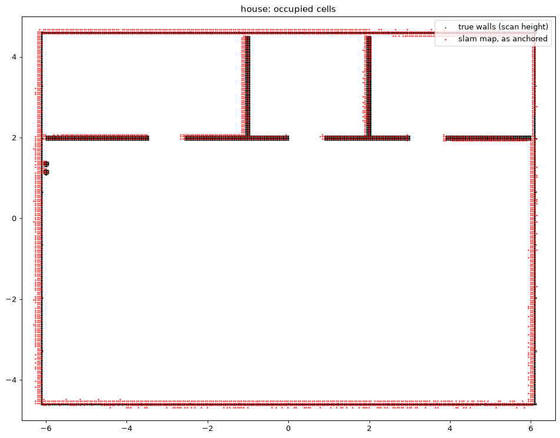
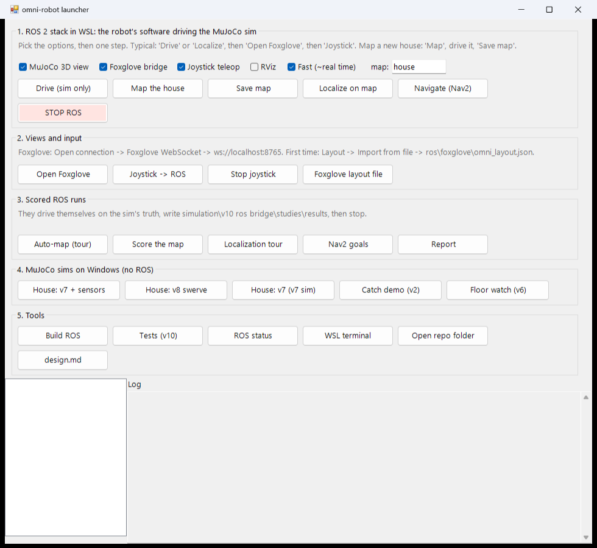
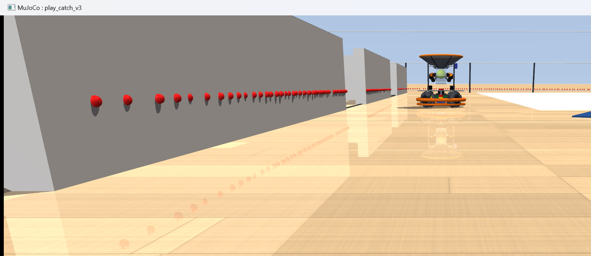

# v10: the sim as a ROS 2 robot

v10 is v9 (the v7 home-floor base in the house, its sensors, v9's estimator) plus a bridge to **ROS 2 Jazzy in WSL2**.

- MuJoCo keeps the physics. A ROS node publishes the robot's sensors and takes `/cmd_vel`, so `robot_localization`, `slam_toolbox`, Nav2, RViz and Foxglove run against it unchanged. No Gazebo is involved.
- The sensor models are now the parts Fernando chose: the **RPLIDAR A2M12** and the **BNO085**.
- The ROS packages themselves live in the repo's top-level [`ros/`](../../ros/README.md) (monorepo); this folder is the sim side.

Numbers and decisions: [../../design.md](../../design.md) section 28. Everything here is **proposed**, and every result is simulated, not measured.

> **⚠ Jetson caveat (VERIFY):** the Jetson Orin's JetPack 6 is Ubuntu 22.04, and ROS 2 Jazzy needs Ubuntu 24.04. So on the Orin, Jazzy either runs in Docker (as design.md section 5 already plans), or waits for a JetPack 7 release for the Orin, if one exists by then. Check NVIDIA's release notes before relying on a native install.



**Results in one place** (3 sensor seeds):

- **Map:** 2.1 cm median wall error (95%: 9.9 cm), every wall found. This takes two scan fixes, which the real robot will need too (`omni_perception/scan_prep`):
  - drop floor returns: a 1.2°-tilted A2M12 13 cm up sees the floor at 6.4 m;
  - de-skew: slam_toolbox doesn't.
- **Localization** on v9's house tour, all estimators on the same readings:

  | Estimate | Median / 95% |
  | --- | --- |
  | slam_toolbox + robot_localization | 9.0 / 13.2 cm |
  | v9's known-map matcher | 1.3 / 2.4 cm |
  | robot_localization alone (wheels + BNO085) | 13.5 / 42.8 cm |
  | v9's wheels + IMU EKF | 19.7 / 52.5 cm |

- **Nav2:** 24 of 24 goals through every door and onto every rug, ~100 s per round of 8, ending a median 9 cm from the goal.
- **Speed:** with `fast` (the default for driving), the whole interactive stack runs at ≈ 0.95–1.0× real time, MuJoCo view and Foxglove included. Without it, 0.6–0.7×. Everything runs on sim time (`/clock`) either way.

## Run it: the launcher

Double-click **`Launcher.cmd`** in the repo root. To look at the sim: tick the options, click **Localize on map** (or **Drive**), then **Open Foxglove**, then **Joystick → ROS**. That's three clicks.



- The **MuJoCo 3D view** is MuJoCo's own window of the running sim, drawn on Windows (`ros/tools/mujoco_view.py`; the bridge starts it and streams the state at 30 Hz). It follows the robot (drag to orbit, scroll to zoom), and the red dots are where the lidar's rays hit.
- **Foxglove:** *Open connection → Foxglove WebSocket → `ws://localhost:8765`*.
  - The first time, *Layout → Import from file →* `ros/foxglove/omni_layout.json`. That gives a 3D view (SLAM map, filtered scan, the true house, the robot where the stack thinks it is), a status panel, and a **Teleop panel to drive without the stick**.
  - Click in the 3D panel (publish pose) to send Nav2 goals.
- **The stick:** hold the **thumb button** (the dead man) and push to drive at up to 1 m/s; add the **trigger** for 2 m/s. Twist the stick to turn. Let go and the firmware ramps the base to a stop.
- Each job's log shows in the launcher's bottom panel (files in `logs/`). **STOP ROS** stops everything.



The same steps from a terminal, and every argument: [`ros/README.md`](../../ros/README.md).

## One-time setup (done on this PC)

```powershell
wsl --install Ubuntu-24.04 --no-launch      # WSL2 itself was already there (Docker Desktop); no admin, no reboot
wsl -d Ubuntu-24.04 -- bash "/mnt/c/Dropbox/Personal Projects/Robotics/omni-robot/ros/setup/install_wsl.sh"
```

It installs ROS 2 Jazzy desktop, colcon, slam_toolbox, robot_localization, Nav2, foxglove_bridge and joy/teleop, plus `~/.venvs/omni-ros` with MuJoCo 3.16.0, the same version as the Windows venv.

## Scored runs and tests

From the launcher (section 3), or `bash ros/omni.sh auto-map | score-map house | tour seed:=0 out:=ros_tour_s0 | goals seed:=0 out:=ros_nav_goals_s0`. Then `studies/ros_report.py` (Windows venv) prints the tables in design.md 28.

- Several runs can go at once on different ROS domains: `ROS_DOMAIN_ID=41 bash omni.sh tour ...`.
- The scored steps keep v10's published settings: firmware every 0.5 ms step, lidar in 1 ms batches.

**Tests** (no ROS needed): `& $py -m pytest -q` here on Windows, or `bash ros/omni.sh test` in WSL. They are v9's checks plus the A2M12, BNO085, bridge core and map scorer.

## What the bridge publishes (`bridge_core.py` here, `ros/src/omni_sim/omni_sim/bridge_node.py`)

| Topic | What | Rate (sim) |
| --- | --- | --- |
| `/clock` | sim time (every other node: `use_sim_time`) | 250 Hz |
| `/scan` | A2M12, one turn of 1,600 samples; stamp = first sample, `time_increment` 62.5 µs | 10 Hz |
| `/imu` | BNO085: game rotation vector, gyro, accelerometer (with gravity) | 400 Hz |
| `/odom` | wheel odometry with covariance (slip-aware) | 50 Hz (est) |
| `/tf`, `/tf_static` | odom → base_link (when no EKF runs), base_link → laser, imu_link; map (or odom) → world | |
| `/sim/house`, `/sim/robot` | markers: the true house, the robot at its estimate (blue) and its truth (green) | latched / 10 Hz |
| `/ground_truth/odom`, `/v9/*/pose`, `/sim/origin`, `/sim/phase`, `/sim/status` | for scoring and the status panel | |
| `/lidar/tilt_cal` | the lidar's scan-plane tilt as a bench calibration would give it | latched |
| `/cmd_vel` (in) | body twist → `Robot.drive_velocity` (the firmware's limits and terrain caps apply); none for 0.5 s → ramped stop | |

## Files (new or changed from v9)

| File | What |
| --- | --- |
| `sensors.py` | `SensorConfig.parts("BNO085", "A2M12")`, plus:<br>• the full 3-axis IMU report and the game rotation vector<br>• range-band lidar noise and the scan-plane tilt (floor hits)<br>• scans cut at whole turns<br>• `lidar_cast_dt` batching, with each ray turned back by the robot's rotation since its own sample time<br>• the lidar clock starting at the current time (v9's first scan could span several turns) |
| `bridge_core.py` | new: the sim side of the bridge, no ROS (physics, sensors, wheel odometry, cmd watchdog, v9's tour, v9's estimators in shadow, firmware rates) |
| `robot.py` | `drive_velocity` / `drive_to` take the controller's own `dt`; `floor_div` / `post_div` run the floor hooks and electrical bookkeeping less often (default 1 = every step, as v9) |
| `map_quality.py` | new: a SLAM map against the true house (wall error, coverage, per-wall offsets, best SE(2) fit) |
| `models.py`, `omni_control.py` | scalar `np.clip` → a plain-Python clip (same results, faster) |
| `studies/ros_report.py` | the tables from `studies/results/ros_*.json` |
| `test_v10.py` | v9's checks + A2M12 turns and noise, floor hits, BNO085 drift, bridge events / odometry / ramped stop, map scorer |
