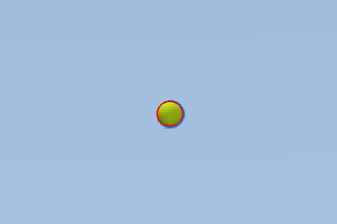

# v11: the robot's own code in the loop

v11 is v10 (the v7 robot, its sensors, the ROS 2 bridge) running the code that will run on the robot, instead of the sim's stand-ins for it:

- **The MCU firmware.** The Teensy 4.1's C++ core (`../../firmware`) runs inside the sim every 1 ms of sim time: software in the loop (SIL).
  - The sim talks to it only through what the Teensy's pins would carry: raw CAN frames to and from the four DM-2325s, BNO085 reports, DShot eRPM, the RoboClaw's and the servo's readings, the beams.
  - The Jetson side talks to it only through USB bytes.
- **The Jetson's catch code** (`../../ros/src/omni_catch`, `omni_mcu`): the colour-blob detector on camera pixels, the tracking filter on the MCU's odometry and attitude, the catch behaviour, the modes, the MCU link with time sync. It runs here in one process (`sil_game.py`) and as ROS nodes (`ros/omni.sh catch`).
- **What stays the sim's:** the world (physics, the thrower, the cameras' image formation, the parts' own loops inside the motors, ESCs and servos) and the truth used for scoring.

Numbers and decisions: [../../design.md](../../design.md) section 30. Everything is **proposed** and simulated, not measured.

## Results in one place

**The same 216 throws** (the 6-7 m catch game, home_floor B's grid, firmware adult, expected cameras, flat floor), played two ways (`studies/sil_catch.py`):

| | Caught | Not in place / bounced | Funnel offset median / 95% |
| --- | --- | --- | --- |
| The sim's own game (Python firmware on the true pose, perfect timing) | 93.1% ± 1.7 | 14 / 1 | 2.2 / 29.5 cm |
| **SIL: C++ firmware, the MCU's odometry, the Jetson's code** | **90.3% ± 2.0** | 16 / 5 | 2.5 / 33.0 cm |

By apex: 0.75 m 83 → 76%, 1.0 m 96 → 89%, 1.5 m 93 → 96%, 2.0 m 100 → 100%. Zero link errors; the time sync holds the MCU's clock to ~0.2 ms.

**Through ROS** (`omni.sh catch-score`, two runs of 24 throws at 6.5 m, return throws on): 41 of 48 caught (85% ± 5) at ≈ 1.0× real time. The returns landed a median 25 cm from the thrower's hands. Perception: 1.1 ms per stereo pair.

**The house through the firmware:** 0.5 m/s on `/cmd_vel` for 4 s drove 2.08 m, and the MCU's odometry said 2.10 m.

**Rendered images** (`studies/rendered_frames.py`, 6 throws): the same detector on MuJoCo-rendered 1280 × 800 frames finds the ball in as many frames as on the sparse ones, with its centre 0.11-0.12 px from the truth, and the filter's rim-crossing prediction agrees within a few mm. Rendering costs 2-5 ms per frame on this PC's GPU.



## Run it

- **Any variation on Windows:** `Launcher.cmd` → group 4 *Catch game on Windows*: pick the scene (house / arena), the cameras (rendered / sparse), the acquisition, the thrower distance, apex range, throws and seed, then *Play catch*. *Study: run the grid* runs the 6-7 m grid with the same options, *Study report* compares everything run so far, *Camera pictures* and *House overview* write `renders/`.
- **Watch it on Windows:** `Launcher.cmd` → *Catch: firmware + robot code* (`sil_game.py --view`: MuJoCo's window at real time, the log in the launcher).
- **On ROS:** `Launcher.cmd` → *Play catch* (with the MuJoCo view and Foxglove), or `bash ros/omni.sh catch dist:=6.5`. *Catch score (24)* writes `studies/results/ros_catch.json`.
- **The house** (`sim`, `map`, `localize`, `nav`) also runs through the firmware now (`firmware:=true`, the default): `/cmd_vel` → mode_manager → mcu_link → the firmware, and `/odom`, `/imu` come back from the MCU.

```powershell
& $py sil_game.py --returns --tosses 6                  # in one process, verbose
& $py studies\sil_catch.py both                         # the 216-throw comparison (~3 min on 27 workers)
& $py studies\rendered_frames.py --throws 6 --png       # the detector on rendered frames
& $py house_scene.py fetch                              # once per PC: the house's CC0 textures (Poly Haven)
& $py sil_game.py --view --frames rendered --scene house    # the robot's code on rendered images (~0.06x real time)
& $py studies\rendered_catch.py run --frames rendered --seeds 1 --workers 12    # 72 throws, ~10-20 min
& $py studies\rendered_catch.py run --frames sparse --seeds 3  # the same 216 throws on sparse frames (~1 min)
& $py studies\rendered_catch.py report                  # every variation run so far
& $py studies\rendered_catch.py pictures                # camera frames with the detector's blob + the overview
& $py robot_export.py                                   # after a change to params / catalog / the model
& $py sil_game.py --returns --tosses 6 --log logs\      # + a session log in the robot's own format (omni-log/1)
& $py sil_game.py --returns --pass-game --tosses 6      # two throwers taking turns: the pass game
& $py studies\replay_log.py <log.jsonl>                 # a session's throws thrown again in the sim (--demo: end to end)
& $py studies\detector_speed.py --rendered              # the detector's C++ pixel loops against numpy
& $py -m pytest -q                                      # 94 checks (~3.5 min)
```

Fault injection (`faults.py`): `FaultInjector(robot).inject("link" | "motor" | "battery" | "estop" | "bumper" |
"imu" | "flywheel", on, seconds)`; `SimLink.faults` drops the link's bytes. On ROS the bridges take
`{"kind", "on", "s", "motor"}` on `/sim/fault` (the console's System tab in the sim) and list what's active on
`/sim/faults`.

The house textures are CC0 photos from Poly Haven (`house_scene.POLYHAVEN`: asset names, the 1k diffuse JPGs, md5-checked against Poly Haven's API, recoloured where noted). They live in `assets/house/` (not in git, ~28 MB; `SOURCES.md` there lists URL and md5 for each). Without them the house builds with flat stand-ins and says so.

## Files (new or changed from v10)

| File | What |
| --- | --- |
| `sil_robot.py` | new: `SilRobot`, the robot with the C++ firmware in the loop; `DmMotor` (the DM-2325's CAN port: enable / clear / errors, 12-bit velocity and 16-bit position feedback, comm-loss timeout); `EscMotor` (throttle in, DShot eRPM resolution out) |
| `sil_link.py` | new: the USB link in one process, with latency, for the harness and tests |
| `catch_world.py` | new: the world for the catch game, with none of the robot's code: thrower (the same throws as `shallow_sweep.HumanToss` for a seed), the cameras' frames per pixel (blur, edge noise, occlusion, calibration error, clutter, latency) as sparse frames, truth scoring |
| `sil_game.py` | new: world + firmware + the Jetson's code in one deterministic process (`--view` for MuJoCo's window) |
| `robot_export.py` | new: writes `firmware/lib/omni_fw/fw_params.h` and `ros/src/omni_catch/omni_catch/config/robot_v11.json` from `SimParams` (the V11 robot: v7 base, v6 round-3 module, section 24's actuators) |
| `bridge_core.py` | `firmware=True`: the house with `SilRobot`; IMU and odometry go via the MCU |
| `studies/sil_catch.py` | new: the comparison above (`ref`, `sil`, `both`, `report`) |
| `studies/rendered_frames.py` | new: the detector and filter on MuJoCo-rendered frames |
| `house_scene.py` | new (31): the house around the field (room, windows, furniture, people, ball-coloured clutter, garden, lights), decoration only; `fetch` the textures, `overview` |
| `rendered_camera.py` | new (31): `RenderedCameraSim`, the stereo cameras as images: MuJoCo renders with the per-run calibration error, sync offset and ball size, motion blur from sub-exposure renders, the sensor model (vignetting, shot and read noise, 10-bit, gamma) |
| `params.py`, `robot_model.py` | `SimParams.scene` ("arena" default, "house") |
| `catch_world.py` | + `WorldConfig.scene / frames / sensor`; `CameraSim.truth` (where the ball really projects, for scoring); the thrower shows the next ball in the hand (house) |
| `sil_game.py` | + `--frames`, `--scene`, `--acquire`; `PerceptionScore` (the detector against the truth); the viewer shows the left camera |
| `studies/rendered_catch.py` | new (31): the grid on rendered vs sparse frames; `report`, `pictures` |
| `test_v11.py` | v10's checks + protocol and codec cross-checks, time sync, ramped stop on link loss, DM-2325 comm-loss recovery, bumper, e-stop, the fire interlock, the kid profile, DShot resolution, the detector, the robot config against the sim, `catch_plan` against the sim's game, a short game through the whole stack, the pin map; Oct 22: every injected fault through the console's core, the C++ detector against numpy, a session log written and replayed, the pass game, the walking person in the lidar |
| `faults.py` | new (Oct 22): fault injection on `SilRobot` and the link (link, motor, battery, e-stop, bumper, IMU, flywheel telemetry) |
| `sil_robot.py`, `sil_link.py` | + per-motor CAN cut, forced battery voltage, IMU and flywheel-telemetry cut-offs; the link drops bytes while a fault says so |
| `catch_world.py`, `sil_game.py` | + `WorldConfig.throwers` (the pass game), `scripted` (replayed throws); `--log`, `--pass-game` |
| `params.py`, `robot_model.py`, `bridge_core.py` | + `SimParams.person`: a mocap person whose legs the lidar sees; `CoreConfig.person` and `Walker` walk them ahead of the start |
| `studies/replay_log.py`, `studies/detector_speed.py` | new (Oct 22): a session log's throws replayed in the sim; the C++ detector timed against numpy |
| `sil_robot.py`, `sil_link.py`, `bridge_core.py` | design.md 10: `SilRobot(timing="real")`: the MCU's crystal error and wander, the CAN bus's reply timing (`DmBus`), IMU samples at their own times, the SYNC_OUT / CAM_TRIG / strobe edges the firmware schedules; `SimLink(latency_up=, latency_down=, gpio="hte" \| "irq")`: an asymmetric USB path and the Jetson's GPIO stamps of the sync pulses; `CoreConfig.timing`. Defaults ("ideal", symmetric, no GPIO) reproduce earlier results |
| `robot_export.py` | + `frames()`: every fixed frame on base_link (REP-103 optical frames) into `robot_v11.json`; `fw_params.h` + SYNC_PERIOD_US, CAM_TRIGGER_HZ, DM_SAMPLE_TO_RX_US |
| `tag_sim.py` | new: AprilTags on the house's walls (`TagWorld`) and the left camera's detections of them (`TagCamera`: visibility, size, angle, occlusion, blur, corner noise, misses, misdecodes) |
| `studies/tag_slam.py` | new: v9's house tour with odometry, tags + odometry, the lidar matcher and lidar + tags (camera refined), a 15 s lidar gap, the tag map, relocalization by votes (`results/tag_slam.json`) |
| `test_v11.py` | + the BNO085 report parser, exact sync / trigger schedules, CAN reply timing, the clock map through the link (HTE, IRQ, echo-only), wheel speeds on real timing, the frames file against REP-105 and calibration bounds, odom jumps, camera stamps from triggers, de-skew and its time order, the scan clock |
| `arm_so101.py` | new (design.md 11): an SO-101 arm (the official model, STS3215 12 V servos, `ArmServos`) for `SimParams(payload="arm")`; `fetch` its meshes |
| `params.py`, `robot_model.py`, `robot.py`, `sil_robot.py` | + `payload` ("catch" default, "arm": no tilt, funnel, feed or launcher, the arm on the plate at `arm_mount`), `arm_payload_kg`, `extra_masses`; Robot and SilRobot step the arm's servos |
| `arm_view.py`, `studies/arm_study.py` | new: watch the arm robot; its reach, static tipping, stops, swings, floor edges, the firmware check, fixes (`results/arm_study.json`, `arm_reach.png`) |
| `test_v11.py` | + the arm replaces the catch module, holds the official zero pose and slews at servo speed, the firmware drives the arm robot |
| `params.py`, `robot_model.py`, `arm_so101.py` | design.md 11, Oct 24 (the picking arm robot): `arm_mount_z` (a low nose bracket), `arm_pick` (finger pads that grasp, fingertips on the floor, the wrist camera; the self-view boxes), `arm_bin` (+ the display behind it), `lidar_mount="rear"`, `camera_mount="nose_pods"` + `camera_pod_xz`, `floor_objects`; `POSES["pick_stow"]`, `gap_at` |
| `arm_objects.py` | new: loose things on the floor (box, cylinder, puck, sphere; `CATALOG`, `SETS` toys / clutter, `scatter`) |
| `arm_bus.py` | new: the six STS3215s' side of the bus (`ServoBusSim`, with a per-joint calibration error) and its TCP port (`ServoPort`) |
| `sil_pick.py` | new: the tidy in one process (firmware, link, mode mux in PICK, `omni_arm` on the emulated bus, depth and wrist renders), `--world arena \| house`, `--view` |
| `robot_export.py` | + `ARM`, `arm_params()`, `arm_json()` → `ros/src/omni_arm/omni_arm/config/robot_arm.json`; `frames()` puts `arm_mount` on the arm's adapter for the arm robot; writes only the files that changed |
| `bridge_core.py`, `house.py`, `robot.py` | + `CoreConfig.payload / objects / n_objects / joint_err_deg` (the arm world: `arm_kw`, `ARM_AREA`); no ball loading without a catch module; the picking arm starts at `pick_stow` |
| `studies/arm_mount.py`, `studies/arm_pick.py` | new: where the arm goes (floor reach, bin drop, stow; `results/arm_mount.json`); the tidy scored over seeds, sets and worlds (`results/arm_pick.json`) |
| `test_v11.py` | + the pick robot's layout, `omni_arm`'s kinematics against MuJoCo's, the driver through the emulated bus, the arm-out caps, a grasp in physics, a whole tidy through the stack |
