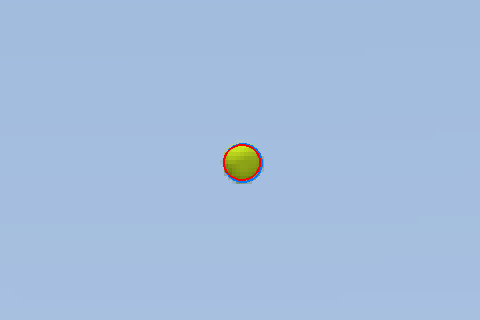

# v11: the robot's own code in the loop

v11 is v10 (the v7 robot, its sensors, the ROS 2 bridge) running the code that will run on the robot, instead of the sim's stand-ins for it:

- **The MCU firmware.** The Teensy 4.1's C++ core (`../../firmware`) runs inside the sim every 1 ms of sim time: software in the loop (SIL).
  - The sim talks to it only through what the Teensy's pins would carry: raw CAN frames to and from the four DM-2325s, BNO085 reports, DShot eRPM, the RoboClaw's and the servo's readings, the beams.
  - The Jetson side talks to it only through USB bytes.
- **The Jetson's catch code** (`../../ros/src/omni_catch`, `omni_mcu`): the colour-blob detector on camera pixels, the tracking filter on the MCU's odometry and attitude, the catch behaviour, the modes, the MCU link with time sync. It runs here in one process (`sil_game.py`) and as ROS nodes (`ros/omni.sh catch`).
- **What stays the sim's:** the world (physics, the thrower, the cameras' image formation, the parts' own loops inside the motors, ESCs and servos) and the truth used for scoring.

Numbers and decisions: [../../design.md](../../design.md) (history §30 for the catch-era text above). Everything is **proposed** and simulated, not measured.

**Current use (Nov 17): the arm robot.** The description above is v11 as built for the catch robot; today v11 is the active
simulator for the arm robot (design.md 5). Use `robot_export.ARM` / `ARM_D435` (`arm_params()`; the D435 on the arm riser is the
arm robot's only camera). Defaults since the bench work: the AK40-10 drives in servo mode (`AkMotor`), refit to the Nov 13 bench
with its 5.5 ms command latency (`SilRobot(ak_latency=)`, 0 reproduces earlier runs); the **RPLIDAR A2M8** lidar
(`lidar_part="A2M12"` / `lidar:=a2m12 map:=house_a2m12` reproduce earlier runs) stamped as the robot's `rplidar_node` does (`lidar_stamp:=clock`;
`sllidar` reproduces Nov 16); realistic D435 depth errors (`d435_noise:=ideal` reproduces earlier runs); the CAD's 687 rollers
(below). The baselined pack is now the HRB 6S 3300 (design.md 2), but the sim still models the OVONIC (next paragraph) until the
HRB is in `catalog.py`. The catch results in "Results in one place" are the parked catch robot's.

Nov 1 battery update: the default is `6S1P-OVONIC-5200` (OVONIC Roam 6S 5200 mAh XT90-S, 25.2 V full).
Sag, recovery and charge depletion use the existing battery model with a separate, explicitly estimated LiPo fit
in `catalog.py`; pack resistance and the discharge curve have not been measured. Complete pack mass is 706 g
(maker claim), with no extra packaging multiplier. No BMS current trip is assumed; the generated firmware's
provisional low-voltage stop is 21 V. Plan runtime with a 20% reserve. The results below predate this change;
use `battery="7S1P-P50B"` explicitly to reproduce the previous battery, or another catalog key for comparisons.

**Nov 12 (Fernando): the arm robot's rollers are the CAD's.** `robot_export.ARM` (and `ARM_D435`) now rolls on
`catalog` `"Printed-140-2x6-687-v13"`: cad/v13's bearing-roller wheel as `wheel_quiet_2` draws it. That means rows at ±17.25 mm,
a 19.5 mm tread half-length, the R2 end round and the 0.2 / 7 mm tip relief, built by `assets.roller_drawn` (its radius matches the CAD's sections
to 1 µm, `test_the_arm_robots_rollers_are_the_cads`). Each roller turns on two 687s, so `roller_pin_mu` is 0 (the v10 PLA-on-M3
rollers had 0.3). Only `wheel_model="rollers"` sees the shape; the default sphere wheel is unchanged. `V10` keeps the v10
wheel for reproduction, and the firmware header did not change (same wheel radius). Not redone on the new rollers: earlier
roller-model studies (terrain crossings, `wheel_wobble.py mj`).

## Results in one place

**The same 216 throws** (the 6-7 m catch game, home_floor B's grid, firmware adult, expected cameras, flat floor), played two ways (`studies/sil_catch.py`):

| | Caught | Not in place / bounced | Funnel offset median / 95% |
| --- | --- | --- | --- |
| The sim's own game (Python firmware on the true pose, perfect timing) | 93.1% ± 1.7 | 14 / 1 | 2.2 / 29.5 cm |
| **SIL: C++ firmware, the MCU's odometry, the Jetson's code** | **90.3% ± 2.0** | 16 / 5 | 2.5 / 33.0 cm |

By apex: 0.75 m 83 → 76%, 1.0 m 96 → 89%, 1.5 m 93 → 96%, 2.0 m 100 → 100%. Zero link errors; the time sync holds the MCU's clock to ~0.2 ms.

**Through ROS** (`omni.sh catch-score`, two runs of 24 throws at 6.5 m, return throws on): 41 of 48 caught (85% ± 5) at ≈ 1.0× real time. The returns landed a median 25 cm from the thrower's hands. Perception: 1.1 ms per stereo pair.

**The house through the firmware:** 0.5 m/s on `/cmd_vel` for 4 s drove 2.08 m, and the MCU's odometry said 2.10 m.

**Rendered images** (`studies/rendered_frames.py`, 6 throws): the same detector on MuJoCo-rendered 1280 × 800 frames finds the ball in as many frames as on the sparse ones, with its centre 0.11-0.12 px from the truth, and the filter's rim-crossing prediction agrees within a few mm. Rendering costs 2-5 ms per frame on this PC's GPU.



**Arm robot colours (Nov 13):** the arm robot is drawn in the baselined filaments (`filament.py`, `SimParams.colours="auto"`; cad/v13 README
"Filament colours"):

- grey SO-101
- white decks, bin, riser and adapter
- orange hubs and bumper
- black TPU rollers

`colours="legacy"` reproduces the earlier yellow arm and orange bin; the catch robot is unchanged. Perception before → after on the same
tree: colour_scene identical for both cameras; test_color_vision 18/18; the tidy 105 → **108/120** (missed grasps 19 → 3: the yellow jaws
no longer in the wrist camera's view). The same tidy scored 112/120 on Nov 7; the tree drifted to 105 before any colour change. Details:
`studies/results/filament_colours_2026-11-13.md`.

**The arm load calibration on the detailed arm (Nov 20, design.md 4.5; est physics, no servo measured).** `arm_model="detailed"` (`arm_detailed.py` under `servo_emulator.py`) with its truth drawn per seed; the robot's C++ driver on the emulated bus; omni_calib's procedure with a simulated person (`sim_human.py`); then the same arm tested with the driver legacy / on the datasheet model / calibrated (`studies/arm_load_cal.py`, 3 seeds, `studies/results/arm_load_cal.md`):

| | legacy | datasheet model | calibrated |
| --- | --- | --- | --- |
| False reflexes in 25 tidy-speed moves | (no reflex) | 23-24 | 0 |
| A 3 kg box pressed by the fingers: force when it stops | never (24-25 N) | 19-21 N, ~0.6 s | 11-12 N, ~0.4 s |
| A sideways push on the fingertip: force when it stops | never | 7-9 N | 5-6 N |
| Still torque error / a 0.2 kg weight's force error | 0.19-0.28 N m / 2.5-2.8 N | the same | 0.10-0.18 N m / 1.7-1.9 N |
| Reach (fingers-down points), mm rms | 6-10 | 3.5-7 (the hold trim) | 4-6 |

The same procedure ran through ROS (`omni.sh arm arm_model:=detailed`, `ros/tools/sim_arm_cal_human.py` pressing Calibrate's button and answering through the console); its first run was refused by the pass limit then set at 1.0 N for the weight (it read 1.19 N), since raised to 1.5 N.

**Opening a floor-level cabinet door (Nov 21, design.md 4.5; proposal, est hinge and grip).** `cabinet.py`'s base cabinet with a low vertical bar pull; omni_arm `door.DoorTask` on the detailed arm with its calibrated load model, the C++ driver, the firmware SIL and the mode mux; the door told to the robot off by 10 mm / 1° (1σ). 24 runs (`--given`, `studies/results/door_open_given.md`): 21/21 opened to 90° and stayed open (88–95°), hinged either side, 1–4 N m at shut, pull μ 0.4–0.7, peak pull 4–13 N; a locked door let go at 29 N (3/3). **Found by its AprilTag (Nov 21, the default):** a 48 mm 36h11 tag at the door's bottom edge under the pull (the riser D435 sees nothing on a door above ~0.18 m), the D435's infrared at 480 x 270 through the real C detector, the face's heading from its depth; the robot started facing the door or turned away (to 180°) 0.78–0.88 m off: 20/21 opened (one never saw the tag: from 0.88 m it is at the image's top edge, row 4 of 270), the locked 3/3 let go, the looks ≤ 6 mm and ≤ 0.26° off (`studies/results/door_open.md`). The tag's own heading at 20 px is 3–5° off: the depth's face fixes it. The forward IMX662 (`--finder imx662`, design.md 4.12) with an 80 mm tag beside the pull, 0.30 m up, from 1.4–2.1 m: 21/21 opened, the far look ≤ 18 mm / 1.8°, the close look ≤ 6 mm / 0.24° (`studies/results/door_open_front.md`). The pull is read from the drive currents (`W = Jᵀτ`, AK40-10 0.48 N m/A est): the arm's load model reads a locked door's 29 N as 12 N, the driver's tool force (0 inside the friction band) 6–13 N.

**The home (Nov 24): the real house, for testing (`world:=home`).** The single-storey house from its permit drawings (sheet A-1 of the patio permit set, 1/4" = 1'-0", vector): `home_extract.py` reads the sheet's paths once into `home_plan.json` (checked in; the sim never needs the PDF), `home.py` builds the world from it. From the drawings, measured: 114 wall boxes at their drawn thickness (the outline 19.18 x 19.85 m against 63 x 65 ft), 18 hinged doors (hinge, width 0.48-0.92 m, swing from the drawn arcs and leaves; the den's two French pairs), the den's sliding glass door, 24 windows (sill, glass, head), the bathrooms (toilets, tubs, shower, vanities), laundry (washer, dryer, counter), kitchen (counter runs, island, fridge, oven tower, two cooktops), the double-sided fireplace and its built-ins, closets (bifold / bypass doors shut, pocket doors open). **est:** heights (walls 2.44, sills 0.91, heads 2.03 m), tile in the wet rooms and the kitchen (friction 0.85 there), the furniture (`home._furniture`: plausible pieces in plausible places, to be replaced by the real ones), bathroom 2's chamfered corner piece (a tub or a bench). Inner doors open as drawn, outer doors shut (`doors:="front=1,bedroom 1=0"` changes them). **Floors (Fernando, Nov 24):** the family room is raised 68 mm: at both its entries a 0.5 in square step, then a 20° ramp over 6 in (`floor.Platform`, `floor.Ramp`; the run taken as horizontal); the robot climbs and descends both at 0.5-1.5 m/s, pitching to ~20-22° for a moment (the short ramp under a 0.4 m wheelbase). A square rug centred in the living room, 0.375 in (9.5 mm) thick (Nov 25; 8 x 8 ft, square edges: est). Both are floor edges in `maps/home.places.json` (the console's slow bands). The robot and toys spawn on the local floor (`floor.height_at`). **The den is off limits:** 165 mm down (the sheet's "-6.5""). The cameras see the real drop (Nov 25): in this world the physics floor plane is group 3 (not drawn) and the drawn floor is planes round the den plus the den's own floor 165 mm under the family room's, with skirts, so the D435 measures the step (fed through `omni_arm.height_map` it is a drop from ~0.6-0.8 m out, measured 165-175 mm down). The physics floor is still one plane, so an invisible barrier just inside the doors (group 4) stops the body where it would have gone over the edge; the bridge warns once per arrival on the log and `/sim/status` (`hazard`), and `maps/home.places.json` holds the den as a no-go zone. `maps/home.yaml` is the drawings' own occupancy map at the A2M8's 0.15 m scan plane (`home.py --map`), its frame the robot's start (the family room, facing east), for `localizer:=amcl` (the sim's scans land within 5 cm of it at 98-100% of returns at 8 poses); slam_toolbox's localization needs a session mapped there and saved as `home`. **Explore here (Nov 25, sim, arm step, new map, radius 20 m): the den is avoided, the ramps are crossed, the coffee table still traps it.** Before the fix it never left the family room: the raw depth layer sees no drop (a new map has no no-go zones, so it drove to the den's step), and the height map called the floors past the ramps (68 mm lower) drops too. Now (`depth_layer:=height`, the default): a lower floor joined to the robot's by a walkable surface is floor; one past a hidden edge is a suspected drop (unknown, 0.2 m/s near it) until the camera sees the edge from within 0.4 m, where a 20° ramp would show; frames whose floor fit isn't the robot's own floor are skipped (near a ramp's top the fit took the floor past it and heights were 100 mm wrong). Scripted drives (0.2 m/s, D435 into `height_map`): the den confirmed a drop with the robot 0.59 m from the step (camera 0.39 m), suspected from ~1.3 m; both ramps down and the hallway ramp up with no drop and nothing across the doorway, the raised floor seen from below a step. Explore (20 min): 83 m2 mapped, 34% of the house's free floor without the den (14% before): family room 95%, hall 62%, bedroom 2 95%, its closet 95%, bathroom 2 51%; never in the den (no hazard), ~150 s spent near its doors on the lidar's den frontiers. The east half (hallway, kitchen, living, dining) wasn't reached: heading for the hallway ramp it drove under the coffee table (est furniture, top 0.49 m) and stuck there for the last ~4 min; the lidar sees only its legs, and the D435 nothing above 0.17 m (it sits at 0.19 m, the top of its field 1° under the horizontal): driven at the table, all 232 cells under the top read as floor and the robot hit the top at x -0.91. That table is gone since (Fernando's call; `home.py`, `maps/home` regenerated; the living room's stays). Then, whole house (radius 20 m, 50 min cap, five runs): a run where the SIL arm never read as stowed had the height map skip every frame (`/arm/out`) and drove to the den's edge, pinned there by the invisible barrier while its SLAM pose ran 7 m into the den on wheel slip; Explore now stows the arm, waits for the floor camera and stops when it goes blind (console). The new jam check first fired falsely twice (the console's wall clock against the sim's ~0.35x time; a frontier route ~3x the straight line) and now runs on the robot's clock with Nav2's route length. The last two runs mapped 84 and 88 m2 (family room 94%, hall 56%, bedroom 2 96%, its closet and bath 95%; 35% of the house without the den; den never entered) and ended Stuck: Nav2 found no path because the SLAM map holds a phantom wall one cell wide across the doorway ~0.6 m past a ramp's foot (the hallway ramp in hm7; the hall ramp in hm6), what a lidar pitched 20 degrees on the ramp would draw from the floor; scan_prep's IMU floor filter should have dropped it. It missed for three reasons, all fixed: the bridge's `/lidar/tilt_cal` height was the lidar's absolute z (the robot starts on the family room's raised floor: 0.228 m, not 0.163 above the floor under it, so every predicted floor hit was 40% too far); one IMU pitch, the latest, served the whole turn, which arrives ~0.2 s late while a ramp swings the pitch 20 degrees in 0.3 s (now each sample's own, omni_cpp `TiltHistory`); and the laser 0.14 m ahead of base_link comes down ~5 cm nose-down (now in the predicted height). Driving the hallway ramp's crossing offline and tracing every return to its hit: 1063 floor returns kept before, ~10 after. hm8 then mapped 161 m2 (73% of the house without the den; kitchen 65%, dining 93%, living 95%, entry 98%; den never entered), crossing both ramps ~5 times with the SLAM pose within 0.2 m, until slam_toolbox jumped 3.9 m sideways in the long hallway at truth x 5-7 and Nav2 found no path home: a loop closure matched it onto the corridor to the south after only 0.16 m of odometry drift. A closure's coarse match searches +-half of `loop_search_space_dimension` (8 m by default) around the robot's estimate; it is now 2 m in both slam configs, so a closure moves the robot at most ~1.25 m. hm9 (2048 s): SLAM within 0.18 m of the truth all run (median 0.03 m), 79% of the house without the den mapped (den 77% seen from outside, never entered), ended by the jam check after 90 s in bathroom 1 and drove itself home. That stall was algorithmic: MPPI hovered 0.17 m short of a frontier goal in its inflation (the goal tolerance is 0.10 m); the robot drove off at once toward home. Explore now takes a frontier goal as reached after 8 s within 0.3 m (at once cut a new map's 0.5-0.7 m goals short and hm10 quit at 2 m2), skips an opening once when stalled within 0.6 m of it, and takes the height map's drops and floor obstacles as walls (hm11 chased den openings: the lidar maps the den's floor free past the drop). hm12: 23 min, no jam, no den entry, SLAM within 0.11 m, 78% mapped, then nothing left inside `explore.radius` (10 m; the kitchen and back hall are 11.3 m from the start; now 15 m). Its drive back found no path: the height map had marked the hallway ramp (map x 3.2-3.35). Cause (hm13, Nov 26): each frame's heights were relative to the floor under the robot, so the raised family room and the hallway were stored 68 mm apart and the ramp, seen from both, read as an edge. `omni_arm.height_map` now registers every frame onto the map's datum (the median height difference over the smooth cells both see, needing 30; a frame agreeing within 12 mm on under half of them is dropped, ~0.1-0.2% of frames), judges relief within 0.15 m of a second floor against the higher floor around it (`base_hi`; the raised floor's rough edge read as an obstacle), and never marks an obstacle or drop within 0.29 m of the robot (it boxed itself in beside the family room's sofa). Explore, hm14-hm27 (each a fresh map, 6600 s wall at most, `explore.max_time` 40 min in the probe): the blacklist now excludes a failed spot, not its whole opening (whole openings vanished and the kitchen, back hall, pantry and bathroom 3 stayed unexplored behind 9 of them, hm16); the way to a goal needs 0.28 m from walls, goals 0.35 m (at 0.35 every doorway under 0.7 m read as shut); `explore.max_time` runs on the robot's clock (30 min default); a stall on the way marks Nav2's plan 0.7 m ahead (from the plan it followed while it last made headway: Nav2's replan in a recovery pointed back, hm21) as a 0.45 m no-go disc for the rest of the exploration (the coat closet's door, open across the hallway, leaves a 0.39 m gap the planner took goal after goal, hm18-19), never one that cuts the robot off from the start and none on the drive home (a block at the ramp's top did, hm22); Nav2's inflation is 0.55 m at cost scaling 3 (0.40 / 6: the robot hugged the hallway ramp's jamb and jammed, hm17 and hm22; none since); the loop-closure window is 1 m with coarse variance <= 0.5 and fine response >= 0.55 (at 2 m the west hall slid 0.55 m along itself, hm21). hm16, hm18, hm23: 82-84% of the house without the den, home each time, SLAM median 0.02-0.03 m; the rooms past the kitchen never reached. hm23's cause: beside the kitchen island's stools (their legs mapped by the floor camera only once beside them) the robot stood inside Nav2's inscribed radius, NavFn found no path from there and the backup recovery refused ("collision ahead"): 13 kitchen goals failed from that one spot in 400 s and were blacklisted. Explore now backs out along its own trail (<= 2 m, 0.12 m/s, on the manual input; the drive guard still applies) when a goal fails within 0.29 m of a wall or mark, keeping that goal once, and when nothing is left tries the skipped spots once more without the blocks. hm24: 89.8%, the east rooms reached (pantry 80%, bathroom 3 58%), then no way home: `robot_radius` 0.27 (raised for the jamb in hm17) closed the 0.55 m between the stools' legs and the counters behind it; back to 0.24 (the outline 0.234), the inflation keeps routes centred. hm25: **91.7%, back at the start, no jam, SLAM median 0.04 m (max 0.13)**; every room 80-98% but the back hall (41%: its north half lies behind the open pantry door, whose leaf reaches the bar counter) and bathroom 1 (48%: recesses beside its fixtures, out of the lidar's sight from the door). hm26: 87.3% and home, but bedroom 3 at 14%: standing in the 0.55 m passage beside the coat closet's door, the passable strip under the robot was a 15-cell island, every opening looked unreachable and Explore went home early; it now starts from every passable area it reaches over free floor within 1 m. hm27: 66.9% and no way home from the hallway east of the coat closet: with the stools' legs mapped, the gaps past the island (0.55 m) were open in the costmap only diagonally, which NavFn's 4-connected search can't use; the stools (est, `home._furniture`) stood 0.3 m out from the island and now stand tucked in (~0.65 m), the walkway rule the furniture follows. hm28 ended on the jam check (not there after 197 s): its frontier lay past the den and Nav2's route ran round the outside of the house through space SLAM had never seen. The console's keepout mask was 0 outside its zones, and Nav2's KeepoutFilter writes any mask value but unknown over an unknown costmap cell, so from the first mask on all unknown space was free to NavFn (`allow_unknown: false`), in every run before; `zones.masks` now leaves the background unknown. hm29: **94.3%, back at the start, no jam, SLAM median 0.04 m (max 0.19)**; every room 91-98% but the back hall (42%) and bathroom 1 (65%); none of the 72737 unknown cells free in the costmap. From hm30 two runs at a time (domains 77 and 78; the sim bridge is the bottleneck at ~3.3 cores, the stack ~86% idle on 28). hm31: 84.7% and home, bedroom 3 and the pantry unseen: Nav2 (0.24) had taken the robot into bathroom 3 through a door Explore (0.28) saw no way out of; Explore's way now needs 0.30 m from walls (on 5 cm cells, openings from 0.55 m; 0.33 shuts the kitchen past the stools, 0.31 bedroom 3 past its bed) and frontier goals count when the start reaches them too. hm30: 89.0%, then pinned on the hall-side ramp doorway's north jamb (0.11 m short of the step), the wheels' slip putting the pose 0.4 m off onto the doorway's middle, so the spot didn't look tight: Stuck on the drive home. A stall on the way to a frontier now also backs out >= 0.5 m along the trail (a back-out that doesn't move the robot 0.2 m leaves the jam check running). hm32: wedged leaving bathroom 3 (its 24 in door, ~0.57 m clear: a 2-cell channel at Nav2's radius; MPPI dithered there ~95 s), Stuck at 64.6%. hm33: 94.2% (every room >= 81% but the two above), then pinned against bathroom 2's vanity after a back-out with the pose 0.37 m off; Stuck on the drive home. Open: tight spots in the bathrooms (24 in door, vanity beside the shower glass the lidar sees through) and the pose error a pinned robot's wheel slip leaves. hm34 and hm35 (same code, in parallel): **93.1% and 93.3%, both back at the start, no jam, SLAM median 0.03 and 0.06 m (max 0.22 / 0.29)**, ~1340 s of robot time each; 3 and 1 samples backing out, 5 and 4 spots skipped (tried once more at the end), no block. The stuck endings of hm30, hm32 and hm33 were not physical: `pin.py`-style checks (the robot placed at the final pose in `SimCore`, driven 0.2 m/s for 2 s in 8 directions) moved it 0.2-0.38 m in 5-7 of them with no contact. hm30 and hm33 followed a ~0.4 m pose jump: the wheels slipped against the hall ramp doorway's jamb or the shower glass, odometry ran on and slam_toolbox's scan match (+-0.25 m, `correlation_search_space_dimension` 0.5) never caught it; it now searches +-0.5 m (1.0, both configs; hm36 never started: Nav2's lifecycle timed out with three stacks and a build at once). hm32 was MPPI dithering in bathroom 3's 24 in door (open). hm37 (the +-0.5 m scan match): **94.4%, back at the start, no jam, SLAM median 0.04 m, max 0.16 m**. Sim limitation: the lidar's rays are cast flat in its (pitched) frame and the unit's 1.2 degree plane tilt is added only as a z 0 floor, so a pitched robot sees a few floor returns where the real unit tilts up. **Open:** a Nav2 goal from the family room to the kitchen on AMCL (`compose:=false`) drove 5 m and AMCL lost the turn into the entry (2-3 m off, goal aborted): AMCL tuning or a slam_toolbox map, not tried yet. 2.5x the v7 house's geoms, ~10% slower.

```powershell
& $py home.py                                           # MuJoCo's viewer on the home (no robot code)
& $py home.py --top home_top.png                        # a plan view to renders/
& $py home.py --map                                     # ros/maps/home.{pgm,yaml}, home_origin.json, home.places.json
```
```bash
bash ros/omni.sh arm world:=home                        # the arm robot in the home (map defaults to home)
bash ros/omni.sh nav world:=home localizer:=amcl         # Nav2 on the drawings' map
```

**The course (Nov 26): a world that stresses Nav2 and Explore in minutes (`world:=course`, `course.py`).** Made up (est), 16 x 9 m, 115 m2 of floor, walls 1.0 m: a straight hall 16 m long and 1.2 m wide (top speed), a start room, a 1.0 m dead end 3.2 m deep and a 0.66 m one 2.0 m deep, a bathroom behind a 0.61 m (24 in) door, a room raised 68 mm behind the home's ramp doorway (12.7 mm step + 20 deg over 6 in, 0.86 m), a back room with two doors round a bed, a square spiral of 1.0-1.1 m corridors (~1.75 turns) ending in a room entered through a 0.8 m gap, a room with an island and two doors (two loops), an open room with a table and chairs, a sofa, stools 0.55 m apart and a thin lamp pole. `maps/course.*` is its drawn map and places (`course.py --map`); the Launcher and launcher_full have it as a world. Explore on it, arm step, a new map each (runs cx1-cx3 in the session's scratch; `explore.max_time` 40 min):

| Run | Change | Wall | Real time | Mapped | End |
| --- | --- | --- | --- | --- | --- |
| cx1 | (Nov 26 baseline) | 14.5 min | 0.60x | 82.8% (spiral 21%) | NavFn refused the dead end, the spiral and the drive home ("Failed to create a plan from potential when a legal potential was found") |
| cx2 | NavFn Dijkstra (`use_astar: false`), Windows cameras, C++ hooks, no air | 13.2 min | 0.82x | 91.9% (spiral 95%) | Stuck in the spiral's end room: MPPI asked 0.01-0.04 m/s at its 0.8 m gap for 60 s, the guard clear |
| cx3 | + `clock_period:=0.004` | 12.2 min | **1.00x** (the bridge's pace cap) | **94.6%** (every room 89-97%) | back at the start, no jam, SLAM max 0.17 m |
| ce1 | + the height map's LOW rule, MPPI 1.5 s horizon, the console's creep (below) | **8.2 min** | 1.00x | **94.8%** | back at the start, SLAM max 0.10 m |
| ce2 | the same, `explore.speed` 0.8 | 7.5 min | 1.00x | 92.6% (bathroom 77%) | back at the start, SLAM max 0.14 m |
| ce3, ce4 | as ce1 (repeats) | 8.0, 8.2 min | 1.00x | 94.2%, 94.9% (every room >= 89%) | back at the start both, SLAM max 0.12 / 0.14 m |

The same code on the home (hm41): **93.0% of the house without the den, back at the start, 24 min wall** (40-75 before) at ~0.82x real time (the home's 2.5x geoms and furniture), den never entered.

The house takes 40-75 min for the same check. **Go To scenarios** on a saved course map (`goto_course.py`-style tours, a leg each: the 14 m hall both ways, into the spiral's end room and out, the 24 in bathroom door), each fix found this way:

- **The robot crawled at 0.40 m/s in the hall under a 2.0 m/s cap.** Not MPPI: the height map's `/speed_limit` (omni_arm `height_map.speed_limit`) capped at `V_LOW` 0.4 m/s whenever any LOW cell (8 mm relief, the floor noise's level) lay within 2.5 m ahead and 0.59 m either side, as cells at a hall's wall feet always do (612 of ~700 samples: "a low thing near the path"). A LOW thing now gets the unknown floor's law, braking to V_LOW at it, on the path or within 0.3 m beside it once 0.5 m near. The hall: 46-48 s -> 28 s east, 41-43 -> 21-22 s west; MPPI's own changes (PathFollow offset 60/112, gamma 0, noise 1.0, cost weight 1) had moved it < 10%.
- **MPPI sat at the spiral room's 0.8 m gap** (5 of 5 legs; the robot's centre has ~0.3 m there, and with 0.6 m/s of sampling noise over a 2.8 s horizon nearly every rollout clipped the inscribed zone late). `time_steps` 56 -> 30 (1.5 s) got through every time and was the fastest variant on every leg (6/6 legs, 190 s against 217 for vx_std 0.3, which also got through); half the computation too. The house's 24 in door dithering is the same thing.
- **The console now creeps along Nav2's plan** after 10 s without headway toward a goal (any nav mission): 1.5 m of NavFn's path from its point nearest the robot at 0.12 m/s on the manual input (the guard still shaping it), then MPPI again; once per spot. With the old horizon it freed the spiral leg (stalled, crept 1.26 m, arrived). It needed the plan in Go To too (the node kept it only while exploring).
- **Real time with `/clock` at 4 ms** is now the arm step's default; the MCU clock's fit holds 240-290 us rms (stamps <= ~0.35 ms off; `clock_period:=0.001` for timing work).

**Why not 2 m/s:** in the hall the robot now peaks ~1.4-1.6 m/s: the height map's other limit, braking (0.8 m/s^2, est) to stop before floor the D435 hasn't seen (it sees ~1.2-1.5 m ahead from the riser). Acceleration isn't the limit (Nav2 2.0, the firmware 2.5 m/s^2, slip ~3-4).

**Square steps (Nov 26, `studies/step_climb.py`, rollers, Python base controller, no terrain assist).** The arm robot up onto a 0.8 m platform and off, 10-70 mm, at 0.15 / 0.4 / 1.0 m/s, body direction 0-180 deg by 30, edge 0 / 30 / 60 deg to the path (693 crossings, 12 min on 24 workers): **every case crosses up to 15 mm.** Driving forward (body 0) it crosses up to 60 mm at every edge angle and speed; sideways and backward nearly as well. The failures above 15 mm are the diagonals: when an edge's normal lies near a wheel's axle (body 45 deg into a square edge, or 30 deg into one 30 deg oblique), that wheel can't drive up it and climbs only on its small rollers: it bounces and the base skates along the edge (20 mm: stopped; sideways at 90 deg: across in 5.6 s). The sim's Python controller's terrain assist turns mapped square edges to a multiple of 90 deg in the body frame for this reason; **the C++ firmware has no terrain assist**, so on the ROS stack the heading node's default (forward) is what keeps the robot square to a step.

**The sim's speed (Nov 26).** The arm step ran at 0.27-0.36x real time on the home (the full stack, 40-75 min an Explore). Where it went, measured (plain timers; cProfile mis-attributes here): the bridge is one Python thread pinned at ~94% of a core with the machine 82% idle, so the stack wasn't short of CPU; the bridge alone with no robot stack ran 0.46x. Fixed, each checked against the old path:

- **MuJoCo's air** (`SimParams.air_density/viscosity`, for the catch ball's flight) puts drag on every body and the implicitfast integrator differentiates it each step: 491 vs 129 us a step. Off for the arm robot (`CoreConfig.air` "auto"; "on" reproduces the earlier runs); the arm robot drives 6.4 m 5 mm differently. Its Goalie shots now fly without drag.
- **WSL renders on the CPU** (Mesa llvmpipe; WSLg's D3D12 was slower still, ~1.2 s a frame through MuJoCo's legacy GL): a lit wrist or colour frame ~150 ms, a D435 depth frame 23 ms. The cameras now render on Windows's GPU (`sim_render.py`, started by the bridge through WSL's interop; `render:=local` keeps them in WSL): depth 5.5 ms, colour 7, wrist 6, including the transfer. The noise and its random stream stay in the bridge, so frames are the same draws; the GPU's depth differs from llvmpipe's by a median 0.7 mm (1% of pixels > 1 cm, at edges), the albedo not at all.
- **The D435's segmentation:** MuJoCo's Renderer rebuilt its segment table in Python from every scene geom each frame (70-130 ms); `sil_pick` keeps it (pixel-identical, 2 ms). The stereo occlusion in `depth_noise` is a sliding max instead of up to 64 passes (identical; the noise model 27 -> 22 ms).
- **The wrist preview** rendered at 1 Hz whether anyone looked: now only while something besides arm_brain subscribes (arm_brain asks for its frames).
- **C++ hooks** (`sim_hooks.py`, `cext/sim_hooks.cpp`, built with zig / g++ against MuJoCo's headers; `CoreConfig.cpp_hooks`, on in the bridge): the contact model's slides and ball check, the floor friction field, rolling resistance and the arm's servos in one call a step (`pre_step` 49 -> 26 us; to 1e-16 of Python's, `test_cpp_hooks_match_python`).
- **`/clock` at 1 kHz** went to ~25 readers, most of them Python nodes woken for every message (arm_brain 88% of a core idle): `clock_period:=0.004` took the full stack from 0.82x to the 1.0x cap (cx3).

What remains per sim second in WSL (sim only, no ROS): Python glue 0.26 s (lidar packets, IMU, the firmware's CAN glue, motors), physics 0.15, lidar rays 0.07, the D435 noise model ~0.11.

```powershell
& $py course.py --map                                   # ros/maps/course.* (map, origin, places)
& $py studies\step_climb.py                             # the square-step sweep (~12 min on 24 workers); report: step_climb.py report
& $py sim_render.py --port 9881                         # the bridge's Windows render server by hand (the bridge starts it itself)
```
```bash
bash ros/omni.sh arm world:=course clutter:=off         # the arm robot on the course
```

## Run it

- **Any variation on Windows:** `Launcher.cmd` → group 4 *Catch game on Windows*: pick the scene (house / arena), the cameras (rendered / sparse), the acquisition, the thrower distance, apex range, throws and seed, then *Play catch*. *Study: run the grid* runs the 6-7 m grid with the same options, *Study report* compares everything run so far, *Camera pictures* and *House overview* write `renders/`.
- **Watch it on Windows:** `Launcher.cmd` → *Catch: firmware + robot code* (`sil_game.py --view`: MuJoCo's window at real time, the log in the launcher).
- **On ROS:** `Launcher.cmd` → *Play catch* (with the MuJoCo view and Foxglove), or `bash ros/omni.sh catch dist:=6.5`. *Catch score (24)* writes `studies/results/ros_catch.json`.
- **The house** (`sim`, `map`, `localize`, `nav`) also runs through the firmware now (`firmware:=true`, the default): `/cmd_vel` → mode_manager → mcu_link → the firmware, and `/odom`, `/imu` come back from the MCU.

```powershell
& $py sil_game.py --returns --tosses 6                  # in one process, verbose
& $py studies\sil_catch.py both                         # the 216-throw comparison (~3 min on 27 workers)
& $py studies\rendered_frames.py --throws 6 --png       # the detector on rendered frames
& $py house_scene.py fetch                              # once per PC: the house's CC0 textures (Poly Haven)
& $py sil_game.py --view --frames rendered --scene house    # the robot's code on rendered images (~0.06x real time)
& $py studies\rendered_catch.py run --frames rendered --seeds 1 --workers 12    # 72 throws, ~10-20 min
& $py studies\rendered_catch.py run --frames sparse --seeds 3  # the same 216 throws on sparse frames (~1 min)
& $py studies\rendered_catch.py report                  # every variation run so far
& $py studies\rendered_catch.py pictures                # camera frames with the detector's blob + the overview
& $py robot_export.py                                   # after a change to params / catalog / the model
& $py studies\arm_load_cal.py --seeds 3                 # the arm load calibration on the detailed arm (~25 min)
& $py studies\door_open.py                              # finding (tag) and opening a floor-level cabinet door, 24 runs (~10 min; needs arm_load_cal's models)
& $py studies\door_open.py --one --start 0.1 0.15 180   # one run, the robot turned away from the door: it searches
& $py studies\door_open.py --one --seed 1 --record renders\door_open.mp4   # one run, verbose, with a video
& $py sil_game.py --returns --tosses 6 --log logs\      # + a session log in the robot's own format (omni-log/1)
& $py sil_game.py --returns --pass-game --tosses 6      # two throwers taking turns: the pass game
& $py studies\replay_log.py <log.jsonl>                 # a session's throws thrown again in the sim (--demo: end to end)
& $py studies\detector_speed.py --rendered              # the detector's C++ pixel loops against numpy
& $py -m pytest -q                                      # 94 checks (~3.5 min)
```

Fault injection (`faults.py`): `FaultInjector(robot).inject("link" | "motor" | "battery" | "estop" | "bumper" |
"imu" | "flywheel", on, seconds)`; `SimLink.faults` drops the link's bytes. On ROS the bridges take
`{"kind", "on", "s", "motor"}` on `/sim/fault` (the console's System tab in the sim) and list what's active on
`/sim/faults`.

The house textures are CC0 photos from Poly Haven (`house_scene.POLYHAVEN`: asset names, the 1k diffuse JPGs, md5-checked against Poly Haven's API, recoloured where noted). They live in `assets/house/` (not in git, ~28 MB; `SOURCES.md` there lists URL and md5 for each). Without them the house builds with flat stand-ins and says so.

## Files (new or changed from v10)

| File | What |
| --- | --- |
| `sil_robot.py` | new: `SilRobot`, the robot with the C++ firmware in the loop; `DmMotor` (the DM-2325's CAN port: enable / clear / errors, 12-bit velocity and 16-bit position feedback, comm-loss timeout); `EscMotor` (throttle in, DShot eRPM resolution out) |
| `sil_link.py` | new: the USB link in one process, with latency, for the harness and tests |
| `catch_world.py` | new: the world for the catch game, with none of the robot's code: thrower (the same throws as `shallow_sweep.HumanToss` for a seed), the cameras' frames per pixel (blur, edge noise, occlusion, calibration error, clutter, latency) as sparse frames, truth scoring |
| `sil_game.py` | new: world + firmware + the Jetson's code in one deterministic process (`--view` for MuJoCo's window) |
| `robot_export.py` | new: writes `firmware/lib/omni_fw/fw_params.h` and `ros/src/omni_catch/omni_catch/config/robot_v11.json` from `SimParams` (the V11 robot: v7 base, v6 round-3 module, section 24's actuators) |
| `bridge_core.py` | `firmware=True`: the house with `SilRobot`; IMU and odometry go via the MCU |
| `studies/sil_catch.py` | new: the comparison above (`ref`, `sil`, `both`, `report`) |
| `studies/base_trade.py` | new (Oct 27, design.md 16): the drawn robot as X4 + pods, X4 rigid, X4 rocker (Oct 28; `mass_model="cad"` drops the rocker only on pods), kiwi (+ pods): acceleration and tipping (`T`), house transitions (`A`), square steps and 76 mm triangular bumps (`S`), goal to goal at 2 m/s (`G`), the catch game (`B`) |
| `house.py`, `bridge_core.py` | + `TERRAIN_COURSE` (design.md 16: steps 20 / 30 / 40 mm, bumps 0.5 / 1 / 1.5 in, in the kitchen's east end): `house_params(course=True)`, `CoreConfig.terrain` (the ROS steps' `terrain:=true`), `house.py --course` (key 0) and `--base drawn / x4-rigid / x4-rocker / kiwi / kiwi-pods` |
| `studies/rendered_frames.py` | new: the detector and filter on MuJoCo-rendered frames |
| `house_scene.py` | new (31): the house around the field (room, windows, furniture, people, ball-coloured clutter, garden, lights), decoration only; `fetch` the textures, `overview` |
| `rendered_camera.py` | new (31): `RenderedCameraSim`, the stereo cameras as images: MuJoCo renders with the per-run calibration error, sync offset and ball size, motion blur from sub-exposure renders, the sensor model (vignetting, shot and read noise, 10-bit, gamma) |
| `params.py`, `robot_model.py` | `SimParams.scene` ("arena" default, "house") |
| `catch_world.py` | + `WorldConfig.scene / frames / sensor`; `CameraSim.truth` (where the ball really projects, for scoring); the thrower shows the next ball in the hand (house) |
| `sil_game.py` | + `--frames`, `--scene`, `--acquire`; `PerceptionScore` (the detector against the truth); the viewer shows the left camera |
| `studies/rendered_catch.py` | new (31): the grid on rendered vs sparse frames; `report`, `pictures` |
| `test_v11.py` | v10's checks + protocol and codec cross-checks, time sync, ramped stop on link loss, DM-2325 comm-loss recovery, bumper, e-stop, the fire interlock, the kid profile, DShot resolution, the detector, the robot config against the sim, `catch_plan` against the sim's game, a short game through the whole stack, the pin map; Oct 22: every injected fault through the console's core, the C++ detector against numpy, a session log written and replayed, the pass game, the walking person in the lidar |
| `faults.py` | new (Oct 22): fault injection on `SilRobot` and the link (link, motor, battery, e-stop, bumper, IMU, flywheel telemetry) |
| `sil_robot.py`, `sil_link.py` | + per-motor CAN cut, forced battery voltage, IMU and flywheel-telemetry cut-offs; the link drops bytes while a fault says so |
| `catch_world.py`, `sil_game.py` | + `WorldConfig.throwers` (the pass game), `scripted` (replayed throws); `--log`, `--pass-game` |
| `params.py`, `robot_model.py`, `bridge_core.py` | + `SimParams.person`: a mocap person whose legs the lidar sees; `CoreConfig.person` and `Walker` walk them ahead of the start |
| `studies/replay_log.py`, `studies/detector_speed.py` | new (Oct 22): a session log's throws replayed in the sim; the C++ detector timed against numpy |
| `sil_robot.py`, `sil_link.py`, `bridge_core.py` | design.md 10: `SilRobot(timing="real")`: the MCU's crystal error and wander, the CAN bus's reply timing (`DmBus`), IMU samples at their own times, the SYNC_OUT / CAM_TRIG / strobe edges the firmware schedules; `SimLink(latency_up=, latency_down=, gpio="hte" \| "irq")`: an asymmetric USB path and the Jetson's GPIO stamps of the sync pulses; `CoreConfig.timing`. Defaults ("ideal", symmetric, no GPIO) reproduce earlier results |
| `robot_export.py` | + `frames()`: every fixed frame on base_link (REP-103 optical frames) into `robot_v11.json`; `fw_params.h` + SYNC_PERIOD_US, CAM_TRIGGER_HZ, DM_SAMPLE_TO_RX_US |
| `tag_sim.py` | new: AprilTags on the house's walls (`TagWorld`) and the left camera's detections of them (`TagCamera`: visibility, size, angle, occlusion, blur, corner noise, misses, misdecodes) |
| `studies/tag_slam.py` | new: v9's house tour with odometry, tags + odometry, the lidar matcher and lidar + tags (camera refined), a 15 s lidar gap, the tag map, relocalization by votes (`results/tag_slam.json`) |
| `test_v11.py` | + the BNO085 report parser, exact sync / trigger schedules, CAN reply timing, the clock map through the link (HTE, IRQ, echo-only), wheel speeds on real timing, the frames file against REP-105 and calibration bounds, odom jumps, camera stamps from triggers, de-skew and its time order, the scan clock |
| `arm_so101.py` | new (design.md 11): an SO-101 arm (the official model, STS3215 12 V servos, `ArmServos`) for `SimParams(payload="arm")`; `fetch` its meshes |
| `params.py`, `robot_model.py`, `robot.py`, `sil_robot.py` | + `payload` ("catch" default, "arm": no tilt, funnel, feed or launcher, the arm on the plate at `arm_mount`), `arm_payload_kg`, `extra_masses`; Robot and SilRobot step the arm's servos |
| `arm_view.py`, `studies/arm_study.py` | new: watch the arm robot; its reach, static tipping, stops, swings, floor edges, the firmware check, fixes (`results/arm_study.json`, `arm_reach.png`) |
| `test_v11.py` | + the arm replaces the catch module, holds the official zero pose and slews at servo speed, the firmware drives the arm robot |
| `params.py`, `robot_model.py`, `arm_so101.py` | design.md 11, Oct 24 (the picking arm robot): `arm_mount_z` (a low nose bracket), `arm_pick` (finger pads that grasp, fingertips on the floor, the wrist camera; the self-view boxes), `arm_bin` (+ the display behind it), `lidar_mount="rear"`, `camera_mount="nose_pods"` + `camera_pod_xz`, `floor_objects`; `POSES["pick_stow"]`, `gap_at` |
| `arm_objects.py` | new: loose things on the floor (box, cylinder, puck, sphere; `CATALOG`, `SETS` toys / clutter, `scatter`) |
| `arm_bus.py` | new: the six STS3215s' side of the bus (`ServoBusSim`, with a per-joint calibration error) and its TCP port (`ServoPort`) |
| `arm_detailed.py` | Nov 20 (design.md 4.5): `params.arm_model="detailed"`: each servo a DC motor (R with heat, back-EMF) behind a 1:345 gearbox (rotor inertia, Coulomb + viscous + load-dependent friction, efficiency 0.55 driving / 0.45 back-driven, stiction, ~0.2° backlash), the horn and printed links as a spring past the encoder (35-90 N m/rad), the links' masses 7 % / 3 mm off the official model, a 12 V supply through 0.2 Ω; its truth drawn per `arm_seed`; a person's weight on a string (`hang`) and push. `"simple"` (`arm_so101.ArmServos`) stays every earlier result. est throughout |
| `servo_emulator.py` | Nov 20: the STS3215 as its driver meets it: the memory table (EEPROM kept through a power cycle only when unlocked), the firmware's position loop (P / D per tick, dead zone, start-up force, torque limit, current limit), its protections (overload, over-current, overheat, voltage: unload and status bits), its sensors (12-bit encoder with once- and twice-per-turn errors, current sense, voltage ADC, thermistor) and the bus (PING, READ, WRITE, REG_WRITE / ACTION, SYNC_READ, SYNC_WRITE). Present Load is taken as the duty, Present Current in 6.5 mA (VERIFY both) |
| `sim_human.py` | Nov 20: the person who helps the arm load calibration, with Fernando's kitchen scale, calipers, ruler and luggage scale and their errors |
| `studies/arm_datums.py` | Nov 20 (proposal): touch blocks on the plate (`params.arm_datums`, `arm_so101.DATUMS`, opt-in and removable) zeroing the arm through omni_calib `arm_datum`, against the ruler: they fix pan's zero (0.1-0.5° on 3 seeds; the ruler can't see it), but the whole arm's zeros from them made reach worse on 2 seeds of 3; ruler + pan from the blocks: 4.3-6.2 → 1.8-4.5 mm (results/arm_datums.md) |
| `studies/arm_load_cal.py` | Nov 20: the arm load calibration (omni_calib `arm_load`) run on the detailed arm through the robot's C++ driver and the emulated bus, then five tests with the driver legacy / nominal / calibrated (results/arm_load_cal.md) |
| `cabinet.py` | Nov 21: a US base cabinet with neighbours and a worktop, a 457 x 762 mm full-overlay door on self-closing concealed hinges (2 N m at shut falling to 0 at 30°, est), a vertical bar pull (128 mm centres, d 12, 32 mm standoff, its middle 0.38 m up), an AprilTag (36h11 id 7, 48 mm, its real code painted by `paint_tag`) at the door's bottom edge under the pull; `with_cabinet(xml, DoorSpec)` adds it to a built scene, `Hinge.apply()` the closing torque each step, `tag_record` the door map's entry |
| `studies/door_open.py` | Nov 21: the arm robot finds the cabinet's door by its tag (the D435's infrared rendered through `sil_pick.PickCameras`, the C apriltag library, the depth for the face) and opens it (omni_arm `door.DoorTask`) on the detailed arm with its calibrated load model, the C++ driver, the firmware SIL and the mode mux; `--given` the door told instead (results/door_open_given.md); `--one --record` a video (results/door_open.md) |
| `sil_pick.py` | new: the tidy in one process (firmware, link, mode mux in PICK, `omni_arm` on the emulated bus, depth and wrist renders), `--world arena \| house`, `--view`, `--camera stereo \| d435` (Nov 1: the RealSense D435 on the nose, design.md 4.11) |
| `robot_export.ARM` (= cad/v10's coarse model since Nov 1; the Oct 25 robot is `ARM_V7`), `arm_robot()`, `arm_ballast()`, `robot_model.fork_kinematics` | the arm robot as `cad/v10 human editable` draws it: `SimParams(pod_pivot=, pod_droop=, lidar_x=, d435_box=)` (a hinged fork pod: the wheel, AK40, fork plates, shaft, bar and shocks on a hinge parallel to the axle; the guard's ears and the shocks' rods on the base), the `Printed-140-2x6-36-cad` wheel, deck r 217, bumper r 225, plate 181.5, lidar 163, a D435 box; riser 37 mm and head +5 mm (not the CAD's 50 mm / +13: the arm must reach the floor); tests `test_the_v10_*`; its firmware is built against `fw_params_arm.h` (`firmware_variant`, `build_sil.build(variant="arm")`) |
| `robot_export.py` | + `ARM`, `arm_params()`, `arm_json()` → `ros/src/omni_arm/omni_arm/config/robot_arm.json`; `frames()` puts `arm_mount` on the arm's adapter for the arm robot; writes only the files that changed |
| `bridge_core.py`, `house.py`, `robot.py` | + `CoreConfig.payload / objects / n_objects / joint_err_deg` (the arm world: `arm_kw`, `ARM_AREA`); no ball loading without a catch module; the picking arm starts at `pick_stow` |
| `studies/arm_mount.py`, `studies/arm_pick.py` | new: where the arm goes (floor reach, bin drop, stow; `results/arm_mount.json`); the tidy scored over seeds, sets and worlds (`results/arm_pick.json`) |
| `test_v11.py` | + the pick robot's layout, `omni_arm`'s kinematics against MuJoCo's, the driver through the emulated bus, the arm-out caps, a grasp in physics, a whole tidy through the stack |
| `catalog.py`, `models.py` (Nov 1 motor study) | `DriveMotor` fit fields (`r_fit`, `k_sat`, `viscous`, `driver_eff`, `p_idle`); `AK40-10` fitted to the maker's 24 V curve (`studies/motor_fit.py`, `studies/data/ak40_10_kv170_24v.csv`), the old model as `AK40-10-dc`; `datasheet_fit()` and the `-ds` candidates (AK40, DM-2325, DM-J3507, GIM4305-10, GIM3510-8, EduLite 05, M2006) |
| `params.py`, `floor.py`, `robot_model.py`, `robot_export.py` (Nov 1) | `roller_pin_mu` / `roller_pin_radius` (plain rollers: pin friction with the load), `roller_mesh` (ARM: 13 x 64, smooth), `pod_sprung_mass` (the damping's mass), `floor.Incline`, `arm_params(mass_kg, cg_dz)`, `sprung_mass()`, `study_firmware()` / `study_limits()` / `study_from_env()` (`OMNI_SIM_STUDY`), `SimParams.fw_variant` |
| `studies/drive_char.py`, `drive_mission.py`, `drive_char_report.py` (Nov 1) | the drive-motor study: physics limits with the binding cause (parts C A R S F I U T P), missions through the firmware (M, E), `results/motor_char/` (`HANDOFF.md`: how to run it) |
| `studies/bump_detect.py` (Nov 9) | bumps without bumper switches: the arm robot (firmware in the loop, rollers) into walls, posts, a sprung sofa / leg, free objects, a table edge and pushes, plus free driving, floor transitions and the arm moving; logs what the Teensy reads (BNO085, AK40-10 status, its own commands) to `OMNI_BUMP_LOGS` (~/sim_data/bump_detect, 82 MB, outside Dropbox) and scores an IMU-only, a motor-only, a fused force observer (`ContactObserver`) and a held-back detector, with and without known floor edges, plus a closed loop against an ideal switch. `run`, `analyze`, `sweep`, `closed`, `report` → `results/bump_detect.json`, `bump_detect_2026-11-09.md` |
| `studies/wheel_noise.py`, `studies/petal_step.py` (Nov 11) | stand-alone wheel studies, no robot model change: roller "clicks" (one wheel in its plane at 1 us, each roller a body with its bore and thrust play, A-weighted force into hub / floor / chassis; `all`, `susp`) and the hub's spoke ends ("petals") against a square step (one sprung MuJoCo wheel with the v13 spoke shapes; `all`, `sens`, `trim` = cad/v13 `wheel_quiet` round 3) → `results/wheel_noise/`, `results/petal_step/`, `wheel_noise_2026-11-11.md` |
| `studies/pod_loads.py` (Nov 12) | the arm robot (CAD rollers, pods, AK40s) across 12-25 mm thresholds and a square rug edge, and hard starts / stops on the flat, at 0.5 / 1 / 2 m/s, head-on and at 45 deg: each wheel's peak floor / obstacle force (raw and 5 ms average, world and pod frame), drive torque, pod travel → `results/pod_loads.json`, the loads for cad/v13 `fe_pod.py` |
| `studies/wheel_wobble.py` (Nov 12) | stand-alone, rollers locked: the double-row wheel's lean step (exact support geometry of the drawn rollers, fixed and free lean) and the hub's bob on its TPU contacts with its lean free (hand) or held by the fork (pod), floor-force ripple 5-500 Hz; end relief, row spacing, roller length, 2 x 5, 85A; `mj` drives the robot sim itself (its hubs cannot lean) → `results/wheel_wobble/`, `wheel_wobble_2026-11-12.md`, cad/v13 `wheel_quiet_2` |
| `home_extract.py`, `home_plan.json` (Nov 24) | new: the home's walls, windows and door swings read from the permit drawings' vector sheet (A-1); the JSON is checked in, re-extraction needs pypdfium2 |
| `floor.py`, `arm_objects.py`, `sim_world.py`, `house.py` (Nov 24) | `Platform` (a raised floor, no edges of its own) and `Ramp` (a square step, then a slope), `height_at`: the robot, the toys and the clutter set down on the local floor |
| `home.py` (Nov 24) | new: the home world (`world="home"`): walls with windows, doors (open 0..1 each), the den's step, fixtures, est furniture; `ROOMS`, `START`, `SPOTS`, `PLACES`, `in_den`; `--map` writes the AMCL map and the console's places |
| `params.py`, `house.py`, `robot_model.py`, `bridge_core.py`, `sim_world.py` (Nov 24) | `SimParams.world` / `home_doors`, `house_params(world=)`, `CoreConfig.world` / `home_doors` (MODEL_FIELDS: the viewer builds the same), the den's hazard event, the live world's clutter in the home's rooms |
