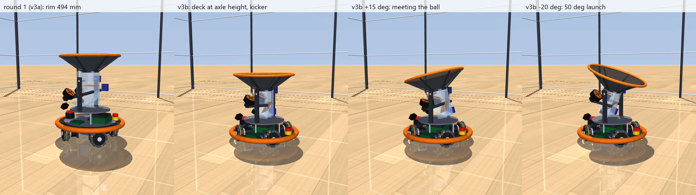

# v3: compact robot

A smaller, lower version of the v2 robot that explores four questions:

1. Do four omni wheels raise the acceleration limit?
2. Can the funnel and launcher be shorter if one tilt joint pitches the whole module into the ball's path, and also sets the launch elevation?
3. How far from the Jetson can the cameras go?
4. At the traction limit, can the robot tip over?

A second round (v3b, now the defaults) followed up:

5. Lower the deck into the plane of the wheel axles.
6. Replace the J-bend gravity feed with an active feed (the gate servo pushes the ball into the flywheels).
7. Does the robot ever have to yaw to shoot back?
8. How sensitive is catching to throws far from the baseline?

A third round added a stereo perception model and catching while moving (2 m/s, only with a 20 cm clear path, 5 × 4 m arena).

The answers, with numbers, are in [../../design.md](../../design.md) section 20. Everything here is **proposed**: v2 remains the design baseline until Fernando decides. Round 1 (v3a) is still available as `SimParams(deck_mode="high", feed="j_bend")`, and its study results are archived in `studies/results/v3a/`.



Video: [catch_demo.mp4](catch_demo.mp4) (40 s, toss → tilted catch → dump → tilt back to launch → return throw).

## What changed from v2

| | v2 | v3a (round 1) | v3b (round 2, defaults) |
| --- | --- | --- | --- |
| Base | Kiwi, 3 × AK40-10 at r 180 mm, deck Ø450 above the wheels | X drive, 4 × AK40-10 at r 150 mm, deck Ø370 above the wheels, front pair on a ±3° rocker | Same wheels; **deck in the axle plane**, notched for the wheels and motors; battery as a flat 7×21700 row under it |
| Wheels | Rigid contacts | Each hub on a vertical slide whose spring is the roller compliance (30 N/mm (est)); the slides read out wheel loads | Same |
| Base control | Acceleration-limited | Plus jerk limiting (40 m/s³); optional load-aware allocation | **Direction-aware limit** (3.0–4.5 m/s², `ACCEL_TABLE_V3B`) with a jerk-aware stopping plan |
| Catch module | Fixed; 35° cone 176 mm deep | Pitches on one tilt joint (−20° to +35°); 55° cone 86 mm deep | Same funnel; tilt −30° to +25° |
| Catching | Stop under the ball | Face the ball, tilt to 60% of its arrival angle, dump upright 30 ms after entry | Same, catch tilt capped at 15°, coast 0.2 s after the ball enters |
| Feed | Trapdoor + 145 mm gravity drop through a J | Trapdoor + 118 mm drop through a J | **Plunger**: the caught ball rests in the corner of an inclined floor; the old gate servo pushes it 50 mm up into the flywheels |
| Launcher | Fixed 52° | 40° in the module; 35–60° elevation | 30° in the module (under the funnel wall); 30–60° elevation; idle flywheels braked |
| Return throws | Open loop | Open loop | Range bias learned from logged landings |
| Gate / floor pad | 3 mm EVA, e 0.15 (est) | Low-resilience foam on the gate, e 0.05 (est) | Same, on the pocket floor |
| Cameras | Funnel rim | Payload-plate front | Same (lower with the plate) |
| Rim height | 600 mm | 494 mm | **387 mm** |
| Mass, CG height | 5.56 kg, 151 mm | 5.85 kg, 142 mm | **5.34 kg, 95 mm** |

## Run it

```powershell
$py = "$env:USERPROFILE\.venvs\omni-robot-sim\Scripts\python.exe"
& $py run.py                          # catch demo in the MuJoCo viewer
& $py run.py --headless -n 30         # 30 tosses: catch rate, arrival/tilt angles, return accuracy
& $py run.py --moving --perception model   # proposed adult mode: moving catches (2 m/s) + stereo perception model
& $py run.py --zone 0.6 --apex 0.5 0.5 --moving --perception model   # line drives landing 0.6 m away
& $py run.py --layout kiwi3           # v2's three-wheel layout on the compact base
& $py run.py --no-tilt                # module fixed upright (launcher stuck at its module angle)
& $py run.py --drive                  # omni-drive demo
& $py run.py --record catch_demo.mp4 -s 40
& $py launcher_bench.py               # calibrate over 4 tilts x 9 rpm (launcher_cal_kicker.json; j_bend: launcher_cal.json)
& $py render.py                       # renders/v3_poses.png
& $py -m pytest -q                    # 17 checks, ~10 s
& $py traction.py                     # quasi-static traction / tip model, 3 vs 4 wheels
cd studies
& $py wheel_count.py                  # 3 vs 4 wheels, panic stops, uneven floor (~5 min, 24 processes)
& $py funnel_tilt.py                  # funnel wall angle x alignment x dump (~1 min, parallel)
& $py camera_view.py                  # stereo visibility and cable run per camera mount (~1 min)
& $py toss_sweep.py                   # catch rate over thrower distance x apex x landing offset, 4 robots (~2 min)
& $py moving_rig.py                   # catching while moving; braking with the ball aboard (~1 min)
& $py catch_sweep.py                  # stop vs moving catch, perception model vs exact, 5 x 4 m arena (~15 min)
```

## Files

| File | What it is |
| --- | --- |
| `params.py` | Fitted parts, geometry, masses, limits. New: `layout` ("x4", "kiwi3"), roller compliance, `rocker_deg`, `wheel_z_offset`, `allocation`, the tilt joint, funnel and camera-mount options, `deck_mode` ("axle", "high"), `feed` ("kicker", "j_bend") with per-feed defaults |
| `traction.py` | Quasi-static N-wheel traction and tip model: spring or rocker load sharing, pseudo-inverse or load-aware force allocation. Also used by the robot for load-aware allocation |
| `omni_control.py` | N-wheel kinematics (least squares) and the jerk-limited, direction-aware base controller; its braking-curve goto can end at a speed (moving catch) |
| `perception.py` | Stereo ball perception model (field of view, occlusion, dropped frames, stereo noise, ego-pose error, latency) and the drag-aware Kalman filter with landing uncertainty |
| `intercept.py` | Moving-catch planner: slowest on-time end speed, clear-path safety gate |
| `robot_model.py` | MJCF builder: compliant wheels, rocker, notched axle-plane deck (convex pieces), tilting catch module with either feed (pivot height computed so the module clears the plate at every tilt; with the kicker, the throat is raised until the launch path clears the funnel's underside), camera mounts |
| `robot.py` | Firmware-facing robot: wheels, flywheels (braked when idle with the kicker), gate or plunger, tilt servo, wheel-load readout, 2-D launcher calibration (rpm × tilt) per feed |
| `catch_game.py` | Toss → plan (base pose, heading and tilt from the predicted arrival velocity) → catch → dump → aim (yaw + tilt for elevation) → launch once the flywheels have held speed 0.1 s and the base is still; learns the return-throw range bias; records yaw-to-aim |
| `launcher_bench.py`, `launcher_cal*.json` | Launcher calibration over tilts; also checks that the feed works at each tilt |
| `ball_flight.py`, `models.py`, `catalog.py`, `assets.py` | As v2 (`ball_flight` also returns the velocity at a crossing; the flywheel ESC model can brake) |
| `render.py`, `renders/` | Still renders: v3a next to v3b's three module poses |
| `studies/` | `wheel_count.py`, `funnel_tilt.py`, `camera_view.py`, `toss_sweep.py`, `moving_rig.py`, `catch_sweep.py`; results (JSON, PNG, logs) in `studies/results/`, round 1 in `studies/results/v3a/` |

## Modeling notes worth knowing

- **Four wheels are statically indeterminate.** Their load sharing depends on compliance and on floor or build errors of a fraction of a millimeter. That's why each hub sits on a sprung slide. The 30 N/mm roller stiffness is an estimate; measure it.
- **Slip on a 4-wheel base.** One wheel can slip while the other three keep the base on track, so the slip detector is the base's velocity error during the ramp, not the error at the end. That's also why plain speed loops get most of the benefit of load-aware allocation: the unloaded wheel slips a little and its share moves to the others.
- **Rocker.** A free rocker lets the body roll about 3°, so the studies allow 5° of body tilt for the rocker build before calling it tipping.
- **Panic stop.** All wheels are commanded to zero speed at once. The decelerations it reports include pitch kinematics; use the tilt angle and the mean deceleration.
- **Throat flaps** (`throat_flaps`) were tried as a one-way trap and rejected. A 6 m/s ball flings them open and they can't close before the rebound. Folded against a solid wall they jam the ball, and even recessed into wall windows they caught 0/75 in the funnel rig. The tilt "dump" does the job instead.
- **Kicker lessons** (each was a failure in the sim first):
  - A paddle hinged at the pocket corner wedge-jams the ball against the floor (the wedge half-angle drops below the friction angle); a plunger that stays perpendicular to the floor can't.
  - The launch line must be shallower than the funnel wall (30° vs 35° from horizontal), or the launched ball runs into the funnel's underside. The throat is raised to clear the 10 mm wall and the collar.
  - The plunger must still be pressing when the wheels take the ball. With the nip 70 mm away, a 0.4 m/s plunger let go first and exit speed scattered 3.6%; at 50 mm, 0.0%.
  - The pocket is open toward the nip, so idle flywheels must be braked (AM32 brake-on-stop), not coasting. A ball bouncing forward during a catch otherwise gets fired out.
  - Spin differs by feed (kicker ~2 rad/s, J ~10 rad/s at exit). MuJoCo's air model has Magnus lift and the throw planner doesn't, so each feed has its own range bias. The game learns it from logged landings, as the real robot will.
- **Direction-aware acceleration** needs a stopping plan to match. Planning the stop with the current direction's limit overshot when the base yawed into a weaker direction. Ignoring the jerk limit's acceleration reversal (up to 0.17 s) overshot too. `goto_step` plans with the table's worst value and subtracts the reversal distance.
- **Moving catch, third version.** The robot passes through the meeting point on time at the slowest possible end speed, using the same braking-curve controller with an end speed, replanned at 20 Hz. Two earlier versions lost to the plain stop controller:
  - *Chasing a virtual target that slides at the meeting velocity.* The target often started behind the robot, which waited for it and then couldn't catch it.
  - *Constant-acceleration guidance.* It arrives at twice the average speed, past the cap and with too little room to stop in the arena.
- **Teleporting the ball in a rig:** call `mj_forward` before reading sensors. Otherwise they report the old position for one step (the first moving rig dumped the funnel 30 ms early because of this).
- **Perception:** `GameConfig(perception="model")` uses `perception.py`. The default `"truth"` is the exact ball state after 0.25 s, kept so earlier results reproduce; it is more pessimistic about timing than the model. With perfect positioning (≤ 4.5 cm error), an upright 55° funnel also catches everything in the game. The tilt pays off for larger errors and steeper arrivals (`studies/funnel_tilt.py`), which real perception will produce.
