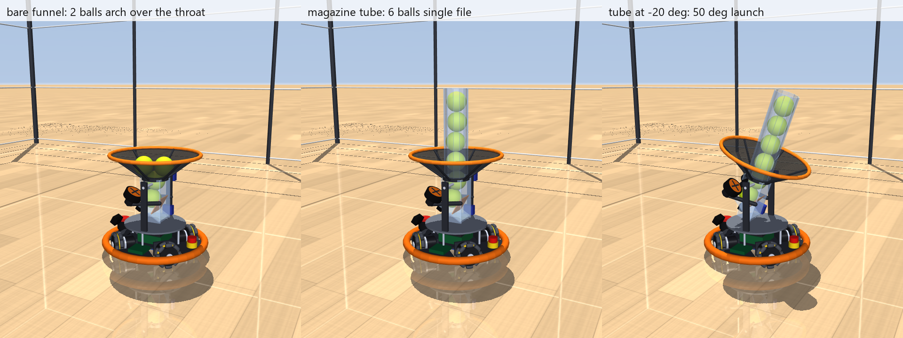

# v5: no limits, a detailed vision model, and a hopper

v5 is the v3b compact robot (4-wheel X base, axle-plane deck, tilting catch/launch module with the plunger feed) with three questions from Fernando. There is no v4.

1. **Remove every speed and safety limit.** What can the robot actually do, with only physics left (motors, battery, roller traction, tip-over, the BMS)?
2. **A more detailed camera / vision model.** Besides stereo, use color-blob detection and the ball's known size to range it. How sensitive is catching to the camera and pipeline choices?
3. **Multi-ball hopper.** Can the compact module hold several balls and shoot them one after another while the robot drives around?

The answers, with numbers, are in [../../design.md](../../design.md) section 21. Everything here is **proposed**. `SimParams(limits="firmware")` / `GameConfig(limits="firmware")` restore v3b's limits, so every v3 result can be rerun here.



## What changed from v3

| | v3b | v5 |
| --- | --- | --- |
| Speed cap | 1.4 m/s (2 m/s adult mode) | None: the wheel-speed ceiling follows the live battery voltage (back-EMF). 3.44 m/s along the X's sides, 2.45 m/s on a diagonal (full charge) |
| Acceleration | 85% of the slip-free table, capped at 4.5 m/s² | 100% of the re-measured slip-free table, 3.4–5.0 m/s², no cap |
| Jerk, yaw | 40 m/s³; 4 rad/s, 15 rad/s² | No jerk limit; yaw motor-limited (~16 rad/s), 100 rad/s² |
| Moving-catch gate | 20 cm clear path, 3 m/s² braking with the ball | 0 cm (only "don't hit the netting or the thrower"), braking with the ball at the traction limit |
| Perception | `"truth"` or `"model"` (Gaussian noise on the true position) | `"vision"`: per-pixel blob detector, stereo + known-size ranging, image-space EKF (`vision.py`) |
| Balls | One | `n_balls` extra balls; `hopper="tube"` (magazine) or `"sweeper"`; `shoot_game.py` |
| Velocity requests | Bypassed the speed cap | Capped too (a v3 gap, fixed) |

## Run it

```powershell
$py = "$env:USERPROFILE\.venvs\omni-robot-sim\Scripts\python.exe"
& $py run.py                                    # catch demo, physics limits
& $py run.py --moving --perception vision       # moving catches, detailed vision model
& $py run.py --limits firmware                  # v3b's limits
& $py run.py --shoot move                       # hopper: 6 balls in the magazine tube, shoot targets while driving
& $py run.py --headless --shoot stop            # the same, standing, no graphics
& $py render.py                                 # renders/v5_hopper.png
& $py render_videos.py                          # videos/: design, good catches, bad catches, hopper (~4 min);
                                                # the catch clips replay real tosses from studies/catch_sweep.py
& $py -m pytest -q                              # 25 checks, ~20 s
cd studies
& $py envelope.py          # A-F: traction, top speed, moves, yaw, hard stops, braking with the ball (~4 min)
& $py vision_sweep.py      # detector precision + 39 camera/pipeline variants x 144 tosses (~12 min); "spin" reruns the spin rows
& $py catch_sweep.py       # firmware vs physics limits, with the vision model, 216 tosses each (~4 min)
& $py hopper_rig.py        # capacity, burst fire, feed options (~3 min)
& $py launcher_max.py      # 3,000-20,000 rpm at a 0.1 ms step (~3 min)
& $py shoot_sweep.py       # hopper shooting standing vs moving, 8 layouts (~3 min)
& $py camera_estimate.py   # researched OV9782-on-Orin pipelines (best / expected / pessimistic), 216 tosses each (~3 min)
& $py thrower_distance.py  # 1.5-6 m throwers, fixed offsets and human-like scatter, 10 x 6 m arena (~3 min)
& $py base_types.py        # X4 vs kiwi / mecanum / swerve / diff-drive reach model, + catch game (~3 min); "reach" = model only
```

## Files

| File | What it is |
| --- | --- |
| `params.py` | As v3, plus `limits` ("physics" / "firmware", `LIMIT_PROFILES`), `ACCEL_TABLE_PHYS`, `camera_baseline`, `n_balls`, `hopper` (+ tube height, sweeper), `pocket_detent` |
| `omni_control.py` | `top_speed()` per direction from the wheel-speed ceiling, `brake_margin`, the speed cap on velocity requests |
| `robot.py` | Live wheel-speed ceiling from the bus voltage; sweeper actuator |
| `vision.py` | The detailed camera model (see below) |
| `catch_game.py` | `GameConfig.limits` profile, `perception="vision"`, `toss_spin`, planner uses the direction's top speed |
| `robot_model.py` | Extra balls (same contact pairs), magazine tube, sweeper arm, pocket detent; funnel net in geom group 2 (seen through by the vision model) |
| `shoot_game.py` | Hopper mode: targets, stop-and-shoot or shoot on the move (launch solved in the world frame with the base's velocity and yaw rate), range-bias learning |
| `studies/` | `envelope.py`, `vision_sweep.py`, `catch_sweep.py` (v5 robots), `hopper_rig.py`, `launcher_max.py`, `shoot_sweep.py`, `camera_estimate.py`, `thrower_distance.py`, `base_types.py` (design.md 21.4); v3's studies are kept and run on the v5 defaults |

## The vision model (`vision.py`)

Each camera frame, for each camera, with no rendering:

- **Image:** the ball is rasterized on the 1280×800 pixel grid of a pinhole camera at the real camera pose. A pixel counts as ball-colored if the ball covers it for half the exposure (motion blur from the velocity relative to the moving camera). Rolling shutter is optional (each row has its own time). Per-pixel threshold noise sits at the edge (0.4 px).
- **Occlusion:** one ray per blob pixel (`mj_multiRay`, subsampled for big blobs) against the robot, the thrower and the arena; the funnel net lets half the ball show through (est).
- **Detector:** a blob needs 8 pixels; it reports its centroid and the minor-axis radius from its second moments (motion blur stretches only the major axis). Blobs touching the image border are dropped. `detector="circle"` refits partly hidden blobs to their own edge. Random drops and optional clutter blobs.
- **Errors the estimator doesn't know:** calibration rotation (0.02°), translation and focal length, stereo sync offset, the real ball size vs 74 mm (1%), odometry drift since release (1%/m, 0.3°/m) and per-frame pose noise (1 mm).
- **Estimator:** an EKF whose measurements are pixels (u, v and the blob radius per camera), using the exact projection of a sphere. Stereo, size ranging or both fall out of the same update, whichever cameras see the ball. Each camera is gated (Mahalanobis); a track starts from two consistent frames and restarts after 6 rejected frames. Measurements arrive after 50 ± 15 ms, stamped with their capture time.

All noise figures are (est) until the OV9782 pair is on the bench.

## Modeling notes worth knowing

- **v3's "9.9 m/s² forward" was the test, not the robot.** A 1 m/s ramp at 40 m/s³ can't exceed √40 ≈ 6.3 m/s². Ramping to 2 m/s at 400 m/s³, forward is 5.0 m/s² (worst direction 3.4).
- **Hopper bridging.** In the bare funnel two balls arch over the Ø84 throat (narrower than two 74 mm balls) and stop feeding. It happens with a slick net too, so it's geometry, not friction. Tilt flicks and base shimmies only partly break it.
- **Open pocket + running flywheels.** v3b brakes idle flywheels because a bouncing ball gets fired. In hopper mode the wheels run between shots, and hard turns and braking still roll the waiting ball in. `ShootConfig.brake_while_turning` and the settle hold help, but don't cure it (~19% misfeeds standing). A 4–6 mm retaining ridge (`pocket_detent`) was tried and is worse: at 60° launch the next ball doesn't seat behind it.
- **The filter is conservative** (actual landing error ~0.12–0.2× its own σ). That delays moving-catch commitment. Lower process noise helps spin-free tosses (93% vs 89%) but is overconfident with 10 rad/s of spin, so the default stays 0.5 m/s².
- **Above ~10,000 rpm** the flywheel shots need a 0.1 ms step and are still erratic (non-monotonic exit speed). Treat `launcher_max.py` above 10k as indicative, not calibrated.
