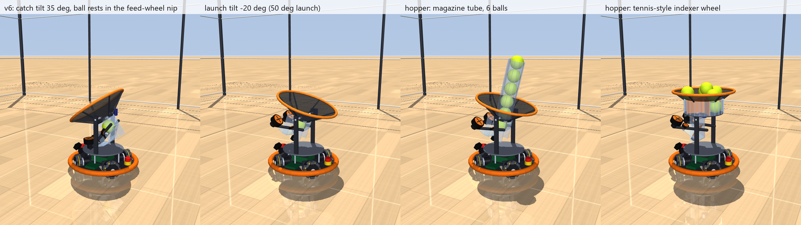

# v6: shallow throws from 6-7 m

v6 is the v5 robot (v3b compact: X4 omni base, axle-plane deck, tilting catch/launch module) with Fernando's questions for long throws:

1. **Catch more of the shallow throws from 6-7 m away.** v5 caught 57% of them (firmware adult mode, expected cameras). This is where the tilting funnel should pay off.
2. **No ball misfires.** The trigger must actively pass the ball to the launcher, not rely on gravity or an open pocket.
3. **A funnel and launcher that can fire several balls.** The bare funnel jams after 2 balls in v5. Tennis-ball machines were the suggested model.

**Round 3** (design.md section 23) makes the guesses real or ranged: datasheet models of real feed motors (a direct-drive GM3506 gimbal motor under FOC holds the ball with current, no worm), viscoelastic ball and tire contacts, randomized worlds (catch-rate ranges and which guesses matter), floors with rolling resistance, varying friction, thresholds and carpet, and a motor study of every actuator.

The baseline is unchanged: the X4 omni base, the expected camera pipeline (Argus, MCU-triggered stereo pair, printed bracket recalibrated per session: `camera_estimate.EXPECTED`) and 6 rad/s of ball spin. The answers and numbers are in [../../design.md](../../design.md) section 22. Everything here is **proposed**.



## What changed from v5

| | v5 | v6 (defaults) |
| --- | --- | --- |
| Trigger / feed | Plunger pushes the ball out of an open pocket; idle flywheels must brake | **Chute feed** (`feed="chute"`, round 2, the default): the pocket floor slopes down into the nip of two stopped, worm-driven TPU feed wheels at every tilt, so any ball from 72 to 76 mm rests against both. Turning at 1.6 m/s, they push it through a smooth J-bend up into the flywheels. One ball per trigger: a second beam at the feed-wheel exit stops them once the ball has passed. Round 1's **roller feed** (`feed="roller"`: feed wheels ahead of a back stop, 0.8 m/s) only fed balls within ±0.5 mm of 74 |
| Pocket | Padded floor, bare PETG tube walls (bounce at the ball's 0.45) | **Padded walls too** (`pocket_pad=True`) |
| Catch tilt cap | 15 deg (the kicker's floor tipped forward above 30) | **35 deg** (`GameConfig.max_catch_tilt_deg`) |
| Flywheels between shots | Braked | May coast or keep running (the pocket is closed) |
| Track start (vision) | 5 cm / 2 m/s initial covariance | **The triangulation's real covariance** (`VisionConfig.honest_init`): depth error grows with range^2 |
| Hopper options | tube, sweeper | + `"stirrer"` (rejected), `"indexer"` (tennis-machine wheel, exploration) |
| Planner option | | `GameConfig.landing_prior` (fuse the landing estimate with "aimed at me"; off by default, within noise) |

| Feed motors (round 3) | | **`feed_motor="GM3506"`**: a gimbal motor + AS5048A encoder on a SimpleFOC driver (12 V rail), speed loop to feed, position hold with a current limit when stopped (`models.FeedDrive`, `catalog.FEED_MOTORS`). `"ideal"` = rounds 1-2's stiff velocity loop |
| Contacts (round 3) | Fixed damping ratios (restitution the same at every speed) | **`contact_model="viscoelastic"`**: Hunt-Crossley damping on every ball contact, fitted to the restitution at 1 and 7 m/s (`Ball.e_slow/e_fast`, `pad_e_slow/fast`); standard-linear-solid flywheel and feed-wheel squeeze slides (`squeeze_dyn_ratio`, `squeeze_relax`); `contact_model.py`. Its launcher table is `launcher_cal_chute_ve.json` |
| Floor (round 3) | Free-rolling wheels, one friction | **`wheel_crr=0.02`** rolling resistance as load-dependent joint drag; optional `floor_mu_field`, `floor_patches`, `floor_features` (`floor.Threshold`, `floor.Carpet`); `floor.py` |

Other new parameters: `funnel="net"` (slack cloth panels on lumped spring-dampers, rejected), `feed_seat_time` (reverse pulse before feeding, rejected), `GameConfig.fire_settle`, `pocket_floor_mu`, `indexer_*`. `SimParams(feed="kicker", pocket_pad=False)` plus `GameConfig(max_catch_tilt_deg=15)` and `VisionConfig(honest_init=False)` give back the v5 robot.

## Run it

```powershell
$py = "$env:USERPROFILE\.venvs\omni-robot-sim\Scripts\python.exe"
& $py watch_shallow.py             # 3D viewer: the 6-7 m shallow throws (--help for seeds, scenarios, video, slow motion)
& $py watch_floor.py               # 3D viewer: thresholds, rug edges, the home floor, the two flips (--list, --help)
& $py run.py                       # older 3 m catch demo with the v6 module (not the 6-7 m scenario)
& $py launcher_bench.py            # recalibrate launcher_cal_roller.json
& $py render.py                    # renders/v6_module.png
& $py -m pytest -q                 # 43 checks, ~45 s
cd studies
& $py shallow_sweep.py             # 6-7 m shallow throws, 216 per robot, v5 -> v6 step by step (~3 min)
& $py catch_rig.py                 # static rig: 6.5 / 8 m/s arrivals 30-60 deg from vertical; "trace NAME" prints misses
& $py return_throws.py             # return throws to a thrower 6.5 m away, roller vs plunger
& $py hopper_rig.py                # multi-ball: tube, bare funnel, stirrer, vibrator, indexer
& $py shoot_sweep.py               # hopper shooting at targets, standing and on the move, misfire count
& $py thrower_distance.py          # v5's 1.5-6 m study on the v6 robot (close throws must not get worse)
& $py feed_handoff.py              # roller pocket: where the feed wheels and the flywheels grip the ball (travel, mm)
& $py feed_tolerance.py            # roller vs chute: 72-76 mm balls at every launch tilt (exit, elevation, spin, grip gap)
& $py indoor.py                    # 8 ft / 9 ft ceiling: catches and ceiling-aware return throws from 6-7 m (~2 min)
# round 3
& $py feed_motor.py                # feed-motor candidates: feed every ball size, hold against fast catches, magazine bursts (~1 min)
& $py randomized.py                # 192 randomized worlds x 36 shallow throws + 96 return worlds; ranges and sensitivities (~40 min)
& $py randomized.py reanalyze      # recompute the summaries from the saved rows
& $py floor_wheels.py              # roller model on X4, thresholds / carpet edges, catch game on real floors
& $py motor_study.py               # actuator duty in play, drive alternatives (M2006, 37D, GIM6010, kiwi; low battery, 6S), flywheels, tilt
& $py actuator_choice.py           # design.md 24: reads ../../../database, ranks every class by cost, writes results/actuator_choice.md
```
Recalibrate the launcher after a contact-model change: `& $py launcher_bench.py` writes `launcher_cal_chute_ve.json` (viscoelastic) or `launcher_cal_chute.json` (elastic).

## Files (new or changed from v5)

| File | What changed |
| --- | --- |
| `params.py` | `feed="roller"` and its feed-wheel fields, `pocket_pad`, `funnel="net"` fields, `hopper="stirrer"/"indexer"` fields, `feed_pulse`, `funnel_catch_radius` |
| `robot_model.py` | Feed wheels on sprung mounts with stiff stops, back stop, padded named pocket walls, compliant net panels, stirrer, the indexer (wheel, plate with exit hole, outer wall, hood) and the pocket tube moved under its exit |
| `robot.py` | Feed-wheel trigger (one ball per trigger, `trigger_done()`), indexer firmware (`want_ball`, dwell, jam back-off, `index_empty`), `ball_aboard()` |
| `vision.py` | `honest_init`: track covariance from the stereo geometry |
| `catch_game.py` | `landing_prior`, `fire_settle`, `pred_err` / `ctrl_err` diagnostics in `TossResult` |
| `shoot_game.py` | Misfire count; launch detection relative to the robot (v5's absolute-speed test counted magazine balls as launched at 2 m/s) |
| `studies/` | New: `shallow_sweep.py`, `catch_rig.py`, `return_throws.py`. Updated: `hopper_rig.py`, `shoot_sweep.py`. Kept from v5: `camera_estimate.py`, `thrower_distance.py`, `common.py` |
| round 3: `catalog.py`, `models.py` | `FeedMotor` (five datasheet points -> R, kt, ke, drag) and `FEED_MOTORS`; `FeedDrive` (speed loop, current-limited position hold, worm option); drive candidates `M2006`, `Pololu-37D-19` |
| round 3: `contact_model.py` | Hunt-Crossley ball contacts (fitted in MuJoCo by drop tests, per-step solref), Maxwell arms on the squeeze slides |
| round 3: `floor.py` | `RollingResistance`, `FloorFriction` (field + patches), `Threshold` / `Carpet` meshes, belly collision geoms |
| round 3: `randomize.py` | The 17 guessed parameters and their ranges (est), Latin-hypercube worlds, `apply()` to a built model |
| round 3: `studies/` | `feed_motor.py`, `randomized.py`, `floor_wheels.py`, `motor_study.py`; round-1/2 rows of the older studies are pinned to `feed_motor="ideal"`, `contact_model="elastic"` so they reproduce |

## Modeling notes worth knowing

- **MuJoCo joint limits are soft.** The feed-wheel mounts are preloaded onto a stop; with the default limit solref, the 6 N preload pushed them 3-4 mm past it. The wheels then caught a dropping ball above the pocket floor, and return throws scattered by half a metre. The limit is now stiff (`solreflimit 0.001`).
- **Bounce-outs of flat throws came from the hard pocket walls, not the net.** A 7-8 m/s ball 40-50 deg from vertical goes through the throat almost at full speed and hits the tube's back and side walls. Padding them and tilting further (the roller feed allows it) took the rig from 80% to 99%.
- **The slack-net model is not trustworthy.** Whole panels slide outward on spring-dampers, including at the throat collar, where real cloth is sewn tight. The ball then catches on the pocket wall's top edge. It scored worse (92%), but a real cloth model (MuJoCo flex) would be needed to judge slack mesh.
- **Domes over a fixed throat are very stable in the sim** (ideal contacts, 12 mm net rolling resistance (est)). A stirrer, a vibrator and a slick net each failed at some launch tilt. The tennis-style indexer avoids the dome, but it needs low rolling resistance on the cone (4 mm) to empty the hopper, and it catches only 20% (balls land on the wheel top and bounce off; a pocket only accepts a ball centred within about ±5 mm).
- **The indexer must dwell over the exit** (~0.4 s): stepping on while a ball is still falling shears it in the exit hole and jams the wheel.
- **The sim launcher is very repeatable**, so return-throw accuracy (3 cm at 6.5 m) is an upper bound: real feed and flywheel scatter will add to it.
- **Feed handoff (`feed_handoff.py`).** The feed wheels push the ball for its first ~42 mm of travel, and the flywheels grab it at ~52 mm. In between, nothing drives the ball: it coasts ~10 mm uphill along the launch line. They never grip together, so the self-locking worm is never back-driven by the flywheels. The gap shrinks with ball size (5 mm for a 76 mm ball). A ball 2 mm under nominal isn't touched at all and doesn't feed. Pinching the resting ball instead (`feed_fit_diameter`) fixes feeding, but a dropping ball then perches about 15 mm up on the tire edges. Either way the fixed side-wheel pocket needs a ball held to about ±0.5 mm, or a redesign (design.md 22.4).
- **The chute pocket (round 2) fixes ball size** (`feed_tolerance.py`). Gravity presses any ball into the stopped feed wheels' nip, so nothing has to pinch it at rest. Lessons from building it:
  - the ball must coast up the J into the flywheels, so 0.8 m/s stalled at the 60° launch and the feed runs at 1.6 m/s;
  - the J and launch run must be slick (μ 0.25). On the catch pad a ball sliding round the bend lost 1 m/s and stalled, and the next fed ball pushed it into the flywheels (a "double feed");
  - the firmware stops the feed wheels by a beam at their exit, not by a time or distance after the pocket beam, which can't fit every ball size.
- **Resizing a ball after `build_model`** needs `geom_rbound` too, or contacts of a bigger ball are missed.
- **Indoors (`indoor.py`, `GameConfig.ceiling`, `SimParams.ceiling_height`).** The return planner flattens the lob until its apex clears the ceiling by 0.25 m.
- **Round 3 lessons:**
  - *Don't model rolling resistance as MuJoCo rolling friction (condim 6).* In the elliptic cone, a wheel that always rolls keeps its rolling torque at the limit, which takes away its sliding grip: the base ran 2-7% slower than its wheels said. `floor.RollingResistance` puts Crr N R on the drive joint and Crr N r on the roller freedom instead (load and surface read every step).
  - *MuJoCo's rolling friction is a torque.* On an explicit 16 mm roller the same arm gives ~6x the force it gives on the 96 mm sphere wheel.
  - *v6's "e = 0.45" contact really bounced at 0.47-0.52,* rising with speed (the solver's impedance and gravity during the contact). The Hunt-Crossley fit is done in MuJoCo itself (`contact_model.fit`), so its drop tests hit the targets.
  - *Per-step solref changes need one step of lag:* the compression is read from the previous step's contacts, which is 0.5 ms in a ~12 ms foam contact. Pairs keep their own laws, and default contacts use the ball geom's solref.
  - *Cluster the bootstrap by world* in randomized studies. Resampling throws (36 per world share one draw) made dropped frames look helpful at 4.6 sigma; a direct A/B shows no effect at the expected calibration. The residual effect is an interaction: the filter treats a fixed calibration bias as white noise, so with a poorly calibrated pair, fewer frames make it less overconfident.
  - *Wall crashes look like wheel-model faults:* a 2.5 s cruise in the 5 x 4 m arena hits the netting (it collides with the deck). Cruise tests use a 14 m arena.
