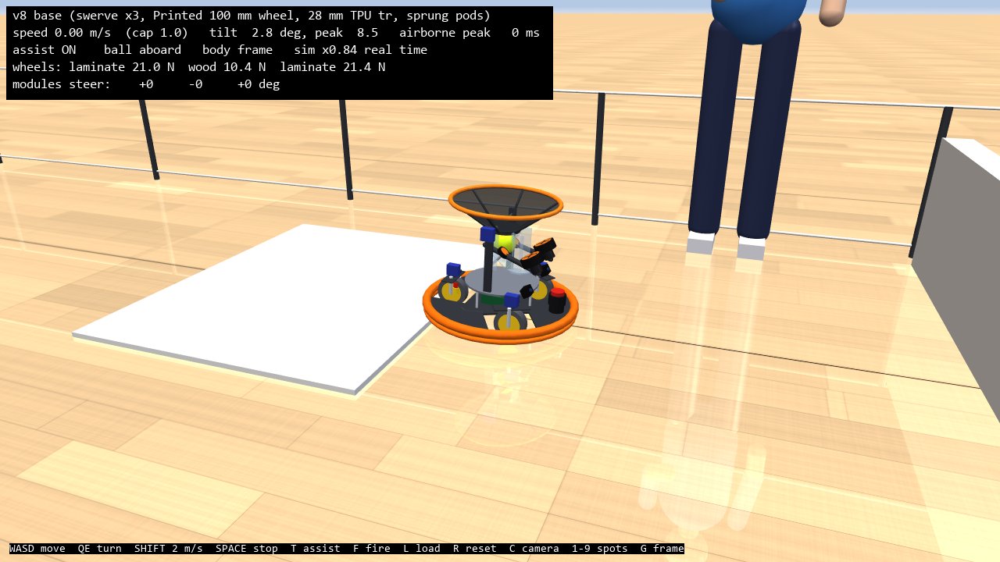

# v8: a three-module swerve base

v8 is v7 (the v6 round-3 catch robot, with v7's home-floor work) plus a **swerve** base option. Each module is a steered, driven wheel with an ordinary tyre. Fernando's question: with three modules to keep the cost low, is a swerve better on home floors, and does it still make most catches? The answers and numbers are in [../../design.md](../../design.md) section 26. Everything here is **proposed**.

**Answer (design.md 26.4):**

- **Terrain:** better. A tyre rolls straight at every edge, so the swerve crosses every house transition plus 16 and 20 mm rugs at every direction, with 2 cm odometry error against 11 cm for v7. But with 100 mm wheels its belly sits 21 mm up.
- **Catching:** slightly fewer. It catches 90.3% flat and 87.5% at home, against v7's 91.0 / 90.0% on the same DM-2325 drive. The triangle rocks at the catch, and it needs modules 170 mm out (a 47 cm deck) to stay upright.
- **Cost:** the same drive-set cost (~$420 vs ~$444), and 0.7 kg lighter.
- **Recommendation:** keep v7 for the catch robot; revisit the swerve for plush or 16-20 mm rugs, or an arm.

`SimParams()` still builds the v6 robot. The v7 X4 is `house.BASES["v7"]` (big-roller omni wheels on pods, DM-2325 drive); the swerve is `house.BASES["v8"]` and the `"swerve ..."` configs in `studies/home_floor.py`.



## The model

| | v7 X4 omni | v8 swerve (`layout="swerve3"` or `"swerve4"`) |
| --- | --- | --- |
| Wheels | 127 mm printed omni, 2 x 5 rollers of 36 mm | Printed hub with a TPU tread, 76 / 100 / 127 mm (`Printed-*-tire`, est). One cylinder per wheel (`wheel_model="tire"`) |
| Steering | none | A vertical hinge over each wheel's contact (`steer{i}`), driven by a serial-bus servo: slew-limited to its speed, torque-limited to its stall (`catalog.STEER_SERVOS`: ST3215-HS, ST3215, ST3025, STS3250, from `database/servos.csv`). `steer_gear` for a printed reduction; ±180° range (the drive cable loops, no slip ring) |
| Drive | DM-2325 on each wheel | DM-2325 standing beside each wheel (belt or bevel 1:1, est); it sets the module's swept circle (`module_sweep`), and the deck and bumper grow to cover it |
| Suspension | sprung pods (15 mm, 3000 N/m, ζ 0.6) | the same pods, retuned for three wheels (`tune_swerve`: 20 mm, 3000 N/m, ζ 0.6, 6 N) |
| Kinematics | `OmniKinematics` | `SwerveKinematics`: each module points along v + ω × p; it takes the nearer of the two headings (or the reverse with the wheel reversed) inside its range; below `steer_hold_speed` it keeps its heading and drives only the part of its velocity along that heading (no hunting while settling); odometry by least squares at the measured angles |
| Firmware | the X4's acceleration table (85% of its slip limit, cap 4.5) | a table from this base's own limits: `swerve_accel_frac` × min(quasi-static tip-over, 0.8 μ g), cap `swerve_accel_cap`. While a module turns, its wheel speed is scaled by cos(steer error) (`steer_cos_scale`) |
| Terrain assist | aligns for square edges above 0.7 × the roller radius | never aligns (a tyre always rolls straight at the edge); the speed caps still apply |

## Run it

```powershell
$py = "$env:USERPROFILE\.venvs\omni-robot-sim\Scripts\python.exe"
& $py house.py                     # drive the swerve through the house (keyboard, gamepad, flight stick; --base v7 / v6)
& $py -m pytest -q                 # inherited checks + v8's
cd studies
& $py home_floor.py A "swerve3 100" "v7 on DM-2325"     # crossings
& $py home_floor.py S              # steering: moves, reversals, panic stops, steering torque
& $py home_floor.py B "swerve3 v2, flat" ...             # catch games (tags in GAME_ROWS)
& $py home_floor.py C              # costs, including the whole drive set
& $py home_floor.py tune_swerve    # pod grid for three modules
```

## Files (new or changed from v7)

| File | What changed |
| --- | --- |
| `catalog.py` | Tyre wheels (`kind="tire"`), `SteerServo` and `STEER_SERVOS` |
| `params.py` | `swerve3` / `swerve4` layouts, `is_swerve`, `module_sweep`, steering and module fields, `swerve_accel_frac` / `_cap`, `steer_hold_speed` |
| `omni_control.py` | `SwerveKinematics`; `BaseController.top_speed` asks the kinematics for its wheel-speed factor |
| `robot_model.py` | `_module()`: steering hinge, sprung carrier with the drive motor, tyred hub; steering actuators and angle sensors; the deck grows over the modules |
| `robot.py` | Steering servos, cos-scaled drive, the swerve acceleration table, no edge alignment for tyres |
| `house.py` | `BASES["v8"]`, steering angles on the HUD |
| `studies/home_floor.py` | Swerve configs, part S (moves, reversals, panic stops, steering torque), `tune_swerve`, drive-set cost |
| `test_v8.py` | v7's checks + swerve kinematics, driving, the 16 mm rug at 45°, the house |
