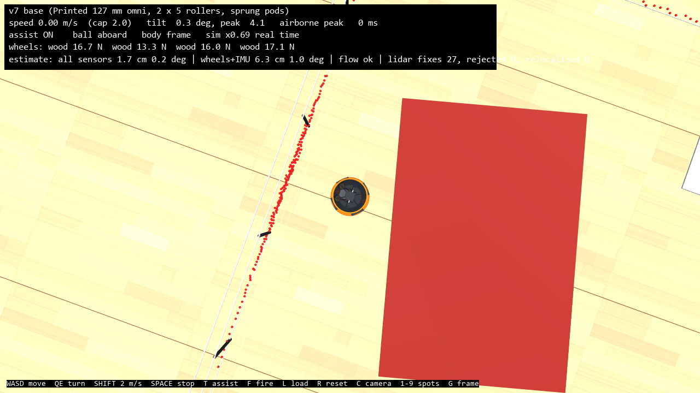

# v9: sensors and localization

v9 is v8 (v7's home-floor X4, the swerve option, the drivable house) plus models of the sensors the real robot will carry, and a fused estimate of where it is. It is step 1 of the move to a ROS-like simulation: the physics stays in MuJoCo; step 2 bridges these sensors to ROS 2 (`slam_toolbox`, `robot_localization`, Nav2) in WSL2. The answers and numbers are in [../../design.md](../../design.md) section 27. Everything here is **proposed**.



**Results in one place:**

- **With lidar:** every base knows where it is to about 1.2 cm median (under 3 cm at the 95th percentile, 0.5°) through the whole house at up to 2 m/s.
- **Without lidar:** drift is 0.5-1% of distance.
- **During a catch:** the robot's own motion over 1 s is known to 13-20 mm (95%) with lidar, against 42-65 mm without.
- **For an arm:** on its fused estimate the omni base holds 1 mm and makes 5-20 mm moves to about 1 mm. The arm limit is tipping (11-16 N at 35-50 cm in the worst direction).
- **The optical-flow sensor:** blind above ~1.1 m/s and over rugs.

## Sensors (`sensors.py`)

| Sensor | Part and datasheet values | Modelled |
| --- | --- | --- |
| IMU | ICM-42688-P: gyro 2.8 mdps/√Hz, accelerometer 70 µg/√Hz | 1 kHz, residual bias + random walk (est), gravity leaking in when the base tilts |
| Wheels | drive encoders | 1 kHz body twist from the kinematics; 1% radius error (est); a slip flag from the wheels' disagreement |
| Flow | PAA5100JE: 15-35 mm, ~1.14 m/s at 25 mm, 42° | 100 Hz; no reading out of range or too fast; scale error with height unless `flow_tof` |
| Lidar | RPLIDAR C1: 5 kHz, 10 Hz, 0.72°, 0.05-12 m, ±30 mm | ray-cast one sample at a time (skewed scans), the robot's own returns masked, 3% dropouts (est) |

`SensorConfig` holds every value; `Sensors(robot).step()` returns what arrived in that physics step.

## Estimator (`estimator.py`)

- `EKF`: x, y, yaw, body velocity, gyro bias. It predicts with the IMU and corrects with wheels, flow and lidar pose fixes (Mahalanobis gates).
- `Map2D` and `ScanMatcher`: a likelihood field of the static scene at the scan height; scans are de-skewed with the filter's history and fitted by Gauss-Newton. Poor fits are skipped, and a coarse search re-localizes after five rejections in a row.
- `Localizer`: several sensor combinations side by side on the same readings (shadow mode), with errors against the truth.

## Run it

```powershell
$py = "$env:USERPROFILE\.venvs\omni-robot-sim\Scripts\python.exe"
& $py house.py --base v7 --sensors --camera top   # drive with the fused estimate live (the scan drawn where the robot thinks it is)
& $py -m pytest -q                                 # inherited checks + v9's
cd studies
& $py localization.py              # T: house tour, C: catch game in shadow, P: positioning for an arm (~15 min)
& $py localization.py report
```

## Files (new or changed from v8)

| File | What changed |
| --- | --- |
| `sensors.py` | new: IMU, wheels, flow, lidar models |
| `estimator.py` | new: EKF, map, scan matcher, Localizer |
| `robot_model.py` | a `lidar` site at the scan plane; the lidar housing in geom group 2 (its rays skip it) |
| `house.py` | `--sensors` (live fused estimate, scan dots, estimate errors on the HUD), `--camera` |
| `studies/localization.py` | new: parts T, C, P and the tip-over forces |
| `test_v9.py` | v8's checks + IMU noise, lidar scan, flow limits, scan matcher, fused estimate through a wall push |
